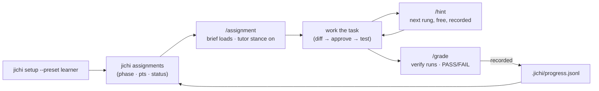
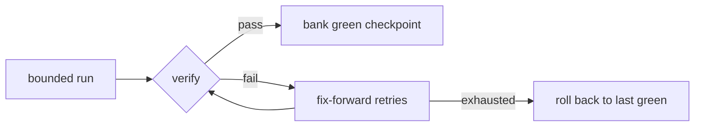
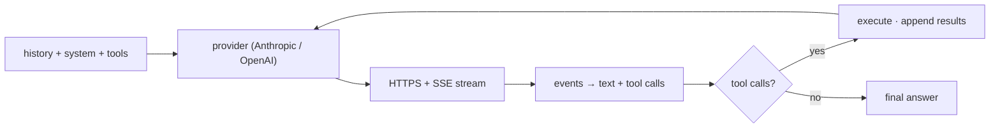

# Changelog

All notable, **user-visible** changes to jichi, newest first — so nobody has
to parse the git history to learn what changed. The format loosely follows
[Keep a Changelog](https://keepachangelog.com/); versions follow
[Semantic Versioning](https://semver.org/), pre-1.0: MINOR bumps mark a
completed capability cluster or a breaking change (config keys, CLI,
wire/JSONL contracts), PATCH bumps mark fixes. **The first public release is
pre-1.0** (decided 2026-08-19) — this paragraph used to reserve 1.0.0 for it,
but 1.0 is a claim about interface stability and the honest time to make it is
after the interfaces have met someone else's machine. What a first release
promises is [`docs/EMBEDDING.md`](docs/EMBEDDING.md)'s four stability tiers.

> **Honesty note.** Versions **0.1.0–0.8.0 are retrospective labels**: the
> project grew by milestones (M1–M177, see [`docs/ROADMAP.md`](docs/ROADMAP.md)),
> not tagged releases, and these bands were named after the fact so this
> document has a spine. **0.9.0 is the first version stamped while it was
> current.** For engineering depth per milestone, read the ROADMAP; for the
> project retrospective with metrics, read
> [`docs/PROJECT_TIMELINE.md`](docs/PROJECT_TIMELINE.md).

The version lives in one place — `include/jc_version.h` — and is printed by
`jichi --version`, `jichi-convert --version`, the top of `jichi doctor`, and
the `describe` interface contract.

## [0.13.0] — 2026-11-05 — the hardening wave: redirect and multipart fences, validated session ids, and 32-bit large files
M1143 (SV:0850, run 0186; corrected SV:0947 + SV:0954, run 0188; SV:1147, run 0193): the release record is corrected before the 0.13.0 cut -- the four public pages that stated a present-tense release claim (README's version line and `make ci` stamp, CHATBOT's 'latest release' clause, the install page's sample `--version` output) now state the version this tree reads, 0.13.0, true in both trees; the unit-suite build list in the README's `make ci` stamp is corrected to the nine the gate runs, and gateway attributions are removed per the operator's rule of 2026-11-02 (eight places, plus four more sites of the same class in the gateway-findings header, the GATEWAY_ADMIN introduction, a snapshot_lint comment and the public-snapshot plan's not-shipped table); docs only, no code, no user-visible behaviour change. The 0.13.0 snapshot is cut from the commit carrying this record.
M1142 (SV:0419, run 0167): the retry gate no longer retries an in-stream context-overflow error -- M1125's transient arm (a provider error arriving inside an HTTP 200 stream) also matched M909's in-stream over-context shape: the LM Studio message is known only to `jc_text_is_context_overflow`, not to `jc_http_body_ctx_overflow`, so `ctx_overflow` stayed 0 and the deterministic error was re-sent (measured with `maxRetries` 3: 4 model calls, 3 retries). The in-stream M909 reclassification now marks overflow when either classifier matches, and the retry gate checks the flag (stale-flag safe: reset in the run preamble; a call that sets it ends the run). Red-first `stream_error` leg 7 (4 requests / 3 retry rows before, 1 request after); M1142-b leg 8 pins the jc_http-only arm of the OR (teeth probed red). `stream_error` 8/8, `stream_cut_retry` 7/7 (the M1125 engine-error cut still retries), gate 37482/0; the independent review's M1125 WRONG verdict is resolved and the 0.13.0 cut waits on the BATCH 12b landing.
M1140 (D-10, run 0158): 32-bit builds get large-file support and a failed directory listing says so -- the build now carries `-D_FILE_OFFSET_BITS=64` behind a capability probe, so a file over 2 GiB is no longer reported as missing (`stat`/`fopen` used to fail `EOVERFLOW`), and `jc_list_dir` now reports a mid-listing `readdir` failure as an error instead of returning a short listing with success. The 64-bit `time_t` and the `long`-typed size interface remain the separate E-09 card; gate 37482/0, the 32-bit stage 37482/0.
M1139 (D-07, run 0156/0157): the session store validates the id before it becomes a path -- the editor protocol's `session/load` used to hand the client's `sessionId` straight into `~/.jichi.d/sessions/<id>.json`, where a traversal id loaded a foreign `.json` as a conversation (and the next save would overwrite it), and `jc_session_delete` could remove any file. `jc_session_load_by_id` and `jc_session_delete` now refuse any id outside the command line's existing `[A-Za-z0-9_-]` gate with `JC_ERR_INVALID` before touching the disk; a malformed `sessionId` gets the protocol's "unknown session" refusal. Plain (jichi-created, UUID) ids are unchanged. Unit teeth in the session suite witness the actual destruction (fixture read in, fixture removed) on the unfixed tree; gate 37482/0.
M1138 (D-05, run 0155): `jc_read_file` (and its `jc_read_file_bounded` sibling) no longer reads a procfs file as empty, with success -- on procfs the seek-to-end succeeds and `ftell` reports 0 for a file that has real bytes, so the size==0 path allocated 1 byte, read 0, and returned JC_OK with an empty buffer (`/proc/cpuinfo` -> len 0). The size==0 window now routes to a bounded read: a 1-byte probe discriminates a genuine empty file (kept: JC_OK, len 0, the old 1-byte shape -- procfs pseudo-files are stat-identical to a genuine empty regular file, so stat cannot) from an unknown-size file, which is fread in a loop to EOF capped at JC_READ_FILE_MAX (the sibling at `max`), with each ferror (an EIO short read, previously returned as success) -> JC_ERR_IO. The size>0 path is byte-identical. In a hardened (PR_SET_DUMPABLE 0) build `/proc/self/environ` is still refused at the open, so the M770 key protection is unchanged (proc_key_hidden.sh 8/8). Red-first: new teeth in test_platform.c fail on the unfixed tree (4 FAIL, control green), green after; gate 37470/0.
M1137 (C-19, run 0154): the six secret-redaction sinks that failed OPEN on an allocation failure (the over-cap tool-output spill, the `--dump-requests` body, the full-tier eventlog value, the session save, the `--output jsonl` stream, and the relay handover baton) now fail CLOSED: a shared `jc_redact_scrub` helper returns a redacted copy or "degrade", and each sink routes the degrade to its pre-existing failure arm (discard / no file / drop the key / refused save / drop the line / no baton), so a redaction that cannot allocate never writes the unredacted buffer. A `JC_FAULT_REDACT` probe makes the arms deterministically testable; the relay baton's adjacent defect (writing the original length from the shorter redacted buffer) is folded in. Gate 37458/0 (plain), 37547/0 (FAULT).
M1136 (C-18, run 0153): the raw-string-call lint (`tests/smoke/sprintf_lint.sh`) now checks CLAUDE.md's full list -- `sprintf`, `strcpy`, `strcat`, `gets` -- instead of `sprintf` only. The 71 existing `strcpy`/`strcat` sites (17 in src/ incl. the 2 cJSON-pair, 54 in tests+tools) were each audited bounded by an explicit check and are allowlisted by exact line beside the 4 pre-existing cJSON `sprintf` lines; a new completeness check (raw-match floor 75) keeps the allowlist honest, so a new unbounded call, or a moved/removed site, turns the driver red. No source change; no new driver (count 542); gate 37448/0.
M1135 (C-17, run 0152): a reranking model's out-of-range `index` (a reply with `"index": 1e300`) is now pinned by a running test as a **dropped row**, not a memory write. The underlying cast was already made safe by the A-02 sweep (it clamps to `INT_MAX`, fails the `0..n-1` range check, and the row is left at the parser's `0.0`), and the mechanism was lint-pinned (`json_cast_lint.sh`); what was missing was the behaviour -- the embedding parser got the same pin at M725, the rerank parser did not. Reverting the one line and building with `-fsanitize=undefined,float-cast-overflow` aborts on `1e300` ("outside the range of representable values of type 'int'"), confirming the teeth fire; on the fixed tree the gate is green (37448 checks, 0 failures).
M1134 (C-16, run 0151): when `HOME` is unset and the system has no password entry for your user, jichi's `/tmp` state fallback now verifies the `pid-scoped` directory it was about to use — the `uid-scoped` one already did, the `pid`-scoped one did not, on the assumption that "a `pid`-scoped name cannot have been pre-planted," which is false (pids are predictable; a hostile local user can pre-create `/tmp/jichi-<uid>-<pid>` and jichi would root its config, sessions and key file in a directory they control). Both candidates are now checked the same way (directory, owned by you, no group/other bits); a pre-planted `pid` path falls back to a fresh unique `0700` directory (`mkdtemp`), and if even that fails jichi degrades loudly rather than persisting into an unsafe directory — never `NULL`, never a crash.
M1133 (C-15, run 0150): `jichi --version` and `jichi doctor` now report what the **linked libcurl** can do — its version, its TLS backend, and its default CA path — so a TLS-free libcurl, an old one, or a static build with no CA bundle is visible before the first https call rather than after it. `doctor` also fails when a model's `https://` endpoint meets a library that has no TLS backend, and a new config key `caBundle` names a CA bundle to use (`CURLOPT_CAINFO` — certificate and host verification stay on; the key only repoints the trust anchors), with `doctor` failing a `caBundle` path that is not an existing regular file so a typo no longer passes the report and dies at the first transfer.
M1132 (C-14, run 0149): `jichi doctor` now tells you when a credential can cross the network in cleartext, for every endpoint that carries one. Before this fix the check exempted every PRIVATE address (it reused the SSRF guard, which answers "loopback or private"), so a model `apiBase` on `http://192.168.x.x` passed in silence, and MCP server URLs and the web-search URL were never checked at all. Now only true loopback (`localhost`, `*.localhost`, `127.0.0.0/8`, `::1`) stays silent, a private-range endpoint warns (and fails under `--unattended`), and the warning names the offenders (model / MCP / search).
M1131 (C-13, run 0148): a registered secret that straddles the log line's cut no longer leaks its prefix. When the log's secrets path formatted an over-long message it redacted the already-cut text, so a credential starting within its length of the cut left its near half printed; it now redacts the full text. Separately, the five network clients (embeddings, rerank, image, audio, transcription) no longer write a whole (multi-megabyte) provider error body into one log line -- they cap it at 2048 bytes, the bound the chat path already uses.
M1130 (C-12, run 0147): credentials your configuration holds for other services -- an MCP server's `Authorization` (or other credential-named) header, an MCP server's `env` entry, and a user tool's `env` entry -- are now scrubbed from the logs, the saved session, and the streaming output the same way model API keys are. Before this fix, a session whose configuration named such a credential could have that credential appear unredacted in the transcript and journal if a command printed the configuration back, because only the model keys were registered with the redactor. The recognition is by the credential's NAME (a header named `Authorization`/`Proxy-Authorization`/`X-Api-Key`/`Api-Key` or ending `-token`/`-secret`/`-key`; an environment variable ending `_KEY`/`_TOKEN`/`_SECRET`, case-insensitive) -- a value that merely looks key-shaped is not a reason to redact.
M1125 (SV:0825, run 0146): a model stream that is cut mid-generation by an engine error now retries when it has not yet shown you any answer. A request that receives a 200 response and then an error inside the stream (the over-context / engine-crash shape) used to end the turn — and, in a headless run, the whole run — on its first attempt even when the retry budget (`maxRetries`) allowed more. It is now retried within the normal budget, and the run survives when the next attempt succeeds. A cut that already streamed answer text or a tool call is still not retried: a partial answer is never duplicated.

M1129 (run 0142): the quality gate (`make ci`) now also builds the optimised fortified release and a 32-bit build, as two self-cleaning stages at the END of the gate (the smoke and e2e stages reuse the ordinary binary, so the rebuilds must not precede them; on a host without gcc multilib the 32-bit stage says SKIP and why). The stages were red on landing, which is their tooth: (1) the release stage exposed three jichi-harness warnings visible only at fortify+optimised builds -- a redundant `realpath` declaration (fortify's headers declare it themselves at -O) and an ignored `write` return in the run's drain loop -- now fixed by the `_XOPEN_SOURCE 600` guard (the `jc_path.c` precedent) and a write-return capture (the `jc_term.c` precedent); (2) the 32-bit stage exposed two unit-test literals that overflow a 32-bit `long` -- now width-aware preprocessor test constants (the 64-bit arms unchanged, the 32-bit arms assert the correct clamp). Driver count unchanged.
M1128 (R12-N2, run 0141): a multi-leg relay run no longer forgets the task it was given. When a run hands over to its next leg in the same process (the relay, topology B), it re-seeds each leg from the operator's original prompt -- but that prompt was copied onto memory that is reclaimed at the end of every leg, so from the second leg on the relay carried a fragment of reused memory instead of the task, and each leg's handover note recorded the task verbatim from garbage. The task is now kept on memory that lives as long as the run, so every leg continues the same prompt. Driver count unchanged.
M1127 (R01-N2, run 0140): a memory corruption in the budget-stop path is fixed. When a run stops on the tool-call budget mid-round, jichi answers every unrun call with an error result so the saved session stays wire-valid -- but it read the assistant message through a pointer fetched before the first answer, and each answer can grow the history and invalidate it: from the second stranded call on, the call ids were read from freed memory (a heap use-after-free under AddressSanitizer; on a default build the stale bytes happen to be intact, which is why the test suite never saw it). The message is now re-read at each iteration. Pinned by the new sanitizer-stage driver `stranded_call_uaf.sh`; driver count 537 -> 538.
M1126 (R01-N1, run 0139): a crash at a relay handover is fixed. When a context-exhausted run hands over and the model call that writes the handover note fails (a refused request, an empty reply), jichi quotes the leg's last real answer as the note instead -- and that fallback wrote through a garbage pointer and left its copy unterminated, so the run died (a segmentation fault) at the handover with no handover note and the turn not saved. The note is now written correctly: a refused account call leaves a clean handover whose note carries the quoted answer under a label that says the model's own part was not obtained.
M1124 (C-08, run 0138): the redirect guard no longer refuses two legitimate feed fetches. A feed or docs URL that redirects to the SAME host and port (a path change on the same endpoint) is fetched again, and a name that resolves to both a dead IPv6 and a live IPv4 address (a dual-stack feed) is reached over its working address -- both first-hop addresses are the user's own naming, not a server's redirect. A redirect to any NEW private address, or to a different port on a private host, is still refused; that fence is unchanged. Known limitation: a redirect to another port on the same private host (e.g. http://host:80 answering 301 to https://host:443) is refused; name the final URL.
M1123 (C-11, run 0137): the SSRF address classifier now covers the reserved IPv6 ranges it missed. NAT64 (the well-known 64:ff9b::/96 and RFC 8215's local-use 64:ff9b:1::/48) and 6to4 (2002::/16) are classified by the IPv4 address they embed -- an embedded private target is refused, an embedded public one is not -- the deprecated IPv4-compatible form (::a.b.c.d, other than :: and ::1) by its embedded v4, and deprecated site-local (fec0::/10) and multicast (ff00::/8) are refused outright. Teredo (2001:0000::/32) is refused by its prefix: its client address is stored XOR-obfuscated, so classifying the raw bytes would read the flags and port field as an address and fail open for a private client behind a cone NAT; refusing the whole legacy prefix is the finding's own "or refuse it" option. A reserved IPv6 literal (e.g. a NAT64 translation of 127.0.0.1) that previously read as a public address can no longer reach a connect on a guarded fetch, feed or docs URL; ordinary public IPv6 hosts are untouched (the Teredo test is the /32, not the /16 -- 2001:4860:4860::8888 and 2001:db8::1 stay allowed). Unit-only: nine red-first rows in the SSRF classifier test plus the moved public control, no driver, driver count unchanged.
M1121 (C-10, run 0136): the multipart upload's file payload is now checked against its boundary, and `doctor` reports which entropy source the identifiers use. A model-chosen file whose bytes contained the part-terminating delimiter `--<boundary>` (RFC 7578: the delimiter must not appear in any data unit) could split the part and inject a fake one -- reachable exactly when the boundary is a guessable time-seeded `rand()` id (no `/dev/urandom`). `jc_multipart_file` now scans the file payload for the delimiter and, on a match, regenerates the boundary (bounded at 5; the payload is never modified), so the body renders from the final boundary; the single caller `jc_transcribe` propagates the (impossible under OS entropy) failure. `jc_multipart_field` is deliberately left unchecked (a text parameter). Separately, `doctor` now says which source the identifiers come from -- `/dev/urandom` (OK) or the weak time-seeded `rand()` fallback (WARN, FAIL under --unattended) -- via a new `jc_entropy_probe()` that does the same read the uuid path uses. Pinned by the new `test_multipart_payload_boundary` unit test (red-first: the planted boundary made the delimiter appear three times) and the new `tests/smoke/multipart_boundary.sh` driver; driver count 536 -> 537. Deferred: the finding's prefer-`getrandom`/`getentropy`/`arc4random_buf` bullet (a portability improvement with no red on a Linux host where `/dev/urandom` works) and the reopen-per-id nit (C89 `fopen` already does the equivalent).
M1120 (C-08, run 0135): the `@rss:` feed fetch and the docs URL fetch now guard their redirect hops against private addresses while still allowing the user-named first hop. `resolve_rss` (jc_refs.c) and `materialize_url` (jc_docs.c) set `follow_redirects = 1` with no private-address check, so a feed/doc host the user named could answer 302 to a loopback or link-local address (e.g. the cloud-metadata endpoint) and jichi followed it, placing the private target's body in the prompt. A new per-request flag `block_redirect_private` (with a connect-time guard mirroring `block_private_addrs`) allows the transfer's FIRST IP connection and refuses every LATER one at a private / link-local / reserved address; the M1026/M1027 authority triple (FRESH_CONNECT + FORBID_REUSE + the empty proxy) keeps the hop count honest. A blanket `block_private_addrs` was rejected because it would refuse the first hop and break a legitimate internal feed (the HARDENING.md §6b decision). Security-class: docs/HARDENING.md states the consequence by class only; the mechanism and the reproduction stay in the test. Pinned by the new `tests/smoke/feed_redirect_guard.sh` driver (5 checks; red-first witnessed: `not ok 1 - fence: the @rss: redirect reached the private (loopback) target`; 5/5 after). Driver count 535 -> 536. M1120-f1: the review's two source findings (the driver's docs-run env prefix is the M465 shape; the header comment no longer promises both guards).
M1119 (C-07, run 0134): the image tool's fetch of a server-named reply URL (the `url` half of an `images/generations` reply, when there is no inline `b64_json`) now carries the connect-time private-address guard -- the same `block_private_addrs` standard `fetch_url` applies to a model-named URL -- so a reply the image server (or anyone able to alter its replies) names can no longer point jichi at an address inside the machine or network, and a refused reply writes no file. The configured image endpoint itself is unchanged (it is the operator's trusted `apiBase`, as for providers). Security-class: docs/HARDENING.md states the consequence by class only; the reproduction stays in the test. Pinned by the new `tests/smoke/imagegen_url_guard.sh` driver (5 checks; red-first witnessed: `not ok 1 - fence: the reply-URL GET reached the private (loopback) target`; 5/5 after). Driver count 534 -> 535.
M1118 (C-04, run 0133): the over-cap tool-output spill (the M339 preserved remainder of a too-large tool output) is now written through the secret scrub, into an owner-only directory. `jc_toolout_preserve` wrote the preserved text verbatim into a store directory made 0755 -- a registered secret a shell echoed was readable from `~/.jichi.d/tool-output/<pid>/*.txt` by another user of the machine until the age sweep removed it. It now redacts into a copy before the atomic write (the same guarantee the session and the request dump give; byte-identical when no secret is registered) and creates the store directory owner-only where it did not already exist. Security-class: docs/HARDENING.md states the consequence by class only under the on-disk-sinks section; the reproduction and the canary stay in the test. Pinned by the new `tests/smoke/toolout_private.sh` driver (4 checks; red-first witnessed: `not ok 2 - the spill is not redacted: canary appears 1 line(s), marker 0` and `not ok 3 - the store directory is group/other-readable: 'r-xr-x'`; 4/4 after). Driver count 533 -> 534. M1118-b (SV:1737): the two 10b-6c docs drivers (hooks_docs, lease_advisory_docs) no longer carry the binary skip-guard and are exempt from smoke_lint check 5 by name, so they stop staying green against a binary that does nothing -- the make-ci gate red on the 10b-6c wave head. M1118-b-c: the review's three comment rewordings (comment-only).
M1117 (B-10, run 0122/0130): docs/HOOKS.md now states the depth-0 hook rule's consequence for delegated writes. A hook never fires for a `spawn_subagent` child (in-process, depth 1) or a `spawn_parallel` write child (depth 1) -- the per-tool fence (path fence, edit scope, mode) is the gate that covers them, and the hook is the operator's top-level veto -- so a project believing "every write is gated" is wrong for delegated writes; the hook child runs with jichi's environment minus the secret variables (the M130 scrub), everything else on stdin as JSON. The env-var half of B-10 was already closed at 267189de before this drive. Doc-only, the finding's own recommendation (the behaviour is correct and intentional). Pinned by the new `tests/smoke/hooks_docs.sh` driver (3 checks; red-first witnessed: `not ok 2 ... HOOKS.md spawn_parallel=missing 'every write is gated'=missing`). Driver count 532 -> 533 (run.sh registration + CONTRIBUTING.md / docs/VOCABULARY.md / the ja VOCABULARY count page in the record commit).
M1116 (B-09, run 0121): the `posix_spawn` child backend (`JICHI_SPAWN_BACKEND=spawn`, the fork-less rows' choice) restores jichi's own working directory through a held directory handle (`open(".")` + `fchdir`) instead of re-chdir'ing the saved path, so the original directory vanishing mid-call can no longer leave jichi running in a silently-moved directory (the old code warned and continued); the path-based restore + its warning stays where the `JC_HAVE_FCHDIR` link probe is absent or the open failed, and `make info`'s new FCHDIR line (with docs/BUILD.md's probe-list entry, SV:1057) says which restore a build took. Default fork-backend builds are unchanged.
M1115 (B-07, run 0120): the per-workspace lease's degradation is documented. Where the filesystem's file locking is unavailable (some network mounts) or the current holder keeps the lock past its wait, `--lease fail` does not guarantee a single writer -- the take proceeds, and the no-locking case is logged at debug level, so nothing is printed at the default log level. The finding's recommendation (note the degradation; a strict mode that refused to start was considered and rejected: on a mount without lock support it would turn a convenience into an outage) is now carried in the learner-facing pages by class only: a bullet on SECURITY.md's non-model-dependent defences and docs/HARDENING.md 7.6, both stating the lease is advisory in those cases and is a convenience, not a security boundary, that does not serialise against another user (docs/AUTONOMY.md 3b keeps the full honest-limits account). A new smoke driver (`lease_advisory_docs.sh`, 2 checks) pins the two src degradation log lines and the presence of the documentation; driver count 531 -> 532. No product behaviour changed.
M1113 (A-13, run 0117): the JSON object accessor `cJSON_GetObjectItemCaseSensitive` now returns the LAST matching member instead of the first, so a peer object carrying a duplicate key (`{"x":1,"x":2}`) reads its last value (last-write-wins) -- the one product change of the 10b-6b wave, chosen as the minimal altitude (decision B) over parse-time dedup (rejected as an O(n^2) parse plus a tree/iteration/re-serialisation change for a LOW finding); every `jc_json_get_*` routes through it (jc_json.c:22/31/63/159/169/192), so config, model, MCP and tool-argument reads become last-wins at once, while `parse_object`, the `AddItemToObject` build path and `cJSON_Duplicate` are deliberately untouched (a different altitude -- a dup peer object still iterates/prints both, which jichi never re-serialises). Red-first: unit legs in tests/test_json.c (`{"x":1,"x":2}` -> one GetObjectItem match, value 2; `jc_json_get_num` == 2.0) -- the unfixed first-wins tree FAILs at test_json.c:123/124/130/131/146, green after. In the same window the three remaining 10b-6b SV rows close, all test-only except M1106-b's product strip: M1106-b (SV:1725 #2, the D-24 neighbour -- `setup --from-global` still copied literal `mcpServers[].env` / `.headers` and `tools[].env` values into the 0644 committed project config under the "never a literal key" `_comment`; the inherit strip now generalises `strip_api_key` to `strip_named_member` and drops `mcpServers[].env` + `.headers` + `tools[].env` on inherit, warning per affected entry while the entry's name/command/args survive -- red-first unit + setup_from_global_nokey 10 -> 14) and M1106-b-b (the stale `strip_api_key` comment nit); M1108-b (SV:1725 #5 -- the D-33 WARN's "(FIFO/device/socket)" parenthetical was false for a DIRECTORY, which also skips without a hang; both choke messages now say "-- skipped without reading", the guard untouched -- rules_fifo_skip 6 -> 8) and M1108-b-b (the rules-side `add_file` directory WARN pinned at full-text altitude, rules_fifo_skip 8 -> 9); M1110-d (SV:1725 #3 -- search_option_path leg 5's `found5` matched the CALL'S OWN PATTERN ARGUMENT in the request body, not the tool result, so the "is searched" half read nothing; the link is renamed so its name carries no content marker, so `found5` is satisfied only by grep's RESULT line -- anti-vacuous, driver 5/5). Gate `make WERROR=1 test` 37304/0 (37293 + 11); drivers setup_from_global_nokey 14/14, rules_fifo_skip 9/9, search_option_path 5/5, config_verbs 7/7, config_set_comments 6/6. Every wave extended an EXISTING driver, so the driver count is UNCHANGED at 531 -- no run.sh or count-page change. 10b-6b is now code-complete (the three SV:1725 #2/#3/#5 rows and the next LOW row A-13 are all closed). The operator then measured the CONSEQUENCE (SV:2259): on master, a PreToolUse hook on write_file that parses its event last-wins judged one path while jichi (first-wins) wrote another -- a model reply with duplicate `path` keys was ALLOWED and the blocked name was written, a fence bypass; M1113-b pins it by a three-leg hooks.sh driver (red witness on the pre-M1113 accessor) and corrects the M1113 comment in cJSON.c (jc_tool.c DOES re-print the args; every value read resolves last). M1114 (SV:2220 #1, pre-existing): a FIFO at local/config.json or ~/.jichi blocked start-up (rc=124); a following-stat guard now refuses a non-regular config path before the open, each shape's true text (M1114-b: a directory keeps the M198 message). M1112-j (SV:2220 #2/#3): the parallel_salvage instrument's present= line no longer leaks the path, and the wait keys on the marker being written, not the file existing. Fast gate 37304/0.
- **Batch 10 "The rest, by severity" (runs 0095-0096, cards 119-121) begins with the two memory-cap findings and the privileged-launcher detector.** `src/json/cJSON.{c,h}` + `docs/LOW_MEMORY.md`, `src/provider/jc_provider.c` + `src/provider/jc_provider_openai.c` + `src/provider/jc_provider_anthropic.c` + `src/provider/prov_internal.h`, `src/util/jc_priv.c`. (1) The JSON parser bounds the node count of one parse at 1,000,000 (M1089/A-06): a dense reply used to expand ~40x its bytes into tree memory (a 4 MB array -> ~160 MB resident; measured on head, 1.9 MB -> ~78 MB peak), so on a 256 MB board one large-but-valid reply could exhaust memory while the byte cap "held" -- a cap now holds the memory, and a reply that would need more nodes is refused as an error (the parser returns an error, not a partial tree; the largest legitimate parse, a 64-item embeddings reply at 8192 dimensions, is ~524,000 nodes and clears the cap with margin). (2) Streamed assistant text and each tool call's arguments are capped (M1090/A-07): 4 MiB of text and 1 MiB of arguments per stream, the same order of magnitude as the 4 MB SSE field cap; a stream that exceeds them is cut and the message it produces is marked truncated, the same verdict the server's own length cap already sets, so a misbehaving endpoint cannot grow the agent's memory without limit. (3) The privileged-launcher detector skips a wrapper's own options and matches a launcher by its final path component (M1091/B-05): `nice -n5 sudo x`, `timeout 5 sudo x` and `/usr/bin/sudo x` used to pass the gate undetected because the wrapper branch skipped only the wrapper word (its own option was re-read as the command) and the launcher table compared whole barewords; the option/value tokens are now skipped the way `env`'s arguments already are, a launcher named by a path is matched by its last component, and the documented non-catches (`sudoku`, `sh -c 'sudo'`, `S=sudo; $S`, quoted sudo) are untouched. The supervisor's effect-check then surfaced two follow-ups, both landed (run 0096): a clipped tool call or reply caused by JICHI's OWN per-stream cap is now named as such in the message the model reads, instead of blaming the model's output-token limit that never fired (M1090-b/G2 -- an in-memory `truncated_by_cap` cause rides `jc_message`, never serialised), and the args-cap test now guards ALL FOUR dialect routes (openai stream/full, anthropic stream/full) instead of only the openai stream route the wave-1 test drove (M1090-b/G1 -- the supervisor proved the other three could regress to uncapped appends with the test suite still green). M1091-b (SV:2258) fixes a false positive the fix itself introduced: `command -v NAME` is a shell name LOOKUP that runs nothing, so the detector no longer flags the looked-up name (and `command sudo x` / `command -p sudo x` still flag); five one-level-deeper obfuscations (path-qualified `env`/`nice`, `timeout -s KILL`/`-k`, `exec -a`) are encoded as documented non-catches, not fixed -- the lexer's honest boundary.
M1092 (C-06, runs 0096-0098): a default 32 MiB ceiling (JC_HTTP_DEFAULT_RESP_BYTES) bounds every collected jc_http response and ABORTS the transfer past the bound (a distinct overflow flag, so a caller never misreads a cut body as a whole one); the audio and image caps ride it, and web search/fetch name the limit in the message the model reads. M1092-b (SV:0219): the image POST leg's transfer cap moves from the DECODED bytes to the b64_json ENVELOPE size bound, so a legal image whose base64 envelope is larger than its decoded bytes is no longer refused. M1092-c (SV:0302 R2): the driver's memory teeth read the kernel's high-water mark (rusage.ru_maxrss via a new tests/tools/rsshwm helper) against a baseline turn, not a 50 ms /proc sampler that missed the transient peak -- a check that could not go red. M1093 (C-09): every side (non-model) HTTP call -- embeddings/rerank, the model listings, image/audio/transcribe, MCP-over-HTTP, compaction, one-shot, web search, feed/doc fetch, the two helper completions and the TUI's inline suggestion -- now carries the connect fence (CLI > global > built-in 30, no per-model tier) and the dead-stream fence (cfg->dead_stream_secs, explicit-off honoured, else the built-in 900), through one helper (jc_net_side_fences); the totals stay on but are named per call class, and a new lint (side_call_fences_lint, floor 21) holds every site fenced. M1094 (G3, run 0099): the JSON parser's per-parse node cap (M1089) now names a REFUSAL in the SSE event path -- an event whose JSON would need more than 1,000,000 nodes used to be dropped silently (the streamed reply came back rc 0, not marked truncated); both provider dialects now mark the reply truncated and log a line when the parse is a cap refusal, so the message the agent sees is incomplete and the journal says why, instead of the silence reading as the server never having sent the event. M1095 (D-03, run 0100): the edit-scope out-of-scope sweep and its revert read raw git names again -- `jc_snapshot_changed_since` goes NUL-separated (`-z`), so a non-ASCII (or quote/backslash/tab/newline) path is no longer C-quoted into a name that mismatches the scope glob (a false violation) and unlinks a name that does not exist (the journal recorded a revert that did not happen); every consumer of the list splits on NUL, and the M1095-b teeth pin the full C-quoted name family (SV:0918). M1096 (D-06, run 0101): the state root ~/.jichi.d -- which holds the shadow-repo objects, the worktrees and the index cache, i.e. FULL CONTENT COPIES of your workspaces -- is created owner-only (0700) by every jichi before any dispatch, so every child is unreachable on a traversable home whatever its own umask-derived mode, and, on an existing install, tightened back to owner-only by an agent run (SV:1618: a pre-fix root at 0755 left the old checkpoints' full content copies of workspaces readable by other users); the checkpoints/<key> shadow-repo base and the improve/attempt/workflow worktree bases are created owner-only too (belt); `jichi doctor` names a group/other-accessible state dir -- with its observed octal mode and a `chmod 700` remedy -- and never tightens one itself (it must keep observing), and a no-op chmod (the MSYS2 no-acl class, M503) is reported on stderr with the same remedy. M1096-b (SV:1618): the existing-install tighten. M1097 (D-09, run 0105): the per-workspace stores -- the checkpoint shadow repo, the run lease and the telemetry log -- are keyed by the 64-hex SHA-256 of the RAW workspace path (the M851 trust-step digest) instead of djb2, which collides on adjacent bytes differing by (+1,-33): two workspaces whose names collided (e.g. `col/Ez` and `col/FY`) used to share ONE shadow repo, so `jichi checkpoints` in the never-run sibling listed the other's checkpoint and `undo --dry-run` there offered to restore the other's tree and delete its own; an `undo` in one could restore the other's state. The shadow repo now records its work tree (`jichi.worktree` config) at fresh init and is DISABLED (one warn, "snapshots unavailable here") when a positively-mismatched belt is read back; a belt-absent (pre-M1097) store is trusted and pinned once, and old numeric-keyed stores are simply never reached again (orphaned by effect). New `keyprobe` instrument (sha256/djb2, linked to the in-tree SHA-256 core) and the `checkpoint_key_collision` smoke driver (6 checks); driver count 515 -> 516. M1098 (run 0102): the batch-10 full-smoke gate reds are cleared -- the batch-10 drivers are POSIX (`http_resp_cap`'s GNU-only `head -c` becomes the tier's `head_bytes`; `side_call_fences_lint`'s `grep --include`, which BSD grep reads as a filename, becomes `smoke_srcfiles | xargs grep` with a fixed `/dev/null` operand so a lone-file xargs batch keeps its file name, SV:2138) and the M1096 state-root creation no longer runs ahead of the legacy-migration advice (which reads whether `~/.jichi.d` exists to decide between the safe plain `mv` and the M326v merge-by-hand warning), so an old-only install is still told the safe rename. M1099 (D-12, run 0106): the spawn_parallel merge no longer follows symlinks at either end -- apply_change lstats both ends: a child-side link is re-created as a link (bounded readlink, parent dir created, byte-exact), a regular file is read O_RDONLY|O_NONBLOCK then fstat-verified (S_ISREG, same st_dev/st_ino) and written through the new jc_write_file_atomic_mode (the atomic tmp+rename shape, so rename REPLACES a live link; the temp fchmod-ed to the CHILD's mode, the two existing 0600 writers untouched and byte- and mode-identical), and any other type (FIFO, socket, device, dir) is refused as a conflict without opening -- never a silent drop, never a blocking read; the M975 scoped-edit re-read follows a merged link only when its endpoint is a regular file. M1099-c (SV:1144): the read allocates the file's st_size + 1, not 64 MiB per file (the strace-measured no-overcommit/32-bit spurious-conflict class), a read past the fstat size is a conflict, and the read chunk is off the stack onto the tool-scratch arena. Red-first driver tests/smoke/parallel_symlink_merge.sh (13 checks: the SRC link-copy, the DST write-through, the FIFO link-to-pipe stall, the MODE, the FIFO-DIRECT, and the NEWLINK legs); driver count 518 -> 519; per-check teeth probe pinned all six effect-on-disk checks. M1100 (D-16, run 0106): a present-but-unreadable .jichi/memory.md or rules.md is refused, never replaced -- jc_read_file returns JC_ERR_TOOBIG over the 64 MiB cap (and the run-0106 measurement: a 67109888-byte memory.md became 8 bytes, only the new note, after one remember, rc=0); the new platform helper jc_read_existing returns a true tri-state (JC_ERR_NOTFOUND only for a genuinely absent path, the read error unchanged for a present-but-unreadable one, *out NULL on every error), so jc_memory_add and learn_apply_rules write only on a genuine absence and refuse otherwise -- the remember tool surfaces a tool error naming the cause and the remedy, the M533 board rule applied to the file-tool writers; at-cap (exactly JC_READ_FILE_MAX) still appends, pinned by the strict-boundary leg. M1100-b (review nit 1): the helper lstats the leaf, so a symlink -- live or broken -- is never NOTFOUND and a trusting writer can never create the target on the other side of a link (the D-12 write-through class). Red-first driver tests/smoke/memory_over_cap.sh (5 checks); driver count 519 -> 520; cap-relative unit teeth in tests/test_platform.c. Red-first driver tests/smoke/memory_over_cap.sh (5 checks); driver count 519 -> 520; cap-relative unit teeth in tests/test_platform.c. M1101 (D-17, run 0107): the workspace lease holds one record per holder -- `<key>.<run>.json` beside the legacy `<key>.json` (still read) -- so a `--lease warn` run no longer overwrites the live holder's record and its exit erases nothing but its own; stale records are counted by `jichi ps` and left on disk as evidence, red-first driver `tests/smoke/lease_lifo.sh` (6 checks). M1102 (SV:1637, run 0107): `learn apply`'s rules arm (the M1100 refusal of a present-but-unreadable rules file) is pinned by the new driver `rules_over_cap` (a 67109888-byte `AGENTS.md` survives byte-exact; the small-file append and the `CLAUDE.md` fallback still work), and the refusal names the real file -- `AGENTS.md` or `CLAUDE.md` -- instead of the `.jichi/rules.md` that never existed. M1103 (SV:1848, run 0107): the control channel answers `status`/`pause`/`abort` while an in-process `spawn_subagent` runs -- the service points guard the socket's owner process (recorded at open), not `agent_depth`; an `inject` sent mid-child folds only at the lead's next top-level boundary; red-first driver `control_subagent_answer`. M1103-b (SV:2118, run 0107): a `--daemon` run with an opened control socket is refused at startup (exit 2) -- after M1103's owner-process rule no forked worker would answer a bound socket; red-first driver `daemon_control_refuse`. Driver count 520 -> 524 with this run's four drivers. M1104 (D-18, run 0108): the four in-place rewrites of jichi's own workspace files -- .jichi/memory.md (jc_memory_add/correct) and the rules file AGENTS.md/CLAUDE.md (learn_apply_rules / learn_rules_apply_correction) -- now go through a MODE-PRESERVING atomic replace (jc_write_file_atomic_mode with the target's lstat mode, 0644 for a genuinely absent target), so a failed write leaves the pre-existing bytes untouched instead of truncating them to 0 while the command exits 0; the atomic impl honours the one-shot JICHI_FAULT_WRITE_ONCE_AT knob for the red-first injection; red-first driver tests/smoke/inplace_rewrite.sh (7 checks, FAULT-gated), named in the Makefile smoke-faults target (smoke_lint check 16); driver count 524 -> 525. M1105 (D-23, run 0109): init, setup and setup --import no longer write through a symlink planted in the project -- one guard (scaffold_write_guard) fences every scaffold/config/start-script/import write: it resolves the leaf parent under the canonical project root (a symlinked parent like .jichi -> ../dir is refused) and lstats the leaf (a symlink leaf is refused always, even under --force; a non-regular leaf is refused; a regular existing file is still force-overwritten, no over-refusal); global writes have no workspace to fence and are exempt, and an unnameable project root refuses every local write (fail-closed); a refused setup aborts before the config write and the trust registration; red-first driver tests/smoke/init_symlink_refused.sh (5 legs, offline); driver count 525 -> 526. M1104-c (SV:0257, run 0109): the remember/learn writers now keep a HARD LINK -- jichi's own workspace files (memory.md, the rules file) are written in place when the target's st_nlink is greater than 1 (the editor convention, vim backupcopy=auto), so a rules file shared between two names (AGENTS.md linked to CLAUDE.md) sees the new bytes under every name; a single-link or absent target still takes the mode-preserving atomic replace of M1104 (D-18), and the M141 in-place truncation trade applies only to the hard-linked case. Red-first driver tests/smoke/hardlink_rules.sh (4 legs, offline); 43 unit teeth in tests/test_platform.c; driver count 526 -> 527. M1106 (D-24, run 0110): `setup --from-global` (and its `--inherit` subset) no longer copies a literal `apiKey` from the global `~/.jichi` into the project config -- a secret that used to move from a 0600 home file into a 0644 project file that is commonly committed, under a `_comment` promising "apiKeyEnv only, never a literal key". When inheriting, the exact member `apiKey` is now dropped from every model and from the top-level `search` (a one-time stderr warning names the affected model by its name, else its id), while `apiKeyEnv` (the env-var NAME -- the whole point of inherit) is kept, so the inherited config's promise is now true. Red-first driver tests/smoke/setup_from_global_nokey.sh (10 checks, offline); unit legs in tests/test_setup.c; driver count 527 -> 528. M1107 (D-25, run 0111): `config set` no longer loses the config it is editing -- the old sequence RENAMED the live config to .bak first, then wrote a temp at a FIXED name (<path>.tmp) and renamed it over the config: a 0600 config came back 0644, a DIRECTORY planted at <path>.tmp made the save fail with the config GONE, and a symlinked config was followed and replaced by a regular file. The save is reordered to refuse a symlink (the name and its target are left untouched) -> back up by COPY (the backup now carries the original's mode, M1107-b) -> temp-first mode-preserving EXCLUSIVE write (unique <path>.tmp<pid> suffix, fchmod to the original mode before the rename), so a failed save leaves the original byte- and mode-identical. Red-first unit legs in tests/test_configedit.c (9 failing checks pre-fix) + drivers tests/smoke/config_set_safe.sh (5 checks, offline) and tests/smoke/fault_config_loss.sh (3 checks, FAULT-gated); driver count 528 -> 530.
M1112 (A-12, run 0116): jc_testparse no longer overflows on a test runner's attacker-sized number -- the finding named find_loc's line number, but the same unguarded n = n*10 + digit sat at FOUR sites (the TAP plan total, num_before's backward multiply-accumulate for "N failed/passed/tests", and scan_counts' "out of" loop); each wrapped signed int (UB) -- a 30-digit line number overflowed at jc_testparse.c:89 (UBSan), wrapping to the deterministic 5076944270305263615, a 30-digit count wrapped to the garbage 1073741823. One file-static read_num_capped helper now guards all four, capping at INT_MAX (the report's count fields are int, so (int)LONG_MAX would be UB on its own) and consuming the whole digit run (pointer invariant); in-range values are byte-identical. The finding's second clause ("JUnit parse is O(n*m)") does not reproduce -- benchmarks are linear (400k testcases in 7 ms, 10M in 3 s), recorded with the measurements, not fixed. Red-first: four unit legs in tests/test_testparse.c (a 30-digit input per shape, asserting the INT_MAX cap) -- the junit leg's wrapped value can never equal INT_MAX, so the plain gate is red; make WERROR=1 test 37252/0 -> 37256/0; the ASan/UBSan standalone is the secondary witness. qwen27b review REJECTED-with-findings: M1112-b -- the INT_MAX cap propagated into two downstream sums (r->total = failed + passed in scan_counts, p + f in jc_test_report_count), each a reachable signed-int overflow (lead-verified UBSan 2147483647+2147483647 at jc_testparse.c:474:30; the unchecked sum also wraps to total=-2 in the plain gate); both are now checked and cap at INT_MAX, plain-gate red-first legs (37256/0 -> 37258/0). No smoke driver (unit-only), no count pages. In the same window: M1107-d (SV:1739 -- make ci RED at d294b8da on its -O2/ASan stage: test_save_safe's two jc_arena_free(a) ran before their blocks' memcmps; moved after; test-only, no product change; the instrumented gate re-run clean on the main line: SAN 37264/0, -O2 37264/0) and M1107-e (SV:1725 #1 -- config set's M1107 copy backup wrote <path>.bak with jc_write_file (fopen "wb" follows the name) + chmod: a planted symlink/hardlink at the .bak was written THROUGH (canary clobbered, chmod 0600), a planted FIFO BLOCKED the save (rc 124, a new hang); the .bak is now jc_write_file_atomic_mode -- unique temp, fchmod before the rename, the name replaced, never opened -- so all three shapes are replaced, not followed; the redundant chmod and M1107-c's remove-partial are dead; red-first three config_set_safe legs (plan 5 -> 8), lead-witnessed red on the main line (legs 6/7 CLOBBERED, leg 8 rc=124) and 8/8 after; fault_config_loss 4/4 on a FAULT=1 build (its faulted .bak is now ABSENT, an accepted shape; header comment updated, no assertion changed). M1110-c (SV:1725 #4): the search_code stat-fallthrough for a DANGLING symlink (present link, absent target) had no unit tooth -- the comment claimed the M1110-b missing-path tooth pinned it; a sibling green-first regression tooth added (+6 checks) and the comment corrected. Open for 10b-6: SV:1725 #2 (the D-24 neighbour -- setup --from-global still copies literal mcpServers[].env / .headers / tools[].env values; the strip covers models[].apiKey + search.apiKey only; measured MKM 0 / MKE 1 / MKH 1 / MKT 1), #3 (search_option_path leg 5's found-key is the call's own pattern argument -- the "is searched" half reads nothing) and #5 (nit: the D-33 WARN's parenthetical names FIFO/device/socket for a directory too).

M1111 (A-11, run 0115): jc_group_num clamps its staged number length to what was written, so a caller buffer larger than the 40-byte staging buffer can no longer make the copy loop read past it -- n is jc_snprintf's WOULD-BE length, so a value whose integer part is >= 40 digits (1e40 renders as 41) and a >41-byte caller read raw[39] and beyond and copied OOB stack bytes into the output; the fix is `if (n > (int)(sizeof raw - 1)) n = (int)(sizeof raw - 1)` after the n<0 guard, a no-op for every current caller (all pass 40-byte buffers with token counts well under 1e38) and for every <40-digit value. Latent, keyed on the caller's size argument (the finding's shape), so low/note; it is on the DEFAULT vsnprintf path (the strict-C89 fallback emits a bounded "big" marker). Red-first: a plain-gate unit leg in tests/test_str.c (a 64-byte caller, `jc_group_num(1e40,'.',big,64)`, asserting the clean grouped string) -- the unclamped output is deterministic mis-grouped garbage that can never equal it, so it is red WITHOUT ASan (a stronger tooth than M1029's ASan-only relay case; ASan fires pre-fix at jc_str.c:304, clean post-fix). make WERROR=1 test 37252/0 (baseline 37251 + 1). No smoke driver (unit-only), no count pages. A-11 is the next un-fixed batch-10b row after D-36 (A-08 was fixed at M1078 in batch 8); it rides 10b-6 (the LOWs). The 10b-5 READY (the five mediums M1106/M1107/M1108/M1109/M1110) cleared at d294b8da, full smoke green 531/3187, after three record/lint reds their own commits introduced (docs_flags --devices FOREIGN line, SETUP_WIZARD --inherit row back under 200, config_set_safe guarded G=); parallel_salvage's in-suite red is environmental (passes 6/6 standalone).
M1110 (D-36, run 0114): search_code no longer hangs when its path is a present-but-unsearchable file (a FIFO, device or socket) -- a model pointing the tool at a named pipe made grep block forever in open() (no writer), so the whole tool call ran until the deadline killed it. search_run now lstats the path (after the D-31 dash check) and, when the entry exists but is neither a regular file nor a directory, returns a tool error naming it instead of running grep; lstat (not stat) so a link to a FIFO is refused like a FIFO, and a missing path still falls through to grep's usual "reading the path" error (a FIFO INSIDE a directory is already skipped by grep -r, so only the top-level path changed). No --devices=skip (it does not cover the top-level case, and -I is non-universal, M658); the popen/read loop is unchanged. Red-first: legs 3/4 of tests/smoke/search_option_path.sh (2 -> 4 checks) under a 30 s inner deadline -- leg 3 is not-ok (rc 124, the hang) pre-fix and ok (the refusal marker in the round-2 request, not the dash message) post-fix, leg 4 the anti-vacuous regular-file control; the first attempt's leg 3 was hollow (ok on the unfixed binary) and was re-cut so rc>=124 is a failure, mirroring the D-33 sibling rules_fifo_skip. make WERROR=1 test 37246/0 (check-neutral against the pre-M1110 head, measured); qwen27b hunk audit carried two unpinned assumptions to a note (M1110-b: the missing-path fall-through has no unit tooth, and the char sp[1024] copy is redundant because lstat takes the string directly). M1110-b (run 0114, the lead's self-review): the guard found a THIRD problem the audit had not pinned -- lstat over-refuses a symlink resolving to a regular file (pre-M1110 grep opened the link and searched the target, the house M992/M1020/M1108 semantics) -- and it is now stat: a link to a regular file searches again (search_option_path leg 5, not ok on 3ed79604, 5/5 after; qwen27b re-review confirmed no lstat/stat case is worse than either baseline), a link to a FIFO is still refused by the target's type without blocking (stat is metadata-only, never opens), the sp[1024] copy is dropped (for a >1023-char path it lstat'd the truncated PREFIX -- a hang bypass), and the missing-path fall-through is a unit tooth in test_tool.c (green regression tooth; its red is the predicate perturb, 2 failures at test_tool.c:1237/1238). make WERROR=1 test 37250/0.
M1109 (D-35, run 0113): a prompt-asset file is no longer read whole onto the session arena before its cap is cut -- rules add_file (the global AGENTS.md and every explicit config instructions path) and glossary append_file (project and global .jichi/glossary.md) and the command @-reference append_file each jc_read_filed the whole asset (up to the 64 MB JC_READ_FILE_MAX) into app->arena and only then cut to the cap (rules 32 KB head, glossary 8 KB of the combined buffer, command file 32 KB head); the cut bound the output, not the retention -- the arena block held the whole file for the process lifetime (measured: an 8 MB CLAUDE.md added 8064 KB peak RSS; the finding raised peak 12.9 to 442 MB over seven sparse 60 MB files). A new additive jc_read_file_bounded(path, out, len, a, max, head) reads at most max bytes of a file the caller cuts to max anyway -- the leading max when head, the trailing max otherwise, no TOOBIG (the bound IS the size) -- and the three chokes switch to it: rules reads the HEAD JC_RULES_MAX+1 (the +1 is the M516 UTF-8 boundary byte the truncation backstep needs), glossary reads the TAIL JC_GLOSSARY_MAX (the kept cut is the TAIL of the COMBINED buffer; byte-identical, case analysis in the M1109 report), command @-ref reads the HEAD JC_CMD_FILE_MAX. jc_read_file and its 64 MB cap are untouched, as are its other callers; jc_command.c load_dir, jc_agentdef.c and jc_skill.c (read whole with NO cap) are a distinct shape, recorded not fixed. No output change for files <= 64 MB (the one deliberate change: a > 64 MB asset at these chokes now expands truncated instead of being refused -- the documented no-TOOBIG contract). Red-first tests/smoke/prompt_asset_peak.sh (a 4 MB CLAUDE.md adds ~4032 KB peak RSS pre-fix, ~384 KB post-fix; the file head marker in the captured request is the anti-vacuous denominator); test_glossary_tail_cut pins the glossary tail read (red on a head-read swap -- the hunk-audit F2, closed in M1109-b); arena_lint session-arena allow-list rekeyed to the bounded read (F5); driver count carried 530 to 531 (CONTRIBUTING, VOCABULARY, ja translation). make WERROR=1 test 37247/0; qwen27b review APPROVE.
M1108 (D-33, run 0112): a FIFO (or other non-regular file) in a prompt-asset position no longer hangs start-up -- M1020 had guarded only the rules dir-walk (add_dir_rules lstats AGENTS.md/CLAUDE.md); the two read chokes the other routes reach directly -- rules add_file (the global ~/.config/jichi/AGENTS.md and every explicit config `instructions` path) and glossary append_file (project and global .jichi/glossary.md) -- fopened the pipe and blocked. Each choke now follows-stats the path and, when it exists and is not S_ISREG, prints one WARN and skips it BEFORE the open: a missing or broken-symlink path gives stat!=0 and still falls through to jc_read_file's silent NOTFOUND skip, a symlink resolving to a regular file still reads (M992/M1020 semantics); red-first driver legs C/E/F of rules_fifo_skip.sh (2 -> 6 checks: not-ok command-timed-out pre-fix, all green after; the regular-file control leg pins the no-over-block), make WERROR=1 test 37241/0; qwen27b review APPROVE.
- **Batch 9 "Resources" (run 0092, cards 112-117): the small-board memory and persistence findings land.** `src/index/jc_repomap.c`, `src/chat/jc_app.c` + `src/session/jc_session.c` + `src/chat/jc_agent.c` + `src/platform/jc_platform_posix.c`, `src/json/cJSON.{c,h}` + `src/util/jc_utf8.c`, `src/util/jc_telemetry.c`. (1) The repo map's build arena peaks at ONE scanned file instead of the sum of all of them (M1081/F-01) -- a 40-file workspace no longer retains ~2.5 MB of source text while it renders a sub-KiB listing. (2) A session save that fails (ENOSPC/EACCES/EROFS) now says so -- one line naming the session file and the reason, once per process -- instead of silently losing the turn (M1082/F-02). (3) A `SIGKILL`/OOM mid-turn loses at most the in-flight round: the session persists at each tool-round boundary, the session save fsyncs its file and directory, and stale `<id>.json.tmp<pid>` files are swept on listing (M1083/D-08). (4) cJSON appends to an array in O(1) via a cached tail instead of walking the whole list (M1085/F-05) -- 16,557 appends 0.236 s -> 0.0008 s. (5) The telemetry readers (`jichi telemetry`, `context tools`) are honest past the 64 MiB slurp cap -- they stream the log line by line instead of refusing it (M1086/F-04). (6) The request-path printer and UTF-8 sanitiser get two byte-identical fast paths (M1084/F-06), a ~27% cut in re-serialisation CPU on a tool-heavy turn.
- **M1080 (run 0091, card 111, batch 8, SV:0548): the `jichi-harness --help` BUILT marks are pinned.** `tests/smoke/harness_third_program.sh`. Check 3 now asserts the `run` entry carries "BUILT, M1057/M1058" and the `drive` entry "BUILT, M1059", so the carried M1059-b fix can no longer revert without a gate going red.
- **M1079 (run 0091, card 110, batch 8, A-10): the C89 `snprintf` fallback consumes the right `va_arg`.** `src/platform/jc_snprintf.c` + `include/jc_snprintf.h` + `tests/smoke/snprintf_fallback.sh`. Without `vsnprintf`, an unsupported conversion (`%.*s`, `%5d`, `%g`, ...) printed the literal and consumed NO argument, so the next `va_arg` read the wrong slot (SEGV). The fallback now parses width/precision/`*`/length, honours them for the supported set, and every else branch consumes its class-implied argument. Red-first: `snprintf_fallback.sh` (the SEGV leg).
- **M1078 (run 0091, card 109, batch 8, A-08): `cJSON_Parse` refuses trailing content after the root value.** `src/json/cJSON.c` + `tests/test_json.c`. The parser used to return the first value and silently accept anything after it (`{"a":1}}`, `{"a":1}{"b":2}`, ... all ACCEPTED). Now: after the root, skip whitespace and require the end of input. Verified no caller feeds a prefix (jsonrepair re-parses the complete string; the prose-scanner slices are complete objects).
- **M1077 (run 0091, card 108, batch 8, A-02): 117 out-of-range `(int)`/`(long)` casts of untrusted JSON are now defined.** `src/json/jc_json.{c,h}` + the 25 swept `src/` files + `tests/smoke/json_cast_lint.sh`. Four clamp helpers (`jc_json_clamp_int/_long/_uint/_size`, NaN->0, +-Inf->the bound, out-of-range clamped, in-range exact) replace every `(int|long|unsigned|jc_size) jc_json_get_num*` and `(int|long) x->valuedouble` site in `src/` (117, enumerated by the lint). The new `json_cast_lint` is RED BY DESIGN at floor 117 pre-sweep and pins the clean tree at 0 post-sweep so a new bare cast fails loudly.
- **M1076 (the resumed drive, run 0091, card 107, batch 8, A-09 + L-04): the JSON printer is exact.** `src/json/cJSON.c` + `tests/test_json.c` + `tests/smoke/sprintf_lint.sh`. The in-tree cJSON printed integral `|d|<=1e15` via `(long)d` (UB on an out-of-range double; `-2147483648` garbage on 32-bit) and everything else via 6-digit `%g`, so a re-serialised session file / tool-argument echo / converted config was lossy. Integral `|d|<2^53` now prints via `%.0f` (exact, no cast) and the rest via `%.15g` with a `strtod` round-trip falling back to `%.17g`. Red-first: `test_json_print_exact` (9 failing checks pre-fix).
- **M1074 (the resumed drive, run 0090, card 105, batch 7, E-06): a `make CFLAGS=...` no longer replaces the project's compile line, and the environment's `CFLAGS`/`CPPFLAGS`/`LDFLAGS` are no longer silently dropped.** `Makefile` + `tests/smoke/harden_flags_lint.sh` (10->15 checks). The Makefile's project flags live in `JC_CFLAGS`/`JC_LDFLAGS`; the user's three variables are empty by default and are honored AFTER the project's on the compile and link lines (GNU convention; `OPT` stays the documented knob). The capability probes and `fallbacks-compile` deliberately keep project-only flag sets (the D1 decision: they ask "does the compiler accept flag X?", not "does the user's CFLAGS break X?"). `make info` prints the user's three variables. New checks 11/12 (red-first: pre-fix the command-line form lost the project's `-Iinclude` and the env form was silently dropped), 13/14 (the user flag's POSITION on the compile and link lines), 15 (no user-flag leak into `fallbacks-compile`); the audit that found the 13-15 gaps is M1074-b.
- **M1073 (the resumed drive, run 0089, card 104, batch 7, L-01): the documented install path gets a named release build to point at.** `Makefile` + `docs/BUILD.md` + `tests/smoke/release_mode.sh`. `make install` (which does not build, M586) shipped whatever the last plain `make` produced -- the `-O0` debug build with zero `_FORTIFY_SOURCE` imports, by the recorded design decision. `RELEASE=1` is now the named release mode: `-O2` at the probed fortify level (M1071's gate, fed by placing the knob *before* the immediate `OPTLEVEL :=` line -- the ordering is load-bearing) plus `-ftrivial-auto-var-init=zero` where the toolchain accepts it (probed, not assumed; the aarch64 and GCC-14 umbrella candidates stay out of scope). The default build is byte-identical. The install section of `docs/BUILD.md` now recommends `make -j4 RELEASE=1` for the running build, keeping plain `make` for the editing loop. New smoke driver `release_mode` (6 checks) is red-first: pre-fix, a `RELEASE=1` build reports fortify inert and imports no `__*_chk` symbols.
- **M1072 (the resumed drive, run 0088, card 99, SV:1419, LOW): `jichi-harness mirror push`'s within-limits size-check line no longer prints the biggest file version as a whole-MB ceiling next to the total's one-decimal number.** `src/harness/jc_harness_push.c`. A 0.13 MB blob read "the biggest file version 1 MB" beside "0.3 MB in all" — biggest larger than the total on the same line, in 32 of push.log's size lines; the limit decision (byte comparison) was right all along, only the message was wrong. The biggest is now formatted with the same one-decimal `fmt_mb` the total and the over-limit branch already use; the ceiling computation is gone. New harness_mirror_push cell 32 asserts biggest ≤ total numerically (the total is the sum, the biggest the max) — red-first: `biggest=1 MB > total=0.1 MB` pre-fix.
- **M1071 (the resumed drive, run 0088, card 102, batch 7, E-05): `_FORTIFY_SOURCE` is keyed on an optimisation level and its level is probed, not pinned.** `Makefile`. The old gate was true for `LTO=1` alone (SIZEFLAGS = -flto, no -O) and for `OPT=-O0`, so it set `-D_FORTIFY_SOURCE=2` at -O0 — inert on glibc ≥ 2.39, a `#warning` (→ WERROR error) on older — while `make info` claimed "live" there (the LTO=1 "carries -Os" lie); and where it was live it silently LOWERED Ubuntu gcc's own -O2 default of 3 to 2, losing the run-time-sized-overflow class the arena buffers are. Now `OPTLEVEL` (an actual -O level) keys the gate and the level is probed 3-then-2 (a `<string.h>` program must compile silently under the build dialect; fallback the compiler default, announced). `make info` names the probed level. The default -O0 posture is the recorded trade-off and is unchanged (see M1070's sibling L-01 for the installed build). harden_flags_lint 8→10: `make info LTO=1` must not claim live (red-first), and a live OPT=-O2 build must import `__*_chk` symbols (detector self-test, no vacuous pass).
- **M1070 (the resumed drive, run 0088, card 101, batch 7, E-04): jichi's own printf-style formatters are checked by `-Wformat`.** `include/jc_platform.h` + the four formatter headers + `src/util/jc_relay.c`. `JC_PRINTF(f, a)` (guarded `__GNUC__`, empty on a compiler without attributes) is on `jc_snprintf`/`jc_sb_append_fmt`/`jc_logf`/`jc_ir_warn`; `jc_vsnprintf` takes a `va_list` and cannot carry it (documented). The first catch was a live undefined-behaviour site: `jc_relay.c`'s relay-baton render printed the `int` changed-file count with `%ld`. harden_flags_lint check 8 pins the attribute (floor 4). No `-Wformat=2` yet (its nonliteral count is measured first, as M472 did for its flags).
- **M1059-b/-c (the resumed drive, run 0088, the operator's go 19:38): `jichi-harness --help` marks `run` and `drive` BUILT.** `src/harness/jc_harness_main.c` + `tests/smoke/harness_third_program.sh` + `tests/smoke/harness_drive.sh`. The fix and its teeth were built by the stopped harness drive (2026-10-23, run 0018) and never landed — carried by `git am -3` with the original authors and trailers (its red gate was one lint line: the carried log-shape teeth spelled the stamp offset `[+-][0-9]{4}` in a t_fail MESSAGE, which posix_utils_lint check 24 reads as an awk regex literal; spelled out, its own commit). The bare-form "not built yet" refusal stays pinned by harness_third_program checks 4-7.
- **M1069 (the resumed drive, run 0087, card 77, batch-13 residual): the constraint scanner no longer infers a blanket rule from prose that is a path scope, a named file object, or a description of a subject's habits.** `src/chat/jc_constraint.c`. An inferred advisory rule (printed in every later prompt of the run; M734 keeps it non-enforcing) was misread three ways, confirmed on the pre-fix core: "never a report at the repository root" inferred a privilege ban from the scope noun `root`; "never commit a REPORT.md at the root" inferred a blanket commit ban from a prohibition that NAMES its file object; "The branches never run at runtime (only the unit tests reach them)" inferred a test ban from a description of what code executes. The fixes: `root` now requires an action reading like the other privilege words (G1); a command-key ban is withheld only when the target is followed by a determiner AND a file-extension name (G2, the M968 named-target class); a `never` cue is classified by what PRECEDES it — a reader, an opener or a clause start orders; a third-party subject describes — and a deontic (`must/should/shall/may`) or a reporting verb (`says/states/notes/writes/requires`) standing right before `never` is still an order (G3, reworked per the operator's measured 16/30-brief contrasts SV:1359/SV:1459/SV:1737). `tests/measure/scanner_corpus.py` over 669 distinct messages (the drive sessions + jichi's own docs): 18 verdicts moved, 77 → 59 rules, every mover a false-positive removal, zero real orders dropped. `make WERROR=1 test` 16360/0; the 8 touched constraint smoke drivers green; qwen27b reviewed every fix commit.
- **M1068 (the resumed drive, run 0084, card 98, LOW): portability_lint check 5 refuses a libcurl guard token that is not exactly 6 hex digits, instead of decoding it to a fake version.** `tests/smoke/portability_lint.sh`. Check 5 extracted the source's `LIBCURL_VERSION_NUM >= 0x...` guards with `grep -o 'LIBCURL_VERSION_NUM >= 0x[0-9a-f]*'`, which stops at the first character outside `[0-9a-f]` — so an UPPERCASE guard `0x073B00` was read as `0x073` and the decoder turned it into the FAKE version 7.3.0, surfacing as "guarded but undocumented libcurl versions: 7.3.0" instead of refusing the malformed token. The fix is in the LINT (the guards in `src/net/jc_http.c` are the ground truth; no src/ change): a shared POSIX-sh function `curl_version_guards FILE` (broadened class `0x[0-9a-fA-F]*`; a token decodes only if its hex part is exactly 6 digits — `0xMMmmpp` — and everything else is emitted as the token on a second line, never decoded; a malformed token is UNKNOWN, not a version). Check 5 t_fails "check 5 extraction: N malformed libcurl guard token(s) ... — unknown, not decoded" on a non-empty malformed line, before the `nwant >= 2` floor. The teeth row is new check 39 (`t_plan` 38 → 39): a synthetic 3-guard fixture (`0x073b00`, `0x073B00`, `0x073`) run through the SAME function — not a copy of `jc_http.c`. Red-first: `not ok 39 - guard extraction wrong (want decoded='7.59.0 7.59.0' malformed='073'; got decoded='7.59.0 7.3.0 7.3.0' malformed='')`. `make WERROR=1 test` 16340/0; portability_lint 39/39; smoke_lint 22/22.
- **M1067 (the resumed drive, run 0078→0083, SV:0957.2, LOW-MEDIUM): an undeclared tool argument is named on the call's own result, not dropped silently.** `src/tools/jc_tool.c`. A tool's `tu_arg_*` readers look up declared keys by name and dropped every other top-level argument the model sent — so a key the schema does not declare vanished with no signal, and the model concluded the extras were honoured (run 0078: the `git_commit` tool's schema declares only `message`/`all`, so the `trailer` block the agent sent was dropped and commits 49c48026/bcdec34a carried no trailers). The executor now captures the schema's `properties` names, computes the undeclared top-level keys of the normalised arguments, and appends an advisory `[note: ...]` naming each ignored key on the call's own result (the M353 idiom: a per-call fact rides its own result) plus one `undeclared_args` telemetry event (`tool`, `count`). The note is advisory — `is_error` is untouched, the run lands clean. Red-first driver `tests/smoke/tool_undeclared_args.sh` (the M350/M351 count-not-absence pattern). The C++ build stage (make ci) forced the `(struct jc_vec *)malloc` casts (SV:0200, M1067-c; the M690/M709/M867 class — the gcc fast gate cannot see it).
- **M1064 (the resumed drive, run 0083-0086, SV:0904.3, LOW, card 93): the drive loop's two in-process mirror FETCH reports reach harness.log stamped, off the loop's stdout.** `src/harness/jc_harness_drive.c` (one static helper `fetch_logged_to_harness_log`, called by both the pre-run fetch and save_team's fetch; the push's redirect window is unchanged and covers the push only). The loop's own fd 1/fd 2 are never dup2'd for the fetch (the first attempt's dup2-the-loop-stdout capture poisoned the snapshot's gzip child's execvp to EFAULT and regressed D6; run 0085 root-caused it). The fetch runs in a FORK child whose fd 1 is a pipe; the parent drains the pipe (select, 200 ms) and reaps the child (waitpid WNOHANG) CONCURRENTLY (the jc_proc_capture discipline) and log_line()s each complete line stamped, with a 120 s deadline. Red-first: harness_drive cell 12 (D1f) -- `mirror fetch:` absent from the loop's stdout, at least two STAMPED `mirror fetch:` lines in harness.log; the teeth probe re-verified the instrument (product reverted: 11/12, check 12 RED class 1, D6 check 7 ok in the same invocation). `make WERROR=1 test` 16340/0; the full 12-cell driver green; C++ build clean. (Lands out of number order -- M1064's number is lower than M1065/M1067/M1068 which already shipped in earlier runs of the same batch -- so its entry is inserted at its numeric home, before M1065, and the "latest milestone" banner keeps naming M1068, the numeric max. M1064-c routes the helper's pipe() through jc_pipe_cloexec (the bare pipe left the loop's fds inherited by the fetch child; posix_utils_lint check 8); M1064-d spells out check 12's `{n}` interval braces (the `$G` indirection tripped the lint's awk-regex check; match language unchanged).)

- **M1065 (the resumed drive, run 0077→0083, SV:0904.4, LOW): `--output jsonl` streamed `text` lines are well-formed UTF-8.** `src/main.c`, `include/jc_utf8.h`, `src/util/jc_utf8.c`. The direct jsonl text emit copied each provider SSE content delta verbatim, and a provider splits a multibyte character across deltas (the `→` of E2 86 92 as three 1-byte deltas), so streamed `text` lines were raw-invalid UTF-8 (run 0077 measured 5 of 2,537). The fix holds an incomplete trailing multibyte sequence to the next delta: new `jc_utf8_stream_prefix(s, len)` (the largest well-formed prefix; a truncated tail excluded) and a `hl_ctx.utf8_tail` carry flushed verbatim at message end on the no-secret path. The redact path's emit cut is clamped to the boundary-safe prefix (the hold-bound arithmetic keeps it from ever emitting mid-character and never moving the cut backward). Red-first driver `tests/smoke/jsonl_text_utf8.sh` (byte-level via od). `make WERROR=1 test` 16340/0.
- **M1062-c (the resumed drive, runs 0079→0081, SV:1141/SV:1518/SV:1557, MEDIUM): a COLD first call whose DNS resolve times out reads as a connect failure, not a reused stream death.** `src/net/jc_http.c`. M1062's reused-connection discriminator (the empty per-transfer sockwatch + `connect_time == 0`) is necessary but not sufficient: a cold call whose resolver outlives the connect bound gives the same inputs yet nothing was sent, so it read as "connected, then the stream went dead (timeouts.deadStream)" — a *stall* where nothing connected, when `timeouts.connect` is the bound that fired. The helper gains a third input, `jc_http_reused_conn(w, connect_time, sent)` with `sent = request_size > 0` (`CURLINFO_REQUEST_SIZE` is a `long`, not `curl_off_t` — SV:1518: the type was wrong on 32-bit): a resolve timeout never uploaded a byte, a reused-then-dead transfer did. A cold resolve timeout now lands as `timeout-connect` with "the request was never sent" — true there. E2e: `resolve_timeout_connect.sh` (a private netns whose resolver is blackholed; it branches on the recorded `fail_class` and never passes an unknown shape, and skips where unprivileged user namespaces are blocked). The hang shape is toothed on the gate host by M1062-e's FAULT=1 driver `resolve_stall_connect.sh` (a resolver-start stall past the connect bound; the config pins the measurement values `connect 1, stall 0, request 0, deadStream 5` so the -b misclassification reads in the wording check 3 greps — SV:1859). `make WERROR=1 test` 16317 checks, 0 failures.
- **M1062 (the resumed drive, run 0077→0078, SV:0813, MEDIUM): a dead-stream fence firing on a REUSED (keep-alive) connection no longer misclassifies as a connect timeout and no longer keeps the dead socket.** `src/net/jc_http.c` + `include/jc_http.h`. A model call that REUSED a live connection and then died mid-stream (the VPN-drop signature: status 0, nothing arrives, the `timeouts.deadStream` fence fires) was recorded as `fail_class: timeout-connect` and "the request was never sent" — the opposite of what happened. The cause: the classifier's "was it connected?" answer (`jc_sockwatch_tcp_up(&g_sockwatch, connect_time)`) reads 0 on a reused transfer, because libcurl leaves `CURLINFO_CONNECT_TIME` at 0 for a pooled connection and the per-transfer sockwatch counts only sockets THIS transfer opened. The fix infers the third answer with the new pure helper `jc_http_reused_conn(w, connect_time)` — `connect_time == 0` AND an EMPTY per-transfer sockwatch (`w->nfds == 0 && w->closed == 0`, consulted only for timeouts, so a reused transfer that fails for any other reason is unchanged): a reused transfer inherited its socket from the pool and opened none, while a cold dial that failed pre-TCP opened and libcurl closed a socket, so its watch is non-empty (`closed >= 1`) — which guards the M326v cold-timeout keep. It then passes `(tcp_up || reused)` at both failure sites (`jc_http_perform`, `jc_http_stream`): the reused dead stream now lands as `timeout-stall` (status 0) or `provider-error` (status 200) and the message names `timeouts.deadStream`. Cold-connect rows are unchanged (a fresh dial that connects has `connect_time > 0`, and one that failed pre-TCP has a non-empty watch, so `reused` stays 0 either way). Second half: the pure predicate `jc_http_conn_reusable(transfer_ok, connected, reused)` now DROPS a pooled handle whose connection died mid-transfer (reused OR fresh) so the retry re-dials instead of riding the dead socket — a pre-connect timeout on a cold dial still keeps it (M326v). mockmodel gains a `stall none` action (reads + captures the request, sends ZERO bytes, holds the socket) to reproduce the signature. Red-first driver `tests/smoke/reuse_dead_stream.sh` (two model calls on ONE connection, the second dead): red on the unfixed tree (`timeout-connect`, "the request was never sent"), green after. `make WERROR=1 test` 16311 checks, 0 failures; `telemetry_fail_class` 12/12, `dead_stream_fence` 3/3, `fail_class_lint` 4/4, `stall` 5/5.
- **M1058 (batch H4): `jichi-harness run`'s handoff body, the C89 port of `handoff.py`.** `src/harness/jc_harness_handoff.c`. Before the spawn, the run builds the `## What the previous run left you` section of the prompt from the PREVIOUS run's own records and keeps it as `runs/N/handoff.md` (empty when there is no section): the `meta.txt` ("How it ended" -- `rc`, the minutes, the `team_head_after` commit), the `stream.jsonl` (the model's last message, its todo list as last written -- at most 15 items, the files it read or changed with their counts, its `spawn_parallel` batches, the manager's notes it was given -- at most four, the rest counted), every line capped and the whole section cut at 6000 bytes with a marker. It FAILS OPEN: a previous run whose records are missing or unreadable starts the next run without the section (the exit class is unchanged) and the reason is filed to `runs/N/handoff.err`. Port differences from the reference, each named: the run writes the `team_head_after` meta line itself (the reference's `loop.sh` did); the notes' "full text is in" path is the Mode A records dir (no read-only `/records` mount); `apply_patch` edits are counted per `edits[].path` (the reference reads only a top-level `path`/`file` and never counts one); the batch lines pair each `spawn_parallel` call with its `tool_result` BY ID; a `.gz` note is `(unreadable)` by name (def-358 -- no gunzip). The SAN stage now runs every `tests/smoke/harness_*.sh` driver (SV:1158/SV:1200): the H0 `leakcheck.sh` gap had run only `jichi-harness --version`, so it missed `team_head`'s `argv[14]` index-out-of-bounds (an M1057 bug, now `argv[15]`) and two `closedir`-before-`refuse(e->d_name)` heap-use-after-free in the mirror/push check-4 hooks refusal (reordered refuse-then-closedir) -- all six drivers green under ASan/UBSan. Red-first driver `harness_run` (17 cells: the todo/files/notes section, the batches with the pairing tooth on its own run pair, the byte cap, the two fail-open classes, the first run's no-header, and the non-vacuous stdin guard whose argv-dump wrapper no longer pins the child's stdin). `make WERROR=1 test` 16308 checks 0 failures; qwen27b review: all behaviours match, three findings (the 1-byte `one_line` arena OOB, five `jc_vec` leaks, run 0001's spurious `handoff.err`) fixed.
- **M1057 (batch H4): `jichi-harness run`, one lead run in Mode A, the C89 port of `run-lead.sh`.** `src/harness/jc_harness_run.c`. `jichi-harness run --config <f> --tenant <n> --run <N>` lays out `<dir>/runs/N/` (the prompt, the meta, the journal, the telemetry, the stream, the stderr, the config copy) and spawns the pinned jichi `-C <the tenant workdir>` with the full flag set. The container half of the reference is dropped (Mode A, D4) -- there is no podman; the record and key-delivery half is kept: the model key is read from the file the configuration names at run start and handed to the spawn through its env vector under the fixed `JICHI_API_KEY` (the reference's env var), never on argv, in a URL, a log or a record; the parent unsets `JICHI_API_KEY`/`JLU_API_KEY` before the read so the file is the only source, and jichi's own scrub (M1043-a) drops it again from the model's children. Caps off (no `--deadline`, no `--budget-tokens`), fences on (`--max-tool-calls`, `--verify-timeout`); stdin at /dev/null so a blocked spawn cannot hang the run (the ANECDOTES #64 class); the child's HOME is the tenant's home. A `drive.leadModel` the tenant's config does not name WARNS on the harness's stderr and OMITS `--model` (the run proceeds on the config's routing; a raw id reaching the gateway is the priced-model class, ANECDOTES #68) -- a cost fence, not a refusal. The supervisor's notes are moved into the run's records ONLY after the run's first model call succeeds (a run that dies before its first call keeps them in the inbox). Red-first driver `harness_run` (11 cells; the 498th driver). Deferred: def-355 (post-run record collection), def-356 (a per-tenant `apiKeyEnv` name -- the run delivers under the fixed name), def-357 (the gateway-up probe, H5's loop). `make WERROR=1 test` 16309 checks 0 failures.
- **M1056 (batch H3c): `jichi-harness mirror push` + the C `credential-helper` subcommand, the C89 port of `mirror.sh`'s push.** `src/harness/jc_harness_push.c` + `src/harness/jc_harness_cred.c`. The push is a sequence of check-then-use refusals: the five mirror-integrity prechecks (git-free, BEFORE any git child) -> the URL guard (`git remote get-url --push origin` must equal the mirror's stored-config-copy `remote.origin url` byte-exact, exit 2, the first git child) -> the C key scan (the model key + git token read from the files the config names at the moment of use, `>= 12` bytes after trim, fail-closed; scans the blobs the push adds -- the remote's current tips come from `git ls-remote <stored URL>` because a URL push leaves the mirror's `refs/remotes/origin/*` stale -- the supervisor's 2026-10-25 01:37 item 1; a `.gz`'s decompressed content is def-341) -> the C size check (the reference's 8 MiB per file-version / 20 MiB per-push limits, fail-closed, `no pushed tips resolved` is a refusal) -> the push (`push -q <stored URL>` the refset, the M2 set, `core.hooksPath=/dev/null`, the `credential.helper=` reset then `<ABS> credential-helper` two-word spec, `credential.useHttpPath=true`, no `--force`, no `refs/kept/*`). The credential-helper reads its token from `JICHI_HARNESS_GIT_TOKEN_FILE` at the moment git asks and refuses (exit 1, no `password=` line) a `get` whose stdin protocol/host/path identity is not the configured remote URL `JICHI_HARNESS_CRED_URL` -- the race-free layer the check-then-use guard cannot be (01:37 item 2). Red-first driver `harness_mirror_push` (26 cells; the driver count re-measured 495->496, the English AND the Japanese count pages in the same commit). Deferred: def-341/342/343/344/345/346/347/348; def-338 (the Mode B alternates fence) and def-340 (the allow-list env) RESTORED. `make WERROR=1 test` 16308 checks 0 failures; qwen27b review: APPROVED-WITH-FINDINGS, F1/F2/F5 fixed with their own cells.
- **M1055 (batch H3b): `jichi-harness mirror fetch` + `mirror head`, the C89 port of `mirror.sh`'s fetch.** `src/harness/jc_harness_mirror.c` (the push, batch H3c, is not built here). The mirror is the FETCH CLIENT: `git -C <mirror> fetch <the team clone>` reads the team's `refs/heads/<br>/main` + `refs/heads/<br>/work/*` into the mirror's `refs/heads/` (not `refs/remotes/`), no `+`, no prune, `--no-tags`; a non-fast-forward rejection of one refspec is a report line, not a failure (the other refspecs still apply). The kept-attempt checkpoint loop (each `<dir>/home/.jichi.d/checkpoints/*` whose `worktree =` line names the team) fetches `refs/jichi/discarded/*` into `refs/kept/<k>/*` and runs even after a team-fetch transport failure (the script's `|| log` order). **The five integrity prechecks run BEFORE any git call in the mirror** (the Mode A threat model: the mirror is same-user-writable, unlike the script's host-only-writable one): bare (git-free — it reads `<mirror>/HEAD` as a file), owned by the harness's uid, `config` byte-identical to a stored copy (`init` now writes `mirror.git-config.harness-copy`), `hooks/` holds no regular file but git's own `*.sample` (git never runs a `.sample`), and no `objects/info/alternates` (the measured `core.alternateRefsCommand` vector — a command in the mirror's OWN local config that git runs as its child; the M2 read set does not stop it; refusal is the guard). Every harness git child carries the M2 set + `GIT_CONFIG_GLOBAL`/`SYSTEM` at empty files + `-c core.alternateRefsCommand=`. A failed precheck is exit 2 naming the check, before any fetch. The fetch child's environment is the DENY-LIST scrub (the model-key and git-token names are on the builtin list); a git-wrapper driver cell measures it — the registered-name canary is absent from the child's env, the unregistered one crosses, and a driver-shell control carries both. Deliberately CHANGED away from the script (the note's CHANGED lines): the container serve becomes a local isolation-guarded fetch (Mode A has no container — def-336); the host's ownership becomes the five prechecks (a guard against the agent's commands, not a deliberate same-uid racer — def-330, P4). The precheck is check-then-use (a racer can plant between the check and the fetch) — the complete fence is Mode B (P4). Red-first smoke driver `harness_mirror_fetch` (13 cells, real git, a rehearsal layout made by `init`). Deferrals: def-339 (the `objects/info/alternates` recursion) and def-340 (the allow-list env the C9 correction removes). qwen27b review: eight structural points confirmed correct, four LOWs.
- **M1053 (batch H2): `jichi-harness init`, the C89 port of the drive's `setup-dir.sh`.** `src/harness/jc_harness_init.c` lays out a drive's or a rehearsal's runtime directory (`init --config <f> <drive|rehearsal> DIR [--from <repo>] [--jichi-bin <p>]`): the plain directories, the pinned `bin/jichi`, in a drive the `key.env` that references the model key file (mode 600, never a copy) and in a rehearsal the random canaries plus a local bare `standin.git`, `team/` (on `<prefix>/main`, origin to `/nonexistent-the-harness-pushes`, no sample hooks), `mirror.git` (bare, the fetch refspec, an initial fetch that is reported not fatal and runs with a cleared credential helper), and `recs/` (the orphan records branch, the identity-stamped README commit). It is idempotent — a part that exists is "left as it is", and init never deletes — and a usage refusal precedes the layout. Every git step runs M2-neutral through the shared spawn primitive. Deliberately not done (the port's CHANGED lines): no `harness/` archive, no container-prefix rewrite (def-336, Mode D), no pre-push hooks or credential helper installed (def-337, H3).
- **M1051 (batch H1, H1a): the harness's JSON configuration file and its C89 loader.** `src/harness/jc_harness_config.c` (a prerequisite of the harness binary and the unit target, not `LIB_OBJ`): a credential is BY REFERENCE (tokenFile/env/helper/sshKey) and a `credential` that holds a `token`/`key`/`password` value is refused before it is stored -- the configuration never holds a secret (D4); the six server kinds (gitlab/github/gitea/bitbucket/ssh/local) fix the user-name rule (oauth2/x-access-token/git/bitbucket/none/none); a tenant with a non-local push target but no `branchPrefix` is refused; booleans read leniently; the `JICHI_HARNESS_DIR`/`_MODEL_KEY_FILE`/`_GIT_TOKEN_FILE` env settings (D13) override their config twins with the source recorded; a malformed config is a `jc_status`, never a crash; the loader never opens a secret file and a successful load carries no message (the teeth probe's canary perturbation made `JC_CHECK(cfg.message == NULL)` red). Red-first unit (`test_harness_config`), per-guard teeth (the probe's b1 segfault -- a bare `JC_REQUIRE` write left a `strcmp` on NULL -- is the same class the M729 stage found; verified rc=1, complete count, no crash); def-334 registers the bare-`JC_REQUIRE` lint; qwen27b review APPROVED WITH FINDINGS, both LOWs closed. `doctor` and the linted settings table come next in the batch.

- **M1006 (batch 14, run 0074): the dirty-tree dispatch guard.** A write dispatch (`spawn_parallel` with write tasks, `spawn_subagent` with write tools) now checks the workspace for uncommitted changes before it forks anything: `strictness.dirtyDispatch` takes `off` / `warn` / `refuse` (default `warn`, PROVISIONAL -- the drive runs `refuse`), and a refusal names the uncommitted paths and the fix ("commit, then dispatch"). `jichi doctor` prints the effective mode, a config typo in the key is loud instead of silent, and a probe that fails in a git workspace reads `unknown` (work proceeds, and the `dirty_dispatch` telemetry line -- checked / refused / unknown, new in `jichi telemetry` -- says so). Read-only dispatches are never checked.
- **M1061 (the resumed drive, run 0077, SV:0725.4, HIGH): the credential-helper `get` answers real git's identity for its configured remote.** `src/harness/jc_harness_cred.c`. The helper's path guard compared the request byte-exactly against the configured remote's URL path *with its leading '/'*, but real git with `-c credential.useHttpPath=true` sends the path *without* it (`path=drive/remote.git`, measured on git 2.43.0 and 2.53.0) — so `mirror push` against a real HTTPS remote could never authenticate: the helper refused its own remote. `cred_get` now strips the single leading '/' so the comparison is byte-exact on git's form; the guard is not loosened (a different project still refuses, a different host still refuses, file-URL stays empty==empty, and a literal slash-prefixed request — no real git sends one — refuses). The driver's hand-written cells 18/19/25 corrected to git's form, and a new cell 31 (P11r) drives REAL git as the credential peer (`git credential fill`, the reset + the two-word helper spec + `useHttpPath=true`, offline): leg a answers the configured remote (red first: git exit 128, "the helper refused its own remote"), leg b refuses a different project on the same host — the control that catches a path-ignore regression. `harness_mirror_push` 31 cells; `docs/HARNESS.md` count updated; `make WERROR=1 test` 16309 checks 0 failures; qwen27b review approve-with-notes (two non-blocking: the literal slash form is comment-pinned only; the git version range is not tree-pinned — both fail-loud).
- **M1060 (the resumed drive, run 0077, card 89, the shakedown): `dirty_dispatch.sh` checks 4/6 grep the event form, not the bare word.** `tests/smoke/dirty_dispatch.sh`. The absence checks grepped the BARE word `dirty_dispatch` over the whole telemetry file, and every event carries the workspace path — so a TMPDIR whose path held the word turned both red on a correct tree (verified by the supervisor by effect). They now grep `'"event":"dirty_dispatch"'` — the form check 3 already used, which only the guard's own line can carry (the path field's internal quotes are JSON-escaped). 14/14 with a word-bearing TMPDIR and with a normal one; the tooth is a flow-neutral forced emission (the event present while off/readonly turns both checks red, `events=1`).
- **M1048 (batch G18, finding G18, HIGH): a "verify green" claim now comes from a check that ran.** A run that took no pre-edit checkpoint -- `snapshots: false`, or a model whose tools changed nothing -- used to never execute its completion verifier, yet the reach footer read "verifier armed + outcome ok" as green and the envelope footer said "[envelope] verified ok" with exit 0, with zero `verify` journal records behind the claim. The completion and `--verify-every` verifiers now run whenever they are armed and the run completes (a snapshot is needed to roll back, not to check): a "did nothing" run with a failing check ends red (exit 1), and without a checkpoint the work is kept as it is rather than rolled back. The footer says "ok, not verified (verifier did not run)" for an armed stop-first finish instead of "verified ok", and the journal `end` record gains `verified: true | false | "not_run"`. `jichi doctor` warns (and does not refuse) when a configured verifier meets snapshots off. Held red-first in the smoke driver `verify_without_snapshot` (three false-green cases red on the unfixed head, a budget control, the relay handover, and the periodic-without-snapshot teeth) and `capped_turn_says_so` (the cap qualifier the footer restructure must not drop).

### Added
- **M1049 (the jichi-harness drive, batch H0a): `jichi-harness`, jichi's third C89 program, builds.** `make`/`make all`/`make smoke` now produce three programs: `jichi`, `jichi-convert` and `jichi-harness` (its own `src/harness/jc_harness_main.c`, a standalone main mirroring the converter, linked against the shared `src/util` + `src/json` + `src/platform`). At this commit the harness prints and refuses only: `--version`/`-V` (the version from `jc_version.h`, the copyright/author/licence lines, and the `build:` stamp from `jc_build_rev()`), `--help`/`-h` (the five commands the plan names), and each of `init`/`doctor`/`mirror`/`run`/`drive` refuses on stderr with exit 2 (`jichi-harness: <cmd>: not built yet`), never a silent success. `make install`/`uninstall`/`clean` and the C++ and SAN+leakcheck stages of `make ci` all reach it. `docs/HARNESS.md` is its page. Held red-first in the smoke driver `harness_third_program`.
- **M1050 (the jichi-harness drive, batch H0b): the learner's page `docs/HARNESS.md`.** What the harness is (jichi's third C89 program, driving an agent on its own, unattended, with the operator deciding), the threat model from the plan's section 6, and on its first screen D4's limit: in Mode A the harness keeps the token from the model's commands, not from a determined attacker with the same account. The five commands are listed with their roles and stated plainly as not-yet-built. def-327 in DEFERRED now points at the drive that builds it.
- **M1045 (batch 14, item (d)): the control `status` reports the inject delivery state.** `jichi control inject` acks `applied at next model call` immediately, but the note is folded into the model's history only at the next tool boundary -- a paused run serves `status` while the ack has already overclaimed, so an operator could not tell from the channel whether a queued note had landed. `status` now carries two integers, both always emitted, zero included: `injected` (total inject commands accepted this run) and `queued_injects` (notes still pending that have not folded yet). M1045-b closes a seam the supervisor measured: `queued_injects` was derived from the pending buffer's *line* count, so a single note containing a newline read as more than one queued inject -- it now counts notes, not lines, and a multi-line note reads as 1. Held red-first in the smoke driver `control.sh` (run 6: baseline `0/0`, `1/1` after one inject, `injected=2 queued_injects=2` after a second two-line note).
- **M1044 (batch 14, def-332): a worker's root report no longer rides the `spawn_parallel` merge.** A `spawn_parallel` task's root `REPORT.md` / `REPORT-*.md` was merged like code, so a second writer's report was dropped as a conflict and the drop forced the whole worktree into a Kept `parallel-conflict` state — a report-only change read as unfinished work. Reports are now kept out of the merge, stored redacted (the run's registered secrets scrubbed) with the run's records, and named in the batch result's `## Reports` section (one `[report]` line each). Held red-first in the smoke driver `parallel_reports`.
- **M1044-b (batch 14, the supervisor's two closes on M1044): the stored report's redaction buffer is sized from the input, and the redaction is pinned.** With redaction active — every drive run registers the API key — a stored report longer than 8191 bytes was cut at the 8 KB stack buffer, silently, and the "redacted" claim was unmeasured (the driver's 1-byte key sat below the redaction minimum). The buffer is now allocated from the input length (redaction only shrinks), and the driver arms an 18-byte canary plus a 9000-byte report so both mechanisms have their own tooth.
- **M1043-b (batch 14, def-329's `-C`): a run's workspace is a flag.** `jichi -C <dir>` / `--cwd <dir>` changes the working directory to `<dir>` before config discovery and before the run, so the project config, the path fence, the repo map, skills/agents/commands, sessions and `.jichi/` state all see that directory — run jichi in a checkout from any other directory (def-329's 4.3, the headless-harness prerequisite). It applies to every subcommand and run mode the way git/make/tar's `-C` does — `jichi -C dir init` scaffolds into `dir`, `jichi -C dir prune` acts on `dir`'s state — and a missing directory is refused at startup for every invocation. Held red-first in the smoke driver `workdir_flag`.
- **M1043-a (batch 14, def-329's `secretEnv`): a named credential in the environment reaches no child.** A config `"secretEnv": ["NAME", ...]` lists environment variables to remove from EVERY child jichi forks — the model's shell commands, lifecycle hooks, MCP servers and the verify command — the same registry the `apiKeyEnv` scrub uses, so the fork+exec drop and the shell `unset` prefix carry the names together. The built-in drop list gains the four usual CI/forge names (`CI_JOB_TOKEN`, `GITLAB_TOKEN`, `GITHUB_TOKEN`, `GH_TOKEN`), which are removed even when unconfigured, and `jichi doctor` warns for a variable in the environment that is set, looks like a credential (ends in `_TOKEN`, `_KEY`, `_SECRET`, `_PASSWORD`) and is in neither list. The class measured on 2026-10-03 — a credential under a name jichi does not know reaches every child — is closed for named credentials. Held red-first in the smoke driver `secret_env_register`.
- **M1042 (batch 13, M1039 residual): the `fail_class` token has one writer.** M1039's classifier was only one of four writers of the telemetry's `fail_class` value (the stream's 4xx/5xx path and the agent's `aborted`/`provider-error` fallbacks wrote their tokens directly), so two of the classifier's branches never ran and the vocabulary could drift between writers. Every site now calls `jc_http_fail_class`, and a smoke lint holds the rule: no direct literal write, one definition, all nine documented tokens returned. The tokens a failed call records are unchanged.
- **M1039 (batch 13, MO-2): a failed model call names its failure class, so an outage is greppable by one stable token.** A failed `model_call` telemetry row used to carry its diagnosis only in `result` (`aborted`/`timeout`/`error`) plus `transport`, libcurl's free-text prose, which changes with the curl version and the timeout knob and so cannot be matched across an outage's rows by a `grep`. Every failed row now also carries **`fail_class`** — `connect`, `timeout-connect`, `timeout-tls`, `timeout-stall`, `dns`, `refused`, `http-status`, `provider-error`, or `aborted` — classified from the same structured inputs that decide `result` and the `transport` prose, so the two cannot disagree. `result` is unchanged (it still drives the retry decision); `fail_class` appears only on a failed row, never on a success. See TELEMETRY.md, "The failure class." Held red-first in the smoke driver `telemetry_fail_class` (four legs: a closed port → `refused`, an unresolvable host → `dns`, a scripted 401 → `http-status`, an error inside a 200 stream → `provider-error`).
- **M1038 (batch 13, MO-1): a model call that fails at connect walks the fallback chain.** A model call that could not connect (no HTTP status) used to re-hit the same dead endpoint until `maxRetries` was exhausted, burning every retry while a configured fallback sat unused. On a connect failure the call now re-probes the endpoint and, if it is still down, walks the active model's `fallback` chain and routes the turn to a reachable fallback for the rest of the turn. An HTTP status **≥ 400** is a reachable server and keeps retrying in place (no routing), and with no fallback configured there is no re-probe and no routing — byte-identical to before. Held red-first in the smoke driver `model_fallback` (four legs; supervisor-verified).
- **M1024 (C-03): provider error text into the on-disk telemetry is redacted at the source.** The three error fields of the model-call telemetry event and the run's `last_model_error` note used to be written with plain JSON insertion, bypassing the secret redactor. They now go through the redaction path, so a registered key echoed by a gateway or debug proxy does not reach the telemetry file, the session, or a child agent's error report. Held red-first in the smoke driver `redact_sinks`.
- **M1025 (B-08, C-05): language-server children no longer inherit the registered API keys.** The LSP spawn scrubbed no environment; a repository could point a language server at any host and the server would carry the keys. The spawn path now strips the registered secret environment variables while keeping the rest, held red-first in `lsp_env_scrub`.
- **M1026 (C-01): a guarded fetch no longer rides a pooled connection.** A `fetch_url` to the provider's own host:port could reuse a live keep-alive connection and skip the connect-time address check. Guarded requests now force a fresh, non-reused socket. Held red-first in `fetch_ssrf_reuse`.
- **M1027 (C-02): a proxy in the environment no longer defeats the SSRF guard on a guarded fetch.** Guarded requests used to route through the environment proxy, so the address check classified the proxy, not the target. Guarded requests now go direct, and `jichi doctor` names the proxy variables it sees without their credentials. Held red-first in `fetch_ssrf`.
- **M1028 (C-03 residual): the error note redacts the whole provider body before cutting it to 120 bytes.** A secret straddling the cut boundary leaked its near half into a child agent's error report, which reaches the provider. The cut now applies to the redacted text. Held red-first in `redact_rerr_straddle` (M1030) and the `fetch_ssrf` doctor leg (M1031).
- **M977 (D-02): `undo`/`rewind`/the rollback no longer delete files that are ignored *now*.** A whole-tree restore is `reset --hard` + `clean -fd`, and the preservation stash (`git add -A`) skips exactly the files `clean -fd` deletes — those the working tree's `.gitignore` currently ignores. A file tracked at the target checkpoint but ignored now was preserved as nothing and deleted. `restore_to` now runs `clean -fd` before `reset --hard` and checks clean's exit status; held red-first in `test_restore_clean_before_reset` and the smoke driver `restore_clean_before_reset`.
- **M978 (D-01): binary files are refused by `edit_file`/`apply_patch` and marked by `read_file`.** Both edit tools cut a file at its first NUL byte and reported success, and `read_file` showed the same prefix with no marker. The tools now use the byte length, not `strlen`: `edit_file` and `apply_patch` refuse a NUL-bearing file with a tool error naming the readable prefix, and `read_file` appends a one-line marker ("contains NUL bytes; content truncated at byte N in the display") placed after the gutter is initialised so it survives the capped path too. Held red-first in the D-01 unit tests and the smoke driver `nul_edit_refused` (check 2 greps the edit's own phrase, "readable as", so it fires on the guard itself, not the read marker).
- **M979 (D-04): a failed write no longer destroys the original file it was replacing.** `jc_write_file` truncates on open, so a disk-full write left the file empty and both tools reported the failure without recovering it. `edit_file` and `write_file` now read the file they are replacing and, on a failed in-place write, re-write the original bytes — reporting "(original restored)" or "(restore also failed; the file may be corrupt)", never a false success. The monotone fault model could not express the positive case (it faults the restore too), so a one-shot knob `JICHI_FAULT_WRITE_ONCE_AT` (the M269 `NET_MID_AT` shape, unset = -1 = disabled per M503) was added; two `#ifdef JC_FAULT` unit tests per tool observe both the transient case (bytes land) and the persistent case (honest "restore also failed"). Held in the smoke driver `write_fail_restores` (FAULT-gated, `smoke-faults`).
- **M980 (D-22): `jichi setup` no longer silently replaces a commented (JSONC) project config.** A JSONC config failed the strict parse and `setup` overwrote it with a fresh build — comments and hand-edits gone, no backup. The merge/inherit path now strips comments with `jc_jsonc_strip` before parsing, keeps a `.bak` **copy** of the original bytes (a rename stranded the original on a failed write), and refuses to replace a genuinely unparsable config without `--force`. Review found and fixed a second defect in the same path: `setup --from-global` called `free(raw)` on a scratch-arena buffer (heap/arena mismatch, aborts on the reachable success); held red-first in `setup_jsonc_preserved`'s `--from-global` arm (rc=134 unfixed).
- **M984 (L-27): the background spool's on-disk cap no longer corrupts a running command's output.** The 512 KiB spool cap rewrote the file with `O_TRUNC` on every drain that saw it oversized — including mid-run drains while the command was still writing — destroying its output in the gap between reading and truncating (the batch-1 gate failed on exactly this). The cap now binds **at reap only**: while a command runs its spool file is unbounded, and the in-memory head + tail you see are unchanged; the file is capped once the command exits. This is the operator's decision (2026-10-19) to give up the running-time disk bound until a loss-free design restores it; the bound is deferred (see `DEFERRED.md`, def-324). Held red-first in a FAULT-injection test that pauses the drain in the truncate window and verifies the final output line survives.
- **M976 (L-25): `run_terminal_command`'s `timeout` no longer invites a cap on a measurement run.** The parameter's description read "a command you expect could hang or run long (a build, a test suite)" — which on 2026-10-18 led a lead following the tool text over its standing no-cap-on-measurement rule to cap `make smoke` at 1200 s (exit 124, driver 413 of ~457). The description now says what it is *for* (only for a command that might hang) and states the measurement caveat: do not set it for a run that measures or reproduces something, because a cap that fires does not merely hide the answer — it manufactures a plausible different one. Held red-first in `test_run_timeout_schema`; the three tsuiseki traces that carry the tools array are re-taken (the diff is exactly the description).
- **M975 (D6): the one-owner-per-file rule gets a jichi-side check the shell cannot bypass.** When you run workers in parallel, a merged worker file now belongs to that worker for the rest of the turn: from your **second** (configurable, `scopedEditMax`, default 2, `0` = off) edit of it in the same turn the file tools return a tool error naming the file and the owning task, and after each tool call jichi checks whether a merged worker file changed *by any means* (a `sed -i`, a `git checkout`) and reports it in the next result with a telemetry event. The first edit stays allowed, so a one-line reconciliation after a merge costs no round. It closes the M2 verdict's deferred `.git` coverage: a worker-owned path written out-of-band is detected, reported, and journalled.
- **M966 (L-21 with L-19): a constraint inferred from your brief no longer leaves the clause it came from.** The advisory rules jichi infers from a task's text (L-19, L-21) now stay inside one clause, and a negation only governs the verb it is joined to. Two measured briefs that read the OPPOSITE of what they said are fixed: "Never run `make ci` here." no longer infers a class ban on the whole build command family (so the gate's own `make` is not flagged), and "Never end a run with a dirty tree: commit the work, or say why it was discarded" no longer infers "do not commit" (the negation no longer crosses the colon onto the following instruction). Held red-first in `test_constraint`; `jichi brief-check` now reports `constraints inferred: none` for both.
- **M963 (L-20): a background read at the cap's edge no longer delivers its last lines twice.** When a background command's output sits between the 256 KiB in-memory cap and the cap + 8 KiB tail, the head buffer and the 8 KiB tail ring overlap; the exit flush used to re-send the overlapping lines (up to 8 KiB, with no marker) and an output of exactly the cap size was misreported as truncated although nothing was dropped. The tail flush now sends only the ring bytes the head does not already hold, and the truncated flag is set only when bytes were really dropped. Held red-first in `test_bg` at the exact-cap and cap + 4 KiB boundaries.
- **M960 (record; feature at `c31cee0c`/`7d814ea0`, def-326): the background read keeps the tail, where a build log's verdict is.** A background command whose output over-runs the 256 KiB in-memory cap now delivers its LAST `JC_BG_TAIL_MAX` (8 KiB) of output on the final read -- prefixed by a `[... N middle bytes not shown ...]` marker and an `output truncated` note -- instead of dropping it, so `read_background_output` reaches the "N tests passed" summary line of a chatty build without the model re-running the command until it fits. The head is retained as before; only the middle is dropped.
- **M958: the V2f guest's seven smoke reds are classified and fixed (zero product defects), and the stall default gains its measurement.** The Debian 9 / 492 MB / 1-vCPU KVM guest re-runs the whole smoke tier at `702f9fab` with KEEP_GOING: **455 of 456 drivers, 2,612 checks** (named gap: `peer_line_cap` -- a 9.4 MB no-newline peer read that crosses its 60 s deadline under full-suite 1-vCPU load and passes standalone in the same run), unit **15,396 / 0**, `WERROR=1` clean. Every one of the seven reds the first-fail stamp had hidden behind `from_resume_commits` is a test-tier defect the guest's old userland exposed, each proven red-to-green on the guest: three drivers read back state with a BARE command while their write run pinned the full profile (a low-RAM host's auto-lite `snapshots:0` default then denies the read -- `attempts show`, `ps --output json`'s stderr banner, `undo`'s usage path), three lints extracted with mawk 1.3.3-incompatible constructs (`[[:space:]]` silently matches nothing; `length(array)` needs 1.3.4), and `trailer_block_lint` needed git >= 2.22's `interpret-trailers --parse` (now a detected capability with a portable sh/awk fallback). The same re-run's `model_call` telemetry: a cut attempt where nothing arrived now records **`stall_ms`** (time-to-cut) alongside the already-present `req_bytes`, so the 30 s stall default's failure mode -- slow local prefill on a big context -- can be measured instead of censored; `stall_silent_answer` holds it (red without the field). The rig record is `docs/internal/2026-10-16-v2f-red-set.md`; the V2f matrix row is re-verified at this head.
- **M957: the VisionFive 2 v1.3B graduates to Verified (the first board drive over the jlu gateway).** With the bench's GPU down for another agent's crash analysis, the board re-runs now drive a free `jlu/*` gateway model — `jlu/qwen3.8-27b`, verified in the gateway's free `jlu/` namespace, native tool-caller, 256k context — instead of a loopback LM Studio server. The re-run at `f73e63fa`: `WERROR=1` build 85.15 s (multiplier 10), unit 15,402 / 0, `smoke: OK (456 drivers, 2,657 checks)`, the whole tier 0 red, footprint and offline green, and both driven turns green against the gateway (the agentic turn executed its tool, phrase `TIER-B-D84038`). The rig gained `--live-key-env` for keyed endpoints: the operator's key value is piped over stdin into the board's isolated `.home` as a mode-600 `.jichi.env` (never on a command line, in no `ps`, in no log), the live config references it by name (`apiKeyEnv`), and every remote shell sources it through a guard that is a silent no-op for the offline steps and for keyless runs; `--keep` now leaves the board's tree in place for inspection and prints a copy-paste follow-up line that sources the kept key env. Two first-launch rig defects (an unmatched quote, and a `\$HOME` the board's final parse read as an escaped dollar — the row ran fully green with both live turns 401'ing) were found by the board itself and proven before the row counted. The LicheeRV Nano stays Partly verified: its re-run waits on the board's eth link (offered 2026-10-16, not installed this week).
- **M955: the platform campaign's first landing — three boards recorded, and the stall premise made testable.** The matrix gains its first physical-RISC-V and 16 KB-page rows: the VisionFive 2 v1.3B (riscv64, 8 GiB), the LicheeRV Nano (riscv64, 256 MB) and the Raspberry Pi 500+ (aarch64, 16 KB pages), each Partly verified + Driven at `7f5ca791` with the rig's own two turns and its measured build/unit/smoke figures. The Pi 500+ found a real defect the workstation's gates could not see: `tests/tools/mocklsp.c` built its LSP frames off uninitialised memory (a `strlen` over an unterminated buffer, feeding the Content-Length) — zero on x86-64's stack by luck, five stray bytes on the 16 KB Pi, so the LSP server never initialised and `lsp_diag_grace` failed there; fixed and proven red-to-green on the board. The 30 s `timeouts.stall` default's premise ("any progress keeps the timer from firing") is true only while the response *streams* — a prefill sends no bytes, so a healthy slow generation is cut — which the board runs measured (4 of 4 first-attempt cuts on the VF2). `mockmodel` gains a `text-stream` rule and a new `stall_silent_answer` smoke driver (red-first) proves the premise offline; the rig's driven turns now run with `stall 0` (a cap, off for a measurement; `connect`/`deadStream` stay fences). MODELS.md's and `jc_http.h`'s uncappable-progress claims are corrected. Two shipped-tree lint defects the VF2's run found are fixed: `config_keys_lint` now counts the archive (not the checkout) as its corpus, and `trailer_block_lint` skips its history checks — with a note — when the tree has no jichi history. `relayNotesBytes` gains a public doc line (RELAY.md).
- **M954: the relay's leg surfaces.** The session store is now version 3, carrying the relay's four chain fields (`relay_id`, `leg`, `prev_session`, `notes_path`) on every session that handed over: every relay session's file carries its position, and the listing API (`jc_session_list_ex`) reads the four fields, so a supervisor can walk a relay from the store alone, and a forked session does not inherit a `relay_id`/`prev_session` that pointed at its source's relay dir. Each relay leg also journals a `leg_start` (the run's one relay, leg N) and a paired `leg_end` (N, reason: the relay's own stop — `hard_limit`, `leg_budget`, … — or the run's stop name for a leg that finished the task), and telemetry carries the same two as `relay` events with `phase` `leg_start` / `leg_end` through the stamped helper. The chain rebuilds across processes in topology A (each `--handoff-in` leg journals exactly one pair, linked by `prev_session`) and within one in topology B (legs 1..N of one process pair directly). Held by the `relay_store_v3` smoke driver: leg 1's file is v3 (relay_id self, leg 1, notes_path the baton it wrote, no prev_session), leg 2's chains to leg 1 (prev_session = leg 1's id), and leg 2's journal has the paired leg_start/leg_end.
- **M953: topology B's RSS guard (invariant 2).** A topology-B run whose process has grown past four times its first leg's resident set now ends the relay as a handover (stop reason `handover`, rc 0, the baton already on disk) instead of starting another in-process leg -- topology A takes over from the baton. The guard is checked at the continue-decision (after the baton is written, before the next leg), so a tripped run is resumable; when the process's resident set is unreadable (no `/proc`) it is a no-op rather than a false trip. A `FAULT=1` build arms `JICHI_FAULT_RSS_AFTER` to make the branch testable: a healthy ~12 MB process cannot honestly exceed four times its own start, so the seam reports the current leg's read eight-fold (the baseline stays honest), tripping the guard deterministically on leg 1. Held by the `relay_rss_guard` FAULT smoke driver (red-first: with the guard neutralised the run reaches the `relayMaxLegs` ceiling -- six requests, three batons -- and the driver's check goes red).
- **M952: topology B's in-process legs.** A top-level headless relay run with `relayInProcess` (off by default: topology A's handover-and-exit is unchanged) now continues its next legs in the same process up to the `relayMaxLegs` ceiling (5 by default, 32 guard), each re-seeded from the baton the previous leg wrote. One session, one run id, one journal; the baton is still written at every in-process handover, so a crashed relay is resumable from its last one. The RSS guard ships in M953; the leg surfaces (store v3, journal/telemetry) ship in the follow-up slice.
- **M951: the relay's leg budget is now measured (V2, tighten-only).** When the relay is on and a leg runs under a configured cap (`--max-tool-calls`), the loop ends that leg at a budget derived from the leg's own measured prompt growth, not at the cap: the depth-0 model calls' server-reported prompts give a per-call growth (the lower median of the sorted diffs, so one big call does not inflate it), and the next leg's tool-call budget is the window's 80% high-water over the first prompt and a handover reserve, divided by the growth, clamped to [25, cap] and never above the relay's remaining call fence. Tighten-only: a leg with no cap measures no budget; the baton can only shorten a leg, never lengthen one. The number crosses the process in the baton's `Next-leg budget:` line (the `--handoff-in` parse path) and fires the previously-disarmed E5, ending the next leg with `stop_reason handover` (`reason: leg_budget`). Recorded in the journal (`budget_adjust`), session telemetry (`relay`/budget), the done object (`relay.next_leg_calls`, `calls_used`), and the runs table (`relay_budget(N)`). Off by default; off, the controller is never called. The mock test model gains a `usage grow BASE STEP` script line so a long run can measure a real per-call growth (the relay's controller needs it).
- **M950: the PROJECT_TIMELINE's counting expressions are written down and pinned.** `scripts/timeline-pin.sh [commit]` (default HEAD; `--pin` re-checks the thirteen M865 targets at `a9cc36f3`, all exact) prints every at-a-glance file figure and the three line totals from the tracked tree, and the table is re-counted in one pass from them (EN + ja). Two historical conventions the pin exposed are named, not re-guessed: the Milestones figure is milestone-named `###` headings (930 at this tree; all-`###` 938 -- the M865 column had used all-`###`), and the M907 "758 files incl. translations" reproduces from no tracked rule (the pinned expression gives 686 at M907, 704 now, 628 at M865). The two counting traps from the M907 off-by-one lesson are recorded in the script header.
- **M949 (def-325): tool calls a model writes as markdown are now executed.** For a model flagged `textToolCalls` (or `toolCalling: "text"` now a live setting), well-formed calls in the reply text are recovered and run through the unchanged executor (fences, approval, telemetry) instead of the M147 nudge. Opt-in per model, precision over recall; `md_tool_call_recovered` telemetry + `recovered:"text"` on the run journal.
- **The docs carry the house's standards, and lints now hold three of them
  (M941–M948).** CONTRIBUTING.md gains a junior developer's route ending in a
  worked first change; BOARD.md, the entry pages and the reading guides are
  corrected for stale facts (macOS's verdict, the learner's first command);
  DOC_REVIEW says what a revised page gains and which rule a lint holds. Three
  smoke lints are added: every install page states the verdict PLATFORMS.md
  gives its platform, every living page's missing opener / "Read further" can
  only get fewer, and every headless run a living page shows pins its stdin
  (so a copy-pasted `jichi -p` example can't block on a keyboard it never has).
- **A file that still has errors is no longer read as clean after an edit
  (M938).** Post-edit diagnostics now wait on a monotonic clock with a real
  2-second grace (the old whole-second clock made a 0.4 s grace expire at the
  next second boundary, so a re-index pass that published the real errors ~1.5 s
  in was never read, and the edit reported "No diagnostics."). LSP re-opens also
  now send incrementing versions instead of a hardcoded 1, so a
  version-aware server re-syncs a changed document.

- **A reasoning-only delegate child is asked once for its answer (M937).**
  When a delegated run (`spawn_subagent`, `spawn_parallel` worker) ends a reply
  with reasoning but no answer text -- and was not cut at the output ceiling --
  jichi asks it once for the final answer, instead of accepting the empty reply
  as the child's result and running the next phase with the review missing.
  The top level is unaffected (a person can say "continue" to their own empty
  reply). The nudge is a single extra model call, made only in this failure
  shape; a second reasoning-only reply still ends the child and is warned
  about.

- **Cut replies are diagnosed as cuts, not misreads (M934).** When a reply
  ends on reasoning with no answer text, the warning now names the actual cap
  the request sent and the two knobs that change the outcome
  (`maxTokens`, `continueCutReply`), instead of advising to "declare a larger
  contextLength" -- which, for a 196,608-token context, was already past the
  16,384 ceiling. And when a cut reply's next shape (no tool call, no text)
  arrives, jichi says the cut is the cause, not "the request was rejected or
  misread". Both were measured wrong on the same stderr in the 2026-10-11
  zigodot drive; the M167 warning stays for the case it was written for.

- **The loaded memory block says when it is truncated (M933).** When
  `.jichi/memory.md` exceeds the injection budget, the oldest notes are
  dropped; the drop was previously announced on stderr only, where an
  unattended run never sees it. The "Remembered notes" block the model reads
  now carries a one-line notice that it is partial.

- **`board` returns what changed, and `jichi board --output json` (M932).** A
  board action no longer sends the whole render back to the model: `add`,
  `move`, `remove` and `set_phase` report the one changed card and the
  counts, and `list` shows the done column as a count (with `"all": true` for
  everything). A 185-card board that cost about 30,000 tokens a call now
  costs the size of its one changed line. `jichi board --output json` (or
  `board list --output json`) is a read-only, one-line JSON view -- phase,
  counts and cards -- for a supervisor or a script; it writes nothing, and a
  board file that exists but cannot be read is an error, never an empty board.

- **The context relay begins: `relay: true` in the config, off by default
  (M920).** A headless run is one long turn, so the between-turn summary
  never runs in it, and a window exhaustion today ended as an HTTP 400 with
  no notes and no continuation. With the relay on, jichi measures each
  round's numbers (the server's token count, the elision passes' pressure,
  refusals) with the relay's decision core and, when exhaustion is measured
  rather than forecast, ends the run at the round boundary with
  `stop_reason: "handover"` and a log line naming the reason that fired --
  the work is kept and the saved session resumes intact.

- **The relay writes its baton and starts the next leg (M921), still off by
  default.** With the relay on, a handover now writes the notes it hands over
  to `~/.jichi.d/relay/<session-id>/leg-NN.md` (a fixed template: the task
  verbatim, jichi's own mechanical records, and the model's own five-heading
  account, capped to a byte budget and cut first on a UTF-8 boundary), and a
  new `--handoff-in <file>` flag starts the next leg as a FRESH session seeded
  with the baton's task and notes. The notes are fenced as untrusted data and
  are exempt from the AUTO constraint scan, so a sentence in the previous
  leg's account does not become an enforced rule for the successor. `--handoff-in`
  is refused alongside `--session`/`-c` (a baton starts a fresh session, not a
  resume). The relay itself remains the `relay` config key: nothing here runs
  unless that key is on.

- **jichi's commit attribution is now machine-readable** (M916): the
  `Co-Authored-By`/`Jichi-Build`/`Jichi-Model` block on jichi's register commits
  must be a parseable git trailer. A smoke lint (`trailer_block_lint`) checks every
  commit after the one grandfathered block that was glued onto its body: the block
  must parse, name a clean build sha, and the sha must actually precede the commit.
  A draft `pre-push` hook (`docs/internal/scripts/`) that refuses a
  non-fast-forward push to `master` ships for the operator to install.
- **Large file writes no longer cost double** (M912): when a whole-file
write's body is unchanged on disk, long sessions elide it to a pointer
that says "re-read the file" instead of preserving a redundant copy.

- **Sub-agent answers are capped at the boundary** (M911): a spawned agent's final answer longer than 4 KB no longer lands in the session uncapped; you see its opening and a note naming where the complete answer is preserved on disk (readable with the usual tools).

- **Elided arguments can no longer be elided twice** (M910): the M909
  recovery file a trimmed write or patch argument points at can no longer be
  itself trimmed into a second placeholder in a long session, which used to
  leave the original unrecoverable in exactly the runs the ticket was for.

- **Elided tool-call arguments are recoverable** (M909): when mid-turn
  compaction trims an oversized write or patch argument out of the context, the
  full argument is now saved to the private tool-output store and the
  placeholder points at the file instead of saying the content is gone
  (M348's claim ticket was already there for tool results, but missing for
  arguments — the asymmetry def-317 recorded, cost measured by M901). The
  marker still names the file it targeted, and a model that copies the
  placeholder back as arguments is still rejected and told to re-send the real
  ones.
- **An attempt records what it cost, and `jichi runs` lists it** (M898): `attempt --output json`
  adds `wall_s`, `model_calls`, `tool_calls`, `tool_calls_executed`, `model`, `model_id` and `run`.
  Every attempt keeps a run journal (`--journal -` still turns it off), and `jichi runs` shows it
  with `attempt=PASS` or the other verdict. Before, an attempt wrote no journal, or, with an
  envelope flag, one that held only its `open` line and listed as outcome `?`.
- **Each model call records its first-token time** (M897): `model_call` telemetry carries `ttft_ms`,
  the time from sending the request to the first answer text, reasoning or tool call, and `jichi
  telemetry` prints its mean and maximum after `lat_ms`. A chat visitor waits the first-token time
  before anything appears; `latency_ms` remains the whole call.
- **The batch result names each task's model** (M891): a `spawn_parallel` task's section says which
  model it ran on, and says so when that was the lead's own because neither the task nor its profile
  named one.
- **`"merge": false` for a `spawn_parallel` write task** (M890): its work is kept and named, never
  merged, at any ending and after any verify -- for a probe whose changes are evidence, not a change.
  The demos drive had a probe's code merge four times in one night. The value is read leniently.
- **A metric gate for parallel write children** (M875): with `"parallelTestEdits": "metric"` and a
  declared `parallelMetric` (a command, the label its number follows, which way is better, and the pin
  files it governs), a child that moved an expected value in a pin file merges when the metric
  measured in its worktree is not worse than the base's run, and is kept otherwise. The default is
  unchanged: such a child is held. See `docs/proposals/2026-10-metric-gate.md`.
- **`"constraintsAutoAdopt": false` turns off reading rules out of an `--auto` request** (M874): for a
  harness that assembles its prompt from several documents, where a "do not ..." in any of them would
  become a rule for the run. Rules you wrote in `.jichi/constraints.md` still bind. Your own config or
  `--config` can turn it off; an untrusted project config cannot. `jichi doctor` says when it is off.
- **A guide and an example for jichi as a chatbot on a website or in an application** (M841):
  [`docs/CHATBOT.md`](docs/CHATBOT.md) and [`examples/chatbot/`](examples/chatbot/), a chat page and a small server
  that answer visitors from a folder of documents, read-only, on a free local model. The guide explains each setting
  and the measurements behind it, which local models worked, and what to add before exposing it.
  `tests/smoke/chatbot_example.sh` checks the example's safety claims on every gate run.
- **On DOS, jichi says when a drive keeps only 8.3 file names** (M838): plain DOS cuts file names to eight
  characters and cannot hold a name like `.jichi.d`, so jichi's state files would be truncated and collide.
  `jichi doctor` now reports long file names as ok or FAIL, naming DOSLFN (which FreeDOS ships) as the fix,
  and a command that writes state prints one warning first unless `--quiet` is given. Other systems have no
  8.3 limit, and nothing changes there.
- **A rig that runs jichi on FreeDOS** (M836): `scripts/tier-v-freedos.sh` boots FreeDOS 1.3 in QEMU from its
  published image (pinned by the SHA-256 the release publishes), cross-builds jichi with DJGPP, and runs the
  unit suite, `jichi --version` and `jichi describe` inside DOS. Results come back over the serial port and
  from the guest's disk, which the rig reads with GNU mtools, so nothing needs root. The first run: 14,072
  checks, 108 failures, each with a cause recorded in `docs/DEFERRED.md`.
- **jichi can start every program it runs without `fork()`** (M832): the eight fork-to-exec sites — the
  shell and `run_tests`, verifiers, git (checkpoints and the git tools), background commands, MCP stdio
  servers, language servers, and the captured commands (hooks, user tools, grading, `pdftotext`) — plus the
  `popen` path now describe their child to one primitive, `jc_spawn`, which has two backends: **`fork`**
  (the default everywhere fork exists; the historical child ritual, moved verbatim) and **`posix_spawn`**
  (where `make info` shows the probe found it), selected at run time with **`JICHI_SPAWN_BACKEND=spawn`**.
  Both backends carry the same fences — the child leads its own process group so a timeout kills the whole
  pipeline, SIGPIPE returns to default, and the provider keys are scrubbed (parent-built environment on the
  spawn backend) — and `tests/smoke/spawn_backend.sh` proves each of them against both backends on every
  gate run. `doctor` reports the resolved backend (`process backend: …`). This is the gate the fork-less
  platform rows (AROS/AmigaOS, FreeDOS+DJGPP, NuttX) were waiting behind (M769's measurement, DEFERRED
  def-33); the parallel pool and the daemon still fork jichi's own code, by design (def-34). Also new:
  `jc_proc_popen` streams are closed with `jc_proc_pclose` (libc `pclose` on them would be undefined
  behaviour; `posix_utils_lint` check 7b enforces the pairing).
- **A parallel write task's shell is now confined to its worktree (Linux Landlock)** (M831): a
  `spawn_parallel` `write:true` child already edits an isolated git worktree with its **file tools** fenced
  to it — but its **shell** (`run_terminal_command`) could write anywhere, and guarding the command text is
  not a fence (an absolute path, a `cd ..`, a variable, or a written-then-run script all reach the live
  tree). On Linux ≥ 5.13 with Landlock, jichi now applies an irrevocable kernel **write fence** in the
  forked child: it and every command it starts can write only under its worktree, the shadow repo (so `git`
  works), and `/dev/null`. New config keys: **`shellFence`** (default on where Landlock is available; set
  `false` to disable) and **`shellFenceAllow`** (extra directories the fenced shell may write, e.g. a build
  cache — `/tmp` is deliberately not granted by default). `doctor` reports the capability
  (`shell fence: available/unavailable/disabled`). Where Landlock is absent the child runs **unfenced but
  never silently** — a warning, a `shell_fence` telemetry event, and the `doctor` line say so. Reads and
  execution are never restricted. See [`docs/CONFIG_TUTORIAL.md`](docs/CONFIG_TUTORIAL.md) §10.
- **Haiku (Apple-of-BeOS) is now a verified, driven platform** (M830): the first Haiku build (R1~beta6,
  hrev60160 x86_64, under qemu) moves it into `docs/PLATFORMS.md` as **Partly verified + Driven**. It took
  **one Makefile line and no source change**: Haiku's BSD socket API lives in `libnetwork`, so the
  socket-lib probe gained a `-lnetwork` fallback (a no-op where libc has sockets). `make WERROR=1` clean
  (0 warnings, gcc 13.3.0), unit suite 14,119 checks / 0 failures, `smoke: 364 of 370 drivers` (the six
  are test-tolerance/fixture, named on the row), and both model turns driven over the HRZ gateway
  (`jlu/qwen3-coder-next`, native tool calling, `TIER-V-HAIKU-82a3a0`). `doctor` and `test_platform.c`
  learn the `Haiku` verdict.
- **Docs caught up on container-git safety, hooks, Godot, the parallel merge, and the reference pages**
  (M828): `CONTAINER_TUTORIAL.md`/`DRIVING_A_TEAM.md` warn that running git on the host in a workspace a
  container wrote runs the container's hooks/config — read the result *through* the container (N11) — and
  that git skips a non-executable hook, so install a key-scan hook `-m 755` (N12); `GAME_DEVELOPMENT.md`
  notes Godot `--check-only` without a `--script` runs the project (bound it with `timeout`, N10);
  `PARALLEL.md` documents untracked-file copying and shared-registry drops (N8) and gained a "what happens
  to unmerged work" section (M803–M816); `CONTROL.md` records the mid-call `status`/`abort` exceptions and
  exit codes; `SUBAGENTS.md` states a subagent inherits no context. Also lands threadwork's demos-drive
  findings handoff.
- **`spawn_parallel` surfaces a dropped change at the top of its report** (M824): when two write children
  change the same file, the first-wins merge keeps one and drops the other (preserved in the loser's
  worktree, but not in the tree). That drop used to sit in the merge summary at the bottom — easy to
  miss, and on threadwork's drive it silently dropped a second worker's test registration, uncompiled
  until the lead noticed. The dropped-change list now appears at the **top** of the result, next to
  *Kept*, telling the lead the lines are recoverable (`jichi attempts show`, or `spawn_parallel`
  `from:"<ref>"`) and must be re-applied. Red-first via `tests/smoke/parallel_dropped_top.sh` (N7).
- **The control client tells a supervisor "queued" apart from "not delivered"** (M823): when
  `jichi control … inject`/`status` connects and sends but the run is inside a long model call and does
  not reply within the wait, the client now **exits 3** (delivered, queued for the next boundary),
  distinct from the **1** a failed connect returns — so a supervisor script can wait-and-re-check on 3
  and treat 1 as a gone run, without parsing the message. The wait (default 300 s) is overridable with
  `JC_CONTROL_CLIENT_SECS`. Exit codes are documented in `docs/CONTROL.md`. Red-first via
  `tests/smoke/inject_queued_rc.sh`. From threadwork's weekend-drive findings (N5).
- **A guide to driving a TEAM of jichi agents** (M822): `docs/DRIVING_A_TEAM.md` — task texts, agent
  profiles, skills, memory, the lead's commit discipline, supervision and the harness, each rule backed
  by evidence from a 248-run weekend drive, with a checklist and exercises. Lands with the drive's public
  record (`docs/analysis/2026-09-26…`, `2026-09-28-the-weekend-drive-complete.md`) and anecdotes
  #112–#118. This is threadwork's documentation, and it is the source the M818–M821 findings work drew
  from.
- **macOS (Apple Silicon) is now a verified, driven platform** (M817): the first verified macOS build,
  contributed by **Dima Mellnik** (MacBook Air M4, macOS 26.5, Apple clang 21), moves macOS from *Never
  compiled* to **Partly verified + Driven** in [`docs/PLATFORMS.md`](docs/PLATFORMS.md). One Darwin-only
  build fix (`_DARWIN_C_SOURCE`, so `<sys/sysctl.h>`'s BSD typedefs are visible under `-D_POSIX_C_SOURCE`;
  a no-op on every other platform), a portable `with_deadline` watchdog fix in the smoke harness (macOS
  has no `timeout(1)`: preserve the command's stdin, and stop an orphaned `sleep` from holding the
  caller's stdout for the full deadline), and three **test-tolerance** fixes (not product bugs) so the
  unit and smoke tiers are green on Darwin: a TMPDIR trailing slash, BSD grep accepting Perl `(?:…)` and
  matching, and the `/var`→`/private/var` symlink. Tool calling runs "native" on the HRZ gateway
  (`MAC-50FFBE`). The build fix closes a **second, distinct** macOS build blocker after M400's `long
  long` one: under `-D_POSIX_C_SOURCE` the SDK hid the BSD typedefs `u_int`/`u_char`/`u_short` that the
  `HW_MEMSIZE` branch needs, failing the build with eight errors before any jichi code.
- **`spawn_parallel` can RESUME a kept attempt with `from:"<ref>"`** (M816, P5): a write task given
  `from` (a ref from a run's **Kept**/**Salvaged** list or `jichi attempts`) starts with that kept
  state's file changes **already applied** — a 3-way `cherry-pick --no-commit` replays the predecessor's
  diff onto the current base — and the predecessor's **outside-tree actions** (shell side effects,
  network, git-ref writes: everything the merge does **not** carry) prepended to the task text as
  "already done", so a successor builds on the work instead of redoing it. In-tree file edits are not
  re-listed — the merge already carries them. A merge **conflict is returned as that task's error**,
  naming the files, never a crash; `from` implies `write:true`, and needs snapshots. Red-first via
  `tests/smoke/from_resume.sh` (the resumed change merges, the predecessor's side-effect counter still
  fires only once, and a diverged tree conflicts as a value). **This completes P5.**
- **`jichi attempts show <ref>` inspects a preserved attempt** (M815, P5): it prints the state's §4.2
  end record (task, reason, model, run, base, counters, the loop count), a **diffstat** of what the
  attempt changed against the base it was made from, and the **tail of the child's transcript** — so an
  operator (or a successor) can read what an attempt did before reusing or discarding it, without
  materialising it. `--output json` carries the record for tooling. The `jichi attempts` list now points
  at it. Red-first via `tests/smoke/attempts_show.sh`.
- **`doctor` now reports free disk, the fence floor, and unrecovered work** (M814, P4b): the "disk space"
  line is measured with `jc_disk_space` (not the old `jc_disk_free_mb`, which read **0** on a sub-1024
  fragment size — ZFS = 512 — so it told illumos/FreeBSD users "0 MB free" on a disk that was not), and
  now shows free MiB, the `diskFloorMb` floor, and free inodes, warning as free space approaches the
  fence. `doctor` also names **kept-but-unpreserved worktrees** — orphan `par-<run>` bases a dead run
  left behind — so an operator knows recoverable work is sitting there. And `spawn_parallel` runs an
  unthrottled disk check before it allocates worktrees, so a full `~/.jichi.d` stops the run rather than
  filling. Red-first via `tests/smoke/disk_doctor.sh`. This completes P4b.
- **jichi stops before it fills the disk** (M813, P4b): a new disk-space **fence** halts a run when free
  space on the workspace filesystem falls below `diskFloorMb` (default **10** MiB; `0` disables), so a
  filling disk can't corrupt the very records a stop needs to leave behind. It is a fence, not a cap —
  on even in measurement runs, because it can only fire when the disk is genuinely nearly full — and it
  is safe two ways: **unknown never stops** (when free space can't be measured, the run carries on) and
  it is **time-throttled** (~10 s at tool boundaries, not per call, since one build can write gigabytes
  in a single call). A trip tells the operator plainly, even under `-q`. `diskFloorFiles` guards inodes
  (default off). Red-first via `tests/smoke/disk_guard.sh` and the `test_diskguard` unit test.
- **A dead run's orphaned parallel work is now recovered, not lost** (M812, P3): if a `spawn_parallel`
  batch's parent dies mid-run, its worktrees are orphaned with no teardown to preserve them. The next
  batch now **salvages** them on start — each orphan base whose lock is free (its run has died) has its
  trees preserved under `refs/jichi/discarded/parallel-orphaned/…` (named from the manifest,
  recoverable with `jichi attempts show`/`recover`), then removed so they don't pile up. It is
  **idempotent** (two salvages yield one ref, guarded by the fcntl lock and by removing the base), and
  the batch's result reports what it recovered at the top. This completes P3's recovery path. Red-first
  via `tests/smoke/parallel_salvage.sh`.
- **A dead run's leftover no longer breaks the next `spawn_parallel` batch** (M811, P3): the pool's
  worktree base is now named by the **run id** (`worktrees/par-<run>`), not the pid. In a container every
  lead is the same pid, so a pid-named base let a *dead* run's orphaned worktrees collide with the next
  run's and silently break its isolation (a write child ran in the live tree) — a defect reproduced
  under a pid namespace. A run id is unique per invocation, so bases never collide. Each base also holds
  an **fcntl lock** (dies with its holder, so an orphan's lock reads free) and a **manifest** written
  before the worktrees, which the coming salvage step uses to tell a dead run's trees from a live one's
  and to name its tasks. Red-first via `tests/smoke/parallel_run_id_base.sh`.
- **A model call whose stream goes dead is now bounded, even with the stall cap off** (M810, L2): a new
  `timeouts.deadStream` **fence** (default **900 s**) aborts a call that has connected but is receiving
  *nothing* — the failure mode that once let a call run 11,677 s in a measurement run with `stall 0`.
  Unlike `stall` (a cap, off in measurement runs) it stays on, because it can only fire when nothing is
  arriving. curl has one low-speed window per handle, so `stall` and `deadStream` share it (effective
  window `min(stall, deadStream)` when stall is on, else `deadStream`), and the error names whichever
  knob fired. Red-first via `tests/smoke/dead_stream_fence.sh` and a `test_http`/`test_config` unit pair.
- **`spawn_parallel` now lists the work it kept, at the top of its result** (M809, P2): when a batch
  preserves unmerged child work (interrupted, conflict-losing), the aggregated result opens with a
  **Kept** section — one line per preserved state, each naming the ref and how a child looped, and how to
  recover it (`jichi attempts show <ref>` / `jichi recover <ref>`). The lead (and the operator) reads the
  kept states first, instead of a recovery ref buried at the bottom of a long report. Red-first via
  `tests/smoke/parallel_kept_section.sh`. This completes P2.
- **A preserved parallel child now carries an end record, not just its diff** (M808, P2): when a
  `spawn_parallel` write child's work is kept (interrupted, conflict-losing, unanswered), the preserved
  state's commit message is now the plan's §4.2 **end record** — the task, the reason it was kept, the
  model, the run/task-run ids, the base commit, its counters, the last failing call, a **`repeated`**
  line when a tool loop was detected (the same counter M432/M806 keeps, surfaced — not a new one), and a
  pointer to the child's transcript. A successor, and the coming salvage path, read *why* a state was
  kept instead of guessing from the diff. Red-first via `tests/smoke/parallel_end_record.sh`.
- **A parallel write child now records its own reasoning** (M807, P2): each `spawn_parallel` write
  child writes a transcript to `~/.jichi.d/attempts/<run>/t<k>.jsonl` — one JSONL line per model reply
  and per tool call — so a successor (and, next, the salvage path) can see not just *what* a child
  changed but *what it was doing*. The file is **born redacted** (a registered secret a child's tool
  prints never reaches it), `0600` in a `0700` directory, and flushed line by line so a `SIGKILL` loses
  at most the line in flight. It follows `--no-session`: with sessions off, nothing is written.
  Red-first via `tests/smoke/parallel_transcript.sh`.
- **The loop detector now catches a command that keeps timing out** (M806, R6): a shell command cut
  off at its own `timeout` bound, run over and over, is a loop — even when it is piped into `head` and
  so "succeeds" with exit 0. jichi now recognises this (`JC_FAIL_AT_BOUND`), on the success path as well
  as the failure path, and keys it on a **normalised** command so the same check spelled six ways
  (`timeout 2 X`, `cd . && timeout 3 X`, `X | head`, `X 2>&1`, …) collapses to one — while two genuinely
  different commands stay distinct, so a working agent that legitimately varies what it runs is not
  muzzled. The detector also **re-warns as the loop persists** (every threshold-worth of repeats)
  instead of falling silent after one note — a single ignored note is exactly how one drive looped for
  three hours. Red-first via `tests/smoke/tool_loop_atbound.sh` and `test_toolloop_atbound`.
- **Every tool call records how much disk is free** (M805): each `tool_call` telemetry row now carries
  `disk_free_mb` and `disk_free_files` — free space and free inodes on the workspace filesystem, sampled
  the instant the call finished. It is a **measurement, not a guard**: nothing refuses to run, and the
  pair is *omitted entirely* when the filesystem could not be sampled (a missing pair means *unknown*,
  never *zero free*). It exists so the telemetry corpus can show where a real disk floor sits before a
  later step turns one into a fence. The new `jc_disk_space()` measures in `double`, so — unlike the
  older `jc_disk_free_mb` — a fragment size below 1024 (ZFS uses 512) no longer collapses the reading
  to a false 0, and "could not measure" is kept distinct from "0 free". Red-first via
  `tests/smoke/disk_telem_field.sh` and the `test_disk_space` unit test.
- **A supervisor can abort a running spawn_parallel batch, and its work is kept** (M804): `control
  abort` sent mid-batch now interrupts it immediately (M801 deferred it to the boundary), which is safe
  because P1 preserves each child's worktree at teardown — so an aborted batch's interrupted children
  are recoverable under `refs/jichi/discarded/parallel-interrupted`. `pause` in the pool is defined as
  "launch no new task" (running children continue; the pool starts nothing new until resume), the one
  safe pool semantics — freezing the loop would starve the children's pipes. Red-first via
  `tests/smoke/parallel_abort_preserves.sh`.
- **A spawn_parallel or attempt worktree is preserved before it is removed** (M803): the four paths
  that tore down a worktree (the parallel pool, the improve/assignment attempts, a workflow stage) now
  preserve its content under `refs/jichi/discarded/…` first — so an interrupted or conflict-losing
  child's work survives and is recoverable via `jichi attempts`/`recover`, instead of being deleted.
  If preservation fails the tree is kept, never destroyed. A child whose work already merged is skipped
  (`JC_WT_MERGED`). Red-first via `tests/smoke/parallel_preserve.sh`; a lint
  (`worktree_destroyers_lint.sh`) pins the set of destroyers so a new one cannot skip preservation.

### Fixed
- **A repository's own `.jichi/` can no longer point jichi's `progress.jsonl` / `hints.jsonl` / `predictions.jsonl` and `board.json` outside the workspace (M997, D-15 review-4).** M990's guard checked only the `.jichi` **directory**, so a workspace whose `.jichi/progress.jsonl` was a symlink to an outside file let `grade --record` append the JSONL line **outside** the workspace, and `jc_board_edit` created its `board.lock` (an `O_CREAT`) outside before the guarded load could refuse. Each progress appender now lstats the **leaf** before it opens and refuses a link; `jc_board_edit` checks the directory and the `board.json` leaf before any create. `SECURITY.md` now names the class (by class only); the mechanism and repro stay internal.
- **A closed terminal or a supervisor's `SIGHUP` now stops jichi gracefully, like `SIGTERM` (M988, E-03).** SIGHUP had no handler: the default kill ended a run mid-turn without teardown and left its background jobs running. A hang-up now aborts gracefully, reaps background children, and exits 129 (128+SIGHUP), documented in the help and the `describe` contract.

- **`--verify` and watched shell commands report a real failure even when started under a supervisor that ignores `SIGCHLD` (M987, E-01).** A parent that ignores `SIGCHLD` lets the kernel reap jichi's children before jichi reads them, so a failed `waitpid` used to leave the zeroed status behind and a failing gate decoded as "exited normally 0" -- a red verifier printed GREEN and a failed command read as exit 0. jichi now resets the inherited signal state at start-up and reaps through a checked helper that says "unknown" when the child cannot be collected, never a decoded zero.

- **`search_code` refuses a dash-spelled path and pins its own grep options (M982, D-31).** A model-controlled `path` beginning with `-` was read by grep as an option, so the search ran with that flag through the whole tree. The tool now refuses such a path with a message that names the fix, and the command carries `--` after the pattern.
- **`search_code` no longer tells a model a broken pattern is valid, on Alpine/busybox grep (M956).** Where the platform's `grep` is busybox (Alpine), it reports a bad extended-regex only once it has read real content; jichi's old error probe read `/dev/null`, so a malformed pattern came back as "grep exited with an error reading the path (the pattern itself is valid)" — a mis-telling that sent models to retry the same pattern. The probe now reads a one-line input (busybox reports `bad regex '…'`, like GNU's `Unmatched ( or \(`), and the model gets the pattern-invalid error on every grep. The M732 "grep warned" feedback is unchanged — it stays on `/dev/null` on purpose, because a readable input would let a pattern that both warns and matches (e.g. `.*`) hide the warning. On Alpine that feedback remains GNU-only by nature (busybox accepts `(?:…)` silently); it is documented, not a defect.
- **A background command no longer stalls when it prints a lot (M940).** A
  detached child's output went to a pipe jichi drained only at tool-call
  boundaries; a child that filled the 64 KiB pipe and kept going while the
  model sat in a long call blocked in `write(2)` (a 13-hour `make ci`). Output
  is now spooled to a file the child writes with no reader at all; the read,
  truncation and kill semantics are unchanged, and the spool is cleaned up
  once the child is reaped.

- **A formatted or renamed file no longer gets mangled when it holds non-ASCII
  text (M939).** LSP `character` fields count UTF-16 code units (the spec
  default), but jichi applied them as byte offsets: a single `ö` (2 bytes, 1
  unit) shifted every later edit on the line by one byte, so `format_file`,
  `rename_symbol` and `apply_code_action` silently corrupted lines with
  multi-byte characters. The `initialize` handshake now reads the server's
  `capabilities.positionEncoding` (and advertises UTF-8, so a UTF-8-capable
  server can pick it), and jichi converts UTF-16 columns to byte offsets per
  line on the way in and back on the way out. ASCII-only files are unchanged.
- **`config set` no longer wipes a commented config (M924):** a config with
  `//` comments used to be read as *empty* by the writer, and the edit saved
  one key over it -- losing the model, fences and permissions the file held.
  The writer now strips comments like the reader does, and a file that does
  not parse to a JSON object is refused, its bytes untouched.
- **A numeric CLI argument is a whole number or a usage error (M923):**
  `--max-tool-calls abc` read as 0 (no fence), `--context-limit 32k` as 32,
  `--keep abc` as keep nothing, and `undo`/`rewind abc` as one. The
  whole-string parser now refuses any non-digit in these arguments with a
  clear `error:` and exit 2, instead of guessing.
- **A `spawn_subagent` child's telemetry now names the model it actually called**
  (M922): a delegated subagent ran on its chosen model, but its `model_call`
  telemetry, cost report and run journal named the LEAD's model, because the
  in-process child never set the override fields `spawn_parallel` (a fork) does
  -- so a child's cost was charged to a model it never called. The child now
  labels its calls with its own model and restores the caller's label after, so
  a depth-0 model switch no longer mislabels the lead's later calls either.
- **Resuming a run stopped by a budget mid-round no longer 400s on the
  provider** (M919): when a tool-call/token/deadline/read budget (or a
  `spawn_parallel` task budget) stopped a run in the middle of a round, the
  round's remaining tool calls were saved with no result, and the next
  `--session`/`--continue` resume sent them as unanswered calls -- which
  OpenAI-compatible and Anthropic endpoints reject at the first model call,
  so a "kept for you to resume" run died at its resume. Those calls are now
  answered with an error result naming the budget that stopped them, so the
  saved history is wire-valid and the resume runs.
- **The second Ctrl-C no longer kills jichi** (M918): every signal handler
  was installed with `signal()`, which on glibc under this build's flags is
  `__sysv_signal` (SA_RESETHAND) -- after one delivery the disposition reset
  to the default, so a first Ctrl-C aborted the current turn but a second one
  terminated the process with no teardown (no session save, no shutdown of
  background processes, MCP/LSP or leases). Handlers are now installed with a
  `sigaction()` helper that persists across deliveries while keeping the
  interrupt behaviour the tool loops rely on.
- **A context-window 400 no longer poisons later parallel children** (M917): a
  request refused as over the model's window set a process-wide flag that was never
  cleared, so after any one such refusal every later `spawn_parallel` write child was
  labelled "ran out of context" and its finished work was kept instead of merged,
  whatever the child itself did. The flag now resets at the start of each run, so a
  refusal describes the run it ended -- a child that overflows itself is still
  labelled as one, but a later run (or a forked child) inherits no stale flag.
- **A model call that errors mid-stream fails instead of answering with the error** (M914):
  a server that answers a stream begun HTTP 200 with an `error` event (LM Studio over its loaded
  context; Anthropic overloaded) used to turn the error message into the *answer* and mark the call
  a success with 0 tokens. It now fails the call as it fails an HTTP error -- no answer, no retry,
  the server's message kept and logged, recorded as `stream_error` on `model_call` telemetry, and
  in the run's last-error report.
- **The subagent-cap note no longer reads "total of opening"** (M915): a reversed argument made
  M911's capped hand-back note print "12,000 of 3,796 bytes" -- claiming the note carries more bytes
  than the whole answer. It now reads "the opening only, 3,796 of 12,000 bytes", and the test
  asserts the exact string so a reversal fails rather than reading as a plausible number.
- **Telemetry lines are valid UTF-8 again, and a task's title is cut at a character** (M889):
  `spawn_parallel` cut each task's title at 70 bytes, which could keep part of a character, and the
  telemetry line that carried the batch result was then not valid UTF-8 -- a strict reader rejected
  it. The title and a long answer are now cut at a character, and the event log repairs any line a
  producer cut mid-character.
- **A write child's large new directories are held out of the merge, and every new one is named**
  (M888): scratch a `spawn_parallel` write child made in its worktree -- 15 MB of copied demo
  projects in one drive's run -- was merged into the live tree with its work. The batch result now
  names each new directory with its file count and size, holds one over 1 MB or 100 files (the task is
  kept as `parallel-new-dir`), and merges the rest.
- **A write child's file tools reach what its shell may write** (M887): a `spawn_parallel` write
  child's shell may write its own `$TMPDIR` and the `shellFenceAllow` directories, but its
  `write_file` and `read_file` were refused there, so a task told to write `/tmp/x.tsv` used the
  shell -- or wrote into its worktree, and the merge carried the file into the tree. In a write
  child the file tools now reach the same directories; the top level is unchanged.
- **A child that reads between its failures is still stopped as a loop** (M886): a delegated child
  that sent the same failing call nine times is stopped (M869), but any shell command that worked
  reset the count -- a `sed -n` or a `grep` included -- so a probe that read code between fifteen runs
  of one failing command was never stopped. Now only a shell command that changed the worktree's
  content resets it.
- **A worker stopped from outside is reported as that** (M885): when a supervisor stopped one
  `spawn_parallel` worker with SIGTERM, the lead's batch result said the operator had interrupted the
  run, and advised splitting the task whose command the SIGTERM had killed. It now names the SIGTERM,
  says the lead's own run goes on, and says the killed call met no limit.
- **jichi no longer reads the rules files above a linked worktree** (M884): the walk took the
  repository root to be a `.git` directory, and a worktree's `.git` is a file, so from a worktree jichi
  read every `AGENTS.md` or `CLAUDE.md` above it, ahead of the project's own. A submodule's walk now
  stops at the submodule too; list the superproject's rules under `instructions` to keep them (in a
  project's `.jichi/config.json`, after `jichi trust`).
- **A model call no longer crashes when the server keeps its connection open** (M882): M880's socket
  watch outlived its stack frame inside libcurl, and the connection's close wrote into it -- a crash on
  LM Studio and any provider that keeps connections. It reached master `b0a8a790` but no release. The
  smoke tier's mock can now keep a connection, and `make ci`'s sanitizer turn runs over one.
- **The smoke tier no longer reaches model providers, and the board rig reads doctor's summary** (M881):
  `setup_keyfile` contacted api.anthropic.com and api.openai.com from every run, and failed on a slow
  machine because it typed ahead of a prompt; it now waits for its prompts and runs with its proxy at a
  closed local port. `scripts/tier-b-device.sh` failed `doctor` on every board since jichi stopped
  choosing a model (M709); it now reads doctor's summary line and keeps its output.
- **A slow TLS handshake is named on libcurl 8.14 and later too** (M880): there, M877's "TCP connected,
  but the TLS handshake did not finish" read as "could not connect", because libcurl no longer reports a
  connect time for a connection whose TLS never finished (Debian 13, and likely Ubuntu 26.04). jichi
  now asks the socket itself whether TCP was up.
- **The smoke tier's placeholder lint passes on a release tarball** (M879): its page floor counted
  `docs/internal/`, which a tree made with `git archive` leaves out, so `make check-target` failed on
  every shipped tree, a test board's included. It now counts the pages that ship.
- **A read-only phrase said of someone else no longer becomes a rule** (M878): "The child runs in
  read-only mode", "Run the children in read-only mode", a markdown note's heading, blockquote or table
  about its children, and "read-only children" no longer make an `--auto` run adopt a session-wide
  read-only rule. An order to the run itself -- "Stay read-only", "Run everything in read-only mode",
  "This session is read-only" -- still does.
- **A slow TLS handshake is no longer reported as a stalled model** (M877): `timeouts.connect` also
  bounds the TLS handshake, so on a listening but slow `https` endpoint it fired before any request was
  sent -- and jichi said the stream had stalled. The error now says "TCP connected, but the TLS
  handshake did not finish within Ns", the call is retried as a connect failure, and the docs no longer
  say `connect` "can only fire when nothing is listening". Raise it for a shared or slow gateway.
- **A delegate whose model calls failed is reported as such** (M876): a worker whose gateway went down
  was reported by its last failing tool call alone ("kept hitting its own time limit"), and its lead
  planned around the wrong cause. The report now opens with the run's own failure -- the model call's
  diagnosis, the attempts and the times -- marks the last failing call as an earlier event, and says
  "kept hitting" only when a call's class failed more than once.
- **An inferred rule is no longer said to be broken by a command that only names it** (M873): with "do
  not install packages" read from a request, `grep -n install build.zig` was told it went against the
  rule. A rule jichi inferred is now matched against what a command runs -- its command word, or the
  action of a program that takes one (`pip install`, `git commit`, `zig build test`, a `make` target).
  A rule you wrote in `.jichi/constraints.md` still matches the word anywhere, and refuses.
- **A phrase a request quotes, or asks about, is no longer read as a rule** (M872): in an `--auto` run,
  "do not commit" inside quotation marks or code, or in a sentence that ends in "?", was adopted as a
  rule for the whole session -- a drive's lead agent was told not to commit by its supervisor's question
  about what a task text should say. Each inferred rule now also quotes the sentence it was read from:
  in the notice, the system prompt, the note on a call against it, the run journal, and
  `jichi constraints scan`, `brief-check` and `/constraints`, which now also say which rules advise.
- **`make ci` holds the C++ build** (M871): it builds, links and tests jichi with `CC=g++` and runs
  `cpp-check`, so a C++ incompatibility can no longer rot unnoticed as it did twice in ten days.
- **A child that cycles through calls with nothing new is stopped** (M870): a parallel or delegated
  child whose last 24 calls each repeat one of the 24 before them -- a rotation of checks after its work
  is done -- ends with its work kept. Before, commands in rotation reset each other's counts and nothing
  stopped them.
- **A child that repeats a refused call, or copies a placeholder, is stopped** (M869): a parallel or
  delegated child whose same refused call reaches nine repeats, or that copies M218's placeholder
  three times in a row, ends with its work kept, as a child repeating a successful call already did
  (M829). And every such stop is now named as a loop, not as the iteration cap.
- **A repeated failing call with long arguments is noticed** (M868): the tool-loop detector compared a
  key cut at 159 bytes with the whole incoming one, so calls with arguments of 160 bytes or more never
  counted as repeats; it now compares a hash and a length.
- **`make CC=g++` and `make CC=clang++` build again** (M867): a compile error since M709 and a link
  error since M690 (a header without its own `extern "C"` guard) had broken both; the unit suite now
  passes compiled as C++.
- **A JSON number jichi builds no longer overflows its int view** (M866): `cJSON_CreateNumber` cast a
  double to int unchecked, undefined behaviour for a number beyond about 2.1 billion; it now clamps
  as the parser does.
- **A write child that changed an existing test assertion is kept, not merged** (M865): before a
  `spawn_parallel` write child's changes merge, jichi diffs each test file it modified against the
  base; a change to an existing assertion keeps the work (`parallel-test-edit`, in the Kept list)
  instead of merging it, even after a green verify. A new test, or an added assertion, merges as
  before. **Changed behaviour:** an honest pin update is taken from the Kept list on purpose.
- **A parallel child's log lines say when, and which child** (M864): in a `spawn_parallel` child,
  each stderr log line begins with the UTC time and the child's `task_run`
  (`2026-10-02T08:12:34Z <sid>-b1-t1 [jichi warn] ...`), and every log line is written with one call,
  so concurrent children no longer cut into each other's lines. **Changed format** for a child's
  lines only; the lead's are unchanged.
- **A write child's work survives its own discarding git commands** (M863): before a parallel write
  child runs `git checkout`, `switch`, `restore`, `reset`, `clean` or `rebase` (harmless forms
  excepted), jichi keeps its worktree's files and HEAD under `refs/jichi/discarded/pre-discard/`,
  without touching the tree, and the tool result and the batch result name the ref.
- **A red worktree verify shows its failing lines first, and keeps its whole output** (M862): the
  batch result showed only the last 500 bytes of a red `parallelVerify` run, which for zig is its
  summary and not the failing tests. It now lists the lines that look like failures first (at most
  12, with a count of the rest), then the tail, and names a file that holds the whole output.
- **A parallel task can be given its own tool-call budget** (M861): `spawn_parallel`'s tasks take
  `max_tool_calls` (a number, or a string of digits; any other value refuses the task). It binds with
  or without `--max-tool-calls`, the task is told once at four-fifths, and a task that reaches it ends
  with a note and merges only after a green worktree verify. **Changed behaviour:** a write child
  stopped by its share of the run's budget is now such an ending too; before, it merged unverified
  whenever it had written text. The delegate report's new stop `task_budget` says so, and a stop on
  a share no longer reports the run's budget as spent while the run has budget left.
- **Every parallel batch has its own id** (M860): two batches of one session no longer give their
  children the same `task_run` and `seq`, and a batch started inside a write child no longer
  overwrites the lead's manifest or deletes its lock (which let a later run salvage the lead's live
  worktree). **Changed format:** `task_run` is `<sid>-b<k>-t<task>`, and a child's transcript lives
  under `~/.jichi.d/attempts/<sid>-b<k>/`.
- **A delegate whose reply is cut off is asked once to continue** (M859): a delegate whose reply
  hit the output ceiling with no tool call gets one "continue, and keep each reply short" turn
  instead of ending mid-sentence; a second cut ends the turn as M858's ending. New config key
  `continueCutReply`: `"delegates"` (default), `"headless"` (a headless top-level run too), `"off"`.
- **A reply cut off at the output ceiling is seen, recorded, and not taken for an answer** (M858): a
  reply also counts as cut when its `completion_tokens` reach the request's `max_tokens` (a cut tool
  call reports `finish_reason: "tool_calls"` on some gateways, so its incomplete arguments were
  treated as malformed). Telemetry's `model_call` row says `truncated`. **Changed behaviour:** a write
  child whose turn ended on a cut reply answers with a note naming the cut, and its work merges only
  after a green worktree verify; the delegate report names the cut for `spawn_subagent` too.
- **A fenced write child keeps its claim tickets** (M857): the shell fence (M831) binds the whole
  write child, so jichi's own store for over-long tool output (`~/.jichi.d/tool-output/<pid>`) was
  refused and every trim lost the path it would have left. The child now creates that store before
  the fence and the fence grants it, alone. A `shellFenceAllow` list longer than six entries is no
  longer cut short without a word.
- **A resumed attempt carries the predecessor's own commits** (M856): `"from":"<ref>"` applied only
  the kept commit's own diff, so a worker that had committed as it went was resumed without its
  commits, and told they were applied. The resume now replays the range from the base the kept state
  records, `jichi attempts show` diffs against that base, and the resume note says how many files it
  applied, or that nothing was.
- **A parallel child's `git stash` is kept, and no child pops another batch's** (M855): a write
  child's worktree shares one stash stack with every other child (measured: one worktree's `git stash
  pop` applied another's entry), and a stashed change was in no kept state. **Changed behaviour:**
  before and after a batch with write tasks, every entry on the shadow repo's stash stack is kept as a
  ref, named in the batch result, and the stack is emptied; a child that runs `git stash` is told to
  commit instead. With `preserveDiscarded: false` the stack is left as it is.
- **A write child stopped, capped or out of context answers, and its work can merge** (M854): such
  a child ended "without a result" and its committed work was only kept. It now answers with its
  last text and a line saying how it ended (stopped from outside with SIGTERM, a context-window
  400, or `maxSubagentIters`), and its work merges after a green worktree verify (`parallelVerify`).
  **Changed behaviour:** with no verify such a child is kept as `parallel-unverified`, not merged --
  including a capped child that had written text, which merged unverified before.
- **A delegate that calls `finish` ends its turn with its message** (M853): models call a `finish` tool
  jichi does not have, and a refused delegate looped until something stopped it, which cost a write
  child its merge. **Changed behaviour:** in a delegate, a call to an unregistered `finish`, `done`,
  `complete`, `submit`, `task_complete` or `final_answer` that carries a `message` ends the turn, and
  the message is the answer; a write child then verifies and merges as after any answer. At the top
  level, or with no `message`, the call gets an error that says how a turn ends. `jichi telemetry`
  counts these endings, and no longer reports a write task the fence refused (M852) as one that ran
  unfenced.
- **A fenced write task can compile and make temp files** (M852): since M831, a `spawn_parallel` write
  child's shell was fenced with no writable temp dir, so `cc` aborted ("Cannot create temporary file in
  /tmp") and `mktemp` failed, with nothing naming the fence. Each write child now gets a private
  `$TMPDIR` inside the shadow repo, removed with its worktree, and a fenced command that fails on a
  permission error gets one line naming the fence, counted in the batch result. **Changed behaviour:**
  where Landlock is present but the fence cannot be applied, the write task is refused instead of running
  unfenced; a `shellFenceAllow` entry that is not absolute or does not exist grants nothing, as before, and
  the batch result now says so once at the top; an entry that is a file refuses the write tasks.
- **A project's own config no longer runs with your trust** (M851): `local/config.json`, else
  `.jichi/config.json`, used to be merged over your `~/.jichi` with nothing asked -- so a cloned repository
  could send your requests (and your API key) to its own endpoint, start programs, pre-approve tools, or
  switch a headless run to auto. Until you trust it, a project config now applies only its safe settings
  (display and behaviour, and anything that only tightens: `mode: "plan"`, a `permissions.deny`, a smaller
  bound); the rest is listed, not applied. **Changed behaviour, and the migration:** if you run `jichi`
  directly in a project whose `local/config.json` or `.jichi/config.json` names models, servers, commands or
  pre-approvals, run `jichi trust` there once (the TUI asks you instead; `jichi doctor` shows what the file
  would do first). Trust is bound to the file's content: editing it outside jichi makes it untrusted again,
  while `jichi config set` on a trusted file keeps it trusted. `jichi untrust` drops it. Start scripts written
  by `jichi setup` pass `--config` and are unaffected; a config `jichi setup` creates is trusted for you.
- **An armed envelope no longer switches an editor's session to auto** (M850): in `jichi --acp`,
  `--edit-scope`, `--max-tool-calls`, a config `verify`, or a project `.jichi/config.json` with `editScope`
  silently turned the session to auto -- the editor got no permission requests -- because ACP's piped
  stdin read as headless. An ACP session now keeps asking; the envelope still applies its budgets, scope
  and verifier. An explicit `--acp --auto` still runs unprompted.
- **A delegate asks before running a shell command, and never runs a privileged one through the
  allowlist** (M849): a subagent or parallel task ran every tool without asking, so a pack profile that
  holds the shell (`sysadmin`, `deploy-runner`) could run any command after one approved
  `spawn_subagent`. A delegate's shell call (`run_terminal_command`, `run_tests` with a command) now
  follows your posture: the TUI asks, and where the delegate cannot ask -- headless, an editor, a
  parallel task -- it is refused; `--auto` is unchanged. **Changed behaviour:** `privilegedCommandsAllow`
  no longer applies to a delegate (it is for your own turn, a subtask command, and a top-level `--auto`
  run); a delegate's privileged command is refused and audited as `delegate_refused`. An allowlist entry
  matches by word prefix -- `sudo systemctl` admits every `sudo systemctl ...` -- so list whole commands.
- **A subtask command asks before a change, like the turn it runs in** (M848): `/learn` and any
  `subtask: true` command ran their agent with every tool and asked nothing -- in chat mode, and headless
  without `--auto`, where a plain prompt is refused. A subtask now runs under your posture: in chat it
  asks, headless without `--auto` a change is refused, and under `--auto` nothing changes. A delegate
  that runs without asking (`spawn_subagent`, a parallel child) now has the path fence on in chat too.
  **Changed behaviour:** a profile's `tools:` now fences a subtask command and `attempt --agent` -- a
  tool outside the list is refused, and the refusal names the list, so a subtask command of yours whose
  profile lists fewer tools than it uses will lose those -- and `attempt --agent` takes the profile's
  `model:` unless `--model` is given. A main-turn command is unchanged. The scaffolded mentor is
  read-only: its answer is the draft, and when `.jichi/lessons.draft.md` already exists the new draft
  lands beside it as `lessons.draft.md.answer`. Existing projects keep their mentor and now get asked.
  A profile and a skill whose tool lists share nothing are refused, instead of running a subagent with
  every tool.
- **A `formatCommand` with `{}` inside quotes is refused, not run with a broken-out path** (M847): the
  file path is substituted already single-quoted, so a `{}` placed inside your own quotes let the path
  fall out of them -- an ordinary filename with a space split into two arguments, and a crafted name could
  run commands. jichi now refuses that shape with an error naming the fix (put `{}` outside the quotes, or
  append the path as a trailing argument). **Changed configs:** the `r` and `elisp` scaffold packs now take
  the path as a trailing argument; a hand-written `formatCommand` with `{}` inside quotes must be moved.
  `docs/FORMATTING.md` is corrected -- it had taught the unsafe shape.
- **`--strict-scope` forbids the shell through `run_tests` too** (M846): `run_tests` runs its `command`
  through the shell exactly as `run_terminal_command` does, but the shell fences matched only the name
  `run_terminal_command` -- so `--strict-scope` let a `run_tests` command write outside the edit scope,
  and the privileged (sudo) and kinetic gates missed a command sent that way. jichi now decides "this
  tool runs a shell command" in one place, so both tools are fenced alike. A plain test command is
  unaffected.
- **A session saved in auto mode no longer turns a stricter run into auto** (M845): loading a session over
  ACP applied the mode it was saved with, even in a process started with `--plan` -- which then wrote files
  without asking, and saved its next sessions in auto too. Resuming in the TUI or headless without a mode
  flag widened chat to auto the same way. A saved mode may now make a run stricter, never looser, and jichi
  says when it kept one out (`mode: kept chat -- the session was saved in auto, ...`). **Changed
  behaviour:** to resume a session in auto mode, start with `--auto`.
- **A command jichi runs no longer reads the editor's messages** (M844): over ACP, jichi's stdin is the
  editor's JSON-RPC stream, and a shell command, a background command, the verify command or a git call
  inherited it -- so a command that read stdin (`head`, `cat`, an installer's prompt) swallowed the
  editor's next message, such as a cancel. Every program jichi starts now gets `/dev/null` as its stdin,
  in every mode: a command that waits for input gets end-of-file at once.
- **A permission written as `1` or `"true"` now applies** (M843): `permissions.deny` and an MCP server's
  `deny` took only a JSON `true` (or `"*"`) as "every tool", so a config saying `"deny": 1` denied nothing --
  measured with a real model under `--auto`, `write_file` wrote. These fields now read a boolean the way every
  other config key does: `1`, `"true"`, `"on"` and `"yes"` mean true, and prose still means nothing. The same
  reader serves `permissions.allow` and `autoApprove`, so **`"allow": 1` now means allow-all**, as written.
  Read leniently now too: `control` (an `"on"` or `"off"` was taken as a socket path), `routing.escalateOnContext`
  (a `"false"` switched escalation on), an MCP server's prompt-argument `required`, and an opencode agent's
  tools map in `jichi-convert`.
- **`--readonly` now holds for a bounded headless run, and for a resumed session** (M840): a headless run with
  `--deadline`, `--budget-tokens` or `--max-tool-calls` was promoted to auto mode, and resuming a session saved in
  auto mode re-applied that mode. Both cleared an explicit `--readonly`, so such a run could write files, and under
  `-q` it said nothing. `--readonly` is now kept through every mode change, and a read-only run is no longer
  promoted at all. `tests/smoke/readonly_pinned.sh` holds both paths.
- **On DOS, dates and timestamps are right even when `TZ` is not set** (M839): DJGPP's C library returns a
  garbage local time, and shifts the clock itself by weeks, whenever `TZ` is unset, empty or lacks an offset,
  and FreeDOS leaves it empty by default. jichi now checks the local time against UTC at start-up and, where it
  is no real time zone, runs with `TZ=UTC0`, says so once, and explains it in `jichi doctor`. On a system whose
  time zone works, nothing changes.
- **Every file jichi opens is opened in binary mode** (M837): on DOS (DJGPP), a file opened in text mode has
  `"\n"` written as `"\r\n"` and is cut short at the first Ctrl-Z byte when read. 27 stream opens and 4
  low-level `open()` calls relied on text mode being the same as binary, which is true only on POSIX systems.
  The input history, for one, came back with a stray `"\r"` on every line on DOS. All of them now ask for
  binary, and `tests/smoke/portability_lint.sh` fails the build if a new one does not. Nothing changes on
  Linux, the BSDs, illumos or macOS.
- **`jichi describe` no longer offers the daemon on a build that has none** (M836): on a build without sockets its
  text said "Drive warm: jichi daemon", which that build refuses. The text now says the daemon is not on this
  build, and the JSON contract marks `daemon` and `control` `"available": false` with the reason. A build with
  sockets prints exactly what it printed before.
- **jichi builds on a system with no socket library** (M835): DJGPP on FreeDOS has no `<sys/socket.h>`, and the
  build failed there. The Makefile now detects that and builds without sockets: `jichi daemon`, `--connect` and
  `jichi control` refuse with exit 2 and say what to do instead, `--control` prints a warning and the run
  continues, `jichi doctor` lists "built without sockets", and the check that keeps a model from fetching private
  addresses reads IPv4 addresses itself. Nothing changes where sockets exist; `make info` reports the answer
  under `SOCKET_LIBS`.
- **The unit suite compiles without warnings on a system without `posix_spawn`** (M835): two test helpers were
  unused there, which failed a `WERROR=1` build. `make ci` now compiles every file once with each detected
  feature taken away, so a fault of this kind shows up on the machines that run the gate.
- **jichi builds on a C library that hides POSIX from strict C89** (M834): DJGPP's headers show POSIX
  declarations only when `__STRICT_ANSI__` is undefined, so under `-std=c89` the build lost `pid_t`, `struct stat`
  and the rest, and three capability probes wrongly reported `vsnprintf`, `lstat` and the terminal-size ioctl
  absent. The Makefile now detects this and adds `-U__STRICT_ANSI__` for the headers (the compiler stays in
  strict C89); it also works without `<sys/select.h>` (via `include/jc_select.h`), without `nanosleep`
  (`select()` sleeps instead), without `SIGCHLD` and without `_SC_PAGESIZE`. Nothing changes on glibc, musl
  or the BSDs; `make info` reports the three new answers.
- **The build no longer trusts what a compiler prints on stdout** (M833): the Makefile's probes kept the
  compiler's stdout with their own answer, so a compiler that prints a notice there (DJGPP's gcc does, for
  `-fPIE`) put that sentence into the compiler flags and broke every compile, and under any such compiler a
  feature probe would silently report the feature absent. Probes now read only the exit status, and an
  optional flag is used only when the compiler accepts it without comment. `-fstack-protector-strong` is now
  also passed at link time, which toolchains whose libc lacks the stack-protector runtime (DJGPP) need; on
  glibc and musl nothing changes. Found by the FreeDOS + DJGPP cross-compile; `tests/smoke/probe_quiet_lint.sh`.
- **A command run without a timeout no longer receives libcurl's internal pipe** (M832): libcurl creates
  that pipe without close-on-exec, and the old libc-`popen` path ran no jichi code between fork and exec,
  so both ends reached every such `run_terminal_command` shell (measured on the installed M831 build, which reports 0.12.0: descriptors 5 and 6;
  DEFERRED def-151, open since M472). The popen path now starts its child through `jc_spawn`, which closes
  everything above stderr, and `tests/smoke/child_fds.sh` asserts the total on that path too, on both
  process backends. The descriptor was not a sink, a socket or a secret, but the fence's claim was
  "stdio and nothing else", and now it holds everywhere.
- **A looping sub-agent now stops itself, instead of spinning to its iteration cap** (M829): the
  no-progress detector already re-warned a model repeating the same successful call (M819), but a
  `spawn_parallel`/`spawn_subagent` child's whole task is **one turn** — it has no next turn to change
  course, so on threadwork's drive a worker made one passing call **1,126 times**. A child (depth ≥ 1) is
  now ended when the same successful call reaches the stop threshold (9, after the warnings at 3 and 6),
  keeping its work and recording the repeat count in its end record; the top level, which has more turns
  and an operator, still only warns. Red-first via `tests/smoke/parallel_noprogress_stop.sh` (the looping
  child stops near the threshold instead of running to `maxSubagentIters`). Completes finding N4.
- **Three honest-reporting fixes from the demos-drive rehearsal** (M827): (N14) a `control abort` sent
  during a `spawn_parallel` batch now replies "the batch stops now and its workers' work is kept" — the
  pool acts on it in ~200 ms — instead of "queued to the next tool boundary", which was true only for a
  shell call, not a batch a supervisor was watching; (N15) `jichi attempts`/`recover`/`undo`/`checkpoints`
  — read-only inspectors that call no model — no longer print the "No model is configured" first-run
  banner ahead of their output; (N16) an interrupted worker's end record counts its tool calls as
  "unknown (interrupted before it reported)" rather than a fabricated **0** that could make a successor
  discard a state holding real work. Red-first via `tests/smoke/parallel_abort_preserves.sh` (N14, N16)
  and `tests/smoke/attempts_no_banner.sh` (N15).
- **The ROADMAP's "Where we stand" banner no longer describes a milestone ten behind its number** (M826):
  the banner bumped its milestone *number* every milestone but its descriptive *prose* had drifted to
  M815 while the number said M825 — a currency claim that lied. The banner now leads with the current
  state, and `milestone_currency_lint` gains a check that the banner's prose cites a milestone within a
  window of the number it states, so it cannot silently fall behind again. From threadwork's demos-drive
  findings (N13).
- **The memory over-budget warning names which notes it drops** (M825): `.jichi/memory.md` loads only its
  last 8 KB, so a file ordered by importance loses its most important notes first — and the warning used
  to say only that "older notes are skipped". It now lists the **headings** (or first words) of the
  dropped head ("dropped: …"), and both the warning and `docs/MEMORY.md` now say plainly that the kept
  part is the tail: durable rules belong in a rules file or an agent profile (loaded in full), not at the
  top of `memory.md`. From threadwork's weekend drive, where a lead moved its costliest lesson to the top
  and watched it fall out of the window fourteen runs later (N1). Red-first in `tests/test_memory.c`.
- **A parallel write child is told where its workspace is; the two delegation tools' workspaces are
  documented** (M820): a `spawn_parallel` write child edits in an isolated worktree, but its *shell* is
  not confined there — on threadwork's weekend drive a worker whose task named the parent's `/work` path
  eight times made 53 write-class shell commands against the live tree. Its system message now states
  plainly that it runs in its own worktree, that the parent's workspace is not its, and that a refused
  file path means stop-and-report rather than reach for the shell (the note the drive's own team added to
  its profiles, after which no worker strayed). And `spawn_subagent`'s docs and tool description now say
  the opposite, previously unstated, fact: a **write subagent edits the live workspace directly** (no
  worktree) — use `spawn_parallel` with `write:true` for isolated or parallel edits. Red-first via
  `tests/smoke/parallel_workspace_note.sh`.
- **The success-loop detector now re-warns, instead of once and then silent** (M819): when a model
  repeats the same *successful* call with the same result, the "no progress" note fired once per turn and
  went quiet — but a sub-agent's whole task is one turn, and on threadwork's weekend drive a child made
  one passing call **1,126 times** in a single turn, warned once, and looped until a chance compaction
  broke it. The note now re-fires at each multiple of the threshold (3, 6, 9 …), matching what M806 did
  for the failure detector; a genuine edit still resets the count, so it only re-warns inside an unbroken
  loop. Red-first in `tests/test_toolloop.c` and `tests/smoke/no_progress.sh`.
- **The goalpost warning no longer fires on files that merely contain "test"** (M818): the envelope's
  test-file check matched `test`/`spec` as a bare substring, so it warned about "moving the goalposts"
  when a model edited an agent profile (`.jichi/agents/weekend-test-writer.md`), anything under
  `latest/`/`contest/`, or `inspector.*` (it contains "spec"). It now matches by **path component** — a
  test directory (`test`, `tests`, `spec`, `specs`, `__tests__`) or a test basename (`test.zig`,
  `test_x`, `parser_test.zig`, `foo_spec.rb`, `FooTest.java`) — and never jichi's own `.jichi/` config
  tree. Found on threadwork's weekend agent-team drive; red-first in `tests/test_envelope.c`.
- **A secret split across two streamed deltas can no longer leak** (M802b, security): the `--output
  jsonl` text stream now holds back the last `jc_redact_maxlen()` bytes across delta boundaries and
  redacts the reassembled text, so a registered secret split across two SSE deltas (a full match in
  neither line) is scrubbed before release. Finishes the redaction fix begun in M802. Red-first via
  `tests/smoke/redact_split_delta.sh`.
- **The saved session and the `--output jsonl` stream now redact tool output** (M802, security): a
  registered secret a tool printed (e.g. a command dumping an environment) could reach a saved session
  or a jsonl stream verbatim; telemetry already redacted, these two did not. Both now route their
  serialized text through the redactor. Sessions are redacted rather than kept for replay (the model
  already saw the value). Red-first via `tests/smoke/redact_sinks.sh`. (Two narrower gaps remain, to
  be closed next: secrets the model prints that were never registered, and a registered secret split
  across two streamed model-text deltas.)

### Added

- **A busy lead answers `status` mid-call** (M801): the `--control` socket is now polled from inside
  a long tool call and a `spawn_parallel` batch, so a supervisor's `status` is answered in ~1 s
  instead of waiting ~15 s for the call to end. Status-immediate, abort-deferred: `abort` is queued
  to the next tool boundary (serving it in the pool is a later step, after preservation lands), so an
  operator's abort can never destroy a batch's unmerged work here. Red-first via
  `tests/smoke/parallel_reach.sh`.
- **Telemetry names the `spawn_parallel` child** (M800): the first step of the preserve-agent-work
  line. A child's depth-1 records now carry the model it actually called (not the lead's), a `task`
  index, and their own `seq` band, so two concurrent children can be told apart in the log. Readers
  tolerate old rows without the new fields. Red-first via `parallel_child_attribution.sh`.
- **illumos hides the API key from `pargs -e`** (M799): the key-protection sweep's fourth row, and
  the third SysV/procfs platform with neither a dumpable nor a trace-control flag. illumos hides a
  foreign process's environment behind `pargs -e` (reading `/proc/<pid>/as`), not `/proc/environ` or
  `ps -e`; the same in-place environ scrub closes it (measured on the OmniOS r151058 rig).
  `proc_key_hidden` now detects the `pargs` route — without which it would have skipped illumos as
  unmeasured while the key was readable — and names it in its output. Partial, like NetBSD's procfs
  case: `/proc/<pid>/{as,mem}` and the fd channel stay open, and illumos offers no way to close them,
  and `doctor` says so. **macOS is now the sweep's only unmeasured route.**
- **NetBSD hides the API key from `ps -e` and `/proc/environ`** (M798): the key-protection sweep's
  third row. The same in-place environ scrub as OpenBSD closes NetBSD's key-read routes (measured on
  the NetBSD 10.1 rig). Partial where procfs is mounted — `/proc/<pid>/mem` and the fd channel stay
  open, and NetBSD offers no way to close them — and `doctor` says so; on a default (no-procfs)
  NetBSD the scrub is a full guard.
- **OpenBSD hides the API key from `ps -e`** (M796): a same-user process could read jichi's key
  from its environment via `ps -e`, and OpenBSD has no dumpable/trace flag. jichi now scrubs its
  secret env-strings in place (measured on the OpenBSD 7.9 rig). Partial by nature — it closes
  `ps -e` but not a debugger (ptrace), which OpenBSD offers no way to prevent — and `doctor` says
  so. `JICHI_KEEP_DUMPABLE=1` opts out.
- **The S3 entry-path review is written up** (M789):
  [`docs/analysis/2026-09-26-docs-s3-entry-path-review.md`](docs/analysis/2026-09-26-docs-s3-entry-path-review.md)
  records the start-here review — four reviewers, the priced-model headline, the seven fixing
  milestones (M782–M788), what was verified against the tree, and what was deferred —
  completing docs-structure S3.
- **`docs/install/` — a step-by-step page per platform** (M777–M779), the first steps of the docs
  restructure: **13 pages** — Debian/Ubuntu, Fedora/RHEL/Arch, Alpine/musl, old Linux, Raspberry Pi,
  Guix, GNU/Hurd, FreeBSD, OpenBSD, NetBSD, illumos, Windows/WSL2 and macOS — all with the same nine
  sections (Status, Before you start, Steps, Measured difficulties, Verifying, …) so they compare
  line for line. They are **written for self-learners**: which terminal to open, which directory to
  be in, exactly what to type, what you should see after each command, and what to do if you see
  something else; the model step leads with the guided `jichi setup` wizard and a free local server.
  `INSTALL.md` gained a "Find your platform" table. The `PLATFORMS.md` matrix restructure follows.
  (`BUILD.md`'s stale "no `#ifdef __FreeBSD__`" claim was corrected — M771 added one, for FreeBSD's
  `procctl`.)
- **`make NOFORK=1`**, a measuring build that creates no process (M769): `fork()` and `popen()`
  refuse with `ENOSYS`. It is not a product, and it is how the fork-free design was measured:
  a read, edit and search agent works in it, and 271 of 342 smoke drivers pass.
- **`docs/QUEUE_PROTOCOL.md`** (M765): the task queue several agents share, written down
  as a protocol, with the POSIX rule each step relies on, the four gaps the two example
  supervisors still have, and the design of the experiment that will measure them.
- **The `slm-lab` bench** (M764), in `examples/slm-lab/`: train a character-level language
  model from scratch on a CPU with `charlm.c`, one C89 file, and read the result against
  a held-out part of the text and three baselines. It has a guide agent, a read-only
  leakage reviewer, four commands and three skills. jichi still trains nothing itself.
- **Typed input is kept across TUI runs** (M763), in `~/.jichi.d/input_history` (0600,
  at most 500 entries), so Up and Ctrl-R reach earlier sessions. A line that holds a key
  jichi registered, or a token shaped like a credential, is never written.
  `"inputHistory": false` turns it off.
- **`/why` in the TUI** (M762): which rule decided the last tool call. It names the gate
  that refused it (a constraint, the edit scope, the path fence, a hook, your answer at the
  prompt), or what let it run (the mode, your allow list, your approval), and what the
  model was told. The gates record their decisions themselves.
- **`jichi ps`** (M759): the jichi runs alive on this machine. Each gets its pid, age,
  mode, lease, control socket, workspace and journal, and `--output json` gives the same
  to a supervisor. Leases and sockets left by runs that are gone are counted and never
  removed. A run's lease now also records its workspace and its control socket.
- **`/fences` in the TUI** (M757): what bounds the next turn, on one screen. It shows the
  mode, read-only, the path fence, the edit scope, the constraints (yours refuse, inferred
  ones advise), the privilege policies, the approvals remembered, the budgets, and the
  shell, which no fence covers. The screen says so.
- **Esc stops a running turn in the TUI**, as Ctrl-C does, and says so (M753). An arrow key
  or an Alt chord does not. Without type-ahead, a key typed while jichi works is still not
  kept, and the first one now says so at once instead of vanishing at the next prompt.
- **`describe --output json` describes the control socket** (M752): a `control` section
  beside `daemon`, with the transport, the socket path and one row per verb (`status`,
  `inject`, `pause`, `resume`, `abort`, `mode`) with its fields. The `control`
  subcommand's summary names `mode` too, which it never had.
- **`describe --output json`: each `conditional_tools` row that names a tool carries
  `readonly`** (M744), the flag the registry itself uses. A consumer classifying calls by
  the contract used to have to guess that `git_diff` is read-only. This is an added field,
  under the contract's own rule that new fields may appear.

### Changed

- **A silent success says it succeeded, and its third in a turn says what that means** (M895): a
  shell command that exits 0 and prints nothing reads "(no output: the command succeeded and printed
  nothing)", and from its third silent success in a turn -- counted by the normalised command, so
  `cmd | tail` counts as `cmd` -- the result adds that exit 0 with no output means it passed. Workers
  had re-run a passing test suite looking for output, nine times in one run.
- **A failure that predates the run's changes is said to, and costs no retry** (M893): when the
  end-of-run check fails on the very line that failed before the run's first change -- in the
  run-start verify, or in a batch's worktree verify on the starting tree -- the message says the
  failure predates the run's changes and where it was seen, and that round spends none of the run's
  retries. Once per run.
- **The end-of-run check says it is jichi's, and offers a way out** (M892): the fix-forward message
  arrives as a user message, and began "The verification command ... failed", so a model read it as
  the operator's order -- one spent 33 calls porting a project to a toolchain the operator had
  decided against. It now says it comes from jichi's end-of-run check, not from the operator, and
  ends: if your changes did not cause this failure, say so and make no further edits. An answer
  after which nothing changed ends the run on the check's verdict, without re-running it.
- **The heavy reference diagrams become tables and lists; the Mermaid review (S5) is done** (M794):
  `HARDENING`'s threat model, SSRF flow, write path, fence tiers and insight pipeline;
  `SELF_IMPROVEMENT`'s worktree anti-pattern and safety rules; and `PROJECT_TIMELINE`'s subsystem
  pie (whose per-subsystem line counts were data-only) all became tables or lists. Two low-value
  groups (a chronological timeline diagram and four historical ROADMAP-entry diagrams) are
  registered in `DEFERRED.md`.
- **The autonomy and teaching diagrams become tables and lists** (M793, docs S5 part 2): 9 more
  flowcharts converted (grading paths, escalation ladder, tutor/teacher loops, reporting
  channels, the bench loop, "what travels", the lean knobs, the RAM breakdown); genuine
  sequence/state/topology diagrams kept.
- **The unreadable `PLATFORMS` matrix diagram is gone, and 16 more diagrams became tables or
  lists** (M792, docs S5 part 1): the Mermaid review's first batch. Wide flowcharts that
  duplicated an adjacent table were removed with a pointer; others became the list or table
  they always were; genuine diagrams were kept, some trimmed. Sequence/state diagrams and the
  teaching pages' diagrams are untouched.
- **`DEFERRED.md` is now one line per entry** (M791, docs S4 complete): its 94 tables (262
  entries, three column shapes) became a one-line index over per-entry `#### ` sections,
  converted in place with every section intro preserved. Overlong rows fell from 225 to 3.
  With `DECISIONS.md` (M790), both registers are now scannable; all 20 lints that parse the
  page stay green.
- **`DECISIONS.md` is now one line per entry** (M790, docs S4): its five category tables
  (358 decisions) became a scannable one-line index, each row linking to a `#### M###`
  section that holds the full rejected-alternatives reasoning (moved verbatim). Overlong
  rows on the page fell from 354 to 9. `DEFERRED.md` follows.
- **Consistent `doctor` glyphs and a workflow tiebreaker** (M788, docs S3):
  `CONFIG_TUTORIAL.md` showed doctor output three incompatible ways; it now uses the real
  `✓`/`!`/`✗` throughout and notes that the config accepts JSONC comments. `WORKFLOWS.md`
  now tells a lone self-teacher when to pick `learner` vs `developer` and links its jargon
  to `VOCABULARY.md`.
- **`doctor`'s docs lead with a healthy run** (M787, docs S3): `DOCTOR.md` opened with a
  sample ending "1 problem" — a red `✗` as the first thing a just-set-up reader saw. It now
  leads with an all-`✓` run and moves the failure example to "A check failed", and gained an
  audience header. `SETUP_WIZARD.md` gained a who-this-is-for header, and
  `TUTORIAL_BEGINNER.md`'s setup-check step shows a healthy doctor sample.
- **macOS docs corrected: "never compiled" was too absolute** (M786, docs S3): two people
  reported compiling jichi on macOS (2026-09) but sent no evidence and may have changed the
  source, so the docs no longer claim no Mac ever built it or invite you to "be the first".
  The strict verdict stays **Never compiled** (no *verified* build exists), now defined to
  cover unverified reports; the call to action is to send the first verified result.
- **The build walkthrough explains `run.sh`** (M785, docs S3): `PREPARE_AND_BUILD.md`
  told readers to run `./run.sh` without ever saying it is the start-script `jichi setup`
  writes — a dead-end for anyone who had not run setup. It now says so, with the escape
  route. `BUILD.md`'s stale "line 13" reference to the Makefile's `CC` default (it is
  line 15) was dropped, and a `VOCABULARY.md` pointer added.
- **`VOCABULARY.md` gains the words the entry pages point to it for** (M784, docs S3):
  the `role` list was corrected against the source (`vision` is a bool, not a role;
  five real roles were missing), and `provider`, `apiBase`, `apiKeyEnv`, `selector`,
  `fallback`, `preset`, `journey`, `headless`, `daemon`, `subagent`, `fork pool`,
  `MCP`, `LSP`, `SDLC` and `arena` were added — so the glossary every page links to
  actually defines the words those pages use.
- **`docs/README.md`'s "Start here" is now an ordered path** (M783, docs S3): a numbered
  seven-step spine from an empty terminal to a working session, instead of sixteen pages
  in no order. Six pages (`BUILD`, `CJK`, `READING_THE_STANDARD`, `DISTRIBUTED`,
  `COMPARED`, `LICENSING`) moved to the groups where they belong, and `PLAIN_LANGUAGE`,
  `STATE` and `LICENSING` gained the context a lone self-learner needs — where to get a
  model and key (a free local server needs none), a "who this is for" opener, and an
  SPDX definition.
- **The onboarding docs default to a free local model** (M782), the first fix of the start-here
  pass (docs S3). `INSTALL.md`, `SETUP_WIZARD.md` and `TUTORIAL_BEGINNER.md` led their copy-paste
  examples with a **priced** model (`anthropic/claude-opus-4-8` or `openai/gpt-4o` behind an API
  key) — so a self-learner following the happy path spent real money on first use, the exact
  surprise the local-only rule exists to prevent. All three now lead with a **free local
  OpenAI-compatible server** (LM Studio at `http://localhost:1234/v1`, no API key), with a hosted
  model as the demoted, clearly-paid alternative. `INSTALL.md` also gained the missing **FreeMiNT /
  ARAnyM** routing entry and had three stale samples corrected (the `--version` string, a fabricated
  `Makefile:311` line, and a pre-rename cleanup line).
- **`PLATFORMS.md` shrank from 129 KB to 54 KB** (M780–M781), completing the docs restructure: the
  long per-platform *history* prose moved to `docs/platform-notes/` (M780), then the giant
  verdict-table Evidence cells — the worst an 8,198-character row — were rewritten to the essential
  tokens with their measurement logs moved to `platform-notes/` too (M781, longest row now ~1,090).
  The five tools that parse `PLATFORMS.md` were preserved token-for-token and verified after each
  batch. With the 13 self-learner install pages (M777–M779), the docs restructure (S2) is complete.
- **`describe` lists the two always-on background tools it had omitted** (M774):
  `read_background_output` and `kill_background`, registered unconditionally but absent from
  `describe`'s `tools` and `conditional_tools`. A supervisor enumerating the contract now sees
  every always-on tool (19 in `describe --output json`).
- **Eight smoke drivers skip instead of failing where git is absent** (M773): `hint_record`,
  `undo_scope`, `attempt_tainted`, `attempt_guard`, `improve_tainted`, `grade_cannot_run`,
  `verify_stuck_periodic`, `verify_consistency_periodic` -- they enable jichi snapshots, which
  need git, and now carry the `command -v git || t_skip` guard the other snapshot drivers use.
- **Documentation house rules, and a table-row length lint** (M772), the first step of the
  docs-structure plan. `DOC_REVIEW.md` §7 records how to write so a page passes review (short
  table cells, readable diagrams, a context header, honest measurement, one question per page);
  `tests/smoke/docs_table_rows_lint.sh` refuses a new table row over 200 characters in a
  top-level `docs/*.md`, carrying a per-page floor of today's counts so existing long rows are
  grandfathered and come down as pages are revised. No existing row is shortened yet.
- **The API-key `/proc` protection now covers FreeBSD** (M771), the second platform after
  Linux's M770. FreeBSD has no procfs by default, but a same-user process reads another's
  environment through `ps -e` / `sysctl kern.proc.env`; jichi now makes itself untraceable at
  startup with `procctl(PROC_TRACE_CTL_DISABLE)` (behind the `HAVE_PROC_TRACE_CTL` probe), so
  that read is refused. `JICHI_KEEP_DUMPABLE=1` is the same opt-out. `proc_key_hidden.sh` is
  now route-aware — it measures the `ps -e` route where there is no readable
  `/proc/<pid>/environ`, and reports *unmeasured*, never *absent*, where it knows neither
  (M770's version skipped green on FreeBSD, where `ps -e` in fact revealed the key). OpenBSD,
  NetBSD, macOS and illumos remain unmeasured; doctor warns there.
- **The sdlc pack's `/design` is now `/design-doc`** (M751). In the TUI the built-in
  `/design`, which loads a design document, always answered instead, so the pack's command
  only ever ran headless. A project scaffolded before this keeps its
  `.jichi/commands/design.md`, and `jichi doctor` now says it is shadowed. Rename the file to
  `design-doc.md` to use it in the TUI.

### Fixed

- **Every ptydrive `waitexit` is now read by an `assertexit`** (M776), so a smoke driver that
  waits for jichi to exit also checks the code it exited with. 44 of 63 `waitexit` sites across 26
  drivers checked nothing; each now asserts the code its session ends with (all 0, after a clean
  `/exit`), and `tests/smoke/assertexit_lint.sh` keeps it so. A wrong exit code -- a `/exit` that
  returned non-zero -- no longer slips through where only a crash was caught before.
- **The SSE parser ends a line at a bare CR** (M775), the third line ending the WHATWG spec
  allows beside CRLF and LF. `jc_sse_feed` ended a line only at LF, so a bare-CR stream produced
  no events; it now honours all three, and one bit of state (`last_was_cr`) swallows the LF of a
  CRLF split across two network chunks, so the events are the same at every chunk size. No
  provider jichi talks to sends bare CRs, so nothing user-visible changes today.
- **On GNU/Hurd the TUI no longer freezes before every model call** (M768). Its key poll
  read with `VMIN=0`, which the Hurd's term server blocks on, and since M753 that poll ran
  on every turn. It now asks `select()` first.
- **Two processes editing one board keep each other's cards** (M761). A session edited
  the copy of `.jichi/board.json` it had loaded at its start, so a run overwrote cards added
  meanwhile, and both handed out the same id. Every edit now reloads the board under a
  lock (`.jichi/board.lock`: kept, not for committing). The board tool and
  `jichi board` no longer report an edit into an unreadable board as made, and a
  session that once saw an unreadable board no longer refuses edits after the file
  is repaired.
- **Two runs started together can no longer both take a workspace's lease** (M760).
  The take was read-then-write, so under `--lease fail` both could run, and under
  `--lease warn` neither warned. The take and the release now hold a short lock
  (`~/.jichi.d/leases/<key>.lock`, kept on purpose). A run that waits more than 5 s for it
  says so and goes on.
- **With no model configured, jichi no longer crashes on its way out** (M758). Since M718
  `jichi -p hi` and the TUI's `/exit` ended in SIGSEGV (exit 139) after the refusal was
  printed. A fresh install did this on its first run. They now exit with the refusal's code,
  or 0 from `/exit`.
- **The control socket's reply to an unknown verb lists `mode`** (M752), the verb that
  narrows a run's posture. Its list was typed by hand and stopped at `abort`.
- **`/help` lists `/accessible`**, and says that bare `/learn` is a pack command, which it
  is (M751). `jichi doctor` warns about a project command that `/design` or `/predict` would
  shadow.
- **A read-only sub-agent could write anyway** (M750). `spawn_subagent` with
  `"readonly": true`, a `spawn_parallel` task without `"write"`, and `ask_for_help`'s
  helper took the write tools off the child's menu, and nothing else. A child that named
  `write_file` regardless was served, and a read-only parallel task, which has no
  worktree, wrote to your tree. The call is now refused, and the model is told so.
- **`spawn_subagent` understands the model names a model actually writes** (M745).
  `"model": "default"` or `"current"` is the current model, and a role that no configured
  model declares runs on the current model, with a `[delegate]` note saying so. Both used to
  be refusals. A selector that matches nothing is still refused, and the refusal now lists
  the configured models. The `readonly` description says that a read-only sub-agent is
  offered no shell, so a parent does not brief it to run a command.
- **`scripts/corpus-drive.sh` records everything a run changed** (M744). Its per-run patch
  was `git diff`, which is empty for a run that staged its edit or created a new file. It
  is now taken against the base with staged and untracked files included, and the
  script's self-test runs in `make e2e`.
- **An `--auto` prompt's "Do not modify any file." is heard.** The rule jichi infers from
  a prompt knew one edit verb, *edit*, so *modify*, *change* and *touch* inferred nothing:
  240 runs of a drive with sixteen read-only tasks produced no advice at all. They are orders
  now, and so is *"Make NO edits to any file."* (M743).
- **Nine ways the inference misread a prompt, seven of them fixed** (M743). A keyword in a
  file name is not the word (*"Do NOT modify `src/root.zig`"* no longer implies *do not run
  privileged commands*). *never-compiled* is an adjective, not a ban on compiling. *"do not
  just build"* bans nothing. A negation ends at its clause (a semicolon or a dash). *make*
  is the build tool only when it is run. *other*, *else* and *but* narrow a prohibition.
  *code* and *source* name a kind of file, so *"do not edit any source"* in a brief that
  writes a document is no longer read-only. Measured over 656 stored prompts: 73 rules with
  23 wrong became 69 with 2 wrong. `tests/measure/scanner_corpus.py` reproduces it.
- **`brief-check` and `constraints scan` said an inferred rule is enforced.** Since M734
  it only advises. They now say ADVISORY.

### Security

- **The `--edit-scope` fence no longer trusts argument shapes the executor would normalise (M981, M986).** SECURITY. The fence and the executor read DIFFERENT tool-argument trees, and both read a bypass shape as "nothing to check, so in scope": a path spelled with `..` matched its glob textually and was then written at the workspace root, and a call wrapped under its own name (or with its nested arguments sent as a string) carried no path the fence could see at all. There is now one argument normalisation both readers share, so a path the fence checks is a path the tool will act on, `..` is collapsed before the glob matches, and a path that escapes the root is treated as out of scope. The public chapter describes the two bypass shapes; the mechanism and reproduction stay internal.
- **`git_branch` no longer lets a model-controlled name reach git as options (M983).** SECURITY. The name was passed to `git checkout` with no end-of-options marker, so a name beginning with `-` was read as a flag. A branch name that legitimately begins with `-` does not exist, so the tool now refuses it.

- **The CI example in `DEPLOYMENT.md` no longer hands its model key to the verify command** (M894):
  it began with `export OPENAI_API_KEY="$CI_LLM_KEY"`. jichi removes a key from its children only under
  the names it knows, so the original stayed visible to `make test`, which runs the code the model
  wrote -- and since M718 the copy authenticated nothing but OpenAI's own endpoint. The config now
  names the CI variable (`"apiKeyEnv": "CI_LLM_KEY"`), and a smoke driver runs the recipe as printed.
  `docs/HARDENING.md` says what the scrub does not cover.
- **`doctor` warns when a container init process holds your API key** (M821): jichi hides the key in
  its *own* environment (M770), but in a container an init process at PID 1 (`podman run --init`) holds
  whatever `-e NAME` passed it, and its `/proc/1/environ` is readable by the model's same-user shell — a
  route jichi's hardening cannot close. `doctor` now reads PID 1's environment (only possible inside a
  rootless container, where it is the same user; skipped on a normal host) and warns if it names a
  configured key variable, reading the NAME only, never the value. `docs/CONTAINER_TUTORIAL.md` §8 now
  tells operators to hand the key to jichi on its standard input through a small wrapper — so jichi is
  the only process that holds it — instead of `-e`. Found on threadwork's weekend agent-team drive;
  red-first for the detector in `tests/test_priv.c`.
- **A model's command can no longer read your API key back out of jichi** (M770). Since
  M130 jichi removes the key variables from every command it runs. But the command runs as
  you, and on Linux it could read jichi's *own* environment, key included, from
  `/proc/<pid>/environ`, and write into jichi's output through `/proc/<pid>/fd`. 0.11.0's
  "your keys stay out of a model's commands" held for the command's environment, not for
  this route. jichi now makes itself non-dumpable at startup, so those files refuse every
  other process; the programs it starts are unaffected. It costs jichi's own core dump and
  a debugger's attach: `JICHI_KEEP_DUMPABLE=1` keeps both, and `jichi doctor` says which
  is in force. Linux only, and elsewhere doctor warns. It protects jichi's copy of the key,
  not the file you keep it in: see `docs/CONFIG_TUTORIAL.md` §1.7.

### Fixed
- **M1014 (D-14): a relay handover note no longer overflows its own buffer.** When jichi relays a run, it rewrites process-local file paths in the note into a stable marker. That rewrite used to shift the text in place and could run past the end of the note's memory (a heap overflow) when the note held many such paths. It now rebuilds the note in a correctly-sized buffer. The path is still rewritten and the note is still written; what changes is that a note full of elided paths can no longer corrupt memory or a following field.
- **M1015 (A-04): YAML front matter from a cloned repository can no longer overflow the stack.** A repository whose README or config front matter nests hundreds of levels deep used to recurse the YAML parser until it crashed. Nesting beyond a bound (about a dozen levels, far more than real front matter uses) is now a clean parse refusal.
- **M1016 (A-05): a markdown tool call whose code fence is never closed no longer reads past the end of the reply.** A model reply that ends on an opening ```json fence (no closing fence, no trailing newline) used to make the tool-call recovery parser scan a byte past the reply. Such a reply is now treated as an empty (unrecovered) call instead of reading out of bounds.
- **M1017 (A-03): a very large diff no longer under-allocates its comparison table on 32-bit Linux.** A diff between two texts of tens of thousands of differing lines used to size a working table from a product that wrapped around on a 32-bit machine, allocating too little and crashing. The size is now checked before the multiplication, on every word size.
- **M1018 (E-02): the shell fence no longer fails at random on 32-bit Linux.** The kernel-attribute structure the fence hands to Landlock was partly left uninitialised on 32-bit Linux, so the fence could be refused for no reproducible reason. It is now initialised fully, and behaves identically to before on 64-bit.
- **M1020 (review-13): a refused rules/glossary symlink and a skipped non-regular file each print one WARN line.** Loading a rules or glossary file that is a symlink out of the workspace, or a FIFO/device, used to be silent; jichi now says on stderr why the file was not loaded (the load behaviour itself is unchanged). The rest of this band (M1019, M1021) is test-tier and documentation work with no user-visible change. Newest in the band: **M1021**.

### Known issues
Issues still open when this release was cut, re-checked on the final head: the rows below plus the 2026-10-17 hardening review's open security and phase-2 findings (the review's internal reports name each with its mechanism). They carry into the next release.
- **A repository setting planted by a write child can still make jichi's own git calls run a program.** This release's neutralisation of the git settings a hostile repository can plant does not close every route from a repository to code execution through jichi's own git tools. The fix is designed (M995) and scheduled as the first batch after this one; this release ships without it.
- **The 2026-10-17 hardening review's still-open rows.** As of this head the internal findings index lists 23 rows without a fix marker (1 medium, 11 low, 11 note); four further low rows carry a fix marker *and* an explicit open-residual clause (A-12, C-10, D-07, D-10) and count as open for their residual. The next batch builds the security row above first, then the remaining rows in severity order.
- **An LSP `rename_symbol` given a `line` renames whatever starts that line.** The tool's `line` argument is meant to disambiguate the symbol, but the position it sends is column 0 of the line -- so in the common C style where the definition line starts with the return type, the server renames the *type*, not the function, and the success message still names the symbol you asked for. Fix: locate the symbol as a whole word on that line, confirm the position with the server, and report what it actually renamed.
- **Control bytes can still reach the terminal on the tool-start line and on the parallel-board rows.** Tool *output* is scrubbed (M472), but a control sequence inside a tool's argument summary or a board row (the tool name or error text a model chose) is printed raw -- a `run_terminal_command` whose arguments carry an OSC 0 title marker sets the terminal title. Fix: the same scrub on those two print paths.
- **A process run that asks for its exit code only can die mid-run and report failure.** When the caller discards the child's output, the drain loop misreads a stale error flag after the first successful read and stops draining; the child's next write raises a default signal and the call reports it as a failure. Fix: treat a successful read as a read, and keep draining.
- **The ACP prompt ignores the client's `sessionId`.** A second `session/new` on one connection drops the first session's unsaved state, and a prompt addressed to a session does not verify it is the one being run. Recorded by design as a desktop-client item; the neighbouring `session/load` path (a client-named id becomes a file path without validation) is the larger half and is tracked with it.
- **The context compaction summary cannot run headless.** `/compact` in a `-p` run refuses instead of summarising; it works in the TUI and ACP. This is by design of the compaction surface, recorded so a headless user is not surprised.
- **A guarded feed or docs URL that redirects to another port on the same private host is refused.** The redirect guard allows the address the user named and refuses anything a server chooses, and "another port on that private host" is server-chosen: an `http://host` feed answering 301 to `https://host` is not followed. Name the final URL in the config. A redirect to the SAME host and port (a path change) and to a dual-stack name's working address are followed (M1124); a redirect to any NEW private address is refused (M1120).

## [0.12.0] — 2026-09-24 — a repeating call is named, a guessed rule only advises, and the tests clean up after themselves

> **Why a MINOR, and why the public tree skips 0.11.0.** This section's span is
> M733–M740. One behaviour a user relies on changed (M734): a rule jichi *infers*
> from an `--auto` prompt no longer refuses a call — it advises, and only a rule you
> wrote refuses. That changes what `--auto` does, which this page's own policy makes a
> MINOR. 0.11.0 was cut the same morning and not published on its own; the public
> tree goes from 0.10.1 to 0.12.0 and carries 0.11.0's section below as part of it.
>
> Two fixes a public user can hit: `make smoke` — and so `make check-target` — left
> every smoke driver's temp directories in `/tmp`, enough to exhaust a tmpfs's inodes
> on a machine that tests often (M739); and the autonomous-loop example's database
> tool let a model's status label evaluate SQL and write files (M740).

> **What to check after upgrading.** If you relied on `--auto` refusing a command
> because your prompt said "do not …", write the rule down — `/constraints add` in a
> session, or `.jichi/constraints.md` — which still refuses. If you copied
> `examples/autonomous-loop/db-report.sh`, take the new one.

### Fixed

- **`examples/autonomous-loop/db-report.sh` no longer lets a status label run SQL** (M740).
  The sqlite3 shell's `.param set` evaluates its value as an SQL expression, so a model-chosen
  status could call `writefile()` and create files. The label is now whitelisted and sqlite3
  runs with `-safe`; a smoke check proves each separately.
- **`make smoke` no longer leaves its temp directories behind** (M739). Every smoke driver's
  temp dirs stayed in `/tmp` after it exited -- about 900 per `make ci`, the largest holding
  thousands of files -- so a machine that gated often without rebooting could run its `/tmp`
  out of inodes. They are removed at exit now, including fixtures left unreadable.
- **`scripts/tier-v-tiny.sh --dry-run` no longer downloads a kernel** (M738). With
  `--live-model` and no cached kernel the dry run fetched one, and it stopped at the first
  missing prerequisite; it now prints what a real run would fetch and refuse, and touches
  nothing. `scripts/tier-v-arch.sh --dry-run` likewise completes on a host without zig, and
  `tier-v-bsd.sh` and `tier-v-vm.sh` on one without qemu (M741).
- **jichi builds on the oldest distributions it promised, and on older ones**
  (M736). `docs/INSTALL.md` named CentOS 6 and Debian 7 as the floor; measured for the
  first time, neither compiled `src/net/jc_http.c`, because three libcurl names newer
  than the promised 7.19.4 were used without a version check. They are guarded now,
  and built in containers with each distribution's own compiler and libraries, jichi
  passes its unit suite on Debian 5 to 9 and CentOS 6 and 7 -- glibc 2.7 upward. On an
  old libcurl that cannot ask for TLS 1.2, jichi asks for TLS and never SSL.
- **On an older glibc, numbers were formatted wrong** (M736). The build asked whether
  `snprintf` exists with fewer feature macros than it compiles with, and on glibc 2.7
  the answer was no, so it used its own minimal formatter, which has no width or
  precision: token counts printed as `%..0f`. The build now asks the way it compiles.
- **gcc older than 4.3 no longer rejects every file** (M736). `-Wvla` was passed to every
  compile, and gcc 4.1 does not know it; it is probed now, like `-Walloca`.

### Added

- **`docs/SQLITE.md` and `examples/sqlite/`** (M740): three ways to give an agent a database: a
  read-only MCP server in one file of standard-library Python, a user-defined tool around
  `sqlite3 -safe -readonly`, and the shell with `undo` as the net. Also why `-readonly` alone is
  not read-only, measured.
- **`docs/PLATFORM_TESTING.md` §5**: what to send the developers after testing a platform, with an
  email template to copy (M740).
- **`scripts/tier-v-guix.sh`** (M738) drives the published Guix System VM image with no one
  at the keyboard: it adds `console=ttyS0` in GRUB's editor over the serial line, builds jichi
  in `guix shell` with the store's toolchain, runs the unit suite and, with `--live-port`, the
  two-turn driven task against a model server on the host. The operator downloads the image.
- **The FreeMiNT rig drives a model from inside the Atari guest** (M737).
  `scripts/tier-v-freemint.sh --step 4` cross-builds jichi with a TLS-free libcurl for MiNT
  and runs the two-turn driven task over ARAnyM's network link; it needs an ARAnyM built
  with ethernet (Ubuntu's is not) and a tap device the operator creates once.
  `scripts/minimal-curl.sh --tls none --target m68k-atari-mint` builds that libcurl.
- **`scripts/tier-v-ladder.sh`** (M736) measures the userland floor: it builds jichi and
  runs the unit suite in a series of older Linux distributions, one container each, and
  writes the results outside the tree.

- **`scripts/corpus-drive.sh` keeps each run's work on a branch, and drives one task
  list in several modes** (M735). `--branch drive/...` commits a run's changes on a
  branch of its own, with the run's final answer in the commit message, and `--push`
  pushes it -- plainly, never forced, never deleted, and only under `drive/`. An https
  push reads its token from `--token-file`, which must not be readable by group or
  others. `--mode NAME` prepends a preamble to every prompt, so the same tasks can be
  run single, with subagents or in parallel.

- **A tool call that keeps returning the same result is told so, at the third time**
  (M733). jichi already told a model when a *failing* call kept failing; a call that
  *succeeds* with the same answer every time was invisible to it, and one run made 200
  successful calls after it had the answer. Now the third identical call in a turn --
  the same tool, the same arguments, the same result -- gets one sentence folded into
  its result: repeating it will not change the answer. An edit starts the count again,
  and so does a shell command, for every call but itself. The threshold was fitted on
  a 48-run drive with free models, where the note would have fired in the four turns
  that were looping and in no other. The run's journal records each note as
  `no_progress`, and `jichi runs` shows `same=N`. It is a note, not a stop: the run
  goes on as before.

### Changed

- **A constraint jichi infers from your prompt advises; only one you wrote refuses**
  (M734). In `--auto`, jichi reads rules such as *"do not run the build"* out of the
  request and used to enforce them. Measured over 289 real prompts, six of the nine
  rules it inferred were wrong, and each forbade the check its own task asked for --
  one such run refused its own builds for 21 minutes. An inferred rule is now shown
  to the model as a guess, in its own section of the system prompt; a call that goes
  against it **runs**, and the first such call per rule in a turn is told which rule
  it broke. Rules from `.jichi/constraints.md` or `/constraints add` refuse exactly
  as before, and are checked first. The run's journal records every call against an
  inferred rule (`constraint_advisory`), and `jichi runs` shows `advised=N`. **If you
  relied on an `--auto` prompt's wording to forbid something, write it into
  `.jichi/constraints.md` instead.**
- **A "do not" in your prompt stops at the end of its sentence** (M734). *"Do not
  touch build.zig. Verify by running zig build test"* was read as *do not run build
  commands*, because the scanner looked at the 95 characters after a negation
  wherever they fell. It now stops at the sentence's end -- a full stop before white
  space, a blank line, or a new list item -- so `build.zig` and hard-wrapped lines
  still read as one sentence.

## [0.11.0] — 2026-09-24 — no house key, no house dialect, and your keys stay out of a model's commands

> **Why a MINOR.** This section's span is M717–M732. Two defaults were **removed**
> (M718, M719), which the page's own rule makes a MINOR: a vendor's API-key variable is
> no longer sent to a host that is not that vendor's, and a config entry that names no
> provider is refused instead of guessed at. Two safety fixes a public user can hit
> landed with them: a model-issued shell command could inherit your API keys when a
> config named many key variables (M724), and `make test` could delete what was in a
> long `TMPDIR` (M728). The rest is additive or corrective: the journal names the stop a
> run really had (M732), the measurement scripts count real runs only (M720), and
> jichi builds and runs on FreeMiNT under ARAnyM (M722–M729).

> **What to check after upgrading.** If a config entry names **no** `"provider"`, add
> one (`"openai"` for any OpenAI-compatible server): the run refuses such an entry now,
> and `jichi config validate` fails the file and says so. If an entry reaches a host
> that is **not** its vendor's endpoint -- a gateway, a proxy, a local server -- with a
> conventional key variable such as `OPENAI_API_KEY`, name the variable in
> `"apiKeyEnv"`: jichi no longer sends it there, the run says which line would, and
> `jichi doctor` shows where each key comes from and which host receives it.

> **Breaking, and why.** jichi no longer guesses a model entry's wire dialect, and
> no longer reads a vendor's key variable for a host that is not that vendor's
> (M718). `config validate` now fails what jichi refuses to run (M719). Both remove
> behaviour a config may have relied on, so the release that carries them is a
> MINOR one.

> **If you upgrade and jichi stops working:**
> - `error: model "…" names no provider` — add `"provider": "openai"` (any
>   OpenAI-compatible server: LM Studio, Ollama, vLLM, a gateway) or
>   `"anthropic"` to that entry. `"ollama"` and `"lmstudio"` are not dialects —
>   write `"openai"`.
> - `note: $OPENAI_API_KEY is set but not sent`, or a gateway answering 401 — a
>   vendor's variable now goes only to that vendor's own endpoint. If this server
>   should receive it, add `"apiKeyEnv": "OPENAI_API_KEY"` to the entry; better,
>   give the server a variable of its own.
> - `config validate` exits 1 — it now fails a config that names no model id or
>   no provider, with the sentence `doctor` prints.

> **If a key may already have gone where it should not.** Before this release an
> entry naming no provider (or one jichi does not speak, such as `"ollama"`) sent
> `ANTHROPIC_API_KEY` to that entry's host whenever the variable was set, and a
> keyless model converted by `jichi-convert` sent `OPENAI_API_KEY` to its host. If
> you ran such a config with a vendor key in your environment against a host you
> do not control, rotate that key.

### Changed

- **No house key: a vendor's key goes to that vendor's own endpoint, and nowhere
  else unless you name it** (M718). A model entry that named no `apiKey` or
  `apiKeyEnv` used to take `OPENAI_API_KEY` when its provider was `openai` — and
  `ANTHROPIC_API_KEY` for everything else, an entry with **no** provider included —
  and send it to whatever `apiBase` the entry named. Measured on 0.10.1 with a fake
  key and the smoke tier's mock server: an entry with no provider sent
  `x-api-key: <your ANTHROPIC_API_KEY>` to that host. The variable is now read
  without being named only for provider `openai` at `https://api.openai.com` and
  provider `anthropic` at `https://api.anthropic.com`; any other host — a gateway,
  LM Studio, a lookalike such as `api.openai.com.evil.example` — gets no implicit
  key, and the run says which line would send one. Naming the variable in
  `apiKeyEnv` is honoured anywhere.
- **No house dialect: an entry that names no provider is refused, not guessed**
  (M718). jichi guessed the wire dialect from the model id (`gpt` in it meant
  OpenAI) and otherwise used Anthropic's, so `"provider": "ollama"` sent the
  Anthropic Messages API to an Ollama server. A headless run, `serve` or `daemon`
  now refuses such an entry before anything is sent (exit 2); the TUI starts —
  its local commands need no model — and refuses the prompt; a subagent and
  `/model` say which entry and what to write.
- **`jichi doctor` says where the key comes from and which host receives it**
  (M718) — never the key itself: `from $OPENAI_API_KEY (the openai convention),
  sent only to https://api.openai.com`, or that a set variable was withheld and
  which line would send it. It fails an active entry that names no provider, and
  warns when `apiKeyEnv` sends `OPENAI_API_KEY` or `ANTHROPIC_API_KEY` to a host
  that is not that vendor's.
- **`jichi-convert` writes no key line it was not given, and keeps the name a
  template gives** (M718). A keyless model in a Continue config (an Ollama entry,
  say) used to get `"apiKeyEnv": "OPENAI_API_KEY"`, which the runtime honours as a
  choice — so your OpenAI key went to the Ollama host. `${{ secrets.X }}` became
  the provider's conventional variable instead of `X`, so an OpenRouter secret
  became `OPENAI_API_KEY`. Both now follow the source; a model whose source names no
  provider gets none. **A config converted before this release may carry the old
  line** — `jichi doctor` names it.
- **`jichi config validate` fails what jichi refuses to run** (M719). It printed
  `OK` and exited 0 for a config naming no model id while `doctor` failed the same
  file. It now exits 1 for no model id and for a named model with no wire dialect,
  printing `doctor`'s own sentence, and stays a parse check otherwise: `doctor`'s
  warnings (no key, no pricing) do not fail it.

### Added

- **`tests/measure/success_repeats.py --per-turn FILE`** (M731) writes one row per
  turn -- its `run` id (the journal's join key), the calls it made, and the largest
  raw and unchanged repeat of one successful call, with the tool behind it. That row
  set is the population a no-progress threshold is fitted on, so a fit can be read
  turn by turn and re-derived from one command: M731 fitted D1's note at three that
  way, over threadwork's 48-run drive (`docs/analysis/2026-09-24-the-corpus-drive.md`).
- **The run journal names the model** (M720). The `start` event carries `model`, the
  active model's id -- never its endpoint or key. A journal is read to price
  decisions about how runs behave, and it recorded the cap, the verifier and the
  scope but not what answered.
- **The measurement scripts in `tests/measure/` count real runs only, and say what
  they left out** (M720). An agent probe that runs jichi against the mock model with
  the real home directory writes into the same store the scripts read -- on the
  development workstation, 40 % of the recent tool calls and 28 of 32 journals with
  a stop reason. A session whose model is named `mock`, or whose every answered call
  took under 50 ms, is now dropped and counted; `--include-synthetic` restores it.
  `reread_ratio.py` no longer dies on a telemetry line that is not valid UTF-8. No
  user-visible behaviour moves; this is here because the tools ship in the tree.

### Fixed

- **The run journal names the stop a run really had** (M732). An interrupted run and a
  run whose model call failed were both journalled `stop_reason: done` -- the end event
  classified a hard-coded success instead of the loop's status -- while the same run's
  `--output jsonl` stream said `interrupted` or `error`. Found by reading one run of the
  2026-09-23 drive, which the drive's own time limit had interrupted. The measurement
  scripts read the journal, so interrupted runs had been counted as finished ones.
  `outcome` still reads `running` for those two endings; `stop_reason` carries the fact.
- **The context-overflow hint recognises LM Studio** (M732). *"request (74866 tokens)
  exceeds the available context size (65536 tokens)"* came back as a run's answer and
  matched none of the hint's signatures.
- **`search_code` passes on grep's warning about a pattern** (M732). A pattern grep
  accepts with a warning -- Perl's `(?:…)` gives *"? at start of expression"* -- used to
  come back as a bare `(no matches)`, and a model repeated one such search thirteen
  times. The result now carries grep's own words and what `grep -E` does not do.

- **`make test` on a machine whose `TMPDIR` cannot be written reports failures
  instead of crashing, and no longer writes into the directory it runs from**
  (M729). With no fixture written, the unit suite died of a segfault in
  `test_config`, and one test whose `chdir` into its fixture had failed wrote seven
  spec files into the current directory, which from the repository root is the
  source tree. It is the environment of a phone or a guest system without a
  writable `/tmp`. The suite now completes there and says how many checks failed.
- **Following a symlink cycle no longer takes ~700 KB of stack** (M727). The path
  resolver, which the workspace fence calls for every file a tool touches, recursed
  once per link at ~16.5 KB a call, up to its 40-link bound, so a `loop -> loop`
  needed about 700 KB of stack before it was refused. Linux's 8 MB stack never
  noticed. FreeMiNT's fixed 512 KB did (a bus error in the unit suite), and so would a
  `ulimit -s` below it. It is a loop now: one frame however many links it follows,
  and the same answers. The M726 entry below says the unit suite completes under the
  emulator; it did so only because this test was skipping itself silently, and on a
  fresh disk it crashed here.
- **A FreeMiNT build of jichi gets a stack it can run on** (M726). FreeMiNT gives a
  program a fixed stack, 64 KB by MiNTLib's default, and jichi's unit suite ran past
  it, overwriting the environment beside it (a bus error in `getenv`). MiNT builds now
  carry 512 KB. Cross-compiled and run under the ARAnyM emulator, the unit suite
  completes and `jichi --version` works; no model call has been made there yet.
- **Parsing a large JSON document no longer reserves the rest of the document for
  every string** (M725). The parser sized each string's buffer to all the input left
  after it, and kept it, so memory grew with a document's strings times its size: an
  embeddings reply of ~1.5 MB held ~190 MB, and `jichi index` on a 200-file corpus
  peaked at 219 MB of heap, now 25.6 MB. On Linux little of it was ever resident, but
  where requested memory is real (FreeMiNT, a strict overcommit setting, a
  `ulimit -v`) an index build or a large response could fail. An embeddings reply
  with a duplicate `index` is now refused; it returned one vector uninitialized.
- **The source no longer assumes glibc's headers where POSIX promises less**
  (M723). Cross-compiling for FreeMiNT against MiNTLib found four places: files
  that used `struct timeval` without `<sys/time.h>`, and `pid_t` without
  `<sys/types.h>`; `lstat`, `readlink` and `symlink`, which MiNTLib declares only
  at an X/Open level; and `mmap`, which it lacks entirely. Two new probes switch on
  `-D_XOPEN_SOURCE=600` and a copy instead of a mapping only where they are
  needed, and `make info` reports both. `make ci` now compiles both fallback paths,
  the clock's and the mapping's, under its own flags. The tree cross-compiles for
  FreeMiNT, clean under `WERROR=1`; nothing has run there yet.
- **jichi builds again with gcc older than 7** (M722). Since M472 the Makefile
  passed `-Walloca` to every compile, and gcc before 7 rejects an unknown `-W`
  option as an error, with or without `-Werror`, so not one file compiled on
  CentOS 7 (gcc 4.8.5), on Debian 9 (gcc 6), or on the CentOS 6 / Debian 7 floor
  [`docs/INSTALL.md`](docs/INSTALL.md) promises. The flag is now probed like the
  other compiler-specific warnings: gcc 7 and later, and clang, keep it; older
  compilers build without it. Found by cross-compiling for FreeMiNT with gcc 4.6.4.
- **A shell command's stderr reaches the model from every part of the command**
  (M721). `run_terminal_command` ran `<command> 2>&1`, and a trailing redirection
  binds to the last command only: in `A; B` or `A | B`, A's errors went to jichi's
  own stderr — the screen, in the TUI — and never to the model, so
  `make test | tail -20` handed it the tail of stdout and none of the compiler's
  errors. The whole shell's stderr is redirected now. A command template's `!`
  interpolation had the same defect and the same fix. Commands with a timeout
  were never affected.
- **A command too long for the local shell is refused, not run cut short** (M721).
  It was formatted into a fixed 8 KB buffer and silently truncated, and a
  truncated command still runs its beginning: a long heredoc wrote a partial file
  and reported success. The tool now says how long the command was and suggests
  `write_file` for long content.
- **A `/model` switch that fails leaves the previous model active** (M718). The
  switch made the new entry active before building its provider and returned with
  it active on failure, so the previous provider would have read the new entry's
  endpoint and key. Unreachable while building a provider failed only on
  out-of-memory; reachable once an entry naming no provider is refused.
- **The README's configuration examples lead with the path that costs nothing**
  (M718): a model server on your own machine. The one vendor example declares its
  pricing, and the embedding/rerank example gives its host a key variable of its
  own instead of `OPENAI_API_KEY`.

### Security

- **`make test` can no longer delete what is in your `TMPDIR`** (M728). The unit
  suite removed its fixtures with `rm -rf` command lines built in fixed-size
  buffers. Under a `TMPDIR` of 127 characters a path came out as the `TMPDIR`
  itself, and the suite removed everything in it; a longer one could come out as a
  parent directory. Fixtures are now removed without a shell and only strictly
  below `TMPDIR`, and the suite refuses to start under a `TMPDIR` longer than 160
  characters, the length its fixtures are measured clean under. With `TMPDIR`
  unset or short, as on most systems, nothing was at risk.
- **A model-issued shell command no longer inherits your API keys when a config
  names many of them** (M724). The default path of `run_terminal_command` drops
  every key variable by prefixing the command with `unset …;`, and that prefix was
  built into a 1 KB buffer. When it did not fit — twelve configured `apiKeyEnv`
  names of about 100 characters were enough — it was dropped **whole**, and the
  command ran with every key in its environment, the built-in names such as
  `JICHI_API_KEY` included. Separately, the list of names to drop stopped at 32 and
  ignored names of 128 characters or more, so a 33rd configured key variable reached
  every command and child process jichi starts. The list now grows, the prefix is
  sized to fit, and a command whose prefix cannot be built is refused rather than
  run. **If your config names more than 32 distinct key variables, or names
  that together run past about 780 characters,** treat those keys as exposed to
  the commands a model ran, and rotate them. A config naming a handful of keys
  was never affected.

## [0.10.1] — 2026-09-23 — search_code speaks the regex models write, and a turn reports its own answer

> **Why a PATCH.** This section's span is M710–M716. Two defects a user could hit
> are fixed: `search_code` ran grep in *basic* mode, so a pattern like `a|b` found
> nothing where the code existed and the model concluded it was not there; and in a
> resumed session, `--output json`/`jsonl` reported the previous turn's answer when
> the current turn wrote none. Nothing on the Stable tier was removed or renamed.
> Everything else here is additive — the journal's `one_shot` and `answer_bytes`,
> the lines a read covered in telemetry,
> [`docs/VERIFY_A_PLATFORM.md`](docs/VERIFY_A_PLATFORM.md) — or documentation and
> measurement that changes nothing you run.

> **One thing to check after upgrading:** `search_code` patterns are now *extended*
> regular expressions. If you or your prompts wrote basic-regex syntax — `\|` for
> alternation, `\(` for a group — write `|` and `( )`; a literal `(` or `|` now
> needs a backslash.

### Fixed

- **A resumed turn that answered nothing no longer reports the previous turn's
  answer** (M715). In a session continued with `-c` or `--session`, the
  `--output jsonl` `done` event and the `--output json` object took `text` from the
  last assistant message in the *whole* history -- so a turn that stopped at the
  tool-call cap without writing anything reported the answer of the turn before it,
  in exactly the output a script trusts. Plain-text stdout was right: it streams
  only this turn. `text` is now this turn's answer, and empty when the turn wrote
  none, which is what [`docs/SCRIPTING.md`](docs/SCRIPTING.md) always said it was.
  The context-overflow hint (M73) had the same defect and repeated an earlier
  turn's hint under a capped turn; it is fixed by the same change.

- **`search_code` finds what is there when your pattern uses `|`, `+` or `( )`**
  (M714). It ran grep in POSIX *basic* mode, where `|` and `+` are ordinary
  characters and `\(` opens a group -- so `Kind|TokenKinds` came back
  `(no matches)` for code that contained `Kind`, and the model concluded the code
  was not there. Re-running a 45-search pilot against the same tree, 11 were false
  negatives and 1 a spurious error. It now runs `grep -rnE` (extended regular
  expressions, the dialect models write -- 230 bare `|` against 5 GNU-basic `\|` in
  the measured corpus), its schema says so, and an invalid pattern is reported with
  grep's own message instead of a generic "grep exited with an error". **If you
  relied on basic-regex syntax** -- `\|` for alternation, `\(` for a group -- write
  `|` and `( )`; a literal `(` or `|` now needs a backslash. `-E` is POSIX, and every
  grep in the platform matrix takes it.

- **A published rate corrected: 13 of 264 turns, not 20** (M714). The review
  M713 added counted successful-call repeats on argument *summaries* and output
  *sizes*; keyed on the whole arguments and a hash of each result -- which most of
  the measured events carry -- the rate is lower. Every page that printed the old
  figure now says so beside it.

- **Two pages denied a result the project had recorded, and a released change had
  no entry here** (M713). `SESSION_RUNBOOK.md` — the page every session starts
  from — and `READING_OPEN_SOURCE.md` said the self-hosting write slice had never
  completed a real task end to end; it did once, on 2026-08-03 (M271), and both
  now say so, with what they used to claim. The 0.10.0 section below gains the
  line it was missing: the constraint fix for prompts that describe broken code
  shipped in that release without one. The review that found both —
  `docs/analysis/2026-09-23-what-to-build-next.md`, with its plan
  `docs/plans/2026-09-after-m712.md` — changes no behaviour.

- **Mid-turn compaction stops re-scanning a history it already knows is dry**
  (M712). The exhaustion latch's horizon meant "re-check now", not "something
  is elidable now", so a turn whose tool results all sat below the elision floor
  paid a full history scan every few rounds that could not possibly find
  anything. It now checks only what actually left the protected window.
  Measured on a real shape — 120 rounds of a 676-byte result against an
  800-byte floor — **30 scans became 1**; on the end-to-end fixture, 4 became 1.
  CPU only: what jichi elides, what it reports and when it warns are unchanged.

- **125 rotted documentation claims, swept and corrected** (M711). Every
  documentation lint in this tree checks *references* — paths, anchors, flags —
  so a sentence whose pointer still resolves can go false and stay green. The
  ones that could cost you something: `PREPARE_AND_BUILD.md` still taught the
  priced vendor default that v0.10.0 removed, and reassured you nothing was
  wrong; `JUPYTERHUB.md` told deployers there is no `LICENSE` file (Apache-2.0
  since M619); `USER_TOOLS.md` denied the built-in `web_search` that ships;
  `DEPLOYMENT.md` and `include/jc_config.h` documented `maxSubagentDepth`
  default 1 against a parser default of 2; `REMOTE_SSH.md` named two flags that
  do not exist (`--budget-time`, `--budget-tool-calls` — the real ones are
  `--deadline` and `--max-tool-calls`); and **24 citations across 19 pages**
  pointed at `tests/e2e/*.py` drivers the Python-free port deleted.

### Added

- **[`docs/VERIFY_A_PLATFORM.md`](docs/VERIFY_A_PLATFORM.md) — how to help verify
  jichi on a machine this project does not have** (M716). For a self-learner or a
  junior developer: eight steps, every command run as printed before it was
  published; what each step proves and which of `PLATFORMS.md`'s four words —
  Never compiled, Partly verified, Verified, Driven — it can earn; what to send,
  and what never to send (keys, telemetry, journals); and how a report is checked
  rather than trusted. Written when two macOS users reported compiling jichi:
  macOS stays *Never compiled* in the matrix until a build log reaches it, and this
  page is what one looks like.

- **The run journal says whether a run was a one-shot, and how much it answered**
  (M715). The `start` event carries `one_shot` -- headless with `--no-session`, so
  there is no session to resume -- and the `end` event `answer_bytes`, the size of
  this turn's answer: a size, not a verdict, because a capped run's last words can
  be text without being an answer. With `stop_reason` these are the facts
  [DEFERRED](docs/DEFERRED.md) item 7 needs (does a capped one-shot usually answer
  anything?), and `tests/measure/capped_oneshot.py` now reads them, counting older
  journals as `unknown` rather than guessing.
- **Telemetry records the lines a read covered** (M715). A `read_file` `tool_call`
  event carries `offset` and `limit` -- the range the tool *executed*, reported by
  the tool after argument repair and unwrapping -- beside its path, so ordinary
  `metrics`-tier telemetry can tell paging through a file from reading it twice.
  `tests/measure/reread_ratio.py` gains a telemetry route with a by-range ratio,
  and `success_repeats.py` keys such reads on their range. The argument summary is
  unchanged: it is also what the TUI prints and a screen reader speaks.
- `tests/measure/success_repeats.py` — how often a turn repeats a **successful**
  tool call and gets the same answer back (M713). jichi's in-turn loop detector
  counts failed calls only, so a model that keeps re-asking a question it has
  already answered meets nothing but the tool-call cap. The script counts that
  shape in your own telemetry, twice — across the whole turn, and only where
  nothing changed between the identical calls — prints which tools it counted
  and which it left out, and prints `NOT EVIDENCE` below 50 turns. Offline and
  read-only. At the `full` telemetry tier it keys a repeat on the whole arguments
  and a hash of each result rather than on summaries and sizes (M714). No
  user-visible behaviour moves; this is here because the tool ships in the tree.

- `scripts/corpus-drive.sh` -- drive jichi over a list of tasks, headless, to MAKE
  a corpus (M714): one `--auto` turn per task in a clone it resets each time,
  fences on and caps off, everything each run leaves kept (stream, journal, diff,
  `full`-tier telemetry). It refuses, before any request, a config naming a model
  outside the free `jlu/` namespace on a non-loopback server, and `--self-test`
  proves that refusal two-sided.

- `tests/measure/compaction_pressure.py` — what mid-turn compaction actually
  does under pressure, with its universe and its two filters stated in its
  header (M710). It settles the two compaction rows `DEFERRED.md` has carried
  since 2026-08-06 and 2026-08-25: over **248 pressed passes in 49,600 events**,
  **0 context-overflow rejections** and every short-fallen request **served** at
  or under the declared window (closest 98.0%, median 86.2%) — so the three
  deferred remedies address a harm that has not occurred, and **jichi's
  behaviour under context pressure does not change.** No user-visible behaviour
  moves; this is here because the tool ships in the tree.

### Changed

- **`jichi doctor` and `jichi setup` say where to report an unmeasured platform**
  (M716). On a platform the matrix records as never compiled or partly verified,
  or one it does not recognise, the message now names `docs/VERIFY_A_PLATFORM.md`.
  The never-compiled message used to end in "please report it" and named no
  procedure.

## [0.10.0] — 2026-09-22 — jichi chooses no vendor, and illumos went green

> **Why a MINOR bump and not a patch.** This release **removes a default you may have been relying on**. A config that named no `model` used to resolve to a priced Anthropic id; it now refuses and says so. Under this page's own rule — *MINOR bumps mark a completed capability cluster or a breaking change* — that is a breaking change, and it is the only one here. Everything else is additive or a fix.

> **If you upgrade and jichi stops working**, run `jichi doctor`. If it says
> `no model is configured`, name the model you intend on the model entry, or run
> `jichi setup` — it will ask your endpoint which models it serves.
> [`docs/CONFIG_TUTORIAL.md`](docs/CONFIG_TUTORIAL.md) §0a is written for this.

> **Coverage note, current to M709.** Most of M688–M708 is measurement, rig and
> register work — platform rows, the two Windows rigs, lints — which changes
> nothing you run. The exception is below under **Known**, and it is recorded
> before its cause is understood rather than after, because a user on those
> platforms is affected today.

> **Correction, same day.** An earlier version of this note reported that the
> interactive setup wizard fails under a pty on Windows + Cygwin and Windows +
> MSYS2, and named M695 as the suspected cause. **That was wrong, and the fault
> was in the measuring rig rather than in jichi.** The rig exports the gateway key
> so its live turns can use `apiKeyEnv`; the smoke tier inherits that export; and
> `setup_keyfile` asks the wizard to store a key in `JICHI_API_KEY`. jichi found
> the variable already set and correctly answered *"already set in this shell --
> nothing to store"*, so it never prompted, and the pty script timed out waiting.
> The paired control settles it: with the variable unset, the same driver passes
> **28 of 28** on the same tree and commit. There is no known setup defect on
> those platforms, the wizard behaved correctly throughout, and the rig now
> unsets the key for the offline half and restores it only for the live turns.
> The original claim is kept here rather than deleted, because a retracted defect
> report is worth more to a reader than a silent edit.

### Changed

- **jichi no longer chooses a provider or a model for you — and it used to
  choose a priced one.** With no config at all, a fresh install resolved to
  `https://api.anthropic.com` and `claude-opus-4-8`, because the provider fell
  back to `anthropic` and the model id was substituted from a built-in default.
  `jichi doctor` reported that as a green `configuration loaded` line. Nothing is
  substituted now: an unset provider stays unset, an unset model stays unset,
  `doctor` fails with `no model is configured` and says what to do, and a config
  file that is only built-in defaults is reported as a warning rather than `ok`.
  **If you relied on the old behaviour**, name the model you intend on the model
  entry — it was a priced frontier id chosen by a string literal, and a hardcoded
  fallback goes stale as ids change. `jichi setup` now asks your endpoint which
  models it serves (`/v1/models`) and offers that list rather than suggesting an
  id, its provider menu leads with "any OpenAI-compatible endpoint" rather than a
  vendor, and the `jichi-convert` importer leaves the model unset when the source
  config names none. See [`docs/CONFIG_TUTORIAL.md`](docs/CONFIG_TUTORIAL.md)
  §0a, written for a first config. (M709)

### Fixed

- **A prompt that describes broken code no longer forbids fixing it.**
  *(Recorded late, at M713: this shipped in 0.10.0 from a branch that landed
  without a milestone number, and its entry was never written.)* In `--auto`,
  jichi infers constraints from your request and enforces them. A prompt opening
  *"Two tests … do not compile:"* was read as an order — `compile` is a build
  word and `do not` a negation — so the run refused its own builds, looped on a
  red verifier, and was rolled back: 21 minutes and 2,215,762 tokens on a real
  drive. A subject in front of "do not" now makes the sentence a statement, while
  the start of a clause, or an opener such as "please" or "but", still makes it
  an instruction. (`1d31473d`)

- **`doctor` told an illumos user jichi had never been compiled there, on a
  platform `PLATFORMS.md` partly-verifies.** POSIX specifies that `uname()`
  returns a **non-negative** value on success — not zero — and illumos returns a
  positive one. Four call sites written `uname(&u) == 0` therefore read a
  successful call as a failure on that kernel: `jc_platform_describe` returned
  nothing, so `doctor` printed `! host platform not recognised`, and
  `jc_platform_row_verdict` returned UNKNOWN, which made the whole platform
  verdict table added in the previous wave unreachable on the one row it named
  that is not a Windows layer. Every other platform this project runs on returns
  0, which is exactly why nothing caught it. `doctor` now reports
  `! SunOS 5.11 (i86pc)` and the partly-verified verdict. (M703)

- **On MSYS2, the fix this project documented for its `noacl` mount protects the
  test suite rather than your key file.** Adding `acl` for `/tmp` makes the smoke
  tier pass, because its temporary HOME lives there — but `~/.jichi.env`,
  the daemon socket and the audit log live under `/home`, which stays `noacl` and
  world-readable. The line that actually works is
  `C:/msys64/home /home ntfs binary,acl 0 0`; mounting `/` does not. `jichi doctor`
  was right throughout — it probes the directory your state is really in — so if
  it says "private files are NOT private on this filesystem", believe it over the
  mount you just added.

- **Type-ahead typed before the first prompt is now actually discarded on every
  platform.** jichi entered raw mode with `TCSAFLUSH` and relied on its specified
  side effect to throw the input away. Cygwin does not implement that side effect
  — measured, 18 bytes pending before and 18 after — so jichi announced a discard
  that had not happened and the stray line became the user's first prompt. That is
  what the flush exists to prevent: stray type-ahead answering an approval prompt
  nobody has read. The flush is now explicit, and the notice is withdrawn if the
  input is somehow still there.
- **The smoke tier no longer reports a killed driver as a failed one.** A driver
  killed at its deadline can print `not ok` lines drawn from values the kill
  erased, so the tier was publishing findings that were artifacts. Killed drivers
  are now named as killed and their output marked as not evidence.

- **`jichi doctor` and `jichi setup` no longer tell a measured platform that
  jichi has never been compiled on it.** Three places answered the question and
  none agreed: the setup wizard and doctor's platform line both asked "is this
  Linux", while doctor's never-compiled warning knew four kernels. On Cygwin
  **both** platform warnings fired, in a binary Cygwin had just compiled; on
  FreeBSD, NetBSD and OpenBSD — all running the full gate — the wizard's opening
  paragraph said the system was untested. The verdict has three values now
  (verified / partly verified / never compiled), doctor makes **one** platform
  statement instead of two, and `docs/PLATFORMS.md` states each measured row's
  `uname -s` so the check that pins them reads the page rather than a second
  copy of the list.

### Added

- **A reply cut short at the model's output ceiling now says so**, in the reach
  footer and as `answer_capped` on the `done` object. Previously a run whose
  reply hit `maxTokens` ended with a clean stop reason and `answer_complete` set,
  so every machine-readable channel called it finished; the footer's truncation
  clause could not fire because a clean stop leaves it empty. The footer now
  names the output ceiling and the fix (raise this model's `maxTokens`), and
  `answer_complete` is forced to 0 when the reply was capped. `answer_capped` is
  a **conditional** top-level key, present only when true, like `degraded` — so
  existing readers are unaffected; `docs/EMBEDDING.md` item 2c records it. It is
  deliberately not a new `stop_reason` value: the stop reason answers why the
  loop ended, and the loop ended normally. (M701)

- **One real agent turn now runs under LeakSanitizer in `make ci`**
  (`tests/smoke/leak_turn.sh`). The existing leak check covered seven
  **read-only** subcommands, none of which calls a model, so the provider /
  SSE / tool-execute / loop path had no leak coverage at all. The new fixture
  found a 384-byte leak on its first run — see Fixed. It proves the leak
  detector is armed with a planted leak, and requires the tool round to have
  actually completed, before it reads any verdict: a clean report from a turn
  that never ran is not evidence.

- **The run journal records WHY a run stopped**, not just the envelope's verdict.
  Its `end` event carried only `outcome` — `ok` / `running` /
  `budget_exhausted` / `verify_failed` — which cannot express `max_iters`, so a
  capped run wrote `"outcome":"ok"` and read as a clean one. Measured over 114
  journals and 101 completed runs before the field existed. `stop_reason` now
  sits beside `outcome`, and `tests/measure/capped_oneshot.py` asks
  `DEFERRED.md` item 7's question of it — printing **NOT EVIDENCE** below 20
  capped runs rather than computing a rate from a handful.
- **`docs/DRIVE_LOG.md`** — the counterpart to `PLATFORM_TESTING.md`: *does it
  work when somebody uses it?* Every gate in this tree is offline, so none can
  see what a caller is told; eight headless runs against one foreign repository
  found four defects that no gate could. A recipe, the discipline of getting
  ground truth **first**, and the log of drives that two deferred measurements
  read as their corpus.

- **The run journal records WHICH out-of-scope paths are tracked in git.** The
  `out_of_scope` record keeps its `paths` array unchanged and gains a `tracked`
  array naming the subset git knows about. This is the field M662's own
  measurement asked for: `--strict-green` would downgrade **16 of 35** successful
  runs, and **85% of what it flags is the work's own output** -- a downloaded
  PDF, a `.o`, jichi's own state -- while only 15% is source at all. The line
  that separates them is version control, and nothing recorded it. The key is
  **absent**, not empty, when git cannot answer: "none of these are tracked" and
  "nobody asked" are different facts, and a rule that conflated them would
  downgrade every run in a workspace without version control.
  `tests/measure/strict_green_fp.py` now reports the recorded answer where it
  exists and falls back to its crude extension-based guess only for journals
  written before this, never summing the two.

- **`INTERFACE_TUTORIAL.md` §5 — the TUI**, which the page's own scope rule said
  it would grow once the tree had a worked example (M678). It does: jichi's line
  editor, its colour rules and five platform rows' worth of terminal failures.
  The section opens by naming **the advice this project did not take** — there
  are zero references to terminfo, ncurses or `tput` in `src/tui/`, and the
  program writes a small hardcoded ANSI subset instead. That is a trade, not an
  oversight, and the section states both halves: it buys a dependency surface of
  *libcurl and nothing else* on a 415 MB board and five kernels, and it costs a
  bet that every terminal worth supporting speaks the same small dialect — a bet
  this project cannot prove right, only report not yet having been caught on.
  **Take the advice unless you can state that trade for your own program.**
- Four rules, each with the failure that produced it: three fallbacks for the
  terminal's width (and `TIOCGWINSZ` vanishing behind `__EXTENSIONS__` on
  illumos); `isatty` on **both** ends, with the STREAMS finding that a pty slave
  *is not a terminal* until `ptem`/`ldterm` are pushed — nineteen drivers failed
  there and jichi was right every time; colour as meaning rather than
  decoration; and wrapping to a width you chose, which is how a **~150-column**
  notice shipping on every platform was found on exactly one.
- **§5.3, the combination nobody runs.** The accessible-mode branch ordering made
  the prose form dead code for any accessible user whose terminal had colour —
  and the whole smoke tier exports `NO_COLOR=1`, so that combination had never
  run. Eight green checks in the accessibility driver, and the one case that
  mattered was the one the harness had made impossible. *Look at what your
  harness sets globally; it is defining the universe your tests may explore.*
- **`tests/smoke/tutorial_refs_lint.sh`** — the design tutorials' claims about
  this tree now resolve in it: every path they name exists, every `symbol()`
  they name is under `src/`. `reading_refs_lint.sh` had held `docs/reading/` to
  the source for exactly this reason since it was written, and its universe was
  the directory it was written for. **That is the third universe-too-narrow
  defect this session** (after `rig_live_lint` check 3 and the unchecked pack
  count in `SCAFFOLDING.md`), and the driver's header names the pattern: when
  you add a check, ask what it does *not* look at, and whether that set can grow.
- **Six rigs can now drive, and both Raspberry Pis were re-run** (M677).
  `DEFERRED.md`'s sixth recommendation, past its item zero: `tier-b-device.sh`
  (physical boards), `tier-v-illumos.sh` and `tier-v-vm.sh` (the Debian ladder)
  joined the three BSD rigs. The three that still cannot drive say why
  themselves — `tier-v-tiny` and `tier-v-arch` are **curl-free by construction**,
  so there is no HTTP in the binary to drive.
- **The task and the transport are now separate.** `tier-b-device.sh` drives
  physical boards over the LAN, cds into a run directory under a nested `$HOME`
  and therefore uses relative paths everywhere — converting it to the VM-shaped
  `jc_rig_live` wholesale would have broken a working rig to satisfy a lint. So
  `_rig_live.sh` exposes the **task** (both prompts, the nonce, the config, the
  fixture) and each rig keeps its own transport. What must match across rows is
  the task; the transport is nobody else's business.
- **Pi 400: `18 ok, 0 failed`** — build 29.99 s, multiplier 5, unit suite
  **13,362 / 0**, `smoke: OK (308 drivers, 1,793 checks)` *identical to the
  host's*, agentic phrase `TIER-B-2B7078`. **Pi Zero 2 W: `18 ok, 0 failed`** on
  a **415 MB** board — build 79.47 s, multiplier 12, **13,362 / 0**, `smoke: OK
  (308 drivers, 1,780 checks)`, **coverage debt 0** where the last run left one
  driver red, agentic phrase `TIER-B-526D6F`.

### Fixed

- **A memory leak on every run that read a file.** `app->read_files` and
  `app->read_recs` — the read-tracking vectors behind the re-read advisory —
  were initialised at startup and never freed. Their *contents* are
  arena-owned, so the paths really were released; what leaked was each
  vector's own backing array. The main exit path had five hand-copied frees
  where the 37 early-return exits share `app_free_common()`, which is why two
  vectors added later were never added to it; it now calls the shared helper.
- **A lint check could hang the gate forever instead of reporting zero.** Two
  checks in `posix_utils_lint.sh` passed their file list as an unquoted
  command substitution, so when it expanded to nothing `awk` read **stdin** —
  blocking indefinitely where stdin stays open (observed: 15h47m), and
  printing a cheerful `ok` after reading no files where stdin is `/dev/null`.
  Both now capture, floor and print their universe, and a new check refuses
  the shape anywhere in the test tier.

- **Two leaks on `jichi doctor`, and the gate gap that hid them.** 512 B from
  `jc_list_dir` and 384 B from `jc_calib_load`. The cost was never the bytes —
  the process exits — but that a leak checker could not be *used* on those paths,
  because a new leak would arrive as more lines in a report that already had
  some. Underneath: 36 early-return subcommand exits each freeing a
  hand-maintained subset, with `jc_calib_free` on none of them. `make ci` had
  never seen it because its sanitizer stage runs the unit suite, which never
  enters the subcommand dispatch; `scripts/leakcheck.sh` now runs seven
  subcommands under LeakSanitizer and `ci` calls it.
- **`make info` said `_FORTIFY_SOURCE inert` under `SIZE=1`**, where the
  optimisation arrives as `SIZEFLAGS` and the flag is live — a diagnostic
  contradicting the build it describes.

- **`doctor --live` no longer throws away the server's diagnosis.** It printed
  `the probe request did not complete (http error, HTTP error)` — the status
  string, then the literal words "HTTP error" — for a gateway that had answered
  `HTTP 400 … There are no healthy deployments for this model`. Both the status
  code and the message were in hand. It now prints the status as a number and
  the server's own text: from the old line the next move is to check the
  network; from this one it is to fix one string.
- **The hollow-gate check says when it could not run.** M86 warns that a green
  verify ran zero tests, or fewer than an earlier green — and all three of its
  checks need a parseable test count. A verifier that prints nothing on success
  (`zig build test` is one) gave it none, so it stayed silent and "the gate is
  fine" read identically to "the gate could not be inspected". The reach
  footer's not-checked half now says so. **Not a warning**, deliberately: a
  verifier quiet on success is a normal setup, and a per-run warning would fire
  on every run of every such project.

- **`doctor` now asks whether the server LISTS the configured model, not just
  whether its base URL answers.** `✓ model server reachable` is a fact about the
  URL. Driving jichi on a second project, that project's committed config named
  **two model ids the gateway had retired** — every offline check passed, and
  only `doctor --live` failed, with `the probe request did not complete (http
  error, HTTP error)`, a message that sends the reader to the network when the
  fix is one string. A new `/v1/models` probe answers the prior question. It
  **fails open**: only a listing that was obtained *and* lacks the id is a
  finding, because a server that will not answer is not a bad config.
- **A shell command that provably changed nothing is no longer reported as
  unattributed.** `not checked: a shell command ran -- changes it made are not
  attributed to the run` fired identically on a run whose fourteen shell calls
  were `grep`/`find`/`ls` and on one whose single call was `zig fmt`. jichi
  already diffs the tree against the run-start baseline at turn end; when that
  diff is **empty** the shell provably wrote nothing, and the footer now says so
  on the *checked* side. The converse proves nothing — the run's own file tools
  change the tree too — so a non-empty diff leaves the warning exactly as it was.

- **Why a run stopped is now decided once, not five times.** Eight stop reasons
  were reported on five surfaces — stdout, the exit code, the reach footer, the
  `[envelope]` verdict and `--output json` — each wired by hand. M687 filled one
  empty cell; an audit the next day found another, in a run stopped by
  `--max-tool-calls` that printed `not checked: (nothing -- a verifier and an
  edit scope were armed)` beside an **empty** answer, four words from
  `verify did not conclude` on the *checked* side of the same colon. A new
  `jc_outcome.h` classifies the stop once and every surface reads it; each
  renderer switches with **no `default:`**, so `-Wswitch` under `-Werror` turns
  a ninth stop reason into a build error at every site that must handle it.
  Two consequences a user sees: a footer that names **any** truncating stop
  (cap, budget, deadline, interrupt, error), and a verifier that never reached
  a verdict reported as *not* checked instead of as a check that ran. **No exit
  code, wire string or stdout rule changed** — `stop_reason` values are
  identical, and `tests/smoke/describe_fields_lint.sh` holds them to
  `jichi describe`.

- **A headless turn that hit the tool-call cap reported success in every channel
  a caller reads.** Measured driving jichi on a second project: stdout **0
  bytes**, exit code **0**, and `[envelope] verified ok (tokens 4,887,733, tool
  calls 200)` with `not checked: (nothing -- a verifier and an edit scope were
  armed)`. The only dissent was a `warn` log line. M322 had fixed exactly this
  for `--output json` (`stop_reason: "max_iters"`) and the text path was left
  behind. The reach footer now names the cap **first** and in **both** of its
  branches — including the no-envelope one, where a silent truncation is
  hardest to notice — and the `[envelope]` verdict reads *"verifier ok, but the
  turn hit the tool-call cap"*. **The exit code is unchanged at 0**, which was
  M322's deliberate choice; the argument for changing it on a `--no-session`
  one-shot is recorded in `DEFERRED.md` rather than acted on. ANECDOTES #87.

- **The tiny rig's results file contradicted the run it recorded.** A hard-coded
  `NOTE: curl-free payload -- offline surfaces only, no model call.` sat four
  lines above `256 MB: COMPLETE + REAL TURN` on a `--turn` run that made four
  real model calls. The note now describes the run: which model, which port, and
  that plain HTTP leaves the TLS handshake path unexercised. A results file that
  disagrees with its own verdict is worse than one that says nothing, because
  somebody later quotes the note.
- **`DEFERRED.md` and `PLATFORMS.md` disagreed about the project's smallest
  result for five milestones.** The register said the tiny row was "turning, not
  driven" and that "the 160 MB Debian row holds that now"; the platform page had
  recorded the agent loop closing on a **96 MB** machine with no distro since
  M680. Neither lint could see it: one holds `PLATFORMS.md` to the tree, the
  other holds `DEFERRED.md` to the tree, and nothing held the two pages to each
  other. Re-confirmed with a freshly built payload and a different nonce.

- **`smoke_lint` died mid-run on OpenBSD**, taking the whole row red. A `case`
  pattern written `bibliography_lint.sh)` inside a `$( )` leaves the paren
  unbalanced, and OpenBSD's ksh closes the substitution there:
  `syntax error: ';;' unexpected`, after nineteen checks had passed. POSIX allows
  the optional leading `(` for exactly this; the fix is one character. Introduced
  2026-09-19 by a commit that was itself an OpenBSD fix, and undetected for a day
  because nothing had run there since.

- **Three platform rigs could hang forever on a stalled package mirror.** The
  OpenBSD, NetBSD and illumos rigs install their toolchain over the network with
  no deadline. Measured 2026-09-20: OpenBSD's `ftp` sat on one package for
  **22 minutes 47 seconds** at 0.0% CPU with the TCP connection ESTABLISHED and
  both queues at zero, while the rig printed `== pkg_add the toolchain` and
  nothing else -- no error, no progress, no end. A step with no deadline cannot
  fail, and "cannot fail" is indistinguishable from "cannot succeed" from
  outside. All three installs are now wrapped in `timeout`, probed rather than
  assumed so a guest without `timeout(1)` runs unbounded and is no worse off.
  ANECDOTES #86.

- **illumos: the last ten smoke drivers, and a blind spot in the lint that
  guards publication.** The tier is now **310 of 310 on OmniOS r151058**. Every
  one of the seven remaining failures was a defect in this project's own test
  tooling, not in jichi, and three shared one cause: `mockmodel` wrote its
  captured request ending mid-line, and POSIX defines a text file as
  newline-terminated lines — illumos `grep -o` returns only the first match on
  an unterminated line, and illumos `sed` terminates it as POSIX requires while
  GNU sed preserves its absence. The others: `env -u` is a GNU extension whose
  illumos refusal exits **1**, indistinguishable from `doctor`'s own verdict; a
  multi-character `awk` `RS` is read as its first character only; a write to a
  pty master with **no slave open** is discarded although it returns the full
  length; and `git archive <commit>` emits a pax global header that illumos tar
  materialises as a stray file at the root of the publishable tree.
- **`snapshot_lint` checks 8-13 stopped reading at the first NUL byte.** They
  build one corpus from every non-ELF file and grep it; GNU grep prints matches
  until a NUL and then goes silent. ELF was excluded for that reason, but a PNG
  carries NULs too — and one was added to `docs/images/` in the same session.
  Measured: the first NUL sat **89.1% into a 19.5 MB corpus**, so a tenth of the
  tree the project publishes to strangers was never scanned, with the cut point
  moving with `find` order. It was hiding a real leak: the author's home path in
  `docs/ILLUSTRATION.md`, in the paragraph explaining that a screenshot must not
  show one person's machine. The corpus now strips NULs, excludes the `.git/`
  the `--commit` probe leaves behind, and carries a floor asserting it is
  NUL-free.

- **`docs/PLATFORM_TESTING.md`** — *"Does this work on my machine?"*, for a
  self-learner with one laptop (M682). A six-rung ladder, cheapest first, where
  **each rung is a complete answer**: the local gate, a different libc in a
  container, a whole VM, a foreign kernel, a board, and finally **driving a
  model** — the only rung that tests the point of the program, since every gate
  in this project is offline and passes on a machine that has never reached the
  network.
- The content is the **judgement**, not the commands: telling an infrastructure
  failure from a result (with M679's false boot-floor finding as the worked
  example), proving a check can go red before trusting it green, and saying what
  you did **not** test. Plus a row template — *copy the numbers, do not
  summarise them* — and a troubleshooting table.
- **`jichi init platform-test`** — the 33rd scaffold pack, and the coached half
  of that page. **The coach never runs the gate for the learner**, including
  when asked: a platform result is only worth something to the person who
  watched it happen, and one they did not watch is one they cannot defend. On a
  failure it walks the **diagnosis** — *is this my machine, my build, or my
  instrument?* — rather than the fix. `init.sh` check 21 holds that refusal in
  the shipped text, and the pack writes no config for the same reason the course
  pack does not.
- **A name collision in my own design, caught before it landed.**
  `plans/2026-09-testing-and-illustration.md` proposed `TESTING_TUTORIAL.md` for
  this page; that file already exists and teaches a different activity (*writing*
  a check). The plan is corrected and the new page opens by saying which is
  which.

- **The tier's `grep -o` sweep — 11 one-character edits, not a 30-driver
  rewrite** (M681), because the recorded mechanism was wrong. `DEFERRED.md` said
  illumos's `grep -o` *"returns only the FIRST match per line"*. Measured on a
  live guest, that is false as stated: with a trailing newline it returns all
  matches. The trigger is a line with **no trailing newline** — one character
  apart, 3 matches against 1, and on `jc_config.c` flattened, **1 against 593**.
- **The wrong mechanism made the work look thirty times bigger.** The predicted
  shape, `tr '\n' ' ' | grep -o`, occurs **zero** times in the tier; the real
  shape is a shell variable printed with `printf '%s'`. Eleven sites in six
  files, each `printf '%s'` → `printf '%s\n'`. `grep -q` is deliberately
  untouched — a match is a match either way, and changing those would have made
  the diff larger than the finding.
- **One more illumos driver passes.** `config_defaults_lint` reported *"only 0
  defaults were comparable — the extraction broke, so this lint is vacuous"*
  there; it now reports *"compared 13 documented defaults against the parser"*.
  That check exists for exactly this and it fired. Three of the original ten
  illumos failures are now closed, all diagnosed on a live `--keep` guest.
- **`posix_utils_lint` check 22** prevents recurrence: no newline-less stream
  may feed `grep -o`.

- **The agent loop closes in 96 MB, on a machine with no distro** (M680) —
  kernel, busybox and one static jichi linked against the minimal mbedTLS
  libcurl. Both turns of the shared driven task ran and the agentic one reported
  `TINY-3232A6`, a phrase minted that boot and reachable only by a tool call.
  jichi's own peak: **1,668 KB**. Below the 160 MB Debian row, which needed a
  whole distribution. `tier-v-tiny.sh --live-model` drives it.
- **`DEFERRED.md` was wrong that the tiny row could not be driven**, and the
  error had been repeated. `HAVE_CURL=` is a property of what a rig *ships*, not
  of the system; that rig has had a `--turn` mode with a NIC and a curl-enabled
  payload since M430. Corrected in the register. The exclusion still stands for
  the qemu-user sweep, with a note that the driven task speaks plaintext HTTP, so
  a libcurl with no TLS backend removes the hard part of that cross-compile.
- **`docs/ILLUSTRATION.md`** — the rule for pictures in this documentation,
  written before any were made. A screenshot is a **record**; an image model does
  not record. An image that looks like jichi's output but shows text jichi never
  printed is a fabricated record, in the same class as an invented citation.
  Captures may claim what was printed; generated images may claim nothing and
  carry a marker. With the capture recipe (`ptydrive` + `scripts/ansi-to-png.py`)
  and **an honest measurement of the generation path**: the plumbing works, and
  two attempts against `sd-1.5-ggml` produced a disc on orange and then orange
  with a smudge — so no generated image ships, and the reason is recorded.
- **`docs/images/doctor.png`** — the first capture: `jichi doctor` on a machine
  *before setup*, 22 ok / 8 warnings / 0 problems, each warning naming its own
  fix. Added to `INTERFACE_TUTORIAL.md` §2.2, the section that argues about
  exactly that surface and previously showed none.

### Fixed

- **`bibliography_lint` check 3 reported correctly-marked entries as unmarked on
  illumos** (M680), silently. That awk — one-true-awk "Aug 27, 2018" — does not
  support ERE interval expressions: `{4}` matches a literal brace, measured on
  the guest. So the date patterns matched **nothing** there, and only the `[DOI `
  alternative kept passing, which made it look like a few odd entries rather than
  a broken regex. A regex that matches nothing is not an error. Fixed, verified
  on the guest at 9 of 9; `posix_utils_lint` check 21 bans intervals in awk regex
  literals tier-wide. The same run **established** M679's open question:
  `tutorial_refs_lint` passes there, so the unescaped `/` really was its cause.
- **`tier-v-tiny.sh` fetched modules from a floating URL against a pinned
  kernel.** A cached 6.12.81 kernel met a modloop that had moved to 6.12.110;
  `insmod` refuses a vermagic mismatch **silently**, so the guest booted with no
  `eth0` and the turn reported `error: http error` — which reads as a model
  failure. Both now come from one release, and the guest prints `TINY_NIC_OK` or
  names the problem.

- **The agent loop closes in 160 MB** (M679). A whole Debian 12 machine with
  **160 MB of RAM** ran both turns of the driven task — `ok - live turn answered
  over the reverse tunnel` and **`ok - agentic turn: the model called a tool and
  reported TIER-V-EA7E77`** — so on that ceiling jichi built a request, framed
  SSE, the model chose a tool, the tool ran, and a second turn consumed its
  result. **It is the smallest whole machine in the matrix to have done so**;
  the Raspberry Pi Zero's 415 MB held that before. The question had been open
  since the sub-256 MB ladder was built, and two of this project's own bugs —
  both of which *looked like results* — stood between it and an answer.

- **A rig reported an infrastructure failure as a capability verdict** (M679),
  which is the one outcome every rig in this tree exists to avoid.
  `tier-v-vm.sh` and `tier-v-openbsd.sh` both defaulted to port **2222**; an
  OpenBSD VM left up eight hours earlier was still holding it, so qemu exited
  instantly with `Could not set up host forwarding rule`, and the rig — seeing
  no kernel banner after 120 s — wrote *"FINDING: the kernel never STARTED at
  -m 1024 … a property of the IMAGE, not of jichi"* into the results file that
  `PLATFORMS.md` quotes. Nothing in that sentence was true and nothing about
  jichi was measured.
- Both halves repaired. **`vm_start` now asks whether qemu is alive** before
  attributing silence to the guest, and reports `INFRASTRUCTURE:` with qemu's
  own error instead of a finding — the rig already had the pid and simply never
  asked. And `tests/smoke/rig_ports_lint.sh` holds all **seven** rigs' default
  ports distinct.
- **`tier-v-vm.sh`'s live step used the wrong guest paths.** It calls the
  VM-shaped `jc_rig_live`, which assumes `$HOME/jichi`; that rig builds in
  `/work/jichi`. Both turns failed with `No such file or directory` — honestly
  and loudly, but on a row whose question was *"does the agent loop close in
  160 MB?"*, where two FAIL lines could be read as the answer. **They were not
  an answer to anything**, and the question is still open.
- **`rig_live_lint` check 6** — a rig that advertises `--live-port` must
  actually parse it, checked in dry-run with no VM. `tier-v-vm.sh` wired the
  flag with the `"$2"; shift` idiom while parsing with `for arg in "$@"`, where
  `$2` is the script's second argument and `shift` skips nothing: `--live-port
  1234` set the port to `--dry-run` and died on `1234`. It shipped for a day
  because no check had ever passed the flag.

- **illumos is fully Driven** (M678) — `18 ok, 1 failed` through the rig, with
  `ok - agentic turn: the model called a tool and reported TIER-V-52FE94`. The
  row had been *Driven (text turn only)* since M663 and driven **by hand**, so
  the half the verdict is named for had never happened on that kernel. Build
  11 s, unit suite 0 failures, smoke **300 of 310 drivers** (up from 279 of
  301), `doctor` 23 ok / 8 warnings / 0 problems.
- **An awk regex that gawk accepts and a stricter awk does not.** An unescaped
  `/` inside a bracket expression ends the regex literal for a strict parser:
  `[A-Za-z0-9_./-]` becomes *"bad regex … Unmatched ["*. It was in
  `tutorial_refs_lint.sh`, written hours earlier, and illumos failed it the same
  day. Fixed — **though whether that was the cause on that row is not
  established**, because the VM was torn down before the per-driver output could
  be read and a proxy awk is not the platform's awk.
- **The instrument is the reusable part:** a PATH shim pointing `awk` at busybox
  awk runs any driver under a stricter parser in milliseconds, with no VM. Run
  across all **64** `*_lint.sh` drivers it found exactly **one** defect — the new
  one — so the tier's existing awk usage is already portable and no sweep is owed.

- **`LOCAL_MODELS.md`'s own worked example configured the one model it says
  jichi cannot use** (M678). The page carries a measured table whose `tool
  calls` column marks `qwen/qwen2.5-coder-14b` as **prose** — it answers well,
  returns `tool_calls: []`, and puts the call in `content` where nothing runs
  it — and the LM Studio config block two screens above named exactly that
  model. A reader copying it met the failure the page then explains.
  `tests/smoke/local_models_lint.sh` now joins the two halves, because the table
  is re-measured when the bench changes: a config correct today can be
  contradicted by tomorrow's measurement with nobody editing it.
- **The qwen finding was re-measured (2026-09-20) and holds, with a
  correction.** `tool_calls: []`, `finish_reason: stop`, the call in `content` —
  but it now arrives as a fenced ```json``` block rather than in Qwen2.5's
  `<tools>` template, which is what the page recorded a month ago. *The verdict
  was stable across a month and the evidence for it was not*, which is the
  argument for dated markers in one line.

### Changed

- **`DEFERRED.md`'s recommendation list rewritten** — five of its six entries
  were done, and the list's own rule is that one which outlives its
  recommendations is worse than none, because it is read as current. What is
  left, in order: run the two rigs that are wired and have never been run
  (illumos has only ever been driven *by hand with a text turn*, so the tool
  half has never happened on that kernel; and nobody has asked whether the agent
  loop closes at all in **160 MB**); the `grep -o` portability sweep, floor 27
  drivers, already measured; a rig for Cygwin and MSYS2, which were measured by
  hand and so cannot be re-run; and recording trackedness in the run journal,
  which is what M662's own measurement asked for.

- **A reverse forward that could not bind was not a failure** (M677). `ssh -R`
  prints *"Warning: remote port forwarding failed for listen port N"* and then
  **runs the command anyway, exit 0**. Caught by reading the log of a Pi 400 row
  that had already reported two green live turns: the rig's own forward had
  failed and the turn answered regardless. The model calls were real — which is
  what makes it dangerous rather than merely wrong, because the capability
  result was true and the evidence for *how* was absent.
- The cause was **not** a stale socket, and the first fix was wrong. This bench
  carries a **deliberate persistent tunnel per board**, so the port was already
  correctly forwarded and the rig was binding it a second time. Adding
  `ExitOnForwardFailure=yes` alone — the obvious fix — would have **broken a
  working bench**, aborting precisely where the operator had already done the
  work. The rigs now **ask the target** whether it can already reach the
  endpoint, use that path and **name it in the row**, and only make their own
  forward when there is none — where a bind failure is then a real failure.
  `rig_live_lint.sh` check 5 holds all seven rigs with a `-R` to it, and found a
  seventh (`jhub-tier-j2.sh`) whose backgrounded tunnel had the same hole.
- **`rig_live_lint.sh` check 3's universe was the set of rigs that already
  passed it.** It skipped any rig that did not already call `jc_rig_live`, so
  the one rig carrying a fourth copy of the task was invisible to it and the
  check reported "all 3 driven rigs … none re-states the task" with a fourth
  copy in the same directory. A check whose universe is what already complies
  cannot fail. Both it and check 4 now scan every rig.
- **`scripts/_rig_live.sh` — the DRIVEN task now has one definition** (M676).
  `PLATFORMS.md` carries a fourth verdict beyond *Verified*: a row where jichi
  has actually called a model and run a tool there. Three rigs implemented that
  step, and by the time the third existed the code had been copied twice.
  **Measured before extracting**, because "they have drifted" is a claim: the
  three copies still agreed on the task — same two prompts, same nonce shape,
  same assertions — and differed only in row names inside filenames, two `note`
  lines and one reworded message. Not drifted *yet* is the only moment at which
  extracting is cheap, and `_rig_ship.sh` had already written the rule down: *a
  second rig is where drift starts, not the fourth.*
- **What "driven" means is now written where a reader looks** — `PLATFORMS.md`,
  beside the register. Two turns: `reply with OK` proves the wire and nothing
  else; then *read `note.txt` with `read_file` and report the pass phrase*,
  where the phrase is a token generated that second, so a pass is evidence
  rather than an impression. And what a pass does **not** mean is stated too: it
  is the loop closing once, not long sessions, compaction or concurrency.
- **Two lints.** `rig_live_lint.sh` keeps the task single — a rig may not carry
  its literal text, and a rig that cannot drive must *say so* rather than stay
  silent, because silence reads as the better verdict.
  `rig_live_commands_lint.sh` proves the extraction preserved the commands
  exactly, by sourcing the helper with **recording stand-ins** for `ssh` and
  reading what it tried to do — no VM, no model, no network, milliseconds. Its
  fifth check is the one that matters: the nonce written into the fixture must
  be the same string the assertion greps for. Decouple them and the agentic turn
  passes on any output at all, silently, and every Driven verdict after that is
  worthless.
- This closes **item zero** of `DEFERRED.md`'s sixth recommendation. Adopting
  the task in a new rig is now four lines.
- **`jichi init course`** — the scaffold half of the language course (M675). It
  writes a `COURSE.md` (fetch a versioned snapshot → point `docs` at it → coached
  reading → graded task, with a log table at the bottom), the **`course-coach`**
  skill, a `/course` command and a learning-directory `AGENTS.md`. The coach's
  method is **predict before reveal** — it asks what you expect a passage to say
  *before* it shows you, and names the gap — and every claim it makes about the
  language must name the file in *your* snapshot it came from. If it cannot find
  one, it is instructed to say so rather than answer from memory.
- It **writes no config, deliberately**, and `tests/smoke/init.sh` check 18 keeps
  it that way. All three values a scaffolded config would need are guesses: the
  `docs` path is the snapshot only you know, and the embed and chat models are
  whatever your machine has. A config full of placeholders is worse than none,
  because `doctor` then reports a setup that **failed** rather than one not yet
  done — and a beginner cannot tell those apart. Recorded in `DECISIONS.md` with
  the three alternatives that were rejected.
- **`docs_counts_lint` check 19** — `SCAFFOLDING.md`'s pack count is now held to
  the `PACKS[]` registry. It said **30** while the registry had **31**, and had
  been wrong for at least one pack before this milestone touched it: the number
  is prose, the registry is C, and nothing joined them. (`SDLC.md`'s copy of the
  same number *was* checked, which is why that one was right.)
- **A graded Python track — tasks 81–84**, the graded half of
  [`docs/LANGUAGE_COURSE.md`](docs/LANGUAGE_COURSE.md) (M674). The curriculum had
  standalone language courses for eight languages and **none for Python**, which
  is the language the course itself starts with. The arc is the one every track
  here uses — fix-forward, test-first, refactor under green, capstone — with
  **Python's own** defects rather than a C exercise translated: the mutable
  default argument (`tags=[]` evaluated once, at definition), the bare `except:`
  that hid the bug it was asked about (and swallows `KeyboardInterrupt` with it),
  accumulator loops that should be comprehensions, and a sort whose two halves
  run in opposite directions. 12 points; needs `python3` and **nothing else** —
  no package manager, no virtual environment, no third-party library. Two-sided
  through `jichi grade` like every task here, with four trap cases: a fix with no
  test, three green tests that never touch the bug, a comprehension built for its
  side effect, and a capstone with no design note.
- **`tests/smoke/course_citations_lint.sh`** — the course's promise is that a
  claim can be checked against a file the learner has on disk, so each task cites
  the tutorial section it comes from, and this holds those citations to a real
  snapshot. **It caught a wrong one on its first run**: task 83 sent the reader to
  `tutorial/introduction.txt` for *"Sets"*, which is in
  `tutorial/datastructures.txt`. Real path, real section, wrong file — the shape
  a prose review does not catch. The structural half runs everywhere; the
  resolution half **skips with its reason** where no snapshot exists (CI, the BSD
  rigs) rather than passing silently.
- **`docs/BUILD.md` now covers every platform jichi builds on** (M673) — it
  covered three. **FreeBSD, NetBSD, OpenBSD** get a section with the dependency
  line, the measured build times (7 / 8 / 9 s, rigs, 2026-09-19) and the one
  thing that actually stops a first build there: *their `make` is not GNU make,
  type `gmake`*. **illumos / Solaris** gets one with `CC=gcc` and why passing it
  matters — without it every capability probe answers "no" and `make info`
  cheerfully reports a featureless build. **Cygwin** and **MSYS2** get one too,
  including the caveat that belongs on a build page: MSYS2 mounts its root
  `noacl`, so `chmod 0600` **returns success and changes nothing**, leaving the
  API key file, the daemon socket and the audit log world-readable until one
  line is added to `/etc/fstab`. The page also stops claiming "no Darwin-specific
  calls" two paragraphs above the table that names the one there is.
- **`portability_lint` check 18 — BUILD.md is held to the matrix.** The gap
  above was reported by a reader, not by a check: four platforms carried a
  verdict on `PLATFORMS.md`, three of them Driven, and the build page named
  none. Checks 15–17 all stayed green throughout, because each compares
  PLATFORMS.md against the README or against itself. Check 18 derives the set of
  **non-Linux userlands** from the Driven register by *excluding* the Linux
  family, so a kernel nobody has thought of yet is included by default and the
  check fails until the build page mentions it. Born red on `cygwin msys2`,
  which were a real gap and are now documented.
- **`ptydrive --presend`** — writes to the pty master **before** the child is
  spawned (M672), so a driver can test what a program does with input that
  arrived *before it was ready*. A script `send` runs after the fork and races
  the child's startup, which is why `preprompt_discard` passed on Linux and
  failed on OpenBSD while jichi behaved correctly on both. ptydrive prints
  `presend ok` / `presend unsupported` on stderr, because **a write to a master
  with no slave open returns −1 on OpenBSD** where Linux accepts it — so a
  driver branches on the fact instead of assuming its fixture worked.
- **`docs/INTERFACE_TUTORIAL.md`** — a tutorial on designing interfaces,
  **including the ones made of text** (M670). One test, applied to the cheapest
  surface there is and then to documents: *can a person arriving mid-task tell
  where they are, what is available, and what happened?* The guiding sentence is
  a quote from this project's author — *"You are here. This is what you can do
  here."*, Alexander-Lars Dallmann. It teaches CLI and
  documents, with real runnable examples from this tree, and states plainly that
  TUI, desktop and web are **not** covered here rather than padding them out.
- **`docs/BIBLIOGRAPHY.md` §6 Python and §7 Racket** — the two languages the
  language course supports come off the deferred list (M671), because that page
  points a learner at the bibliography for *"the important literature"* and for
  those two it pointed at nothing. 17 entries, every one fetched on 2026-09-19.
  Both sections lead with what the source says about **its own reader** — the
  Python Tutorial is for *programmers new to Python, not beginners new to
  programming*; the Racket Guide *assumes programming experience* and routes
  beginners to *How to Design Programs*. Four languages remain deferred and the
  page says which, and why the list is worked through by reason rather than
  alphabetically.
- **`docs/BIBLIOGRAPHY.md` §8, interfaces** — 18 entries across CLI, terminal,
  desktop, web, accessibility, documents and method, every one checked on
  2026-09-19: two read, thirteen probed, three ISBNs resolved. Standards first,
  because most writing about interfaces dates in months and ECMA-48 does not.
- **Two smoke drivers were measuring the machine instead of the behaviour**
  (M672). `lite_context_cap` checks 4-5 assumed the absence of `--lite` meant the
  normal profile — but lite **auto-enables** below the resource tier, and a
  415 MB Pi Zero reports `tier: minimal (lite)`, so they failed on both Pi rows
  while jichi did exactly what `LOW_MEMORY.md` documents. They pin `--no-lite`
  now. `preprompt_discard` was a fixture race, settled by instrumenting jichi
  (`enter_raw pending=0`, five runs of five) after two plausible hypotheses were
  **tested and refuted**.
- **`doctor` warns when this platform does not expose a core count** (M669).
  `maxParallelAgents` defaults to the core count, so where the count cannot be
  obtained `spawn_parallel` runs a **single child on an eight-core machine** and
  says nothing — which is the situation on FreeBSD and NetBSD, because the BSDs
  hide `_SC_NPROCESSORS_ONLN` behind `__BSD_VISIBLE` while this tree compiles
  `-D_POSIX_C_SOURCE=200112L`. The warning names `maxParallelAgents` as the
  override. *It fires on the **fact** that the count is unavailable, not on the
  suspicion that it is 1* — a genuine one-core VM is a normal thing and this
  project tests several.

## [0.9.2] — 2026-09-19 — the platform page you can count, and documentation
jichi can read

> **This section's span is M654–M668, and for once that is exactly the version
> step.** `[0.9.1]` was cut at M653 and opened a fresh `[Unreleased]` in the same
> commit, so nothing accumulated across a boundary this time — the bookkeeping gap
> that made the previous section run from M327 is closed. The step is a **PATCH**
> and that is the right class: no interface changed. What is in it is five
> platform rows that ran a real model for the first time, a platform page whose
> counts can be checked, HTML documentation indexed as prose rather than markup,
> and a run of lints that turned out to have been reading the wrong thing.

### Added

- **HTML documentation sources are indexed as prose, not as markup** (M667).
  `docs/DOCS.md` had always promised this for a `url` source; a **`path`** source
  got it too now. It matters because whole projects ship documentation as HTML
  and publish no text archive — Racket is one — so a learner following
  [`docs/LANGUAGE_COURSE.md`](docs/LANGUAGE_COURSE.md) indexed markup or nothing.
  Measured on Racket's Guide (151 Scribble pages): the first cold `docs search`
  went **72 s → 7 s**, a retrieved passage went from `<span class="RktSym">` and
  `&ldquo;rest&rdquo;` to readable prose with real quotation marks, and **the
  same first hit came back both times** — retrieval was never wrong, it was
  paying to embed markup. *For advanced readers:* `jc_index_build` takes a
  `with_html` flag and it is **opt-in on purpose** — a codebase index passes 0,
  because in a web project the markup *is* the code and stripping it would make a
  file unsearchable by the thing its author was looking for. The file **path is
  kept**, so a citation still points at the real page you can open.
- Named typographic entities (`&ldquo;`, `&rdquo;`, `&lsquo;`, `&rsquo;`,
  `&mdash;`, `&ndash;`, `&hellip;`, `&sect;`) are decoded by the HTML reducer,
  which also improves RSS sources. The numeric forms were already handled — M524
  added those after a reader got `&#167;3.6.2` out of the C standard — and this
  is the same defect in its named spelling.
- `tests/smoke/docs_html.sh` and `tests/smoke/docs_html_scope_lint.sh`: the first
  drives a real HTML index through a mock embedder (prose present, no tags, no
  class names or `<script>`/`<style>` bodies, entities decoded); the second parses
  every `jc_index_build` call site and holds codebase calls at 0, docs calls at 1.
- `posix_utils_lint` checks 15–17: the README's platform counts are pinned to
  `docs/PLATFORMS.md` in both directions, orphaned table rows are refused, and the
  **Driven** register must cover every platform row.

- **`docs/CRAFT_AB_TUTORIAL.md`** — a step-by-step tutorial for a learner or
  junior developer handed a craft A/B grading pack: what the experiment measures,
  the order to read a pair in, what each of the seven questions is actually
  asking (`overreach` is a **cost**, and it is the one people fill in backwards),
  why not to deduce which arm is which, and — the part most likely to be got
  wrong in a write-up — what may and may not be claimed from an n this small.
- `tests/smoke/posix_utils_lint.sh` check 20 — `grep -r` is never pointed at a
  single named **file**. FreeBSD's grep treats `-r` as `-H`, so a count comes
  back `path:2` and a comparison against `2` fails on a healthy tree; `-r` does
  nothing on a named file in the first place. Two checks of `ctx_estimate_lint`
  had this shape.
- `tests/smoke/portability_lint.sh` check 14 — README's never-compiled prose is
  pinned to `docs/PLATFORMS.md` both ways. M486 pinned the *binary's* verdict
  list after `doctor` told FreeBSD users the platform had never been compiled;
  the README's prose was pinned to nothing, and said illumos had never been
  compiled the day after illumos passed 284 of 303 smoke drivers.
- `smoke_make` in `tests/smoke/_smoke.sh` — resolves GNU make's name (`$MAKE`,
  else `gmake`, else `make`) for a driver that shells out to a make target.
  FreeBSD's `make` is bmake, which made `cppcheck_lint` report `rc=2` for a
  target that passes there.

- `tests/smoke/deferred_register_lint.sh` — the deferred register's *structure*
  is now checked on every build: no closed row under an `## Open` heading, no
  open heading with no rows, every `path:line` anchor resolves, and every
  platform `docs/PLATFORMS.md` files as *Never compiled* has a row in
  `docs/DEFERRED.md`. That last check found **illumos missing from the register
  entirely** (M657).

### Changed

- `docs/DEFERRED.md` walked end to end (M657): the licence and public-repository
  row **closed** — it had read *"waiting on a JLU rights answer"* and *"no
  `LICENSE` file exists"* for three weeks after v0.9.0 was published; an illumos
  row and two coverage-debt rows added; the three peer-transport rows and the
  logo row re-scoped; `--strict-green` given a recommendation (`--unattended`
  only, joining M158b's escalation set) instead of a standing open question.
- `README.md` records the **v0.9.1 public re-cut** (2026-09-17/18, public
  `573ccce`, tag on both remotes); it had still said the public tree read 0.9.0.
- `docs/VOCABULARY.md` gains **nine English idioms** with their literal image —
  *dogfooding*, *blast radius*, *teeth*, *born red*, *flaky*, *footgun*, *happy
  path*, *paper over*, *shu-ha-ri* — after a native Japanese-speaking reviewer
  pointed out that a metaphor a reader cannot decode is not explained by defining
  its usage (49 → 58 terms, M657b).
- **All ten tutorials now link `VOCABULARY.md`**; none of them did. Held by
  `docs_locators_lint` check 8.
- `docs/i18n/README.md` states the **Japanese register** (formal written
  Japanese) as a decision, with the argument on both sides — it had never been
  argued, only defaulted into.

- `tests/measure/strict_green_fp.py` classifies the paths a `--strict-green`
  flip would refuse, instead of printing them for a reader to sort by hand
  (M662). On the current corpus the rate is **16 of 35 scoped green runs**, and
  **85% of the flagged paths are the work's own output** — so the default stays
  opt-in and the earlier recommendation to enable it is withdrawn.

### Fixed

- **Four rows of `docs/PLATFORMS.md` were not rendering as table rows** (M667).
  NetBSD, OpenBSD, Windows + Cygwin and Windows + MSYS2 sat after prose
  paragraphs with no table header above them — and one of them on the line
  immediately following the paragraph, which markdown treats as a lazy
  continuation of that paragraph. On the published page they appeared as literal
  pipe-delimited text. Nothing errored; it was invisible until something tried to
  **count** the platforms.
- **The public platform count was wrong, and so was the first correction.**
  README said *"19 rows verified"*; the page has **20 Verified, 3 Partly
  verified, 1 Never compiled**. An intermediate attempt said 14/5/2 because it
  counted bold verdict words anywhere in the file, and another said 27/3/1
  because `### Verified` also holds a six-row **compiler front-end** table. Three
  honest attempts disagreeing is what an unpinned public number looks like.
- The **Driven** register now lists all 24 platform rows rather than only the
  eight that are driven — a register of the driven ones makes absence ambiguous
  (*not driven* or *not updated*?), which is the defect the word was added to
  remove. WSL2's row says Driven now; it always was, and only a prose section
  said so.
- `CHANGELOG.md`'s `[Unreleased]` had **duplicate `### Changed` and `### Fixed`
  headings**, two of each, merged into one section per type.

- **The FreeBSD row's six failing drivers, four of them harness defects that had
  nothing to do with the platform** (M665). `ctx_estimate_lint` compared a count
  against `2` while BSD grep returned `src/chat/jc_compact.c:2`; `cppcheck_lint`
  enumerated its universe with `git ls-files` on a shipped tree that carries no
  `.git` (which failed it on FreeBSD, illumos **and both Pi rows at once**) and
  ran bare `make` where `make` is bmake; `man_page_lint` passed man-db's
  `--warnings` to a mandoc-based `man` and reported a defect in the page having
  never read it. **`peer_reap_grace` accused the fix it exists to defend**: it
  timed `with_deadline` rather than jichi, and FreeBSD's `timeout(1)` acquires
  reaper status, so the mock's orphaned `sleep 120` reparented to it and held it
  open for the full 45 s. jichi's own exit took **0 s**; `jc_worker_reap_grace`
  was correct throughout. The check now times its own child and no longer prints
  a cause it cannot observe.
- **OpenBSD is at 301 of 303 drivers, and `parallel_abort` is diagnosed**
  (2026-09-19). The BSD row went `290 → 294 → 301` as its own findings were
  fixed: **thirteen** GNU BRE alternations `\|` that a lint written to ban them
  could not see (it matched the literal word `grep` while the tier spells it
  `$G` — the fourth check in three days with that exact vacuity), a BRE
  `\(…\)\?` that OpenBSD grep **refuses** outright, a `grep … -` reading stdin
  which it also rejects, and `--include` filters it silently ignores.
  `describe_names_lint` is the one to read: it reported *"the binary does not
  report unknown options"* while printing the error that proves it does.
  **`parallel_abort`** turned out not to be an abort defect at all — instrumenting
  the real driver showed the second child was never forked, because
  `jc_cpu_count()` returns **1** on FreeBSD and NetBSD (the BSDs hide
  `_SC_NPROCESSORS_ONLN` behind `__BSD_VISIBLE`, and this tree compiles
  `-D_POSIX_C_SOURCE=200112L`). `jc_platform_posix.c` had predicted that exact
  consequence in a comment since M459. The driver now pins `maxParallelAgents`
  so it measures abort and reaping rather than the CPU count.
- **OpenBSD and NetBSD are now *Driven*, and the OpenBSD row found eight GNU-isms
  a lint had been written to ban** (2026-09-19). Both BSD rigs gained live turns —
  a text turn *and* an agentic turn whose tool the model must actually run — with
  the guest reaching a loopback LM Studio over a reverse forward carried on the
  connection that runs the turn. **NetBSD passed both first try** and stands at
  `302 of 303 drivers, 1,735 checks`, the cleanest non-Linux row in the matrix;
  **OpenBSD** passed both twice and moved `290 → 294 of 303` as its findings were
  fixed. What it found: `grep -r --include=` is a GNU extension **BSD grep does
  not reject** — it reads the argument as a filename and searches on *without the
  filter* — so `ctx_estimate_lint` reported an **object file** as a source using a
  symbol. `posix_utils_lint` check 8 bans that flag and had missed **eight** sites
  because it matched the literal word `grep` while the call sites spell it `$G`,
  **`priced_model_lint` among them**. Also fixed: `cppcheck_lint` passed an option
  *after* its operand (only GNU grep permutes that), and `portability_lint`'s own
  check 14 split text with `sed 's/…/\n/'`, which BSD sed renders as a literal
  `n`. **`parallel_abort` fails identically on FreeBSD and NetBSD** — one child of
  the fork pool does not reach the mock — which makes it a behaviour to diagnose
  rather than one row's quirk.
- **Both Raspberry Pi rows are now complete and driven, and the device rig had
  four defects that had been hiding it** (2026-09-18). The **Pi 400** reports
  `smoke: OK (303 drivers, 1,761 checks)`, 0 failures — the whole tier, and a row
  of `17 ok, 0 failed` including an agentic turn where the model chose
  `read_file`, the tool executed and the second turn reported the run's random
  phrase. It had stood at *green without a driver count* since M451. The
  **Pi Zero 2 W** reports `smoke: (302 of 303 drivers passed, 1,743 checks)` —
  its first denominator ever — and drove both a text turn and a `read_file` tool
  call in **17 s each on a 512 MB board**, the smallest thing in the matrix to
  have run the agent loop. The rig defects, each found by running it: `--live`
  set **`JICHI_API_BASE`, a variable that exists nowhere in jichi**, so it never
  drove the endpoint it was given and fell back to a **priced provider**; the
  gate ran without `JC_SMOKE_KEEP_GOING=1`, so the tier stopped at the first
  failing driver and **never printed a count** (the root cause of the Pi 400's
  missing denominator); the live config was written under a reassigned `HOME`;
  and both the prompt and the fixture lost their quotes crossing `sh -lc`, so the
  agentic check blamed the model for a file the harness had not written.
- **FreeBSD is now *Driven*** — the first live model call on that kernel, and a
  real tool call with it (`google/gemma-4-12b` over an ssh reverse tunnel to a
  loopback-bound LM Studio): a text turn in **4 s**, and an agentic turn that
  chose `read_file`, executed it and used the result, in **7 s**. `PLATFORMS.md`
  gains a fourth verdict word for this, because the other three describe gates
  that are **all offline** — a row can be *Verified* on a kernel where jichi has
  never called a model. Raised by the operator — who then corrected the first
  count published with it: *"3 of 19"* counted what `PLATFORMS.md` **records**,
  not what has run. The M459 fleet push had driven a Pi, an Android tablet and a
  proot guest with a model over ssh in 2026-08, executing tools and writing
  files. The real gap is that the matrix does not carry driven-ness, and that is
  what `DEFERRED.md` now tracks.
- **A ~150-column line in the pre-prompt discard notice** (`src/tui/jc_term.c`),
  against the project's own 76-column rule for wizard output. `setup_keyfile`
  check 22 had enforced that rule all along and had never fired, because the
  flush path is not reached in that driver on Linux. FreeBSD reached it. The
  defect was on every platform and visible on one.
- `man/jichi.1` — a literal backslash written `\\` (undefined escape; roff needs
  `\e`) and a `.TH` date whose hyphens were roff-escaped and therefore
  unparseable. **Both were found by mandoc on FreeBSD and accepted silently by
  GNU man** — the third time a non-Linux row has been the second opinion.
- `README.md` no longer says illumos has never been compiled. It has been
  *partly verified* since M658.
- `scripts/tier-v-bsd.sh` records the smoke driver count on the **failing**
  branch too. It only ever captured it when the tier passed, so a partly-green
  row came back with no denominator and its coverage debt stayed uncomputable —
  the gap `docs/PLATFORM_RETEST.md` already names for the Pi 400.

- **The MCP and ACP readers were quadratic in message size** (M664). Each
  rescanned the whole accumulated buffer for a newline after every 4 KB read —
  about 8.6 GB of scanning for a message approaching the 8 MiB peer cap. A large
  MCP message was slow on every platform; on a Raspberry Pi Zero 2 W it consumed
  the reader's entire 120-second deadline, so the deadline fired before the cap
  could. Measured 121 s → 0.44 s on that board.
- A fourth blocking `waitpid` after `SIGTERM`, on the LSP connect path's
  allocation-failure branch — found by `posix_utils_lint` check 19, which now
  keeps the whole family swept (M661c).
- **A peer that ignores `SIGTERM` can no longer hang jichi's exit** (M661b). MCP
  and LSP shutdown blocked in `waitpid` with no timeout; both now use the
  SIGTERM→grace→SIGKILL reap the parallel pool and the daemon already used.
  Held by `tests/smoke/peer_reap_grace.sh`.
- **`make install` installed only one of the two binaries on illumos, and exited
  0** (M661). `install SRC1 SRC2 DIR` is a GNU/BSD extension; Sun's `install`
  takes a single file. Each binary is now installed by its own call with an
  explicit destination.
- `make check-target` builds `all`, so the on-target tier has both binaries to
  test `make install` with (M661).
- The pty-driven smoke drivers work on illumos: a pty slave on a STREAMS system
  needs `ptem`/`ldterm` pushed before it is a terminal, behind a Makefile probe
  and a runtime `isatty` guard (M661).
- `scripts/tier-v-illumos.sh` reads `doctor` by its summary line rather than its
  exit code (it exits non-zero when it *finds* something), installs git and
  git-inits the shipped tree so the row compares to a host run, and survives
  cloud-init restarting sshd under it (M660).
- **A peer cannot exhaust memory with an endless line** (M659). The MCP stdio
  reader and the ACP stdin reader both accumulated an inbound message with no
  byte bound; both are now capped at `JC_PEER_LINE_MAX` (8 MiB), and **the
  refusal names the cap in bytes** rather than looking like a network stall.
  Held by `tests/smoke/peer_line_cap.sh`.
- **jichi builds on illumos/Solaris** (M658). Two Makefile probes, reported by
  `make info`: `-D__EXTENSIONS__` where a platform hides `struct winsize` and
  `TIOCGWINSZ` under strict POSIX, and `-lsocket -lnsl` where sockets are not in
  libc. Neither is added on Linux or the BSDs, where the first probe succeeds.
- **`search_code` no longer fails outright where grep rejects `-I`** (M658).
  illumos's grep accepts `-r` and rejects `-I`, so every search exited 2 and the
  tool was dead there. A one-shot capability probe now selects the flags; on the
  fallback branch binary files are no longer skipped, which the code states at
  the probe. Held by `tests/smoke/search_grep_dash_i.sh`.
- `scripts/tier-b-device.sh` could not measure a device in a non-English locale:
  `awk`'s `%.2f` printed a comma and the timeout multiplier was unparseable, so
  the row was abandoned. It also wrote its stderr capture into the shipped tree,
  and ran the gate against `/tmp`, which is a 213 MB tmpfs on the smallest board
  in the fleet (M658).

## [0.9.1] — 2026-09-17 — the drift sweep, the licence, and the first snapshot

> **What this section's span actually is, because it is wider than the version
> bump.** It runs from **M327 to M653**, not from the 0.9.0 release to this one.
> The reason is a bookkeeping gap rather than a decision: the `[0.9.0]` section
> below is dated **2026-07-28**, but the *public* release on **2026-08-27**
> shipped `v0.9.0` (M619–M620) **without opening a new section**, so everything
> from M327 onward accumulated here. Retitling it is the honest repair — the
> alternative is splitting it retroactively at a boundary nobody recorded at the
> time. The version step itself is a **PATCH**, and the band since the public
> tag (M640–M653) is what a patch release is for: fixes, a silent-flag refusal,
> and a documentation drift sweep.


> **Coverage note (M402).** This section had stopped at **M326z** while the project
> reached **M401** — seventy-five milestones of user-visible change that a reader
> would have had to parse the git history for, which is the one thing this file
> exists to prevent. The M327–M401 band is written up below in themed entries,
> newest band first, each naming its milestones; per-milestone detail with the
> reasoning stays in [`docs/ROADMAP.md`](docs/ROADMAP.md). Catching up cost one
> afternoon; leaving it uncaught cost the file its purpose.

### Added

- **A workflow spec can seed its context with `input`** (M641). The text the
  pipeline starts from, so a `refute` or `synthesize` stage can come first and
  still have a claim. Found by the refute A/B harness: it had passed each report
  as the refute stage's prompt, the frame then read `(empty)` where the claim
  goes, and two of four models answered "no claim was provided" without reading
  a file. The harness (`tests/bench/refute_ab/`) also gained `--model`,
  `--api-base`, `--arms`, `--workspace`, `--context-length` and `--dry-run`, and
  refuses any model that is not free.

- **A second machine in the task 78 and 80 reference measurements** (M639). A
  Raspberry Pi 400 (Cortex-A72) ran both benches; its tables sit beside the
  Ryzen's in the reference `MEASURE.md` fixtures and `docs/DATA_STRUCTURES.md`'s
  correction banner. The hash table is never slower on either machine; the
  ordered-map lookups, a wash on the Ryzen, favour the sorted array on the Pi.

- **The refute A/B, run** (M637). The pre-registered experiment behind the
  `refute` workflow stage: twelve planted false claims, two arms, opaque ids, a
  sealed mapping, a per-arm form. Refute named 12 of 12, the control 1 of 12 —
  the frame did work the words did not. Harness in `tests/bench/refute_ab/`
  (a measurement, never in `make ci`); results and limits in
  `docs/analysis/2026-09-17-refute-ab.md`. The harness was first written by
  jichi itself in plan mode and `--auto`, and the reach footer's first reading
  on a real task is `docs/analysis/2026-09-17-reading-the-footer-in-anger.md`.

- **Task 80, *The order you didn't sort*** (M636k). The last of the five: an
  ordered map built twice to one contract — a sorted array kept sorted on
  insert (jichi's `qsort` + `bsearch`, grown up) and an unbalanced binary search
  tree — correct on random and on sorted input under ASan/LSan, then measured
  insert-heavy against query-heavy on the learner's machine. Balancing and
  deletion are deliberately reading, not grading, and the brief says why. The
  reference measurement gave three different answers for three workloads and
  showed the unbalanced tree degenerate on sorted input (324 ms for 16,000 keys).
  84 graded tasks, 71 trap cases; the files-and-structures course is complete.

- **Task 79, *When a vector is wrong*** (M636j). The same fix made twice: a
  team held in a growable array whose captain is remembered by pointer -- a
  dangling pointer the moment `realloc` moves the buffer -- fixed the jichi
  way (hold an index) and again as a linked list whose nodes keep their
  addresses and move between teams in O(1). Both under ASan/LSan, because the
  lesson is the comparison, and the brief asks which of the two the learner's
  own use-case is buying. 83 graded tasks, 68 trap cases.

- **Task 78, *The scan that was fast enough*** (M636i). The keystone of the
  "C: files & structures" course: a hash table to a fixed contract (5,000 keys
  into 64 buckets, key ownership, deletion that spares its neighbours, no
  leaks), then a **measurement** of it against the linear scan on the learner's
  own machine, recorded with a machine, a method and a crossover; the grader
  checks the shape, never the direction. The reference measurement refuted
  `DATA_STRUCTURES.md`'s "crossover often in the hundreds" — the table was
  never slower from N = 8 up — and the page keeps the claim under a correction
  banner. 82 graded tasks, 65 trap cases.

- **Task 77, *Replace it without losing it*** (M636h). The writing half of file
  I/O in the "C: files & structures" course: a nine-line saver whose first line
  truncates the user's data, rewritten as a same-directory temp, `O_EXCL`, the
  mode at creation, `fclose` checked, `rename` last. The grader simulates the
  interrupted write by hooking the libc calls in the learner's translation unit
  and says so; durability is not graded, and the brief explains why jichi never
  calls `fsync`. 81 graded tasks, 62 trap cases.

- **`docs/BIBLIOGRAPHY.md` — the reading this documentation points at** (M636).
  64 outside works on the craft, C, C++, Zig and Rust, each saying which question
  in jichi's own pages it answers; **37 are free to read**, including complete
  books on C, Zig and Rust, SICP and every relevant language standard in draft.
  Rust's section (M636c) closes the gap the coverage review named: it was the
  only language in this tree with a graded course and no literature at all.
  Every URL was fetched or probed on a stated date and every ISBN resolved
  against a catalogue. One canonical link (`c-faq.com`) was unreachable during
  the sweep and reachable again hours later — the page first recorded it as
  *dead*, which one probe cannot establish; it is now cited canonically **with**
  a mirror, and the corrected reasoning is kept on the page.
  `scripts/check-bibliography.sh` re-probes all 33 URLs on demand (network, so
  not in any gate); `tests/smoke/bibliography_lint.sh` checks the page's shape
  and counts offline in every `make smoke`.

### Added

- **Two plans the operator asked for, each with a finding that precedes the plan**
  (M652). `plans/2026-09-curriculum-rehearsal.md`: one reading of "test-run the
  whole curriculum" is **already done and gated** — re-measured at **224 checks,
  96 s, 0 failures, 1 loud skip** — so the plan prices the other reading (a
  model attempting the tasks), states that the subject under test is **the
  curriculum and not the agent**, and starts with a ten-task sample because the
  only cost anchor in the tree is a quarter-million tokens on one 4-point task
  that failed. `DISTRIBUTED.md` §5a: the multi-host run that page has wanted
  since M526 was waiting on a **workload**, not a design. A building game with
  seeded, script-generated changes supplies one — a world has invariants a
  script can check, which is the positive marker that page requires — with the
  generator deliberately a script rather than a model, the invariant check in
  the supervisor rather than inside the agent's fence, and cross-region seams
  excluded from the first run because a shared write is the coordination problem
  the topology exists to avoid.

### Fixed

- **The Japanese retrospective's figures are current again; its marker reads 0**
  (M651). `docs/i18n/ja/PROJECT_TIMELINE.md` carried `figures-behind: 25` after
  the M646 English recount left its numerals a revision behind. The half of that
  debt that needs no Japanese — the numerals — is carried across: the subsystem
  pie (now 18 slices, English having added `include`), the authored-lines table
  on the corrected English-only universe, the summary table, a recounted commits
  row. Two rows needed more: the TEST row's parenthetical had **changed shape**,
  and the LANGUAGE/TARGET row wrongly listed cJSON as a dependency when
  `src/json/cJSON.c` is this project's own code (M171). What is still owed is the
  **prose that interprets** those tables, and the marker says so.

- **Six tutorials named books and cited none of them** (M650). The design
  tutorials ended with works listed under *"search these; prefer primary
  sources"* — Evans, Vernon, Cockburn, Richards & Ford, Brown, Nygard, Wirth,
  Knuth, Conway, Fowler, Brandolini, the OMG UML spec and the mermaid docs —
  with no publisher, year, ISBN, DOI or URL between them. All fourteen are now
  entries in `BIBLIOGRAPHY.md`, **verified rather than recalled**: four ISBN-13s
  resolved against Open Library to that exact title and publisher, eight URLs
  probed at HTTP 200, and two cited by DOI because ACM and Oxford answer an
  automated request with 403. The tutorials name their sources and link them
  instead of instructing a search, and separate the works from the *concepts* in
  the same lists, which correctly have nothing to cite. 64 → 78 entries;
  `bibliography_lint` gains check 8 (the six tutorials must route the reader to
  the page) and its checks 5 and 7 caught all three stale count quotations.

### Added

- **`08-self-learners.md` — a deck for learning software development alone**
  (M649). Its argument: a self-learner's deficit is not information but a
  **feedback loop with teeth**, and an agent that answers fluently makes most of
  that deficit worse rather than better. The teaching layer is therefore
  presented as four refusals — grading by a script you cannot argue with, help
  as a ladder you must deliberately pull, trap cases that teach distrust of a
  green, and real source with the project's failures still in it — followed by
  what jichi will **not** do, and a closing slide stating that no
  learning-outcome study has been run.

### Changed

- **The presentation decks are restamped and now reach M649** (M649).
  `03-roadmap.md` had said "**M173** today" for 475 milestones; *today* was the
  defect, because slide figures must be bounds or dated stamps and never live
  counts. It now carries a dated stamp and a new slide covering the six bands
  from M391 to M648. `06-building-with-ai.md`'s stamp is refreshed to
  2026-09-17 / M648 and **quotes the stamp it replaced**. The four localized
  `03-roadmap` decks moved from 2 slides behind to an exactly-declared 3.

### Fixed

- **A release slide named the wrong copyright holder** (M648). `07-the-release.md`
  said the notice "**will read** `Copyright (c) 2026 Alexander-Lars Dallmann`".
  It reads `Copyright (c) 2026 Justus-Liebig-Universität Gießen` over
  `Author: Alexander-Lars Dallmann`, decided at M619 and in force since
  2026-08-27. The slide now states the decision and its basis (§ 69b UrhG:
  authorship stays with the author, economic rights sit with the employer) and
  keeps what was always right — Claude credited in `CREDITS.md` and `NOTICE` as
  a tool and collaborator, not as a holder. Found by the operator reading a
  slide. Historical occurrences of the old string are deliberately untouched.

### Added

- **Five operator questions answered in writing** (M648), each as a dated
  analysis rather than a feature. **The Agent Host Protocol: watch, do not
  adopt** — 96 action types and 392 command definitions, and jichi is on the
  wrong side of its central noun, since AHP's server is a sessions *host* and
  jichi is the agent; the cheap path to "jichi sessions in VS Code" is an
  out-of-process bridge against the existing `--output jsonl` and control
  channel. **libcurl stays** — 11 functions and 37 options in one 953-line
  file, no proxy and no HTTP/2 anywhere, and the footprint prize a rewrite
  chases is bounded at ~300 KB because HTTPS means substituting a TLS library,
  not removing a dependency. **Small-model tool use, measured** — nine local
  models, three probes each, one resident at a time: **5 native, 4 text**, the
  smallest model native and a 14B *coder* model not, so the reserved
  `toolCalling: "text"` mode has a real audience. **The CLI-agent landscape** —
  373 surveyed entries, of which four are in a compiled language, added to
  `COMPARED.md` at the weakest evidence tier and labelled as such. **GitHub
  topics** — seven recommended additions, because nothing in the existing
  thirteen says AI, LLM or coding agent.

- **`docs/PLATFORM_RETEST.md` — when a verified platform needs re-running**
  (M647). The operator asked at which point the platforms need a retest; there
  was no policy. The trigger is **never a calendar**: a row is a claim about a
  commit and does not decay with time, only with changes to the tree under it.
  Seven trigger classes, each named after an incident in this project, and a
  measurable staleness figure — **coverage debt**, the smoke drivers in the tree
  today minus the drivers that row ran. At M647: FreeBSD 97, NetBSD/OpenBSD/WSL2
  89 each, the Raspberry Pi Zero 2 W **204**. Under 25, cite the row in the
  present tense; 25–100, cite it with its stamp; over 100, it is a historical
  datum and a claim resting on it needs a new run. The answer to "retest
  everything" is **never all at once**, with the reasoning given rather than
  asserted. `platform_retest_lint.sh` keeps every Verified row datable so debt
  stays computable; it deliberately does not try to detect the triggers, and the
  page says why.

### Fixed

- **The illumos `/proc/self/status` prediction is measured, not reasoned**
  (M647). `PLATFORMS.md` has said since M469 that illumos has that file as a
  binary `pstatus_t`, so `fopen` succeeds where a reader might hope it failed,
  and predicted `jc_meminfo_parse` would find no `VmRSS:` and report zero — *no
  data* rather than *wrong data* — "reasoned from the source, not measured".
  Nobody has an illumos box, but the prediction is about a pure function over
  bytes, so it is now tested on Linux: a `pstatus_t`-shaped buffer with embedded
  NULs reports not-found, and the **mechanism** is pinned — bytes spelling
  `VmRSS:` after an embedded NUL stay unreachable, while the same bytes without
  the NUL are found, so the pair cannot pass vacuously. The row stays **NEVER
  COMPILED**; what is tested is a pure core, not the platform.

- **The project retrospective is re-counted, and two M620 figures were wrong**
  (M646). `docs/PROJECT_TIMELINE.md` reports ~30 measured figures; M620 said it
  had re-counted all of them. Two had been copied. The **documentation line
  count was measured over a different set than the page count beside it** --
  lines including `docs/i18n/`, pages excluding it -- so English documentation
  was overstated by ~8,000 lines and the translations were counted twice in the
  grand total (124,746 + 8,020 = 132,766, the claimed "~132,800"). And there are
  **19 fuzz targets, not 21**, as there were at the M620 commit too. Both were
  found by re-deriving M620's own published numbers from the M620 commit before
  trusting today's; three other universes reproduced to the digit, which is what
  confirmed them. The narrative reached M497 and now reaches M645, six phases
  later; the waypoint row labelled "now" is dated to M505, where `git log -S`
  places it. `docs_counts_lint` gains checks 17-18 -- the second tests which
  *universe* the doc figure was measured over rather than how far it has
  drifted, because drift tolerance tight enough to catch an 8,000-line universe
  error would fire on ordinary growth every few weeks.

- **The front page's "Green end to end" stamp is current again, and gated**
  (M645). README.md stamped M486 -- 12,422 unit checks, 211 smoke drivers -- at
  M644, 158 milestones behind, while every currency check in the tree stayed
  green because all of them watch the milestone banner or the curriculum counts,
  never the README's own test figures. Re-measured before editing (**13,323 unit
  checks / 0 failures**, smoke **297 drivers / 1,728 checks**) and restamped; the
  bound rises "over 11,000" -> "over 13,000". Two pages that describe the smoke
  tier in the present tense were wrong by 229 and 80 drivers (CONTRIBUTING.md,
  docs/VOCABULARY.md) and now state the counted total. `docs_counts_lint` gains
  checks 14-16 over a **named** universe; the tree-wide version was written,
  measured at ~185 correct-historical lines out of ~190, and dropped.

- **The licence has been decided since 2026-08-27; five live pages still said it
  was pending** (M645). Both public decks were the worst of it: `03-roadmap.md`
  offered "Apache-2.0 leaning; **waiting on an answer, not on us**" with the
  public snapshot "blocked on the licence", and `07-the-release.md` listed
  "Waiting on a JLU rights answer" under "What is not done, said plainly". All
  now state the decision (Apache-2.0, M619) and keep the part that is genuinely
  open -- a possible deliberate switch to MIT after review.
  `docs/DEFERRED_LOCAL_GPU.md` no longer counts the LICENSE file among the
  outstanding human tracks. Historical narrative that records the question as
  open *at the time* is deliberately untouched.

- **`docs/BENCH_LOCAL_GPU.md` and `docs/DEFERRED_LOCAL_GPU.md` contradicted each
  other on telemetry for 478 milestones** (M645). The bench page stated in bold
  that `nudge` and `args_repair` "have no reader in `jichi telemetry`"; the
  deferred page recorded that gap closed by M167e. `src/util/jc_telemetry.c`
  handles both events by name and prints a self-correction block, so the bench
  page was wrong and is corrected. Its "8-task corpus" sentence, over an 11-task
  corpus, was the fifth home of the rot check 11 exists for; check 16 now holds
  it by meaning rather than by one phrasing.

- **`--agent <profile>` is refused where it does nothing** (M644). It is honoured
  by `attempt` and `improve --attempt`; every other invocation accepted it and
  silently ran the default agent, so a run believed to be under a `readonly: true`
  profile was not fenced at all. The refusal names where profiles do apply and
  which flags fence a one-off run.

- **A `workflow` spec's per-stage `model` now works on `synthesize` too** (M643).
  It was honoured by `map` and `refute` and ignored by `synthesize`, which ran on
  whichever model was active — so a spec that pinned the judgement to a reasoning
  model silently got the fast one, with nothing in the output or the telemetry to
  say so. An unknown model name is now named on stderr instead of falling through.

- **A progress line that cannot be written is reported** (M642). The three
  appenders behind `grade --record`, the hint log and `/predict` ignored the
  return values of `fprintf` and `fclose`, so a full disk lost the line while
  jichi printed nothing. Both are checked; the caller's "could not append"
  warning now fires. Tested with a progress file that is a symlink to `/dev/full`.
- **The diff's no-memory fallback read past the end of an array** (M642). When
  the LCS table could not be allocated, `lcs_middle` recursed with the wrong
  lengths, emitted no deletions and read `mm` entries beyond the new-lines array;
  under the fault injector the unit suite segfaulted. The fallback is now the
  bounds-safe trivial branch. Found by a first-seat review in the refute A/B and
  disputed by two refuters; see `docs/ANECDOTES.md` #80.

- **`write_file` into a directory that does not exist yet is no longer refused
  by the path fence** (M638). The resolver tolerated one missing path component;
  a missing parent made it fail, the fence read the failure as "outside the
  workspace", and the model was told a falsehood it then worked around through
  the shell (`docs/analysis/2026-09-17-reading-the-footer-in-anger.md`). It now
  canonicalizes the deepest existing ancestor and re-appends the missing tail; a
  `.` or `..` in that tail still fails closed. The reach footer also gains
  `(N refused by a fence)` beside the error count (`reach.tool_refused` in JSON),
  and the plan clause names the shell when it is why the plan reads short.

- **`make cpp-check` works from a clean tree again, and with three C++
  front-ends** (M636). It had failed for 154 commits — the rule had no
  prerequisite on the generated build-stamp header, so it was green only when
  some earlier build had already produced it, and red when run as
  `docs/CPP_BUILD.md` publishes it. It now also passes `-x c++` explicitly and
  *probes* whether the driver really supports `-fsyntax-only`, so
  `make cpp-check CXX=clang++` and `make cpp-check CXX="zig c++"` both pass.
  `tests/smoke/cppcheck_lint.sh` guards all of it.
- **`make CC=clang++` builds the tree; `make CC=g++` is quiet** (M636). The
  Makefile now detects that `$(CC)` compiles `.c` as C++ and selects
  `-x c++ -std=c++17`, dropping four C-only warning flags. clang++ previously
  refused `-std=c89` outright and the build died on the first file; g++ printed
  913 warnings, of which 900 were that mismatch. Both now build and print the
  same **13** real `-Wwrite-strings` warnings. `make info` reports the dialect
  truthfully instead of claiming "this platform's headers are not C89-parseable".
- **A no-op statement in the docs text normalizer** (M636). `src/index/jc_docs.c`
  had `pending_nl = pending_nl || 0;` — correct in intent, invisible to gcc,
  and compiled to nothing. Found by the repaired C++ tier on its first run; now
  the comment it always was. No behaviour change.

- **`ARGUMENT.md` and `/predict`** (M635). A short page mapping the house
  vernacular to its names in argumentation theory (design rationale, warrant,
  defeater, qualifier, undercutting vs rebutting), placed last on purpose. In
  the TUI, `/predict <text>` records what you expect before you look,
  `/predict right|wrong` resolves the last open one, `/predict` prints the
  tally — in `.jichi/predictions.jsonl`, never scored.

- **The `refute` workflow stage** (M634). A fourth stage type: a read-only
  second seat takes the previous stage's output as the claim under review and
  argues against it under a fixed frame — `## Rebutting`, `## Undercutting`,
  `## Stands`, with "nothing found" permitted. The claim is kept beside the
  refutation. Whether it finds anything real is pre-registered in
  `docs/proposals/2026-09-refute-ab.md` and not yet measured.

- **Steelman before rebuttal** (M633). Task 10's grader gains a conditional
  check: when `DESIGN.md` carries `## Objections`, every entry must state the
  objection (`Objection:`) before answering it (`Reply:`); a design without the
  section is graded as before. The e2e proof gains the matching trap (58 trap
  cases). Module 07 §2b adds the four critical questions of a consequence
  argument; CODE_REVIEW.md's Review row points to them.

- **Warrant tags on lessons** (M632). A drafted memory note ends in
  `[warrant: measured]`, `[warrant: judgement]` or `[warrant: unchecked]`; the
  mentor prompt asks for it. `learn apply` appends `Warrants: … measured, …
  judgement, … unchecked (labelled -- check before trusting), … untagged` after
  its summary, counting the notes it committed. `learn analyze` lists the
  unchecked notes first, by name. Nothing is refused: the tag is a label, not a
  gate, and it travels into `memory.md` with the note.

- **The plan artifact** (M631). In plan mode the model writes `.jichi/PLAN.md`
  with the new `write_plan` tool — the one write plan mode allows — in five
  sections: claim, rejected alternatives with why they lost, a falsifier,
  not-goals, and the files the work expects to touch. An incomplete plan is
  refused with the missing section named. When the work then runs, the reach
  footer reconciles the files written against `## Touches` (`plan: 2 of 2
  predicted files touched`, or `plan drift: <files>`) and the `done` object
  carries `plan_named` / `plan_touched` / `plan_drift`. A plan is a prediction,
  not a fence — `--edit-scope` fences; drift is reported. The Tsuiseki traces
  were re-taken (every chat-mode request now advertises the nineteenth tool)
  and tsuiseki-01/02's shape quotes and byte figures refreshed.

- **The reach footer** (M630). A headless answer (`-p`) is followed on stderr
  by two lines saying what the run's *record* checked and what it did not — the
  verifier's colour or `no verifier armed`, the tool-error count, test edits,
  writes inside or outside the edit scope, a shell that ran — derived from
  counters, never from the model. `--output json`'s `done` object gains `reach`
  with the same facts (additive; declared in `describe`). `-q` silences it. The
  footer states what was checked; it never says the answer is true. The three
  Tsuiseki traces were re-taken (their `done` lines gained `reach`), and
  tsuiseki-04's finding — that two runs' summaries were byte-identical — is kept
  under a correction banner: the summaries now differ in `reach.tool_errors`.

- **A decision is graded** (M629). New process-track task `75-process-decisions`:
  given the requirements and a design that made three choices silently, write a
  `DECISIONS.md` where each decision carries `Chose:`, `Rejected: … — why it
  lost`, and `Because:` — the criterion, traced to a requirement id. The grader
  checks the three-line shape and the trace; a rejection with no criterion fails
  (that trap is in the two-sided proof). The process track is now eight phases,
  20 points; `PROJECT_RECORDS.md` §3 names the task as its graded floor.

- **Reading code for review, as a graded discipline** (M627). `docs/CODE_REVIEW.md`
  is the code counterpart of `DOC_REVIEW.md`: five readings of one piece of code
  — abstraction to concrete, control flow, data flow, execution, and the review
  lens turned on your own reading — with the move and the failure each catches.
  The new assignment `74-read-the-turn` grades them on **jichi's own source**
  (one turn of the agent loop): the learner's `READING.md` must carry the five
  sections, name both concrete `build_request` implementations, check itself
  against a recorded trace, and cite at least six `file.c:symbol` anchors — every
  one of which is resolved against the tree when graded from the checkout (an
  invented citation fails by name; graded from a copy without `src/`, the grade
  says the anchors were checked for form only). `jichi init assignments` now also
  ships a `code-reading` skill that coaches the five readings — predict before
  reveal — and never writes the reading for you.

- **`jichi assignments` is an orientation, not a flat list** (M626). Specs
  carry their curriculum group as a `stage:` frontmatter key (`shu`/`ha`/`ri`
  for the gated sets, a slug per track), and the listing groups by it with
  per-stage earned/available points, passed counts, and one `total:` line —
  so "am I ready for the next stage?" is a read, not hand-arithmetic against
  INDEX.md. `--stage <name>` filters to one group; `--output json` rows carry
  `stage`. The TUI `/assignments` renders through the same collector now (it
  was a diverged copy that read no hints.jsonl) and gains the hints column.
  Gate thresholds are deliberately not printed — a gate is more than points —
  and workspaces whose specs carry no `stage:` key list exactly as before.
  `tests/smoke/stage_index_lint.sh` holds the keys and INDEX.md's tables
  identical, both ways.

### Fixed

- **Three doctrine/code divergences settled** (M628). `doctor --live`'s
  tool-calling probe now reports `unknown` for an *empty* reply instead of
  `none` — `none` is a finding about an answer that made no call, and an empty
  reply is not that finding; the FAIL under `toolCalling: native` stands (the
  loop cannot run on it) and the advice still suspects the request before the
  model. `scripts/probe-models.sh` gained the same `unknown` branch. The
  reading guide `fukabori-11` no longer claims reasoning is streamed (it is
  detected, never shown); the wrong sentence stays struck through under a
  correction banner. `DECISIONS.md` gained a superseding convention
  (`**Superseded at M<n>** —`, never delete a row) held by
  `tests/smoke/decisions_superseded_lint.sh`, and `LEARNING.md` states why a
  retracted memory note is deleted while a retracted analysis sentence is kept.

- **A missing toolchain is a refusal, never a failing grade** (M625). The verify
  exit-code contract: a verify script that exits **77** (automake's SKIP) is
  declaring it cannot run here — a missing compiler, a version-manager shim with
  no toolchain — and every grading surface (`grade`, `grade --expect-fail`,
  `attempt`, the TUI `/grade`, the daemon `assignment.grade`,
  `improve --attempt`) now answers with a refusal in M502's words: exit 2, the
  script's own reason quoted, **nothing recorded** in `.jichi/progress.jsonl`.
  Before this, all 52 shipped toolchain guards exited 1, so a learner without
  the toolchain recorded FAIL 0% for a property of their machine — and
  `--expect-fail` read the same guard as "RED as expected", a red-proof about a
  gate that never ran. `improve --attempt` also stops spending a model turn on
  a spec whose grade could only be a refusal. Guards now print `CANNOT RUN:`
  and exit 77 (`tests/smoke/assignment_guard_lint.sh` holds them there); the
  contract is documented in `docs/ASSIGNMENTS.md` for assignment authors.

### Added

- **The first public snapshot is prepared** (M620). `make-snapshot.sh --commit` produced the
  curated single-commit public tree (LICENSE + NOTICE included, deliberately authored),
  verified to build and pass its suite standalone; the release plan's gates and open
  questions are marked answered where they landed. The documentation stays under the same
  Apache-2.0 as the code — decided against a CC BY-SA split because the docs are executable
  and their fixtures are meant to be copied into solutions (DECISIONS, M620). Publication
  (push + tag) is a separate act.

- **jichi is licensed: Apache-2.0** (M619, decided 2026-08-27). `LICENSE` is the verbatim
  checksummed text; `NOTICE` travels with redistributions; every tracked source carries the
  three-line header (`SPDX-License-Identifier: Apache-2.0`, `Copyright (c) 2026
  Justus-Liebig-Universität Gießen`, `Author: Alexander-Lars Dallmann` -- § 69b UrhG
  separates holder and author); `--version` prints all three and `describe` gains an
  `author` field. `license_lint` pins every surface to one identifier, and
  `scripts/set-license.sh` can now perform a deliberate switch (an MIT candidate stands
  ready, should the review choose it). This also unblocks `make-snapshot.sh --commit`.

- **The task list survives a resume** (M606). `todowrite`/`todoread` now act on a list the
  SESSION owns: it is saved in the session file (`"todos"`, beside a new store version
  `"v":2`), restored by `--continue`/`--resume`, the TUI `/resume` and ACP `session/load`,
  copied by `/fork`, and cleared by `/clear` together with the history. Before, the list
  lived in the process alone: a resumed conversation read "(todo list is empty)" beside a
  history full of todos, and a `/resume` into another conversation kept the previous one's
  list. A session file written by a newer jichi loads with one warning instead of being
  refused. `tests/smoke/todo_resume.sh`, born red on the M605 binary.

- **`tests/bench/mentor_ab/` -- the mentor A/B harness, tracked** (M605). The scripts that
  produced the eight blinded mentor drafts of 2026-08-27 (`run-arms.sh`, `blind.sh`) are
  parametrized (two pinned binaries, a config, a key file, `workspace:log` pairs) and live
  beside the craft A/B, so the numbers in the analysis page name a runnable command. A
  measurement, never a gate: live model, free `jlu/*` only, no caps but connect.

- **The two M600 note trailers are registered in `NOTICES.md`** (M604) as known
  bracket-shaped prose: `[evidence: …]` and `[pins: …]` are authored by the mentor and reach
  the model only inside a remembered note; `notice_tags_lint` had flagged them as emitted
  tags without a row, which is the registry doing what M368 built it for.

- **The mentor reads the project's glossary** (M603). `learn.md` inlines
  `.jichi/glossary.md` when it exists, and the starter glossary of jichi's own terms
  now ships with the `default` pack as well as `assignments`, so lessons are drafted in
  the words the notes and the `learn analyze` report use. A project without a glossary
  gets nothing inlined (a shell block, not an `@file`, so no "[could not read]" note).
  `tests/smoke/subtask_persona.sh` check 6 reads the glossary in the mentor's request.

- **The mentor may propose refusals: a `## Checks` section committed as authored
  constraints** (M602). `- constraint: do not run the build` in the reviewed draft becomes,
  on `learn apply`, an entry in `.jichi/constraints.md` enforced at the tool gate — the
  loop's first output that does not depend on the model remembering it. Phrases the
  scanner cannot read are counted and named; `hook:` bullets are counted as unsupported
  (hooks stay a config.json decision, `DEFERRED.md`). Propose-only is unchanged.
  `tests/smoke/learn_checks.sh` pins the effect: the next run's `make` is refused.

- **A `## Corrections` directive retracts a learned convention from the rules file**
  (M601). `remove:` / `replace:` now act on the `## Learned conventions` section of
  `AGENTS.md`/`CLAUDE.md` as well as on `memory.md`; hand-written rules above the heading
  are never touched. The loop could append a rule since M106 and take one back only now.
  `tests/smoke/learn_retract.sh` reads the file back.

- **A memory note carries its provenance, `learn analyze` says what holds it, and
  `learn apply` names the corrections it could not read** (M600). The mentor's
  `[evidence: …]` trailer is kept on commit (it was stripped), a `[pins: tests/…]`
  trailer names the check that holds a lesson, `learn analyze` prints the injection
  budget as a fraction, the pinned share, and any cited path that no longer resolves in
  the workspace, and a `## Corrections` bullet that is prose rather than
  `remove:`/`replace:` is counted and reported instead of vanishing. `LEARNING.md`,
  `MEMORY.md`.

- **learn-on-stop reports what its draft would commit** (M598). After the mentor writes
  `.jichi/lessons.draft.md`, the run parses it with `learn apply`'s own parser and prints the
  counts; a draft with bytes and no parseable section is named at WARN -- *"applying it
  would commit nothing"* -- and the journal's `learn_on_stop` event carries
  `draft_items` / `draft_parsed_nothing`, which `jichi runs` renders as `draft=empty`.
  Until now an unappliable draft looked exactly like a good one until someone ran apply.

- **`language:` frontmatter on custom commands** (M597) pins the answer language for
  that command's run, replacing config `language`. It exists for one decision: lessons
  are stored in the user's language by default, and `language: English` on
  `.jichi/commands/learn.md` is the English-canonical option -- the mentor drafts in
  English while the session still tutors in yours. `COMMANDS.md`, `LANGUAGE.md`,
  `LEARNING.md`.

### Changed

- **Telemetry `metrics` is on by default, one appended log per workspace, and the
  readers prefer it** (M599). The operator's decision: *"telemetry should be on by default,
  otherwise a learner forgets"* — measured the same day, jichi's own workspace had no
  telemetry at all, so `learn analyze` had nothing to read. The default log is now
  `~/.jichi.d/telemetry/<workspace>-<key>.jsonl`, appended across runs (one `<run-id>.jsonl`
  per run gave the miner a one-run memory), and `telemetry`, `learn analyze`, `dream`,
  `improve` and `doctor` open this workspace's file before falling back to the newest one.
  `metrics` records numbers and names, never a prompt, a response or code; `full` stays
  opt-in; `--log-level off` / `--log -` / `"logging":{"level":"off"}` turn it off.
  `tests/smoke/telemetry_default.sh` pins the three properties. Retention is still manual
  (`DEFERRED.md`).

- **The answer-language directive now reaches every `subtask: true` command** (M597).
  It was top-level only, on the reasoning that a delegate's prose is consumed by the main
  agent -- true for spawned delegates, which keep that behaviour, and false for a command
  subtask, whose answer streams to the user or is written to disk. The mentor of a German
  self-learner drafted English lessons while `LANGUAGE.md` said the mentor loop inherited
  the language "for free". `tests/smoke/subtask_language.sh` pins both the directive and
  the frontmatter override on the wire.

- **`AUTONOMY.md` now says which budget actually binds a run, and why** (M595). The four
  budgets read like peers; in practice one decides and the others are decoration, and which
  one is a division you can do before the run: with token budget `B`, call cap `C` and `t`
  tokens per model call, tokens bind when `B / t < C`. `t` belongs to the **backend** — 21–35k
  per call on a cacheless local server, against 92% cache read on one HRZ session — so a token
  cap on a cacheless model converts almost exactly into a call count. `jichi telemetry` prints
  `t` as `input/call (est)`. The table of six measured runs is in AUTONOMY.md §1.

### Changed

- **`prune` sweeps stale attempt/improve/workflow worktrees, never a live run's** (M616).
  `~/.jichi.d/worktrees/` grew forever after `--keep-worktree`, a SIGKILL or a deadline
  kill; `prune` now trims it by the same selectors, restricted to the names jichi mints
  (`att-`/`imp-`/`wf-<pid>`) and never a directory whose embedded pid is alive. The report
  gains a `worktree(s)` count. `tests/smoke/prune_worktrees.sh`, born red.

- **`prune` trims the codebase-index cache too, protecting the current workspace's own index** (M612).
  `~/.jichi.d/index/<key>/` grew one directory per distinct workspace with no eviction; `prune`
  now sweeps it by the same `--keep`/`--older-than` selectors (an index is a rebuildable cache, so
  it is swept by default), never deleting the index of the workspace you run `prune` in. The report
  gained an `index(es)` count. `tests/smoke/prune_index.sh`, born red.

- **`prune` trims dreams, and `dream` records a delta instead of a duplicate** (M611).
  `~/.jichi.d/dreams/` had no retention (the daemon's `--idle-dream` grows it unboundedly);
  `prune --keep N`/`--older-than DUR` now applies to dreams as well as sessions, reported
  apart. A dream identical to the most recent one is no longer written (so an idle daemon
  stops piling up dated duplicates), and the dated filename is collision-proof (two dreams
  in one second used to clobber a propose-only draft). `tests/smoke/dream.sh` (now 6),
  `tests/smoke/prune_dreams.sh`, born red.

- **The arena lint audits the whole tree** (M610). The guard against per-call data on the
  session arena scanned eight hand-picked directories (75 files, floored at 50); it now
  scans every `src/*.c` except `main.c` (174 files, floored at that exact count), so a new
  directory cannot fall outside its universe -- which had left `src/util/jc_learn.c`
  unaudited. A related per-turn/per-call arena slip in `spawn_parallel`'s merge is fixed.

- **The workflow parser no longer drops stages or items silently** (M610). A spec with more
  than 16 stages or 64 items per stage, or an unknown stage type, was truncated and run as a
  success; `jc_workflow_parse` now counts what it dropped and `jichi workflow` prints a
  warning naming the limits. `test_parse`, born red.

### Fixed

- **The hint-ladder shortfall reaches the brief, and new assignments cannot ship unproven**
  (M618). A spec whose hints the YAML subset cannot read now says so in the rendered brief
  itself (one place: `assign`, the TUI, and the `attempt` brief share it -- it reached only
  the CLI `hint` before), and `curriculum_universe_lint.sh` pins every shipped spec to the
  two-sided grader proof in `curriculum_graders.py` (77/77 today, floored there).
  `ASSIGNMENTS.md` gains two honest sentences: where `--record` rows land, and why `pct`
  can read 100 on a failed verify.

- **A wrong-directory FAIL says so, and the tutor cannot spend the learner's hints** (M617).
  Twelve shipped specs (the intro and plain-language tiers) use `grep`/`[` as the verify
  program, so M502's reachability guard could not fire and a grade from the wrong directory
  read as a real FAIL; the grade line now carries a note when the verify references a
  directory that does not exist from here (a note beside a FAIL, never a refusal -- a
  missing directory can also be part of the task). And in tutor mode the `hint` tool is
  fenced: it no longer reveals rungs, moves the counter, or writes hints.jsonl rows
  attributed to the human learner. `grade_wrongdir.sh` and the tutor unit case, born red.

- **Honest attempt verdicts** (M615). `attempt` now refuses what it cannot grade -- an
  unreachable verify program or an unenterable worktree exits 2 with "This is NOT a grade
  (nothing was recorded)", where both used to score FAIL and `--record` wrote it into the
  learner's progress file; and it runs the spec's `setup` inside the worktree, as `grade`
  always did. A `write_file` that overwrites a gate wholesale is now TAINTED like an
  `edit_file` that moves an assertion (same M88 predicate, third write path); and the
  `improve --attempt` rehearsal runs under a metering envelope, so a gutted gate reads
  `TAINTED ... NOT counted as fixed` instead of raising the pass-rate. Three drivers born
  red: `attempt_tainted.sh` 8->11, new `attempt_guard.sh`, new `improve_tainted.sh`.

- **The TUI records hint pulls, and `/grade` cannot mis-record a broken harness** (M614).
  `/hint` was the one hint writer that appended nothing to `.jichi/hints.jsonl` (the CLI
  and the `hint` tool both record), though the docs promise "recorded, never penalised";
  and `/grade` was a fourth inline grading implementation without the M502 reachability
  guard, recording `FAIL 0%` into `progress.jsonl` when the verify could not even run.
  The grading mechanic now lives in `jc_gradecore.c` with the TUI as its fourth caller:
  an unrunnable verify answers "This is NOT a grade (nothing was recorded)". The mechanic
  gained its first direct unit test; `learner_flow.sh` 9 -> 12 checks, born red by teeth.

- **The assignment brief arrives whole** (M613). The hint-availability note was staged
  through a 192-byte buffer and silently truncated, so every shipped spec's brief -- and
  the task text `attempt` hands the solving model -- ended mid-word ("...or delega").
  Now appended unbounded; the render test pins the final sentence of both framings,
  born red.

- **The LSP framer's header block and `Content-Length` are bounded by construction** (M609).
  M472 capped the message *body* at 64 MB but left the header block before `\r\n\r\n`
  unbounded and the `Content-Length` accumulator unguarded against overflow -- a language
  server that never sends the header terminator grew the buffer toward an OOM, and a length
  that wrapped to a small value desynced the stream. A 64 KB header cap (resync on
  overflow) and an overflow guard close both. `test_framer`, born red. (The sibling MCP/ACP
  line buffers and the blocking `waitpid` at shutdown are recorded in `docs/DEFERRED.md`:
  real, one-line fixes, but their born-red tests need a harness the smoke tier lacks.)

- **The API key is scrubbed from every child jichi forks, including the ones a
  subcommand forks before the agent loop exists; and jichi's own key names are built in**
  (M608). The secret registry was armed after the subcommand dispatch chain, so
  `brief-check --verify CMD` ran CMD with the configured key variable intact; and the
  built-in scrub list held thirteen provider names and neither `JICHI_API_KEY` nor
  `JLU_API_KEY`, so a stray export of jichi's own key reached every shell tool, hook,
  verifier and MCP server. Arming now follows the config load; both names lead the list.
  `tests/smoke/secret_env_subcommands.sh` (born red 2/3) and `secret_env_lint.sh`, which
  pins every shipped `apiKeyEnv` default to a row on the list and the arming's position.

- **A dangling symlink no longer carries a write out of the workspace** (M607). The path
  fence resolves a not-yet-existing target by canonicalizing its parent and re-appending
  the leaf; a leaf that is a symlink to a target that does not exist yet was re-appended
  verbatim, judged inside, and `fopen` then followed it -- `notes.md -> /elsewhere/x`
  planted in a workspace carried `write_file` out of it under `--auto`. The resolver now
  follows such a leaf to its target (relative targets against the link's directory, at
  most 40 hops; a cycle fails closed), so every fence caller gets the same answer. A
  symlink to an existing outside target was always caught; a symlink to a not-yet-written
  *inside* target is still allowed. `tests/smoke/pathfence_dangling.sh`, born red.

- **A command's `agent:` persona now reaches its `subtask: true` run** (M596). The
  scaffolded `/learn` mentor -- and `/onboard`'s project-analyst -- ran under the generic
  "You are a focused sub-agent" prompt since M28: `jc_agent_run_command_subtask` never read
  the persona the command had set, so the mentor's `FORMAT IS STRICT` block (the five
  headings `learn apply` parses) was never delivered. Reproduced from a captured request
  (0 bytes of `mentor.md` in it); now `jc_sysmsg_build_sub_as` makes the persona the
  identity paragraph and still appends the enforced sections. The same builder serves
  profiled `spawn_subagent` / `spawn_parallel` / `ask_for_help` delegates, which until now
  received the bare profile text and none of the rules jichi enforces at depth.
  `tests/smoke/subtask_persona.sh` pins it on the wire.

- **`read_file` reported the truncated buffer's line count as the file's** (M594). When a
  read hit `readMaxBytes` and the requested range fell beyond it, the tool answered
  *"(no lines in range; file has N lines)"* where N counted only what was returned — so a
  12,509-line file was reported as having 4,027 lines, and a model looking for line 11,715
  was told the content does not exist. The whole file is in memory (only the *output* is
  capped), so both messages now carry the real total, the window that was returned, and the
  name of the knob:

  ```
  (no lines in range; the file has 12509 lines but only the first 4027 were read
   -- readMaxBytes is 262144; raise it, or read within line 1-4027)
  ... [output truncated] (read lines 1-4027 of 12509; readMaxBytes=262144)
  ```

  Untruncated reads keep their previous wording, which was already correct. PDFs report
  only what was read, because the extractor is bounded and the true size is not knowable
  there.

- **`make install` refuses a binary built from a dirty tree, and says what it installs**
  (M593). Reported by an operator who followed the documented steps: build, gate, commit,
  `sudo make install` — every step succeeding — and ended up with a `<rev>-dirty` binary on
  the PATH, reporting a revision nobody can check out. `install` does not build (M586), so
  it copied the binary compiled *before* the commit. It now prints the stamped revision and
  stops when it ends in `-dirty`, naming `make -j4`, `sudo make install`, and
  `ALLOW_DIRTY=1` for installing a dirty build on purpose. The check reads the generated
  build stamp rather than git, because `install` runs under sudo where git can refuse on a
  user-owned repository. `make clean` now also removes the stamp — it was the one file left
  root-owned after a build under sudo, surviving the cleanup that exists to undo exactly
  that.

- **`jichi telemetry`'s prompt-cache hit-rate is now reported per session** (M592). The
  aggregate figure is misleading on any log that spans a change in the backend's caching:
  one drive summarised as `hit-rate=8.0%` while its five sessions were 0%, 0%, 0%, 0% and
  92.4% — the deployment's prefix caching was switched on partway through, and 8.0% is the
  average of a before and an after. Each line of **Sessions (timeline)** now carries its own
  `cache=NN%`, omitted below 2,000 tokens of input for that session. The aggregate is
  unchanged; `docs/TELEMETRY.md` says which number to read. Two other explanations were
  measured and rejected first (mid-turn compaction, and concurrent sessions evicting each
  other) — see `docs/ROADMAP.md` M592.

- **`jichi telemetry` counted one tool as two when the model used an alias** (M591). A
  workspace log showed `todo_write calls=1` beside `todowrite calls=2` for a single tool:
  `todo_write` is a transparent alias, so all three calls ran `todowrite`, but the reader
  keyed its per-tool row on the raw name the model sent. Every statistic on that tool —
  ok-rate, mean and max latency, output bytes — was computed on a third of its calls. Rows
  are now keyed by the tool that **ran**. The log is unchanged (it records what was asked,
  deliberately), so **logs already on disk read correctly with no migration**. When an
  alias was resolved, a new section names each spelling with its count:

  ```
  Names the model reached for (resolved by alias):
    todo_write               -> todowrite            calls=1
  ```

  It is printed only when an alias was actually used.

### Added

- **`jichi doctor` warns when your stall timeout is shorter than the slowest call it has
  recorded (M589).** jichi aborts a model stream that goes quiet for `timeouts.stall` seconds —
  30 by default. If you drive a local model that thinks before it answers, calls in the tail get
  killed mid-run with `model stalled (timed out)`. Both numbers were already on your disk (the
  timeout in your config, the maximum in telemetry) and nothing compared them. Now doctor does,
  naming both and the flag: `--timeout-stall <s>`. Silent below five recorded calls, because one
  slow request is not a tail.

### Fixed

- **`sudo make install` no longer rebuilds your tree as root (M586).** The `install` target
  depended on `all`, so the documented install command rebuilt everything under sudo and left
  every object file and both binaries owned by root — after which your next ordinary `make`
  failed with *Operation not permitted*. It was easy to miss because the install itself
  succeeds; the breakage appears at the next build. `install` now installs only: if the binaries
  are not built it stops and tells you to run `make` as yourself first. **If your tree already
  has root-owned objects, plain `make clean` fixes it — no sudo needed**, because deleting a
  file depends on write permission for its directory, not on the file's owner.

- **A tool call that arrives with no name is diagnosed as malformed, not as a bad guess (M585).**
  jichi answered `error: unknown tool ''`, which asks the model to correct a name it never sent —
  so it re-sent the same empty call. Measured on a real workload: seven such calls, always in
  bursts of two or three inside one turn, so three mistakes cost seven round-trips. The message
  now says the call was malformed and names what to do instead. `jichi telemetry` reports
  `Tool calls with NO NAME: N, in M burst(s)`, counted from data your existing logs already
  contain — no new event type, so old logs answer the question too.

- **A hook whose script is missing no longer fails silently (M584).** If a `hooks` entry names a
  command that does not exist or is not executable, the hook **does not run** — and jichi used to
  say so only as `hook exited 127 (ignored)`, a warning that `-q` (every headless and autonomous
  run) suppresses. A project could believe it had a formatter or lint gate for months while every
  invocation died. The warning now names the cause, and the failure is recorded with a bounded
  `outcome` (`start_failed` · `timeout` · `not_runnable` · `nonzero_exit`). **Check yours:**
  `jichi telemetry | grep -i hook`. A hook that answers with the JSON contract is *not* treated
  as failed even when its exit code is non-zero, and a clean hook still records nothing.

- **`jichi telemetry` now reports nine event types it used to drop on the floor (M584).**
  `hook`, `privileged`, `kinetic`, `prefix_churn`, `retrieve`, `args_truncated`,
  `history_check`, `constraint` and `constraint_exempt` were written to your telemetry log on
  every run and displayed by no command. Each now prints a line — and **only when its count is
  non-zero**, so a log that never exercised a feature stays quiet.

- **Every telemetry event now really does carry `depth`, `turn` and `run` (M583).**
  [`docs/TELEMETRY.md`](docs/TELEMETRY.md) has listed those three as *"common fields on every
  event"* since M420, and it was not true: the helper that stamps them was `static` inside the
  agent loop, so nine emitters in four other files — `prefix_churn`, `hook`, `retrieve`,
  `test_edit`, `args_truncated` and four `args_repair` variants — carried none of them. If you
  read a telemetry log offline, those events could not be joined to the turn or the bounded run
  that produced them; "which turn did the model's arguments break on?" had no answer. The
  stamping path is now shared, the fields are added (an additive change to a machine surface,
  per [`docs/EMBEDDING.md`](docs/EMBEDDING.md)), and a lint fails the build if a new emitter
  bypasses it.

- **The German, Spanish, Japanese and Chinese slides no longer claim a 700 KB binary (M582).**
  Every localized deck carried figures from an earlier count: a `~700 KB` binary (measured
  1,265,104 B with `SIZE=1`, 1,810,720 B as built — a claim wrong by a factor of 2.6),
  `7,170` test checks (12,960), `~25,100` test lines, and `M1 – M163`. The English decks had been
  converted to durable bounds and dated stamps at M391; the translations kept the exact numbers and
  rotted. Figures corrected in all four languages; the English decks' own footprint stamp was
  re-measured and re-dated too. The prose is unchanged and the translations are **still behind**
  their English sources — four decks are one to two slides short — but that is now declared in each
  file with a checked count instead of being invisible, and `tests/smoke/i18n_tracks_lint.sh`
  fails the build the next time a translation invents a figure or loses a slide. Five
  `GETTING_STARTED.md` provenance markers that resolved to nothing were fixed on the way.

- **Two test-suite defects found by the first full mutant sweep (M579).** One lint ran jichi and
  then asserted only that nothing went wrong, so it passed against a binary that did nothing; it
  now checks the binary identifies itself first. And the sweep's own driver selection matched the
  binary's name inside a *comment*, so it swept a lint that never runs jichi and reported it as
  broken. All 214 drivers that invoke the product now notice when it is hollow.

- **A suggestion is no longer read out as your own typing (M578).** Ctrl-G's inline "ghost text"
  was distinguished from what you had typed by dim rendering alone — invisible to a screen
  reader, which spoke the model's words as part of your sentence. Under `--accessible` the
  suggestion is now announced on its own labelled line, the way Ctrl-Q advice already was, and
  Tab still accepts it. The dim inline ghost is unchanged for everyone else, because it shows
  exactly where the text would land.

- **An uninitialised function pointer in the line editor (M578).** `jc_term_init` left the
  prompt-advice callback uninitialised; the interactive setup wizard and model picker install no
  callback, so pressing Ctrl-Q there tested — and could have called — a garbage pointer.

### Added

- **`docs/PROMPT_CACHING.md`: how to tell whether you actually have prompt caching (M577).**
  jichi already reads server-side cache figures and subtracts them from the input count, so
  `tokens in=` is what you were charged for and the cached part is reported separately — there is
  nothing to configure. The new page is about *measuring* it: send at least three identical
  requests, because the first call to a cold prefix **writes** the cache and a two-call test
  catches a healthy backend mid-warm-up and looks like failure. Also covers telling prompt caching
  apart from response caching, and why the answer can differ between two models on the same
  gateway.

- **Documented claims can now cite the test that proves them, and the citation is checked
  (M576).** Nine false claims were planted in the documentation to see which lints noticed: four
  mechanical ones were caught, and **none of the five prose claims** — including *"five refusals in
  a row end the turn"* when the code says three. Behavioural claims in `docs/ACCESSIBILITY.md` now
  name the driver and check that pins them, and a new lint verifies every such citation resolves.
  It immediately found a page citing a test deleted twenty milestones earlier.

### Changed

- **The documentation says who wrote it (M575).** `docs/README.md` now states at the front that
  these pages — over a million words — were written by a language model and that no native
  English speaker has reviewed them. That caveat had been applied only to the Japanese and German
  translations, which was backwards: the languages nobody here can audit were flagged, and the one
  the author writes in was not.

- **`/status` states its token counts as a sentence under `--accessible` (M574).**
  `tokens: 3,960 in / 10 out` put the whole relation in a slash; it now reuses the sentence the
  interactive token line already uses, which is already translated. The aligned form is unchanged
  for everyone else — a column is easier to scan.

- **Idle proverbs no longer interrupt a screen reader (M574).** They are on by default and print
  before every prompt, so a listener had to sit through one to reach the prompt while a sighted
  reader glances past it. `--accessible` suppresses them; `/wisdom on` still turns them on for
  anyone who wants them.

### Added

- **The approval fence is documented, and the model is told its limits (M573).** `/help` gained
  a "When jichi asks permission" section — the keys in both notations, that an unrecognised key
  does nothing, that Ctrl-C stops the run, and that three refusals in a row stop it too, with
  when that count resets (every new message, and whenever you approve something). The first
  refusal in a turn now states the rule rather than only the escape, and the model is told in the
  tool result how many refusals it has used and what the limit is — so it can ask what you want
  instead of discovering the limit by hitting it.

### Fixed

- **Ctrl-C at an approval prompt now stops the run (M572).** It used to refuse the single call,
  so the model asked again and the next Ctrl-C answered *that* — it could never reach the input
  line, and there was no way out of a retry loop except to out-wait the model. It now refuses and
  stops, which is what Ctrl-C means everywhere else in jichi.

- **Three refusals end the turn however the model varies its request (M572).** M570's stop
  counted per tool, so a model rotating `edit_file`, `apply_patch`, `run_terminal_command` and
  `write_file` got a fresh allowance for each — one report ran to **ten** prompts for a single
  rename. The count is now independent of which tool asked. **Approving anything clears the
  streak**, so refusing a couple of proposals and accepting the next is unaffected. The first
  refusal in a turn also prints how to stop, once.

- **The view key shows the call instead of its JSON encoding (M571).** Pressing `v` (or `5`) at
  an approval prompt printed the raw argument string, so an `apply_patch` call arrived as
  `{"edits": [{"path": …, "old_string": "…\n{\n    printf(\"hello\");…`. It now prints one
  field per line with the values decoded, so the code appears as it will be written. Content is
  passed through untouched and each value is bounded with a marker naming its true size.

- **Tool calls announce their target instead of their arguments (M571).** The summary line
  looked only for a top-level `path`/`command`/`query`/…, so **17 of 43 tools** fell back to
  dumping raw JSON — including `ask_user` (its key is `question`) and `apply_patch` (its path is
  nested inside `edits[]`). It now finds nested targets (`a.c and 2 more`), knows the
  content-bearing keys, and where it recognises nothing it names the *fields* rather than
  reading the values aloud. Raw arguments remain available under `-v` and through the view key.

- **A refusal is no longer reported as a failure (M571).** Answering "no" at an approval prompt
  produced *"The tool edit_file failed. denied"* — your own decision announced back as a
  malfunction. Refusals, whether yours or a safety fence's, now say *"was refused"*.

- **Refusing the same tool call repeatedly now ends the run (M570).** A denial went straight
  past the tool-loop detector, so the model was told only `denied` and kept rephrasing the same
  request — one report showed **seven approval prompts for a single rename**, each read aloud in
  full to a screen-reader user. The detector already had the right advice for a refusal and the
  right thresholds; it simply never saw a human's. Three refusals of the same call now stop the
  turn and say so. Refusing three *different* calls still leaves the run going, because
  approving some and refusing others is ordinary use.

### Added

- **`doctor` warns when the interface language and the locale disagree (M567).** A screen
  reader takes its voice from the desktop, not from the text, so a German interface on an
  English desktop is read with English pronunciation — `1 ja` is heard as "one ya". A terminal
  has no way to declare its language (HTML has `lang=`; a TTY has nothing), so this cannot be
  fixed in the output and `doctor` names the two settings that fix it instead. Silent unless
  you deliberately override the language. Two related warnings: a locale naming a translated
  language on a non-UTF-8 terminal, and a CJK interface with no Han-capable synthesizer.

### Changed

- **The interface is fully available in German (M568).** `msg_de` is complete — 23 of 23
  entries. The German approval prompt is now `Erlauben? 1 ja, 0 nein, 8 immer, 3 bearbeiten,
  5 ansehen.`, which at 57 columns is *shorter* than the English one, because the digits from
  M564 need no "as in" cue. Approved by a native speaker.

- **The type-ahead notice no longer tells you to press a key that will not work (M569).** A
  line typed during a turn but never committed was reported as *"unsent, press Enter to queue
  it"* — printed at the moment the text was already discarded, so Enter could not queue it and
  never could. It now says the line was not sent, names Enter as the key that queues, and tells
  you to retype. Both languages. The queue notices also drop their leading `▸` under
  `--accessible`, which was the one chrome glyph in the TUI with no accessible arm.

### Fixed

- **`jichi -p --accessible` now speaks prose, like the interactive session does (M566).** The
  headless front-end printed `[tokens in=3973 out=38]`, `[tool] read_file  src/greet.c` and
  `[tool read_file -> ok]` no matter what `--accessible` said: every accessibility fix from
  M549 onward, and every translation, lived in the interactive renderer only. A headless run
  also never resolved a UI language, so `JICHI_LANG` was ignored there entirely. Both
  front-ends now render from the same message catalog, and the language is resolved once for
  all of them — so the next translation reaches both without a second change. **The default
  output is unchanged**: the compact bracket form, thousands separators included, is still what
  a sighted user gets.

### Fixed (continued)

### Changed

- **The approval prompt accepts digits as well as letters (M564).** `1` yes, `0` no, `8`
  always, `3` edit, `5` view — in **every** language, alongside `y`/`n`/`a`/`e`/`v`, which keep
  working everywhere. The letters are English initials, so a German or Japanese prompt could
  never cue them (`a wie immer` is simply false); digits need no cue. English still shows the
  letters, since `y`/yes explains itself.

- **A keypress the prompt does not recognise now asks again instead of refusing (M565).**
  Pressing a stray key used to count as "no" — safe, but it settled a permission prompt with a
  keystroke you never meant, and told the model you had refused. It now says *"That key does
  nothing here. Try again."* and re-shows the prompt, up to three times. `Ctrl-C` and
  end-of-input still refuse, which is the safe default when there is nobody to ask.

- **Fixed: the per-call token line ignored accessible mode if your terminal had colour
  (M563).** `[tokens in=3960 out=10]` was shown instead of the spoken sentence whenever
  colour was enabled, because the colour branch was tested first — and `--accessible` does
  not imply `NO_COLOR`. If you use a screen reader with a colour terminal, this affected every
  model call.

- **The prompt is much shorter in accessible mode (M562).** `[chat·qwen3-coder-next·2%] ›`
  became **`chat › `** — the brackets, separators, percent sign and model name are gone,
  because a screen reader voices each of them and the prompt is redrawn every turn. The
  context percentage now appears **only at 80%**, the point where compaction rewrites the
  conversation; below that it is not news. The model is still announced on every reply, so
  nothing is lost. **The sighted prompt is unchanged.**

- **The per-message header names the role when colour is off (M560).** With colour, "this is
  the assistant" was carried by bold cyan and the mode's own colour; with `NO_COLOR` that
  information was simply gone and the line read `m (mock) - chat - 13:05:42` — four fields
  with nothing saying what they are, which is ambiguous in a piped transcript or a pasted bug
  report. It now reads `assistant: m (mock) - chat - 13:05:42`. The coloured and accessible
  renderings are unchanged; the tool-call and tool-result lines already carried glyphs that
  survive `NO_COLOR`.

- **Corrected: why grouped numbers were misread (M559).** The M555 note said a punctuation
  mark inside a numeral defeats the *synthesizer's* number parser. It does not — `espeak-ng`
  reads `4.946` correctly as a number, in German and English. The layer is the **screen
  reader's punctuation setting** (Orca's `verbalizePunctuationStyle` at SOME), which voices
  the dot and splits the number before the synthesizer sees it. The fix is unchanged; the
  explanation was wrong. The same setting turns out to explain every accessibility defect
  found in this audit — the brackets, the `=`, the `->`, the `/`, the `%` and the `.` were
  all symbols the reader was configured to speak.

- **Typing in the TUI is now incremental for everyone, not just `--accessible` (M558).**
  jichi used to rewrite the entire prompt and input line on every keystroke — about 39 bytes
  and one erase-below per character. Accessible mode had emitted just the typed character
  since M362; that path is now unconditional, because the checks that decide whether it is
  safe (cursor at the end, plain ASCII, no line wrap) already covered every case where it
  differs from a full repaint. **Measured: a normal session drops from 37 full-line repaints
  to 4, and roughly halves its terminal output.** Nothing looks different and the text sent
  to the model is byte-identical.

- **jichi's own status lines can now be translated (M557).** The prose status lines
  introduced in M553 — the token counts, the per-message header, the tool call and result,
  the session total, and the `sudo` and physical-actuation prompts — were inline English
  literals, so no language but English could ever have them. They are message-catalog
  entries now (11 → 22), which is the prerequisite for a German or Japanese interface that
  is more than a translated approval prompt. **User-visible behaviour is unchanged**;
  `make test` prints how many entries each language still lacks.

### Known limitation

- **jichi's Japanese interface is unusable with Orca's default synthesizer (M556).**
  `espeak-ng`, which Orca speaks through, has no readings for kanji: it announces each
  ideograph as *"Chinese letter"*, and for 常に it drops the kanji entirely and says *"ni"*.
  jichi's Japanese message catalog contains **46 kanji characters**, including 表示 in the
  approval prompt — the option that shows you a diff before an edit is authorised. Kana is
  read correctly. **If you use a screen reader with Japanese, install Open JTalk**; a
  catalog fix is being designed with native speakers rather than guessed at. Measured, with
  the method and its limits, in
  [`docs/analysis/2026-08-23-tts-japanese.md`](docs/analysis/2026-08-23-tts-japanese.md).

### Fixed (continued)

- **Numbers are no longer read out as digits plus the name of a punctuation mark
  (M555).** A screen reader speaks `4.946` as *"four Punkt nine four six"* — a separator
  inside a numeral is verbalised by the reader, which splits the number. This was **not** a
  German-locale
  quirk: jichi falls back to `.` when the locale supplies no separator, which is what
  `LC_ALL=C` gives, so an English user on the default configuration heard it too, after
  every model call. In accessible mode numbers are now ungrouped (`4946`); **the sighted
  rendering keeps its separator**, because a bare six-digit integer is harder to scan. All
  eight places that format a number for a person — including the headless `-p` token line
  and the envelope summary — go through one shared rule, with a lint that fails the build
  if a new one does not.

- **Three of the new prose status lines no longer wrap an 80-column terminal (M554).**
  Turning compact chrome into sentences spent a width budget nobody had counted, and a
  wrapped line is worse for *both* audiences — some screen readers re-announce it, and
  visual alignment breaks. Measured: the cached token line came to ~95 columns, the
  session total to 83, and the session total *with a cost* to **114** — its fixed part
  alone was 84 columns, so it wrapped before a single number was substituted. All three
  are shortened or split into two shorter sentences, which also read better aloud. The
  accessible approval prompt was 81 columns and is now 75, with the "as in" cue on the two
  keys that needed it (`a`, `e`) rather than all five. `make test` now prints the width of
  every status line in every language and fails the build over 78 columns.

- **The TUI's own status lines are sentences in accessible mode (M553).** jichi's output
  splits in two: **content** — the model's answer, file bodies, diffs, code — which is
  never altered, because a symbol in code is information; and **chrome**, which is jichi
  talking about itself. One ordinary turn measured four lines of content against about
  twenty of chrome, and a listener traverses all of it. So `[tokens in=4,946 out=37]` is
  now **"4,946 input tokens used, and 37 output tokens used."**, the per-message header is
  **"Model qwen3-coder-next responds with the following:"** with the wall clock dropped,
  `-> denied` is `denied.`, `session total: 40 in / 10 out` is **"In total this session
  used 40 input tokens, and 10 output tokens."**, and the tool being called is announced
  once rather than three times. **The sighted rendering is byte-for-byte unchanged** —
  every line is a branch on `--accessible`, with a control check per change. English
  only for now; the other four catalog languages are unchanged.

- **The spoken key list now names each key by its word, not by the letter alone
  (M552).** M551's *"Press y for yes, n for no, a for always, e to edit, v to view"* was
  measured by ear and came back *"better, and more useful. The single vowels a, and e are
  difficult to make out."* Two reasons: `a` and `e` are weak spoken alone, and **"a for
  always" is ambiguous with English grammar** — a listener cannot separate the letter A
  from the indefinite article, so the wording hid the key it existed to expose. It now
  reads **"Press y as in yes, n as in no, a as in always, e as in edit, v as in view."**
  so that the option word identifies the letter and mishearing the letter costs nothing.
  Applied to all three prompts and to jichi's own voice line. **Not applied to the
  German, Spanish, Japanese or Chinese catalogs**: the keys are never localised, so they
  are the *English* words' initials — `a wie immer` would be false, since `a` is not the
  first letter of `immer`. Those keep M551's bracket-free form.

- **The approval prompt no longer spells its own key list aloud in accessible mode
  (M551).** `Allow? [y]es  [n]o  [a]lways  [e]dit  [v]iew` shows each accepted key
  *inside* the word it names — a visual affordance a sighted reader resolves at a
  glance, and a stream of punctuation and single letters when read aloud: a screen
  reader announces it as *"bracket y bracket e s, bracket n bracket o"*. With
  `--accessible` the prompt now reads **`Allow? Press y for yes, n for no, a for
  always, e to edit, v to view.`** The sighted rendering is unchanged — this is a
  branch on the flag, not a replacement — and German, Spanish, Japanese and Chinese
  get their existing translation with the brackets removed and nothing else changed.
  **The same fix reached two more prompts** — the ones that authorise a `sudo`
  (`Run this with elevated privilege?`) and a **physical actuation** (`Allow this
  physical actuation?`). Both read `[y]es  [n]o` aloud too, and the first draft of this
  change fixed only the tool prompt, which is the reported one.

  Found by ear in the manual screen-reader protocol, on the three surfaces where a
  keypress authorises a file edit, a privilege escalation and a physical motion. Three
  regression drivers already covered them with 21 checks between them, and not one had
  ever rendered a prompt: every arm passed `--auto`, which skips the confirm entirely.

- **Accessible mode no longer streams the answer a character at a time (M549).** A
  screen reader announces terminal text as it appears, and jichi wrote every SSE delta
  to the terminal immediately — measured at **266 deltas for 926 characters, 62% of
  them three bytes or fewer**. So a reader spoke the reply in fragments: *"it read
  every single character."* Accessible mode now holds streamed text until a newline
  and writes whole lines. jichi's own `/voice` had made this argument since M303
  ("synthesising each delta would stutter"); it was never carried across to the reader
  the user runs.

- **A leading space no longer turns a slash command into a prompt (M550).** `" /exit"`
  did not quit — it was sent to the model as a message. Any command with surrounding
  whitespace was, costing a full round-trip and, because the text is meaningless as a
  prompt, often making the model repeat its previous answer. Invisible on screen, and
  entirely invisible to a listener.

- **The screen-reader protocol was run for the first time, and found something
  (M548).** Accessible mode's incremental input echo works — verified by ear against a
  control. But a tool result prints `tool result: read_file ok` **followed by the entire
  file body with line numbers**, which a reader speaks line by line. A sighted user
  skims past tool output; a listener cannot. Not fixed: capping it trades away content a
  blind developer may want, so it needs a design decision rather than a patch. Also, the
  page now leads with the **desktop path** (Orca in a terminal — two commands in, two
  out) instead of sending readers to a virtual console without telling them how to
  leave one.

- **`docs/ACCESSIBILITY.md` now says how to get a screen reader to actually speak
  (M547).** The manual protocol had never been run, and the obstacle was not the one
  the page named: every package was already installed and four separate configuration
  fixes still stood between that and one spoken word — a root service that never sees
  the user's audio session, `ALSA_CARD` being the wrong knob when PipeWire holds the
  cards, a zero-latency loopback hub that truncates speech even at 500 ms of client
  buffer, and fenrir's shipped default calling an `espeak` binary the distribution
  does not package. `spd-say` is the one command that localises all of it. Also
  corrected: the page told readers to `pip install fenrir-screenreader`, which PEP 668
  refuses on Ubuntu 24.04, and fenrir is in `apt`.

- **The `craft_ab` bench arms a fence, not a cap (M546).** It passed
  `--budget-tokens` on every run — a *cap*, which `CLAUDE.md` says to disarm for
  measurement runs — defaulted from a frontier-model calibration, and truncated 3 of 8
  runs on a smaller model. The budget now defaults to **off**; `--max-tool-calls` (a
  fence) bounds the run and rises to 45, measured. Also fixed: a skip diagnostic that
  named one arm and printed the other arm's stop reason, and `license_lint`'s universe,
  which scanned model-written files in the bench's throwaway workspaces and reported
  the tree as naming two licences.

- **The `craft_ab` bench no longer spends money by default (M544).** Its `--model`
  defaulted to `anthropic/claude-opus-4-5` while `--api-base` pointed at the
  institutional gateway, so any run that forgot `--model` billed a shared key — which
  once cost about $10 for dogfooding the free models did better. The default is now
  `jlu/qwen3-coder-next`, and a new lint refuses a priced default in any harness, and
  a priced model in any file that also names that gateway.

- **An `--auto --verify` run no longer tells the model to work blind (M543).** The
  system prompt said the verification gate "runs after your tool calls" and told the
  model not to run any build or test command itself — but the mid-turn gate only runs
  with `--verify-every`, which is **off by default**. So in an ordinary run the
  promised feedback never arrived, and the model had been forbidden from checking its
  own work. The prompt now states the real cadence: "every N tool calls" with the
  do-not-re-run rule when a periodic gate is armed, and "runs when your turn ends…
  if you need to know sooner, run it yourself once after a batch of edits" when it is
  not.

- **`scripts/a11y-session.sh` no longer needs an institutional key (M543).** It
  honours `JICHI_A11Y_CONFIG=<path>`, so a tester with a screen reader and a local
  model server can run the accessibility protocol.

- **The SSRF fence on `fetch_url` is now behaviourally tested (M542).** The tool
  tells the model it will not fetch private, loopback or link-local addresses; the
  predicate behind that had eight unit checks and nothing verified that the tool
  called it. Nothing was broken — but a refactor could have removed the fence and no
  test would have noticed. Now five checks do, including the cloud-metadata address
  `169.254.169.254`.

- **A new `make smoke-mutant` proves a test can notice the product vanishing
  (M540).** It runs each changed smoke driver against a binary that prints nothing
  and exits 0; any driver that stays green is measuring its own fixtures. Swept over
  all 211 it found one real defect — `parallel_abort` asserted only that a process
  "exited promptly" after SIGINT, which a program that does nothing satisfies, while
  its header claimed it verified two forked children were reaped. New
  [`docs/TESTING_RUNBOOK.md`](docs/TESTING_RUNBOOK.md) is the ten-step procedure for
  adding a test, each step naming the incident that produced it.

- **The man page documents every flag and command, and names the safety
  off-switches (M539).** It covered 77 of the 148 long flags the parser accepts and
  38 of the 55 subcommands, advertised a `session` command that does not exist, and
  omitted exit code **143** — the clean-SIGTERM code that `describe`, `--help` and
  two docs pages all list, so a supervisor reading only the man page would treat a
  graceful shutdown as an unknown failure. Now 148/148 and 55/55, with a new
  **Safety off-switches** section: six flags that disable a guard — including
  `--no-preserve-discarded`, which removes the `jichi recover` handle that makes an
  `undo` recoverable — were accepted by the parser and documented in no help output
  at all. They now appear in both the man page and `jichi --help`.

- **`jichi describe --output json` now puts names in its `name` fields (M538).**
  Six rows across three tables held a human synopsis instead — `subcommands[].name`
  read `"session/export/rewind/undo"` (and `session` is not a subcommand at all,
  it is the `--session` flag), `key_flags[].name` read `"-p, --print [text]"`, and
  four `conditional_tools` rows collapsed whole tool families into slash-joined
  strings while their `summary` held the *condition*. Nothing is lost: aliases and
  argument placeholders moved to new `aliases`/`arg` fields, each conditional tool
  got its own row with a `when`, and `checkpoints`/`recover` — omitted entirely by
  the collapsed row — are now listed. A driving agent can finally ask whether a
  given tool is available and under what condition.

- **`undo` now says how much it reverted (M537).** It printed the checkpoint's
  label and nothing else, so a revert of 768 files and a revert of none looked
  identical — while `undo --dry-run` had shown a full preview since M337. The
  reversible path was the informed one and the irreversible path was the silent
  one. It now prints a one-line summary (`N files changed, …`), measured *before*
  the restore, because afterwards there is nothing left to measure.

- **The `ctx%` badge no longer reads comfortable while compaction fires (M536).**
  It showed the *history* alone, while the 80% auto-compaction trigger and the
  75%/55% routing thresholds all evaluate history **plus** the system prompt and
  tool schemas — so on a large tool profile the badge under-read by a five-figure
  token count and disagreed with the `/context` percentage printed beside it. All
  five now share one function. `/context` additionally prints the figure the
  trigger evaluates, because its own breakdown is a *fresh* estimate while the
  trigger uses the non-history cost *measured on the last call*: two legitimate
  numbers, and the honest fix is to show both.

- **A hint pulled by the `hint` tool is now actually recorded (M536).** The
  description handed to the model every turn promises "their use is recorded";
  only the `jichi hint` CLI ever wrote a row, so a teacher reading the ladder
  diagnostic saw nothing for a learner or a model that pulled hints *inside* a
  session. The record lands in the real workspace even during `attempt`, which
  runs the turn inside a worktree that is deleted afterwards.

- **Telemetry and the run journal now agree about what failed (M536).** They share
  a `run` key so a supervisor can join them, but named the outcome of a tool call
  differently and with **opposite polarity** — `ok` in one, `error` in the other.
  Filtering `.ok` over journal rows made every row look like a failure; filtering
  `.error` over telemetry rows made every row look like a success. Both names now
  appear on both, written from one predicate. The journal also gained `exit`, so a
  correctly-failing test is no longer indistinguishable from a broken tool.

- **ACP tool results no longer truncate mid-character (M536).** The 8192-byte cap
  on text echoed to an editor cut on a raw byte boundary; 8192 is not a multiple
  of 3, so any long CJK or symbol-heavy result normally split a character, and a
  strict JSON-RPC client is entitled to reject the whole notification — leaving the
  editor's tool call stuck in "running". The same file already truncated terminal
  output correctly; one call site had been missed.

- **Indexed web documentation no longer carries raw `&#NNN;` noise (M524).**
  The HTML-to-text reduction behind `docs` sources decoded named entities and one
  numeric one (`&#39;`), so a page using numeric references indexed with them
  intact — the ANSI C Rationale, for instance, became `"(See &#167;3.6.2.)&#160;"`,
  and that noise went into the embedded chunks rather than only the display.
  Decimal and hex references now decode to UTF-8; no-break spaces collapse like
  other whitespace; a malformed reference is left as written rather than guessed
  at.
- **The daemon verifies its own access control, and enforces a request limit (M528).**
  Its socket's file mode *is* its entire access-control list, and the mode was
  requested twice (a umask around `bind`, then a chmod) and never read back — while
  the code's own comment named a case neither call can rule out: platforms that
  ignore the umask for sockets. There, the kernel creates a world-accessible socket
  and a daemon that runs tools and shell commands as your user becomes a shell
  prompt for every local account, silently. It now reads the mode back and
  **refuses to serve** unless the socket is owner-only and owned by you. Separately,
  there was **no request-size limit at all** — one byte at a time into an unbounded
  buffer until a newline, so a client that never sent one could exhaust the server;
  the cap is now 1 MiB and exceeding it returns `{"code":"limit.line"}` rather than
  a truncated request. If the socket sits in a directory others can write without
  the sticky bit, that is reported too, since a mode cannot stop someone replacing
  the socket wholesale.

### Added

### Fixed

- **`--edit-scope` did not cover three tools that write (M535).** SECURITY.
  jichi's event layer counts six write tools; the edit-scope fence knew three. With
  a scope covering only `src`, `format_file` on a path outside it **rewrote the
  file** and the run reported success. `format_file` is now fenced like any other
  single-path write. The other two, `rename_symbol` and `apply_code_action`, apply
  language-server edits whose paths are not in the tool call at all — fencing them
  on the one path they do name would imply a safety they cannot provide, so while
  an edit scope is set they are refused, naming the reason and pointing at
  `edit_file`/`apply_patch` instead.

- **`readonly: yes` on an agent profile gave you a writable agent (M534).** SECURITY.
  Agent profiles and skills read their boolean flags with an exact comparison
  against the word `true`, so `readonly: 1`, `readonly: yes` and `readonly: True`
  all produced an agent that could write — and because the key's *presence* was
  noted, this read downstream as an explicit "not read-only" rather than as an
  unrecognised value. The same applied to a skill's `restrict-tools`. Separately,
  `"pathFence": "on"` turned the fence **off**, because `config set` blesses the
  `on`/`off` spelling while no reader accepted it. There is now one boolean
  dialect — true/false, yes/no, on/off, 1/0, case-insensitive — shared by every
  reader and by `config set`, and anything that is not a boolean word leaves your
  setting alone instead of quietly meaning "no".

- **`config set` could silently switch off your project's configuration (M533).**
  jichi reads `local/config.json` if it exists and `.jichi/config.json` otherwise;
  `config set` always wrote the first. On a project using `.jichi/config.json`, one
  unrelated key edit created a new file holding just that key — which then won, and
  the project's model, `pathFence`, `privilegedCommands` and `permissions` all
  stopped applying while the original sat on disk unread. It also locked you out,
  because `configEditable` was among the keys that stopped applying. The writer now
  targets whichever file the loader reads.
- **`learn apply` could shadow your whole rules file (M533).** Same cause: jichi
  reads `AGENTS.md` and falls back to `CLAUDE.md`, but `learn apply` always wrote
  `AGENTS.md` — so in a `CLAUDE.md` project it created a new file containing only
  the new rules, and every later run read that instead of your rules file.
- **A damaged board file is no longer overwritten (M533).** An unreadable
  `.jichi/board.json` loaded as an *empty* board without a word, and the next
  `board add` wrote the empty version over it: measured, three cards became one.
  jichi now says the file is unreadable, refuses to save over it, and writes the
  board atomically so an interrupted save cannot corrupt it in the first place.

- **Tool fences could be walked through with an alias (M532).** SECURITY. jichi
  resolves tool aliases before executing — a model calling `create_file` runs
  `write_file` — but every fence compared the raw name the model sent. Measured:
  with `permissions.deny: ["write_file"]`, a `create_file` call **wrote the file
  and reported success**. The same bypass reached `--edit-scope`,
  `--strict-scope`, enforced command constraints, and `privilegedCommands: deny`,
  where the gate never ran at all so nothing was written to the privileged audit
  trail either. These are not exotic names: the alias table exists because models
  emit them unprompted, and in the deny case the real tool is not advertised,
  which is exactly what makes a model guess. Every fence now decides on the tool
  that will run; messages still show what the model actually called. Separately, a
  repairable-but-malformed argument blob (a trailing comma) slipped the path fence
  for the same reason — the executor repaired it and wrote, while the fence saw
  unparseable JSON and allowed it.

- **A model asking for a read-only subagent could silently get a writable one (M530).**
  `spawn_subagent`'s `readonly` argument was read by a helper that accepted `true`
  and the strings `"true"`/`"1"` but **not** the number `1` — and because the code
  checks whether the argument is *present* before reading its value, `1` came out
  as "explicitly not read-only". The child ran writable. This is the same shape as
  the config defect fixed in M519, and it also affected eight other boolean tool
  arguments (`all`, `staged`, `create`, `pop`, `run_in_background`, …), which now
  share one reader with the config path.
- **The diff preview could show a narrower edit than the one that ran (M530).**
  The TUI read `replace_all` strictly while the tool read it leniently, so a model
  sending `"replace_all": "true"` produced a preview showing a single occurrence
  replaced and an edit that replaced all of them — you approved one change and
  another happened. Both now read the value the same way.
- **Booleans from an editor, a supervisor script, a session file or a workflow map are read leniently (M530).**
  Four more places where a `1` meant nothing: ACP capability flags (jichi concluded
  your editor could not read or write files and stopped delegating), a control-socket
  request, a session file's `isError` (a failed tool call reloading as a success),
  and a workflow map's `readonly`. Only jichi's own telemetry and journals still
  require a strict boolean, where a wrong type is a bug worth seeing.
- **The daemon no longer makes one syscall per received byte (M530).** Measured on
  a single legitimate 900 KB request: 900,128 `read` calls and 3.50 s of syscall
  time became 270 and 0.001 s.

- **The `assignment` verbs: drive jichi's teaching features from other software (M529).**
  `assignment.list`, `assignment.get` and `assignment.grade` over the daemon
  socket, so a course platform, a marking service or an editor plugin no longer has
  to run the CLI and parse output written for a human. `get` returns the spec's
  `verify` command deliberately — a grade whose basis you cannot inspect is an
  opinion — and `grade` returns `passed`, `pct`, `points`/`of`, test counts and the
  verify command's own exit code. All three read the same collector and the same
  grading core the CLI uses, so the wire and the terminal cannot disagree about a
  grade. The verbs take a **name**, not a path, and refuse anything expressing a
  location: grading runs the spec's own verify command, so naming a location would
  mean grading any file a caller can point at. Three refusals are kept distinct
  from a failing grade — in particular `assignment.not_gradeable`, which means the
  verify command could not run here and so **this is not a grade**. Submitting an
  attempt over the wire is not supported; `docs/DAEMON.md` says why.

### Fixed

- **`improve` no longer counts an unrunnable grader as a failed assignment (M529).**
  Two grading paths had drifted: the one behind `improve` lacked the check that
  `grade` gained at M502, so a suite graded from a directory where a verify script
  could not be opened scored those specs as **failures** — silently depressing the
  pass-rate that `improve` exists to track. Both paths, and the new wire verb, now
  share one implementation, and an ungradeable spec is reported as ungradeable
  rather than failed.

- **`hello`: ask the daemon what it is and what is guarding it (M528).**
  `{"v":1,"type":"hello"}` returns the protocol version, the enforced limits, the
  uid the server resolved, and the authentication posture — including
  `"peercred": false`, which is there in order to say that no peer-credential check
  is performed (the APIs for it are unavailable under this project's build flags).
  The exchange is **optional**: `prompt`, `ping` and `shutdown` are stable surfaces
  and work with no handshake, and a test holds them there. Listed as Provisional
  while its `groups` and `limits` settle.

- **A CJK identifier now appears in the repo map (M523).** `def 계산(a, b)` or
  `def 加算(a, b)` produced a repo map that listed the **file** and no symbols at
  all, because the identifier scanner required `[A-Za-z_]` for a name's first
  character. Since the repo map is included in every request, such a file was
  paying for its own path and contributing nothing — and Python, Zig, JS, Java,
  Ruby and Elixir all allow non-ASCII identifiers, so this affected anyone writing
  code in their own language. A byte at or above 0x80 now counts as an identifier
  character.

### Documentation

- **`docs/reading/KIROKU.md`: how to read jichi's own record (M531).**
  The record is 6.86 MB across 474 files — a 1.8 MB roadmap, 65 anecdotes, 269
  decision rows, 58 analyses — and there was no way in. Three reading guides
  existed for the source and none for the history. This one argues that the 65
  anecdotes are instances of about **nine recurring shapes** (a cap that fires
  manufactures an answer; an instrument validated on one input shape; a check whose
  universe is smaller than its header claims; a presence check that turns a fence
  into a denial; a diagnostic asserting an unchecked cause; a fixture broken so as
  to produce a plausible finding; a gate stage nobody runs; two paths answering one
  question differently; the answer already being in the evidence), each cited to
  incidents you can check. It also includes a curated first afternoon, how to audit
  a claim in the record, and what the record deliberately leaves out.
- **`docs/COMPARED.md` corrected in five places, three of them in jichi's favour (M531).**
  An independent reading of the opencode and Continue trees found that the
  comparison under-credited them a third time by searching for jichi's own
  vocabulary: opencode ships and documents a path-glob edit fence, ships a
  dead-ends table and two deferral registers, persists per-session cost, and has a
  test-that-tests-the-tests deriving its universe from its live API. The page had
  also over-credited opencode's run caps. Continue is archived, which every row
  about it now says.

- **`docs/TEST_TIERS.md`: jichi's own test tiers, on their own page (M527).**
  `docs/TESTING.md` documents the `run_tests` tool, and 147 lines of contributor
  reference about the project's own tiers had been appended to it at M516 — two
  thirds of a page whose title and index entry described the other third. The
  reference is now its own page, indexed for the audience that needs it. The
  de-duplication pass that prompted the split found almost nothing: across the four
  testing and platform pages there is not one identical sentence and exactly one
  overlapping paragraph, which is now a pointer. Both places that predicted overlap
  now record the measurement instead.
- **`docs/DISTRIBUTED.md`: running jichi across processes, machines and clusters (M526).**
  An honest analysis of the three topologies that already work — a fork pool on one
  host, a queue claimed by atomic `rename(2)` on one filesystem, and a supervisor
  pushing over ssh to machines that share nothing — and of what is absent, stated
  as failure modes rather than a wishlist: no authentication anywhere, no
  accounting that composes across hosts, no answer to a duplicate claim beyond
  reporting it. It includes the rule that generalises furthest: a status channel's
  reliability depends on how many layers it crossed, which is why the local queue
  can trust an exit code and a fleet over ssh cannot. Also a grid/HPC section
  (a headless run is already a batch job) with the caveat that no jichi run has
  ever been submitted to a scheduler, so that section is a plan and is labelled
  one.
- **A protocol specification for jichi-to-jichi and third-party integration (M525).**
  `proposals/2026-08-jichi-protocol.md` specifies JCP — a handshake, five
  independently enable-able verb groups (run work, assignments and grading,
  lessons, evidence, peer tasks), an error model, and four conformance levels so
  that "supports the jichi protocol" is checkable. It is a **proposal**: nothing is
  implemented, and nothing in the stability contract changed. Two things in it
  matter to anyone integrating today: the existing `--output jsonl` stream is
  already a conforming reader level without changing a line, and the daemon's
  `prompt`/`ping`/`shutdown` shapes are proposed to be accepted **forever**,
  because they are declared stable. It also states plainly that jichi has no
  authentication anywhere today, which is why the daemon is a local-socket-only
  feature.
- **`docs/READING_THE_STANDARD.md`: how to read the C standard, with jichi (M524).**
  The C standards committee's hub links excellent free C89 material — the ANSI C
  Rationale, the draft, both Technical Corrigenda, the comp.lang.c FAQ — and no
  guidance on how to read it. This is that guidance: which document first and why,
  the four terms whose confusion is the commonest self-learner error, a ready-made
  `docs` sources block so a question returns a clause, and exercises that each
  start from a rule jichi enforces and end at the clause that governs it. It also
  publishes where the tooling is weak: semantic search over the standard finds a
  *region*, not a citation — asked about `sprintf` in the standard's own words it
  returns `scanf`, because the library clauses are near-duplicates — so use a
  literal search for a named thing and keep the semantic one for concepts.
- **`docs/CJK.md`: using jichi in Japanese, Chinese and Korean (M523).** Locale
  (you need less than you expect — content needs none), terminal and font (where
  the real failures are), IME, editing wide characters, CJK filenames and
  identifiers, and a checklist to verify your own machine. It also documents a
  measured caveat: with `"language": "Korean"` a small local model returned empty
  turns, while asking for the language *in the prompt* worked — so if answers go
  empty, that is model compliance, not encoding. A section names what has **not**
  been verified: no terminal/font matrix, no vertical or right-to-left text, and a
  deliberately partial width table. A Korean `GETTING_STARTED.md` joins the
  translations, and `docs/i18n/README.md` now states plainly which languages are
  partial.

### Documentation

- **`docs/COMPARED.md`: how jichi compares to Continue, opencode and Claude Code (M522).**
  Written by one of the participants, so it opens with a sourcing rule instead of a
  feature table: every claim says whether it comes from a tree that was read, from
  a config format `jichi-convert` parses exactly, or from published behaviour —
  and Claude Code's implementation is not readable, so nothing pretends to
  describe it. It states jichi's debts (a from-scratch reimplementation of the
  Continue CLI, the slash-command shape from opencode, compaction mirroring
  Continue and Claude Code), and concludes that for most of the feature list
  nothing makes jichi special: MCP, LSP, ACP, compaction, prompt caching,
  subagents, headless mode, shadow-git snapshots and an identically-worded
  permission model all arrived independently in more than one tool. The prior
  analysis is corrected in place — its file counts could not be reproduced because
  it never recorded the command — and its two recommendations now carry outcomes.

### Fixed

- **An answer is no longer lost when a stream ends without its terminal event (M521).**
  jichi flushed the assistant message only when the provider signalled
  completion (`data: [DONE]` on the OpenAI wire). If a connection was cut, a
  server omitted the event, or the final SSE frame arrived without its
  terminating blank line, the text that had already been *streamed to your
  screen* never reached the message: `--output json` reported
  `"text": "", "stop_reason": "done"` for a run that had visibly printed its
  answer — an empty result carrying a success verdict, which nothing downstream
  could distinguish from a model that said nothing. Both providers now finish the
  message when the stream ends unsignalled.
- **The "reasoning but no answer" warning no longer guesses at the cause (M521).**
  It always said "the output budget was likely exhausted — raise the model's
  maxTokens". Measured across one bake-off of local models, that was true half
  the time: one model spent all 13,107 of its derived output tokens reasoning and
  answered nothing, while another ended a turn after 62 of the same budget with
  nothing left to say. jichi already knows which happened (the server's
  `finish_reason`), so it now names the output ceiling only when the reply
  actually hit it, and otherwise reports how many tokens the model used and says
  explicitly that raising `maxTokens` will not help.

- **`ignoreDirs`: the repo map and the search index can be told what to skip (M520).**
  Both walkers descend everything except dot-directories and a hardcoded
  `node_modules`/`target`/`build`/`dist`/`__pycache__`. That is not enough for a
  real tree: measured on a project mid-rewrite from Python to Zig, the repo map
  jichi sends **on every request** was 87 lines of `advenv/.../site-packages/pip/`
  followed by "835 more files" — it described the reference implementation's
  dependencies and never mentioned the Zig sources being written. The walk is
  alphabetical and the map is truncated, so a large early directory silently
  evicts the code; in a second project the ~300 Zig files lived in `zig/`, which
  sorts last, and never appeared at all. Now:
  `"ignoreDirs": ["advenv", "rulebooks", "htmlcov"]` — matched by exact name at
  any depth, like the built-ins, so `advenv` does not also hide `advenv2`. Both
  walkers share one list (a single pure `jc_walk_skip_dir`) so they cannot drift.
  `.gitignore` is still deliberately not consulted: it answers "what must not be
  committed", and the sets differ in both directions. If `jichi map` does not look
  like your project, that is the symptom.

- **A boolean written as `1` in a config now means true — and until now it meant the opposite (M519).**
  `pathFence` is the important one: **fifteen shipped example configs** said
  `"pathFence": 1`, and every one of them ran with the path fence **off**. The
  config parser required a real JSON `true`, so the number `1` fell back to the
  default — and because the surrounding code checks whether the key is *present*
  before reading it, the fallback was written in as an explicit "off", overriding
  the default that turns the fence on for unattended runs. Writing `1` did not
  fail to enable the fence; it disabled it. The same defect ran the other way for
  the seven keys that default to on: `"snapshots": 0` fell through and ran with
  snapshots enabled, and `"lowResource": 1` was read as "key absent", letting
  auto-detection override an explicit setting. Config keys, converted configs from
  other agents, and an MCP server's `isError` (where a numeric `1` reported a
  failed tool call to the model as a success) are now read with a lenient
  accessor that also accepts `"true"`/`"false"`, `"yes"`/`"no"` and `"1"`/`"0"`.
  Prose is still refused: a value that would have to be guessed at falls through
  to the default, because guessing is how a typo becomes a policy change. **No
  config file needed changing** — the values were always right. If you had
  written `1` or `0` for a boolean, your setting now takes effect, which for
  `pathFence` means the fence comes on; `doctor` prints which state you are in.
- **A leak in the test suite that had been failing `make ci` unnoticed (M519).**
  `make ci`'s sanitizer stage reported 4,224 bytes leaked in 3 allocations, from a
  config test that freed its arena but not the heap vectors each config load
  allocates. Present since M503 and invisible to `make test` and `make smoke`,
  which is what a session actually runs — so the gate stage had quietly stopped
  being a gate. No user-visible behaviour changed; it is listed because the reason
  it survived is worth knowing.
- **`scripts/probe-models.sh` no longer reports every capable model as incapable (M519).**
  Its native-tool-call test was a line-based pattern, and LM Studio pretty-prints
  its JSON, so the check could never match and the fallback claimed the opposite.
  Five of six local models on the test bench emit native tool calls; the probe had
  said none did. It also now sends enough tokens for a reasoning model to get past
  its own chain of thought before the tool call — 96 was not enough, and the
  truncation looked exactly like refusal.

- **The rules block no longer arrives with a broken character, and every rule now reaches the model (M515–M516).**
  Two defects, found by pointing jichi at its own source. First: the assembled
  `AGENTS.md`/`CLAUDE.md` block is capped at 32 KB, and the cap cut **mid-character** — in
  this repository it sliced an em dash in half on *every* request, which the provider layer
  then replaced with U+FFFD while warning once per call. Fixed, with a test that watches the
  cut land mid-character before it passes. Second, and larger: because truncation is silent
  and takes the tail, an oversized rules file does not fail — it stops applying from the
  bottom up, so **which rules apply is decided by their line number**. This project's own
  139 KB `CLAUDE.md` delivered 14.1% of itself to a 16k-context model and 23.5% to a
  196,608-token one; three whole rule sections had never reached any model. The reference
  half moved to [`docs/ARCHITECTURE.md`](docs/ARCHITECTURE.md) and the canonical subsystem
  pages (verbatim, byte-for-byte), leaving 17.6 KB of rules that fit at every supported
  window, plus per-task rules under [`docs/rules/`](docs/rules/) loaded via a config's
  `instructions`. `tests/smoke/rules_budget_lint.sh` now fails the build if a rules block
  would be truncated — the silence was the defect.

- **Eight capstone graders no longer fail a correct answer on macOS or a BSD (M511).**
  Twenty-two graded assignment scripts used GNU-only regular-expression syntax, which
  every non-GNU `grep` reads differently — and the graders run on the *learner's*
  machine, not ours. `grep -qi 'stack\|fold\|reduce'` searches for the literal string
  `stack|fold|reduce` under POSIX rules, so a learner whose `DESIGN.md` said "a fold"
  was failed by the grader for the **Racket, Guile, Elixir, Haskell, Clojure, Zig, C++
  and Rust capstones** — the final task of eight courses. Fourteen more used `\b` word
  boundaries, which match nothing: three rejected correct solutions
  (`45-haskell-loops-to-folds`, `71-process-session-notes`, `69-process-design`), and
  **two were safety traps that silently passed a violating solution** —
  `53-never-call-sprintf` did not notice a `sprintf`, and `61-cpp-own-your-memory` did
  not notice a raw `new`/`delete`, on any machine without GNU grep. All 24 are fixed
  with portable equivalents, byte-identical in behaviour where GNU grep is installed,
  and every grader is re-proven two-sided (pristine rejected, reference accepted).
  Two reading-guide commands had the same defect and are fixed. The portability lint
  now covers all 79 shell scripts under `docs/` and the shell blocks of the learner
  corpora, so a GNU-only construct cannot reach a learner again.

### Added

- **A launcher for self-hosting sessions, and the undo/branch interaction written down (M514).**
  `examples/self-hosting/jichi-dev.sh` starts a session with the right config and enforces
  what the README asks: `--gateway` refuses without a key in the environment, `--write`
  **refuses on master or main** and adds budgets if you passed none, `--clean` puts
  `.jichi/` back. And a measured behaviour that had never been documented: because
  checkpoints are keyed by the workspace **path** rather than the branch, `jichi undo`
  after switching branches restores the other branch's content into your worktree — a
  file that existed only on the feature branch arrives on `master`. Nothing is lost
  (`undo --dry-run` names every file first, and the discarded state is preserved with a
  `recover` handle), and `docs/SNAPSHOTS.md` now has the rule: an undo belongs to the
  branch the run happened on. `docs/SESSION_RUNBOOK.md` §4b is the procedure for pointing
  jichi at jichi.

- **The self-hosting dev pack runs without an institutional account, and is now reachable from the course (M513).**
  `examples/self-hosting/` — a compiled jichi reviewing jichi's own source — gained
  `config.jichi-dev-local.json`: the same review-only slice pointed at a **local model
  server**, keyless, on loopback, with the context window declared. Both existing configs
  named a university gateway and three `jlu/*` models, so a reader outside that
  institution could not run the pack at all. The pack is also routed from the curriculum
  for the first time — **Module 8** to its write-slice config as a worked autonomy
  envelope (a positive `editScope` that cannot reach `src/` or its own guardrails),
  **Module 9** to the read-only slice as a way to measure whether a model is a good
  enough reviewer — and `docs/READING_OPEN_SOURCE.md` now sequences it after the reading
  guides, honesty first: what a tool that develops itself can hide, why the gate stays
  `make ci`, and which limits are openly unmet. A new offline check
  (`tests/smoke/self_hosting_pack.sh`) holds the pack's own claims: the agents and
  commands load, every delegated agent exists, the review agents are still read-only, and
  the write slice's fence still excludes `src/`.

- **The Tsuiseki trace guide is complete: four recorded runs, four shapes of run (M509).**
  Chapters 2–4 join chapter 1, each with its own committed trace that `make smoke` replays
  and diffs. **Chapter 2** traces a turn that calls no tool and weighs what a turn costs
  before anything is decided: 14,534 bytes of request for a 51-byte question, **11,635 of
  them tool schemas** for eighteen tools the turn never used (the same run under
  `--tool-profile core`: 7,345 bytes, 7 tools). **Chapter 3** traces a whole run with no
  provider in it — `jichi map` — and uses it to show one string with two lifetimes: printed
  and freed in the subcommand, copied into the session arena when it goes in a system
  prompt. It also states the limit of the whole format: a run can be recorded only when its
  output depends on nothing but its input, which is why `doctor` (machine facts, plus a
  reachability probe that makes it not offline at all) is an exercise here rather than a
  trace. **Chapter 4** is chapter 1 with one field changed, and finds that the two runs'
  summary events are **byte-identical apart from the model's sentence** — same
  `stop_reason`, same `tool_calls`, same `tools:{read:1,write:1}` — while one edited the
  file and the other changed nothing. It also pins down that `is_error` never reaches the
  model: the tool message carries role, id and content, so a failure is prose in a channel
  that carries prose.
- **A third source-reading guide: 追跡（ついせき）*Tsuiseki*, which starts from a recorded run (M508).**
  [`docs/reading/TSUISEKI.md`](docs/reading/TSUISEKI.md) is the inverse of the existing two
  guides: instead of walking the source, each chapter takes **one run that happened** — its
  event stream, the HTTP requests it sent, the file it left on disk — and works back to the
  code responsible for each value. Chapter 1 of 4 ships: a headless turn in which the model
  calls `read_file`, then `edit_file`, then answers, with the loop's termination rule, the
  cost in bytes of a tool round, and the eleven places a refusal becomes a tool result.
  The traces are **replayed, not described**: `sh docs/reading/traces/capture.sh tool-round`
  re-takes the run offline against a scripted mock model (no key, no network, deterministic)
  and writes the same artifacts committed beside the chapter, so a reader can reproduce
  every quoted byte — and `make smoke` diffs them, so a chapter cannot keep describing
  behaviour the code has left behind. What is jichi's, what is the fixture's, and what is
  normalized is stated in [`docs/reading/traces/README.md`](docs/reading/traces/README.md).
- **The phone row is re-measured, and the first smoke driver has run on a phone (M507).**
  The Motorola moto g(30) (Android 12 / SDK 31, arm64-v8a) rebuilt at commit `5914174`
  with NDK 28.2 clang 19: **12,499 unit checks / 0 failures**, all four offline surfaces,
  `doctor` reporting `8 core(s), 3725 MB RAM` with no lite auto-enable, and `smoke_lint`
  green at **17 of 17 checks** — the first driver of the smoke tier ever to run on a
  phone, in 9m35s against 7.8s on the development box. The rest of the tier is still
  unrun. The row was reached over **wireless debugging** rather than USB, because the
  handset's port no longer enumerates (`error -71`, full-speed only); that makes it the
  first platform row in the matrix obtained with **no USB data path**, which is worth
  knowing for anyone testing on a handset with a worn port.
- **How to measure on an Android handset without publishing a phantom (M507).** Android
  dozes with the screen off and `/proc/uptime` does not count suspended time, so `ps`
  `ETIME` under-reports while `time`'s real seconds silently include the idle gap. On this
  handset 200 process spawns cost **112 ms each** dozing and **22 ms each** held awake with
  `dumpsys deviceidle disable` — so the fork penalty against the development box is about
  **27x**, where the dozing measurement claimed **139x**. The tell is wall clock far
  exceeding CPU; `svc power stayon true` does not help a device that cannot charge, and
  even `deviceidle disable` lapses, so `dumpsys power | grep mWakefulness=` has to be read
  **after** the run. Recorded in [`docs/PLATFORMS.md`](docs/PLATFORMS.md) and
  [`docs/LOW_MEMORY.md`](docs/LOW_MEMORY.md), together with why a multiplier taken from the
  unit suite (storage-bound, ratio 5) must not be reused for the smoke tier (fork-bound).

### Fixed

- **A timeout test no longer fails on a device that suspends mid-test (M507).**
  `tests/test_app.c` proved that a command outlasting its cap is killed *early* by timing
  the call with `gettimeofday()` — `CLOCK_REALTIME` — while `jc_app_run_command_ex` arms
  its deadline from `jc_now_millis()`, i.e. `CLOCK_MONOTONIC`, which does not advance
  while the system is suspended. On an Android handset that dozes the two diverge by the
  suspended interval, so the kill landed correctly (exit 124 and the `timed out` marker
  both passed) while the stopwatch read 4 s+ and only the bound failed — 0, 0, then 1
  failure on the same binary and device. The test now reads the same clock as the
  deadline. Measured on the handset: a 20 s sleep is **20.001 s of `CLOCK_MONOTONIC`
  against 51.603 s of `CLOCK_REALTIME`**. No product change — the kill path was correct
  throughout; the test was measuring the host rather than jichi.
- **`revertOutOfScope` no longer reverts changes your run did not make (M501).** It
  restored every out-of-scope change since the run's baseline, so a colleague merging
  files into the working tree during an autonomous run would have had that merge undone.
  jichi now records the paths it wrote and whether a shell command ran, and reverts only
  what is its own or attributable to it; anything else is left alone, named on stderr and
  journalled as `not_ours`. The residual is documented in `docs/AUTONOMY.md`: a run that
  uses the shell still cannot tell its own out-of-scope writes from yours, so the rule
  remains one envelope per working tree at a time.
- **An inferred read-only no longer blocks `apply_patch` on a file you explicitly
  scoped (M501).** M459 made `--edit-scope` outrank a constraint guessed from your
  prose, for `write_file` and `edit_file` by name; `apply_patch` carries its paths in
  `edits[]` and was missed, as were `generate_audio`, `generate_image` and
  `record_audio`. The exemption is now a property of the call's arguments — every
  declared path must be in scope — and refuses the whole batch if any path is not.
- **A failing audio or transcription backend now says which failure it was (M500).**
  `generate_audio` and `transcribe_audio` reported one sentence — "request failed" —
  for an HTTP 500, a rejected key and an unreachable host alike, while the status sat
  in the log. A model given that sentence can only retry the arguments: measured
  against a gateway answering 500, three variations, 428 output tokens and 27 seconds,
  ending in advice to fix a correct API key. Both tools (and the **voice** path, whose
  user cannot read the screen) now name the operation, the HTTP status, the endpoint
  and the action — 401/403 fix the key, 404 fix `apiBase` or the model id, 429 wait,
  5xx *stop, it is not your arguments*. Same call afterwards: 8 seconds, 209 tokens,
  no retries.
- **`docs/VOICE.md`'s `sound` example could not work.** It showed `"play": "aplay"`
  where the parser reads `"play": {"command": "aplay", "args": [...]}` (the shape
  `SOUND.md` documents correctly), so a reader copying it got no sound backend and no
  error saying so.

### Fixed

- **`snapshot_lint` no longer reports on a tree nobody is about to commit (M492).**
  The producer builds the publishable tree from the git **index**, which is the right
  rule — an untracked file does not ship — but it meant a brand-new file was invisible
  to every check. A coordination document was written, linted green, smoke-tested green
  across 212 drivers, and only *then* staged; it contained an ssh login against a
  private-range address, in the sentence warning that that shape is forbidden, and
  master went red on the next person's run. **Check 12** now fails while any untracked,
  non-ignored file exists. **Check 13** enumerates the repository root against an
  allowlist, after a scratch file (`.jc_chmodrow.txt`) rode in past every content check —
  text, so not an artifact; no address, account or host, so nothing else looked.
- **Four `docs/DEFERRED.md` rows that were done and still filed as open (M492).** The
  `--api-base` row read *"there is **no** base-URL flag"* in the present tense four
  milestones after the flag shipped, because M488 appended its closure to the *end* of a
  ~1,500-character row. Three M488 closures plus M475's WSL2 row — marked **DONE** and
  left for thirteen milestones under a heading reading *platforms never compiled*, about
  a platform now recorded as Verified — moved into a Closed section.

- **`--lite` no longer caps your context budget silently (M489).** The lean profile
  publishes `contextLimit 16384` and that cap stays — the 965 MB tablet row depends on
  it — but it is a *default*, and `effective_limit()` prefers the top-level number over
  the active model's `contextLength`. So a model declaring a larger window was budgeted
  small with nothing said, which is a default outranking an explicit declaration. jichi
  now names both numbers. An explicit `contextLimit` is your own choice and stays quiet.
  Measured: the same conversation reads 53% of limit under `--lite` and 7% without.

- **jichi no longer re-permissions a directory it did not create (M488).** Run as
  root — every container, most CI — `--log /tmp/jichi.jsonl` made **`/tmp` 0700
  root-only for the whole machine** (measured: 1777 before, 700 after), because the
  log sink applied its 0700 privacy mode to the path's parent whether or not jichi
  had created it. Non-root was inert only by accident. Fixed as a **family**: four
  `jc_mkdir_p` + `jc_make_private` sites — **two of which take the path from the
  operator** (`--log`, `--control`) — now call `jc_mkdir_p_private()`, which tightens
  only what it created, and a lint bans the old pairing. A directory jichi *does*
  create is still 0700 and the file is still 0600.
- **A failed precondition no longer kills the unit suite (M488).** With the sessions
  directory unwritable, `test_session_roundtrip` exited **139 (SIGSEGV)** and — worse
  — `abort()` discarded block-buffered stdout, so the FAIL lines naming the cause
  vanished and the reader got a bare "Aborted". It now exits **1**, prints both
  failures, and runs the remaining 12,413 checks.
- **`jichi setup --non-interactive` gained `--api-base` (M488).** The interactive
  wizard prompted for the endpoint and the config writer had always written it; only
  the flag was missing — so a script following setup's **own printed guidance** got a
  config pointing at the provider's cloud. That bit precisely `small-local` and
  `constrained`, the two presets that exist for locally hosted models. The not-a-TTY
  message now shows the local-server form too.

- **`make install` no longer puts the retired `jlu_continue` / `jlu-convert` names
  into the user's `$PATH` (M487).** They came from an alias whose purpose was that
  wrappers in a sibling project resolve `../jlu_continue/jlu_continue` by path — one
  machine's concern, shipped to everyone. `uninstall` still removes them so an older
  install can be cleaned up; the runtime state migration in `src/main.c` stays.
- **`editors/emacs/jichi.el` stopped claiming MIT (M487).** Its header carried
  `SPDX-License-Identifier: MIT`, a 2025 copyright, an author of "jichi contributors"
  and `https://example.invalid/jichi` — four placeholders, and the only licence claim
  in the tree contradicting the project's stated position. A wrong SPDX tag is worse
  than an absent one: a scanner reads it with confidence.
- **The version scheme said two different things (M487).** `include/jc_version.h` and
  `CHANGELOG.md` reserved **1.0.0** for the first public release while the snapshot
  plan said tag `v0.9.0`. The first release stays **pre-1.0**, and the reason is now
  written down: 1.0 is a claim about interface stability, and the honest time to make
  it is after the interfaces have met someone else's machine.

- **The front page now states the platform matrix it actually has (M486).**
  `README.md` opened with *"Verified on Linux only … Never compiled on macOS or
  under WSL"* while `docs/PLATFORMS.md` recorded **19 verified rows** — FreeBSD,
  NetBSD and OpenBSD each on the full gate, WSL2 running the whole of `make ci`,
  14 architectures, five libcs, a phone. Nine sites across six routed pages said
  some version of it and `docs/BUILD.md` contradicted itself 26 lines apart. All
  corrected, along with README's stale gate figures (11,305 checks / 165 drivers →
  **12,422 / 211**), its milestone count (400 → **486**), and `PLATFORMS.md`'s own
  headline row, which read 11,248 against its footnotes' 12,422.
- **`jichi doctor` no longer calls a verified platform never-compiled (M486).**
  It told FreeBSD users *"jichi has never been compiled on this platform"* months
  after FreeBSD began passing 1,068 smoke checks there. A kernel with a Verified
  row now stays silent, exactly as Linux does; `jc_platform_verified_row()` holds
  the list and a lint pins it to `PLATFORMS.md` in both directions.
- **The lint meant to prevent all of the above could not fail (M486).**
  `portability_lint` check 7 grepped `PLATFORMS.md` for `WSL` — which matches the
  *Verified* row — and then only checked that six pages *contain the string*
  `PLATFORMS.md`, never that they refrain from stating a verdict. Rewritten to read
  the verdict from that page's own tables, in three shapes (matrix row, clause,
  labelled list item), each pinned by a self-test that plants the defect **and** its
  corrected form. `docs_counts_lint` gains check 6b for the milestone count, which a
  maintained neighbouring banner had been hiding for 83 milestones.

### Added

- **Documentation for teachers and tutors, and the rule it is built on (M502).**
  [`docs/TEACHING.md`](docs/TEACHING.md): the five-phase progression — be a learner,
  author, prove the gate both ways, **sit your own assignment in a student's bench**,
  hand out tested copies, run the cohort — with the design decisions and their rejected
  alternatives, the measured table of what "the same environment" actually means, and an
  honest limits section including the one thing no tool can check: whether you walked it.
- **Hint usage is recorded at last (M502).** `jichi hint` appends the rung to
  `.jichi/hints.jsonl`, and `jichi assignments` shows `hints N (deepest rung M)` plus
  `hint_pulls`/`hint_rung` in `--output json`. 74 shipped specs have promised hints are
  "free, and recorded" since M174; only the agent's pulls were ever written. It is a
  separate file from `progress.jsonl` on purpose — every reader there counts a line as a
  graded attempt — which is what keeps "never penalised" true by construction.

### Fixed

- **A run stopped by a budget now tells you whether its gate passes (M506).** The
  verifier was run at a budget exit only when the answer could change the rollback
  decision, so a run whose gate started red — every `--verify-kind goal` run — ended with
  no verify verdict at all, and a run that had satisfied its own gate was reported as a
  bare `budget_exhausted`. The gate is now evaluated for the record, journalled as
  `budget_exit_advisory` and reported on stderr when green. It is **advisory**: the
  outcome stays `budget_exhausted`, because a stopped run must not read as a completed
  one. Costs one extra verifier run per stopped run (bounded by `--verify-timeout`).
- **A model id you never configured is no longer reported as if you had (M505).** A
  config entry with no `"model"` key gets one from a built-in default — `gpt-4o` for
  provider `openai`, an Anthropic id otherwise — and `doctor` showed the result as a green
  "configuration loaded" line, indistinguishable from a config that named it. That can be
  a **priced** model you did not choose. `doctor` now reports *"active model id was
  DEFAULTED, not configured"*, naming the id and the provider default behind it, and
  **fails under `--unattended`**. The default itself is unchanged.
- **`doctor` now checks that private files really are private (M503).** `jc_make_private`
  called `chmod` and believed the return value; on a filesystem that accepts the call and
  ignores it — MSYS2's default `noacl` mount, some network mounts — your API key file, the
  daemon socket and the audit log are readable by other local users while jichi reports
  nothing. doctor creates a probe, tightens it and **reads the mode back**: a WARN
  interactively, a **failure under `--unattended`**.
- **Input typed before the first prompt no longer vanishes silently (M503).** Anything
  typed while jichi starts up is discarded when the line editor enters raw mode — under
  100 ms on a fast box, over five seconds on some systems. It now says so and asks you to
  retype. The input stays discarded deliberately: that flush is what stops stray
  type-ahead from answering an approval prompt you have not read.
- **The run journal says where the verifier came from (M503).** An armed `--auto` run with
  no `--verify` inherits the project's `verify`/`testCommand`; the journal recorded the
  command but not its origin, so an operator's choice and a config inheritance looked
  identical. The `start` event now carries `verify_source` (`flag` or `config`). To run
  with **no** gate, pass `--verify ""` — that already worked and is now documented, and it
  records as a decision rather than an absence.
- **A gate that cannot run is no longer reported as a failing grade (M502).** Graded from
  the wrong directory, `jichi grade` printed `FAIL / score: 0%` because the shell could
  not open the verify script — a failing grade on correct work — and `grade --expect-fail`
  called a missing script a proven red gate, certifying the hollow gate it exists to
  catch. Both now refuse with an explanation and exit 2. Only the verify command's
  *program* is checked, never its arguments: a verify like `test -s docs/DESIGN.md` names
  a file the learner is supposed to create.

### Added

- **Three pages for the reader who knows least, and five tutorial sections inside the
  reference pages (M499).** New: [`docs/TOOL_DECISIONS.md`](docs/TOOL_DECISIONS.md) —
  the six mechanisms that decide one tool call, in the order they actually run, including
  that an `ALLOW` verdict is not permission to proceed and that the edit-scope fence and
  `PreToolUse` hook run *after* your approval; [`docs/STATE.md`](docs/STATE.md) — every
  path jichi reads or writes, which of them are irreplaceable, and the prerequisite that
  `make install` ships **no** `docs/`, `tests/` or assignments (the course needs the
  source checkout); [`docs/VOCABULARY.md`](docs/VOCABULARY.md) — 48 terms defined before
  use, with a pointer from `GLOSSARY.md`, which documents the *feature* of the same name.
  Added inside existing pages: "your first hour" (AGENT_MODES), "your first bounded run"
  (AUTONOMY), "your first skill" (SKILLS), "the smallest config that works" (MODELS), and
  "a check failed — now what" (DOCTOR), each pinned by `tests/smoke/self_learner_lint.sh`.
- **Every source file now says who owns it, and `--version` says what you may do with
  it (M497).** All 476 files under `src/`, `include/` and `tests/` carry
  `Copyright (c) 2026 Alexander-Lars Dallmann` above an SPDX line, and `jichi --version`
  prints the holder plus `licence: <spdx-id>`; `describe --output json` gained
  `copyright` and `license` fields. While the licensing question is open that identifier
  is `LicenseRef-UNDECIDED` — valid SPDX for "not on the SPDX list", and deliberately
  not the name of any licence, because an unmarked repository reads as "presumably
  permissive" and naming the leaning early would itself be a grant. **No licence is
  granted until a `LICENSE` file exists**; when it does, `scripts/set-license.sh <id>`
  sweeps every file, installs the verbatim text and the `NOTICE` it propagates, and
  `tests/smoke/license_lint.sh` fails the build if anything was left saying UNDECIDED.
  New pages: [`docs/LICENSING.md`](docs/LICENSING.md), [`CREDITS.md`](CREDITS.md),
  `docs/licenses/` (candidate texts, checksummed).
- **`jichi doctor` tells you when your declared context window disagrees with the
  server's (M489).** Where a gateway publishes its limits — a **LiteLLM** proxy serves
  `GET /v1/model/info`, which the standard `/v1/models` does not — doctor now compares
  `max_input_tokens` against the `contextLength` your config declares, for the active
  model. Four verdicts: none declared (with how far off the built-in 32000 is), agreement,
  **declared larger than the server** (the dangerous direction: your budget goes
  unenforced until the provider enforces it as an HTTP 400), and "this server does not
  publish limits" — said rather than skipped, so you can tell *nothing to check* from
  *not checked*.
- **`jichi setup --context-length <tokens|auto>` (M489).** A number keeps `setup`
  entirely offline and reproducible, which is what you want from a script or an agent
  driving another jichi; `auto` is an explicit opt-in to one request that reads the
  window the server publishes and says which number it used. Missing prerequisites (no
  `--api-base`, or the `--key-env` variable not exported) refuse with exit 2 and name
  what is absent; a server that publishes nothing is reported and the run continues.
- **`setup --api-base` is now in `--help` and the man page (M489).** M488 shipped the
  flag; this makes it discoverable, which was the substance of the original gap — the
  plumbing had always been there.
- **jichi builds and runs on MSYS2, and the caveat is documented (M490).** Clean build
  in 94 s, 12,440 unit checks, 211 smoke drivers. **But MSYS2 mounts `noacl`, so `chmod`
  returns success and changes nothing** — which means jichi's owner-only guarantee does
  not hold there and jichi cannot tell: the API key file, the daemon socket and the audit
  log are world-readable. Adding `binary,acl` for the relevant mount fixes all of it, and
  Cygwin on the same machine already honours modes. If your threat model includes other
  local accounts, either set that mount option or use WSL2 or Cygwin. Also needed:
  `MSYS=winsymlinks:nativestrict`, or `ln -s` silently makes a directory copy, and
  `diffutils`, absent from a default install. See
  [PLATFORMS.md](docs/PLATFORMS.md).

- **The community layer a public repository needs (M487).** `SECURITY.md` (a private
  reporting route, and an honest account of what jichi *is* from a security point of
  view — it runs commands a model chose, and the defences that do not depend on the
  model's cooperation are listed before the one that does), `CODE_OF_CONDUCT.md`, and
  a **`docs/README.md`** index covering all **138** top-level pages in ten groups —
  generated under a completeness assertion, pinned both ways by the new
  `tests/smoke/docs_index_lint.sh`, and stating to the *reader* that `analysis/`,
  `plans/` and the anecdotes ship on purpose (that decision had lived only in
  `CLAUDE.md`).
- **`CONTRIBUTING.md` now says how to contribute (M487).** It was 163 lines of C89
  style rules with no clone, branch, patch or issue instruction anywhere. The policy:
  **issues yes**, patches read and applied by hand but **not merged as commits**,
  because this repository receives curated snapshots and a merge button would promise
  something it cannot keep. Plus what a good bug report contains, and the three
  expectations for code — zero warnings, a test shown to fail without its fix, and
  saying what you did not verify.

- **Two example configs a stranger can actually run (M485).**
  `examples/config.openai.json` and `examples/config.anthropic.json` — the smallest
  file that works with one environment variable and nothing else. `README.md` had
  routed readers to `examples/config.*.json`, where the only multi-model example
  pointed at a university endpoint they cannot reach and neither of these existed;
  the front page's own advice was unfollowable. `config.multi-server.json` and the
  self-hosting recipes now use `api.example.edu`; the real gateway stays in the docs
  that measured it, where a reader at that institution needs it.
- **`snapshot_lint` checks 9 and 10 (M485)** pin that policy: every institutional
  host in the publishable tree must be one of an allowlisted three, and `examples/`
  must name none at all. Both proven two-sided.

- **A producer and a gate for the public snapshot (M484).**
  `scripts/make-snapshot.sh` builds the publishable tree and
  `tests/smoke/snapshot_lint.sh` asserts against it, so the release step designed at
  M391 is a rehearsed command rather than an afternoon of care. The producer refuses
  a destination inside the repository, refuses a dirty tree unless `--dirty` (which
  then snapshots the working tree), and **refuses `--commit` while no `LICENSE`
  exists** — the checklist's first gate, made mechanical. Rehearsed at **1,679 files
  / 19 MB**, with the full gate run inside the produced tree.
  The selection rule is `git archive`, so **the git index is the manifest**: if it
  must not ship, it must not be tracked. That replaces the plan's written table of
  exclusions, which had gone stale in both directions.
- **Nothing in the publishable tree now identifies a person or a machine (M484).**
  The new lint found, in a tree the plan called clean: **three compiled binaries**
  (3.9 MB, one unstripped and carrying build paths in its DWARF), **six copies of the
  author's email address** in case-study diff headers, **nine absolute paths naming
  two real accounts**, **four ssh logins** naming boards on a desk, and **one adb
  device serial**. All removed; the binaries are rebuilt by their own `build.sh` and
  are now ignored. Every content check is an *allowlist* — example and no-reply
  addresses, placeholder account names, loopback and RFC 5737 — so the lint never
  names the thing it protects and is itself safe to publish.

- **jichi under JupyterHub, measured (M478).** A new page,
  [`docs/JUPYTERHUB.md`](docs/JUPYTERHUB.md), answers "can jichi be used with
  JupyterHub?" with evidence rather than reasoning: **11 checks** in a real
  JupyterLab terminal (pty, `TIOCGWINSZ` at two sizes, bracketed paste, ASCII
  fallback, `NO_COLOR`, type-ahead) plus a notebook cell driving `--output jsonl`,
  and **9 checks** in a two-user VM where the multi-user hazard was staged: with
  one user's run holding its lease, a second user's run completed on the **same
  tree** under `--lease fail`. Both mechanisms are per-`$HOME`, so they do not
  arbitrate between people — the mitigation is a workspace per person.
  Three numbers worth knowing: a notebook with one figure costs **~65,631 tokens**
  against **~255** for the same code as a jupytext-paired `.py` (**257×**, and the
  notebook is truncated at the 256 KB read cap besides); building jichi into a hub
  image needs **three packages and 5 seconds**, and the toolchain can be purged
  afterwards; and a JupyterLab terminal is a **login** shell, so the usual
  "put your key in `~/.bashrc`" advice fires only if `~/.profile` sources it.
  The rigs are `scripts/jhub-*.sh` — an operator tier, deliberately outside
  `make ci`, with a `--negative-control` mode that must be run before a green
  result is believed.
- **[`docs/DEPLOYMENT.md`](docs/DEPLOYMENT.md) §6, "Shared and multi-user hosts"
  (M478).** The hazard above is any shared machine's, not JupyterHub's, and this
  page had **zero** mentions of multi-user before. `AUTONOMY.md` §3b and
  `SNAPSHOTS.md` now each say, in one sentence, that the lease and the checkpoints
  are per-`$HOME`. [`docs/PLAIN_LANGUAGE.md`](docs/PLAIN_LANGUAGE.md) gained a
  plain-register section for learners given a hub account.

- **jichi runs on FreeBSD, OpenBSD, a phone, and its own toolchain on Android
  (M459–M461).** FreeBSD 15.1 was the first non-Linux **kernel** and first non-Linux
  **libc** (11,621 unit checks / 0 failures); OpenBSD 7.9 was the second, built clean
  on the first try in 14 seconds (11,626 checks) under a `/bin/sh` that is **ksh** —
  an implementation nothing else in the matrix exercises. On Android, a Lenovo tablet
  built jichi with **its own on-device clang** under Termux and, separately, with gcc
  under a `proot-distro` Debian — the full gate green in both userlands — and a
  Motorola moto g(30) ran the unit suite and the offline surfaces. Each row is
  reproducible from nothing: `scripts/tier-v-bsd.sh`, `scripts/tier-v-openbsd.sh`.
  Verdicts per platform: [`docs/PLATFORMS.md`](docs/PLATFORMS.md).
- **Run one task across several machines at once (M459).** `scripts/fleet-run.sh`
  pushes work over the ssh connections you already have, because the three existing
  loop topologies all assume **one filesystem** — task claiming is an atomic
  `rename(2)` — and a fleet of a Pi, a tablet and a proot guest has none.
  Manufacturing one with NFS or sshfs would put a network filesystem's rename
  semantics underneath the only thing keeping two agents off the same task. Devices
  are thin clients (the model stays on the workstation), the **deadline** scales per
  device and the token budget deliberately does not, and the workspace is scratch with
  `--strict-scope`. [`docs/AUTONOMOUS_LOOPS.md`](docs/AUTONOMOUS_LOOPS.md).
- **The Ctrl-G ghost suggestion is spoken in voice mode (M462).** Dim grey overlay
  text is the single rendering a screen reader is least likely to convey, so for
  exactly the users voice mode exists for, Ctrl-G produced no observable output at
  all. The general lesson: shipping a voice mode does not make the visual-only
  surfaces accessible — each has to be found and closed deliberately.
- **`--output json`/`jsonl` now reports decisions made in your absence (M443).** A
  headless run answers its own `ask_user` questions, refuses tools nobody could approve,
  and refuses privileged or kinetic actions nobody could confirm — all of which used to
  leave `stop_reason: done` looking identical to a clean run. The terminal object now
  carries a `degraded` block counting `unanswered`, `approval_unavailable` and
  `privilege_refused`, **present only when one of them happened**, so a supervisor tests
  for the key. A tool auto-approved under `--auto` is *not* counted: that is your
  instruction, not a decision taken for you.
- **Tool-call ids in the jsonl stream (M442).** `tool_call` and `tool_result` events now
  carry the provider's `id`, so a round with two calls to the *same* tool can be paired
  with its results instead of guessed at by order.
- **The model is now told what its own output costs (M440).** A `# Cost model` section
  in the system prompt states the five effective per-tool output caps in KB — the real
  ones, including `--lite`'s or a hand-tightened `readMaxBytes` — why they matter (a tool
  result stays in the conversation and is re-sent with every later request in the turn),
  and the four measured behaviours that follow: search before reading, read a range
  rather than a whole file, don't re-read what is already in context, and batch shell
  work. These were advice for a human to copy into an `AGENTS.md`; jichi knew every input
  already. Controlled by `costModel` / `--cost-model` / `--no-cost-model`, default auto =
  on only when prompt caching is off, since that is where the cost is real. See
  [`docs/TOOL_OUTPUT_COST.md`](docs/TOOL_OUTPUT_COST.md).

- **A supervisor can tell a live run from a dead one sooner (M438).** The run journal now
  gets an `open` record — carrying the pid — the instant the file is created, so it is
  never a 0-byte file while the process is alive; previously the first line arrived only
  after config load, server reachability probes, MCP connect and the repo-map build, any
  of which can hang. The control socket is also served before the first model call and
  **between** the individual tool calls of a round, instead of once at the round's end, so
  `status` and `abort` answer in about a second rather than waiting out a slow build. (An
  `inject` still lands at the round boundary, where it can be placed without malforming
  the request.) One limit stands: the socket is not served *during* a model call — use
  `--heartbeat` for that window.

- **A delegated run now reports what happened, in one shape (M437).** `spawn_subagent`
  used to answer a failure with one of two fixed strings, so a parent could not tell an
  edit-scope denial from a tool error from a refusal — its only moves were to
  re-delegate identically, paying the subtask twice, or give up. Both delegation tools
  now append a bounded `[delegate]` block: the stop reason (`done` / `max_iters` /
  `budget` / `no_answer` / `aborted` / `error`), the delegate's tool-call and token
  counts where an `--auto` run has them, the files a parallel write child changed, and
  the delegate's last failing call **with its class** — so a denial reads as a policy
  refusal that will not succeed on a retry, rather than as a generic failure. Each line
  names the parent's next move. A clean, unmeasured delegation prints nothing.

### Fixed

- **jichi builds and passes its unit and smoke tiers on Cygwin (M477).** Cygwin 3.6.10 /
  gcc 14.4.0 on Windows 11: `c89 (strict)`, libcurl, full hardening, **12,418 unit checks
  / 0 failures**, **smoke 209 drivers / 1,081 checks**. **No change to jichi itself was
  needed** — the POSIX emulation carried the program. `make ci` has not been run there
  (no clang, sanitizers, Valgrind, fuzz or e2e), so [PLATFORMS.md](docs/PLATFORMS.md)
  lists it as *partly verified* and names the tiers it means. Budget for a **~10× fork
  penalty** (130 s for the unit suite against 13 s on WSL2, same machine) and run smoke
  with `JC_SMOKE_TIMEOUT_MULT=10`. **Do not run Cygwin and MSYS2 at the same time** —
  their shared-memory regions collide and `fork` starts failing in both.
- **Three tests asserted the shape of their host, and now skip instead (M477).**
  `test_lease.c` and `smoke/lease.sh` assumed **pid 1 exists** (it does not on Cygwin) and
  `test_meminfo.c` assumed `/proc/self/status` carries `VmHWM:` (it does not). None of the
  three was a jichi defect. Both pid-1 sites also *claimed* to cover the EPERM liveness
  branch, which holds only for a non-root user — and the WSL2 and container rows run as
  root, so the claim was false exactly where it looked safest.

- **Cygwin: every build-time feature probe answered "no", and the build reported
  success anyway (M476).** On Cygwin the linker cannot write a PE image to `/dev/null`
  (`ld: final link failed: file truncated`), and all **eight** of the Makefile's feature
  probes linked their test program exactly there — so a perfectly working gcc 14.4.0
  produced a maximally degraded binary: `gnu89`, **no libcurl (networking off)**, the
  bundled fallback formatter, coarse `time()`, no warning flags and **no hardening
  flags**. `make info` did print `gnu89` (M458's no-silent-degradation rule held) but
  gave the reason as "this platform's headers are not C89-parseable", which is false.
  Probes now link to a real per-PID temporary file, cleaned up by each probe and by
  `make clean`. **If you built jichi under Cygwin before this, rebuild** — the binary
  you have almost certainly had networking compiled out.
- **`--log-path` corrected to `--log` in three documents (M476).** The event-log flag is
  `--log <path|->`; `--log-path` never existed — it is the internal struct field name,
  and it had been written into a defect report readers were invited to reproduce.

- **`make ci` passes on four configurations it had quietly stopped compiling (M475).**
  The clang, sanitized, valgrind and no-emacs paths are each built by `make ci` and by
  nothing else, so three defects and one broken guard accumulated between full gate runs.
  Running the whole gate on WSL2 / Ubuntu 24.04 (clang 18, no emacs) found all four; each
  reproduces on bare-metal Ubuntu 24.04, so **none is WSL-specific**. (1) Three GCC-only
  warning flags were handed to clang unconditionally, and `-Werror` promoted clang's
  `-Wunknown-warning-option` to fatal — every flag is now probed against `$(CC)`, and the
  probe carries `-Werror` because clang exits 0 for a flag it does not implement, so a
  naive probe would answer "supported" and reinstate the bug. (2) `test_sb_reserve_bounds`
  asks the allocator for `SIZE_MAX/2+2` on purpose and needs `realloc` to return NULL;
  AddressSanitizer aborts instead, so the sanitized suite never reached its own check.
  (3) The same call makes valgrind log a "fishy value", and because a forked child
  **inherits** the error count, `--error-exitcode=1` then overrode an unrelated
  `test_pdf` child's `_exit(127)` with 1 — a failure in `test_pdf.c` caused by a test in
  `test_str.c`. (4) The `elisp-compile`, `elisp-test` and `slides` skip-guards printed
  "skipping" and then ran the command anyway: `exit 0` ends one recipe *line's* shell, not
  the recipe, so `make ci`'s last stage died with `Error 127` on any machine without emacs.
  `make info` now reports `WARN_OPTIONAL`, `EMACS_OK` and `MARP_OK`, so a reduced
  configuration is stated rather than silently assumed (M458).

- **Five smoke drivers stripped ANSI escapes with a GNU-only sed escape, so they stripped
  nothing on a BSD (M471).** `\xNN` is a GNU extension; POSIX sed has no hex escape, so
  `sed 's/\x1b[\[]…//g'` matches a literal `x` followed by `1b` and every escape
  survives. Predicted to be all three of OpenBSD's remaining smoke failures; **measured,
  it was one** — `setup_keyfile` now passes 28/28, its width check having counted the
  surviving escapes as columns and objected to lines nothing like 76 wide (the quoted
  evidence was made mostly *of* escapes, which is the tell). `sessions_footprint` and
  `turn_scratch` still fail, so those two have a different, still-undiagnosed cause and
  the register says so. OpenBSD stands at **199 of 201**. A shared
  `smoke_plain` helper builds the ESC byte with `printf` instead; two rigs that used the
  same trick for OSC sequences and UTF-8 glyph bytes are fixed the same way; and
  `posix_utils_lint` check 12 bans the hex-escape family, after `grep -P`, GNU `\|` and
  `\b` — four milestones, one idea, each typed after the previous ban existed.

- **The sanitizer gate could not have caught M469's undefined behaviour under gcc, and
  would not have failed on it anyway (M470).** Three separate gaps, each measured: the
  `json` fuzz target had **no seed corpus**, so the bytes that reach the bug now live in
  `tests/fuzz/corpus/json/` and are replayed on every run; **gcc omits
  `float-cast-overflow` from `-fsanitize=undefined`** while clang includes it, so it is
  named explicitly in `SANFLAGS`; and UBSan **recovers** by default — with the bug
  reverted and the check enabled it printed `runtime error: ...` and the runner still
  reported `1 target(s) ok`, so `-fno-sanitize-recover=all` now makes it fatal as ASan
  already is. Verified not to break anything before adopting (11,661 checks / 0
  failures). Two-sided at the end: with the bug reverted the corpus replay exits 1; with
  it fixed, 0.

- **Undefined behaviour parsing a JSON number outside `int` range (M469).**
  `src/json/cJSON.c` did `node->valueint = (int)val`, which C leaves undefined when the
  double exceeds `int` — and jichi parses JSON it did not write: model responses,
  fetched pages, MCP results. `{"x":1e300}` is valid JSON and enough to reach it. The
  value is now clamped to `INT_MAX`/`INT_MIN` (`valuedouble` is unaffected), so a
  response carrying a huge number can no longer trigger UB. Found by the M469
  architecture sweep on big-endian ARM, where `zig cc` traps UB by default, and
  reproduced on x86-64 under `clang -fsanitize=undefined`; `make ci` runs UBSan and had
  never caught it because nothing in the test corpus had ever fed the parser such a
  number.
- **The unit suite could not validate on a target with excess floating-point precision
  (M469).** Five checks compared doubles with `==`. On m68k the values are *right* —
  `strtod("0.2")` yields `0.20000000000000001`, byte-for-byte what x86-64 yields — but
  the comparison happens in the 68881's 80-bit format, where the literal carries more
  bits than the nearest double, so it fails. C89 permits this and i386/x87 does the
  same. A new `JC_CHECK_NEAR` is used at the five at-risk sites; exactly-representable
  comparisons (`== 0.5`, `== 0.75`, `== 3.0`) are deliberately left exact.

- **The Guix `parallel_abort` deadlock does not reproduce; the row is closed (M468).**
  Open since M458 as a suspected defect in `spawn_parallel`'s abort/reaping path. Measured
  on Guix System 1.5.0 at HEAD inside `guix shell`: `-Werror` C89 build clean, **11,594
  unit checks / 0 failures**, and `parallel_abort` **passes 2/2**, exiting in 1 s by the
  abort path rather than the 120 s watchdog (`signals` 4/4, `parallel_hang` 2/2,
  `stop_reason_capped` 5/5). The likely fix is `448616d`, where children stopped
  inheriting jichi's ignored SIGPIPE — a producer spinning on `EPIPE` instead of dying is
  exactly a parent that never leaves `waitpid`. Closed as *does not reproduce at HEAD*
  rather than *was never real*, because the environment is not byte-identical to M458's.
  Also: M450's claim that the published Guix VM image "cannot be driven" is **partly
  retracted** — no sshd and GRUB-renders-to-VGA hold, but it boots.

- **Two test-harness bugs cost OpenBSD twenty smoke drivers (M467).** The platform went
  from **178 of 201** drivers to **198**, and neither fix touched jichi. (1) `ptydrive`
  treated a zero-length read on the pty master as EOF. Measured side by side: before the
  child opens the slave, OpenBSD reports the master *readable* and `read()` returns **0
  with errno 0** — identical to a closed slave — where Linux reports not-readable. Every
  driver whose script opens with `expect` therefore raced the child's `open()` and stopped
  reading, giving 21 failures with `0 of 0 bytes`; it reproduced with **`cat`** as the
  child. This closes the `accessible` stop open since M461, and **retracts the M464
  explanation of it** — the flush mechanism described there is real, but it cannot produce
  a zero-byte transcript. (2) A backgrounded subshell's `$!` names **the subshell** on
  OpenBSD ksh, not the command (dash and bash implicit-exec). So `parallel_abort` sent
  SIGINT to a shell and reported *"abort/reaping deadlocked"* about an agent that was
  never asked to abort, and `stop_reason_capped` orphaned a daemon so `timeout(1)` failed
  a driver whose every check passed. Both are lints now (`smoke_lint` 14 and 15), each
  proven two-sided. **No user-visible behaviour change** — this is all test harness — but
  it means two entries in the platform record were accusing jichi of defects the harness
  caused, and the claim that Guix's identical `parallel_abort` failure shares this cause
  is **withdrawn** (bash implicit-execs, so it does not transfer; that row is open again,
  and now cheap to settle).

- **Two documentation lints were broken on non-GNU platforms; one silently (M466).**
  `\b` is a GNU regex extension — POSIX defines no word-boundary operator in either
  BRE or ERE — so on OpenBSD `grep -ohE '\bM[0-9]{3}\b'` matches nothing.
  `milestone_currency_lint` (shipped at M463) failed **loudly**, because it had a floor
  asserting its own extraction found something. `changelog_coverage_lint` **degraded
  silently**: one alternative of its pattern still matched, so it kept reporting a
  number while ignoring every unparenthesised citation — and it was inside the green
  gate that promoted FreeBSD to *Verified*, which means at least one of those 1068
  checks was not testing what it claimed. Both now tokenise with `tr -c`, where `^…$`
  *is* the word boundary; `posix_utils_lint` check 11 bans the escape family outright
  (it already banned `grep -P` and GNU `\|` for the same reason, and was one row
  short). The smoke tier's `t_ok`/`t_fail`/`t_skip` now use `printf` instead of `echo`,
  because dash and ksh `echo` expanded the `\b` inside the diagnostic *about* that
  `\b` and deleted it from its own report. No user-visible behaviour change — this is
  all test harness — but it is the second consecutive milestone where the finding was
  in the instrument rather than the product.
- **The OpenBSD rig can now verify a fix before it is committed (M466).** Every rig
  ships `git archive HEAD`, so an uncommitted change is invisible to the target and
  the only way to test a portability fix was to commit it untested. `--dirty` ships
  tracked files with working-tree content and marks the row *NOT a commit* in its
  results file. The rig also copies the whole smoke log back to the host rather than
  grepping it in the guest, and records how many drivers **declined to run** — "201
  drivers passed" and "201 drivers ran" are different claims.
- **Hardcoded machine paths removed from committed artifacts (M466).**
  `docs/plans/2026-08-guix-bench-system.scm` named another machine's user
  (`/home/u/.ssh/…`), so the one platform whose row cannot rebuild itself could not
  be rebuilt anywhere but the host that wrote the file. It reads `JICHI_BENCH_PUBKEY`
  now and **refuses** when it is unset, relative or absent — defaulting would be worse
  than refusing, since a wrong guess there is an authorized credential.

- **FreeBSD is now verified against the full gate (M465).** It is the first
  non-Linux kernel to pass the complete `make check-target` — 11,643 unit checks and
  `smoke: OK (201 drivers, 1068 checks)`, zero failures, measured on the platform.
  The one stop that had held it at *Partly verified* since M460 turned out to be a
  defect in jichi's own test harness rather than anything about FreeBSD: an
  assignment **prefixed to a shell function** is exported to that function's child
  processes on dash and bash and **not** on FreeBSD's `/bin/sh`. Five sibling sites
  had the same shape and were worse than a failure — they *passed* while silently
  losing `HOME` isolation or a fault-injection variable, i.e. while testing
  something other than what they claimed. Nothing about jichi itself changed; if you
  run the test suite on a BSD, it now measures what it says.
  [`docs/PLATFORMS.md`](docs/PLATFORMS.md) owns the verdict.
- **Every command jichi runs inherited an ignored SIGPIPE (M461).** A pipeline producer
  whose reader went away spun on `EPIPE` instead of dying: measured on Linux/dash at
  **6.7 seconds and 59 MB of spew** against 0.002 s once fixed. It affects **every
  platform** — GNU coreutils check their write result, which is the only reason Linux
  never showed it, and BSD `yes(1)` does not, which is why OpenBSD did.
- **A timed-out `run_terminal_command` orphaned the rest of its pipeline (M461).** The
  capture killed only its direct child. Found as eight `yes` processes at load average
  9, the oldest still spinning **3 h 50 m** after its run had ended. Also every
  platform.
- **`search_code` returned "(no matches)" for everything on OpenBSD (M461).** It
  shelled out `grep --color=never`; BSD grep rejects the flag and exits 2, and the
  tool's `2>/dev/null` hid the message — so the tool *lied* rather than failed, which
  is worse than a crash.
- **`--max-tool-calls` now bounds what the agent attempts, not what it was permitted
  (M459).** It counted only calls that survived every gate, which made the cap *weaker
  the more a run was refused*: a probe watched a model repeat one out-of-scope write
  five times under `--max-tool-calls 2`, never trip the cap, report `tool_calls: 0`,
  and end `outcome: ok` having spent its whole token budget on an action that could not
  succeed.
- **An operator's typed `--edit-scope` now outranks an *inferred* read-only (M459).** A
  run given an explicit edit scope had a read-only constraint inferred from prose and
  then refused `write_file` on the very file it was told to edit. The journal gained a
  `constraint_exempt` event so the exemption is visible rather than silent.
- **The record itself: four milestones had shipped with no ROADMAP entry (M463).**
  M459–M462 were cited by nine other pages while `docs/ROADMAP.md` still ended at
  M458 — and **every** currency check reported no drift, because all three resolve to
  the same expression over that one file and nothing checked *it* against reality. The
  entries are written and `tests/smoke/milestone_currency_lint.sh` now measures the
  newest entry against the highest milestone the other reference pages cite. Also
  retired: four claims that had become false (the BSDs and uClibc "never compiled", no
  phone had run jichi) and three `## Open` register sections that advertised work which
  did not exist.
- **Guix System verified, and `docs/LOW_MEMORY.md` now documents every hardware test (M458).**
  11,599 unit checks / 0 failures on a headless Guix System VM — a real non-FHS distribution,
  where `/bin` holds only `sh` and `/usr/bin` only `env`. **On Guix you must pass `CC=gcc`**:
  it ships neither `cc` nor `c99`, and without an override every capability probe reports its
  *feature* absent rather than the *compiler*. `LOW_MEMORY.md` gains a full overview — every
  device, VM, libc and RAM tier in tables, plus an explicit list of what is **not** tested.
  One open finding: `parallel_abort` deadlocks on Guix, and it is neither a timeout nor the
  missing process groups that explained the container case.

- **The unit suite honours `TMPDIR` and no longer crashes on a host without `/tmp` (M457).**
  158 hardcoded fixture paths now go through a helper, and two new harness verbs
  (`JC_REQUIRE`, `JC_VEC_STR`) close the class where a recorded null check was followed by a
  dereference — which turned one environment failure into a SIGSEGV that hid ~119 test files.
  On the Android 4.4 tablet that exposed this the suite now **runs to completion** (11,534
  checks, 47 honest failures) instead of aborting at the 4th of 123 files. The same 11,599
  checks run whether `TMPDIR` is unset, `/tmp`, or an arbitrary directory. No product change.

- **jichi builds and passes its suite against bionic, Android's libc (M456).** 11,537 checks /
  0 failures on Android 16 (arm64), built with the NDK's clang and dynamically linked against
  the platform libc. It needs **`-std=gnu89`** rather than `-std=c89`: bionic's kernel UAPI
  headers use `inline`, which C89 does not have — jichi's own code needs no change. This also
  **corrects M452**, which said "Android has no `/tmp`": measured, 4.4 has none and 16 has a
  writable one, so that claim was too broad. Termux/proot is still untested, so the phone row
  stays open.

- **The Arduino UNO Q re-measured on this bench (M455).** 11,595 checks + 194 smoke drivers at
  multiplier 8. Its image has no `/usr/bin/time`, so the footprint fell back to polling and the
  row **says which instrument produced each number** — the polled `--version` figure reads 43%
  below the Pi 400's exactly-measured one, and is not comparable to it.

- **`tier-b-device.sh` refuses to invent a timeout multiplier (M454).** On a board without
  `bc` — a stock Raspberry Pi OS image — the device build time came back non-numeric, awk
  compared it as a string, and the rig silently produced `JC_SMOKE_TIMEOUT_MULT=1`: the
  tightest deadlines, on the slowest hardware, announced as confidently as a real figure. The
  subtraction now uses awk, and a malformed time **abandons the row** instead of falling back,
  because a wrong denominator makes every timing in a row meaningless. The Raspberry Pi Zero 2 W
  armhf row it was blocking is green: 11,595 checks + 194 smoke drivers at multiplier 11.

- **Documented: the unit suite needs a writable `/tmp`, and `PLATFORMS.md` now says so (M453).**
  If you are validating a new platform with `make check-target` and it dies early, this may be
  the suite rather than your system: 158 fixture paths across 35 of the 123 test files hardcode
  `/tmp`, with no `TMPDIR` fallback. jichi itself has no such dependency and runs fine on a
  platform without one. The analysis and the staged fix are in
  [`docs/plans/2026-08-test-tmpdir.md`](docs/plans/2026-08-test-tmpdir.md); the caveat is
  attached to the instructions it affects. No behaviour changed.

- **jichi runs on Android (armv7, 4.4), and one test crash became honest reds (M452).** A
  static musl build pushed over `adb` runs `--version`, `describe`, `context`, `map` and
  `doctor` on a 2013 tablet. The **unit suite does not run there**: 158 fixture paths across
  35 test files hardcode `/tmp`, which Android does not have, and one of the resulting
  failures dereferenced a pointer whose null-check had just failed — aborting the run at the
  fourth test file. That site now branches instead of dereferencing; the `/tmp` assumption is
  filed as its own work. Termux (and so bionic) needs Android 7+ and remains untested.

- **Raspberry Pi 400 verified, and device rows now exercise the git tools (M451).** The
  first Cortex-A72 in the platform matrix passes the full `make check-target` — 11,593
  checks + 194 smoke drivers — and confirms that a machine above 1 GB really does get the
  normal tier and the full tool profile. The row also found that every board row ever run
  shipped its tree via `git archive`, which carries no `.git`, so `test_git.c` returned
  early and jichi's git tools had **never been exercised on ARM**. `scripts/tier-b-device.sh`
  now makes the shipped tree a repository, restoring parity with a host run.

- **jichi builds and passes its unit suite on a non-FHS system (M450).** 11,592 checks
  / 0 failures inside `guix shell -C` — a namespace with no `/usr` at all — built against
  a Guix store toolchain and libcurl found through a store-path `pkg-config`. Three test
  checks that asserted properties of their *environment* rather than jichi's behaviour
  were fixed, and one of them affected ordinary hosts: `accessible.sh` called the
  whole-driver `t_skip` at check 6 of 8, so on any glibc older than 2.35 (no `C.UTF-8` —
  CentOS 7, Debian 9) it silently dropped checks 7 and 8 and failed the tier on a count.
  A new `t_skip_one` skips a single check and keeps the plan honest.

- **jichi builds and passes its suite on uClibc (M449).** Its third libc, after glibc
  and musl: zero diagnostics under `-std=c89 -pedantic -Wall -Wextra -Werror` and
  11,593 unit checks / 0 failures, built with a Bootlin buildroot toolchain. Fixed on
  the way: the `malloc_trim` capability probe omitted the build's own warning flags, so
  it answered "yes" for a function uClibc declares only under `__USE_GNU` while still
  exporting the symbol — and every translation unit then failed under `-Werror`. Both
  probes now use `-Werror=implicit-function-declaration`. **glibc and musl verdicts are
  unchanged**; only a libc that hides a declaration is affected.

- **`LOW_MEMORY.md` no longer promises full defaults on a 1 GB machine (M448).**
  Auto-lite engages below **1024 MB of presented RAM**, and a machine given 1024 MB
  presents ~973 MB once the kernel takes its reservation — so a Pi 3B/3B+ or a 1 GB
  VPS silently runs the lite profile (no snapshots, `/undo`, repo map, references or
  markdown; `contextLimit` 16384). The threshold is deliberate and test-pinned; the
  page claiming "≥512 MB: defaults are fine" was wrong and now says what happens.
  Pass `--no-lite` or `"lowResource": false` for the full set, and read `doctor`'s
  machine-profile line to see which tier you got. Behaviour is unchanged.

- **The curl-free build links its test suite again (M447).** `make HAVE_CURL=
  run_tests` — the configuration behind every static/cross recipe in
  `docs/DEPLOYMENT.md` §3e — failed with an undefined `jc_http_conn_reusable`,
  because that pure predicate sat inside `#ifdef JC_HAVE_CURL` while the unit suite
  links it unconditionally. Moved out of the guard, and `make ci` now compiles the
  curl-free configuration so the drift (M189 repaired the same class once) cannot
  return unnoticed.

- **A config file that exists but cannot be read now says so, instead of exiting
  silently (M446).** If the config path was a **directory** — the shape an operator
  actually creates, by copying a file into `~/.jichi` — then `doctor`, `context`, `map`
  and `status` exited 1 with nothing on stdout *or* stderr. jichi now names the cause
  (`config path is a directory, not a file: <path>`) and the way out (`pass --config
  <file>`). An **absent** config is unchanged and still not an error: built-in defaults
  apply, as before.

- **`jichi sysmsg` and `jichi context` no longer omit the run's bounded-mode sections
  (M444).** Both dispatch before the autonomy envelope is built, so previewing the prompt
  for a run with `--edit-scope`, `--verify` or a budget silently left out the flight plan,
  the writable-path list and the gate contract — and `context`, whose job is to size the
  prompt, under-reported it. Showing the prompt still creates no run journal.
- **`--output jsonl` no longer emits invalid UTF-8 (M439).** The `tool_result.preview`
  field was cut at 512 bytes without regard for character boundaries, so a preview of
  non-ASCII output — any accented text, CJK, or a box-drawing diagram — could carry a
  half-written character into a JSON string, which a strict parser may reject outright.
  Previews are now cut on a codepoint boundary. The same fix was applied to the tool-call
  summary that reaches stderr and the telemetry log.
- **A capped grandchild no longer poisons a clean child's report (M437).** The
  iteration-cap flag was cleared when a run started but not when it ended, so a
  delegate whose own sub-delegate ran out of iterations was reported as having run out
  itself, even after finishing cleanly.
- **A `spawn_parallel` child that hits its iteration limit now says so (M437).**
  `spawn_subagent` had carried that note since M62; the fork pool never did, so a
  truncated answer from a parallel child was indistinguishable from a complete one.
- **Subagents are no longer offered tools they will be refused (M436).** `todowrite`,
  `todoread` and `board` act on state that belongs to the main agent — the user's task
  list and the project board, both shared with the human and outliving any subtask — and
  a runtime check had always refused them to a delegate. They were nonetheless
  *advertised* to every subagent, which would call one and be refused. On a backend
  without prompt caching, at the measured 25–42k input tokens per call, each of those
  round trips cost real money for information that omitting the tool carries for free.
  The tools are now omitted from a subagent's tool list; a call made anyway is still
  refused, with a message that names the alternative (report it in the final answer, so
  the delegating agent can act on it).

### Added

- **The model is now told when its own edit moved the goalpost (M435).** M88 has
  detected an edit that changes a test's assertion for a long time and reported it to
  the journal, telemetry, a stderr WARN and the run's verdict (**TAINTED**) — all four
  read by the *operator*, three of them only after the run ends. The model was told
  nowhere, and one measured run adjusted expectations ten times while that warning fired
  unseen. `edit_file` and `apply_patch` now append one sentence to their own result:
  the change is **recorded** and **does not count** if the goal was to make a failing
  gate pass, and if the test was genuinely wrong, say so in the final answer and name
  the correct expectation. Repeat edits name the running count. **It is not a refusal**
  — correcting a wrong test is legitimate work, and refusing would only move the edit
  into a shell command where nothing inspects it.
- **`--budget-panel`: a periodic budget reading with the spend RATE, off by default
  (M431f).** The envelope states its caps at takeoff and rings once at ~80%, which
  leaves the 76–100% band — where runs die — with no reading at all. With the flag on,
  the agent gets `412000/1500000 tokens (27%) · 18/60 tool calls · ~34000 tokens/call ·
  ~32 calls left at this rate` every 5th tool call plus each quintile of the budget
  (`budgetPanel`, `budgetPanelEvery`). **Off by default on purpose:** M347 decided
  against a per-round nag on real evidence, so this is a flag to be *measured* against
  that decision — [`docs/AUTONOMY.md`](docs/AUTONOMY.md) §3a carries the A/B recipe and
  the keep/discard criteria.
- **`--lease`: concurrent runs on one workspace are now detected (M431e).** jichi had no
  lock of any kind, while the autonomy envelope assumes one actor per tree — and
  `revertOutOfScope` makes that load-bearing, since the out-of-scope sweep cannot tell a
  sibling run's edits (or your own mid-run merge) from a write by the model it polices.
  An armed run now writes an advisory lease to `~/.jichi.d/leases/<key>.json` and drops
  it at the end. **Warn and proceed by default** — two read-only runs over one tree are
  routine; `--lease fail` refuses (exit 2) for a supervisor that wants serialisation, and
  `--lease off` opts out. A stale lease (holder pid gone) is taken quietly in every mode.
  It does **not** make concurrency safe; it makes violating one-actor-per-tree loud. See
  [`docs/AUTONOMY.md`](docs/AUTONOMY.md) §3b.
- **The run id is on the machine surface: a new `run_start` jsonl event, and `run` on
  the terminal object (M431c).** The envelope's run id is the key the audit journal
  stamps on every line and telemetry stamps on every event, and it appeared in neither
  `--output jsonl` nor `--output json` — so correlating a worker's stdout with its own
  audit trail required having passed `--journal <path>` yourself. `run_start` arrives
  **before the work starts**, so a supervisor can tail `~/.jichi.d/runs/<run>.jsonl`
  while the run is live; `done.run` carries the same id for a driver that keeps only the
  last line. Both are emitted only when an envelope is armed — a plain `-p` run has no
  run id and no journal to correlate with. Additive: unknown event types must be ignored
  per the jsonl contract.
- **A subagent is now told the rules that bind it (M434).** Three gates apply to a
  delegate at any depth — the edit-scope fence, the constraint gate and the run budget —
  while its prompt named none of them, so it was fenced by rules it had never seen and
  could not learn from a refusal. Its prompt now states the untrusted-content convention
  (unconditionally: without it, a subagent fetching a URL had no statement that fetched
  content is data rather than instructions), the active constraints, and the edit scope
  with its globs. Deliberately *not* the repo map, skills, rules or memory — those are
  context, and copying them would defeat the isolation that makes delegation worthwhile.
- **`jichi brief-check <file|->` — pre-flight a brief with no model call (M433).** It
  reports every constraint the brief would infer **and the line that produced it**, the
  envelope the flags declare (including absences, so "writes are NOT fenced" is stated),
  and the gate's baseline colour. Exits 1 only when a declared `goal` gate already
  passes — a gate that forces nothing — so a wrapper can gate on it. Built because 4 of
  7 measured runs silently adopted a constraint from *descriptive* prose, and two more
  spent ~3M tokens against gates that could not pass. See
  [`docs/AUTONOMY.md`](docs/AUTONOMY.md) §3z.
- **A tool call that keeps failing the same way now says so (M432).** Every recovery
  before this was reactive to *one* failure, so a model could repeat a failing call
  dozens of times unremarked — measured at 31% and 40% of error-turns across two
  corpora, with single turns repeating one call 34× and 59×. jichi now folds one note
  into the tool result when the same call fails 3× with identical arguments, or 4× for
  the same underlying cause with varied arguments, and the advice is chosen per cause
  (find the real name / narrow the call / it will not succeed by rephrasing). Told once
  per loop, at any depth, and never changes the run's outcome. Journalled as `tool_loop`
  and shown as `loops=N` in `jichi runs`. See
  [`docs/AUTONOMY.md`](docs/AUTONOMY.md) §3c.
- **The `--edit-scope` globs are named in the system prompt (M431).** The prompt
  told the agent "the edit scope **above** fences the file tools" while nothing above
  named it: the globs were rendered into the prompt nowhere, so the only way to learn
  which paths were writable was to attempt a write and read the refusal — which is
  how one run came to guess **177 times** before M333 put the list in that refusal.
  A run under `--edit-scope` now states its writable paths up front, through a
  renderer the refusal message shares, so the two lists cannot differ.
- **A delegate's tool calls and tokens now spend the run's budget (M431).** The
  autonomy envelope metered at every depth and *enforced* only at the top level, so a
  subagent's or a `spawn_parallel` child's calls were free: `--max-tool-calls 3`
  permitted **nine** executed calls (measured at M422), and each fork-pool child's
  computed `1/ntasks` slice was applied and then never consulted, leaving the
  per-child watchdog as the only real bound. Budgets now hold at every depth, while
  the journal, the verify gate and the rollback decision stay top-level. A delegate
  stopped this way keeps its work and says so, rather than reporting success.
- **`describe --output json` is checked against the code that emits the events
  (M431).** New `tests/smoke/describe_fields_lint.sh` extracts every emitted event
  field and stop reason from the emitters and diffs them against the declared
  contract, in both directions. If you generate a parser from `describe`, regenerate
  it — four field names were wrong; see *Fixed*.

- **The ≤64 MB tier's own build recipe, built and measured for the first time
  (M430).** `docs/LOW_MEMORY.md` has recommended "a minimal single-TLS-backend
  libcurl, statically linked against musl" since long before anyone produced one;
  M403 could only bound the result between 0.5 and 8.6 MB. New
  **`scripts/minimal-curl.sh`** builds it, and it is **804 KB** of peak resident
  set for `--version` against the system libcurl's 10,012 KB — with `ldd` down from
  34 entries to **zero**, and a real model call verified against a mock. Worth
  knowing before you choose: the static binary is **larger on disk** (2,698 KB vs
  1,159) and 12× smaller resident, because curl and mbedTLS are inside it rather
  than mapped from a shared TLS chain. The musl rung uses **mbedTLS**, not OpenSSL,
  so it is a separate claim from the documented OpenSSL recipe; and the verified
  turn is HTTP, so no TLS handshake is in that figure.
- **jichi measured on whole machines below 256 MB (M430).** `scripts/tier-v-vm.sh`
  gained rows at 192, 160, 128, 64 and 32 MB — the same image, seed, runbook and
  gate as the published 256 MB row, only the ceiling changed. The full
  `make check-target` passes on a **160 MB** machine (11,342 checks + 174 smoke
  drivers, footprint 8,632/14,864 KB). A stock Debian 12 cloud image **cannot boot
  at 128 MB** — the kernel reserves 59,592K of 130,516K and panics unpacking its
  own initrd — so the `~128 MB` tier cannot be graded with a distro at all.
- **A minimal guest for the tiers a distro cannot reach (M430).** New
  **`scripts/tier-v-tiny.sh`** boots a kernel plus a busybox initramfs carrying a
  static jichi — no distro, no disk, no root. jichi's offline surfaces run on a
  **64 MB** machine and a **verified model turn** on an **80 MB** machine, with
  jichi's own peak at 1,160 KB and 1,396 KB. Swapping only the kernel moves the
  floor (Debian generic 96 MB → Alpine `virt` 64 MB), which extends M403's finding
  by one level: the footprint floor is libcurl's TLS stack, and once that is gone,
  **the kernel**.
- **`tests/measure/ram_floor.sh` measures four workloads, not one (M430).**
  `--workload turn|doctor|units|smoke` — the three floors
  `docs/plans/2026-07-hardware-testing.md` asked for plus the unit suite, each
  verified by a positive marker in the output rather than an exit code. The default
  is unchanged and reproduces M403's 3 MB turn floor exactly.

- **Documented: `--verify-every` requires snapshots (M422).** Banking a green
  checkpoint is half of what the flag does, so the periodic gate is
  `env_active && depth 0 && snapshotted && verify_cmd` — with `snapshots: false` (or
  no `git`) the flag is accepted and never fires. [`AUTONOMY.md`](docs/AUTONOMY.md)
  now says so, and says to check snapshots before suspecting the count. No behaviour
  change; the silence was the problem.

- **A worked joined-read recipe, and the field-name table it needs (M421).**
  [`docs/OBSERVABILITY.md`](docs/OBSERVABILITY.md) now shows the read the M420 join
  was built for — `runs --output json` indexed by `run`, against telemetry grouped by
  the same key — with a table mapping the two sinks' differing names for the same
  quantities (`tokens_used` vs `in_tok`/`out_tok`). The column worth deriving is
  **input tokens per model call**, which neither sink shows alone: on the three runs
  that first exercised it, 65k/54k/23k explained two `budget_exhausted` runs that had
  made only eleven and twenty-six tool calls — the budget went on re-sending uncached
  context, not on work.

### Fixed

- **A mid-turn `--verify-every` red now tells the model when the fault is the harness
  (M431b).** M331 detects a gate that reports failure while no test failed and some
  passed — a wrapper's exit code, a lint step beside the tests — and the whole return on
  that check is one sentence placed in front of the model. The periodic site computed the
  verdict and discarded it, so only the completion path ever said it; a mid-turn red
  handed the model an exit code and zero failures with nothing redirecting it at the
  harness. Both sites now render the same sentence, ahead of the evidence it reframes.
- **A hollow green at the END of a run never reached the model (M431d).** M351 tells the
  model when a mid-run green looks hollow, but the completion green could not — a green
  ends the run, so there was no next model call to read the note. Without
  `--verify-every` (the default) a gate that passed while running zero tests was therefore
  invisible to the model in every run, and it banked "tests pass" as fact. It now gets one
  more round to fix the gate or say plainly that the result is unverified; the gate
  re-runs on that round, because the model may edit files in it.
- **`--connect --output json` was silently served as text (M431g).** The daemon's wire
  `format` field was a boolean (`text`|`jsonl`), so `--output json` over `--connect` sent
  `format:"text"` and the single-object contract — Stable per
  [`docs/EMBEDDING.md`](docs/EMBEDDING.md) — was unavailable over the daemon. `format` now
  takes `text|json|jsonl`; the change is additive, so existing clients are unaffected, and
  an unknown value is served as text rather than refused. If you generate daemon requests,
  you can now ask for `json` and get exactly one terminal object.
- **`describe --output json` named four things the wire does not carry (M431).** The
  `text` event's field is **`delta`**, not `text`; `usage` carries **`cost`**, not
  `cache`; the **`status`** event was missing from the contract entirely; `heartbeat`
  omitted `rss_kb`, `done` omitted `model`, `tool_calls` and the whole economics block,
  and `stop_reasons` omitted **`scope_tainted`**. `describe` is a **Stable** surface and
  [`docs/EMBEDDING.md`](docs/EMBEDDING.md) advises diffing it in CI, so these were
  promises to consumers that nothing checked.
- **A subagent was told it could not delegate when it can (M431).** The subagent prompt
  stated "You cannot delegate further (no sub-agents of your own)" to *every* delegate —
  false at the default `maxSubagentDepth: 2`, where a depth-1 subagent is advertised
  `spawn_subagent`. Both wordings now come from the same predicate that builds the tool
  array, so they cannot disagree.
- **`docs/PARALLEL.md` promised a per-child budget bound that did not exist, and an
  `ok: false` that never fires (M431).** The first is now true in code (see *Added*);
  the second is corrected in the page — `is_error` is set only when *every* child fails,
  deliberately, because that same bit is what the model reads and flagging a call in
  which three of four children succeeded would tell it the fan-out failed. Read the
  per-task sections, not the ok-rate.

- **A guest that could not boot was reported as a timeout (M430).**
  `scripts/tier-v-vm.sh` waited the full 600 seconds and said "no ssh", which reads
  as *the guest was slow* when the truth is *the image cannot boot that small* —
  the wrong diagnosis, and ten wasted minutes per attempt. It now detects a kernel
  panic and a kernel that never started, records each as a `FINDING:` in the results
  file with the kernel's own memory figures, and exits **3** — a code distinct from
  a portability failure, because nothing about jichi was measured. 75 seconds
  instead of 600.
- **The unit suite's RAM floor reads 72 MB, not 14 MB, and the reason is `/tmp`
  (M430).** Not a regression: `tests/test_bounds.c` writes a 64 MiB + 4 KB fixture
  to prove `jc_read_file` refuses an over-cap file, and hardcodes `/tmp` — whose
  pages a cgroup charges when it is **tmpfs**. Both figures are now published with
  the filesystem named, and the consequence stated: a board with a tmpfs `/tmp`
  needs ≥72 MB to run `make check-target` at all, whatever jichi itself costs.
- **`doctor`'s footprint is dominated by your config, not by jichi (M430).** Peak
  resident set is 12,388 KB with no config and **49,060–53,700 KB** against a real
  four-model one — roughly 37 MB of server-reachability probing. Any published
  `doctor` figure now names its config; M265's 5 MB floor and today's 3 MB are
  therefore not comparable, and its observation that a turn costs less than the
  diagnostic inspecting it is labeled unconfirmed rather than repeated.
- **The RAM-tier grade lint pinned answers instead of the property (M430).**
  `tests/smoke/portability_lint.sh` required four literal verdicts including
  `grade B` — so it would have gone red for the page *improving*. It now requires
  that the grade vocabulary is defined and that **every tier row carries a grade**,
  with a row-count floor so a broken extraction fails loudly instead of passing
  over an empty set.

- **A narrating subtask can no longer destroy an existing `output:` file (M423).** A
  `subtask:` command declaring `output:` persists the model's answer there when the
  model narrates instead of calling `write_file` (M79) — but it wrote
  unconditionally, so it could overwrite an artifact that was already there. Since
  learn-on-stop fires after *any* completed `--auto` run, the mentor of an unrelated
  run replaced an 85-line curated `.jichi/lessons.draft.md` with four lines of
  mid-thought narration. A non-empty target is now left untouched and the answer goes
  to `<path>.answer`, with a warning naming the path — both copies survive.

- **A model repeating a policy-blocked action is now told, and `runs` counts it (M429).**
  A block is journaled `blocked: true` rather than `ok:false` and does not count toward
  `--max-tool-calls`, so a run could retry a forbidden action indefinitely with every
  other signal reading normal — measured: five attempts at one out-of-scope write and a
  whole 150k token budget spent. The tool result now carries a notice on the second
  identical block, deliberately saying the *opposite* of the stuck-verify advice (a
  forbidden action does not succeed when rephrased), and a `blocked_repeat` journal event
  surfaces as **`blocked=N`** in `runs`.
- **Documented: `--deadline` bounds when jichi notices, not wall-clock (M429).** Budgets
  are checked at tool-call boundaries, so a run overruns by the length of the model call
  in flight — measured at **4×** on an ordinary run (25s deadline, first boundary at
  +102s). [`AUTONOMY.md`](docs/AUTONOMY.md) now says so, and names the workaround
  (`timeout -s INT`). No behaviour change.
- **Documented: the control channel is unreachable on a short run (M429).** Verbs are
  served at tool-call boundaries, so a run with few tool calls never answers and the
  client blocks for its timeout. Stated in [`CONTROL.md`](docs/CONTROL.md) with the
  measurement. No behaviour change.

- **A run thrashing mid-turn now shows up in `runs` (M422).** M89's stuck-detector has
  two call sites — the completion fix-forward path and M81's periodic
  (`--verify-every`) path — and only the completion one wrote the `verify_stuck`
  journal event. So a run repeating the same verify failure appended the "SAME error,
  try a DIFFERENT fix" note to the model's message and logged a warning, while the
  journal stayed silent and `runs`' `stuck=N` column (M420) stayed blank — on exactly
  the path `--verify-every` exists to instrument. Measured on a real run: stderr said
  `(2x)`, `(3x)`, `(4x)`; the journal held zero events. The periodic path now journals
  it, carrying `phase: "periodic"`.

- **`runs` no longer renders a phantom row for a telemetry log (M421).** `runs <dir>`
  globs `*.jsonl`, and both sinks write objects keyed `"event"` — so pointing
  `--journal` and `--log` at one directory showed every run **twice**, the second row
  all zeroes. M420 made this worse before better: stamping `run` on telemetry gave the
  phantom the *real* run id instead of a visibly-wrong filename, and because
  `constraint` is one of three event names **both** vocabularies use, the phantom
  carried telemetry's count beside the journal's genuine one. The reader now requires a
  **journal-exclusive** event name before treating a file as a run journal; a run
  killed before writing `end` still shows, with outcome `?`. A lint fails if the
  journal-exclusive list ever intersects the telemetry vocabulary.
- **`tests/teeth.sh` now requires a green baseline (M421).** It verified that a
  perturbation changed the file, but never that the command could pass beforehand — so
  an unrunnable command (a typo, or `'sh tests/x.sh'` passed as one argv element, which
  it execs as a program of that name) failed under the perturbation and was reported as
  **teeth OK**. It now runs the command on the unperturbed file first and exits VACUOUS
  if it is already red. Contributor-facing; no runtime change.
- **An M420 test string literal exceeded C89's 509-char limit (M421).** It shipped
  because the suite was gated without `WERROR=1` on the test objects — a violation of
  the project's first build rule, inside the test file of the milestone that added it.

- **Telemetry and run journals can be joined (M420).** During a bounded run every
  telemetry event now carries the envelope's **`run`** id, and the journal's `start`
  event names its **`ws`** — so *behaviour* (tokens, latency, tool ok-rates, cache)
  and *outcome* (budget, verify, rollback, goalposts) describe the same run on one
  key. Before this the two richest sinks shared none, and correlating them meant
  matching files by mtime. `run` is absent outside a bounded run, on purpose: that
  means "not a bounded run" rather than forcing every reader to special-case an
  empty string.

- **`runs` shows the two quality signals it used to discard (M420).** `stuck=N`
  (the run hit the same verify error N times — M89) and `goalposts=N` (a test
  assertion was modified mid-run, so a green verify may be a moved gate — M88) now
  appear in the NOTES column and in `--output json`, alongside the run's `ws`. Both
  print only when non-zero: an always-present `goalposts=0` would train a reader to
  skip the column the one time it matters.

- **The case-study recommendations, executed (M415–M417).** `attempt --output
  json` emits one gradebook row (verdict, `test_edits`, `hints_used`, tokens,
  `files_changed[]`, kept-worktree path) beside the human stderr line, and
  `attempt --record` writes the progress entry with the hints count a stateless
  `grade` can never know — a TAINTED attempt records `passed:false`. The shipped
  `/assign` command now states file discipline (five lines, each earned by a
  capable model violating it). And the moved goalpost reaches the learn loop: a
  `test_edit` telemetry event at both warn sites, a loud `Goalposts:` line in
  `telemetry`, and a `learn analyze` insight at threshold **one** — a single
  assertion edit is the difference between a grade and a gamed grade.

- **`docs/case-studies/`: real agent campaigns kept as study material (M413/M414).**
  Four complete bundles from driving the assignment machinery against a real
  codebase with both HRZ models — per case: the assignment as authored (defects
  included), the gate as proven red, the prepared reference solution, the junior
  agent's solution, and the run journals. The week's lessons are taught where
  learners read: **ANECDOTES #51** (the moved goalpost, and the fence that made the
  same model honest and 10× cheaper), **#52** (64 of 80 hint ladders silently
  short), **GATE_INTEGRITY §10** (inherited verifier vs test-first briefs; broad
  verifies couple assignments; the gate is the floor, not the spec), and
  **CHOOSING_A_MODEL**'s measured scoreboard ("coding model" is not one skill).
  The README carries eight recommendations on the assignment and learn features.

- **`grade --expect-fail`: prove an assignment's gate can fail (M412).** jichi's
  own curriculum gets its two-sided grader proof from CI; an assignment authored
  into any other project inherited nothing — and the first one authored in anger
  shipped `verify: zig build test`, already green, grading PASS at 100% with the
  target function still panicking. The new flag runs the verify on the *untouched*
  tree and exits 0 only if it fails; an already-green gate is reported **HOLLOW**
  with exit 1 and the fix (add a failing test the work will turn green first).
  Refuses `--record` — a red-proof is an authoring check, not a learner grade.

- **The plain-register tier reviewed, in both languages (M408).** The three plain
  tasks had escaped two documentation sweeps for a structural reason — **no fence
  carried a language tag**, so the locator convention (M404) never saw the pages that
  most need it. Each task now opens by saying where to type, that `jichi` *is* the
  agent waiting, and the distinction a beginner cannot infer: `jichi grade …` is a
  terminal command while `/undo` is typed inside jichi (p3 had both in identical bare
  fences). Two claims corrected against the binary: the grade prints **three lines**,
  not "PASS or FAIL" (the page now shows the captured output), and p2's check greps
  for the timeout line rather than proving `settings.txt` unchanged — stated exactly,
  because a check that names its own reach is worth more than one you must trust.
  German is the original edition, so every correction landed in both.

- **Graded tasks name their toolchain before the command that needs it (M406).**
  Thirty-two tasks stated it 5–25 lines *below* the command, and the four Racket
  tasks stated it nowhere while their grader guards on `raco` — so a learner without
  the toolchain met `command not found` and had to read past the failure to learn it
  was expected. All 36 now carry the note straight after the frontmatter, in the form
  Set A's older tasks already used (with per-OS install commands), and a lint keyed
  off each grader's own `command -v` guard found **ten more** pages that stated
  nothing. Two claims corrected on the way: the graders **fail** loudly rather than
  "skip" (they `exit 1`), and the `clang` task's install hint named
  `build-essential`, which installs gcc.

- **The curriculum and assignment pages say where each command runs (M405).**
  Extending M404's convention to the corpus that needed it most: **56 of the 66
  shell blocks** in `docs/curriculum/` and `docs/assignments/` resolve paths
  relative to the **repository root** (`jichi grade docs/assignments/NN-….md`, and
  `jichi assignments` scans `<cwd>/docs/assignments`), so running them from
  anywhere else fails in a way a beginner cannot distinguish from a broken
  assignment. All 66 now carry a locator; a new `tests/smoke/docs_locators_lint.sh`
  holds all three teaching corpora with per-corpus floors. `assignments/INDEX.md`
  gained an orientation section — the four locators, `jichi` versus `./jichi`, and
  that `git checkout -- docs/assignments/<task>/` resets a task to its untouched
  state, which is also how you confirm a grader is two-sided.

- **The reading guides say where to type each command, and that the source should be
  open (M404).** Seventeen shell blocks silently alternated between three
  environments — the checkout, a throwaway directory, and jichi-on-`PATH` — and
  following chapters 5→6 in one terminal fails, because chapter 5 leaves you in
  `/tmp` and chapter 6 greps a path in the checkout. Every block now opens with a
  locator comment (`# in the jichi checkout` / `# anywhere …`), and both guides gained
  a **"Before you start"** section: the two places you work, `./jichi` versus `jichi`,
  and the fact that the chapters point at code **101 times**, so the source is meant
  to be open — with the navigation the no-line-numbers rule requires. Labelling the
  blocks also fixed three hazards: `--auto` running inside the tree you are studying
  (now write-fenced, because `--readonly` would hide the tool that chapter is about),
  a `make clean` that discarded the reader's build without saying so, and a telemetry
  log written into their git tree.

- **The RAM tiers say which grade of evidence they have (M403).**
  [`docs/LOW_MEMORY.md`](docs/LOW_MEMORY.md) read as a support matrix while its bottom
  two tiers had never been run. Every tier now carries **real machine**, **cgroup
  ceiling** or **advice** — with the three reasons a ceiling on a big box is a *lower
  bound* rather than a simulation (warm host page cache, the kernel's footprint
  outside the ceiling, no competing pressure). Re-measured with the new
  `tests/measure/ram_floor.sh`: a full headless turn floors at **3 MB**, the unit
  suite at **14 MB** for 11,305 checks. The ≤64 MB tier's own recipe was measured at
  both ends for the first time — a static musl build with no libcurl is **1,051 KB on
  disk, 0 shared libraries, 0.5 MB `--version` RSS** against 1,654 KB / 32 / 8.6 MB
  for the default build, a **17×** difference which is that page's thesis in numbers:
  the footprint floor is libcurl and its TLS stack, not jichi. "musl / uClibc: fully
  supported" is retired — musl is verified, **uClibc has never been compiled**, and
  a phone has never been tried.

- **The notice family: the agent is told *why* it was stopped (M347–M361).** A bounded
  run used to hit a wall in silence — the engine stopped, and the model's last view of
  the world was whatever it had believed a moment earlier. Eleven notices now close
  that gap, each a short system-visible message at a tool boundary: the **budget
  notice** (the envelope warns before the engine cuts in), the **claim ticket** (an
  elided tool output leaves a receipt you can redeem, after telemetry showed the
  placeholder being copied back as tool *arguments* in 18 of 19 argument-shape failures
  on one run), the **undo notice** (`/undo` now corrects the model's memory too, so
  earlier reads are marked stale), the **resume drift note** (on waking, what moved),
  the **hollow-green notice** (your verify passed while running nothing), a **clock**
  (the model can tell the time), the **repaired-call note** (your arguments were
  repaired, here is how), the **superseded marker** (which points below rather than
  lying), the **flight plan** (brief the pilot at takeoff), the **context gauge** (the
  one resource the family had never metered), and the **unanswered question**
  (`ask_user` joins the run's record). Fence refusals now name the way forward (M360),
  and an exhausted run latches rather than thrashing (M361).

- **Mid-run posture narrowing, and a `/chat` command (M304).** The control socket gains
  `mode <chat|plan>` and `status` gains a `mode` field, **one-way by construction**: a
  widening is refused, because a socket that could loosen a running agent is privilege
  escalation wearing a convenience hat. The safety order (auto < chat < plan) is an
  explicit table with an exhaustive nine-pair test, deliberately *not* the enum's
  declaration order. `ask_user` also accepts `/plan` or `/chat` as an answer — the
  moment a human is already in the loop is the moment they most want the run reined in.

- **Voice: jichi speaks and listens (M303).** Config `voice` / `--voice` / `/voice`
  (off by default) speaks the reply, the tool-approval question and errors — a **mode,
  not a tool**, because the things a screen-less user most needs spoken are the ones the
  model never narrates. `/listen [secs]` records, transcribes, echoes what it heard, and
  submits. `/voice on` **refuses loudly** when the audio role or `sound.play` is missing:
  "on but silent" is indistinguishable from a hung session for the users this is for.
  Honest limits — no silence detection, no barge-in, TUI only —
  [`docs/VOICE.md`](docs/VOICE.md).

- **Per-specialist tone (M302).** An agent profile's or a skill's frontmatter may carry
  `style: <name>`, naming an existing output style — a **name, not prose**, so
  personality lives in one mechanism. A skill's style beats a profile's (it was named in
  that call); styles are not intersected, because two tones have no intersection. A name
  that resolves to nothing is a `doctor` WARN, shipped in the same milestone as the
  feature.

- **Untrusted external content is fenced as data (M300).** Anything reached by a
  **model-chosen** URL or URI — `fetch_url`, `@url:`, `@rss:`'s direct fetch, web search
  results, MCP resource reads — is wrapped in an explicit "DATA, NOT INSTRUCTIONS"
  block, with the convention stated once in the cached system prefix
  **unconditionally** (turning off prose guidance must not turn off a safety rule). The
  restatement comes *after* the body on purpose: the last line is where an injection
  sits. **A mitigation, not a fix** — the real defences are the ones that need no
  cooperation from the model, and [`docs/HARDENING.md`](docs/HARDENING.md) §6b says so.

- **The craft prompt: how to work (M299).** A `# How to work` section (config `craft`,
  default on) asks for design before implementation, for the rejected alternatives to be
  written down, for a test to be proven able to fail, and for plain statements of what
  is unverified or skipped. Appended **even under a `persona_override`**, because how to
  work is not who is working. Every line is checkable behaviour rather than vocabulary.
  Its learner-facing companion is [`docs/APPROACH.md`](docs/APPROACH.md) (M401).

- **A mid-run edit-scope statement, in the prompt and in `doctor` (M387).** When an
  `--edit-scope` fence is armed, the system prompt now says so — deterrent-framed, and
  `doctor` reports the resolved scope. Designed alongside the honest limits of the fence
  ([`docs/GATE_INTEGRITY.md`](docs/GATE_INTEGRITY.md) §9): the shell and any interpreter
  reach past it, so the real answer is OS-level isolation, and the page says that instead
  of implying coverage it does not have.

- **`list_files` takes a `pattern`, and `glob` becomes a real alias (M324).** `*` within
  a segment, `**` across, `?` for one character, matched by the same pure `jc_glob_match`
  the edit-scope fence uses — so a pattern means one thing in jichi. A 13,783-call
  workload had shown 46 `glob` calls that never once succeeded beside 7,761 shell calls;
  M219 had left `glob` a hint because its `pattern` did not fit `list_files`, and this
  fixed the objection instead of arguing with it. `list_files` is now **path-fenced**
  too — it consulted no fence at all, tolerable for one level of names and not for a
  recursive walk.

- **Choosing a model, as a documented requirement (M373–M374).**
  [`docs/CHOOSING_A_MODEL.md`](docs/CHOOSING_A_MODEL.md) is the tutorial: tiny/small/large
  against coding versus documentation work, and the rule that a model must be **asked
  which language version it was trained on** — a coder model wrote confident nonsense
  against Zig 0.16 while self-reporting training on 0.11. `tests/bench/version_probe.py`
  mechanises it: self-report plus a compile-judged behaviour probe, with **asymmetric
  verdicts** — it can fail a model, never certify one.

- **The teeth ritual, scripted (M381).** `tests/teeth.sh <file> <sed> <command>` performs
  perturb → expect red → restore, refusing two ways to fake it: a perturbation that
  matches nothing is `VACUOUS`, a check that stays green is `TOOTHLESS`, and the restore
  is trapped so an interrupted ritual cannot leave the tree perturbed.

- **The design-and-modelling reading tutorials (M386).** Six reading-first pages for the
  craft *around* the code — [testing](docs/TESTING_TUTORIAL.md),
  [pseudocode](docs/PSEUDOCODE_TUTORIAL.md), [UML](docs/UML_TUTORIAL.md),
  [use cases](docs/USE_CASE_TUTORIAL.md) (explicitly not user stories),
  [domain modelling](docs/DOMAIN_MODELLING_TUTORIAL.md) and
  [architecture](docs/ARCHITECTURE_TUTORIAL.md) — the learner-facing halves of skills
  the `sdlc` pack had only ever shown the agent.

- **`docs/PLATFORMS.md`: one page owns the platform verdict (M400).** **Verified**
  (compiled *and* gate-run, with numbers) versus **never compiled**, used as strict
  terms. Nine verified rows from x86-64 down to a 256 MB VM, two physical ARM boards and
  s390x big-endian; macOS and WSL2 named as never compiled, because five pages had
  drifted into three different confidence levels for the same untested platform. `doctor`
  now warns an unverified host itself — WARN, not FAIL, since unverified is not broken.

- **`docs/APPROACH.md`, `docs/MCP.md`, `docs/DOC_REVIEW.md` (M395, M397, M401).** How
  jichi approaches building software (eight practices, each with its mechanism and the
  failure that argued for it); the MCP client's config shape, transports, approval policy
  and the deliberate security asymmetry between resource reads and tool results; and the
  documentation-review rubric as a reusable instrument — TEST_INTEGRITY's counterweight,
  since a lint cannot catch coherent, well-formed, false prose.

- **Keeping a project's records, in plain text and in org-mode (M326s).**
  [`docs/PROJECT_RECORDS.md`](docs/PROJECT_RECORDS.md) teaches the practice — capture,
  plan, decide, defer, record, review — as five markdown files and a weekly review of
  five commands, needing nothing but `cat`, `grep` and an editor, with this
  repository's own `ROADMAP`/`DECISIONS`/`DEFERRED`/`ANECDOTES` as the worked example.
  [`docs/ORG_MODE.md`](docs/ORG_MODE.md) mechanises the same six jobs in Emacs
  org-mode. Markdown is the taught default because org is free only once you have paid
  ~119 MB for Emacs (about 140× nano); org itself has shipped *inside* Emacs since
  2006. Both are ungraded reading — a fixture check can confirm someone typed the right
  headings once, not that they kept a register for six months.

  Both pages **carry their own fixtures and are executed**: an unclassified example
  block fails the build, 14 documented commands are run against the markdown page's
  examples, and every org claim is re-measured on Emacs with the expectations scraped
  from the page's visible prose, so a wrong sentence fails even when the code behind it
  is right.

- **A release deck, and the existing slides brought current (M307).** New
  `docs/presentations/07-the-release.md` argues four checkable claims — C89 with one
  dependency, it runs where alternatives do not (six stamped platform rows), the
  testing is the argument, and the documentation ships in full including the
  failures — with a slide on what is *not* done and no public URL implied. The other
  decks' figures were stale (`7,300+ checks` against over 10,000) and the roadmap
  deck still said the curriculum was "designed; enablers half-built" when it is
  complete.

- **A robotics bring-list, and the safety boundary re-verified (M306).**
  [`docs/ROBOTICS_BRINGLIST.md`](docs/ROBOTICS_BRINGLIST.md): what to bring before a
  motor turns — safety tier first and non-negotiable (a real E-stop breaking motor
  power, a current-limited supply, something soft to hit) — what may be substituted,
  what may not, and the gated order to work through: rehearse in the simulator, bench
  with motor power *disconnected*, then powered with a hand on the stop, then motion,
  then the microcontroller reflex layer verified with jichi switched off.

  It also records that `ROBOTICS.md`'s central claims were checked against the
  source: `kineticCommands` defaults to `ask`, unattended actuation is refused, and
  the `kineticCommandsAllow` E-stop is checked *before* `deny` so it survives a
  blanket refusal.

- **jichi in plain language, and in Einfache Sprache (M305).**
  [`docs/PLAIN_LANGUAGE.md`](docs/PLAIN_LANGUAGE.md) and, in German,
  [`docs/i18n/de/EINFACHE_SPRACHE.md`](docs/i18n/de/EINFACHE_SPRACHE.md) describe
  what jichi is, the first run, the three modes, undo, voice, your data, and the
  safety warnings — in short sentences, one idea each, with jargon explained. They
  are **separate pages, not simplifications**: the existing pages' density is a
  feature for their readers.

### Fixed

- **An explicit `--model` now pins the run (M411).** With routing enabled in the
  config, the turn-start re-route to the fast tier silently overrode the flag:
  `status --model X` printed X as active while the first request went to the fast
  tier, and `-q` silenced the `[route]` line that was the only witness — measured
  when work addressed to a 31B model was done by the coder tier. `--model` now
  disables tiered routing for the run (one-line note; `--route-fast`/`--route-strong`
  alongside it keeps routing, since naming tiers is asking for it). The TUI's
  `/model` keeps its live-within-routing meaning: the banner is visible there and
  `/route off` pins.

- **64 of 80 assignment hint ladders were silently short (M409).** `jc_yaml`
  mis-read a sequence item whose quoted value contains a colon — `- "Run it first:
  cd …"` became a *mapping*, and the M289 skip (right in itself) silently deleted
  the hint. A learner saw "the ladder has 2 rungs" and had no way to know the
  author wrote three. Eleven parser lines fix it (a whole-line quoted string is a
  scalar, colons and all; a quoted *key* still parses as a mapping), every one of
  the 64 ladders recovered with **no prose changed**, and the remaining gap now
  announces itself: `hint` says "N hint line(s) could not be read" with the cure.
  A new smoke driver holds written == served across the whole corpus, with the
  binary as ground truth.

- **`attempt` no longer calls a moved goalpost PASS (M410).** A learner-tier run
  made its red gate green by editing the gate tests; the moved-goalpost warning
  fired ten times and the verdict still said "PASS (0 hints used)" — then the
  worktree was deleted, so the diff behind the PASS was unreviewable. The warning
  is now **counted** on the envelope, and a green verify with test-assertion edits
  reports **TAINTED** with exit 1 — a supervisor gating on the exit code must not
  accept unreviewed green. `--keep-worktree` preserves the sandbox for review (not
  `--keep`, which `prune` owns). Ordinary `--auto` runs keep the advisory warning
  only: legitimate work edits tests, and only `attempt` grades against a fixed gate.

- **`search_code` read outside the workspace (M383).** It ran `grep -rn` from a
  model-supplied `path` with **no fence check at all** and returned file *contents* — so
  an unfenced read escaped the workspace in any mode, including plan, unprompted and
  unjournaled. Strictly worse than the name-only leak `list_files` had, which M324 had
  already judged worth fencing. Now routed through the same read-intent chokepoint, so
  `referenceRoots` still apply.

- **`-p` swallowed the following option (M375/M376).** `jichi -p --output json "question"`
  took `--output` as the prompt, silently dropping the question — and the resulting
  garbage answer got blamed on the model, in five documents, by the author of this
  changelog. Flag-shaped prompts are now refused with an actionable message, positional
  prompts are joined, and the guard sits *before* the first subcommand dispatch (M376
  found `-p` losing to any subcommand, and refused `--acp` with `-p`).

- **The smoke tier could dial a real model (M376).** `smoke_home` isolated `$HOME` but
  not the working directory, so a project-local `./local/config.json` reached the drivers.
  `$JC_CONFIG` is now pinned for the tier; one driver whose subject *is* config resolution
  opts out explicitly, after the full tier had caught it.

- **A malformed tool call was reported as a fence violation (M333)**, a kill note named
  the wrong cause — "exceeded the memory budget" when the output cap had fired, feeding
  the very loop it was describing (M342) — a transport failure did not name the knob that
  caused it (M321), and the iteration cap and the daemon socket's mode both stopped runs
  in silence (M322).

- **Rollback discarded what it should have kept (M336–M339b).** A rollback now preserves
  the run's artefacts and reads them back; preservation happens at the **chokepoint**
  rather than the call site (M337b); the checkpoint store names its garbage and is bounded,
  with the default then flipped (M335, M338); and the remainder of an over-cap tool output
  is kept and readable rather than dropped (M339).

- **The gate must agree with itself (M331–M332, M343).** A verify gate can be a file as
  well as a command, it declares its kind, and the baseline checks the declaration —
  closing the class where a green gate and a red baseline described different worlds.

- **Seven findings from running the compiler matrix for real (M368).** Eight consecutive
  `make ci` attempts, each stopping at a real defect, each fix born red on the run that
  exposed it: an unterminated buffer in `test_path` reading 1537 bytes off the stack
  (latent since M271), a test leak unmasked by fixing it, and — the two that reach
  production — the verify runner's kill deadline and `jc_proc_capture`'s **both sitting on
  `time(NULL)`**, so a backward clock step (VM time-sync) made a kill deadline
  unreachable. That deadline bounds every shell command, user tool and hook the agent
  runs. Monotonic now. Matrix green: gcc 13.3, clang 18.1, clang ASan/UBSan, valgrind,
  fuzz, smoke, e2e, `g++`/`clang++ -std=c++17`, `zig cc` 0.16.

- **jichi's only macOS-specific code could not have compiled (M400).**
  `jc_mem_total_mb`'s `#if defined(__APPLE__)` branch used `unsigned long long` and `ULL`
  constants — three diagnostics under this project's own *mandatory*
  `-std=c89 -pedantic -Wall -Wextra`, and a failed build under `WERROR=1`. It survived
  every WERROR build, all four compilers of the M368 matrix and four claims-audit passes
  for one reason: **no machine here compiles it.** Both `BUILD.md` and `INSTALL.md`
  meanwhile said macOS should build because there was "no Darwin-specific code", which was
  simply false. Fixed, and pinned by a tree-wide `long long` lint.

- **A `doctor` warning recommended the wrong config key (M378)**, `config path` and
  `config validate` were advertised, unreachable, and answered with the wrong error
  (M326c), a setup prompt asking for a variable name accepted a key (M326e), the wizard
  nagged about the key it had just stored (M326f), and `mcpServers`/`lspServers` written
  in the Claude Code / Continue *object* shape were ignored in total silence (M395).

- **Session round-trip fidelity: one field lost three ways (M367)**, the history contract
  now has a checker at the loop chokepoint (M364), and a live prompt-prefix churn source
  was fixed with a sentinel to keep it fixed (M365) — a churning prefix silently defeats
  prompt caching.

- **Type-ahead's input echo, and the accessibility claims (M362–M363).** The audit pinned
  what the docs assert about screen-reader and no-colour use, and fixed the echo; paste
  was audited across control bytes, tabs, CRLF bursts, the cap edge and history (M363).

- **Documentation that was wrong rather than merely thin (M392, M396).** A four-reviewer
  pass over thirty pages found two hard stops on the first page a learner opens — a
  `git clone <REPOSITORY-URL>` with no URL, and a fabricated `doctor` sample presenting a
  FAIL-that-cannot-fire as an ignorable warning — plus safety text that over-promised:
  git-ignored files are outside the checkpoint net, `snapshots` defaults **false** under
  auto-lite, `AGENT_MODES` never mentioned undo, and rollback requires a verifier. The
  curriculum's self-learner-first claim was made true in five places (M396).

### Fixed

- **What tool output costs, and how to spend less (M326z).**
  [`docs/TOOL_OUTPUT_COST.md`](docs/TOOL_OUTPUT_COST.md): on a backend without prompt
  caching a tool result is re-billed on **every remaining model call of the turn**, so a
  50 KB read early in a long turn can be responsible for megabytes of billed input.
  Measured on a real workload — the top 1% of calls carry 27% of all output, 344 reads
  over 8 KB used `offset`/`limit` only **12 times**, and **72%** of reads re-read a file
  already read — with the levers ranked by effect, the per-tool cap table (checked
  against the source by a lint), recommendations for both operators and agent
  instructions, and the design decisions including what was rejected. Documentation
  only: no defaults changed.

- **Compaction telemetry says when a pass could not relieve the pressure (M326y).**
  A new `unrelieved` marks a mid-turn pass that ended still above the high-water, so it
  re-triggers on the very next round — the thrash, stated exactly. Distinct from
  `short`: a pass can miss the 60% target and still drop under the 80% trigger, which
  buys quiet rounds. The summary renders it with the honest advice.

  **The 80/60 constants are deliberately unchanged.** Measured, reclaim decays within a
  turn — 1st pass ~10,300 tokens, 2nd ~1,300, 3rd onward ~0 — because elided content
  falls under the elision floor and is never re-elided while newer results are
  keep-recent protected. A lower threshold buys one round and fires the useless passes
  more often; the lever is smaller tool output.

- **The compaction metric could not tell housekeeping from an emergency (M326x).**
  `jc_compact_midturn` runs an eager zero-loss dedup every round and only then, under
  pressure, the lossy trims — but the telemetry wrote `short` as "did not reach the
  target" without consulting whether the pass had been under pressure at all. So every
  routine dedup logged `short: true` with `target: 0`, and `telemetry` reported
  *"requests went out over the configured contextLimit"* about requests that had not.
  In a measured workload **all 19 such events were false and none were real.** Events
  now carry `pressed`, `short` implies it, and the summary states the split (in that
  workload: 593 of 1,057 mid-turn passes genuinely under pressure, the other 44%
  routine). The reader understands both old and new event shapes.

- **`doctor` now says when the backend is not caching your prompt (M326w).**
  `telemetry --cache-audit` has diagnosed this since M104, but nothing told you to run
  it. A measured workload sat at 0% over 1.24 billion input tokens with a **12,637-token
  fixed prefix re-sent on every call** — 14% of its spend. The check states the size,
  names the lever (`toolProfile: core`, a smaller repoMap), and is deliberately *not*
  escalated by `--unattended`: a cacheless backend is a cost, not a broken posture.
  jichi's own prefix was verified byte-stable in 27 of 29 real sessions, so a 0%
  hit-rate is a fact about the server, not a misconfiguration.

- **A connect timeout threw away the connection it needed to retry (M326v).** A
  downstream workload's telemetry showed 14% of model calls failing at exactly
  10,003 ms — jichi's `timeouts.connect` — and `http_handle_release` dropped the
  pooled libcurl handle on *any* error. A connect failure establishes no connection,
  so nothing can be poisoned; dropping the handle discarded the DNS and TLS-session
  caches and forced the retry to open a cold connection, which is the operation that
  had just timed out. The default is now 30 s (matching the stall timeout), and the
  handle survives a failure that happened *before* a connection existed.

- **A failed model call reported that it had sent nothing (M326v).** `in_tok` comes
  from the response body, so every failed attempt logged `0` — hiding the cost of
  retried requests entirely. Failed calls now carry `req_bytes`.

- **The migration hint went silent in the case that loses data (M326v).** It fired
  only while the old path existed *and the new one did not* — but running jichi once
  creates the new one, so after the first run nobody was told their old state was
  stranded. Migrating by hand with `mv OLD NEW` then moves OLD *inside* NEW, silently,
  because NEW is now a directory. jichi now warns when **both** exist, refuses to
  print that `mv`, and recognises a state directory nested inside the state directory.
  `docs/MIGRATION.md` leads with the trap and gives a check-first form.

- **A hook that timed out left no trace in telemetry (M326v).** It was a stderr line
  and nothing else, so a log could not answer whether a `SessionStart` hook was
  quietly eating its timeout every session. Hook failures and timeouts now emit an
  event.

- **jichi failed to *link* on glibc older than 2.17, and nothing said so (M326u).**
  `jc_now_millis` guarded its `clock_gettime` call with `#if defined(CLOCK_MONOTONIC)`
  — but `<time.h>` defines that macro on every glibc, including the ones where the
  function lives in `librt`, and nothing ever put `-lrt` in `LDLIBS`. On RHEL/CentOS 6
  or Debian 7 the code compiled and the link failed with `undefined reference to
  clock_gettime`; a compile-time guard cannot see a linker's symbol table, so the
  `time()` fallback it was written to enable was unreachable. The Makefile now probes:
  links bare → nothing to do; links with `-lrt` → add it; links neither →
  `-DJC_NO_CLOCK_GETTIME` and the fallback stands. `make info` reports which.

  **`INSTALL.md` now states the minimum versions**, which it never did: **libcurl
  7.19.4** (Feb 2009) and **glibc 2.12** (2010) — RHEL/CentOS 6 and Debian 7 are the
  oldest that meet both, exactly at the line. The kernel is not the constraint.

- **The release banner had rotted, and it was the paragraph proclaiming the
  discipline (M326t).** `docs/ROADMAP.md`'s "Where we stand" — the first thing a reader
  of the release checklist meets — said **latest milestone M296** when the file's newest
  entry was 30 milestones later, and claimed **74 graded tasks and 46 trap cases**
  against the **77 and 55** that `tests/smoke/docs_counts_lint.sh` was holding correct
  in `CURRICULUM.md` three files away. Its own text declared those numbers *"measured,
  not incremented, now enforced by"* that lint — which had never read it.

  The banner is rewritten from measurement, and the lint now reads it: the counts, that
  the banner and `CURRICULUM.md` **agree with each other**, and that `latest milestone`
  equals the file's newest entry. Suite sizes become **lower bounds** ("over 10,000 unit
  checks") so they cannot rot by standing still, with the dated exact measurement beside
  them.

- **Three config keys were documented nowhere (M305).** `systemPrompt` appends free
  text to the system prompt *and to every subagent's* — a shipped, session-wide way
  to shape what jichi is, which a reader looking for exactly that would have
  concluded did not exist. Also `timeFormat` (the reply header's timestamp pattern)
  and `numberFormat` (digit grouping). A new lint now fails the build when a config
  key jichi parses is documented nowhere, and when a docs page is linked from
  nowhere.

- **Narrow a running agent's posture: `control … mode <chat|plan>` (M304).** A
  bounded run could be paused, steered or aborted, but not *tightened*. Now an
  operator can move it `auto → chat → plan` mid-run — and **only** in that
  direction: a widening is refused, because a socket that could loosen a running
  agent would be a privilege-escalation surface wearing a convenience hat. The
  change persists past the turn and is journaled, and `control … status` now
  reports the current `mode`.

  `ask_user` accepts it too: answer `/plan` or `/chat` instead of the question. That
  is the moment the human is already in the loop and most likely to want the run
  reined in. The slash is required so a legitimate answer of "plan" stays an answer.

- **`/chat` in the TUI (M304).** `/plan` and `/auto` were one word each; returning
  to the default posture needed `/mode chat`.

- **Voice: jichi can speak, and listen (M303).** `--voice` / `"voice": true` /
  `/voice` speaks the assistant's reply, **tool-approval questions**, and errors —
  because if the screen is not being read, anything jichi *waits on* must be
  audible or the session just stops with no explanation. `/listen [seconds]`
  records, transcribes, echoes what it heard, and submits it as an ordinary prompt.
  Needs a model with the `audio` role plus `sound.play` (and `transcribe` +
  `sound.record` to listen); `/voice on` says which piece is missing rather than
  falling silent. Long replies are reduced for speech — a code block becomes
  "(code block, 12 lines)" instead of being read line by line — and capped, because
  there is no way to interrupt playback. Honest limits (no silence detection, no
  barge-in, no spoken "working yet") are listed in `docs/VOICE.md`.

- **Per-agent and per-skill tone: `style:` (M302).** An agent profile or a skill can
  now name an output style in its frontmatter — `style: blunt` — so *this* reviewer
  is blunt and *this* tutor is patient without restating the tone in every profile
  body. The value is a style **name**, so "blunt" is defined once and shared;
  improving it improves every specialist that uses it. Precedence is session style
  < a profile's or skill's `style:` < a command's `agent:` body. Applied when the
  specialist runs (a subagent, or a command's `agent:`); `load_skill` at top level
  *reports* the suggested style instead, because a tool result cannot change the
  prompt of the turn that called it. `jichi doctor` warns when a `style:` names a
  style that does not exist.

- **`docs/EMBEDDING.md` — jichi as a component, with a stability contract (M301).**
  Which surface fits which job (CI gate, editor sidecar, batch migration, loop
  supervisor, warm front-end, grading harness, edge deliberative layer), the three
  integration shapes, what a consumer must handle, and — new — an explicit
  statement of **which parts are a promise**: what is stable, what is provisional,
  what is not an interface at all, and how a break is announced. `jichi describe
  --output json` now carries a `stability` key pointing at it.

  No new API was added, because none was needed: jichi was already drivable. What
  was missing was the sentence saying which of it you can rely on.

### Fixed

- **The machine-readable contract omitted exit code 143 (M301).** `jichi describe`
  listed it in the text form and left it out of the JSON — and 143 is the code that
  exists so a supervisor can tell a graceful `SIGTERM` from a crash. A consumer
  following the JSON would have read a clean shutdown as a failure.

- **The `heartbeat` event's field list contained prose (M301).** It shipped
  `"(only"`, `"with"`, `"--heartbeat"` as if they were field names, so anything
  generating types from the contract generated nonsense.

### Security

- **External content is now fenced as data (M300).** A fetched page, an RSS feed,
  search results and an MCP resource used to arrive in the prompt unmarked —
  indistinguishable from jichi's own words. They are now wrapped in an explicit
  `<<< UNTRUSTED … DATA, NOT INSTRUCTIONS >>>` fence naming where they came from,
  with the rule also stated once in the system prompt. This matters most under
  `--auto`, where approved tools run without a prompt and a page saying "ignore
  your instructions and run …" reached a model that has a shell.

  **This is a mitigation, not a fix.** Prompt injection is not solved by a
  delimiter. The defences that do not depend on the model's cooperation — the path
  fence, approval prompts, `--edit-scope`, the privileged- and kinetic-command
  gates, and `--auto`'s budgets — remain the real ones.

### Fixed

- **`fetch_url`'s refusal now explains itself (M300).** Declining a private,
  loopback or link-local URL used to say only that it was refused. It now says why
  (a page can choose the next URL, which would turn the agent into a probe for
  internal services) and what to do instead (`read_file` for a local file; have the
  user fetch an internal service and pass the content in).

- **Routing broke auto-compaction, and escalation was one-way (M298).** Two halves
  of one root cause: routing changed which model ran, and the context machinery was
  never told. Compaction measured the history against whichever model was *active*,
  and it ran **before** the turn routed back to the fast tier — so after any turn
  that escalated, the history was measured against the strong model's large window,
  found not to need trimming, and then sent to the fast model, which does not have
  that window. Compaction now runs after routing, against the model that will
  actually run. Separately, escalating because the fast tier ran out of room had no
  counterpart: a long `--auto` run that escalated once stayed on the strong model
  for every remaining iteration, even after mid-turn compaction freed the room. It
  now returns to the fast tier when the room comes back, with hysteresis (down at
  55% against up at 75%) so the pair cannot oscillate — and only for a
  room-caused escalation, never one caused by a failed verify or tool call.

- **Three working subcommands were undiscoverable (M297).** `jichi board`,
  `jichi packages` and `jichi benchmark` were dispatched and worked, but appeared
  in neither `--help` nor the man page — findable only by reading `main.c`. Four
  second-level verbs were also unnamed in `--help`: `mcp resources`,
  `mcp prompts`, `packages recommend` and `learn review`. All are now listed, and
  a lint checks both directions (dispatched ⇒ documented, documented ⇒ dispatched)
  at both levels, so the next one cannot ship silently.

- **`/route` never Tab-completed (M295).** It was handled and documented but
  missing from the TUI's completion table, so it was absent from the completion
  list — and, in turn, from `jc_assetval`'s built-in registry, so `doctor` could
  not warn that a project `route.md` command shadows it.

- **`learn corrections` was missing from `--help` (M295).** M294 added the
  subcommand and updated its usage error, but not the help text.

### Changed

- **The agent is asked to design before it implements (M299).** A new *How to
  work* section in the system prompt (config `craft`, default on): understand
  before changing, ask only what the code cannot answer, write the design and the
  decisions — **including the alternatives you rejected** — then implement, test,
  correct, refactor. Even a very short program gets a short design note. It also
  asks for honesty as a habit: prove a test can fail before trusting it, and say
  plainly what is unverified, partial, or skipped. Applies even when a command's
  `agent:` profile overrides the persona, because how to work is not the same as
  who is working.

- **Todo lists use state words instead of checkboxes (M299).** Models write
  `- [ ]` and then do not go back to flip them to `- [x]`, so the list quietly
  stops being true. The list now renders as `pending:` / `in-progress:` /
  `complete:`, and a checkbox written into an item's text is normalised into the
  state column rather than left to rot. The `todowrite` schema is unchanged, so
  nothing that drives jichi needs updating.

- **The TUI now names the model, not just the tier (M296).** A config `name` like
  `fast` is an intent label — it says which tier is active and nothing about which
  model is answering, and since escalation started firing (M288) `strong` was
  equally opaque. The reply header, `/route`'s active-model line, `/config show`
  and `/status` (both the TUI command and the `status`/`config show` subcommands)
  now read `fast (jlu/qwen3-coder-next)`. The **prompt is deliberately unchanged**:
  it is drawn before a turn runs while routing switches models during one, so its
  model segment cannot be authoritative — the reply header is emitted per model
  call and is the honest place to ask "which model wrote this".

### Fixed

- **A model with no config `name` printed `(null)` (M296).** `jichi status` began
  its output with `model:       (null) (jlu/qwen3-coder-next)` — a NULL pointer
  passed to `%s`, which is undefined behaviour — and the TUI's reply header and
  prompt rendered an empty model slot instead. `config show` said `(none)`, which
  was wrong too: such a model has no intent label, not no model. All now show the
  full wire id.

- **The vendor prefix was silently dropped from displayed model names (M296).**
  `jlu/qwen3-coder-next` displayed as `qwen3-coder-next`, so two vendors' models
  with the same trailing segment were indistinguishable. The id half of a model
  display is now always the full id.

### Added

- **`learn corrections` / `/learn corrections` (M294).** Applies **only** the
  lessons draft's `## Corrections` section — retract stale memory notes without
  committing the draft's additions. That is what the "memory.md exceeds the 8 KB
  injection budget" warnings call for, and both of them now name this command.
  They had named it for months before it existed: typing it printed a usage error
  and exited 2 (M292 pointed them elsewhere; this makes the named operation real).
  `--force` is refused rather than ignored — it only affects skills. A partial
  apply reports what it left for a later `learn apply`, and the draft is not
  rewritten, so it stays yours to edit.

- **`/learn apply [--force]` in the TUI (M293).** Committing a reviewed lessons
  draft no longer means leaving the session. This is a correctness fix, not just
  convenience: `jc_memory_add` does not refresh the running session's notes (the
  `remember` tool calls `jc_memory_refresh` itself), and a `learn apply` in a
  *second* process cannot refresh this one at all — so a live TUI went on serving
  notes that a `## Corrections` section had already superseded, until restart.
  Applying in-process reloads the memory notes **and** the skill catalog, so the
  next turn sees what was just committed. `--force` must be typed explicitly.
  `learn apply`'s CLI output is unchanged, byte for byte.

- **`/learn analyze [log]` in the TUI (M292).** The recurring-problems report was
  CLI-only, and the TUI has no shell escape — so seeing what your own logs say
  meant leaving the session. It defaults to the log the current session is
  writing, filters to the current workspace, names the file it read, and needs no
  model call.

### Fixed

- **Two messages told you to run `/learn corrections`, which has never existed
  (M292).** The `remember` tool's over-budget warning and the memory load-time
  warning (the one `doctor` surfaces) both pointed at a non-existent command;
  typing it prints a usage error. Both now name the real mechanism: add a
  `## Corrections` section to `.jichi/lessons.draft.md` and run `learn apply`.

### Added

- **Every log now records which jichi wrote it (M290).** Telemetry events, the
  autonomy run journal, the privileged audit log, each session file and the
  `export --output json` projection all carry a `jichi` field with the build
  version. Note that the pre-existing `"v"` is the *event schema*, not the build —
  which is part of why this was missing for so long.
  **`telemetry` and `runs` warn when a log spans more than one build**, because
  every rate in such a report mixes eras. This is a direct fix for a real failure
  mode: two defects were reported as live during this milestone chain and both had
  been fixed weeks before the log was read. Old logs carry no field and render
  unchanged.
- **Routing escalates on context pressure (M288).** A new trigger,
  `routing.escalateOnContext` (default **75**, a percentage of the fast tier's
  window), escalates when a turn is outgrowing the fast model rather than waiting
  for something to fail. It is the reason a wide-window `strong` tier usually gets
  configured, and its absence is why one carefully-tiered project logged
  **`routes=0` across 174 turns**. Checked before each request is built, and set
  below the compaction trigger's 80% so a roomier model is preferred over
  summarizing history away. Inert unless the strong tier is genuinely roomier —
  and note that a global `contextLimit` overrides every model, so it flattens the
  tiers and keeps this inert; `doctor` now warns when that contradiction is
  present. Surfaces: `--route-on-context <pct>` / `--no-route-on-context`, TUI
  `/route context <1-99>|off`.
- **`telemetry --since <dur>` (M286)** — window the summary to recent events, like
  `runs --since` and `audit --since` already do. A long-lived log spans your own
  fixes: one 34 MB log crossed three of them, and its single aggregate ok-rate
  mixed events from both sides of each, showing `run_terminal_command` at 87% when
  the last day read **99%**. A windowed report prints a `window:` line so a partial
  summary is never mistaken for a complete one. Matters for the `/learn` mentor too,
  which reads the same summary.

### Changed

- **Guidance reversed: prefer per-model `contextLength` over a global
  `contextLimit` (M288).** `docs/COMPACTION.md` used to advise setting
  `contextLimit` to roughly *half* the server's real window, because the byte
  estimate ran optimistic. M286 calibrated the estimate, so that advice is now
  double-counting — it discards context you paid for and triggers compaction that
  is not needed. It also **flattens routing tiers**, since the global key overrides
  every model's declared window. Declare `contextLength` per model and leave
  `contextLimit` for when you deliberately want a tighter budget.

### Fixed

- **A path-fence denial no longer escalates the model, and no longer looks like a
  disk error (M291).** `escalateOnError` treated a fence refusal as a tool
  malfunction, so it switched to the strong model — which meets the identical
  fence. Found the first time the fence was enabled on a real project: that
  produced the first routing escalation the project had ever made, and it was
  useless. Relatedly, `read_file` reported a denial as `could not open` and
  `edit_file` as `could not write`, indistinguishable from a missing file or a full
  disk; both now say `refused by safety fence`, naming the path. This is the mirror
  image of the M286 fix: one flag standing for two different things.
- **The model was sending jichi's own elision placeholder back as tool arguments
  (M289).** When mid-turn compaction drops an oversized argument list it leaves a
  small JSON object in its place — and that object sits where the model reads
  examples of how to call the tool, so it copied the shape back. **18 of 19
  argument-shape failures** on one measured run were this, each wasting a
  round-trip and answered with a generic "'path', 'old_string', and 'new_string'
  are required" that explained nothing. The placeholder now says plainly that it is
  not arguments, and the tool layer recognises it and says which file to re-send
  arguments for.
- **`out_of_scope` reported the same file on every turn (M289).** The guard diffs
  against a fixed run-start baseline, so a file changed once was re-flagged for the
  rest of the run — one run logged 17 events that were all the same path, which
  reads as 17 violations. Each path is now reported once (a *reverted* path can be
  reported again, since a later change to it is genuinely new).
- **A renamed model split its telemetry in two (M289).** The summarizer grouped
  model rows by config name while `calibration.json` keys by wire id, so renaming a
  model showed its history as two rows with two separate `est vs real` ratios. Rows
  now group by wire id and display the current name; older logs are unaffected.
- **`hint` could answer with nothing (M289).** An unreadable entry in an
  assignment's hint ladder was stored as an empty string and still counted, so
  `hint` returned "Hint 1 of 4:" with an empty body. Blank entries are skipped, so
  the advertised count is the number of hints that actually exist.
- **History compaction silently dropped pages of a paged read (M287).** The
  superseded-read pass — the one documented as *zero information loss* — treated any
  later read of the same file as superseding an earlier one, using only the path. For
  a model paging a large file (`limit:100`, then `offset:100,limit:150`) that is
  wrong: the later read carries different lines, and the first page was elided
  anyway, deleting content the model still needed. One project's log holds **909
  paged reads**, so this fired routinely — and plausibly caused the re-reading it was
  meant to reduce (82 of 142 re-reads immediately followed another read). A read's
  identity now includes its requested range.
- **The re-read advisory accused the model of waste while it was paging correctly
  (M287).** `read_file`'s "byte-for-byte identical to your earlier read" note hashed
  the whole file and kept one record per path, so every page after the first got it:
  **142 firings against 12 genuinely redundant calls**. It now keys on the range and
  hashes the bytes actually shown — silent while paging, and it additionally catches
  a repeat the old version missed (an unchanged slice of a file changed elsewhere).
- **The token-estimate calibration was measured against the wrong basis (M286).**
  The learned real/estimated token ratio (M77) was fitted against `history + 2000`,
  where 2000 stood in for the system prompt plus tool schemas — measured, those are
  **7421** tokens under `toolProfile: core` and **11167** under `full`. Because the
  missing mass is additive and the correction multiplicative, the supposed
  per-model constant became a function of history size (**3.98×** below 2k of
  history, **1.37×** above 30k), and one model persisted **2.717** where jichi's own
  telemetry summarizer read **1.17** from the same calls. Both are now computed from
  the same measured system + tools + history, so they cannot disagree, and a unit
  test asserts it. **Migration is automatic:** `~/.jichi.d/calibration.json` now
  carries a schema version and older files are discarded on load — each model
  recalibrates within its first turn, as it did when new. If you hand-tuned
  `contextLimit` against a ratio read out of that file, re-read it after a few dozen
  turns; the honest numbers are lower.
- **`escalateOnError` escalated on red builds, not broken tools (M286).** The
  routing signal read `is_error` alone, which conflates a tool malfunctioning with a
  command the tool ran correctly reporting failure — and a fix-forward loop runs red
  gates on purpose. On one project **300 of 447 tool errors** were build/test
  failures, so the flag fired nearly every turn and had to be left off, which left
  the `strong` tier unreachable (`routes=0` across 174 turns). It now requires a
  genuine malfunction: a command not found, a timeout, a fence denial, a refused
  permission or bad arguments still escalate; `zig build test` returning 1 does not.
  **If you disabled `escalateOnError` because it fired constantly, try it again.**
  The same conflation is fixed in `jc_insights`, which would otherwise report
  `run_tests` as an unreliable tool precisely on the runs where it worked hardest —
  and those insights are what `/learn` writes durable lessons from.

- **The docs described config precedence wrongly, and M284 spread it (M284b).**
  `docs/CONFIG_TUTORIAL.md` §0 said jichi "loads the **first** of these that
  resolves" and the C pack's `config.example.json` said a standalone
  `./local/config.json` "would SHADOW your global one". Neither is true: only
  `--config` and `$JC_CONFIG` are single explicit sources — otherwise `~/.jichi`
  and a project config (`local/config.json`, else `.jichi/config.json`) are
  **merged**, scalar keys overlaid and list keys unioned with the project's
  entries first (`jc_config_merge_json`). The behaviour was correct and had been
  unit-tested since it landed; only the documentation contradicted it, and M284
  copied the false claim into two more packs. Both are corrected, and the docs
  now describe the **sharp edge** they should have described all along: because
  `models` unions rather than replaces, a project entry repeating a global model
  yields two entries with one name, so every selector naming it becomes ambiguous
  and resolves by array position. That interaction is now pinned by a test.

### Added

- **`doctor` now checks the `tools:` fences on your agent profiles and skills
  (M285).** A profile's `tools:` is an *enforced* allow-list for a subagent, so a
  dead entry silently shrinks what that specialist can do — and there are two ways
  to get one. An entry can name a real tool that the resolved `toolProfile` never
  advertises: that is why `format_file` failed 3 times out of 3 in the zigodot
  dogfood project while its profiles declared the LSP navigation tools, and under
  `core` that project turns out to have **43 dead entries across 14 profiles and 4
  skills**. Or an entry can name nothing matchable at all — which turns on an
  asymmetry worth knowing: a fence is exact string matching, while a *tool call*
  resolves aliases, so `todo_write` works as a call and is dead in a fence. Each
  finding names the fix (`'todo_write' (use 'todowrite')`, `'grep' (use
  'search_code')`). Both classes are warnings rather than failures, because unlike
  an unresolvable model selector they leave a working-but-degraded profile.
  Config-declared user tools and MCP's `<server>__<tool>` names are never
  false-flagged. Findings are counted with bounded samples, since 43 of them on
  one line is a check nobody acts on.
- **`doctor` now checks the model selectors your project assets name (M284).**
  An agent profile's `model:`, a command's `model:`, and `routing.fast`/`strong`
  all resolve the same three ways (1-based index → name/id substring → role
  name), and all of them resolved only at *use* time. A typo'd profile selector
  therefore reached you as `error: no model matches 'gpt-5-mni'` from inside a
  spawned subagent — mid-run, in an `--auto` turn that then spent budget
  recovering — and a typo'd routing tier reached you not at all, because routing
  just stays inert. `doctor` now classifies every selector up front and reports
  the three distinct ways one can be wrong: **unresolvable** (a FAIL),
  **ambiguous** because it substring-matches several models (a warning — it still
  resolves, but the winner is decided by position in the array), and naming a
  **role no configured model declares**. The pure classifier is
  `jc_config_selector_check`; it shares its index parsing and substring matching
  with the resolver it predicts.
- **Scaffolded agent profiles now demonstrate pinning a model tier (M284).** The
  shared profiles (`reviewer`, `planner`, `debugger`, `test-writer`,
  `docs-proofreader`, `mentor`) ship a commented `model:` line naming a tier by
  **intent** (`fast` / `strong`) rather than by vendor id, and the C / Zig /
  Python packs' `config.example.json` now defines those two tiers with
  `contextLength` and a `routing` block — so the two halves of a tuned project
  meet in the files you actually get. Previously the packs' prose told you to
  "add a `model:` selector to a profile" and not one shipped profile showed it.
  The commented line is inert to the YAML parser, so a freshly scaffolded project
  stays clean under the new lint.

### Fixed

- **jichi no longer pays a full second per model call on older libcurl
  (M273).** libcurl adds `Expect: 100-continue` to any request body over 1 KB
  and then waits — up to a second, its default — for a "100 Continue" the
  server may never send. Every model call past a short history clears that
  threshold, so against a server that ignores the header (llama.cpp, LocalAI,
  a simple proxy) **each call stalled for a second before its body was even
  sent**: measured on libcurl 7.52 as 201 calls in 200 seconds, versus 0.09 s
  per call on 8.18, which does not send the header at all. jichi now suppresses
  it, so every supported libcurl behaves like the newest one. This hits anyone
  on an older distro — CentOS 7 ships curl 7.29, Debian stretch 7.52, both
  supported build targets — and was structurally invisible on a modern dev box.
  Found via the Tier V old-kernel row; the full story is docs/ANECDOTES.md #30.

- **`git_stash` works on git older than 2.13 (M272).** The tool always ran
  `git stash push`, a spelling git only learned in 2.13 — on an older git
  (Debian stretch ships 2.11, CentOS 7 ships 1.8) every stash failed. It now
  runs bare `git stash` (the default subcommand on every version) and the
  `save` spelling when a message is given. Found by the V2f Tier V row, the
  first time the suite ran against a 2.11 git.

- **`spawn_parallel` no longer leaks whole worktrees on git older than 2.17
  (M272).** Worktree cleanup ran `git worktree remove`, which does not exist
  before 2.17 — the call failed silently and `worktree prune` cannot help,
  because prune only clears admin data for directories that are already gone.
  Every parallel write-task on an old git left its full worktree under
  `~/.jichi.d/worktrees/`, forever. Cleanup now deletes the tree directly
  (argv-spawned `rm -rf`, guarded to the manager's own worktree area) before
  pruning — the version-independent procedure. Same finder as above.

- **`"lowResource": false` in the config now actually wins (M272).** The
  config key was OR-ed with the low-RAM auto-detection, so a user who
  explicitly turned the lean profile *off* on a small machine was silently
  overridden by the heuristic. Resolution is now the precedence chain jichi
  uses everywhere else: an explicit flag (`--lite`/`--no-lite`) wins outright,
  then the explicit config key, then the auto-detection. `--no-lite` likewise
  now beats a config `"lowResource": true`. The startup notice prints only
  when auto-detection actually decided.

### Added

- **Ctrl-Q: ask whether your prompt is clear, before you send it (M280).** One
  short line is **printed** below the input — never inserted — naming the single
  most useful thing you have not decided, or exactly `looks clear` when nothing
  needs deciding. It uses the **active chat model** (judging whether a request
  is answerable is what that model is for), whereas Ctrl-G uses the
  `autocomplete` role. The separation is the point: a clarifying question is
  useful *as commentary* and garbling *as a continuation*, which is precisely
  what happened when a model answered a Ctrl-G suggestion request. Rendering
  reuses the mechanism Tab already uses to list candidates, so the wrap-aware
  redraw core is untouched. `tests/smoke/advice.sh` asserts both halves —
  the line is rendered, **and** the input buffer is unmodified (shown failing
  when the advice is deliberately spliced in).

### Changed

- **Ctrl-G's prompt now demonstrates instead of only instructing (M280).** An
  instruction a model may ignore is a weaker signal than an example it can
  pattern-match, so the suggestion prompt carries three worked continuations —
  including the exact line from the field report — and names the failure mode
  explicitly ("they do not answer the question and they do not ask for
  clarification"). It also teaches the leading-space rule, since the suggestion
  is appended verbatim. Replies pass through a pure, unit-tested cleaner
  (`jc_suggest_clean`) that strips what models emit anyway: a leading blank
  line, an `output:` label copied from the examples, surrounding quotes, and a
  verbatim echo of your own text. Still **no rejection** of non-continuations —
  every cheap heuristic for that also rejects good suggestions.

- **The TUI's `/help` now lists the keys, and so does the man page (M280).** A
  gesture nobody can discover is a gesture nobody uses: `/help` gained a
  "Composing a prompt (keys)" section, `man jichi` gained **INTERACTIVE KEYS**,
  and `docs/TUTORIAL_BEGINNER.md` gained a step on getting a prompt right before
  spending a turn on it — with the honest caveat that Ctrl-G's usefulness
  depends on which model holds the `autocomplete` role.

### Documentation

- **Edge-AI use cases, and a curriculum idea kept on the shelf (M283).** Nine
  scenarios for a local tiny/small model beside a network model
  (`docs/plans/2026-08-edge-ai-uno-q.md`), each naming the existing jichi feature
  that serves it, the honest limitation, and how you would know it worked — all
  marked as claims to test, since no local model has run on the board yet. Highest
  ranked: compaction offload, because the `summarize` role runs constantly and
  needs no tool calling. Also recorded as a **gap rather than a feature**: there
  is no per-path routing policy, so "sensitive files never leave the device" is
  not something jichi does today. Separately, a curriculum sketch
  (`docs/plans/2026-08-edge-ai-curriculum.md`) is **tracked and deliberately not
  implemented**, with its central tension stated — the existing curriculum grades
  mechanically and offline, so edge-AI tasks should grade *configuration and
  reasoning* rather than inference, and grade the *artifact* rather than the
  *number* where a live model is unavoidable.

- **jichi is validated on a third physical board — the Arduino UNO Q (M282).**
  First non-Raspberry-Pi arm64 SoC: `make check-target` **green (9,770 unit
  checks + 96 smoke drivers)** at a measured `JC_SMOKE_TIMEOUT_MULT` of 19, a
  73 s `-Werror` build (1.5× faster than the Pi Zero 2 W's 110 s, from eMMC and
  memory headroom), a **byte-identical** `SIZE=1` binary to that board, native
  tool calling confirmed by `doctor --live`, and a real budget-bounded agent turn
  answering correctly. With 3669 MB the **Comfortable tier holds without
  `--lite`** — measured, as the plan required, rather than prescribed — while the
  same board still passes the suite and a mock `--auto` turn under a 256 MB
  ceiling. The bring-up route, the datasheet arithmetic explaining why USB
  bus-power fails (5 V at up to 3 A versus a host port's 0.5–0.9 A), and a
  **1.8 V** debug-UART warning that corrected an earlier 3.3 V suggestion of ours
  are all recorded in `docs/plans/2026-07-hardware-testing.md`.

- **"Which jichi am I running?" and "which directory do I run it in?" are now
  documented (M281).** Two questions that cost a real user real time and were
  answered nowhere. `docs/INSTALL.md` gained **Two directories, two purposes**
  (you build and install from the source checkout; you *run* jichi from your own
  project, and config resolves per project) and **the shadowing trap**: if
  `~/.local/bin` precedes `/usr/local/bin` in `PATH`, every `sudo make install`
  is invisible to your shell — observed with a five-day-old binary that made
  five milestones of fixes and a new keybinding look absent. It gives the
  one-line diagnosis (`command -v jichi`, `ls -l $(command -v jichi)`), the
  no-sudo fix (`make install PREFIX="$HOME/.local"`, which needs no root because
  every install path is under `$(PREFIX)`, and needs no `sudo` to clear the old
  files because deletion depends on directory permissions), and a way to check a
  *specific feature* is in the running binary rather than trusting `--version`.
  `docs/TUTORIAL_BEGINNER.md` states the directory rule where a learner first
  runs the thing. Also documented, because it is the immediate sequel: a
  previous `sudo make install` with the *same* prefix leaves
  `~/.local/share/{man,bash-completion,zsh,emacs,vim}` **root-owned inside your
  own home**, so the later non-sudo install gets the binaries and then dies at
  `install -d ... chmod failed ... Operation not permitted` — with the verbatim
  error, the one-time `chown` that fixes it permanently, and the reassurance
  that the agent was already updated when it happened.

- **Ctrl-G ghost text: what it asks for, and what you may actually get
  (M279).** jichi asks the `autocomplete`-role model for a continuation and
  nothing else — the system prompt says "Output ONLY the continuation … no
  preamble". Whether the model obeys is a property of the *model*: a
  chat/instruct-tuned one often treats a half-finished line as a question and
  answers it, and the reply is then spliced in at the cursor as if it were a
  continuation, which reads as garbled input. `docs/AUTOCOMPLETE.md` now says
  so, with a dated real example, and points out that the `autocomplete` role
  exists precisely so it can be a different model from your chat model. Also
  recorded: there is deliberately **no output validation**, because every cheap
  "is this a continuation?" heuristic would reject legitimate continuations too
  — and that a clarifying question in the ghost slot is a model artefact, not a
  feature jichi promises.

### Tests

- **Registry lints: thirteen user-facing vocabularies now have owners (M366, M369–M372,
  M377, M379, M382, M389, M390, M393–M394, M305/M371).** Each extracts ground truth from
  the source and fails when a document disagrees — telemetry event names, bracketed
  notice tags (the vocabulary M368 proved collision-prone), **CLI flags** (three
  undiscoverable off-switches found), **nested config keys** (closing M305's own stated
  exclusion, 128 keys), **keybindings** (three chords documented nowhere),
  **`@`-references** (the lint beat the survey that preceded it), **example JSON files**
  (copy-paste configs nothing had ever parsed), **asset frontmatter keys** (output styles
  were the fourth asset kind and nobody validated them), **unit-test wiring** (a
  `test_*.c` nothing calls), **documented defaults** (which then found a wrong one: an
  eight-assignment blind spot behind `(int)` casts, and `maxSubagentDepth` documented as 1
  against a parser that says 2), and **documented commands** (seven broken invocations).
  Plus the two that pin the front page (M401) and the counted-heading fix that had stopped
  counting (M379).

  The recurring lesson is recorded on each: **a lint sees only what it can extract.**
  Three of these were blind to their own subject — one read the *comment* quoting the key
  it was looking for, so real drift stayed green; one leaked a fence-state flag across
  files because `awk` resets `FNR` and the state did not, reporting 1401 phantom
  invocations. The fix is always to narrow on a fact about the language or the filesystem,
  never to keep an exception list.

- **The bench corpus joins the counted numbers (M379)**, the live claim with a frozen
  count is now recomputed (M381), and the probes gained `--mode self-test` so the harness
  that checks the models is itself checked (M380) — which is also where a sweep was found
  asserting *through* a fallback, and self-tests that nothing ran.

### Tests

- **jichi is verified on 32-bit hardware (M276).** The Pi Zero 2 W's card was
  re-flashed with 32-bit Raspbian and the whole Tier B checklist re-run, so the
  aarch64 and armhf rows differ in word size and almost nothing else.
  `make check-target` is **green — 9,731 unit checks + 95 smoke drivers** on
  `armv7l` with `LONG_BIT=32`, after a 101 s `-Werror` build that raised no
  format or width warning: the first real test of the `%lu`-with-casts
  convention (and of the `jc_size`/`long` boundary, index mtimes and the session
  store) outside cross-compilation, which had only ever proven that arm32
  *links*. The 32-bit build is also smaller and lighter — **770 KB** versus
  1.05 MB, and RSS peaks of **6.9 MB / 13.1 MB** versus 8.9 / 16.3 — and both
  the suite and a full mock `--auto` turn complete under a 256 MB ceiling. This
  retires the hardware plan's last standing portability risk.

- **The TUI is verified against four real terminal stacks spanning 2017–2024
  (M275).** Tier V row V6's two remaining desktop cells ran under plain
  QEMU/KVM with a real X server on a virtual framebuffer — no VirtualBox and no
  physical display, since what the row needs is real terminal *emulators*
  rather than a pty. Debian 12 (xterm 379 + a 2022 VTE) and Debian 9 (xterm
  **327** + VTE **0.46.1**, 2017) each pass **24/24**, joining the reference
  desktop's 24/24 and the virtual console's 11/11: **83 assertions, zero jichi
  defects.** The old stack is where a defect was most likely — bracketed paste
  predates VTE's stabilisation of it — and M156's paste framing plus M257's
  working-line narrowness both hold there. Ubuntu 16.04, the row's named
  target, is recorded as **blocked**: its 4.4 kernel panics in `text_poke`
  under KVM on a 2026 host, and unlike Debian 9's 4.9 kernel it is *not*
  rescued by `-cpu IvyBridge` — so M272's workaround has a floor. Debian 9
  substitutes for it, labelled as a substitution rather than ticked off.

- **jichi is now verified on a real Linux virtual console (M274).** Tier V row
  V6's most interesting cell — no bracketed paste, 8 colours, the kernel's own
  terminal emulation rather than xterm's — had never been exercised outside a
  pty harness, which is to say outside an emulator we wrote ourselves. A new
  test-only driver (`tests/tools/vtdrive`, `make vtdrive`) types through
  `/dev/uinput` and reads the kernel's screen memory from `/dev/vcsa`, reusing
  ptydrive's script language; `scripts/tier-v-console.sh` runs the plan's six
  checks plus a self-test and both sides of type-ahead. **11 of 11 pass**,
  including the one worth having: a three-line burst whose line breaks are raw
  LF (what a paste physically is on a console) arrives intact and submits as a
  single logical line, so M156's fallback is proven rather than assumed. Runs in
  a QEMU guest, needing no root on a workstation and no display takeover. The
  four-mechanism debugging story — chiefly that `VT_ACTIVATE` makes a console
  active without *allocating* it, so every keystroke can vanish behind five
  affirmative return codes — is docs/ANECDOTES.md #31.

- **The smoke tier is machine-profile deterministic (M272).** Running
  `make check-target` on a 256 MB Tier V guest — the first time the tier ran
  on a machine small enough to trigger auto-lite — surfaced four ways the
  machine could silently reshape what the drivers test: auto-lite fenced
  non-core tools the mocks script (`ask`, `websearch`), zeroed the subagent
  depth (`subagent_itercap`), and its startup notice broke a config-less PTY
  driver's prompt expect (`sessions_footprint`); separately, stretch's dash
  0.5.8 expands `${var:+,\"…\"}` inside a heredoc differently than modern
  dash (the kinetic driver's allowlist scenarios), and does not export
  variable assignments prefixed to a shell *function* call to that function's
  children (the supervisor driver's `loop.sh` env — now passed via `env`,
  which POSIX specifies unambiguously). Every inline
  driver config now pins `"lowResource": false` (plus `toolProfile` where
  non-core tools are scripted), config-less PTY drivers pass `--no-lite`, the
  kinetic allowlist fragment is built outside the heredoc, and smoke_lint
  gained three checks (7–9) that enforce all of it mechanically. The 256 MB
  guest row runs fully green; the old-kernel row is green through 83 of 94
  drivers with one recorded-open wedge (`turn_scratch` on the 4.9 stack).

- **Every test-tool deadline scales by `JC_SMOKE_TIMEOUT_MULT`, from one shared
  implementation (M273).** M272 fixed ptydrive and stopped there; mockmodel and
  sockq were unscaled too — three layers, not one. mockmodel's unscaled
  self-watchdog is what actually wedged the V2f row: at ~1 s per call it exited
  mid-run, the driver then hung on a reply that could never arrive, and three
  successive budget increases touched other layers and changed nothing. The
  multiplier now lives once in `tests/tools/tt_mult.c` (pure parser
  unit-tested, with a floor so no input can ever *shorten* a deadline), every
  tool with a `--deadline` calls it, and a lint fails if one does not.
  `scripts/tier-v-vm.sh` also warns about untracked files, which `git ls-files`
  does not ship.

- **`ptydrive` now scales its deadlines by `JC_SMOKE_TIMEOUT_MULT` (M272).**
  The M220 slow-machine knob reached only the runner's outer per-driver
  limit; every inner `expect`/`waitexit` timeout and `--deadline` was fixed,
  so a slow-enough machine could fail a PTY driver whose run underneath was
  healthy. All three now scale (never `delay` — pacing cannot fail), proven
  two-sided with a timing probe, and the deadline layers keep their hierarchy
  under the shared multiplier: a slow machine gets a bigger multiplier, never
  a bigger per-driver base.

- **`scripts/tier-v-vm.sh` gained `TIERV_CPU` (M272)** — pins an older guest
  CPU model (e.g. `IvyBridge`) for guests whose kernel predates the host
  silicon: Debian 9's 4.9 kernel panics in `text_poke` under `-cpu host` on a
  2026 host. KVM-native speed is kept; only the advertised CPUID features
  shrink. The accelerator stamp in each row now includes the CPU model.

- **The empty-answer diagnostic no longer crashes the run it exists to explain
  (M255).** When a model returns neither a tool call nor any text — the
  signature of a request the server rejected or misread, which is what you hit
  when pointing jichi at a small local model — jichi prints a warning naming how
  many tools were advertised. That warning read the tool count out of a JSON
  array the loop had **already freed**: a use-after-free that, depending on heap
  layout, printed a plausible wrong number or **segfaulted**. So the one
  diagnostic built for that situation could kill the run instead of explaining
  it. The count is now taken before the array is released and the pointer is
  cleared, so the stale read cannot recur. A request that advertised an empty
  tool array no longer warns either (with no tools, a model calling none is not
  anomalous).

### Changed

- **Clearer beginner tutorials + curriculum, with diagrams (M243).** A
  specialist-review first pass, weighted to the first-boot experience: the
  `./jichi`-vs-`jichi` trap that broke a freshly-built beginner's first command,
  the per-terminal API-key gotcha, and mis-links are fixed; critical-thinking
  guidance is woven in (read the diff before approving; a confident answer can
  still be wrong); and the first **mermaid diagrams** land — the curriculum
  stage/gate map, the assignment task-loop, and the "point it at a model"
  decision flowchart. Remaining items tracked in
  `docs/plans/2026-08-tutorial-curriculum-review.md`.

- **The API-key env var now defaults to `JICHI_API_KEY` (M242).** The setup
  wizard's generic default and the example configs used `JLU_API_KEY` — the JLU
  HRZ gateway's key-variable name, which jichi never special-cased (it reads
  whatever your config's `apiKeyEnv` names). New `jichi setup` runs and the
  example configs now use `JICHI_API_KEY`; the `jlu/…` model ids and the HRZ
  `apiBase` (the real wire values) are unchanged. Fully back-compatible — any
  existing config or `~/.jichi.env` naming `JLU_API_KEY` still works, and HRZ
  users reuse their key with `export JICHI_API_KEY="$JLU_API_KEY"`.

- **Session saves use less peak memory (M232).** Saving a session re-serialized
  the whole history by building every message into one cJSON tree before
  printing — 2–3× the session text at peak, on an after-every-turn write. The
  serializer now streams the history one message at a time (only one message's
  tree exists at once), cutting the save-time peak to ~1× plus one message. The
  on-disk format is **byte-identical** and fully back-compatible — no format
  change, no session-file risk. (The speculative per-message *cache* version was
  deliberately not taken: the redundant-save storm is already handled by the
  M218 dirty-skip, and a cache needs corruption-prone invalidation for a modest
  gain.)

- **HTTPS connections to the model server are reused across calls (M227).**
  Each model call previously opened a fresh TCP + TLS connection; a long
  session's thousands of calls each paid a full handshake, and a telemetry
  analysis showed ~25% of calls failing at the transport layer (which the
  retry ladder then absorbed). jichi now keeps one libcurl handle warm per
  process so the connection is reused, with a pid guard that keeps it
  fork-safe (a `spawn_parallel` child makes its own) and drops the handle on
  any transfer error so a poisoned connection is never reused. No
  configuration; a transparent no-op against servers that close the
  connection. Verified fork-safe (the parallel drivers) and leak-free
  (valgrind over a live request). **Reuse confirmed live (2026-08-01):** a
  4-model-call turn against HRZ, traced with `strace`, opened exactly **one**
  TCP connection to the endpoint — the connection reused across all four calls
  (3 of 4 handshakes eliminated on that turn), where pre-M227 each call
  handshook anew.

### Added

- **`formatCommand`: `format_file` now works for languages with no LSP
  formatter (M263).** jichi formatted only through a language server, so Emacs
  Lisp (no standalone server exists — the editor *is* Emacs), Racket, R and
  others had no formatting path at all, and `format_file` was not even
  advertised without `lspServers`. Set `"formatCommand": "clang-format -i"` and
  it becomes the second backend: used whenever no language server formats the
  file, with the path appended, or substituted for `{}` when the path is not a
  trailing argument (`Rscript -e 'styler::style_file("{}")'`). The path is
  always shell-quoted, so a file named `x; id > pwned; echo .txt` is formatted
  rather than executed. The nine language scaffold packs ship a working value,
  and `jichi doctor` warns when the configured formatter is not on PATH. See
  [`docs/FORMATTING.md`](docs/FORMATTING.md). *(Those packs had advertised this
  key for months before the binary read it — the M262 audit caught the dead
  promise; this keeps it.)*

- **You can type while jichi works — opt in with `--type-ahead` (M254, M257).**
  Waiting for a run to finish before you could touch the keyboard was the last
  big gap in the interface: a supervisor could steer a headless run over the
  control socket and an editor could cancel over ACP, but the person at the TUI
  had Ctrl-C — abort everything — and nothing else. Worse, keystrokes typed
  during a turn were echoed into the middle of the streamed answer by the
  terminal and then **silently discarded**. With type-ahead on they are
  collected by jichi, echoed live beside the working indicator
  (`⠹ working… 12.4s  » also check the tests`), and applied at the agent's next
  step: **mid-turn** as one course-correcting message if the turn continues, or
  as your **next message** if it has ended. Enter queues; Ctrl-U clears; Ctrl-C
  still aborts exactly as before; a line typed without Enter is printed back
  labelled unsent rather than vanishing. The permission prompt deliberately
  stays un-answerable by queued text.

  **It is off by default, deliberately** — because jichi cannot promise your
  typing is visible every moment, and input you cannot see is input you cannot
  correct or compose against. Two of the three blind spots are now closed:
  terminals with colour disabled used to be blind for the *entire* turn (M257 —
  the indicator that hosts the echo only existed when colour did), and a
  foreground shell command used to be blind for as long as it ran, since the
  agent loop hands out no callbacks while it waits (M258 — the command runner
  now ticks the display while idle, so your typing stays live through a build or
  a test suite). What remains is prose streaming, where the echo would flicker
  between paragraphs, and it returns the moment the next model call starts.
  **Ctrl-K** un-queues a committed line, and **`/typeahead`** toggles the whole
  feature mid-session with no restart. Enable per run with `--type-ahead` or per
  project with `"typeAhead": true`; headless, ACP and non-TTY runs are untouched
  either way. The visibility contract and design decisions D1–D11 are in
  [`docs/TYPE_AHEAD.md`](docs/TYPE_AHEAD.md).

- **The graded process track — software development without a compiler (M253).**
  Every graded course until now taught *code*; this one grades the other half —
  the **process** no compiler checks. Seven two-sided assignments
  (`docs/assignments/67-73`), graded by pure-`sh` structural checkers, so the
  whole track needs **no toolchain but jichi** — the one graded track you can
  start on day one. Each turns a beginner's vague first attempt into a real
  artifact: requirements (ids + a verifiable "shall", not a wish), use-cases
  (actor + trigger + a *failure* path), design (traceable to every requirement
  id), documentation (a README a stranger can follow — install, usage, a worked
  example), session notes (the did / decided / next spine), kanban (columns + a
  WIP limit + every Doing card traced to a requirement), and scheduling (sized
  milestones + an estimate-vs-actual retro). The graders check a **structural
  floor** only — whether these are the *right* requirements or *clear* docs is the
  judgment you keep, and every task says so. The artifacts form a chain, so
  working them in order is itself the capstone. 17 points; no prerequisite but
  jichi. Design: `docs/proposals/2026-08-process-curriculum.md`.

- **The graded Rust systems course — the systems family is complete (M251).**
  The systems family's fourth and last language. Rust has no *gradual*
  C-migration arc (that stays reading-only), but its systems model earns a
  standalone graded course — as Haskell and Clojure did on the functional side.
  Four two-sided assignments (`docs/assignments/63-66`), graded with `rustc
  --test` (no cargo): a clamp fix, the all-negative `list_max` bug written
  test-first, a dangling return the **borrow checker refuses to compile**
  (`error[E0515]` — Rust catches at build time what C catches with a sanitizer),
  and a postfix-calculator capstone over an **enum** returning a **`Result`**
  (errors as values, the `?` operator). 12 points. Prerequisite: **Rust**
  (`rustc` on PATH). **Both course families are now complete** — nine languages
  (5 functional + 4 systems), each with a standalone two-sided graded course.

- **The graded C++ systems course (M250).** The systems family's third
  language, in C++'s own model -- a standalone graded course (distinct from the
  C↔C++ migration track). Four two-sided assignments (`docs/assignments/59-62`),
  graded under **AddressSanitizer + LeakSanitizer** with a base-only `<cassert>`
  harness: a clamp fix, the all-negative `list_max` bug written test-first, a
  leaking raw `new[]` refactored to **`std::vector` (RAII)** — C++'s answer to
  the C leak, with LeakSanitizer *and* a banned-name grep as paired instruments
  — and a postfix-calculator capstone over a `std::vector` stack that **throws**
  on malformed input (exceptions as the error channel). 12 points. Prerequisite:
  **a C++ compiler with AddressSanitizer** (`g++`/`clang++`).

- **The graded Zig systems course (M249).** The systems family's second
  language, in Zig's own idiom — a standalone graded course (distinct from the
  C↔Zig migration track). Four two-sided assignments (`docs/assignments/55-58`),
  gated on `zig`: a clamp fix (`zig test`, the runner is in the compiler), the
  all-negative `listMax` bug written test-first, a leak the **leak-detecting
  test allocator** catches — fixed with one `defer` (Zig's answer to the C
  leak) — and a postfix-calculator capstone over a **tagged union** returning an
  **error union** (errors as values, compiler-checked). Where C bolts ASan on
  the outside, Zig builds the guardrails in. 12 points. Prerequisite: **Zig**
  (`zig` on PATH).

- **The graded C systems course — the systems family starts (M248).** The first
  **standalone graded systems course**. The docs long pointed at a family for
  systems programming (C, C++, Zig, Rust); this fills the standalone slot for C,
  the way the functional courses did for their languages. Four two-sided
  assignments (`docs/assignments/51-54`), all graded under **AddressSanitizer**
  (the tool jichi's own CI runs): a use-after-free / double-free fix (51), a
  growable array whose overflow hides *past the initial capacity* — write the
  failing test first, then fix the grow (52), an unbounded `sprintf` → bounded
  `snprintf` refactor — jichi's own house rule, with ASan *and* a banned-name
  grep as paired instruments (53), and a capstone that implements a **bump/arena
  allocator** — jichi's own `jc_mem` shape (54). Where **Set D** teaches you to
  *reason* about memory lifetimes, this course makes you *build* the machinery.
  Each grader is two-sided through `jichi grade` with three trap cases, gated on
  a real ASan capability probe with a loud skip. 12 points. Prerequisite: **a C
  compiler with AddressSanitizer** (`cc`/`clang`). C++, Zig, and Rust remain
  migration/reading tracks; a standalone graded course for each is the next step.

- **The standalone graded Clojure functional course (M247) — the functional
  family is now complete.** The fifth and last graded instance, a **Lisp on the
  JVM** — the *doing* half of the `CLOJURE_PARADIGM.md` reading track. Four
  two-sided assignments (`docs/assignments/47-50`), the same four skills with the
  built-in **clojure.test**: a clamp fix-forward loop, write-the-failing-test on
  the all-negative `list-max` bug, a loops-to-folds refactor, and a
  postfix-calculator capstone (`reduce` over a stack). The refactor task closes
  the loop back to the Scheme courses: because Clojure *does* have managed
  mutation, its smell is an **atom** (Clojure's `set!`), refactored to a
  `reduce`/`->>` pipeline. Each grader is two-sided through `jichi grade` with
  three trap cases, gated on `clojure` with a loud skip. 12 points. Prerequisite:
  **Clojure** (`clojure` on PATH). **With this, all five functional reading
  tracks (Racket, Guile, Elixir, Haskell, Clojure) now pair with a graded
  course** — 20 assignments, 60 points across the family.

- **The standalone graded Haskell functional course (M246).** The functional
  family's fourth graded instance, with a **static type system** — the *doing*
  half of the `HASKELL_PARADIGM.md` reading track. Four two-sided assignments
  (`docs/assignments/43-46`), the same four skills, graded with `runghc` and a
  tiny **base-only** test harness (no HUnit/cabal assumed — which doubles as the
  lesson that a test is a program that exits nonzero on failure). Two tasks lean
  into what makes Haskell distinctive: the loops-to-folds refactor is
  *hand-rolled recursion → a `filter`/`map`/`sum` pipeline* (recursion is fine in
  Haskell generally — but for a simple aggregate the pipeline is the idiom), and
  the capstone introduces a **`Token` sum type** so the calculator's pattern
  match is total (*make illegal states unrepresentable*). Each grader is
  two-sided through `jichi grade` with three trap cases, gated on `runghc` with a
  loud skip. 12 points. Prerequisite: **GHC** (`runghc` on PATH). Only the
  Clojure reading track now awaits a graded course.

- **The standalone graded Elixir functional course (M245).** The functional
  family's third graded instance, on the **BEAM** — the *doing* half of the
  `ELIXIR_PARADIGM.md` reading track. Four two-sided assignments
  (`docs/assignments/39-42`), the same four skills with **ExUnit** in place of
  `rackunit`/SRFI-64: a clamp fix-forward loop, write-the-failing-test-first on
  the all-negative `list_max` bug, a loops-to-folds refactor, and a
  postfix-calculator capstone (`Enum.reduce` over a stack). Two dialect points
  are lessons in themselves — ExUnit's autorun sets the exit code (no runner
  boilerplate), and because **Elixir has no mutable variable**, the refactor
  task isn't about removing `set!` but about replacing *hand-rolled recursion*
  with an `Enum` pipe (a comprehension counts too). Each grader is two-sided
  through `jichi grade` with three trap cases, gated on `elixir` with a loud
  skip. 12 points. Prerequisite: **Elixir** (`elixir` on PATH). The remaining
  two reading tracks (Haskell, Clojure) each await a graded course the same way.

- **The standalone graded Guile functional course (M244).** The Racket course
  (M238) re-homed in **Guile**, the second graded instance of the functional
  family — the *doing* half of the `GUILE_PARADIGM.md` reading track. Four
  two-sided assignments (`docs/assignments/35-38`), the same four skills in
  Scheme's other dialect with **SRFI-64** in place of `rackunit`: a clamp
  fix-forward loop, write-the-failing-test-first on the all-negative `list-max`
  bug, `set!`→`fold` refactor under green tests (a comment-stripped no-mutation
  grep as the smell check), and a postfix-calculator capstone (a fold over a
  stack). One dialect seam is itself a lesson — unlike `raco test`, SRFI-64
  doesn't set the exit code, so each suite carries an explicit runner + `(exit
  …)`. Each grader is two-sided through `jichi grade` with three trap cases,
  gated on `guile` with a loud skip. 12 points. Prerequisite: **GNU Guile**
  (`guile` on PATH). The remaining three reading tracks (Elixir, Haskell,
  Clojure) each await a graded course the same way.

- **Python and C — a systems-lens curriculum extra (M240).** New
  `docs/PYTHON_AND_C.md`. **Not** a Python course (the curriculum holds its
  C-first line — the shortage is systems/craft, not tutorials); Python appears
  as a *mirror* for C on genuinely systems angles: CPython *is* C (refcounts vs
  jichi's arenas); Python extends *with* C (the inverse of the Guile track),
  shown by Python calling jichi's own compiled `jc_reread_hash` via `ctypes`
  (210714636441, the djb2 across the C boundary); and jichi's own history —
  tests were Python, then ported to the python-free smoke tier (M209–M217)
  because a build had to gate with no `python3` — as a which-requirements-are-
  load-bearing migration you can read in the commits. It reinforces the C-first
  choice rather than diluting it.

- **Self-hosting dev pack, write-enabled slice (M241).** Adds to
  `examples/self-hosting/` three agents that can act — `test-author` (writes a
  shown-red-first test, **`tests/` only**), `doc-updater` (ROADMAP/CHANGELOG
  in-style, **`docs/` + `CHANGELOG.md` only**), and `committer` (drafts a commit
  message, read-only) — plus `/add-test` `/update-docs` `/draft-commit` and a
  write config with the **autonomy envelope** armed. The safety turns on one
  decision: `editScope` is a *positive* allow-list of `tests/`+`docs/`, so the
  edit tools cannot reach `src/` — the loop can modify neither core code nor its
  own guardrails. Layered with `verify: make test` (red rolls back),
  `revertOutOfScope`, self-review, snapshots, and a mandate to run on a branch
  with budgets. The glob fence is proven by the shipped `test_envelope` tests.

- **A self-hosting dev pack, first slice — jichi reviewing jichi (M239).** In
  `examples/self-hosting/`: two **read-only** review agents (a C89/house-rule
  reviewer and a three-arena lifetime auditor), a `/review-diff` command, and a
  secret-free config pointed at the HRZ models — a compiled jichi giving a second
  review to its own diffs. Deliberately read-only (safe against any model) and
  honest about scope: a second reviewer, not the `make ci` gate, with design
  staying on the frontier model. The prototype of
  `docs/proposals/2026-08-self-hosting-dev-pack.md`; write-enabled slices come
  later, envelope-gated.

- **The standalone graded Racket functional course (M238).** The reading tracks
  pointed at a *graded* course; here is the first one — four two-sided
  assignments (`docs/assignments/31`–`34`) re-homing the C curriculum's craft
  into Racket, where immutability and purity are language defaults: the
  fix-forward loop with `rackunit`, write-the-failing-test-first (the same
  all-negative bug the C course's `stats_max` had), refactoring `set!`/mutation
  into `filter`/`map`/`foldl` under green tests, and a capstone (a postfix
  calculator as a fold over a stack). Graded with `raco test`, two-sided through
  `jichi grade` with three trap cases, gated on Racket with a loud skip. 12
  points. The other four reading tracks (Guile, Elixir, Haskell, Clojure) each
  await a graded course the same way.

- **The functional family completes: Clojure (M237).** New
  `docs/CLOJURE_PARADIGM.md`, the fifth and final reading track. Distinctive:
  **persistent immutable data structures** (`assoc` returns a new map sharing
  structure with the original — immutability without the deep copy jichi does in
  `jc_session_fork`); the **hosted-on-the-JVM philosophy** (embrace a giant
  platform — the deliberate opposite of jichi's depend-on-nothing stance); and
  **managed-reference concurrency** (atoms/STM/agents — a third model beside
  jichi's fork isolation and Elixir's actors). It closes the family with a
  synthesis of all five tracks. With it, the **five-track functional family
  (Racket, Guile, Elixir, Haskell, Clojure) is complete** — each verified by
  running its code, each read against jichi's own C.

- **The functional family's fourth track: Haskell (M236).** New
  `docs/HASKELL_PARADIGM.md`. Haskell is purely functional with a static type
  system, so the two disciplines jichi enforces by hand — pure core / thin
  shell, and errors-as-values — become **compiler-checked laws** (a pure
  function's type forbids I/O; `Either`/`Maybe` force the caller to handle the
  error; sum-type matches are exhaustiveness-checked). Its synthesis is the
  family's payoff: Haskell and jichi reach correct software by *opposite* means
  — Haskell rejects wrong programs at compile time with types, jichi earns the
  same guarantees at CI time with discipline plus a verification wall. Verified
  on GHC 9.4.7, including GHC actually catching a deleted sum-type case
  (`-Wincomplete-patterns`) — the missing-`case` bug a C `switch` waves through.

- **The functional family's third track: Elixir (M235).** New
  `docs/ELIXIR_PARADIGM.md`. Functional, so the paradigm transfers; the
  distinctive content is **concurrency**. Elixir runs on the BEAM — millions of
  cheap isolated processes passing messages under supervision trees ("let it
  crash") — and the track reads jichi's own **fork-based parallel pool** as a
  hand-rolled, dependency-free version of exactly that: the fork pool vs green
  processes, jichi's newline-framed pipe protocol as message passing done by
  hand, and its per-child watchdog + autonomous-loop supervisor as a supervision
  tree built in C. Every snippet verified on Erlang/OTP 25, including an
  actor (spawn/send/receive) and the djb2 that matches jichi's C.

- **The functional family's second track: Guile (M234).** New
  `docs/GUILE_PARADIGM.md`. Guile is a Scheme, so the paradigm lessons transfer
  from the Racket track; what's distinctive is that Guile is GNU's **extension
  language, built to embed in a C program** — a seam jichi could host in-process,
  and an honest account of why it doesn't (libcurl-only, C89, the low-resource
  footprint budget, unsupervised-run sandboxing — jichi keeps extension
  out-of-process via tools and MCP instead). Includes a compiled, verified
  example of a C program hosting a Scheme REPL that calls jichi's own
  `jc_reread_hash`. Where Guile *does* pay off: LilyPond (which jichi's music
  pack drives), GnuCash, GNU Make.

- **The curriculum's functional-programming family opens (M233).** New
  `docs/RACKET_PARADIGM.md` — a *paradigm* reading track that teaches the
  functional shift **by contrast with jichi's own pure-core C** (Racket first).
  The surprise it turns on: jichi's pure-core/thin-shell architecture
  (errors-as-values, deterministic pure functions, the vtable as a hand-built
  closure, tagged-union+`switch` as pattern matching) already *is* functional
  programming — Racket just makes default what the C enforces by hand. It is a
  *reading* track, not a graded one (like the Rust track): the migration model
  can't transfer to runtime-bearing functional languages. Every Racket example
  was run and its output verified — including rebuilding `jc_reread_hash`'s djb2
  in Racket and matching the C byte-for-byte. Guile/Elixir/Haskell/Clojure
  follow; a standalone graded functional course is the larger step it precedes.

- **`read_file` nudges on a redundant re-read (M231).** Telemetry showed the
  same large file read dozens of times in a session, each a wasted model
  round-trip. When a file is read again with byte-for-byte identical content,
  the tool now appends a one-line advisory ("identical to your earlier read
  this session — work from the copy you have unless you changed it"). It is
  keyed on size + a content hash, so **any edit makes it stay silent** (no false
  nudge after a legitimate post-edit re-read), and the full content is still
  returned every time — it discourages the wasted round-trip without ever
  withholding.

- **Two graded C-standards assignments on what the standard *won't* pin down
  (M228, M229).** The course gains a trilogy with the existing port task (23):
  - **Task 29, "works on my machine" (M228)** — *undefined behaviour*. A
    rolling hash `acc = acc*31 + x` on a signed `int` compiles clean under
    strict C89 `-Werror`, runs, and is a latent miscompilation: signed overflow
    is UB (C89 6.1.2.5), not the wrap-around a hash relies on. The grader
    compiles with `-fsanitize=undefined`, so the pristine fixture *traps* and
    only the correct fix (an `unsigned` accumulator — defined modular
    arithmetic) passes.
  - **Task 30, "the signed byte" (M229)** — *implementation-defined behaviour*.
    Summing raw bytes through a plain `char` compiles just as clean and traps
    *nothing*, but prints `-1` on x86 and `1023` on a Pi, because `char`'s
    signedness is the compiler's choice (C89 3.1.2.5). No sanitizer sees it;
    the grader compiles *both* ways (`-fsigned-char` / `-funsigned-char`) and
    requires the builds to agree on the correct answer. The fix is
    `unsigned char` for a byte that is a number.

  Each is two-sided through `jichi grade` with a trap case, and each requires
  an account of the behaviour and the fix. `docs/C_STANDARDS.md` gains a "what
  the standard won't pin down: two grey categories" section — undefined vs
  implementation-defined, and why each needs its *own* instrument (a sanitizer
  vs a compile-both-ways diff), neither of which a clean `-Werror` build is.
  Validated by the full `make ci` on the xubuntu low-resource reference box
  (3 cores, 4.8 GiB), exit 0: gcc + clang + ASan/UBSan builds each **9,619 unit
  checks / 0 failures**, Valgrind 0 errors, fuzz 18 targets (2000 iters), smoke
  75 drivers / 323 checks, e2e OK (the curriculum stage exercises both new
  assignments' three directions end to end) — the sanitizer/Valgrind stages the
  two assignments teach, run green over the tasks that teach them.

- **An optional wall-clock timeout for shell commands (M226).** A foreground
  `run_terminal_command` had no time limit, so a hung build or test blocked
  the whole turn. Now `runTimeout` (config, seconds), `--run-timeout <s>`, and
  a per-call `timeout` argument on the tool bound a model-issued command
  (precedence: per-call > CLI > config); on expiry the command's process group
  is terminated and the model gets a `[stopped: command timed out ...]` result
  with exit 124 — an error it can adapt to, not a hang. **Off by default on
  every profile** (including `--lite`, deliberately — a wall-clock cap would
  misfire on the slow hardware `--lite` targets); the `supervise-long-command`
  skill is the advisory front half, this is the backstop. `doctor` reports the
  effective timeout.

- **A `supervise-long-command` skill, scaffolded by default (2026-08).** New
  `jichi init` / `jichi setup` projects (the default pack and every
  build-oriented language pack) now ship a skill that tells the agent to run a
  hangable build/test/server **backgrounded** — start detached, poll
  `read_background_output`, `kill_background` a stall — instead of blocking the
  whole turn on a foreground `run_terminal_command`. The standalone copy is
  `examples/skills/supervise-long-command/SKILL.md`. Its mechanism backstop (an
  optional wall-clock timeout on `run_terminal_command`) is designed in
  `docs/proposals/2026-08-run-command-timeout.md`, deferred until measured.

- **The source reading guides (M222–M225).** Two complete editions over
  the jichi C89 source and its test suite, supplementary to every
  curriculum track: 案内（あんない）*Annai* — the guided tour (10 chapters
  + a benchless appendix, for juniors/beginners: one turn end-to-end, AI
  concepts from zero, pseudo code before C) and 深掘り（ふかぼり）
  *Fukabori* — the deep dive (12 chapters, for experts: one architectural
  decision each, argued against its alternatives with the failures that
  taught it — including why C89 and not C++/Zig, and why gradual seam-wise
  migration beats a rewrite for a living C tree). A drift lint
  (`reading_refs_lint.sh`) holds every source anchor in the guides real.
  See [`docs/reading/`](docs/reading/).

- **The curriculum grows five ways (M221).** Set D — memory & lifetimes
  (three tasks born from the 2026-08 memory-hardening wave, including
  "write the memory checker" with a peak-only-convictable candidate); the
  C89-vs-modern-C extra with `C_STANDARDS.md`; the open-source reading
  track with `READING_OPEN_SOURCE.md`; and two migration tracks —
  C→Zig (`ZIG_INTEROP.md`) and C→C++ (`CPP_INTEROP.md`), each a graded
  compile→extend→refactor arc behind an unchanged C header. 29 graded
  tasks in all, every grader two-sided, twelve trap cases.

- **`prune` subcommand + a `doctor` store-size warning (M219).**
  `jichi prune [--keep N] [--older-than <dur>] [--dry-run]` deletes old saved
  sessions (both criteria must agree when both are given; refuses to run with
  neither), and `doctor` warns when the store passes 500 files / 100 MB. The
  rotation half of session-store hygiene deferred at M197.
- **Runtime test-timeout multiplier for slow machines (M220).**
  `JC_SMOKE_TIMEOUT_MULT` (smoke) and `JC_E2E_TIMEOUT_MULT` (e2e; the smoke
  tier falls back to it, so one variable covers both) multiply the per-driver
  limits — `make check-target` on single-board ARM no longer false-fails on
  x86-calibrated timeouts.

### Changed

- **Long unattended runs hold a flat memory footprint (M218).** Driven by a
  telemetry analysis of marathon `--auto` workloads (hundreds of tool calls in
  one turn, thousands of retries): mid-turn compaction now also elides old
  tool-call *arguments* (a `write_file` body in history is replaced by a small
  marker that keeps the path — also a large token saving, since history was
  83% of every request); jichi pins glibc's malloc tunables and returns freed
  heap to the OS at turn boundaries (RSS now falls after compaction instead of
  staircasing); per-call bookkeeping, provider stream buffers, and several
  smaller sites no longer retain per-call data for the turn or session; and
  redundant session saves are skipped entirely. Verification: a new
  turn-scratch smoke gauge (189 KB → 1 KB), retry/save soak profiles with a
  VmHWM report, and the arena lint widened to five more source layers.
- **Common wrong tool-name guesses now just work (M219).** `create_file` and
  `new_file` resolve to `write_file`; `run_shell_command` and `shell_command`
  resolve to `run_terminal_command` (argument-compatible, so the call
  executes). Schema-incompatible guesses (`glob`, `grep`, `cat`…) still get a
  suggestion instead — a resolved call that then fails validation would teach
  the model nothing.
- **An ambiguous `edit_file` now tells you WHERE the matches are (M208).** When
  `old_string` matched more than once, the error gave a count and told the model to
  "add more surrounding context" -- advice it cannot act on without knowing which
  places collided, so each retry was a fresh guess. The message now names the
  colliding line numbers: `it matches at line 2, 4, 6 -- extend old_string with a
  nearby line that differs between them (or set replace_all ...)`. Same for
  `apply_patch`. Measured motivation: across four dogfood drives, **11 of 14 failed
  edits** were this case, in a file holding 21 near-identical test blocks.

### Fixed

- **A prohibition about ONE file no longer puts the whole run in read-only
  (M207).** jichi infers hard constraints from your request, and `"do not edit"`
  adopted a blanket read-only regardless of what followed it. So a brief whose job
  was to edit one file, containing the line *"Do NOT edit the pipeline"*, had every
  edit and shell call refused for the rest of the run -- while the model kept
  reading and trying to comply. An edit prohibition is now adopted as blanket
  read-only only when its **object is broad** ("do not edit anything", "do not edit
  files or make changes"); a named object scopes it ("do not edit the pipeline",
  "do not edit src/parser.zig", "do not edit any files in third_party/"), and is
  left to the model to honour from your text. This is the same misparse as M168 on
  a second axis: M168 fixed descriptive-vs-imperative, this fixes
  scoped-vs-unscoped. Each cost a ~1.5M-token `--auto` drive.

- **Budget exhaustion no longer discards your work against an unverified baseline
  (M207).** M80's rule is that running out of budget is not a broken state, so
  jichi rolls back only when a verifier says the tree is red. But the "green"
  checkpoint it rolled back *to* was just the first pre-edit snapshot, assumed
  good and never checked. On a run started against an already-red gate that
  assumption is false, and a drive's 12 real edits were discarded in favour of an
  equally broken baseline. Rollback now requires a verify that actually **passed**
  during the run; when none did, the work is kept and jichi says why.

- **A constraint refusal in the telemetry log now records which rule refused it
  (M207)**, not only the tool name -- previously a log full of `constraint` events
  could not be told from a permission denial when auditing a drive that made no
  progress.

- **A non-session `.json` file in your session store is no longer shown as a
  phantom session (M206).** If `~/.jichi.d/sessions/` held a file that is not a
  jichi session -- most commonly Continue CLI's `sessions.json` index left behind
  after migrating -- `/sessions` and `ls` listed it as an `(untitled)` row. Such
  files are now skipped (never deleted). A genuinely unreadable *session* is still
  reported, as before.

- **`--verify` now also gives the agent a test command (M205).** A run launched with
  `--verify '<cmd>'` had a working final check, but the agent's own `run_tests` tool
  reported "no test command given and none configured" and fell back to running
  shell commands instead. An explicit `testCommand`/`verify` in your config still
  takes precedence.

- **`format_file` no longer claims a broken file is tidy (M195).** When a file has
  syntax errors the language server cannot format it and returns no edits — and
  jichi reported "Already formatted (no changes)". If the agent had just introduced
  the error, that told it the file was fine. It now says the file has diagnostics
  and cannot be formatted until they are fixed.

### Changed

- **Sessions now live in `~/.jichi.d/sessions/` instead of `~/.continue/sessions/`
  (M204).** jichi is not Continue, and its conversation history should not sit in
  another tool's directory — where cleaning up that tool would delete it. jichi
  detects an existing store and prints the single `mv` to run; it will not move
  your history for you. The notice stops once you have moved it. If you deliberately
  share a session store with Continue CLI, symlink it instead:
  `ln -s ~/.continue/sessions ~/.jichi.d/sessions`.

### Fixed

- **`doctor` no longer warns about routing escalation when routing is off (M203).**
  `routing.escalateOnVerify` is on by default, and the check did not ask whether
  routing was actually configured — so anyone without a `routing` block was told to
  set up a verifier for a feature that could never fire.

- **Tool calls whose nested arguments arrive as text now work (M193).** Some
  models serialise a nested list into a string — `{"todos": "[{...}]"}` instead of
  `{"todos": [{...}]}` — and the tool rejected it as the wrong type. In one
  observed run that broke **28 of 36** `todowrite` calls. jichi now parses such a
  value back into the shape the tool declares, but only when the tool's own schema
  says that argument is a list or an object, so a genuine string that happens to
  look like JSON is never reinterpreted.

### Added

- **`doctor` now tells you when cost tracking is meaningless (M194).** A model with
  no `inputCostPer1M`/`outputCostPer1M` makes `/cost`, the session total, the
  telemetry cost column and any cost budget all read $0.00 — indistinguishable
  from a genuinely free run. `doctor` warns, and warns separately if only one of
  the pair is set, since that looks plausible while under-reporting.

- **Listing your sessions is no longer memory-hungry (M202).** `/sessions` and
  `ls` used to fully parse every saved session just to read its title and
  workspace, which cost memory in proportion to how many *messages* your sessions
  contained rather than their size on disk — a real 243-session store peaked
  around 193 MB while listing. It now reads just the fields it needs: **13.6 MB**
  on that same store, and no longer sensitive to session length at all. The
  listing output is unchanged, byte for byte.

- **Test-suite reliability (M201, developer-facing).** Sixteen of the 72 end-to-end
  drivers each had their own copy of a mock-server request reader that could
  silently truncate a request under load — which made them report product bugs
  that did not exist. They now share the robust reader, a new lint keeps the
  pattern from coming back, and the suite labels any future intermittent failure
  as "in-suite only" or "also fails alone" so the next one arrives with evidence.

- **A file whose name contains a newline no longer shows up as two files
  (M200).** `list_files` separates entries by newline, so a file called
  `evil<newline>planted.txt` appeared as two entries and the agent would try to
  read one that does not exist. Control characters in names are now escaped
  (`evil\nplanted.txt`, one entry). This also closes a small trust gap: a
  directory you did not create — a cloned repo, an unpacked archive — could put a
  convincing fake line into what the agent reads.
- **`/assignments` no longer costs memory each time you run it (M200).** It
  re-read the progress file, the directory and every assignment's details into
  memory that was only released when you quit.


- **A single long turn no longer piles up the files it reads (M199).** M197
  stopped file reads accumulating across a whole session, but one turn can make
  hundreds of tool calls -- and under a verify gate jichi allows at least 200 --
  so a read-heavy `--auto` turn could still peak tens of megabytes above its
  baseline. Measured on 40 reads of a 1 MB file per turn: **peak RSS 55 MB ->
  15 MB**, flat across turns. Also fixed two smaller versions of the same thing:
  every `remember` kept a copy of your whole notes file, and every revision of
  the todo list kept its predecessor.

- **Your saved sessions no longer cost memory to look at (M197).** Opening
  `/sessions`, resuming with `/resume`, and even pressing Tab after `/resume `
  used to read *every* saved session into memory and keep it there until you
  quit. With a few hundred sessions that was ~17 MB **per keypress**, which over
  a long-lived session is how a report of memory growing from megabytes toward
  12.5 GB happened. Repeated `/sessions` is now flat, and one listing over a
  480 MB store costs nothing instead of 480 MB. The same pattern was retaining
  every file `read_file` and `edit_file` ever touched — also fixed. If you had
  been pruning `~/.continue/sessions` to keep jichi light, you no longer need to.
- **`/resume` with no argument now resumes the *previous* session (M198).** It
  used to re-open the session you were already in, which looked like nothing
  happening.
- **A stray non-file in `~/.continue/sessions` no longer hangs jichi (M198).** A
  FIFO or socket named `*.json` there would make `/sessions`, `/resume` and
  `--continue` startup block forever with no output. Such entries are now
  skipped, along with directories, symlink loops and unreadable files.
- **A session file whose id disagrees with its filename is now usable (M198).**
  Previously it appeared in `/sessions` but could not be opened by either name.
- **Sessions that cannot be read are reported instead of vanishing (M198).** An
  unreadable, corrupt, or over-64 MB session used to disappear from `/sessions`
  and `ls` with a success exit code, indistinguishable from having no sessions.
  You now get a count of what could not be read.
- **"Most recent session" is now deterministic (M198).** Two sessions saved in
  the same second could previously be ordered either way, so `--continue` and
  bare `/resume` could pick the wrong one — unreproducibly.

### Added

- **`doctor` reports session-store health (M198):** its size (with a warning
  above 256 MB, since every listing parses the whole store and there is no
  automatic rotation) and any leftover `*.json.tmp*` files from an interrupted
  write.

- **jichi builds with zig cc (M189):** `make CC="zig cc"` works first
  try, suite green — zig's out-of-the-box claim verified (it is a clang
  driver + hermetic libcs + `-target`). Findings incl. the honest
  size/speed table and the cross-compilation lesson (zig carries the
  libc, not your dependency tree): `docs/ZIG_BUILD.md`; extracurricular
  task `19-the-third-compiler`. The experiment also found (a) M188's
  `cpp-check` had become the default make target — fixed — and (b) the
  no-curl fallback build has drifted (recorded as a repair candidate).

- **jichi compiles as C++ (M188):** `make CC=g++` builds a working
  binary; every public header gained `extern "C"` guards (C++ programs
  can link jichi's pure modules); `make cpp-check` keeps a whole-tree
  C++17 syntax sweep as an optional lint tier. The honest verdict —
  no runtime advantage, three real benefits — is `docs/CPP_BUILD.md`;
  the shipped build remains strict C89.

- **Windows, mapped honestly (M187):** `docs/PORTING_WINDOWS.md` — WSL is
  the supported path; a guided Cygwin/MSYS2 **porting survey** with a
  failure-classification method; and the native-port cost table from
  jichi's actual POSIX surface. The survey ships as a graded curriculum
  extra (`18-where-posix-ends`, the one task with a hardware
  prerequisite). A project-run Cygwin attempt is scheduled as phase 2.

- **Music development (M186):** `jichi setup --preset composer` / `init
  music` — LilyPond composer/engraver/arranger agents, notation + MIDI +
  Ardour-session skills, `/engrave` `/hear` `/transpose`, and an example
  config whose `verify` is the engraving gate (`lilypond
  --loglevel=ERROR`), so score work is gated exactly like code. External
  tools only, honest limits stated (jichi cannot hear): `docs/MUSIC.md`.

- **Stress-test an LLM server with jichi fleets (M185):**
  `examples/stress/` — spawn N instances × M requests against one server
  (staggered ramp, SIGINT-clean), then `report.py` turns the driver CSV +
  jichi's own telemetry into latency percentiles, error/retry rates,
  tokens/s, and a concurrency knee table. Method, tuning loop, and honest
  resource math: `docs/STRESS_TESTING.md`.

- **Accessibility from day one (M184):** every scaffold pack now ships a
  read-only `accessibility-reviewer` agent, the concrete `a11y-checklist`
  skill (CLI / docs / web / API-error bars), and `/a11y-review` — so the
  review exists from the project's first hour, not the day after release.
  And `accessible` mode now labels roles in the TUI transcript
  (`assistant (…):`, `tool call:`, `tool result: … ok|failed`) — the
  screen-reader item deferred since M118, shipped.

- **Five project journeys (M183):** `setup --preset small-project /
  contributor / refactor / rewrite / architect` — one command from "what
  you are walking into" to a configured bench. Four new scaffold packs
  carry the disciplines (the full-lifecycle `sdlc` pack:
  requirements → use cases → design/UML/flows → API/constraints → test
  strategy → release/publication → maintenance/support → team charter,
  with `/requirements` `/usecases` `/design` `/api` `/release-check`);
  the rewrite journey turns the old codebase into a read-only
  `referenceRoots` entry (`--reference-root`, or asked interactively).
  Map: `docs/SDLC.md`.

- **`init <pack> [pack…]` (M182):** compose several scaffold packs in one
  call — order is precedence, every name validated before anything is
  written (extra pack names used to be silently ignored). SCAFFOLDING.md
  gains a "Composing packs" section.
- **Two new maps (M182):** `docs/AGENT_COLLABORATION.md` — every
  human↔agent and agent↔agent learning/working/supervising surface on one
  page, including what deliberately doesn't exist; `docs/ML_SUPPORT.md` —
  jichi's ML story honestly (inference plumbing yes, ML runtime never) with
  three worked extension patterns. Plus SCRIPTING.md now answers "is
  headless streaming?" up front (yes, twice over; json buffers by
  contract).

- **Footprint comparison, measured (M181):** committed scripts
  (`tests/measure/startup.sh`, `idle_tui.py`) and
  `docs/analysis/2026-07-28-footprint-comparison.md` — jichi 0.9.0 vs
  opencode 1.17.7 vs Claude Code 2.1.220 on the same host: 1.4 MB vs
  150/263 MB on disk, ~10 MB vs ~184–294 MB startup RSS, 13 MB flat (0 CPU)
  vs 224–900 MB while idling in a TUI for a minute. With the honesty notes
  those numbers demand, and a deck slide.

- **Memory you can see (M180):** every `turn_end` telemetry event and every
  `--heartbeat` event now carries `rss_kb` (the process's resident set), and
  `/context` shows a `Process: N KB resident (peak N KB)` line — a long
  run's memory curve is one `jq` away instead of unrecoverable after the
  fact. New `tests/measure/soak.py` measures an N-turn session's RSS slope
  against a mock model in minutes.

- **The instructor guide** (`docs/curriculum/INSTRUCTOR.md`) — the
  classroom layer over the curriculum, completing its design (C1–C7): lab
  plans per module (timing, what to demo live, the failure modes to
  expect), learner-tier selection and hint-ladder tuning, per-day/-week
  pacing for the introduction, block, and semester formats, a
  verify-patterns cookbook per SDLC phase (with each phase's honest
  mechanical-floor limit), gradebook operations, the `/check`-vs-human
  rule (the human wins), and the provenance-is-process integrity stance.

- **The no-curl build works again (M190):** src/net compiles
  unconditionally (only `jc_http.c` touches curl, and it stubs itself);
  a drifted Makefile gate had broken the documented curl-less build and
  was hiding a second defect — the SSRF IP-literal classifier was
  disabled in no-curl builds (`inet_pton` is POSIX, not curl; fixed).
  Payoff: `make CC="zig cc -target x86_64-linux-musl"` now yields a
  **fully static jichi** whose whole offline surface runs.

### Changed

- **README origins, honestly:** jichi's opening now describes it on its own
  terms; a new "Origins, honestly" paragraph in §Status carries the lineage
  precisely — the open-source
  [Continue CLI](https://github.com/continuedev/continue) was the
  *specification* (feature set, interaction model, config format), never a
  code source (zero shared code), and upstream has since been archived
  read-only after its final 2.0.0 release. The migration path
  (`jichi-convert`) remains supported and matters more now.

### Fixed

- **Four slow per-turn memory leaks** (M180): tool-call argument copies,
  the checkpoint store, constraint-scan temporaries, and headless prompt
  expansion all accumulated on the session arena for the life of the
  process; a marathon session now holds a bounded, flat footprint once
  compaction is active (measured: −19 % RSS slope on a write-heavy soak;
  live heap < 1 MB under massif). Analysis:
  `docs/analysis/2026-07-28-memory-soak.md`.


Planned next: the license decision and the public snapshot (→ 1.0.0).

## [0.9.0] — 2026-07-28 — the curriculum

jichi becomes a teaching instrument. A complete, self-checkable curriculum —
*learning software development with an agent at your side* — ships in-repo:
four stages on the shu-ha-ri road, twelve module pages, and **18 graded
assignments (47 points)** whose graders are all proven **two-sided** (each
provably rejects the untouched fixtures and accepts a reference solution;
enforced in CI, including nine trap cases that must stay red).



### Added

- **The curriculum** (`docs/CURRICULUM.md` + `docs/curriculum/`): Stage 0
  (a working bench) through Stage 3 (the agent is sometimes wrong; teach a
  peer; the capstone), each module page task-first and ending in a
  mechanical gate. Assignment sets A/B/C under `docs/assignments/` with
  fixtures, hint ladders, worked references, and a capstone proposal
  template. The Stage-3 traps are seeded from the project's own war stories
  (`docs/ANECDOTES.md` #17/#19/#20/#21).
- **Learner & instructor setup presets** — one command from an empty
  directory to a study bench:

  ```sh
  jichi setup --preset learner
  jichi assignments        # the map: phase, points, status
  ```

- **TUI assignment sessions**: `/assignments`, `/assignment <spec>` (flips
  the model into **tutor stance** — it guides, it does not hand over
  solutions), `/hint`, `/grade`, `/tutor`; headless mirrors: `hint`,
  `grade --record`, `--output json` on both.
- **Progress record**: `/grade` and `grade --record` append to the
  per-workspace `.jichi/progress.jsonl`; the `assignments` listing folds it
  into a status column (`-` / `attempted (best N%)` / `passed`), so "am I
  ready for the next stage?" is a command, not a feeling.
- **`phase:` and `difficulty:`** assignment frontmatter keys are now parsed
  and drive the listing's columns.
- **A starter glossary of jichi's own terms** (~35 entries: envelope, fence,
  checkpoint, rung, …) ships with the `assignments` pack to
  `.jichi/glossary.md`.
- **`docs/curriculum/INSTITUTIONAL.md`** — using an institutional LLM
  gateway (base URL + key env-var + model ids), with the JLU HRZ gateway as
  the worked instance and its measured no-prompt-caching cost consequences.
- **Versioning + this changelog** (`include/jc_version.h`, `-V/--version` on
  both binaries, version atop `doctor`).

### Changed

- The root `TUTORIAL.md` is now a one-page router to the focused guides
  (build → bench → first session → config → deep) instead of a fourth
  overlapping tutorial.
- Assignment listings (CLI + TUI) are sorted and tabular.
- Direction decided: exercises stay **C** (small, everywhere, open sources
  to study); human-language translations wait for the maintainer's trigger;
  the complete honest project documentation — plans, decisions, failures,
  lessons — ships with the public release.

*(Milestones M173–M178.)*

## [0.8.0] — 2026-07-27 — the name

### Changed

- **The project is `jichi`** ("just code"; 自治 — autonomy): binaries
  `jichi` / `jichi-convert`, state in `~/.jichi`, `~/.jichi.d/`, per-project
  `.jichi/`, env `JICHI_*`. Migration notes: `docs/MIGRATION.md`. The
  `jlu/…` model ids and `JLU_API_KEY` examples are wire values and
  placeholders respectively — unchanged on purpose.
- **Provenance cleanup**: jichi vendors **no third-party source** —
  `src/json/cJSON.{c,h}` is an original, pedantic-clean implementation of
  the cJSON API (only the API is shared).

### Fixed

- Tool arguments nested under the tool's own name (a small-model wire
  quirk) are unwrapped instead of failing the call.

*(Milestones M170–M172.)*

## [0.7.0] — 2026-07-27 — machine surfaces & the small-model band

### Added

- **Driving jichi from other programs**: `ls --output json`,
  `export --output json` (a machine-readable transcript projection), and
  `--heartbeat <secs>` liveness events on the jsonl stream; a runnable
  minimal web bridge (`examples/web-bridge/`).
- **`doctor --live`**: one real model request that classifies tool-calling
  support (native / text / none) — and names the *request* before blaming
  the model.
- **The live small-model bench** (`tests/bench/`): 11 graded specs over
  fixed fixtures, every grader two-sided; the measuring stick behind this
  band's fixes.

### Fixed

- **The empty trailing assistant turn**: every request carried a
  content-free assistant placeholder that made small local models close the
  turn instead of calling tools (and the Messages API reject outright).
  Both providers now skip it — the single highest-impact fix of the band.
- Prompt-inferred constraints are session-scoped instead of silently
  persisting.

*(Milestones M164–M169.)*

## [0.6.0] — 2026-07-25 — operate, steer, embody

### Added

- **Mid-run control channel**: steer a bounded run without killing it —
  a per-run unix socket with `status` / `inject` / `pause` / `resume` /
  `abort`, served only at tool-call boundaries:

  ```sh
  jichi -p "..." --auto --control &
  jichi control ~/.jichi.d/control/<pid>.sock inject "also update the docs"
  ```

- **Offline run readers**: `runs` (journal summaries, `--since`,
  `--output json`) and `audit`; `doctor --unattended` for loop supervisors.
- **Privileged-command gate**: sudo/doas/… detected below the approval
  verdict, policy-gated, always audited. **Kinetic gate** for
  hardware-actuating tools (robotics), with an E-stop allowlist.
- **Autonomous loops**, documented and hardened: task-queue supervisors via
  tmux/systemd/cron (`docs/AUTONOMOUS_LOOPS.md`, `examples/autonomous-loop/`).
- Runtime **UI languages** (en/de/es/ja/zh) + `language` for the model's
  answers; multiline paste; audio in/out via configured players.

*(Milestones M135–M163.)*

## [0.5.0] — 2026-07-15 — the suite

### Added

- Session-scoped **constraints** parsed from prompts ("read-only", "don't
  touch tests") and enforced below approvals.
- **Config editing** from inside jichi, guided **onboarding**
  (`setup --onboard`), **accessibility** mode, localized docs set.

### Changed / hardened

- **Security band**: fuzzing over the parsers (SSE, JSON repair, YAML,
  markdown), UTF-8-aware line editing, secret redaction in logs, atomic
  0600 writes for private sinks.

*(Milestones M107–M134.)*

## [0.4.0] — 2026-07-10 — guardrails that earned their scars

Dogfood-driven hardening of unattended runs; every rule below traces to a
real failed run.

### Added / changed

- Budget exhaustion **keeps** partial work unless the verifier is red;
  `--verify-every <n>` banks green checkpoints mid-run; out-of-scope shell
  writes are detected (later: optionally auto-reverted); a green verify
  that ran **zero tests** is flagged (the hollow-gate sanity check);
  read-only runs that starve their token budget before writing their
  answer get named as such.
- The **self-improvement loop**: `improve` grades a spec suite over time,
  `learn analyze` mines telemetry for recurring problems, `/learn` drafts
  lessons a human reviews, corrections can retract stale lessons.
- **Design-doc input**: `--design <file>` injects a spec as a first-class
  prompt section.

*(Milestones M80–M106.)*

## [0.3.0] — 2026-07-01 — integrations & autonomy

### Added

- **The autonomy envelope**: budgets (tokens/time/tool-calls), an edit-scope
  path fence, a verify gate with fix-forward and rollback-to-green, and a
  JSONL **journal** per run:

  ```sh
  jichi -p "fix the failing test" --auto \
        --edit-scope 'src/**' --budget-tokens 200k \
        --verify "make test" --journal run.jsonl
  ```



- **Snapshots & time travel**: a shadow git repo checkpoints files before
  each mutating turn — `/undo`, `/checkpoints`, `/rewind` (files *and*
  conversation together).
- **Subagents & the parallel pool**: scoped delegation with depth/iteration
  budgets; `spawn_parallel` fork-pool with isolated worktrees for write
  tasks and a live progress board.
- **LSP client** (diagnostics, navigation, rename/format/code actions) and
  the **ACP server** (jichi as an editor's agent, e.g. Zed).
- Vision input, image/audio generation, transcription; the Emacs package.

*(Milestones ~M50–M80.)*

## [0.2.0] — 2026-06-26 — retrieval & protocols

### Added

- **Prompt caching** (explicit Anthropic breakpoints, OpenAI cache keys)
  with per-model pricing; **auto-compaction** that summarizes old history
  within the summarizer's own window; opt-in **telemetry** with an offline
  summarizer.
- **Retrieval**: workspace indexing + embeddings + rerank, hybrid
  BM25+dense fusion, external docs sources (dirs, URLs, PDFs), `@`-references.
- **MCP client** (stdio + HTTP): remote tools, resources, prompts-as-slash-
  commands; web search; per-model timeouts; model routing (fast → strong
  escalation) and reachability fallback.

*(Milestones ~M21–M50.)*

## [0.1.0] — 2026-06-24 — foundation

The core agent, C89, POSIX, libcurl and nothing else:



### Added

- Two streaming providers behind one vtable; native tool calling; the agent
  loop with retry/backoff.
- Built-in tools (read/write/edit/patch, list/search, shell, tests); modes
  (`chat` / `plan` / `auto`) with a pure permission resolver; diff previews
  on every edit approval.
- Sessions (persist/resume/fork/export), the raw-mode TUI, headless `-p`
  with JSON/JSONL output, and `jichi-convert` for Continue configs.

*(Milestones ~M1–M20.)*