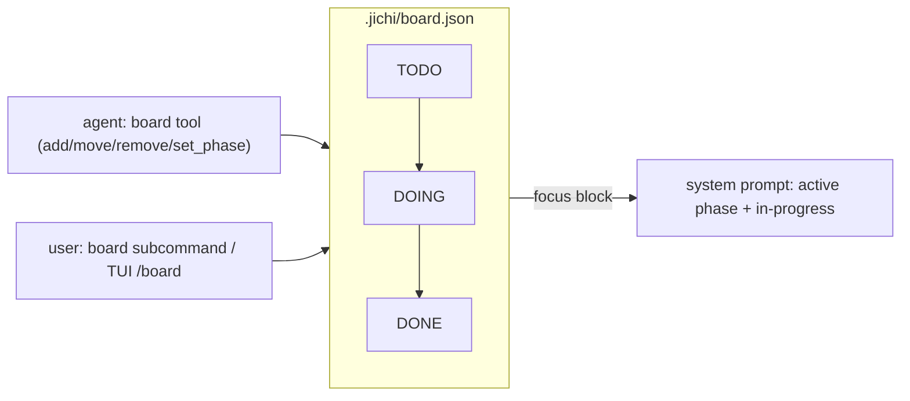

# Kanban phase board (`board`)

A durable, shared task board that helps **users and agents focus** on which
tasks and lifecycle phases are `todo` / `doing` / `done`. Unlike the
session-scoped todo list (`todowrite` -- one conversation's plan, saved with
that session and restored on resume since M606), the board persists to
`<cwd>/.jichi/board.json`, is shared by every session in the workspace, and
survives across runs. **No clock/scheduler** — it is
a focus artifact, not a timer.

## Four things are called "board"

This page is about the first. The other three share the word, not the file.

| Name | What it is | Where |
|---|---|---|
| The kanban board | cards in todo / doing / done and an active phase, in `.jichi/board.json` | this page |
| The parallel status board | the TUI's live view of a `spawn_parallel` batch; headless runs have none | [`PARALLEL.md`](PARALLEL.md) |
| A `BOARD.md` file | a plain Markdown convention, used by the project-management pack's `/kanban` | `examples/project-management/` |
| A web board | a proposal: a supervisor page that draws a fan-out as a live board | [`SUPERVISOR_OF_MANY.md`](SUPERVISOR_OF_MANY.md) |

## When the board fits

The board is for **a project that several sessions work on over days, in phases**: a team's lead
keeping cards for its workers, or you and the agent sharing one list across many runs. For a
single run, the session's own `todowrite` list is enough, and the board's focus block and tool
schema are tokens that buy nothing.

A large board costs little since M932: a change returns the changed card and the counts, and
`list` counts the done cards instead of printing them. Before that, a 185-card board cost about
30,000 tokens a call.

## Turning it on

```json
{ "board": true }
```

When on, jichi loads `.jichi/board.json` at startup, registers the `board` tool for
the agent, and injects a compact **focus block** (the active phase + in-progress
cards) into the system prompt so the agent stays on the current task.

**Where you put the key decides whether it applies at once (M851).**

- In your own `~/.jichi`, or in a file you pass with `--config`, it applies at once.
- In the project's `local/config.json`, it waits until you trust that file, because a project
  config can arrive with a `git clone`. Until then `jichi doctor` says so; for a project in
  `/tmp/blog` it printed:

  ```text
  ! project config not trusted
      /tmp/blog/local/config.json -- 1 setting(s) not applied until you run `jichi trust` here
  !   not applied
      board: turn on the board tool
  ```

  Run `jichi trust` in the project directory to apply it. An edit to the file outside jichi makes it untrusted again;
  `jichi config set` keeps a trusted file trusted. See
  [`CONFIG_TUTORIAL.md`](CONFIG_TUTORIAL.md).

## Model

Each card has an `id`, a `title`, an optional `phase` (the assignments
lifecycle vocabulary — `design` · `implementation` · `testing` · …), an optional
`note`, and a `state` (`todo` → `doing` → `done`). The board also tracks an
active phase.



## Using it

**Agent** (the `board` tool, permission-gated like any mutating tool):
`{action:"add", title, phase?, note?}`, `{action:"move", id, state}`,
`{action:"remove", id}`, `{action:"set_phase", phase}`, `{action:"list", all?}`. Every
change is saved to disk immediately.

**What the tool returns (M932).** A change returns one line saying what happened, the
changed card with its column, and the counts:

```text
moved card [2]
[2] write the parser  (doing, implementation)
Board: 0 todo, 1 doing, 1 done; active phase: implementation
```

`list` shows TODO and DOING in full and DONE as a count; `{action:"list", all:true}`
shows the done cards too. Before M932 every action returned the whole board: a
185-card board cost about 30,000 tokens a call. `/board` and `jichi board` are for
people and still show everything.

**User — CLI:**
```sh
jichi board                       # show the board
jichi board --output json         # the same, as one line of JSON (M932)
jichi board add "implement X" implementation
jichi board move 1 doing
jichi board done 1
jichi board phase testing
```

**Supervisors and scripts (M932).** `jichi board --output json` (or `board list --output json`)
prints one line and writes nothing:

```json
{"phase":"implementation","counts":{"todo":0,"doing":1,"done":1},"cards":[{"id":1,"title":"design the API","phase":"design","state":"done"},{"id":2,"title":"write the parser","phase":"implementation","state":"doing"}]}
```

`phase` is `null` when none is set. Each card has `id`, `title` and `state` (`todo`, `doing` or
`done`), and `phase` and `note` when they are set; the cards are in the file's order. A board file
that exists and cannot be read exits 1 with nothing on stdout, so a script never mistakes it for an
empty board. The edits (`add`, `move`, `done`, `phase`) keep their text output. A supervisor of a
jichi team that keeps a board should read it here rather than keep a second list.

**User — TUI:** `/board` prints the current board (reloaded from disk, so it
reflects the agent's updates).

## Notes

- Cards + the active phase are persisted as JSON (the `jc_calib` load/save
  pattern). A missing file is an empty board. A file that exists and cannot be read
  is shown empty and **never overwritten** (M533): an edit into it is refused, and
  since M761 the tool and the CLI say so instead of reporting the card as added.
- **Two processes can edit one board.** Every edit — the tool's, and `jichi board`'s —
  reloads `.jichi/board.json` and saves it back under a lock on `.jichi/board.lock`
  (M761). Before, a session edited the copy it had loaded when it started, so a run
  overwrote the cards a `jichi board add` in another shell had written meanwhile,
  and both gave out the same id. `list` reads the file too. `board.lock` is empty
  and is kept on purpose (removing it would reopen the race it closes); it is not
  part of the plan, so leave it out of what you commit.
- The board is a project artifact under `.jichi/` — commit it to share the plan
  with teammates, or git-ignore it for a personal scratch board.
- Distinct from `docs/assignments/` (teaching specs) and the ephemeral
  `todowrite` list (one conversation's plan; saved with that session since M606).
- **Main agent only.** A subagent is not offered `board` (nor `todowrite`/`todoread`)
  and is refused if it calls one: the board is shared with the human and outlives any
  subtask, so a delegate that cannot see the whole plan must not rewrite it. A
  delegate reports what it would have recorded in its final answer instead. See
  [`SUBAGENTS.md`](SUBAGENTS.md) (M436).
