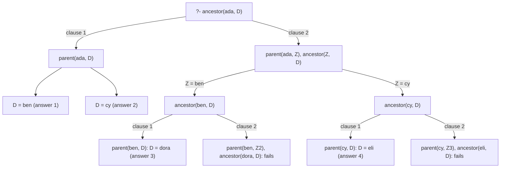
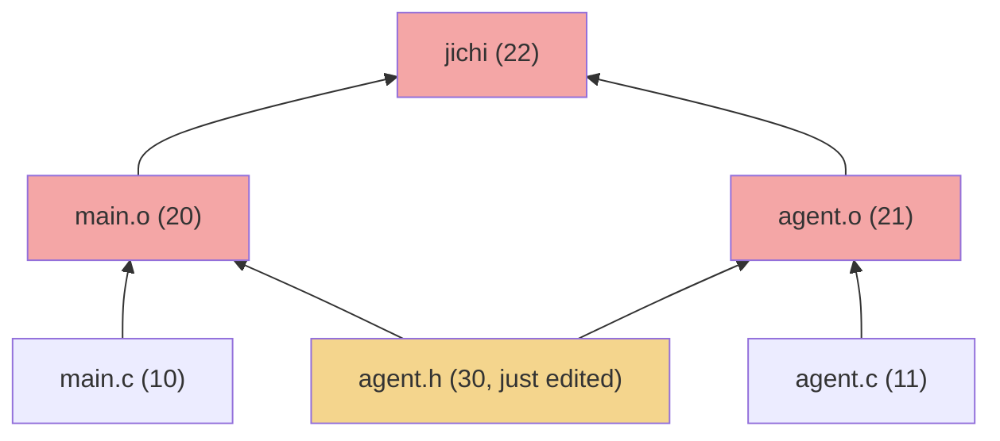
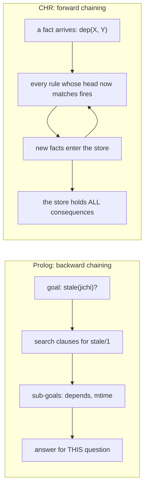
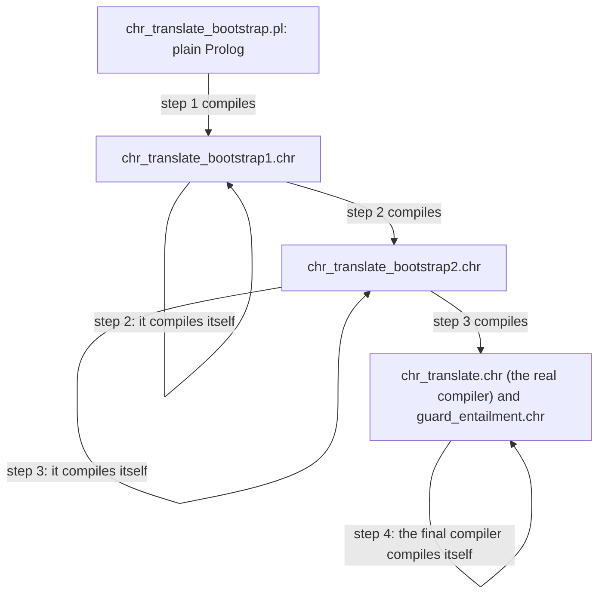
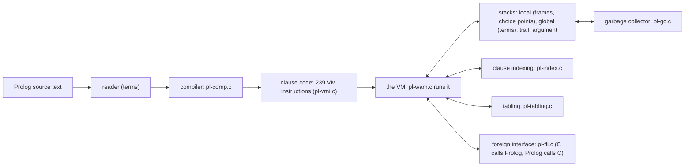

# Logic — logic programming, Prolog, and what they mean beside a C89 agent — a tutorial

**Who this is for:** a self-learner or junior developer. You will learn what logic programming is, run it in Prolog, see how it
searches, and write its core operation, unification, in C89. You will read how a real Prolog system is built (it is
a large C program, like jichi). And you will see, honestly, where logic programming touches jichi and software
development, and where it does not.

Every command here was run in the form shown, on 2026-11-21, with SWI-Prolog 9.0.4 (Ubuntu's package) and gcc
13.3.0; the outputs are the outputs it produced. The implementation chapter reads the SWI-Prolog source at version
11.1.0 (commit 4151b9ca7); of its 41 optional packages, only CHR's (§8, at its V11.1.0 tag) is read here. The example files
are in [`docs/examples/logic/`](examples/logic/). The reading behind it is [`BIBLIOGRAPHY.md`](BIBLIOGRAPHY.md) §16.
Its companion is [`OBJECT_ORIENTED_TUTORIAL.md`](OBJECT_ORIENTED_TUTORIAL.md).

> **Unfamiliar word?** [`VOCABULARY.md`](VOCABULARY.md) defines the terms this project leans on. This page defines its
> own as it goes: *fact*, *rule*, *query*, *unification*, *backtracking*, *closed world*, *constraint*, *tabling*.

---

## 1. The whole tutorial in one sentence

> **In logic programming you state what is true and ask questions; the system searches for the answers, and you
> still have to know how it searches.**

The first half is the promise. The second half is the craft, and most of this page.

## 2. What logic programming is

A logic program is a set of **facts** ("ada is a parent of ben") and **rules** ("X is an ancestor of Y if X is a
parent of Y"). You run it by asking a **query** ("who are ada's descendants?"). The system answers by finding
**bindings** for the query's variables that make it follow from the facts and rules. If there are several, it finds
them one after another. If there are none, the query **fails**: that is an answer ("no"), not an error.

Three ideas carry the paradigm:

| Idea | What it means | Where it came from |
|---|---|---|
| **Resolution** | One inference rule is enough to derive consequences from clauses mechanically | Robinson, 1965 |
| **Logic as a programming language** | A set of Horn clauses (rules with one conclusion) can be read as logic and run as a program | Kowalski, 1974; Colmerauer and Roussel, 1972-73 |
| **Algorithm = Logic + Control** | What a program computes (the logic) can be separated from how it searches (the control) | Kowalski, 1979 |

Colmerauer and Roussel built the first Prolog in Marseille, in 1972-73.

Prolog, the best-known logic language, fixes the control. It tries clauses **top to bottom**, solves goals **left to
right**, searches **depth first**, and on failure goes back to the most recent choice and tries the next alternative
(**backtracking**). That fixed control is why you must still know how it searches.

Related forms you will meet:
- **Datalog** is Prolog without nested terms. Every query terminates, which makes it a database query language
  (Ceri, Gottlob and Tanca, 1989).
- **Constraint logic programming** lets variables carry constraints ("X is between 0 and 200, and X + 5 =< Y"), and a
  solver narrows them. SWI-Prolog ships `library(clpfd)` (Triska, 2012).
- **Tabling** remembers answers, so left-recursive rules terminate and repeated sub-queries are not recomputed.
  SWI-Prolog's implementation draws on XSB's: its source offers two answer-completion strategies and says the lazy
  one "is what XSB is doing".

## 3. Run it: facts, rules, and several answers

[`examples/logic/family.pl`](examples/logic/family.pl):

```prolog
parent(ada, ben).
parent(ada, cy).
parent(ben, dora).
parent(cy, eli).

% X is an ancestor of Y if X is a parent of Y, or a parent of an ancestor of Y.
ancestor(X, Y) :- parent(X, Y).
ancestor(X, Y) :- parent(X, Z), ancestor(Z, Y).
```

```sh
# in docs/examples/logic/ of the jichi checkout
swipl -q -g main -t halt family.pl < /dev/null
```

```
Who are ada's descendants?
  ben
  cy
  dora
  eli
Who are eli's ancestors?
  cy
  ada
All ancestor pairs: 6
dora has none: the query FAILS, which is an answer, not an error
```

The same two clauses answered "who are ada's descendants?" and "who are eli's ancestors?". Nobody wrote a function
for either. The search that found ada's descendants, as a tree: each branch is a clause tried, each leaf a solution
or a failure.



### Relations, not functions

[`examples/logic/append.pl`](examples/logic/append.pl) defines list concatenation as a **relation** between three
lists, and then uses it in four directions:

```prolog
% app(Xs, Ys, Zs): Zs is Xs followed by Ys.
app([], Ys, Ys).
app([X|Xs], Ys, [X|Zs]) :- app(Xs, Ys, Zs).
```

```sh
# in docs/examples/logic/ of the jichi checkout
swipl -q -g main -t halt append.pl < /dev/null
```

```
forward:   app([a,b],[c],Z)    gives Z = [a,b,c]
backward:  app(X,[c],[a,b,c])  gives X = [a,b]
splitting: app(P,S,[a,b,c]) gives every split:
  P = [], S = [a,b,c]
  P = [a], S = [b,c]
  P = [a,b], S = [c]
  P = [a,b,c], S = []
checking:  app([a],[b],[a,c]) fails: it is simply false
```

In C you would write `concat`, `strip_suffix`, `all_splits` and `is_concat` as four functions. Here one definition is
all four, because it states what is true rather than how to compute one direction.

## 4. How it runs: unification and backtracking

### 4.1 The search, in pseudocode

```
solve(goals, bindings):
    if goals is empty:
        report bindings as an answer
        return
    goal = first of goals
    for each clause whose head might match goal, top to bottom:
        rename the clause's variables apart              # fresh copies for this use
        mark = current trail position
        if unify(goal, clause head, bindings):
            solve(clause body followed by the rest of goals, bindings)
        undo bindings back to mark                         # backtracking
    # every clause tried: this goal fails, and the caller tries ITS next clause
```

### 4.2 Unification, in pseudocode

```
unify(a, b):
    a = follow bindings from a; b = follow bindings from b
    if a and b are the same: return yes
    if a is an unbound variable: bind a to b (refuse if a occurs inside b, when checking); return yes
    if b is an unbound variable: bind b to a, likewise; return yes
    if both are atoms: return yes if they are the same atom
    if both are compounds with the same name and the same number of arguments:
        for each argument pair: if not unify(the pair): return no
        return yes
    return no
```

### 4.3 Unification in C89

[`examples/logic/unify.c`](examples/logic/unify.c) is that pseudocode in 174 lines of C89. It has a **trail**:
the list of variables bound since a mark, so bindings can be undone, which is how a Prolog backtracks. And it has a
switch for the **occurs check**.

```sh
# in docs/examples/logic/ of the jichi checkout
cc -std=c89 -pedantic -Wall -Wextra -Werror -o unify unify.c && ./unify
```

```
f(X, b) = f(a, Y)                  yes: f(a, b)   (bindings made: 2)
g(X, X) = g(a, b)                  no
X = f(X), occurs check on          no
X = f(X), occurs check off         yes: f(f(f(f(f(f(f(...)))))))   (bindings made: 1)
```

The heart of it:

```c
static int unify(struct term *a, struct term *b)
{
    int i;
    a = deref(a);
    b = deref(b);
    if (a == b) {
        return 1;
    }
    if (a->kind == VAR) {
        return bind(a, b);              /* records the binding on the trail */
    }
    if (b->kind == VAR) {
        return bind(b, a);
    }
    if (a->kind == ATOM && b->kind == ATOM) {
        return strcmp(a->name, b->name) == 0;
    }
    if (a->kind == COMP && b->kind == COMP && a->arity == b->arity
        && strcmp(a->name, b->name) == 0) {
        for (i = 0; i < a->arity; i++) {
            if (!unify(a->args[i], b->args[i])) {
                return 0;
            }
        }
        return 1;
    }
    return 0;
}
```

The same four questions, asked of SWI-Prolog itself ([`examples/logic/occurs.pl`](examples/logic/occurs.pl)):

```sh
# in docs/examples/logic/ of the jichi checkout
swipl -q -g main -t halt occurs.pl < /dev/null
```

```
f(X,b) = f(a,Y): yes, X = a, Y = b
g(Z,Z) = g(a,b): no
unify_with_occurs_check(W, f(W)): no
V = f(V) without the check: yes -- a cyclic term (SWI-Prolog supports them)
```

**Why standard Prolog skips the occurs check:** it costs a walk over the term on every binding, and almost no
program needs it. The price is that `X = f(X)` "succeeds". SWI-Prolog makes that safe by supporting cyclic terms;
the C example shows what a naive printer does with one. That is a decision with a cost on both sides: soundness
against speed. Prolog systems chose speed and give you `unify_with_occurs_check/2` when you need soundness.

## 5. The closed world, and a trap jichi knows well

`\+ G` in Prolog means "G cannot be proven from what we know". That is **negation as failure**, and it carries the
**closed-world assumption**: whatever the facts do not say is false. It is exactly right for a database and exactly
wrong when your facts are incomplete.

[`examples/logic/lint_rules.pl`](examples/logic/lint_rules.pl) writes a jichi-style lint as one rule: every smoke
driver must be registered in `run.sh`, unless allowlisted.

```prolog
violation(D) :- driver(D), \+ registered(D), \+ allowlisted(D).
```

It then runs the rule three times: once normally, and twice as if one of the two fact lists had failed to load.

```sh
# in docs/examples/logic/ of the jichi checkout
swipl -q -g main -t halt lint_rules.pl < /dev/null
```

```
normal run          : 3 driver(s) read, violations [docs_lint]
registered/1 empty  : 3 driver(s) read, violations [append_lint,docs_lint]
driver/1 empty      : 0 driver(s) read, violations []
A green answer over zero facts proves nothing: floor the count you read.
```

The second failure is loud: every driver is suddenly a violation. The third is **silent**: no drivers read, no
violations, a green lint. This is the same failure jichi's testing rules guard against in shell: "floor its
extraction at today's exact count", and "a check that read nothing proves nothing" (CLAUDE.md, Tests;
[`TESTING_RUNBOOK.md`](TESTING_RUNBOOK.md)). Logic makes the trap precise. A rule is only as good as the facts it
reads, and an empty set of facts satisfies every universal rule.

## 6. Rules you already use: `make`

A Makefile is a logic program in disguise. A target is out of date if it is missing, if a prerequisite is newer, or
if a prerequisite is itself out of date. `make` answers that by working **backward** from the goal, which is how
Prolog runs rules. [`examples/logic/build_rules.pl`](examples/logic/build_rules.pl) states it in three clauses:

```prolog
stale(T) :- \+ mtime(T, _), depends(T, _).                       % missing target
stale(T) :- depends(T, P), mtime(T, Tt), mtime(P, Tp), Tp > Tt.  % newer prerequisite
stale(T) :- depends(T, P), stale(P).                             % stale prerequisite
```

```sh
# in docs/examples/logic/ of the jichi checkout
swipl -q -g main -t halt build_rules.pl < /dev/null
```

```
after editing agent.h, rebuild: [agent.o,jichi,main.o]
main.c is a source file: nothing to rebuild
```



jichi's `Makefile` and its dependency lint (`make_dep_lint`) live in this world. A missing dependency edge is a stale
build that nothing reports, which is the closed world again.

## 7. Constraints: state the rules, let the solver search

[`examples/logic/schedule.pl`](examples/logic/schedule.pl) schedules three gate stages on one machine: the sweep
(5 minutes), the red-first replay (3) and `make ci` (60). None may overlap, and the sweep must finish before ci
starts. It asks for the earliest finish:

```prolog
schedule(Starts, End) :-
    Starts = [Sweep, Redfirst, Ci],
    Starts ins 0..200,
    Durations = [5, 3, 60],
    Sweep + 5 #=< Ci,                    % the sweep finishes before ci starts
    no_overlap(Starts, Durations),
    End #= max(max(Sweep + 5, Redfirst + 3), Ci + 60),
    labeling([min(End)], [End|Starts]).
```

```sh
# in docs/examples/logic/ of the jichi checkout
swipl -q -g main -t halt schedule.pl < /dev/null
```

```
sweep at 0, redfirst at 5, ci at 8: all done at minute 68
```

68 is right: on one machine the stages cannot overlap, and 5 + 3 + 60 = 68. Nobody wrote the search. The durations
in the example came from the drive host's records. Change them and the answer changes, without changing the rules.

## 8. Rules that run forward: Constraint Handling Rules (CHR)

Prolog runs rules **backward**: it starts from a question and searches for facts that answer it (§3, §6). Many
problems run the other way. Facts **arrive**, and you want every consequence derived as they come: a watcher, a
monitor, a type checker, a constraint solver. **Constraint Handling Rules** (CHR) is a rule language for exactly that,
designed by Thom Frühwirth (his 1998 survey and 2009 book are in the bibliography). SWI-Prolog ships it as
`library(chr)` (`packages/chr`, read at 11.1.0). Its README names Tom Schrijvers (K.U. Leuven), Christian Holzbaur and
Jan Wielemaker as authors.

### 8.1 Three kinds of rule, one store

A CHR program keeps a **constraint store**, a multiset of facts. Its rules rewrite the store whenever their heads
match:

| Rule | Form | What it does |
|---|---|---|
| Simplification | `Head <=> Guard \| Body` | removes the head constraints and adds the body |
| Propagation | `Head ==> Guard \| Body` | keeps the head and adds the body (a consequence) |
| Simpagation | `Keep \ Remove <=> Guard \| Body` | keeps one part of the head, removes the other |

The classic first program, [`examples/logic/chr_leq.pl`](examples/logic/chr_leq.pl), is "less than or equal" as four
rules:

```prolog
:- use_module(library(chr)).
:- chr_constraint leq/2.

reflexivity  @ leq(X, X) <=> true.
antisymmetry @ leq(X, Y), leq(Y, X) <=> X = Y.
idempotence  @ leq(X, Y) \ leq(X, Y) <=> true.
transitivity @ leq(X, Y), leq(Y, Z) ==> leq(X, Z).
```

```sh
# in docs/examples/logic/ of the jichi checkout
swipl -q -g main -t halt chr_leq.pl < /dev/null
```

```
leq(A,B), leq(B,C), leq(C,A): the rules proved A = B = C
```

Nobody wrote "detect a cycle and unify". Transitivity derived `leq(A, C)` and `leq(B, A)`. Antisymmetry turned each
opposite pair into an equation, and reflexivity removed what was left.

### 8.2 The store is state: Euclid's algorithm

[`examples/logic/chr_gcd.pl`](examples/logic/chr_gcd.pl) is Euclid's algorithm as two rules on a store of numbers:

```prolog
gcd(0) <=> true.
gcd(N) \ gcd(M) <=> N =< M | L is M mod N, gcd(L).
```

```sh
# in docs/examples/logic/ of the jichi checkout
swipl -q -g main -t halt chr_gcd.pl < /dev/null
```

```
store after gcd(9), gcd(6): [3]
then adding 42, 56, 70: [1]
```

Read the second line carefully: it is not gcd(42, 56, 70), which is 14. The store still held 3 from the first line,
and gcd(3, 42, 56, 70) is 1. **The store is state.** It outlives the call that filled it, exactly like a global
variable. That is CHR's power for monitoring, and its first trap for a learner.

### 8.3 Forward chaining, the other half of `make`

§6 asked "what must be rebuilt?" by working backward from a goal.
[`examples/logic/chr_deps.pl`](examples/logic/chr_deps.pl) works forward instead. As each dependency edge arrives, the
rules derive its consequences at once, remove duplicates, and report a cycle the moment it closes:

```prolog
:- chr_constraint dep/2, cycle/1.

dedup      @ dep(A, B) \ dep(A, B) <=> true.
cycle      @ dep(A, A) ==> cycle(A).
transitive @ dep(A, B), dep(B, C) ==> dep(A, C).
cycle(A) \ cycle(A) <=> true.
```

```sh
# in docs/examples/logic/ of the jichi checkout
swipl -q -g main -t halt chr_deps.pl < /dev/null
```

```
two edges added    : 3 dependency edge(s) known, cycles []
a third added      : 6 dependency edge(s) known, cycles []
an edge that closes a loop: 16 dependency edge(s) known, cycles [jichi,main.o,agent.h,gen_header]
```

Four nodes on one loop: every node reaches every node (4 × 4 = 16 edges, self-loops included), and all four are on
the cycle.



### 8.4 How SWI-Prolog's CHR is built: a compiler written in itself

CHR rules are not interpreted. They are **compiled into Prolog**.
- **The compiler is written in CHR:** `chr_translate.chr`, 11,477 lines. Its guard-entailment analysis
  (`guard_entailment.chr`) is written in CHR too.
- **The runtime is Prolog,** `chr_runtime.pl` (1,020 lines). It keeps the store in hash and integer tables, and uses
  attributed variables (§9's `src/pl-attvar.c`): binding a variable wakes the constraints waiting on it.

A compiler written in its own language needs a way to start. The build (`packages/chr/CMakeLists.txt`, with
`chr_swi_bootstrap.pl`) grows it in stages. Each stage is compiled first by the stage before it, then by itself:



The same idea, at a different scale, is how jichi is developed: the agent is driven on its own source (CLAUDE.md's
self-development; the drives). A tool that builds itself proves itself on its own hardest input, and a bug in it can
hide in the tool that would have found it. The two-pass stages are how CHR guards against that: the self-compiled
output must still work.

### 8.5 What CHR decided, and what it costs

- **Rules over a shared store, not functions over arguments.** It reacts to facts in any order, and suits monitors
  and solvers. The cost is that the store is global state (§8.2), and the order in which rules fire affects
  performance and, for rules that are not confluent, the result.
- **Compile to Prolog, not a new virtual machine.** It reuses Prolog's indexing, garbage collector and attributed
  variables. The cost is that CHR's speed is bounded by those layers, and an error inside a rule surfaces as a Prolog
  error.
- **Written in itself.** The compiler is its own largest test. The cost is a four-step bootstrap that a newcomer must
  understand before changing it.

## 9. Inside a Prolog: SWI-Prolog is a C program

SWI-Prolog is useful to a jichi reader twice over: as a logic language, and as a large, long-lived C codebase that
solved problems jichi also has. Its own paper is Wielemaker, Schrijvers, Triska and Lager, 2012 (free on arXiv). What
the 11.1.0 source shows:

**Size and layout.**
- `src/` holds 159 C files and 255,525 lines of C and headers, vendored libraries included. The engine at its top
  level is 81 files and 193,228 lines.
- `library/` holds 207 Prolog files and about 100,000 lines: much of the system is written in Prolog itself.
- `boot/` holds the Prolog code that is loaded first.
- The optional `packages/` (the web server, XPCE, CHR and 38 others) are 41 separate git submodules. §8 reads CHR's;
  [`OBJECT_ORIENTED_TUTORIAL.md`](OBJECT_ORIENTED_TUTORIAL.md) §7 reads XPCE's. The counts above exclude them.



**Terms are tagged machine words** (`src/pl-data.h`): the low three bits say what a word is.

```c
#define TAG_MASK	0x00000007L	/* mask for tag */
#define TAG_VAR		0x00000000L	/* tag for variable (= 0L) */
#define TAG_ATTVAR	0x00000001L	/* tag for attributed variable */
#define TAG_FLOAT	0x00000002L	/* Floating point number */
#define TAG_INTEGER	0x00000003L	/* Tagged small int, 64-bit indirect, */
					/* GMP mpz or mpq (rational) */
#define TAG_STRING	0x00000004L	/* String */
#define TAG_ATOM	0x00000005L	/* an atom */
#define TAG_COMPOUND	0x00000006L	/* Compound term */
#define TAG_REFERENCE	0x00000007L	/* Reference pointer */
```

The next two bits (`STG_*`) say where the value lives: static, the global stack, or the local stack. An unbound
variable is a word of zero. Compare `unify.c`, where a term is a struct with a `kind` field: the same idea, traded for
readability instead of speed and size.

**Four stacks** (`src/pl-incl.h:pl_stacks_t`): `local` (environment frames and choice points), `global` (the terms),
`trail` (bindings to undo on backtracking), and `argument`, all under one total limit. Read the comments in that
struct and you will find the one on `global` says "local (environment) stack": copied from the line above. Comments
drift in every codebase. Read the code.

**A virtual machine of 239 instructions** (`src/pl-vmi.c`). They are written once, each as
`VMI(Name, Flags, #Args, (ArgType, ...))`, and a generator derives the tables from that one definition. The name
prefixes group them:

| Prefix | Examples | What they do |
|---|---|---|
| `H_` | `H_ATOM`, `H_FUNCTOR` | unify the arguments of a clause's head |
| `B_` | `B_VAR`, `B_ATOM` | build the arguments of a body goal |
| `I_` | `I_ENTER`, `I_CALL`, `I_EXIT`, `I_DEPART` | calls, exits, last calls, choice points |
| `C_` | `C_OR`, `C_IFTHEN`, `C_CUT` | control constructs: disjunction, if-then-else, cut |
| `A_` | `A_ENTER`, `A_INTEGER`, `A_DOUBLE` | arithmetic compiled inline |
| `S_` | `S_STATIC`, `S_DYNAMIC`, `S_UNDEF` | per-predicate "supervisors" chosen by the predicate's kind |
| `T_` | `T_TRIE_GEN2`, `T_VALUE`, `T_DELAY` | tries, used by tabling |
| `L_`, `D_` | `L_NOLCO`, `L_VAR`; `D_BREAK` | further families (`D_BREAK` serves the debugger) |

The design descends from Warren's abstract machine (Warren, 1983; Aït-Kaci's 1991 tutorial reconstruction is the
gentle way in). SWI-Prolog's instruction set is its own, though; do not expect a one-to-one mapping to WAM textbooks.

**Garbage collection** (`src/pl-gc.c`) says, in its own header, that it is "based on Karen Appleby, Mats Carlsson,
Seif Haridi and Dan Sahlin, 'Garbage Collection for Prolog Based on WAM', Communications of the ACM, June 1988". It
runs only at a call port, when the machine's state is known. That is the same kind of invariant as jichi's "reset an
arena only at a turn boundary".

**Clause indexing** (`src/pl-index.c`) builds indexes on demand, on whichever argument would help, rather than only
on the first. It decides with tuning numbers whose defaults are set in that file: `min_speedup` 1.5,
`max_var_fraction` 0.1, `min_speedup_ratio` 3.0, `max_lookahead` 100. Ask them the five questions of
[`LIMITS.md`](LIMITS.md): what they bound, and where the numbers came from. This tutorial did not look for their
measurement, so it does not claim one either way.

**Attributed variables and tabling.**
- Attributed variables (`src/pl-attvar.c`) let a variable carry data that constraint solvers react to when it is bound.
  The design is credited in the file to Demoen's hProlog report.
- Tabling (`src/pl-tabling.c`) offers both an eager and a lazy answer-completion strategy. Its own comment says the
  lazy one "is what XSB is doing".

**Objects, in C, again.** The foreign interface hands C code opaque handles (`term_t`, `atom_t`) instead of pointers
into the stacks, because the garbage collector moves things. A C library can add its own value types through
`PL_blob_t`, a record of function pointers. [`OBJECT_ORIENTED_TUTORIAL.md`](OBJECT_ORIENTED_TUTORIAL.md) §6 reads it
as the class it is.

## 10. Logic programming and jichi, honestly

**jichi contains no logic programming.** It is procedural C89, with the object patterns of the companion tutorial
and a great many declarative **tables**:
- the config trust classification in `src/config/jc_config_trust.c`;
- the tool registry;
- the permission matchers.

Several of its problems are logic-shaped, though:

| jichi problem | Its logic shape |
|---|---|
| A lint: "every X has a Y, unless allowlisted" | a rule over facts, with negation as failure (§5) |
| The build: what must be remade | backward chaining over a dependency graph (§6) |
| A fence or permission check: may this tool touch this path | a policy as rules, the kind of question Datalog answers |
| The census of default limits ([`LIMITS.md`](LIMITS.md)) | a query over facts about the source ("every time cap with no source") |
| Scheduling the gate's stages | constraints (§7) |
| Reacting as evidence arrives (the gate watcher, a shadow comparison) | forward chaining over a store of facts (§8) |

### The design decisions, the alternatives, and what they cost

**Decision: hand-written C checks and tables, not a logic engine.** This is what jichi does today. Each check is C or
POSIX shell, with its own extraction floor and red-first cell.

The alternatives:

1. **Embed SWI-Prolog** through its C interface, and write policies and lints as Prolog. **Rejected by an existing
   rule:** "Dependencies: libcurl and nothing else" (CLAUDE.md). Linking a Prolog runtime would be a second
   dependency, on every platform jichi builds for. SWI-Prolog's licence (Simplified BSD) would not stand in the way;
   the dependency rule does.
2. **Write a small Datalog in C89.** Feasible: the unifier in §4.3 is one of its parts. It would give lints and policies
   one declarative form. The cost is a second language inside the tree for every reader and reviewer, and its own
   test suite. It is a good learner project; it is not a decision jichi has made.
3. **Call `swipl` as an external program, from a user tool or a script.** This keeps the dependency rule (the
   process boundary is the interface), and the result comes back as text the model reads. The cost is that the
   logic engine must be installed where it is used, and every call pays a process start. It is the honest route for a
   jichi user who wants Prolog today. jichi itself ships nothing for it.

**And language models?** An agent like jichi works with a model that proposes: plausible, fast, sometimes wrong. A
logic engine disposes: it is sound for what it can prove, and it fails loudly when it cannot. Using the two together
is an active research area (neuro-symbolic programming): a model writes the constraints, a solver checks or solves
them. It suits exactly the tasks where a wrong answer is expensive and the rules can be written down. jichi does not
do this; the external-program route above is how you would try it.

## 11. What this means for you

**Reach for logic programming when:**
- the problem is rules and relations: eligibility, permissions, configuration validity, dependency analysis;
- the answer requires search: puzzles, planning, scheduling, parsing (Prolog's DCG notation is a grammar formalism);
- you need several answers, or need to run a relation in more than one direction.

**Know its traps:**
- **Left recursion loops.** `ancestor(X, Y) :- ancestor(X, Z), parent(Z, Y).` calls itself before consuming
  anything. Put the base case and the consuming goal first, or use tabling.
- **The closed world (§5).** Negation as failure is only as good as the facts loaded.
- **The cut (`!`)** commits to a choice and changes what a program means procedurally. It is how Prolog programs get
  fast and how they get wrong. Learn the declarative reading first.
- **The occurs check (§4)** is off by default.
- **Performance is about indexing and the order of goals,** not about writing fewer lines.

**Reading a logic program, ask:**
1. Read each clause as a sentence. Is it true?
2. In which directions ("modes") will it be called? Does it terminate in each?
3. Which facts does it assume are complete? What happens when they are empty?
4. Where does it cut, and what answers does the cut remove?

## 12. Exercises

Use `swipl` (any recent version) and a throwaway copy of `docs/examples/logic/`.

1. **Add a generation.** Give `eli` a child in `family.pl`. Which queries' answers change, and which rules did you
   have to touch? (None.)
2. **Make it loop, then fix it.** Swap the goals in the second `ancestor` clause to
   `ancestor(X, Z), parent(Z, Y)` and run the file again. Measured on 2026-11-21: it still prints ada's four
   descendants, because the first clause finds them, and then, looking for a fifth, calls itself until SWI-Prolog's
   default 1 GB stack limit stops it: `Stack limit (1.0Gb) exceeded`, at a depth of 11,030,884 frames, after 5
   seconds. Then add `:- table ancestor/2.` at the top and run it again: every query answers at once. The stack
   limit is itself a default limit, a fence this time, and it names itself when it fires. Ask it
   [`LIMITS.md`](LIMITS.md)'s five questions.
3. **Floor the lint.** Change `lint_rules.pl` so `report/1` refuses to say "no violations" when fewer than 3 drivers
   were read. What is the Prolog for "at least 3"?
4. **Stress the unifier.** Add `h(X, f(Y)) = h(f(Y), X)` to `unify.c`'s `main`. Predict the answer, then run it.
5. **Ask jichi, then check it.** In a scratch directory, ask jichi to "write a Prolog rule `cycle(X)` that holds when a
   target depends on itself through `depends/2`", then run its answer with `swipl` on `build_rules.pl` plus a cycle you
   add. Did it terminate? (CURRICULUM M9, "The agent is sometimes wrong".)
6. **Clear the store.** In a copy of `chr_gcd.pl`, make the second query start from an empty store, so it
   prints 14 (the gcd of 42, 56 and 70). A hint, verified on 2026-11-21: the store is undone on backtracking, so
   running the first half as `( ..., fail ; true )` leaves it empty. Why is the first answer still 3?
7. **Read the machine.** In the SWI-Prolog source, find `VMI(H_ATOM` in `src/pl-vmi.c`. In your own words, what does
   it do when the argument is an unbound variable, and when it is already an atom?

## 13. The checklist

- [ ] I can say what a fact, a rule and a query are, and what "the query fails" means.
- [ ] I can read a clause declaratively (is it true?) and procedurally (what does it do?).
- [ ] I can write unification, and say what the occurs check costs and buys.
- [ ] I know the closed-world assumption, and why an empty fact set makes a lint green.
- [ ] I see `make` as backward chaining, and constraints as rules plus a solver.
- [ ] I can write a CHR rule of each kind, and say why its store is state.
- [ ] I can describe how SWI-Prolog represents terms and runs clauses, with file names.
- [ ] I can say why jichi does not embed a logic engine, and how I would use one beside it.

## Read further: the bibliography

[`BIBLIOGRAPHY.md`](BIBLIOGRAPHY.md) §16, "Logic programming", has the entries with their verification markers. The
ones this page leans on:

- Robinson, 1965, "A Machine-Oriented Logic Based on the Resolution Principle".
- Kowalski, 1974, "Predicate Logic as Programming Language" (free).
- Kowalski, 1979, "Algorithm = Logic + Control".
- Colmerauer and Roussel, 1993, "The Birth of Prolog".
- Warren, 1983, "An Abstract Prolog Instruction Set" (SRI Technical Note 309), via Aït-Kaci, 1991, *Warren's Abstract
  Machine: A Tutorial Reconstruction*.
- Appleby, Carlsson, Haridi and Sahlin, 1988, "Garbage Collection for Prolog Based on WAM".
- Ceri, Gottlob and Tanca, 1989, "What You Always Wanted to Know About Datalog (And Never Dared to Ask)".
- Wielemaker, Schrijvers, Triska and Lager, 2012, "SWI-Prolog" (free on arXiv).
- Triska, 2012, "The Finite Domain Constraint Solver of SWI-Prolog".
- Frühwirth, 1998, "Theory and Practice of Constraint Handling Rules", and *Constraint Handling Rules*, 2009.
- The SWI-Prolog manual's CHR section (free online).
- Sterling and Shapiro, *The Art of Prolog*, 2nd edition, 1994.
- Clocksin and Mellish, *Programming in Prolog*, 5th edition, 2003.
- Bratko, *Prolog Programming for Artificial Intelligence*, 4th edition, 2011.
- O'Keefe, *The Craft of Prolog*, 1990.
- Lloyd, *Foundations of Logic Programming*, 2nd edition, 1987.
- Blackburn, Bos and Striegnitz, *Learn Prolog Now!*, 2006 (free online).
- Triska, *The Power of Prolog* (free online).
- The SWI-Prolog Reference Manual (free online; also in the source's `man/`).
- SICP §4.4, a logic interpreter in Scheme (already in the bibliography).
