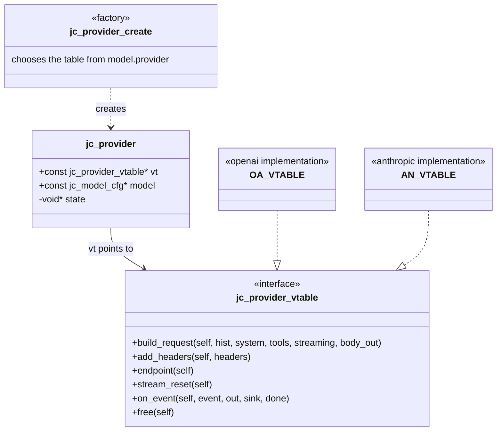
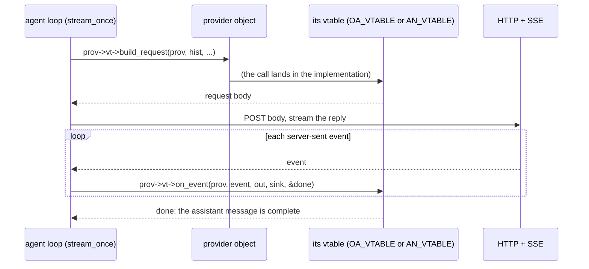
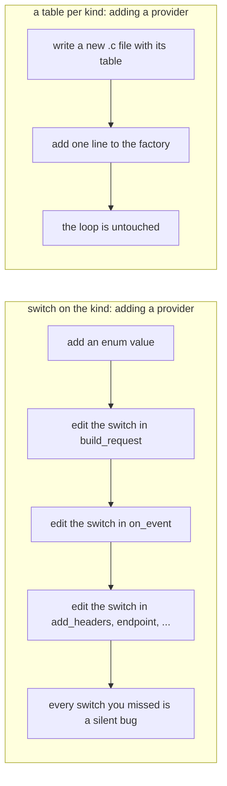
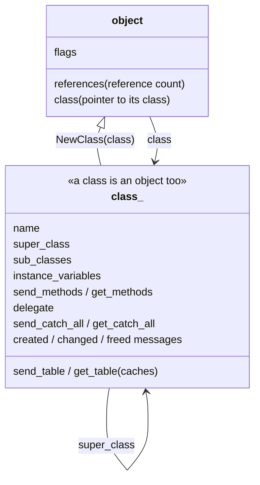
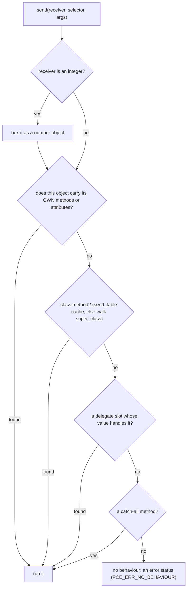

# Objects — object-oriented programming, and what it means in a C89 codebase — a tutorial

**Who this is for:** a self-learner or junior developer. You will learn what object-oriented programming (OOP) is, as a set of
separable ideas rather than a single doctrine. You will see the two places jichi uses those ideas, written by hand in
C89, and the same design with C++'s machinery. You will see the design decisions jichi made, what it rejected, and
what each choice costs. You will also see that the same pattern holds up an unrelated C codebase: SWI-Prolog's.

Every command here was run in the form shown, on 2026-11-21, with gcc and g++ 13.3.0, clang 18.1.3 and zig 0.17.1;
the outputs are the outputs it produced. The example files are in
[`docs/examples/oop/`](examples/oop/). The reading behind it is [`BIBLIOGRAPHY.md`](BIBLIOGRAPHY.md) §15. Its companion
is [`LOGIC_PROGRAMMING_TUTORIAL.md`](LOGIC_PROGRAMMING_TUTORIAL.md).

> **Unfamiliar word?** [`VOCABULARY.md`](VOCABULARY.md) defines the terms this project leans on. This page defines its
> own as it goes: *interface*, *implementation*, *vtable*, *dispatch*, *factory*, *encapsulation*.

---

## 1. The whole tutorial in one sentence

> **An object is some state plus the operations allowed to touch it, reached through an interface that hides which
> implementation you are holding.**

Everything else is either how a language helps you build that (classes, `virtual`, inheritance), or a way to use it
well or badly.

## 2. What OOP is: five ideas, not one

"Object-oriented" names a family of ideas that arrived together historically but can be taken one at a time. Most
arguments about OOP are two people meaning different members of the family.

| Idea | In one line | Where it came from |
|---|---|---|
| **Information hiding / encapsulation** | A module's design decisions are hidden behind an interface, so they can change without changing the callers | Parnas, 1972, before "OOP" was a phrase |
| **Abstract data types** | A type is defined by its operations, not by its representation | Liskov's CLU, the 1970s; Cardelli and Wegner's 1985 survey |
| **Dynamic dispatch (polymorphism)** | The same call runs different code depending on the object it is made on | Simula 67 (Dahl and Nygaard) |
| **Inheritance** | A new class is defined as a change to an existing one | Simula 67 |
| **Objects that send messages** | Computation is objects sending messages to each other; nothing else is special | Smalltalk (Kay, "The Early History of Smalltalk", 1993) |

On Simula: Dahl and Nygaard's 1966 paper in the bibliography describes Simula 67's predecessor, SIMULA I, which had
processes but not yet classes.

Two honest notes:

- **The idea that does the most work in real systems is the first one.** Hide the thing that is likely to change behind
  something that is not. You can do that in any language, including C89, and jichi does.
- **Inheritance is the most taught and the most regretted.** A subclass that breaks its parent's promises makes every
  caller wrong at once; the rule that a subtype must keep its supertype's behaviour is Liskov and Wing's (1994).
  Modern advice ("favor object composition over class inheritance", from *Design Patterns*) is mostly about this
  cost.

## 3. Objects in C89, as jichi writes them

C89 has no classes and no `virtual`. It has structs and function pointers, and that is enough. jichi talks to two
families of model server, OpenAI-shaped and Anthropic-shaped. They differ in how a request is built and how a
streamed reply is parsed. The agent loop must not care which one it is talking to.

### 3.1 The shape



(The vtable has more members than shown; see the header.)

- **`include/jc_provider.h:struct jc_provider`** is the object: a pointer to its table of operations, the model
  configuration it serves, and `state`, which only the implementation reads.
- **`include/jc_provider.h:struct jc_provider_vtable`** is the interface: what every provider can do.
- **`src/provider/jc_provider_openai.c:OA_VTABLE` and `src/provider/jc_provider_anthropic.c:AN_VTABLE`** are the
  two implementations: `static const` tables of function pointers.
- **`src/provider/jc_provider.c:jc_provider_create`** is the factory: the one place that knows which kinds exist.
- **`src/chat/jc_agent.c:stream_once`** calls `prov->vt->build_request(...)`, and
  **`src/chat/jc_agent.c:bridge_sse_event`** calls `prov->vt->on_event(...)`. Neither knows which provider it holds.

### 3.2 What a call does, in pseudocode

```
send a turn (provider, history):
    body = provider.table.build_request(provider, history)   # the implementation decides the bytes
    for each event in the HTTP stream of body:
        provider.table.on_event(provider, event, reply)       # the implementation decides the parsing
        if reply is complete: stop
    return reply
```



### 3.3 The same design, small enough to read in one sitting

[`examples/oop/wire_vtable.c`](examples/oop/wire_vtable.c) is about 150 lines. It builds a request body for two wire
formats behind one interface, with a factory, and a caller that never branches on the kind.

```sh
# in docs/examples/oop/ of the jichi checkout
cc -std=c89 -pedantic -Wall -Wextra -Werror -o wire_vtable wire_vtable.c && ./wire_vtable
```

```
openai     {"model":"jlu/qwen3","messages":[{"role":"user","content":"hello"}]}
openai     calls so far: 1
anthropic  {"model":"jlu/qwen3","max_tokens":64,"messages":[{"role":"user","content":"hello"}]}
anthropic  calls so far: 1
gopher     refused by the factory: unknown kind
```

The core of it:

```c
struct wire_vtable {               /* the interface: what every wire can do */
    int  (*build)(struct wire *self, const char *prompt, char *out, size_t cap);
    const char *(*name)(const struct wire *self);
    void (*destroy)(struct wire *self);
};

struct wire {
    const struct wire_vtable *vt;  /* the dispatch table */
    char model[32];                /* state every wire shares */
    int  calls;                    /* state the implementations update */
};

static void send_one(struct wire *w, const char *prompt)
{
    char body[256];
    int n = w->vt->build(w, prompt, body, sizeof body);   /* dispatch */
    ...
}
```

It builds unchanged with clang and `zig cc` and prints the same lines. It also compiles as C++, which jichi requires of
its whole tree ([`CPP_BUILD.md`](CPP_BUILD.md)):

```sh
# in docs/examples/oop/ of the jichi checkout
g++ -x c++ -pedantic -Wall -Wextra -Werror -o wire_vtable_cpp wire_vtable.c && ./wire_vtable_cpp
```

### 3.4 The same design with C++'s machinery

[`examples/oop/wire_virtual.cpp`](examples/oop/wire_virtual.cpp) writes the interface as a class with pure `virtual`
functions and the two wires as subclasses. Its output is identical, line for line:

```sh
# in docs/examples/oop/ of the jichi checkout
g++ -std=c++98 -pedantic -Wall -Wextra -Werror -o wire_virtual wire_virtual.cpp && ./wire_virtual
```

```cpp
class Wire {                                   // the interface
public:
    explicit Wire(const std::string &model) : model_(model), calls_(0) {}
    virtual ~Wire() {}                          // deleting through Wire* is safe
    virtual std::string build(const std::string &prompt) = 0;
    virtual const char *name() const = 0;
    ...
};
```

What the language does for you, and what you do by hand in C:

| Concern | C89, by hand (`wire_vtable.c`) | C++ (`wire_virtual.cpp`) |
|---|---|---|
| The table of operations | You write `struct wire_vtable` and one `static const` table per implementation | The compiler builds it from the `virtual` declarations |
| Setting the table pointer | The factory sets `w->vt` | Every constructor sets it, invisibly |
| A missing operation | A NULL pointer, found when called | A compile error (`= 0` must be overridden before instantiation) |
| Calling through the interface | `w->vt->build(w, ...)`, with `self` passed explicitly | `w->build(...)`, with `this` implicit |
| Destruction | `w->vt->destroy(w)` | `delete w`, through the `virtual` destructor |
| Hiding the state | By convention: `void *state`, or a struct defined in one `.c` file | `private` and `protected`, checked by the compiler |
| Strings and memory | Bounded buffers, measured before copying | `std::string`, which allocates |

Neither column is free. The C column makes every mechanism visible and checkable on any C89 compiler, from a 1990
toolchain to a microcontroller. The C++ column makes mistakes harder, and costs a language jichi chose not to depend
on ([`reading/fukabori-01-why-c89.md`](reading/fukabori-01-why-c89.md)).

## 4. An interface with two tiers: jichi's tools

`include/jc_tool.h:struct jc_tool` is a second, subtler object design. Most tools (read a file, run a command) carry
no state of their own: they are plain functions, one table entry each. These are *class-level* operations, in OOP
terms. But tools served by an MCP server do carry state: a connection, a remote name, a cached schema. Rather than
give every tool a state pointer it does not need, the struct has both: the plain `schema`/`run` functions, and a
`ctx` pointer with `schema_ctx`/`run_ctx` functions that receive it. The comment at the definition gives the reason:
"This keeps instance data ... out of the otherwise-static vtable."

[`examples/oop/tool_table.c`](examples/oop/tool_table.c) shows the pattern in miniature:

```sh
# in docs/examples/oop/ of the jichi checkout
cc -std=c89 -pedantic -Wall -Wextra -Werror -o tool_table tool_table.c && ./tool_table
```

```
echo   -> echo: hi
upper  -> HI
notes  -> notes-server says: hi
rm     -> no such tool: rm
the notes instance was called 1 time(s)
```

The dispatcher looks the tool up by name and prefers the instance function when one is set. Two lessons hide in the
last two lines:
- **An unknown tool is an answer, not a crash.** jichi's rule is that tool errors are values (CLAUDE.md, "Tool errors
  are values, never control flow"), and the example keeps it.
- **The instance kept its own state** (`calls`) across calls, which is exactly what the class-level tools must not
  have.

## 5. The design decisions, the alternatives, and what they cost

### Decision 1: dispatch through a table, never branch on the kind

**The rule** (CLAUDE.md): "The agent never branches on provider. A backend is a new `jc_provider` vtable, not a new
code path in the loop." The full argument is
[`reading/fukabori-02-the-provider-abstraction.md`](reading/fukabori-02-the-provider-abstraction.md). In Parnas's
terms (the BIBLIOGRAPHY's first craft entry), what varies between providers is hidden behind the interface, not
spread through the callers.

**The rejected alternative:** an enum of provider kinds and a `switch` wherever the behaviour differs.



**What it costs:** an indirect call per operation (negligible beside a network round trip). Also, the reader of the
loop cannot see which code runs without looking at the factory. And a new operation must be added to every table at
once: that is the switch's advantage, adding a new *operation*, mirrored. Which axis changes more often decides the
design. In jichi, new providers and dialects arrive; new provider operations are rare.

### Decision 2: composition, no inheritance hierarchies

jichi has no class hierarchies. An object holds a table and some state, and nothing derives from anything. C89 can
imitate inheritance by putting a "base" struct as the first member of a "derived" one and casting between them; the
Linux kernel builds objects from structs and function tables on a large scale (Neil Brown's two LWN articles in the
bibliography survey its patterns). jichi does not, because it has had
no need: each interface has two or a handful of implementations, and they share code through ordinary helper
functions, as `wire_vtable.c` shares `put()`.

**What it costs:** some repetition between implementations (`OA_VTABLE` and `AN_VTABLE` each implement every member).
**What it saves:** a chain of overrides to read before you know what a call does, and the fragile-base-class problem,
where a change to a parent silently changes every child.

### Decision 3: C89, compiled as C++ too, but never written in C++

The tree is C89 for portability ([`reading/fukabori-01-why-c89.md`](reading/fukabori-01-why-c89.md)), and it also
compiles as C++ ([`CPP_BUILD.md`](CPP_BUILD.md)). That catches a class of mistakes C allows and C++ refuses: implicit
`void *` conversions and missing prototypes. The examples here were built both ways. The headers carry
`extern "C"` guards so C++ code can call jichi's C.

### Decision 4: errors as values, not exceptions

C++ and most OOP languages report failure by throwing. jichi returns a status (`jc_status`) and fills a result. A tool
that fails returns a result marked as an error, which the model reads like any other output. The factory in
`wire_vtable.c` returns NULL for an unknown kind, and the caller handles it on the next line. Nothing unwinds past
code that did not expect it.

### Decision 5: lifetimes by arena, not by object

In C++, an object's constructor acquires and its destructor releases (RAII). jichi keeps most data in three arenas
chosen by lifetime: session, turn and tool call (CLAUDE.md, "Three arenas"). Freeing an arena frees everything in it
at once. Providers are the exception that proves the rule: they are `malloc`ed and released through their own
`vt->free`, because they live exactly as long as a model switch, which matches no arena.

## 6. The same pattern, in a codebase with no relation to jichi

SWI-Prolog is a Prolog system written mostly in C. In the 11.1.0 source read for this tutorial, `src/` holds 159 C
files and 255,525 lines of C and headers, vendored libraries included; the engine at its top level is 81 files and
193,228 lines. It uses the same object design, and its companion
[`LOGIC_PROGRAMMING_TUTORIAL.md`](LOGIC_PROGRAMMING_TUTORIAL.md) explains why a logic language is built this way. Two
examples, quoted from its source:

**Streams** (`src/os/SWI-Stream.h:struct io_functions`): every input/output stream holds a pointer to a table of
operations, so a file, a pipe, a memory buffer and a socket are all read and written the same way.

```c
typedef struct io_functions
{ Sread_function	read;		/* fill the buffer */
  Swrite_function	write;		/* empty the buffer */
  Sseek_function	seek;		/* seek to position */
  Sclose_function	close;		/* close stream */
  Scontrol_function	control;	/* Info/control */
  Sseek64_function	seek64;		/* seek to position (large files) */
} IOFUNCTIONS;
```

**Blob types** (`src/SWI-Prolog.h:struct PL_blob_t`): a C library can add its own kind of value to Prolog by
describing it in a type record whose members are function pointers: `release`, `compare`, `write`, `acquire`, `save`,
`load`. The garbage collector calls `release` without knowing what the blob is. That is a class in all but name. Each
type even keeps its own counts (`live`, `space`) and a link to the next registered type.

The general point for a learner: **the interface-behind-a-table design is not a jichi quirk or a C++ idea. It is what
large C programs converge on** when one part must stay ignorant of how another varies.

Logic and objects meet in one more place: **Logtalk** adds objects, protocols and categories to Prolog itself (see
the bibliography). That is the reverse direction, OOP built inside a logic language.

## 7. A complete object system in C: XPCE

The vtable in §3 is the smallest object design that works. XPCE is close to the largest. It is an object-oriented
system for user interfaces, written in C and shipped with SWI-Prolog (`packages/xpce`, read at 11.1.0). Its README
says it was "designed to be language-independent". Anjo Anjewierden started it as PCE, wrote versions 1 and 2, and
wrote version 3 together with Jan Wielemaker; Wielemaker designed versions 4 and 5. It "makes the full object
oriented mechanisms underlying PCE available to the Prolog programmer". It is large: 264 C files and 209,730 lines of
C and headers, plus 334 Prolog files. It is under the Simplified BSD licence.

Studying it beside jichi shows what a full object system costs, and what it buys.

### 7.1 Every object knows its class, and a class is an object

Every XPCE object begins with the same three words (`src/h/kernel.h:OBJECT_HEADER`):

```c
#define OBJECT_HEADER \
  uintptr_t     flags;			/* general flag field */ \
  uintptr_t     references;		/* reference count */ \
  Class		class;			/* Associated class */
```

That `class` pointer plays the role of jichi's `vt` pointer, but it points at a whole **class object**, not a table
of functions. A class is itself an object (`NewClass(class)` gives it the same header). Among its fifty-five
members:
- its `super_class` and `sub_classes`;
- its `instance_variables`;
- its `send_methods` and `get_methods`, and two hash tables of them (`send_table`, `get_table`);
- a `delegate` chain;
- catch-all methods;
- hooks run when instances are created, changed or freed;
- counters of instances created and freed;
- `tree_index` and `neighbour_index`, numbers from a depth-first walk of the class tree.

**Inheritance is by layout.** `NewClass(x)` opens a struct with the object header, followed by the field macros of
each superclass (`ABSTRACT_OBJECT`, `ABSTRACT_PROGRAM_OBJECT`, ...). So a subclass's struct begins with its parent's
fields, and a pointer to it can be used as a pointer to the parent. This is the C imitation of inheritance §5 says
jichi does not need. XPCE, with hundreds of classes in a hierarchy, does.



### 7.2 How a message finds its code

In XPCE you do not call a function. You **send a message**: a selector, a name, and its arguments, to an object.
`src/ker/passing.c:resolveImplementationGoal` decides what runs:



The steps:
1. **An object can have methods of its own**, besides its class's. That is prototype-style programming, the idea of
   the Self language (Ungar and Smith, 1987) and of Lieberman's delegation (1986).
2. **Class lookup is cached.** `src/ker/class.c:getResolveSendMethodClass` walks up the superclass chain. In each
   class it tries the cached table, the declared methods, methods bound lazily, and instance variables (which work
   as accessors). The first hit is stored in the **receiving class's own table**, so the next send costs one hash
   lookup.
3. **Delegation:** a message the class does not understand is re-sent to the values of the slots named in its
   `delegate` chain.
4. **The catch-all** is Smalltalk's "does not understand".
5. **Failure is a status**, and its comment says it "need not be fatal". The Prolog interface turns it into an
   exception (§7.4 shows it), which is a design choice of that layer.

### 7.3 Memory: reference counts and an answer stack

Each object counts its references (the `references` word above). Objects created during a computation that nobody
has claimed yet sit on a per-thread **answer stack** (`src/ker/gc.c`). They are freed when the computation that made
them ends, much like an autorelease pool in Objective-C. The header's flags also include `F_LOCKED` and
`F_PROTECTED` (`src/h/kernel.h`); this tutorial did not trace where they are checked, so it says no more about
them.

The trade-off, honestly: reference counting frees memory at a predictable moment and needs no pause, but it cannot
free a cycle of objects that point at each other. Prolog's own terms use a tracing collector instead
([`LOGIC_PROGRAMMING_TUTORIAL.md`](LOGIC_PROGRAMMING_TUTORIAL.md) §9). jichi avoids the question with arenas (§5,
decision 5).

### 7.4 Run it: a class, a subclass, delegation, and classes as objects

[`examples/oop/xpce_counter.pl`](examples/oop/xpce_counter.pl) defines three classes in XPCE from Prolog. `:->`
defines a **send** method (it does something), and `:<-` a **get** method (it returns something). The classes are not
graphical, so no window opens and it runs without a display.

```prolog
:- pce_begin_class(counter, object, "Counts up").
variable(value, int := 0, both, "Current value").
increment(C) :->
    "Add one"::
    get(C, value, V), V1 is V + 1, send(C, value, V1).
doubled(C, D:int) :<-
    "Twice the value"::
    get(C, value, V), D is V * 2.
:- pce_end_class.

:- pce_begin_class(bounded_counter, counter, "Counts up to a limit").
variable(limit, int, both, "Highest allowed value").
initialise(C, Limit:int) :->
    send_super(C, initialise), send(C, limit, Limit).
increment(C) :->
    get(C, value, V), get(C, limit, L),
    (   V < L -> send_super(C, increment) ; true ).   % at the limit: stay
:- pce_end_class.

:- pce_begin_class(meter, object, "A labelled counter").
variable(label,   name,    both, "What it counts").
variable(counter, counter, get,  "The counter it delegates to").
delegate_to(counter).
...
```

```sh
# in docs/examples/oop/ of the jichi checkout (needs SWI-Prolog with XPCE, e.g. Ubuntu's swi-prolog-x)
swipl -q -g main -t halt xpce_counter.pl < /dev/null
```

```
counter: value 2, doubled 4
bounded_counter(2) after 5 increments: 2 (the override stopped it)
meter: 3 increments sent to the meter reached its counter: 3
an unknown message raises an exception: pce(no_behaviour, [<the object>, ->, no_such_method])
classes are objects too: bounded_counter's super_class is counter; counter's sub_classes are [bounded_counter]
```

(Run with SWI-Prolog 9.0.4's XPCE; the source read above is 11.1.0.)

Five object-oriented ideas in one screen:
- a class with state and two kinds of method;
- a subclass overriding a method and calling up to its parent (`send_super`);
- delegation (the meter has no `increment` of its own);
- an unknown message as a reported error, not a crash;
- the class hierarchy asked about at run time, because classes are objects.

### 7.5 What XPCE decided, and what it costs

Each of XPCE's decisions, what it buys, what it costs, and jichi's choice instead:

- **Classes, methods and variables are objects.**
  - Buys: inspect and change the system while it runs; define classes from another language.
  - Costs: every call goes through a lookup, and a cache to make it fast.
  - jichi instead: static `const` tables, fixed at compile time.
- **Dispatch by selector name, late-bound.**
  - Buys: any object can be sent any message; delegation and catch-alls are free.
  - Costs: a typo in a selector is found at run time, not compile time.
  - jichi instead: a C function pointer the compiler checks.
- **Inheritance by struct layout and macros.**
  - Buys: hundreds of classes share fields without copying them.
  - Costs: the layout must match exactly; a mistake corrupts memory silently.
  - jichi instead: no inheritance (§5, decision 2).
- **Reference counting plus an answer stack.**
  - Buys: predictable freeing, no collector pauses.
  - Costs: cycles leak unless broken by hand.
  - jichi instead: arenas by lifetime (§5, decision 5).
- **A C class interface that may change.**
  - Buys: the core can evolve.
  - Costs: its own guide (`EXTENDING.md`) says: "we DO NOT GUARANTEE THE INTERFACE TO REMAIN STABLE".
  - jichi instead: a small, stable header per interface.

Neither design is better in general. XPCE needs a live, inspectable object world that a dynamic language (Prolog)
can extend at run time. jichi needs a handful of variation points that a C89 compiler can check. **Choose the
smallest object design that does the job**, and grow it only when a real second need appears.

## 8. What this means for you

**Reach for an interface with implementations when:**
- one caller must work with several variants (providers, transports, storage backends, test doubles);
- the set of variants grows and the set of operations is stable;
- you can name the interface's promises in a sentence each.

**Be wary when:**
- **there is only one implementation.** An interface with one implementation is indirection you pay for and do not
  use. Add it when the second one arrives.
- **you are tempted to inherit to reuse code.** Share a helper function instead; keep hierarchies flat.
- **the interface exists so a test can swap in a fake.** jichi's rule is "never mock what you can run for real"
  (CLAUDE.md, Tests). A mock server that closed every connection once hid a crash the real peer would have exposed
  (M882). If you need a test double, make it behave like the real peer, and say what it cannot do.

**Reading someone else's object design, ask:**
1. What does the interface promise, per operation, in words?
2. Where is the one place that decides which implementation I get (the factory)?
3. Who owns the object, and who frees it?
4. What happens when an operation fails: a value, an exception, an abort?
5. Can every implementation keep every promise? (Liskov's question.)

## 9. Exercises

Do them in a throwaway copy of `docs/examples/oop/`, never in the checkout itself.

1. **Add a third wire.** Give `wire_vtable.c` a `gopher` implementation. Count the lines you changed outside the new
   functions; the answer should be one line in the factory, plus the new table. Then write the same program with an
   `enum` and a `switch` in `send_one` and in `name`, add the same third kind, and count again.
2. **Break a promise.** Make one implementation's `build` return a body longer than `cap` without checking. What does
   the caller see? What should the interface say about `cap`, in one sentence?
3. **Move the state behind the curtain.** Change `struct wire` so callers see only `vt` and a `void *state`, with the
   model name inside `state`. What can the caller no longer do? Is anything lost?
4. **Ask jichi.** In a jichi checkout, start `jichi` and ask: "Explain how `jc_provider_create` chooses an
   implementation, and list every place that calls through `vt->`." Then check its answer against the source
   yourself, with `grep -n 'vt->' src/chat/jc_agent.c`. Did it miss one? (See CURRICULUM M9, "The agent is sometimes
   wrong".)
5. **Extend the XPCE example.** In a throwaway copy of `xpce_counter.pl`, add a `reset` send method to `counter`.
   Does `bounded_counter` have it without changes? Does `meter`, through delegation? Predict, then run.
6. **Read SWI-Prolog's streams.** In the SWI-Prolog source, find the table SWI-Prolog uses for ordinary files
   (`Sfilefunctions`) and one other `IOFUNCTIONS` table. What does each implement differently?

## 10. The checklist

- [ ] I can name the five ideas OOP bundles, and say which one does the most work.
- [ ] I can write an object with a vtable and a factory in C89, and say what C++ would do for me.
- [ ] I know why jichi dispatches through a table and never switches on the provider, and what that costs.
- [ ] I can tell a class-level operation from an instance-bound one, and why jichi's tools have both.
- [ ] I know why jichi has no inheritance, no exceptions and no RAII, and what it uses instead.
- [ ] I recognise the same design in a codebase that is not jichi.
- [ ] I can trace how XPCE finds the code for a message, and say what its full object system costs compared
      with jichi's tables.
- [ ] Before adding an interface, I can name its second implementation.

## Read further: the bibliography

[`BIBLIOGRAPHY.md`](BIBLIOGRAPHY.md) §15, "Object-oriented programming", has the entries with their verification
markers. The ones this page leans on:

- Parnas, 1972, "On the Criteria To Be Used in Decomposing Systems into Modules" (already in §1).
- Dahl and Nygaard, 1966, "SIMULA: an ALGOL-based simulation language".
- Kay, 1993, "The Early History of Smalltalk".
- Cardelli and Wegner, 1985, "On Understanding Types, Data Abstraction, and Polymorphism".
- Liskov and Wing, 1994, "A Behavioral Notion of Subtyping".
- Gamma, Helm, Johnson and Vlissides, *Design Patterns* (late 1994, copyright 1995).
- Meyer, 1997, *Object-Oriented Software Construction*, 2nd edition.
- Booch et al., 2007, *Object-Oriented Analysis and Design with Applications*, 3rd edition.
- Schreiner, 1993, *Object-Oriented Programming With ANSI-C* (free).
- Brown, 2011, "Object-oriented design patterns in the kernel", parts 1 and 2 (free, LWN).
- Hanson, 1997, *C Interfaces and Implementations* (already in §2).
- Ungar and Smith, 1987, "Self: The Power of Simplicity"; Lieberman, 1986, "Using Prototypical Objects to Implement
  Shared Behavior in Object-Oriented Systems" (per-object methods and delegation, as in XPCE).
- Wielemaker and Anjewierden, 2002, "An Architecture for Making Object-Oriented Systems Available from Prolog" (free on
  arXiv): XPCE's own design paper.
- Logtalk, objects in Prolog (free).
