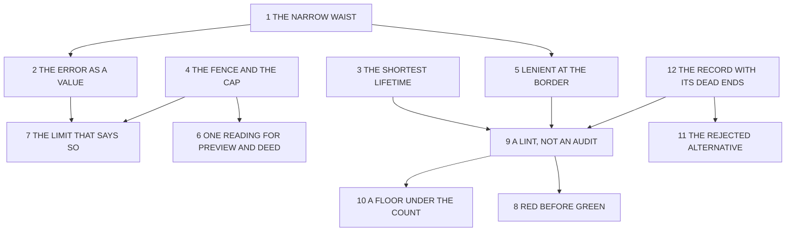

# A pattern language — the forms this tree keeps reaching for

**Who this is for.** A learner who has built a few things, keeps a record of
what went wrong, and has begun to see the same shapes return: the stage
[JOURNEY.md](JOURNEY.md) calls Ha. If you are looking for how to draw a
design, read [ARCHITECTURE_TUTORIAL.md](ARCHITECTURE_TUTORIAL.md); for the
rules of this codebase, [CONTRIBUTING.md](../CONTRIBUTING.md). **After
reading** you can say what a pattern is and is not, follow twelve of this
tree's forms from the large to the small, and write a pattern of your own
from your record. **You need first:** [PHILOSOPHY.md](PHILOSOPHY.md) and some
acquaintance with the tree ([reading/ANNAI.md](reading/ANNAI.md) is the
first reading guide). **Where it fits:** after
[SELF_GUIDANCE.md](SELF_GUIDANCE.md), whose weekly question leads here;
beside [ARCHITECTURE.md](ARCHITECTURE.md), the reference for the layers
these forms live in.

This tree teaches design in six tutorials and algorithms on a page of their
own. It also does something it never names. Files written months apart keep
arriving at the same few shapes: a narrow place that everything must pass
through, a failure handed back as a value, a limit that announces itself. The
tree has words for each of them. It has no page that says what kind of thing
they are, or how they hold on to one another. Until this page, the phrase
*pattern language* stood in the documentation only for the syntax of a
permission rule.

This page says what a pattern is, why the second word is *language*, and then
reads twelve of jichi's own forms as one. It is an essay, like
[PHILOSOPHY.md](PHILOSOPHY.md), and nothing in it is normative. The names in
capitals are this page's and nobody else's; under each stands the sentence the
tree itself uses, and that sentence is the one to trust.

## Where the idea comes from

It comes from building houses, not programs. Christopher Alexander, an
architect, argued with his colleagues in *A Pattern Language* (1977) and *The
Timeless Way of Building* (1979) that good places are made from a stock of
recurring answers to recurring problems, from the layout of a region down to
a seat by a window, and that the people who will live in a place can use that
stock themselves.

Ten years later two programmers carried the idea across. Kent Beck and Ward
Cunningham's report of 1987 is under nine hundred words long and still the
clearest account
for our trade:

> A pattern language guides a designer by providing workable solutions to all
> of the problems known to arise in the course of design. It is a sequence of
> bits of knowledge written in a style and arranged in an order which leads a
> designer to ask (and answer) the right questions at the right time.

They also say what one pattern consists of: "a statement of a problem, a
summary of circumstances creating the problem and, most important, a solution
that works in those circumstances." And they keep Alexander's purpose, which
is easy to lose: "Computer users should write their own programs." A pattern
language was meant as a way to hand design to the people who are not yet
experts. That is the reader this project is written for.

The book that made the word famous among programmers, *Design Patterns*
(Gamma, Helm, Johnson and Vlissides), is a **catalogue**: patterns you look
up one at a time. A great deal was gained by it, and one thing was lost on the
way, which was the second word. Richard Gabriel's *Patterns of Software*, free
to read, is a programmer's book of essays on what the idea was meant to be.
All five works are in [BIBLIOGRAPHY.md](BIBLIOGRAPHY.md), section 1.

## What a pattern is

Four parts and a name.

- **The context.** Where you are standing when the problem appears.
- **The forces.** The things that pull against each other there. A problem
  with a single force is not a design problem; you do the obvious thing.
- **The form.** A shape that settles the forces. It is a shape and not a
  piece of code: you can build it a hundred times and never twice alike.
- **The cost.** What the form asks of you from then on. A pattern that names
  no cost is an advertisement.
- **The name.** Short enough to say across a desk. Once two people share a
  name they can discuss a design without drawing it.

Three things are often taken for patterns and are not. A **rule** ("never
call `sprintf`") says what to do, and neither when nor why; it is what
remains when a pattern has lost its forces. A **snippet** is one building of
a form, mistaken for the form. And a **trophy** is a pattern used because its
name was known. The test for the last one is the test
[PHILOSOPHY.md](PHILOSOPHY.md) applies to its own vocabulary: does anything
in the code differ because of it? If nothing does, cut it.

## Why a language

Words alone are a dictionary. A language also has rules for which word may
follow which. Patterns are the same. A large one leaves smaller problems
open, and smaller patterns close them. A pattern on its own tells you what to
build. The connections tell you **what to ask next**, which is the half a
beginner cannot supply alone.

So a catalogue is something you consult, and a language is something you walk
through, from the large decision to the small one. The map further down is
drawn for walking.

## 型（かた） — the form, and its reason

*Kata* (型（かた）) is a form practised until the body knows it.
[JOURNEY.md](JOURNEY.md) is built on 守破離（しゅはり）, *shu-ha-ri*: keep the form,
break the form, leave the form. That story is about kata.

A pattern is a kata that carries its reason with it. The difference shows at
the second stage. A form learned without its forces can only be obeyed or
dropped. A form learned with them can be *broken on purpose*: you can see
that in this place one of the forces is absent, and build something else, and
say why. Breaking a form, as the journey page has it, means being able to
defend the break. The forces are the defence.

The tea tradition has a verse for this, handed down under the name of Sen no
Rikyū (利休（りきゅう）) and often given as the origin of the three words:

> 規矩作法 守り尽くして破るとも 離るるとても本を忘るな

Keep the rules and the forms to the end; and though you break them, though
you leave them, do not forget the source. The last word, 本（もと）, is the
point. The verse does not say that the three stages must come in order. It
says that at every stage one thing may not be lost, and for a pattern that
thing is its forces.

Japanese also has a pair of words that marks the difference exactly.
*Katayaburi* (型破り（かたやぶり）), breaking the mould, is said in praise of someone
who went past a form they had mastered. *Katanashi* (形無し（かたなし）), literally
without form, is said of something spoiled. From outside the two can look
alike, since neither follows the form. What separates them is whether the
form was there first.

## 用の美（ようのび） — the beauty of use

In 1925 the thinker Yanagi Sōetsu (柳宗悦（やなぎそうえつ）; the given name is also
read Muneyoshi), with the potters
Hamada Shōji and Kawai Kanjirō, coined the word *mingei* (民藝（みんげい）) for the
things ordinary people made for daily life: bowls, cloth, baskets. He held
that such things, made by craftsmen whose names nobody recorded, have a
beauty of their own, *yō no bi*, the beauty of use: a shape that is as it is
because of what it is for, and could hardly be otherwise.

A pattern is a thing of that kind. Three consequences follow, and each can
be checked.

- **A pattern is judged in use.** Not by how well it reads on a page, this
  one included, but by whether the code built on it is easier to change a
  year later.
- **A pattern has no author worth naming.** The twelve below were not
  designed by anyone. They were arrived at, several times, by whoever was
  working there, and written down afterwards. [PHILOSOPHY.md](PHILOSOPHY.md)
  calls that ground "heaps of dwarves".
- **A pattern is plain.** If a form needs admiring, look again at what it
  is for.

The parallel between Yanagi and Alexander is drawn by this page. Both looked
at what unnamed makers had settled on; this page does not claim that either
knew the other's work.

## jichi's language — twelve forms

Each entry gives the tree's own sentence, the forces, the form, where to read
it, and what it costs.

### In the product

**1. THE NARROW WAIST.** *"The agent never branches on provider."*
A core has to outlive every model and endpoint it talks to. Each new backend
invites one more `if` in the loop, and the loop is where a mistake is most
expensive. The form: one table of functions per backend
(`include/jc_provider.h`), with `build_request` as the only door a dialect
comes in by. The loop hands over history and takes back bytes it does not
look into. Read: [reading/fukabori-02-the-provider-abstraction.md](reading/fukabori-02-the-provider-abstraction.md).
Cost: a feature that one backend alone has must fit through the waist or
stay outside.

**2. THE ERROR AS A VALUE.** *"Tool errors are values, never control flow."*
(`CLAUDE.md`.) A model acts through tools, and tools fail for ordinary
reasons all day. The failure has to reach the model as something it can read
and act on, and it must not be confused with the machinery itself breaking.
The form: two answers kept apart. `jc_status` says whether the machinery
worked; the result, with `is_error` set, says whether the thing happened.
Read: [reading/tsuiseki-04-the-call-that-was-wrong.md](reading/tsuiseki-04-the-call-that-was-wrong.md).
Cost: every caller has two things to look at, and must not merge them.

**3. THE SHORTEST LIFETIME.** *"…pick the shortest one that outlives the
data."* (`CLAUDE.md`.) Freeing everything at once is simple and safe. But
memory given too long a life is invisible to a leak checker, because it is
still reachable when the program ends. The form: three arenas named by how
long they live — the session, the turn, the single tool call — and a choice
made before the first byte is allocated. Read:
[reading/fukabori-03-the-three-arena-lifetime-model.md](reading/fukabori-03-the-three-arena-lifetime-model.md);
`tests/smoke/arena_lint.sh` holds the line. Cost: you must know how long a
thing lives before you make it.

**4. THE FENCE AND THE CAP.** *"…fences on, caps off…"*
([TESTING_RUNBOOK.md](TESTING_RUNBOOK.md) §8). An agent that works unattended
has to be bounded. But a bound that fires in the middle of a measurement does
not hide the answer; that page says it "manufactures a different one". The
form: two kinds of bound with two names. A **fence** limits *where* the agent
may act, and stays on. A **cap** limits *how long*, and comes off when you
are measuring. Read: [AUTONOMY.md](AUTONOMY.md). Cost: a measurement run
takes as long as it takes.

**5. LENIENT AT THE BORDER, STRICT AT HOME.** The tree's sentence is a
question: *who wrote this JSON?* People write `1` for true. Read strictly,
that once left a safety setting switched off without a word. Read loosely
everywhere, a typing mistake becomes policy. The form: ask who wrote the
value. What a person, a foreign program or a model wrote is read through one
small, fixed set of spellings; what jichi wrote itself is read strictly,
because there a wrong type is a defect to be seen. Read:
[reading/ireko-06-who-wrote-this-json.md](reading/ireko-06-who-wrote-this-json.md);
`tests/smoke/config_bool_lint.sh` names the border. Cost: two readers, and
the duty to know on which side of the border you are standing.

**6. ONE READING FOR PREVIEW AND DEED.** *"`edit_file`, `apply_patch`, and
the diff preview must agree on exactly what an edit produces — otherwise the
diff you approve wouldn't match what gets written."*
([EDITING.md](EDITING.md).) An approval is worth exactly as much as the
preview is true. The form: the preview and the act go through the same code,
not through two pieces of code that are meant to agree. Cost: the shared
part has to be pure enough to run twice.

**7. THE LIMIT THAT SAYS SO.** *"Every buffer is bounded, every cap is named,
and when output is truncated the truncation says so."*
([PHILOSOPHY.md](PHILOSOPHY.md).) A buffer without a bound is a crash that
has not happened yet. A silent cut is a lie told now. The form has three
parts that travel together: the bound, its name, and a mark in the output
that a reader — a person or a model — cannot miss. Cost: the mark takes
room, and it needs a test of its own.

### In the practice

**8. RED BEFORE GREEN.** *"A test never observed failing has never been
observed working."* ([TEST_INTEGRITY.md](TEST_INTEGRITY.md).) A passing check
feels like knowledge, and it passes just as well when it looks at the wrong
thing. The form: take the guard away, watch that one check fail, put the
guard back. Per check, not per file. Read:
[TESTING_RUNBOOK.md](TESTING_RUNBOOK.md) §1 and §2; `tests/teeth.sh` is the
ritual as a script. Cost: every check is written twice, once broken.

**9. A LINT, NOT AN AUDIT.** *"An audit finds what it knew to look for, once.
A lint finds it every build."* ([APPROACH.md](APPROACH.md) §4.) A finding
made by reading is true on the day of the reading. The form: turn the
finding into a check that states its universe and runs on every build. Cost:
a lint is code, and can be wrong like code; it leans on the next form.

**10. A FLOOR UNDER THE COUNT, AND A SECOND COUNT.** *"…two empty sets agree
perfectly."* (The header of `tests/smoke/docs_index_lint.sh`.) A check that
compares two lists passes with pleasure when both lists came back empty. The
form: fix the size of what the check extracts at today's exact number, and
count the same set once more by a different route. Read:
[TESTING_RUNBOOK.md](TESTING_RUNBOOK.md) §3 and §4. Cost: the floor moves
whenever the tree grows, and moving it is work done on purpose.

**11. THE REJECTED ALTERNATIVE.** *"If there is no rejected alternative, it
was not a decision — it was just work."* ([DECISIONS.md](DECISIONS.md).) A
decision written down without what it turned away looks, a year later, like
an accident, and gets undone by someone who never met the reasons. The form:
what was decided, what was rejected, where the reasoning lives. Cost: you
have to actually consider a second way.

**12. THE RECORD WITH ITS DEAD ENDS.** *Symptom → dead ends → root cause →
lesson* ([ANECDOTES.md](ANECDOTES.md)). The road to an answer is tidied away
the moment the answer is known, and the wrong turns are what the next person
needs. The form: write all four parts, the wrong turns among them, on the
day. Cost: your mistakes stay readable.

## How the forms lean on one another

First as plain text, for a reader without a renderer:

     1  THE NARROW WAIST       is completed by   2, 5
     2  THE ERROR AS A VALUE   is completed by   7
     4  THE FENCE AND THE CAP  is completed by   7, 6
     3  THE SHORTEST LIFETIME  is completed by   9
     5  LENIENT AT THE BORDER  is completed by   9
    12  THE RECORD             is completed by   9, 11
     9  A LINT, NOT AN AUDIT   is completed by   10, 8

And the same as a diagram:

An arrow reads *is completed by*. Walk it from the top. Once you have chosen
a narrow waist, the next question is what crosses it when something fails
(2) and how strictly it reads what arrives from outside (5). Once failures
are values, the next question is what a reader is told when a value had to
be cut (7).

The lower half belongs to the practice, and one node there gathers arrows
from everywhere. That is the most particular habit of this tree: when a form
in the product matters, it is given a lint to hold it (3 and 5 both have
one), and when the record shows a lesson for the second time, the lesson
becomes a lint as well (12 to 9). A lint is then trusted only as far as the
two forms beneath it reach (8 and 10).

The map is one reading. Twelve is not a count of anything; another reader
would cut the same cloth differently, and should.

## Writing your own

A pattern is found, not invented. The place to find yours is the record that
[JOURNEY.md](JOURNEY.md) asked you to start on your first day, and
[SELF_GUIDANCE.md](SELF_GUIDANCE.md) asks you to read once a week.

1. **Wait for three.** One mistake is an event and two are a coincidence.
   When a third entry has the shape of two older ones, you are looking at
   forces that will come again.
2. **Write the forces before the form.** What pulled against what? If you
   can name only one side, you have a rule, and a rule is fine — call it
   one.
3. **Describe the form without code.** If only code will say it, you have a
   snippet.
4. **Write the cost.** Every form here has one, and yours has one too.
5. **Name it, and say what it leans on.** Which of your other forms must
   already stand for this one to work? Which question does it open?
6. **Put it to the test.** Could someone catch you not doing it? Does any
   file differ because of it?
7. **Let it go when its forces go.** A form kept after its problem has left
   is ritual. [JOURNEY.md](JOURNEY.md) says the same of lessons: a teaching
   you cannot take back is dogma.

One caution about the famous catalogues. A form answers forces. Carry a form
into a place where those forces do not act and you have built a decoration
that the next reader must work around. Read the catalogues for their forces
and compare them with yours; the forms come second.

## The honest limits of this page

- **The capital-letter names are this page's.** No other page and no line
  of the source uses them. If one proves useful it will spread; if none
  does, the tree's own sentences were enough.
- **The two books by Alexander and the catalogue were not read at this
  bench for this page.** Their entries in the bibliography say exactly what
  was checked. The 1987 report was read, and the quotations are taken from
  it.
- **The Japanese sources were checked against secondary accounts, on
  2026-11-25, not against the originals.** The verse is traditionally
  ascribed to Rikyū; scholars doubt that he wrote it, and the three words
  are said to be older than their use in tea. What is said of Yanagi and the
  founding of mingei is the common account. None of these is in the
  bibliography, because no edition was verified.
- **Twelve forms is a reading of a large tree**, made mostly from the pages
  linked above and from the rules file, not from every source file.
- **Nothing here was tried on learners**
  ([LEARNER_STUDY.md](LEARNER_STUDY.md) has not been run).
- **It was drafted with the help of a model.** Hold it to the test it
  proposes.

---

## Read further

- *Using Pattern Languages for Object-Oriented Programs*, Beck and Cunningham,
  1987 (primary): the idea's arrival in programming; short, free, and read for
  this page.
- *A Pattern Language* and *The Timeless Way of Building*, Alexander and
  others (primary): the origin, in architecture.
- *Patterns of Software*, Gabriel (secondary, free), and *Design Patterns*,
  Gamma and others (secondary): what became of the idea among programmers.
  All five entries are in [BIBLIOGRAPHY.md](BIBLIOGRAPHY.md), section 1.
- [PHILOSOPHY.md](PHILOSOPHY.md) and [JOURNEY.md](JOURNEY.md): the frame, and
  keep, break, leave.
- [SELF_GUIDANCE.md](SELF_GUIDANCE.md): the record your own patterns come from.
- [ARCHITECTURE.md](ARCHITECTURE.md) and
  [ARCHITECTURE_TUTORIAL.md](ARCHITECTURE_TUTORIAL.md): the layers these forms
  live in, and how to draw a design.
- [APPROACH.md](APPROACH.md), [TESTING_RUNBOOK.md](TESTING_RUNBOOK.md),
  [DECISIONS.md](DECISIONS.md), [ANECDOTES.md](ANECDOTES.md): the practice, in
  full.
