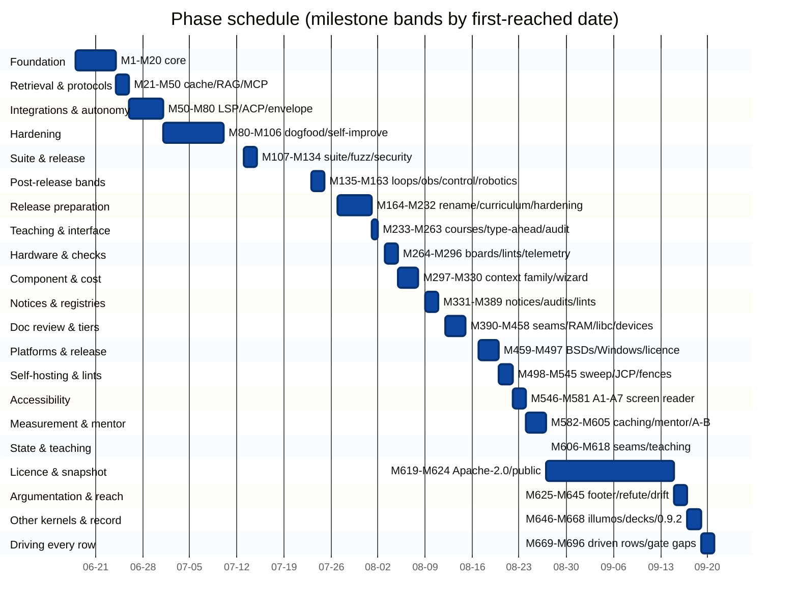
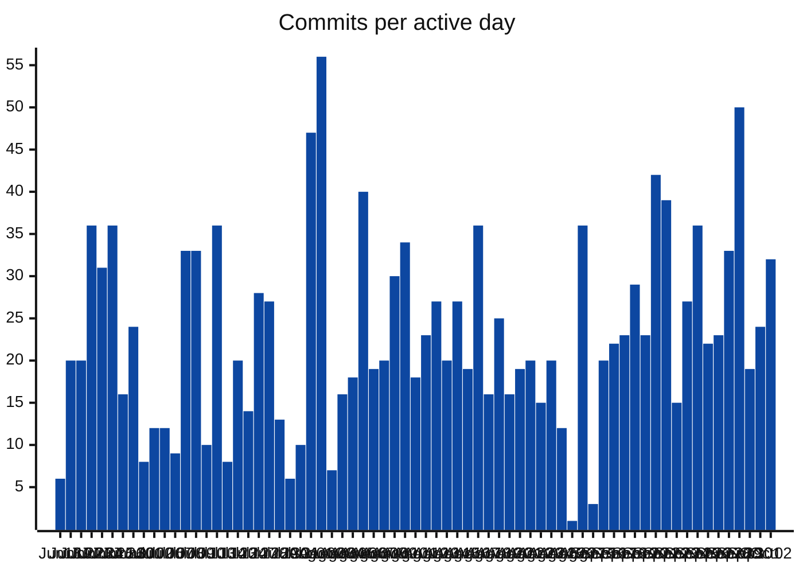
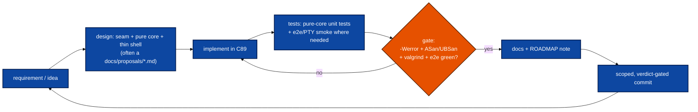
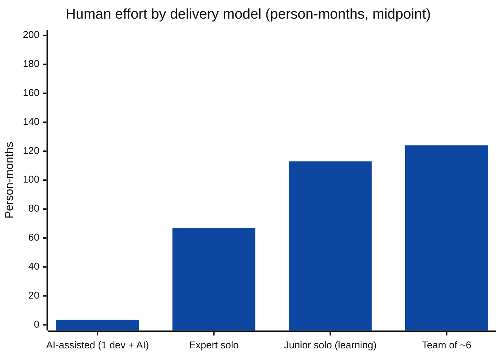
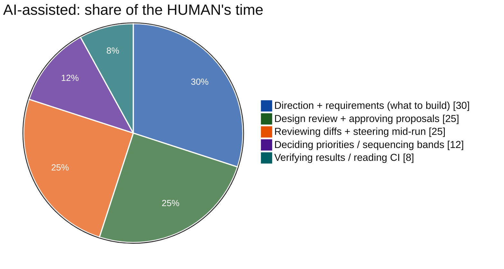

# jichi — project timeline, development & testing retrospective

> **Also in:** [Deutsch](i18n/de/PROJECT_TIMELINE.md) ·
> [Español](i18n/es/PROJECT_TIMELINE.md) ·
> [日本語](i18n/ja/PROJECT_TIMELINE.md) ·
> [中文](i18n/zh/PROJECT_TIMELINE.md) (this English page is canonical).

A data-grounded review of how this project was designed, built, and tested from
its first commit to now — written **for learning project planning and
management**. It reconstructs the timeline from git history, the ROADMAP, and the
codebase; shows the numbers visually; and closes with a transparent,
side-by-side estimate of how long the same scope would take **four** ways: a
single developer **assisted by an AI agent** (what actually happened), an expert
solo developer, a balanced team, and a junior solo developer.

> **Method & honesty note.** The actual build was **AI-assisted** — one human
> directing an AI agent that implemented, tested, and documented under
> supervision. So the *calendar* span below (**15 weeks, 69 active days**) reflects
> that model, not human hand-effort. The other three estimates are
> **human-equivalent**, derived bottom-up from the delivered scope; they are
> ranges with stated assumptions (software estimation is uncertain — treat as
> ±40%). The point is the *method*, the *shape of the work*, and an honest
> comparison of delivery models.

---

## 1. At a glance

| Metric | Value |
|---|---|
| Calendar span | 2026-06-18 → 2026-11-04 (**139 days**, **101 active**) |
| Commits | **3,194** |
| Milestones | **M1 – M1129** (1,106 milestone-named `###` entries in `docs/ROADMAP.md`; all-`###` is 1,115 -- see the pin note) |
| First-party source (`src` + `include`) | **~153,500 lines** (367 tracked `.c`/`.h` files) |
| Tests | **~162,000 lines** (143 unit files + 538 POSIX-sh smoke drivers + 10 e2e modules + **24** fuzz targets incl. the path-fence and jsonrepair property targets — see the note below), **15,343 unit checks**, smoke **2,651 checks** (both carried at M950; the total moves by a few between runs, because some drivers' check counts depend on what the environment provides) |
| Documentation | **~225,300 lines** across **673** English markdown pages (725 docs `*.md` files incl. the 52 translations -- the pinned count; the M907-published "758 files incl. translations" used a second, unreproducible convention, see the note; the export-ignored `docs/internal/` is not counted, see the note) — 50 design proposals, 183 dated analysis notes, 32 source-reading guides, **90 graded assignments** (75 trap cases, both figures re-verified on this tree). Translations are counted separately below, not folded in here; see the note. |
| Subsystems | **20** (`src/*`) |
| Third-party source | none — `src/json/cJSON.{c,h}` is original code (M171), ~1,100 lines |
| Language / target | C89 / ANSI C; **four kernels** carry the full gate (Linux, FreeBSD, NetBSD, OpenBSD), 14 architectures in the named sweep and 20 `zig cc`+musl triples in the re-sweep — 19 runnable, and as of 2026-09-21 **all 19 driven** — five libcs; since M750 **illumos, GNU/Hurd, macOS and Haiku** are partly verified and driven; libcurl the only dependency |
| Quality gates | `-Wall -Wextra -Werror` (gcc + clang), ASan/UBSan, valgrind, fuzz, smoke, e2e — plus two Windows emulation layers *partly* verified, each with what it does **not** cover written down |
| Copyright / licence | **Apache-2.0** (decided 2026-08-27, M619); every tracked `.c`/`.h` (`src`, `include`, `tests`) carries `Copyright (c) 2026 Justus-Liebig-Universität Gießen` + `Author: Alexander-Lars Dallmann` over the SPDX line |

Total **authored** lines (code + tests + English docs): **~541,000**, plus **~8,300**
lines of translation under `docs/i18n/` — the two figures are disjoint, which the
M620 revision's were not.

*Every figure in this table was **re-counted at M907**, on 2026-10-07, not incremented — and the
recount was lint-triggered a fifth time: since the M865 column, 26 drivers and 42 milestones
(through M907, 890 entries) had landed, past `docs_counts_lint`'s 40/25 tolerance. Before counting, the universes were **pinned**
against the published M865 column on the tree that committed it (`a9cc36f3`), and every count
reproduces exactly: 1,587 commits before its own, 340 source files, 137 unit files, 398 drivers,
10 e2e modules, 23 fuzz targets, 576 pages, 628 files, 48 proposals, 104 analysis notes, 32
reading guides, 856 entries; the line totals reproduce to within 0.1% (122,748, 117,647 and
181,975, against ~122,700, ~117,600 and ~181,900). The authored total moved from ~422,300 to
~450,000. (The pin first failed on the smoke-driver count, 397 against the published 398 —
my counting expression excluded `run.sh` by the pattern `run\.sh`, which also matched
`grade_cannot_run.sh`; the M865 column's own figure was the 398 that includes it, and the
corrected expression reproduces both pins. An off-by-one in the counter, caught by the pin.)

*2026-10-13 (M949): the span, commit, milestone and driver figures re-measured on this tree (all four lint-enforced); the line totals, check counts, word count and bar chart stay carried at M907, per the doctrine below.*

*2026-10-20 (M996, the 46-milestone drift the CI follower's 02:16 note caught): the span, commit, milestone, driver, source/test/doc line totals and page counts re-measured on this tree with `scripts/timeline-pin.sh` (HEAD: 2,201 commits, 966 milestone-named entries, 344/139 source/unit files, 473 drivers, 133,389/135,742/219,684 lines); the check counts (15,343 unit / 2,651 smoke) stay carried at M950 and the section-4 bar chart stays carried at M907, per the doctrine below.*

*2026-10-22 (M1038, the 42-milestone drift `docs_counts_lint` checks 12/15 caught when the M1038 ROADMAP entry landed): the span, commit, milestone, driver, source/test/doc line totals and authored total re-measured on this tree with `scripts/timeline-pin.sh` (HEAD: 2,402 commits, 992 milestone-named / 1,000 all-`###` entries, 346/140 source/unit files, 482 drivers, 134,902/140,869/220,569 lines; the doc line figure is the English-only universe, pages 663 unchanged); the check counts (15,343 unit / 2,651 smoke) stay carried at M950 and the section-4 bar chart stays carried at M907, per the doctrine below.*

*2026-11-03 (M1121-c, the milestone drift docs_counts_lint check 12 caught when the M1121 ROADMAP entry landed): the span, commit, milestone, driver, source/test/doc line totals and page counts re-measured on this tree with scripts/timeline-pin.sh (HEAD: 3,147 commits, 1,098 milestone-named / 1,107 all-### entries, 367/143 source/unit files, 537 drivers, 153,149/161,324/225,287 lines); the check counts (15,343 unit / 2,651 smoke) stay carried at M950 and the section-4 bar chart stays carried at M907, per the doctrine below.*

*2026-11-03 (M1122, the 0.13.0 release re-count): the span, commit, milestone, driver, source/test/doc line totals and page counts re-measured on this tree with scripts/timeline-pin.sh (HEAD: 3,150 commits, 1,099 milestone-named / 1,108 all-### entries, 367/143 source/unit files, 537 drivers, 153,149/161,324/225,292 lines); the check counts (15,343 unit / 2,651 smoke) stay carried at M950 and the section-4 bar chart stays carried at M907, per the doctrine below.*

*2026-11-04 (the 0.13.0 final release re-count, SV:2357): the span, commit, milestone, driver, source/test/doc line totals and page counts re-measured again on this tree with scripts/timeline-pin.sh, the M1122 re-measurement re-run on the final RC head (HEAD: 3,194 commits, 1,106 milestone-named / 1,115 all-### entries, 367/143 source/unit files, 538 drivers, 153,478/161,936/225,342 lines); the check counts (15,343 unit / 2,651 smoke) stay carried at M950, the section-4 bar chart stays carried at M907, and the active-day figure (101) stays carried from M1122 per the doctrine below (it is not derived from the pin); the 139-day span end is the 0.13.0 snapshot date, 2026-11-04 (SV:2359).*

*2026-10-13 (M950, universe pin): the counting expressions are now written down --
`scripts/timeline-pin.sh [commit]` (default HEAD; the pin-check flag re-runs the
twelve M865 file-figure targets) reproduces the published file figures of a milestone column
from its tracked tree, and passes them: 1587 commits / 340 source / 137 unit / 398
driver / 10 e2e / 23 fuzz / 576 page / 628 docs-file / 48 proposal / 104 analysis /
32 guide / 856 entries at `a9cc36f3`, plus the line totals 122,748/117,647/181,975.
Run at `d23f90c8` it reproduces the M907 column's pages, drivers and line totals
(634 pages, 424 drivers, 126,198/122,866/200,967) -- its docs-file count (686) is
not the published "758 files incl. translations", which no tracked-tree rule
reproduces; that is the carried figure named below. This table's re-count used the
pre-commit tree of the M949 head (`570cd72f`), which the script reads as 342 source
/ 138 unit / 452 driver / 10 e2e / 652 page / 704 docs-file / 50 proposal / 174
analysis / 32 guide / 23 fuzz, line totals 130,089/129,096/211,512, 929
milestone-named ROADMAP entries (937 all-`###`), and 1,888 commits; at this
commit the ROADMAP holds 930 named entries (938 all-`###`). The at-a-glance and the
section 4 tables above now carry those, with the **15,343** unit checks and
**2,651** smoke checks measured on this tree (replacing the M907-carried 15,005
and 2,433). **Still carried, with no single rule that yields them** (named, not
hidden): the M907-era docs row's "**758 files** incl. translations" (replaced in
the row by the pinned 704, kept here as the record of the old convention), the
**commits** row (published 1,882 at M949; a bare commit-count expression reads
1,888 at that same tree -- the convention is not reconstructed, so the row keeps
1,882), the graded-assignment/trap-case pair, and the historical "exact counts"
the section 4 bars used before M950 (200,948/126,198/122,857 -- none of them a
tracked line total). Two counting traps, and a second convention finding, are
named in the script header: (1) the driver exclusion must be the two files
`run.sh`/`_smoke.sh` -- a pattern on `run.sh` alone also matches
`grade_cannot_run.sh` (the M907 off-by-one); (2) the guide count must descend into
`docs/reading/traces/` -- a flat listing reads 31, not 32; (3) the Milestones
figure has **two conventions in its own history** -- the M865 column (856) counted
ALL `###` headings, M907 onward counts milestone-named ones (890 then; 929 at the
M949 head, 930 now, with this entry); the script prints both, and any re-count
must say which it publishes.*

*2026-10-12 (M948): a **partial** update, not a full re-count. The span, commit, milestone and driver figures above were re-measured on this tree (all four lint-enforced or trivially verifiable). The line totals, file breakdowns, check counts, the word count and the bar chart below are **carried at M907**: at re-count my counting universes did not reproduce the published M907 line figures (for instance, 200,948 English doc lines -- no single tracked-tree rule yields that number), so per this page's own doctrine they are carried, not re-guessed, until their counting expressions are written down.*

***The pin also confirmed the one carried figure is still not reproducible.*** *"90 graded
assignments (75 trap cases)" stays as published: the tree holds 87 numbered assignment dirs at
M865 (183 now) and 81 with a `test.sh` both then and now; the definition that produced 90 is
still not written down, so it is re-measured when someone writes it down, not re-guessed now.
The 75 trap cases reproduce (2026-10-07, `curriculum_graders.py`).*

*Every figure in this table was **re-counted at M865**, on 2026-10-02, not incremented — and the
recount was lint-triggered a fourth time: M865's driver was the 398th, 26 more than the 372 this
page claimed, and `docs_counts_lint` check 13 allows 25. Before counting, the universes were
**pinned** against the published M832 column on M832's own tree (`git archive 63ef86b8`, which
leaves out the export-ignored `docs/internal/`), and every count in it reproduces exactly: 1,460
commits before its own, 334 source files, 134 unit files, 372 drivers, 10 e2e modules, 23 fuzz
targets, 564 pages, 616 files, 45 proposals, 103 analysis notes, 32 reading guides, 823 entries,
65 active days; the line totals reproduce to within 0.1% (117,850, 111,135 and 173,224, against
~117,900, ~111,100 and ~173,200). The authored total moved from ~402,200 to ~422,300.*

***One figure was carried, not measured, and is marked here instead of redefined.*** *"90 graded
assignments (75 trap cases)" stands as published: `docs/assignments` holds 92 numbered pages, the
same tree at M832 and at M865, and the definition that produced 90 is not written down. It is
re-measured when someone writes it down, not re-guessed now.*

*The M832 recount, of 2026-09-28, follows.*

*Every figure in this table was **re-counted at M832**, on 2026-09-28, not incremented — and the
recount was lint-triggered again: M832's own ROADMAP entry put this page 41 milestones behind, and
`docs_counts_lint` check 12 fired. Before counting, the universes were **pinned** against the
published M750 column, and every count in it reproduces exactly (326 source files, 131 unit files,
331 drivers, 10 e2e modules, 528 pages, 580 files, 45 proposals, 96 analysis notes, 739 entries, 62
active days); the line totals reproduce to within 0.3%, because M750 measured a mid-edit branch.*

***The pin found two defects, and both are the kind this page exists against.*** *First, the
documentation universe had moved without a word. It is `docs/` minus `docs/i18n/` **and minus the
export-ignored `docs/internal/`**: M750's 528 pages reproduce only with that exclusion, while the
v0.10.0 column M750 said it matched (149,258 lines over 513 pages) reproduces only *with*
`docs/internal/`, which then held one page of 117 lines. Small for v0.10.0, growing with every
handoff note, and now stated: a published retrospective counts what its readers can see. Second,
figures had been **incremented**. The M750 column's smoke-driver count read **372**, not its
measured **331**, because each later milestone that added a driver bumped it, M831 included; the
column had become a live number wearing a dated label. And the Tests row said 132 unit files where
the tree holds **134**. The M750 column is restored to 331, and M832's counts stand in a column of
their own. The platform row is again carried from [`PLATFORMS.md`](PLATFORMS.md) as it stands.*

*The **milestone figure was re-counted at M791**, on 2026-09-26 (781 `###` entries), when
`docs_counts_lint` check 12 crossed 40 milestones of drift during the docs-structure S4 work
— the same lint-triggered recount this page records happening before. The other rows below
stand from the M750 recount; they are re-measured, not incremented, when the next figure
drifts.*

*Every figure in this table was **re-counted at M750**, on 2026-09-25, not incremented,
on the same universes as the v0.10.0, M686 and M646 recounts: `src` + `include` for
source, everything tracked under `tests/` for tests, and **`docs/` minus `docs/i18n/`**
for English documentation. The platform row is the exception: it is carried from
[`PLATFORMS.md`](PLATFORMS.md) as it stood, and was not re-checked here. Before counting,
the universes were pinned the way M646 pinned them, by running today's commands at the
v0.10.0 commit (`4f283602`). They reproduce that column's source (110,628 lines),
tests (99,981), documentation (149,258 over 513 pages), smoke drivers (317), unit files
(130) and analysis notes (89). The commit count reads 1,304 there, one more than
published, because the published figure was taken before the release commit itself.*

***This recount was lint-triggered, by a number rather than by work.*** *`docs_counts_lint`
check 12 fired at 41 milestones of drift. But M746–M749 were never used: the two
machines' handoff reserved them for threadwork, which released them. So **38**
milestone entries had landed since M709: M710–M745, M735b and M750. The gate counts milestone numbers, the one proxy that
works in a tree without git, and here that proxy fired a few milestones early. That is
the direction a drift gate should err in.*

*The previous recount, of 2026-09-22, follows. It was measured twice, once at M704 and
again at the v0.10.0 release, not incremented —
same universes as the M686 and M646 recounts, so all three are comparable:
`src` + `include` for source, everything tracked under `tests/` for tests, and
**`docs/` minus `docs/i18n/`** for English documentation — `docs/` only, **not**
the root pages. This one was **not** lint-triggered and did not need to be:
`docs_counts_lint` check 12 refuses a drift over 40 milestones and the page had
drifted 10, well inside the gate. It came from the operator asking for the page
to be reviewed, and it found no universe defect — which is worth stating plainly,
because the two recounts that did find one are the reason the universes are named
in this paragraph instead of assumed.*

*What ten milestones moved, then thirty-seven, then eighty-two, then thirty-three:*

| | M686 (2026-09-20) | M704 (2026-09-22) | v0.10.0 (2026-09-22) | M750 (2026-09-25) | M832 (2026-09-28) | M865 (2026-10-02) |
|---|---:|---:|---:|---:|---:|---:|
| commits | 1,221 | 1,264 | 1,303 | 1,353 | 1,460 | **1,587** |
| first-party source | ~109,500 | ~110,500 | ~110,600 | ~112,600 | ~117,900 | **~122,700** |
| tests | ~97,800 | ~99,700 | ~100,000 | ~105,700 | ~111,100 | **~117,600** |
| documentation (English only) | ~141,400 | ~145,100 | ~149,300 | ~158,900 | ~173,200 | **~181,900** |
| smoke drivers | 312 | 317 | 317 | 331 | 372 | **398** |
| unit checks | 13,329 | 13,461 | 13,470 | 13,943 | 14,153 | **14,655** |
| smoke checks | 1,736 | 1,851 | 1,854 | 1,961 | 2,170 | **2,374** |
| dated analysis notes | 81 | 86 | 89 | 96 | 103 | **104** |
| English doc pages | 489 | 499 | 513 | 528 | 564 | **576** |

*The sixth column is the batch branch `fix/2026-10-02-batch2` -- `master` at M859 (`520f3aa8`) plus
M860 to M864 and the demos drive's notes -- measured on M865's staged tree before its own commit.
Thirty-three milestone numbers and 127 commits landed since that recount, in the rest of Sep 28
and four more days: the FreeDOS + DJGPP row
(M833–M839), the chatbot guide and the read-only fix (M840–M842), the branch review's first batch
(M843–M851: the fences, the trust step for a project's own config) and the demos drive's findings
(M852–M865: a fenced child's temp dir, `finish`, how a stopped child ends and merges, the shared
stash, cut replies, batch ids, task budgets, a red verify's lines, keeping work before a discarding
git command, a child's log ids, a moved test assertion held). Source grew **+4.2%**, tests **+5.9%**
and documentation **+5.0%**; in every step of this table tests grew faster than source.*

*The fifth column is `master` at M831 plus M832, measured on M832's staged tree before its own
commit. Eighty-two milestone numbers and 107 commits landed in those three days, on two machines:
the TUI's control surface (`/fences`, `/why`, `jichi ps`, Esc to stop a turn), the GNU/Hurd row and
the fork-free measurement (M767–M769), the API-key protection swept across five kernels
(M770–M799), the documentation-structure plan (M772–M795), the preserve-agent-work line
(M800–M816), macOS and Haiku (M817, M830), the weekend drive's sixteen findings (M818–M829), the
Landlock shell fence (M831) and the fork-free spawn backend (M832). Source grew **+4.6%**, tests
**+5.1%** and documentation **+9.0%**, 36 English pages among it: the structure plan was the
largest documentation wave any column records.*

*The fourth column is the branch `twelve-questions`: `master` at M745, plus the
operator's decisions on the twelve questions and M750. Over those three days source
grew **+1.8%**, tests **+5.8%** and documentation **+6.5%**, and 50 commits landed: a
platform wave (FreeMiNT and Guix driven, the oldest-toolchain ladder), two releases
(v0.10.1 and v0.12.0), two drives measured (M731, M744), and the constraint scanner
measured twice (M730, M743). Tests grew three times faster than source, which is this
project's signature again.*

*The third column is `master` at the **v0.10.0** release — no branch, nothing
un-merged. The M704 column was measured on an un-merged branch and said so; that
branch and four others have since landed, which is most of the jump in pages and
analysis notes. The standing signature holds across both steps: over the two days
source grew ~1%, tests ~2% and documentation ~5.6%. **Source barely moved and
documentation grew five times faster**, which is what a release wave looks like
here — the work was measuring, porting and writing down, not adding subsystems.*

*The M686 recount **was** lint-triggered, and the difference is worth naming:
check 12 fires at 40 milestones of drift, and M686 is 41 past M645, so the gate
went off on the first milestone that crossed it. Its first draft added the root
markdown and came out ~7,800 lines high; `docs_counts_lint` check 18 caught that
by asking which of two candidate universes the claim was nearer — the same defect
it was written for after M620 double-counted the translations. A recount can
drift in the universe as easily as in the number. The M646 recount below was not
forced either: it too came from the operator asking, and it found two defects a
lint-triggered recount would have left standing for another sixteen milestones.
A threshold catches rot; it does not catch a figure that was wrong when it was
written.*

> **What this recount found in the M620 figures, and how.** The M620 revision
> wrote "Nothing anomalous surfaced this round — every figure moved in the
> expected direction". Two figures had not.
>
> **1. The documentation line count silently included the translations, and then
> added them again.** M620 claimed "~132,800 lines, 442 English markdown pages".
> Re-measuring *at the M620 commit itself* gives **124,746** lines across exactly
> **442** pages under `docs/` excluding `docs/i18n/` — the page count's universe
> — and `docs/i18n/` held **8,020**. 124,746 + 8,020 = **132,766**, which is the
> claimed figure to three significant digits. So the line count and the page
> count were measured over *different sets*, and the table then said "plus ~8,000
> lines of translation" on top, double-counting them in the **~327,400** grand
> total (106,696 + 87,907 + 132,766 = 327,369). The English documentation was
> therefore overstated by ~8,000 lines for 25 milestones, in the one table the
> whole page rests on. Fixed by stating the two disjointly.
>
> **2. There are 24 fuzz targets.** `JC_FUZZ_TARGETS[]` in
> `tests/fuzz/jc_fuzz_targets.c` has 24 entries, nameable one by one: json, sse,
> testparse, html, rss, base64, constraint, lsp_framer, glob, output_fmt, yaml,
> patch, utf8, mcp, prop_base64, prop_configedit, prop_setup, prop_constraint,
> prop_pathfence, prop_jsonrepair, embed, prov_openai, prov_anthropic,
> toolcall_recover. *(The page said
> **21** for 25 milestones while the table held **19**, and it had 19 at the M620
> commit too — carried forward rather than counted, in the revision that said it
> had counted everything. `docs_counts_lint` check 17 has held the figure to the
> table since, and it is what caught this line when the count moved to 22, and again at 23 (M725).)*
>
> **How both were caught: enumerating the set a second way.** Every universe in
> this table was pinned by re-deriving M620's *own* published number from the
> M620 commit before trusting any of today's. Three reproduced to the digit
> (source 106,696 ≈ ~106,700 over 316 files; tests 87,907 ≈ ~87,900 over all
> tracked files under `tests/`; unit files 127), which is what confirms the
> universe. The two that would not reproduce are the two defects above. The same
> discipline caught an error of *mine* mid-count: `find src include -name '*.[ch]'`
> returned 324 files against `git ls-files`'s 323, and the extra was
> `include/jc_buildrev_stamp.h` — a generated build artifact, gitignored, not
> source. The tracked route is the right one and the convenient route was wrong.

*The rule stays "recount", never "increment", because the failures run in both
directions: the M579 recount found the documentation **under**counted by ~14,500
lines, and this one found it **over**counted by ~8,000. Only recounting finds
either, and — as M620 shows — only recounting* every *figure finds the one that
was quietly copied.*

*The recounts had landed at a fixed cadence — M538, M579, M620, each exactly 41
milestones apart, which is what a fixed threshold does (about three weeks at this
project's pace). M646 breaks that rhythm at 26, because it was asked for rather
than forced, and the two defects above are the argument for not waiting for the
threshold: a gate set at 40 milestones is a promise that nothing rots faster than
40 milestones, and a figure copied instead of counted rots the moment it is
written. What moved says what the last 26 were:*

| | M579 | M620 | M646 | M620 → M646 |
|---|---|---|---|---|
| first-party source | ~103,900 | ~106,700 | ~108,700 | **+1.9%** |
| tests | ~83,500 | ~87,900 | ~93,700 | **+6.6%** |
| documentation (English only) | ~119,500 | ~124,700 | ~131,300 | **+5.3%** |
| smoke drivers | 258 | 281 | 298 | +17 |
| unit checks | 12,960 | 13,177 | 13,329 | +152 |
| smoke checks | — | 1,608 | 1,736 | +128 |
| dated analysis notes | 66 | 69 | 74 | +5 |
| English doc pages | — | 442 | 466 | +24 |

*The documentation row is restated on the English-only universe for all three
revisions, so the column is comparable; the M579 and M620 cells as originally
published were ~127,500 and ~132,800, both including `docs/i18n/`. The M620 cell
is re-derived from the M620 commit (124,746); the M579 cell is its published
figure less that revision's translation lines and is therefore approximate —
marked so rather than quietly recomputed, because it was not re-measured here.*

*Tests again grew at twice the product's rate and documentation at one and a
half times — the stable signature of this project. What those 41 milestones
were: the close of the accessibility program, then three operator-directed seam
surveys mended wave by wave (the learning loop M596–M605, state and hardening
M606–M612, the teaching features M613–M618), every mend born red before its fix
— and then the licence landing (Apache-2.0, M619) and the first public snapshot
this recount ships inside (M620).*

> Every figure here is **measured, not carried forward** — `git rev-list`, `wc`,
> and the suites' own output, re-run for this revision. The curriculum counts in
> particular are enforced by `tests/smoke/docs_counts_lint.sh`, after
> an audit found they had drifted: each milestone had incremented the previous
> claim (68/41) instead of recounting (74/46). A number that looks maintained is
> a number nobody re-checks.
>
> Re-measuring for the M296 revision made that point twice more. The **smoke
> driver count** came out as 104 by `ls` and 103 by `make smoke`, and the gap was a
> real orphan: `faults_net_midstream.sh` had sat beside its two listed siblings
> since M269/M272 without ever being named in `run.sh`, so its coverage had never
> run. `rig_lint.py` has checked for exactly that on the e2e side since M213; the
> smoke tier had no equivalent, and now does. And the lint named in the paragraph
> above did not exist under that name — the file is `docs_counts_lint.sh`, not
> `curriculum_counts_lint.sh`. **A citation is a checkable claim too.**
>
> **This revision (M497) is the page proving its own point against itself.** It sat
> at **M296** for fifteen days and 201 milestones while every currency lint in the
> tree stayed green, because `milestone_currency_lint` checks that the *ROADMAP* is
> not behind the pages that cite it — and this page cites nothing, it *reports*. The
> operator noticed, not a test. So two figures here are now linted
> (`docs_counts_lint` checks 12–13: this page's stamped milestone against the
> ROADMAP's newest entry, and its smoke-driver count against `tests/smoke/`), and
> the rest are re-measured below with the commands shown. The intermediate
> assertion counts in §6 were obtained by building the suite at four past commits
> in a throwaway worktree, **not interpolated** — which settled a contradiction the
> old revision carried: §1 said 10,090 assertions at M296 and §6 said 9,639. The
> measured answer is **10,090**.

---

## 2. The timeline of phases

```mermaid
%%{init: {'theme':'base','themeVariables':{'cScale0':'#0d47a1','cScaleLabel0':'#ffffff','cScale1':'#1b5e20','cScaleLabel1':'#ffffff','cScale2':'#b71c1c','cScaleLabel2':'#ffffff','cScale3':'#4a148c','cScaleLabel3':'#ffffff','cScale4':'#e65100','cScaleLabel4':'#ffffff','cScale5':'#006064','cScaleLabel5':'#ffffff','fontSize':'14px'}}}%%
timeline
    title jichi — design / development / testing phases
    section P0 Foundation (Jun 18-24)
        Core substrate : platform, arenas, str/vec/json : config + models/roles : providers (Anthropic + OpenAI) + SSE : agent loop, modes/permissions : first tools, sessions, raw-mode TUI
    section P1 Retrieval & protocols (Jun 24-26)
        Cost & context : prompt caching : auto-compaction : RAG (index/embed/rerank) : MCP client (stdio + HTTP)
    section P2 Integrations & autonomy (Jun 26 - Jul 1)
        Reach & safety : LSP client (nav + refactors) : ACP server : snapshots + undo/rewind : autonomy envelope : subagents + parallel pool : learning loop : media/vision/transcribe
    section P3 Hardening & self-improvement (Jul 1-10)
        Dogfood-driven : M80-M99 grounded guardrails : M100-M105 self-improvement band : M106 design-doc input
    section P4 Suite & release hardening (Jul 13-14)
        Toward release : M107-M126 suite (constraints, config edit, onboarding, a11y, i18n) : M123-M125 fuzzing : M127 UTF-8 line editing : M130-M134 security hardening
    section P5 Post-release capability bands (Jul 23-24)
        Depth : M135-M137 natural language/i18n : M140-M143 memory + integrity : M145-M155 small-model agentics + privileged-command safety : M156 multiline paste : M157 autonomous loops : M158-M161 observability readers : M159/M162 control channel : M163 embodied/robotics
    section P6 Release preparation (Jul 27 - Aug 1)
        Toward 1.0 : M164-M165 localized decks + web-frontend enablers : M166-M169 local-GPU bench findings + doctor --live : M170-M173 rename to jichi + curriculum built : M174-M190 curriculum shipped + footprint/domain/boundary bands : M191-M208 telemetry correctness + the memory-lifetime wave : M209-M217 python-free smoke tier : M218-M220 memory hardening + small-device prep : M221-M225 curriculum expansion + source-reading guides : M226-M232 run-timeout, curl keep-alive, C-standards trilogy, re-read nudge, streaming serializer
    section P7 Teaching + interface (Aug 1-2)
        Outward : M233-M237 paradigm reading tracks : M238/M244-M251 two graded course families : M239-M243 self-hosting pack + JICHI_API_KEY + beginner review : M252-M253 domain benches + the process track : M254-M258 type-ahead (and two defects it surfaced) : M259-M262 the claims audit, four passes : M263 formatCommand, the second formatting backend
    section P8 Hardware truth + config-time checks (Aug 3-5)
        Proven : M264-M268 the virtualized tier executed (256 MB, kernel 4.9, big-endian, real terminals) : M269-M271 path-fence property + libFuzzer : M272-M277/M282 physical boards (aarch64, armhf, UNO Q) : M278-M283b edge-AI plans + composing gestures : M284-M285 selector + tool-fence lints : M286-M291 telemetry-driven fix wave : M292-M296 the learn loop reaches the TUI + name the model
    section P9 Component + cost visibility (Aug 5-8)
        What does a turn cost : M297-M300 the gaps --help never mentioned : M301 jichi as an embeddable component : M302-M304 persona, voice I/O, mid-run posture : M305-M307 docs review, Einfache Sprache, slides : M308-M320 the context family (prompt sizing, per-tool cost, telemetry joined to the registry, four measured nulls) : M321-M325 silent stops named, list_files patterns, spawn_parallel knobs : M326a-w the wizard/config swarm + the release banner that had rotted : M327-M330 budget honesty for bounded runs
    section P10 Notices + registry lints (Aug 9-11)
        Tell the model, then check the vocabulary : M331-M334 gate integrity, and the finish reason nobody read : M335-M339 the checkpoint store bounded, spill preserved : M340-M342 cache floor, body dump, the kill note that lied : M343-M346 gate kinds, nine blind pairs, did-you-mean : M347-M355 the notice family (budget, claim ticket, undo, resume drift, hollow green, clock, repaired call, superseded, flight plan) : M356-M361 fan-out teaching, setup measurement seam, context gauge, fence guidance : M362-M372 audit wave -- a11y, paste, history, prefix churn, event/tag/flag/key registries : M373-M382 choosing a model, the version probe, six tiny pairs : M383-M389 the second unfenced read, edit-scope reach, the fourth asset kind
    section P11 Doc review, data seams, RAM/libc tiers (Aug 12-15)
        Read as a stranger, measured as a fleet : M390-M394 orphan checks, snapshot plan, four-reviewer doc review, command/flag lints : M395-M402 MCP page, curriculum truth, reading guides, the changelog restart : M403-M410 RAM tiers graded, plain register, the hint ladder's 64 of 80 : M411-M418 --model pins, grade --expect-fail, case-study bundles : M419-M431g the data seams, the join used, probes on real projects, five promises made true : M432-M445 loop detector, brief-check, subagent rules, goalpost, lease, budget panel : M446-M458 the config that said nothing, curl-free link, uClibc, Guix, bionic, four device rows
    section P12 Platform campaign + release preparation (Aug 17-20)
        Somebody else's machine : M459-M461 the fleet, FreeBSD, OpenBSD -- the first non-Linux kernels : M462-M472 spoken ghost, harness bugs, 14 architectures, the fence's four channels : M473-M478 dogfooding project two, Windows Cygwin/MSYS2 probes, JupyterHub measured : M479-M482a three defects in one file, NetBSD, the FAULT tier nobody gated : M483-M493 the silent-listing family (index, list_files), snapshot rehearsal, first-external-user defects : M494-M496 dogfooding two projects and a bill I had no right to run up, build provenance, no_changes : M497 the copyright landed
    section P13 Self-hosting + the lint-universe sweep (Aug 20-22)
        Who checks the checkers : M498-M507 the retrospective nobody linted, learner pages, four silent signals : M508-M512 traces, the fixture that lied, the lint-universe sweep : M513-M516 the self-hosting pack, self-development, the rules file that could not reach a model : M517-M521 probe-models, the fence fifteen configs turned off, ignoreDirs : M522-M527 COMPARED, CJK, reading the C standard, JCP, DISTRIBUTED : M528-M537 one boolean dialect and the fences it had opened, three unknown write tools, undo tells you what it destroyed : M538-M545 describe, the man page, mutation testing, SSRF, the harness that spent a shared key
    section P14 Accessibility, end to end (Aug 22-24)
        A1-A7, one property at a time : M546-M552 four obstacles to one spoken word, one character at a time, the key list read aloud : M553-M561 the chrome channel speaks in sentences, measured at 50 columns, A3 closed by retiring the bundle : M562-M569 the prompt, dead code, digits for keys, both renderers, the German catalog : M570-M581 a denial that never reached the loop-breaker, per-tool budgets, prompt caching measured, the first full mutant sweep, A3's last question answered in milliseconds
    section P15 Measurement + the mentor (Aug 24-27)
        Instruments before conclusions : M582-M588 the binary size nothing checked, nine emitters blind to their turn, the pressured corpus that argues against its own mechanism : M588c the cause I named was not measured : M589-M595 latency and timeout in separate rooms, prefix caching's block size, a cap reported as end-of-file : M596-M605 the mentor: its own instructions, its language, corrections that take a rule back, telemetry on by default, the A/B harness
    section P16 State, hardening, teaching (Aug 27)
        The seam surveys mended : M606-M612 the task list belongs to the session, a dangling symlink, the secret registry armed before fork, bounded LSP headers, arena lint over the whole tree : M613-M618 the brief arrives whole, honest verdicts, attempt worktree retention, the tutor cannot spend the learner's ladder
    section P17 Licence + the public snapshot (Aug 27 - Sep 15)
        Somebody else's clone : M619 Apache-2.0 : M620 the first public snapshot : M621-M624 the gate must not assume the publisher's machine -- identity, a tie broken by the filesystem, a deadline that could not kill, a course green because it never ran
    section P18 Argumentation + the record's reach (Sep 15-17)
        How does it know : M625-M629 exit 77 for cannot-run, stage frontmatter, reading code for review, a decision graded as criteria before options : M630-M635 the reach footer, PLAN.md, warrant tags, steelman before rebuttal, the refute stage, ARGUMENT.md : M636-M642 the toolchain sweep, the Pi 400 rows, the cross-model refute run and the three disputed calls tested : M643-M645 a stage model honoured by two types of three, a flag that asked for a fence, and a front page stamped at M486
    section P19 Other kernels, and the record made true (Sep 17-19)
        Compile it elsewhere, then drive it there : M646-M652 the retrospective re-counted, when a verified platform needs re-running, the decks restamped, fourteen books verified and routed, five local models asked to translate one paragraph : M653 + M668 0.9.1 and 0.9.2 : M654-M657b Pages weighed, the homepage URL resolved, the deferred register walked and a lint for its shape, a glossary reachable from no tutorial : M658-M663 illumos compiled -- three defects, a rig run four times, the pty cluster, grep -o vacuous there, and the first live model turn on it : M664-M667 the aarch64 row and the quadratic reader a 512 MB board made visible, the FreeBSD row, four probes I built that were broken
    section P20 Driving every row, and the gates that hid their findings (Sep 19-21)
        A row is not tested until a model has run on it : M669-M675 the core count that was a fallback, interfaces made of text, Python and Racket off the deferred list, the language course's graded half, the coach that will not write your code : M676-M680 the driven task has one definition, six rigs driving, both Pis re-run, a rig that reported infrastructure as a verdict, the smallest machine yet : M681-M686 a mechanism the register had wrong, a lint that stopped reading, the field a measurement asked for, a step with no deadline cannot fail, two pages disagreeing about this project's own smallest result : M687-M696 a cap that fired and called itself verified, one classifier across five surfaces, the corpus the deferred questions were waiting on, the leak checker meets the part that is actually jichi, three places answering -- is jichi tested here -- and none agreeing, and a deadline that fabricated findings
```

The same phases as a schedule (milestone bands mapped to their first-reached dates):

Note the **9-day gap** (Jul 15–22): the release-hardening phase closed, then a
distinct **post-release capability wave** (P5) opened — depth on autonomy,
observability, control, and the reach into embodied/robotic use. The two-day P5
burst (Jul 23–24) is short in calendar but dense in milestones because each band
was a designed, self-contained unit landing as one CI-gated commit. A second
gap (Jul 24–27) precedes the **release-preparation wave** (P6, Jul 27 – Aug 1):
the rename to **jichi**, the curriculum built and then shipped whole, a
telemetry-driven memory-lifetime wave, the port of the whole test suite to a
python-free smoke tier, small-device prep, the source-reading guides, and a
run of correctness/robustness milestones — 69 milestones (M164–M232) in six
active days, the densest stretch of the project.

**P7 — the teaching + interface wave (Aug 1–2, M233–M263).** The last stretch
before release turns outward. Two complete **graded course families** land (nine
standalone language courses: Racket, Guile, Elixir, Haskell, Clojure; C, Zig,
C++, Rust — M238, M244–M251), then the **process track** (M253), which grades the
half of software development no compiler checks — requirements, use-cases,
design, docs, session notes, kanban, scheduling — on a structural floor, in pure
`sh`, so it needs no toolchain at all. Twelve **domain scaffold benches** ship in
`examples/` (data analysis, game design/dev, Blender and Krita scripting,
project management, personal finance, scheduling, business planning, academic
writing, research notes, web basics — M252), deliberately copy-to-use rather than
compiled in, after measuring the ~20% binary cost against the low-memory budget.
Then the wave turns to the **human interface**: type-ahead (M254/M257/M258) gives
the person at the keyboard the mid-run channel that automation had had since
M159 — and, characteristically, gating it surfaced two pre-existing defects the
feature had nothing to do with: a **use-after-free** in the empty-answer
diagnostic (M255) and a **CI gate that could not report its own failures**
(M256). The phase closes on **documentation truth** (M259–M262): refreshing these
figures found the curriculum counts had drifted — each milestone had incremented
the previous claim instead of recounting — so they became a lint, and the same
treatment was then applied to every checkable number in the English docs (M260), to
what the **code comments** claim (M261), and to the 31 scaffold packs and
`examples/` materialised into a throwaway workspace and read as a *user* receives
them (M262), which found two promises the binary did not keep. M263 kept one of
them by building it rather than deleting it: `formatCommand`, a second `format_file`
backend for the languages that have no LSP formatter.

**P8 — hardware truth and config-time checks (Aug 3–5, M264–M296).** The plan's own
untested claims go last. The hardware-testing plan gains a **virtualized tier** and
an execution order (M264), and is then *executed* rather than imagined: three
pre-existing **portability defects** (M265), aarch64 and big-endian green (M266),
whole VMs on KVM — Debian 12 in **256 MB with one core**, and a **4.9 kernel** that
took twelve guest passes and proved three product fixes in-row (M267/M272/M273) —
the terminal-emulator matrix driven **without a human** (M268/M274/M275), and
finally physical silicon: a Pi Zero 2 W on aarch64 and, re-flashed, **armhf**
(M272/M276 — the first real test of the `%lu`-with-casts convention where `long` is
four bytes), then an Arduino UNO Q (M277/M282). Alongside, the fuzz/fault band
closes with a path-fence **security property** and libFuzzer targets (M269–M271).

The rest of the phase is checks that see what reading cannot. **Model selectors**
and **tool fences** were both resolved only at *use* time, so a typo surfaced as a
mid-run subagent error — or, for routing, as a run that silently never escalated —
and a dead fence entry quietly shrank what a specialist could do; both became
config-time lints, each sharing the resolver it predicts so the lint cannot drift
from the behaviour (M284/M284b/M285). A **telemetry-driven fix wave** follows
(M286–M291), whose largest single finding was jichi's own elision placeholder
**coming back as tool arguments** — 18 of 19 argument-shape failures on one run.
The phase ends where the learning loop had always been half-built: `/learn analyze`,
`/learn apply` and `learn corrections` reach the front-ends (M292–M294), a lint
proves every `/command` in a source string resolves (M295), and the TUI starts
naming the **model** rather than only the routing tier (M296).

**P9 — the component turn, and what a turn actually costs (Aug 5–8, M297–M330).**
Two threads. jichi is declared an **embeddable component** — M301's finding was that
it already was one, so the work was writing the contract down (`describe --output
json`, the four stability tiers in `docs/EMBEDDING.md`) rather than building an
interface — and personas, **voice in and out**, and a mid-run posture narrowing land
beside it (M302–M304). The larger thread is **cost visibility**: `jichi context`
sizes the prompt it would actually send (M311), breaks down the system message
(M312) and the per-tool definitions (M313), the TUI gets `/context` sub-views
(M317), telemetry is **joined to the tool registry** so *paid for* can be compared
with *called* (M314), and `doctor` learns to say you are paying for tools you never
call (M316). What makes this phase worth reading is that its three big questions all
came back **null**, and all three were kept. *Does the craft section earn its
tokens?* Pre-registered, then measured: **a null** — and reported as *the instrument
cannot see it* rather than *craft does nothing*, a distinction committed to in
writing before the first run (M318). *Does the `core` profile pay for a hint ladder
nobody uses?* The model never asks for it — measured on one model, then **re-asked on
a second** because one model is not a finding (M319, M320), and the tempting flip was
still refused, for a better reason than the measurement. *Does the repo map help on
repository-reading tasks?* **The premise was false** (M326). Three hypotheses tested,
four measurements, no features — and written down, which is the part most projects
delete. The
phase closes with the M326a–w swarm (the setup wizard's questions, `config path` and
`config validate` advertised but unreachable, project records in plain text and
org-mode, the **release banner that had rotted while proclaiming the discipline**)
and with budget honesty for bounded runs (M327–M330).

**P10 — notices, and the registries that keep a vocabulary honest (Aug 9–11,
M331–M389).** The densest *design* phase. First the gate is made to agree with
itself (M331–M334) — including the finish reason jichi had never read — and the
checkpoint store is named, bounded, and taught to keep what it discards
(M335–M339b). Then the **notice family**: nine deliberate messages, each answering
"what changed under the model that it cannot see" — the budget notice before the
engine stops (M347), the **claim ticket** that makes an elision redeemable (M348),
the undo notice that corrects the model's memory (M349), resume drift (M350), the
**hollow-green** notice that tells a model its success was empty (M351), a clock
(M352), the repaired-call note (M353), the superseded marker (M354), and the flight
plan briefing at takeoff (M355). Then an **audit wave** with a single shape:
accessibility, paste, the history contract, the prefix contract, session round-trip
fidelity, and five *registry lints* — event vocabularies (M366), bracketed tags
(M369), flags (M370, which found three undiscoverable off-switches), nested config
keys (M371), keybindings (M372, three chords documented nowhere). The compiler
matrix is run for real and yields seven findings (M368). The phase ends on fences:
`search_code` was grepping **outside the workspace** (M383), the exception design
that followed (M385), and the edit-scope boundary made legible to both the model and
the operator (M387–M388).

**P11 — read as a stranger, measured as a fleet (Aug 12–15, M390–M458).** The
documentation is reviewed by **four reviewer personas across thirty pages** (M392),
which then becomes an instrument rather than an opinion (M397), and the lints follow
the review: documented commands that do not run (M394), the defaults lint that had
been blind to `--lite` (M393), the front page that put the history before the door
(M401), and the **changelog that had stopped for seventy-five milestones** — in the
one file whose purpose is to prevent exactly that (M402). Then the **data seams**
(M419–M421): what jichi records, what its records *cannot* answer, and the join
between telemetry and the tool registry — used, within the hour, to find real
defects and retire a file. Probes on real projects follow, and they are the honest
part of this phase: one found **a jichi test asserting a false invariant** (M424),
another found a **green gate running 0.5% of its own suite** (M425), a third
measured the same model on three job types and showed *bounded beats open-ended,
decisively* (M426), and a fourth found a model that delivers while its gate stays
hollow (M427). M431 makes five promises to the model true at once, and its a–g
sub-band adds the workspace **lease** (no lock had existed), the run id on the
machine surface, and a budget panel **shipped off** so the decision could be
measured rather than assumed. The phase ends in the tiers: RAM measured on whole
machines (M430), **uClibc** and **bionic** as the fourth and fifth libcs, Guix's
non-FHS row, a Raspberry Pi 400, and an **Android tablet from 2013** — where the
finding was that the suite cannot do without `/tmp`, written down where each claim
lives (M446–M458).

**P12 — somebody else's machine (Aug 17–20, M459–M497).** The phase that stops
asking whether the code is portable and finds out. **FreeBSD** is the first
non-Linux kernel and finds **seven real defects** (M460); **OpenBSD** then answers
the question that matters — were those fixes portable or merely fitted? They were
portable: it compiled first try, and its own contribution is a `ksh` `/bin/sh` and a
`grep` that exposed a **nullable `grep -o` pattern** which had been silently
reporting a missing gauge for months (M461, M481). **NetBSD** adds procfs and a base
GCC (M480), and **fourteen architectures** cross-built under emulation — five of them
big-endian, against one before — find two more defects a green `make ci` could not
see (M469). Windows arrives twice: **Cygwin**, where eight feature probes had all answered "no" because the
linker refuses `-o /dev/null`, so a working compiler produced a silently degraded
binary (M476–M477), and **MSYS2**, where seven failures share one cause — a `noacl`
mount, so `chmod` returns success and changes nothing — meaning jichi's file-privacy
guarantees do **not** hold there, and the page says so (M490). Between the platform
rows sit two families of defect worth naming: **the silent listing** — the index, and
then `list_files`, answering *"no matches"* for a tree they could not read
(M483, M493) — and **the tier no gate built**, a `FAULT=1` suite that existed,
passed, and had never been run by `make ci`, hiding a real defect (M482). The phase
also contains the project's least flattering entry, kept on purpose: two dogfooding
runs spent **~$10 on a priced model on a shared key without asking** (M494,
ANECDOTES #63). It closes on release preparation — build provenance in `--version`
(M495), `no_changes` computed from the tree instead of a proxy (M496), and the
**copyright stamped in every source with the licence deliberately left undecided**
(M497). *(That last clause describes M497 and is left as written: the licence was
answered on 2026-08-27 — see P17 below.)*

**P13 (M498–M545) turns the instruments on the instruments.** The phase opens with
this very page — a retrospective no lint was pointing at (M498) — and its centre is
the **lint-universe sweep**: a green check tells you its *universe* is clean, not
that the universe is the one you meant. Enumerating each set a second way, by a
different route, found four consecutive gaps (M508–M511), including a fixture that
made a passing test measure nothing. The self-hosting pack and the
self-development procedure land here (M513–M515), and immediately pay: the rules
file **could not reach a model at all** at the sizes that mattered, so the
test-integrity and platform sections of `CLAUDE.md` had been delivered to nobody
(M516). Then the fence wave. jichi read a boolean strictly where a human, a
foreign program or a *model* had written it, so fifteen shipped configs ran with
`pathFence` **off** while saying `"pathFence": 1` (M519), a model asking
`{"readonly": 1}` for a read-only child got a **writable** one (M530), and the
edit-scope fence had never heard of three write tools (M535). One dialect, three
open fences. The phase also builds outward-facing specifications — a protocol
written from scratch (M525), three distribution topologies with the honest note
that none is a coordination protocol (M526) — and closes on the harness that
**spent a shared key by default** (M544), which is the M494 bill turned into a
lint rather than a resolution.

**P14 (M546–M581) is accessibility, run as a program rather than a feature.**
Seven stages, A1–A7, each closed by a measurement and not by a judgement.
Streaming output was announced one character at a time, so a screen reader read
3.5-character fragments (M549); the approval prompt spelled its own key list
aloud, and the first fix for it was itself unreadable (M551–M552). The stage that
best shows the method is A3: "should line-buffering just be the default for
everyone?" was answered in milliseconds — a character waits a **median 340 ms**
on real prose but **12.5 ms** on short-line output, so the cost is real and
*invisible in the easy case*, and the existing branch was confirmed rather than
deleted (M581). Along the way the first full **mutant sweep** ran (M579): would
these tests notice the product disappearing?

**P15 (M582–M605) builds instruments before drawing conclusions**, and twice
reports that the conclusion did not survive. The pressured corpus was finally
collected and **argues against the mechanism it was collected for** (M588) — and
then M588's own correction says the cause it named was never measured and is
wrong, kept in the record under its own number. Prompt caching turns out to have
a block size, below which you get nothing (M590). The **mentor** arc runs from
M596: it had never received its own instructions, was never told what language to
speak, and gains the ability to take a rule back (M601) and to propose a refusal
(M602). Telemetry becomes on-by-default on the operator's reasoning that *a
learner forgets otherwise* — measured the same day against jichi's own workspace,
which had none (M599).

**P16 (M606–M618) mends three operator-directed seam surveys, wave by wave**, each
mend born red before its fix: session-owned task lists, a dangling symlink that
carried a write out of the workspace, the secret registry armed **before**
anything can fork, LSP headers bounded by construction, and the arena lint widened
to the whole tree (M606–M612). The teaching half makes verdicts honest: `attempt`
now refuses what it cannot grade, no write path can gut a gate, and the tutor
cannot spend the learner's hint ladder on their behalf (M615–M617).

**P17 (M619–M624) is the release, and the three ways the gate assumed our own
machine.** The licence is answered — **Apache-2.0**, copyright
Justus-Liebig-Universität Gießen (M619) — and the first public snapshot ships as
one curated commit to the HRZ GitLab and GitHub (M620). Then somebody else's
machine arrives, in the form of a hosted runner, and finds three assumptions a
green local gate could not: a commit that needed **our** git identity to exist
(M621), a newest-log tie broken differently by **our** filesystem's directory
order, so three full local gates could not see it (M622), and a course that was
green because its toolchain was absent and it therefore **never ran** (M624). The
rule that comes out of all three is one sentence: `make ci` green must mean the
same thing on every clean checkout.

**P18 (M625–M645) asks how an answer knows what it knows.** A verify that cannot
run now says so with exit 77 rather than passing or failing (M625). The **reach
footer** puts under every answer what the run actually checked and what it did
not, refusals included (M630) — and is then read *in anger* on real work, which is
what finds the fence that refused a directory (M637–M638). Arguments become
artifacts: warrant tags say how a lesson knows (M632), steelman precedes rebuttal
(M633), a `refute` stage is **pre-registered** before it runs (M634), and the
cross-model refutation run is executed honestly enough that three of its grading
calls are disputed and then *tested* — two were real defects, one was reachable by
no test and is recorded as read, not run (M641–M642). The phase ends on three
silences: a workflow stage's `model` honoured by two stage types of three (M643),
a `--agent` flag that asked for a fence and was dropped without a word (M644), and
this page's neighbour on the front page still stamping its green run at **M486**
(M645).

**P19 (M646–M668) compiles jichi on a kernel nobody here had run, and spends the
rest of the band making the record match the tree.** illumos builds, and then the
rig fails four times for four different reasons (M660): a pty cluster behind three
of them (M661), `grep -o` quietly making a whole cluster of lints vacuous on that
platform (M661b), and a fourth site that the lint found rather than a reader
(M661c). The row is not finished when it compiles — it is finished at **M663**,
when a model runs on it. Beside that, the *record* is walked rather than extended:
the deferred register is read row by row for what had already shipped (M657), the
homepage URL is resolved and the index's own count found stale (M655), fourteen
books are verified and routed (M650), and five local models are asked to translate
one paragraph — the numerals carried across and the meaning did not (M651). Two
releases ship inside the band: 0.9.1 (M653) and 0.9.2 (M668). It also opens with
this page: **M646** re-counted the retrospective and found two figures M620 had
copied rather than counted.

**P20 (M669–M696) drives the rows, and keeps finding gates that were hiding their
own findings.** The driven task gets *one* definition instead of a per-rig one
(M676); six rigs then drive (M677), both Pis are re-run, Python and Racket come off
the deferred list (M671), and a rig that reported infrastructure trouble as a
capability verdict is corrected (M679). The recurring shape of the band is a check
that could not fail: a lint that stopped reading (M683), a step with no deadline
and therefore no way to fail (M685), a cap that fired and called itself verified
(M687), a hardening pass whose gate gap hid its own findings (M693), and a deadline
that fabricated findings outright (M696). **M695** is the one to read twice — three
places answered "is jichi tested here" and none of them agreed, which is this page's
own failure mode one register away.

**Where the narrative now ends, and why that is the point.** Until the M686
revision the paragraph above finished at M497 and the waypoint table's last row was
labelled "now" while meaning M505. A retrospective that stops is not neutral: it
reads as *the story so far*, so a reader takes its last sentence — here, "the
licence deliberately left undecided" — as the current state. That sentence was
true for one milestone and wrong for the next 148. This revision carries it from
M645 to **M696** for the same reason, and the honest caveat is the same one the
front table carries: the tree it was written against is a branch, not `master`.
**The figures have moved on and the story has not.** The tables were re-counted at
M865, but this narrative still ends at M696. M697–M865 are told only in the
[ROADMAP](ROADMAP.md), so read this section's last sentence as P20's, not as today's.

---

## 3. Development intensity (commits per active day)

Robust fallback (renders anywhere) — commits/day and the cumulative total:

| Date | Commits | | Cumulative |
|------|--------:|--|-----------:|
| Jun 18 | 6 | `██` | 6 |
| Jun 19 | 20 | `██████▋` | 26 |
| Jun 22 | 20 | `██████▋` | 46 |
| Jun 23 | 36 | `████████████` | 82 |
| Jun 24 | 31 | `██████████▍` | 113 |
| Jun 25 | 36 | `████████████` | 149 |
| Jun 26 | 16 | `█████▍` | 165 |
| Jun 30 | 24 | `████████` | 189 |
| Jul 01 | 8 | `██▋` | 197 |
| Jul 02 | 12 | `████` | 209 |
| Jul 06 | 12 | `████` | 221 |
| Jul 07 | 9 | `███` | 230 |
| Jul 08 | 33 | `███████████` | 263 |
| Jul 09 | 33 | `███████████` | 296 |
| Jul 10 | 10 | `███▍` | 306 |
| Jul 13 | 36 | `████████████` | 342 |
| Jul 14 | 8 | `██▋` | 350 |
| Jul 23 | 20 | `██████▋` | 370 |
| Jul 24 | 14 | `████▋` | 384 |
| Jul 27 | 28 | `█████████▍` | 412 |
| Jul 28 | 27 | `█████████` | 439 |
| Jul 29 | 13 | `████▍` | 452 |
| Jul 30 | 6 | `██` | 458 |
| Jul 31 | 10 | `███▍` | 468 |
| Aug 01 | 47 | `███████████████▋` | 515 |
| Aug 02 | 56 | `██████████████████▋` | 571 |
| Aug 03 | 7 | `██▍` | 578 |
| Aug 04 | 16 | `█████▍` | 594 |
| Aug 05 | 18 | `██████` | 612 |
| Aug 06 | 40 | `█████████████▍` | 652 |
| Aug 07 | 19 | `██████▍` | 671 |
| Aug 08 | 20 | `██████▋` | 691 |
| Aug 09 | 30 | `██████████` | 721 |
| Aug 10 | 34 | `███████████▍` | 755 |
| Aug 11 | 18 | `██████` | 773 |
| Aug 12 | 23 | `███████▋` | 796 |
| Aug 13 | 27 | `█████████` | 823 |
| Aug 14 | 20 | `██████▋` | 843 |
| Aug 15 | 27 | `█████████` | 870 |
| Aug 16 | 19 | `██████▍` | 889 |
| Aug 17 | 36 | `████████████` | 925 |
| Aug 18 | 16 | `█████▍` | 941 |
| Aug 19 | 25 | `████████▍` | 966 |
| Aug 20 | 16 | `█████▍` | 982 |
| Aug 21 | 19 | `██████▍` | 1001 |
| Aug 22 | 20 | `██████▋` | 1021 |
| Aug 23 | 15 | `█████` | 1036 |
| Aug 24 | 20 | `██████▋` | 1056 |
| Aug 25 | 12 | `████` | 1068 |
| Aug 26 | 1 | `▍` | 1069 |
| Aug 27 | 36 | `████████████` | 1105 |
| Sep 15 | 3 | `█` | 1108 |
| Sep 16 | 20 | `██████▋` | 1128 |
| Sep 17 | 22 | `███████▍` | 1150 |
| Sep 18 | 23 | `███████▋` | 1173 |
| Sep 19 | 29 | `█████████▋` | 1202 |
| Sep 20 | 23 | `███████▋` | 1225 |
| Sep 21 | 42 | `██████████████` | 1267 |
| Sep 22 | 39 | `█████████████` | 1306 |
| Sep 23 | 15 | `█████` | 1321 |
| Sep 24 | 27 | `█████████` | 1348 |
| Sep 25 | 36 | `████████████` | 1384 |
| Sep 26 | 22 | `███████▍` | 1406 |
| Sep 27 | 23 | `███████▋` | 1429 |
| Sep 28 | 33 | `███████████` | 1462 |
| Sep 29 | 50 | `████████████████▋` | 1512 |
| Sep 30 | 19 | `██████▍` | 1531 |
| Oct 01 | 24 | `████████` | 1555 |
| Oct 02 | 32 | `██████████▋` | 1587 |

The **shape of the work changed** halfway through, and the chart is where it shows.
The first seven weeks are bursts separated by gaps: the **foundation sprint** (Jun
23–25, ~34/day), the **dogfood + suite pushes** (Jul 8–9, Jul 13), a **nine-day gap**
(Jul 15–22), the **post-release bands** (Jul 23–24), then the
**release-preparation wave** (Jul 27 – Aug 2) closing on the two densest days in the
project — **47 on Aug 1** (the C-standards trilogy, the hardware plan, the re-read
nudge, the streaming serializer) and **56 on Aug 2** (two graded course families,
twelve domain benches, type-ahead).

From **Aug 6 to Aug 27 every single day is active** — twenty-two consecutive days,
the longest unbroken stretch by a wide margin, averaging **~22 commits/day** with no
gap at all. That stretch is P9–P16: the cost-visibility family, the notice family,
the documentation review, the platform campaign, the lint-universe sweep, the
seven-stage accessibility program, the mentor arc and the seam mends. It reads as
steadier because it *was* — the work had shifted from adding subsystems to
measuring, auditing and porting the ones that existed, and that kind of work
produces a commit whenever a measurement lands rather than when a feature finishes.
Its last two days are the extremes of the whole project side by side: **1 commit on
Aug 26**, then **36 on Aug 27** — the licence, the public snapshot, and the four
milestones that followed it out the door.

Then a **nineteen-day gap (Aug 28 – Sep 14)**, the longest in the project and more
than twice the July one, and the chart should not be read as saying nothing
happened: it says nothing was *committed here*. What resumed on Sep 15 is P18,
which is about how an answer knows what it knows — and by M865 **eighteen consecutive
active days had produced 482 commits**, ~27/day, above the twenty-two-day August stretch
(493 commits, ~22/day), on two machines instead of one. That rate has been quoted four
times and has moved each time: ~25/day over the first eight days, ~22.5/day over eleven at
M750 — when this page said the rate had "settled back to August's" — ~25/day again over
fourteen at M832 (355 commits then), and ~27/day over eighteen. A running rate describes an
unfinished stretch, and the sentence that called it settled was not true three days later.

**The September bars mean something different from the rest of the chart, and it
would be dishonest to leave that unsaid.** By this recount the work was running on
**two machines in parallel** against the same `master`, so those bars are the
project's cadence and no longer one workstation's. This recount did **not** measure
the split: the `Co-Authored-By` trailer names the model, not the machine, and every
commit from Sep 18 on carries the same one. Sep 22, the v0.10.0 release day, was a partial day when the chart was first drawn
and read 36; it closed at **39**. The earlier text called it the second densest day
after Aug 2's 56, which the table beside it never supported: Aug 1 (47), Sep 21 (42)
and Aug 6 (40) are all higher, so it is fifth. Sep 25 was partial at M750 too, read
at 5; it closed at **36**. Sep 28 was partial at M832, read at 31; it closed at **33**. The final
bar (**Oct 02, 32**) is partial again: this recount was taken before M865's own commit.

The early dips (Jul 1–7) are the hardening/analysis stretch — fewer commits, deeper
work per commit — and the same caution applies to P5's low count: whole capability
bands (autonomous loops, the control channel, robotics) each land as a single
verified commit. **Commits are not a measure of value in either direction**; they are
a measure of cadence, which is the only thing this chart claims.

---

## 4. Codebase composition

Where the first-party **source** lives (every tracked `.c` and `.h` line under `src/`,
by subsystem; the CLI shell `main.c` ≈ 17.8 KLOC sits at the `src/` root; headers in
`include/` add 17.2 KLOC, bringing the src+include total to ~126.2 KLOC — the slices
below sum to exactly that, 126,198 at M907):

First-party source by subsystem (`src` + `include` lines, M907):

| Subsystem | Lines |
|---|---:|
| util (helpers, pure cores) | 18,848 |
| main.c (CLI shell) | 17,793 |
| include (public headers) | 17,191 |
| chat (agent/app/envelope/control) | 17,906 |
| tools (17 core + 23 conditional) | 12,612 |
| scaffold + setup | 7,113 |
| tui (line editor + render) | 6,877 |
| snapshot + session | 3,738 |
| config | 3,643 |
| index (RAG) | 3,099 |
| convert (importers) | 3,078 |
| net | 2,758 |
| platform + json | 2,574 |
| lsp | 2,107 |
| mcp | 2,024 |
| acp | 1,706 |
| command + skill | 1,605 |
| provider | 1,526 |

Authored-lines split across the three deliverable kinds:

| Kind | Lines | Share | |
|------|------:|------:|--|
| Documentation (English) | ~211,500 | 45% | `████████████████████████████▏` |
| Source (`src`+`include`) | ~130,100 | 28% | `███████████████████▎` |
| Tests | ~129,100 | 27% | `██████████████████▏` |

*(Bars at one block per 1.6 points of share, in eighths, redrawn at M950 from the tracked
line totals `scripts/timeline-pin.sh` prints: 211,531, 130,089 and 129,096. The "exact
counts" M907 carried here (200,948, 126,198 and 122,857) matched no tracked-tree rule --
that is why M948 carried them rather than re-guessed; M950 pins the rule, so the bars now
come from the reproducible totals. Historical: at M865 181,975/122,748/117,647; at M832,
173,224/117,850/111,135; at M750, 158,916/112,634/105,737.)*

A **~1 : 0.99 : 1.63** code : test : docs ratio — and the ordering is the finding:
**documentation now outweighs source.** That was not a target, it is what
measurement-driven work produces. Compare the same table at M296 (~1 : 0.44 : 0.56):
every phase since then has been auditing, porting and measuring rather than adding
subsystems, and each of those produces prose — a dated analysis note, a platform row
with its numbers, a register entry saying what was *not* checked — while adding
comparatively little C. The **174 dated analysis notes** and the platform matrix are
most of the difference.

Two honest caveats on that ratio. First, `docs/ROADMAP.md` alone is **50,614 lines —
25% of all documentation**: it is the per-milestone engineering record, so it grows
with every milestone by construction. Second, "documentation" here counts the
teaching artifact too — 90 graded assignments, 32 source-reading guides, the
curriculum — which a normal C project would not carry at all.

---

## 5. Phase-by-phase: design → development → testing

Every milestone followed the same disciplined loop — the real reusable artifact:

- **P0 Foundation.** The hardest *architectural* decisions landed first: the
  two-arena memory model, the provider vtable (so the agent never branches on
  provider), the `jc_status`+out-pointer error contract, and the
  pure-core/thin-shell split that made everything after it testable.
- **P1 Retrieval & protocols.** Cost/context control (prompt caching,
  compaction) and grounding (RAG) — plus the first *external protocol* (MCP),
  which set the pure-proto + pluggable-transport pattern reused by LSP and ACP.
- **P2 Integrations & autonomy.** Reach (LSP, ACP) and the *safety* features that
  make autonomy trustworthy (the envelope, shadow-git snapshots,
  subagent/parallel orchestration). Testing shifted toward e2e.
- **P3 Hardening & self-improvement.** A distinct mode: instead of new features,
  the project **dogfooded itself**, mined telemetry, and turned recurring
  failures into grounded guardrails (M80–M99) — then built the machinery to do
  that systematically (M100–M106). The ANECDOTES war-stories accrued here.
- **P4 Suite & release hardening.** Breadth for a public release: the feature
  suite (constraints, config editing, onboarding, accessibility, localization),
  the fuzzing suite, UTF-8-aware line editing, and the M130–M134 security band
  (secret scrubbing, SSRF guard, private sinks).
- **P5 Post-release capability bands.** *Depth and reach.* Natural-language
  answering + i18n; memory-footprint work; small-model agentics; the
  privileged-command safety band (M152–M155); a full **autonomous-operations
  arc** — loops (M157), observability readers (M158/M160/M161), the mid-run
  **control channel** (M159/M162) — and finally the reach into **embodied /
  robotic** use with the kinetic-safety gate (M163). Each band: a proposal, new
  C behind a proven pattern, an e2e, an operator manual.
- **P6–P8 Release preparation, teaching, hardware truth.** The loop stays the same
  but the *input* changes: no longer "what should this tool do" but "what does this
  tool already claim, and is it true". The rename, the curriculum, the python-free
  smoke tier, then the hardware plan **executed** rather than imagined.
- **P9 Component + cost visibility.** The first phase whose deliverable is mostly
  *knowledge*: `context`, the telemetry↔registry join, and `doctor`'s cost warnings
  exist so a question like "does the craft section earn its tokens" can be answered
  with a number. Four such questions came back **null**, and the nulls were kept —
  a phase that only reports its confirmations is not measuring, it is advertising.
- **P10 Notices + registry lints.** Two patterns, each applied nine or ten times.
  The **notice family** answers "what changed under the model that it cannot see",
  and every notice ships with a driver proving it fires *and* proving it stays quiet
  when it should. The **registry lints** take a vocabulary the code and the docs both
  use — events, tags, flags, config keys, keybindings — and make disagreement a build
  failure. Both are cheap to add once the pattern exists, which is why the phase is
  dense.
- **P11 Documentation review + data seams + tiers.** Reviewed as a *stranger* (four
  reviewer personas over thirty pages), then the review itself turned into an
  instrument so the next pass is repeatable. The probes on real projects are the
  phase's spine, and their most valuable findings were about **jichi's own tests** —
  a false invariant, and a gate running 0.5% of its suite.
- **P12 Somebody else's machine.** Portability stops being a claim. Four kernels,
  five libcs, fourteen architectures, two Windows emulation layers — and the honest
  result is not "it works everywhere" but a matrix that says, per row, what ran, what
  declined, and what is **not** claimed. The last four milestones are release
  mechanics: build provenance, an honest `no_changes`, the copyright, and a licence
  sweep that is one command away from done.
- **P13–P20 The loop turned on itself.** From the self-hosting pack onward the
  *input* to the loop is most often a **disagreement**: a lint saying a document and
  the tree differ, a rig saying a platform claim was never run, a measurement
  contradicting a design note. The stages are unchanged — design, implement, test,
  gate, document, commit — but "requirement / idea" is replaced by *"something this
  project claims and has not checked"*, which is why these eight phases add
  proportionally far more tests and prose than C: **1,891 lines of `src` against
  6,163 of tests** in P19–P20 alone. They are told as narrative in §2 rather than as
  bullets here, because each is a list of named findings rather than a capability,
  and a bullet would flatten exactly the part worth reading.

---

## 6. Testing evolution

Testing was not a phase — it grew with the code (early waypoints approximate,
the end exact):

| Waypoint | Unit checks | | Smoke drivers |
|---|--:|--|--:|
| Early core (P0) | ~600 | `█▏` | — |
| Protocols/RAG (P1) | ~1,800 | `███▌` | — |
| Autonomy/integrations (P2) | ~3,000 | `██████` | — |
| Hardening band (P3) | ~4,300 | `████████▌` | — |
| Suite + fuzzing (P4) | ~6,400 | `████████████▊` | — |
| Post-release bands (P5) | ~7,170 | `██████████████▍` | — |
| Hardware truth (P8, M296) | **10,090** | `████████████████████▏` | **103** |
| Component + cost (P9, M330) | **10,755** | `█████████████████████▌` | **136** |
| Notices + registries (P10, M389) | **11,305** | `██████████████████████▌` | **163** |
| Doc review + tiers (P11, M458) | **11,599** | `███████████████████████▏` | **194** |
| Platforms + release (P12, M505) | **12,557** | `████████████████████████▉` | **217** |
| Learning loop + teaching (P13, M645) | **13,323** | `██████████████████████████▋` | **297** |
| Review + platform truth (2026-09-22) | **13,461** | `██████████████████████████▉` | **317** |
| Two machines, twelve questions (M750, 2026-09-25) | **13,943** | `███████████████████████████▉` | **331** |
| Spawn backend, fork-free rows (M832, 2026-09-28) | **14,153** | `████████████████████████████▎` | **372** |
| Demos-drive findings, held merges (M865, 2026-10-02) | **14,655** | `█████████████████████████████▎` | **398** |

The four M296–M458 rows and the driver counts are **measured, not interpolated** —
each was obtained by checking that commit out into a throwaway `git worktree`,
building it, and reading the suite's own last line. The M645 row was the gate's
output on the day it was added, read the same way; the row below it is this branch's, taken
the same way on 2026-09-22 — 138 checks and 20 drivers later, on a tree that is
`master` plus nine un-merged commits, so it is a waypoint for the branch and not
yet for the project. The M505 row was labelled "now" until the M686
revision: `git log -S` places it at **M505**, so for 140 milestones the page's
last waypoint said "now" and meant August — the same defect as the front page's
M486 stamp (M645), in a table whose whole point is that its numbers are dated. The P0–P5 waypoints are the
original estimates and stay marked approximate; they predate the practice of
recording the number.

The M750 row is the gate's own last line on the branch `twelve-questions` (M745 plus
M750), read on 2026-09-25. The M832 row is `make test` and the smoke tier on M832's staged
tree, read on 2026-09-28; the M865 row the same on M865's, read on 2026-10-02.

The pattern worth noticing: **unit checks grew 45% across some 569 milestones (M296 to
M865) while smoke drivers nearly quadrupled.** That is not testing slowing down, it is a shift in
*kind* — everything after P9 was about behaviour a unit test cannot reach (what the
operator sees, what the model is told, what a foreign `/bin/sh` does, what happens
when a directory cannot be read, whether a model has ever run on this kernel), and
that is the smoke tier's job. **269 new drivers**, most of them a lint or a
two-sided proof of one specific defect.

Layered strategy: **pure-core unit tests** (the bulk — parsers, planners,
decision helpers, all offline/no-network), **integration tests** (isolated temp
git repos, mock providers via synthetic SSE), **e2e/PTY smokes** (the TUI, ghost
text, the autonomous loop, the kinetic gate, the control channel), and a
**fuzzing suite** under ASan/UBSan (**23 targets** — 17 parsers and framers, and
six *property* targets including the path-fence and JSON-repair properties — and
libFuzzer entry points). The whole thing stays valgrind-clean,
and a growing family of **registry lints** — flags, config keys, events, tags,
keybindings, commands, `describe` fields, licence headers — keeps the documentation
and the binary from disagreeing without anyone noticing.

---

## 7. Effort estimate — four delivery models

### Method

Bottom-up: estimate an **expert** engineer's *ideal engineer-days* per major
work area (all hats — design, code, tests, docs), sum, then apply
developer-speed and coordination multipliers for the human scenarios, and derive
the **AI-assisted** figure from the *actual* human-supervision time. LOC/COCOMO
cross-checks are noted but not leaned on (COCOMO over-predicts small focused
efforts). Ranges are ±40%.

Expert-days by area (all hats), grouped. The table below estimates the
**M1–M163 core** (the shipped agent) and is unchanged — it is the original
bottom-up derivation, kept as the anchor.

**The 334 milestones after it are now derived rather than flagged.** The previous
revision carried a hand-waved "+35–50 expert-days" for M164–M232 and said, correctly,
that it had *not* been re-derived for anything later: *"an estimate quietly
multiplied is the drift this document has a lint against."* That was the right
refusal, and it is also why the number had to be replaced rather than extended — 334
milestones cannot sit under a footnote. So the later bands are derived from
**measured insertions per band**, at rates calibrated against the core itself. The
calibration, stated so it can be disagreed with:

> The core delivered 64,423 src + 24,410 test + 27,566 doc lines for its ~385
> expert-days. Splitting those days **65 / 20 / 15** across the three kinds implies
> **~258 src lines/day**, **~317 test lines/day** and **~475 doc lines/day** for an
> expert producing finished, reviewed work. Every later band is then
> `src/258 + tests/317 + docs/475`. The split is a judgement; the line counts come
> from `git diff` in numstat mode between the two commits named in each row.

| Band | src+incl | tests | docs | → expert-days |
|---|--:|--:|--:|--:|
| M164–M232 release prep + curriculum | 9,739 | 18,093 | 29,523 | ~157 |
| M233–M296 teaching + hardware truth | 4,288 | 8,175 | 20,988 | ~87 |
| M297–M330 component + cost visibility | 5,802 | 12,072 | 13,864 | ~90 |
| M331–M389 notices + registry lints | 4,501 | 6,007 | 8,790 | ~55 |
| M390–M458 doc review + data seams + tiers | 3,969 | 6,734 | 12,974 | ~64 |
| M459–M497 platform campaign + release prep | 3,618 | 6,897 | 15,949 | ~69 |
| M498–M645 self-hosting, a11y, mentor, licence, argumentation | 9,145 | 19,315 | 33,414 | ~168 |
| M646–M696 other kernels, driven rows, gate gaps | 1,891 | 6,163 | 14,122 | ~60 |
| **Subtotal M164–M696** | **42,953** | **83,456** | **149,624** | **~750** |

*The M498–M645 and M646–M696 rows are measured against the M497 and M645 commits
by the same method as the rows above them, and converted at the same **~368 lines per expert-day** the existing
subtotal implies (191,983 lines ÷ 522 days) rather than at a rate chosen for it.
Their `docs` columns, like every row here, count `docs/**.md` including `docs/i18n/`,
which is the band table's own long-standing universe and **not** the English-only
one §1 now uses — stated here because the two figures sit four screens apart and
would otherwise look like a contradiction.*

**Plus what produces no lines at all: ~35 days.** Installing and driving four BSD
and Linux guests over serial consoles, flashing physical boards, the fourteen-
architecture emulated sweep, two Windows layers, a JupyterHub deployment, and the
re-measurement runs behind every platform row. That work is most of P8, P11's tier
section and P12, and a line-based model is blind to it — one row of
`docs/PLATFORMS.md` can cost a day and add forty lines. It is a separate allowance
rather than a fudge factor inside the rates, so it can be argued with on its own.

**Total: ~385 + ~750 + ~35 ≈ 1,170 expert-days** (~56 ideal person-months), range
**700–1,640** at the ±40% this document uses throughout.

*The ~35-day no-lines allowance is **left unchanged and now understates the
total**. It was derived for P8, P11 and P12, and everything since has added more of
exactly that kind of work — the Pi 400 bench rows on a second machine (M639), the
cross-model refutation runs (M640–M642), the accessibility program's
screen-reader sessions, and then P19–P20 almost in their entirety: an illumos rig
run four times before it measured anything (M658–M663), six rigs taught to drive a
model (M677), both Pis re-run, and — on this branch, un-merged — nineteen
emulated architecture rows driven. That last one cost a working evening and added
one table cell. Raising it would mean guessing a number, and a guess
inside a figure this document asks to be argued with is worse than an allowance
known to be low. It is low; by how much is not measured.*

| Area | Expert-days |
|---|--:|
| Substrate: build, platform, arenas, str/vec/json, config, convert | ~26 |
| Providers + SSE + agent loop + modes/permissions | ~22 |
| ~35 built-in tools + editing core (patch/diff) | ~28 |
| TUI (readline-parity + UTF-8 editing, markdown render, completion, paste) | ~20 |
| MCP + LSP + ACP protocol clients/server | ~36 |
| RAG (index/embed/rerank/retrieve/hybrid/docs) | ~14 |
| Autonomy envelope + snapshots + compaction/calibration | ~30 |
| Subagents + parallel fork pool (worktrees, watchdog) | ~12 |
| Caching, routing, fallback, hooks, background, media, vision | ~30 |
| Scaffolding + setup wizard + doctor + learning loop + constraints | ~24 |
| Sessions, headless/scripting/jsonl, editors, telemetry, fuzzing | ~27 |
| **Security band**: secret scrub, SSRF, private sinks, privileged + kinetic gates + audit | ~22 |
| **Autonomous ops**: loops + supervisor, observability readers, control channel | ~20 |
| **Embodied/robotics**: kinetic gate, sound I/O, robot-sim, ROBOTICS docs | ~12 |
| Small-model agentics (tool-calling, jsonrepair, prose-nudge, packs) | ~10 |
| Natural-language/i18n + memory-footprint work | ~10 |
| Debugging hard bugs + keeping sanitizer/valgrind/C89 clean | ~28 |
| Requirements analysis, design docs (11 proposals), ROADMAP, PM (solo) | ~24 |
| Comprehensive documentation (122 files) | ~18 |
| **Total (expert, ideal)** | **~385** |

*The parenthetical counts in that table — "~35 built-in tools", "11 proposals",
"122 files" — are the **M163-era** figures the estimate was derived against, kept as
written. Today (re-checked 2026-09-22) it is still **40 tools** — 17 always present and 23
conditional, as `jichi describe --output json` reports them, which is a checkable
claim where a bare "45" was not — and **45 proposals and 499 English pages**; the later scope is accounted
for in the band table above, not by editing the anchor.*

### The four scenarios

Robust fallback (renders anywhere):

| Model | Person-months | | Calendar |
|---|--:|--|---|
| **AI-assisted (1 dev + AI)** — actual | **~3.6** | `█▊`                   | **15 weeks** (69 active days) |
| Expert solo, all hats | ~67 | `█████████████████████████████████▌`  | ~5–7 years |
| Junior → senior solo, all hats | ~113 | `████████████████████████████████████████████████████████▌` | **~9–11.5 years** |
| Balanced team (~6) | ~124 | `██████████████████████████████████████████████████████████████` | ~16–21 months |

| Scenario | Speed / structure assumption | Human effort | Calendar |
|---|---|--:|---|
| **AI-assisted (1 dev + AI)** | one human directing an AI agent; human time concentrated in design, review, and supervision; the AI compresses implementation + tests + docs | **~3.6 person-months** of human supervision (the ~1.3 figure derived at M259 for 25 active days, i.e. ~0.052/active-day, × **69** active days — the method's own basis, shown so it is checkable rather than re-guessed). **This figure is low and the method cannot say by how much:** for the last fifteen active days two machines were supervised in parallel against the same `master`, and a per-active-day rate counts such a day once | **14 weeks** |
| **Expert solo**, all hats | ~1,170 ideal eng-days × ~1.2 solo-friction ≈ 1,400 eng-days | **~47–93** (mid ~67) | ~5–7 years (not fully focused) |
| **Balanced team (~6)** | 1 lead/architect, 3 devs, 1 QA, 1 writer, ~0.3 PM; +~30% coordination tax, ~4 parallel streams — the same structure as before, on 3.3× the scope | **~105–142** total (mid ~124) | ~16–21 months |
| **Junior → senior solo**, all hats | starts ~3.3× slower on hard C89/systems + protocol work, but **the multiplier decays as they learn** — see the note below; more rework, weaker at architecture/PM early | **~108–133** (mid ~113) | **~9–11.5 years** |

> **What changed since the M296 revision, and why the numbers roughly tripled.** The
> scope did: measured insertions went from 119k (core) to 396k, and the derivation
> above is applied to all of it rather than to the core plus a footnote. The
> *multipliers* per scenario are unchanged — solo friction 1.2, team coordination
> ~2.2 effective, junior 3.3 at the start — so the growth is scope, not a re-guess.
> Every input is a `git diff` line count you can re-run. *(The junior multiplier is
> no longer held constant across the calendar; see the note immediately below.)*

> **Correction, 2026-09-22: the junior row used to say ~14–18 years, and that
> number assumed the developer never learns.** A 3.3× penalty applied flat across
> a decade and a half is not a model of a person — nobody is a junior for fourteen
> years. Someone who spends that long on this codebase *and* on whatever else
> their career contains does not arrive at the end as the developer who started;
> they arrive as a senior engineer with a decade of systems work, a portability
> campaign, and several thousand of their own mistakes behind them. The old figure
> quietly assumed the opposite, and it was the largest single assumption on this
> page.
>
> **Recomputed, with the page's own inputs and nothing else.** Hold the work
> fixed at the expert-solo figure (~67 person-months of output) and the delivery
> rate fixed at this page's implied ~11.5 person-months per calendar year. Let the
> multiplier decay by career stage instead of standing still — junior 3.3×, mid
> 2.0×, senior 1.3×:
>
> | learning speed | stages | calendar |
> |---|---|--:|
> | fast | junior 0–1.5 y, mid 1.5–4, senior 4+ | **9.4 years** |
> | central | junior 0–2, mid 2–5, senior 5+ | **9.8 years** |
> | slow | junior 0–3, mid 3–7, senior 7+ | **10.8 years** |
>
> A continuous version agrees: with `m(t) = 1.3 + 2.0·e^(−t/τ)`, τ = 2/3/5 years
> gives 9.4 / 10.2 / 11.5 years. **The answer is insensitive to how fast you think
> people learn** — six models spanning a threefold difference in learning speed
> land between 9.4 and 11.5 years, against **19.2** for the static model recomputed
> the same way. So the row reads **~9–11.5 years** and **~108–133 person-months**
> (the envelope of both models, not one of them), and the scenario is renamed
> *junior → senior* because that is what the scenario actually describes.
>
> **Two consequences worth stating rather than hiding.** First, the junior-solo
> effort (~113 pm) now lands just *below* the balanced team (~124 pm) — the lone
> learner is cheaper in total effort and vastly slower in calendar, which is the
> effort-vs-schedule trade again, seen from the other end. Second, the *shape* of
> what gets built changes: work written in year 1 at 3.3× would be revisited by
> the engineer of year 8, and this model does not price that rework. It could cut
> either way — more total hours, a better final artifact.

Notes:
- The **AI-assisted** bar measures *human* person-months (supervision +
  architecture + review). It excludes model compute (a real cost, paid in
  tokens, not calendar). The honest reading is not "60× a junior" but: **the AI
  collapses the implementation/testing/documentation hats; the design and
  supervision hats stay human and set the ceiling on quality.**
- The **team** costs *more total effort* than the expert solo ([Brooks'](BIBLIOGRAPHY.md)
  coordination tax — *The Mythical Man-Month*, cited with its ISBN in the
  bibliography) but delivers in a fraction of the calendar — the classic
  effort-vs-schedule trade. It de-risks: real code review, dedicated QA + docs.
- The **junior → senior** figure carries a *completeness caveat*, and the 2026-09-22
  correction re-scopes it from a ceiling to a **sequencing** problem. P12's list
  stands — the shadow-git snapshots, MCP/LSP/ACP, the fork-pool + worktree merge,
  the below-the-verdict safety gates, the fuzzing harness are realistically beyond
  a junior to deliver to this quality **without mentorship**, and the portability
  campaign is worse, because its findings were the kind only produced by *running*
  on a foreign kernel and then reading a silent wrong answer correctly (a `grep -o`
  that prints nothing and exits 0; eight feature probes that all answer "no"
  because the linker refuses `-o /dev/null`). But "beyond a junior" is a statement
  about **year one**, not about the person: by year six the same developer is
  precisely who could build them. So the risk is not that those subsystems are
  unreachable — it is **reaching them too early**, and shipping a version that has
  to be rebuilt later.
- The **risk of not finishing** survives the correction and changes character.
  Learning answers the capability half: given a decade, the skills arrive. It
  does **not** answer the persistence half, and adds two of its own. Over ~a
  decade the *target moves* — the reference implementation this reimplements keeps
  developing, the model landscape turns over, and the ecosystem around C89 and
  libcurl does not stand still — so a decade-long solo build is aiming at
  something that is itself in motion. And a decade of solo motivation, with no
  code review and no colleague, is a harder thing to sustain than five years of
  it. **The honest reading of this row is still "this is not a solo-junior
  project" — but because of the calendar and the moving target, not because the
  developer is assumed to stay a beginner.**
- A **reference implementation existed** (the Continue CLI this reimplements),
  which materially cut requirements/design uncertainty across *all* scenarios —
  a genuine planning lever (build-a-known-thing ≪ invent-a-new-thing). The P5
  bands (autonomy, control, robotics) had **no** such reference — they were
  designed from scratch here, which is why each shipped a proposal first.

### Where the AI-assisted human hours actually went

The human wrote almost no C. The value moved **up the stack**: choosing the next
band, approving a design, catching a wrong assumption in review, and pausing or
redirecting a run. The disciplines that let a *team* scale — tight milestones, a
design note before code, pure-core testability, a hard quality gate, a doc +
commit per unit of work — are exactly what let the AI stay productive across
**1,587 commits**, and, just as importantly, what made its mistakes *findable*:
nearly every defect this page names was caught by one of the project's own gates,
not by a user. That is the transferable lesson: **AI assistance rewards the same
engineering hygiene that good teams already practise.**

---

## 8. Lessons for project planning & management

1. **Front-load the architecture.** The two-arena model, provider vtable, and
   pure-core/thin-shell split were P0 decisions that paid off in *every* later
   milestone's testability and speed. Cheap to decide early, ruinous to retrofit.
2. **Make everything testable by construction.** Pure cores fed by synthetic
   inputs meant 13,461 unit checks with **zero network dependence** — CI stays fast
   and hermetic. A design choice, not a testing afterthought.
3. **A hard, automated quality gate is a velocity feature.** `-Werror` +
   ASan/UBSan + valgrind + fuzz + e2e caught regressions immediately — which is
   what made a high commit rate *safe*, and what made AI assistance *trustworthy*.
4. **Small, designed milestones beat big-bang.** 696 milestones, each with a
   seam, tests, docs, and a scoped commit, kept the work reviewable and the
   history a usable narrative (this document is reconstructable *because* of that).
5. **Dogfooding as a planning input.** P3 turned real telemetry into a ranked
   backlog of grounded guardrails — prioritizing hardening by evidence.
6. **Docs and tests are ~40% of the work — budget for them explicitly.** They
   were part of every milestone's definition of done, not "if there's time".
7. **Reuse cuts uncertainty; novelty demands a proposal.** Reimplementing a known
   product removed most requirements risk early; the novel P5 bands each opened
   with a `docs/proposals/*.md` precisely because there was nothing to copy.
8. **With AI assistance, the human bottleneck is design + review, not typing.**
   The scarce resource became clear judgment about *what* to build and *whether
   the result is right* — so invest the saved implementation time there.
9. **Budget for the second half: proving what you already shipped.** Everything
   after M296 — 200 milestones, 40% of the commits — added almost no new subsystems.
   It measured, ported, audited and documented what existed, and it found real
   defects at a steady rate the whole way: seven on FreeBSD, seven on MSYS2 (one
   cause), two that fourteen architectures could see and a green `make ci` could not,
   a test asserting a false invariant, a gate running 0.5% of its suite. A plan that
   ends at "feature complete" has budgeted for about half the work.
10. **Keep the negative results.** Four measured nulls in P9 (the craft section, the
   hint ladder on two models, the repo map premise) and a recommendation withdrawn on
   inspection in P11. They cost real days and produced no feature, and writing them
   down is what stops the same hypothesis being re-bought later.
11. **A number nobody checks is a number that has already rotted.** This page sat at
   M296 for fifteen days and 201 milestones while every currency lint stayed green,
   because none of them was pointed *here*. The operator noticed. Two of its figures
   are linted now — but the general lesson is the cheaper one: **the page that
   reports the numbers should be regenerated by the same command that measures
   them**, and where it cannot be, something must fail when it drifts.

*Generated 2026-08-20 (M497) from git history, `docs/ROADMAP.md`, and codebase
metrics — `git rev-list`, `git diff` in numstat mode, `wc`, and the suites' own output,
with the M296–M458 assertion counts re-measured in throwaway worktrees. See
`docs/proposals/` for the per-band design docs, `docs/PLATFORMS.md` for the platform
matrix behind P12, and `docs/ANECDOTES.md` for the debugging war-stories behind the
P3 hardening figures and the P12 dogfooding runs.*
