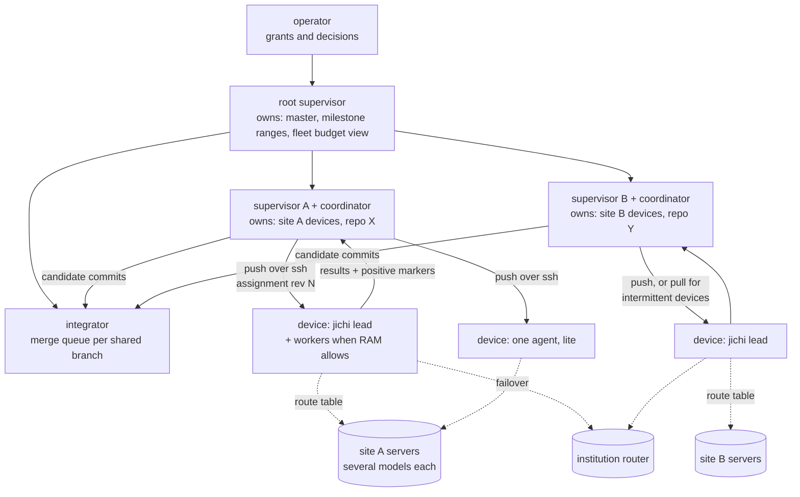

# Many agents, many models, many devices: what jichi can orchestrate today, and what it would take

*An analysis for design decisions, written 2026-10-23 for self-learners. Nothing here is built by this
document. Every claim carries a mark that says how it is known (see §0.2).*

**The question, in the operator's words (2026-10-23):** *"analyze jichi's capabilities regarding complex
multimodel orchestration of agents on hundreds of devices with possibly several supervisors, moderators,
workers, reviewers, specialists working together. This is for design decisions, planning, implications,
recommendations all documented honestly, and comprehensively for self-learners."*

**What was read:**

- jichi `master` at **`fc638450`**, and the hardening drive's branch at `382ddcb5` for the one feature that is
  only there (M1006).
- The docs branch `analysis/2026-10-18-orchestration` for the designs that are not on master yet.
- NVIDIA **OpenShell** at `9a85667d0` (2026-10-22).
- Modular's **`modular`** repository (the MAX serving stack) at `d0462d003e`.
- The telemetry of the running hardening drive: 35,824 successful model calls in 61 runs, 2026-10-18 04:07
  to 2026-10-23 12:02.

**Method:** five read-only research agents, one per area: jichi's single-host primitives, jichi's
multi-device surface, jichi's own records, OpenShell, and MAX. Their central claims were then re-read by
hand (§0.2 says which), and four new measurements were taken from the drive's telemetry (§4.2, §15).

**Revised 2026-10-23 13:19, after the operator's scope clarification.**

The first version (commit `7d61e38f`) let the limits of this development bench limit the design: one shared
gateway, one LM Studio, about ten boards. The operator, the same day: *"we are not talking about the
constraints of our development systems, but what we can design, document, and implement for different
systems (smaller, larger)."*

This version:

- designs for five deployment tiers, from one device with a local model to institutions and federations
  with many devices, many model servers and many models (§2.3);
- treats the bench as the measurement rig for the small tiers, and states how each larger tier is verified,
  with a strict vocabulary (§10);
- adds what many servers and many models need: a route table and its selection rules (§7.2), and the
  components each tier adds (§7.1).

Superseded and withdrawn, so that nobody acts on them:

- The first version's §1 item 10 and §13 second bullet used "the bench has about ten boards" as a reason to
  treat hundreds of devices as out of reach. Withdrawn: the bench limits what can be *driven here*, not what
  is designed.
- D-S1's recommendation (a) and its reason. Replaced by a new D-S1 (§9).
- §5.1's framing of "the gateway" as the model server. Replaced by model capacity across routes. The
  measurements stay, as one route's profile.
- §7.1's recommendation (thin clients of one gateway, plus outage routes) and §10's phase plan (P0 to P5).
  Replaced by §7 and §10 of this version (S0 to S6).
- D-S5's recommendation, which put the gateway ramp first. Now LM Studio, this bench's own server, is
  measured first, and the gateway only with consent.

Added: D-S11 (routing many servers and models) and D-S12 (how larger tiers are verified), so §9 now has
twelve decisions.

The evidence in §3, §4 and §6 is unchanged.

---

## 0. How to read this

### 0.1 A reading path

1. Read §1, the answer in ten points.
2. Read §2 if any role or mechanism word is new to you. Everything later uses those words exactly.
3. Read §3 (what exists) and §4 (what happened when it ran). This is the evidence.
4. Read §2.3, the deployment tiers, then §5, what changes as the system grows. This is the argument.
5. Read §7 to §10: the options, the recommended shape, the decisions and the plan.
6. Do one exercise in §14. Each one says how to check your answer.

**If you only need the decisions:** read §1, then §9. Each decision there points back to the evidence it rests
on.

### 0.2 The marks

| Mark | Meaning |
|---|---|
| **[V]** | Verified: re-read at the cited line, or re-run, by the author of this document. |
| **[R]** | Reported: read at the cited line by a research agent, not re-read by the author. |
| **[M]** | Measured: computed from a recorded data set by the script in §15. |
| **[I]** | Inferred: argued from V, R or M; never observed. |
| **[GK]** | General knowledge: not from this tree or these repositories. |

A claim with no mark is a definition or a recommendation.

---

## 1. The answer, up front

1. **jichi orchestrates a team well inside one host, and has never orchestrated one across hosts.** Inside one
   process, a lead forks up to `maxParallelAgents` workers, each with its own model, profile and git
   worktree, and merges their files first-writer-wins [V/R]. Across hosts its record is one episode (M459,
   2026-08-15): `scripts/fleet-run.sh` pushed independent `jichi -p` tasks over ssh to a Raspberry Pi and an
   Android tablet (with a proot guest), and no team ran across them [R]. Nothing in the C code coordinates
   across machines [V: §3.2].
2. **The design target is every size, with one agent binary.** It runs from a single board with a local
   model up to institutions with hundreds or thousands of devices, many model servers and many models (§2.3
   names five tiers). A larger tier adds components around the agent (a coordinator, a collector, routes, a
   supervisor tree), never a different agent. The simple case must not get worse (JCP P4).
3. **Devices are not the binding constraint at any tier.** jichi's agent loop runs in about 1.7 MB peak RSS
   on a 96 MB machine and in 10 to 17 MB for a networked headless turn [R]. The three binding constraints
   are, in this order:
   - **model capacity**: the routes to the model servers, which all agents share;
   - the **attention** of the leads and supervisors;
   - **integration**, meaning merging and verifying what came back.
4. **Model capacity is a routing problem, and jichi has no router.** A model entry in jichi's config is one
   endpoint and one model id, with a single `fallback` selector [V: `include/jc_config.h`, `struct
   jc_model_cfg`]. Delegates bypass even that chain [V]. There is no admission control, no `Retry-After`, no
   jitter and no prefix affinity [V/R]. The central new design is a **route table**:
   - an **alias** names what a role needs;
   - **routes** name the servers that can serve it;
   - each call picks a route by role, access and price class first, then by health, prefix affinity and
     load (§7.2).
5. **One route's measured profile shows what every route must record.** On the HRZ gateway, under this
   drive's own load [M]:
   - with six coder-next calls in flight, each decoded at about half the single-call rate (68 versus 131
     tokens/s), while the total rose about threefold;
   - a median call sends about 115,000 prompt tokens, and 99% of them are served from the server's prefix
     cache;
   - when 20,000 or more prompt tokens are uncached, the 27B model's first token takes 16.4 s instead of
     1.9 s (medians);
   - a lead waits on its own model calls for a median 47% of its span.

   The cache result is why a call should go back to the server that holds its prefix, at every tier.
6. **The lead is the second bottleneck, and the record measures it.** While a batch runs, the lead's turn
   blocks [V]. Measured worker use was 2% to 28% of the six slots [R].
7. **Several agent-side primitives are missing at every tier above one device:** authentication beyond file
   mode, host identity, admission, `Retry-After`, jitter, and route selection for delegates [V/R].
8. **No record designs several supervisors over one team** [R]. The recommendation: one authority per
   resource, supervisors in a tree, and a separate integrator per shared branch (§5.8, §7.4).
9. **The recommended shape grows by tier** (§7.1, §7.6):
   - T0, one device: the agent alone, with one or two routes;
   - T1, a lab: plus a coordinator that pushes work over ssh, and an integrator;
   - T2, a site: plus a supervisor tree, a collector, a key relay, and a route table over several servers;
   - T3, an institution: plus partitioned coordinators, external routers used as routes, and tenants;
   - T4, a federation of organisations: principles only.
10. **What is measured and what is designed are kept apart** (§13). Each capability gets a scale verdict,
    used as strictly as the platform verdicts (§10):
    - *Designed*;
    - *Mechanics-tested at tier N*: real agents and coordinators against model servers that replay measured
      behaviour;
    - *Driven at tier N*: real models on real routes.

---

## 2. Vocabulary: the roles and the mechanisms

### 2.1 Roles

The operator's list (supervisors, moderators, workers, reviewers, specialists) plus the roles jichi's
records already use. A **role** is a responsibility. It is not a model and not a process: one process can
hold two roles, and one role can be spread over many processes.

| Role | Responsibility | What jichi has today |
|---|---|---|
| **Operator** | Owns goals and grants: what may be spent, what may land, what is decided. | A person. Grants are recorded in `DECISIONS.md` rows and plan sections [R]. |
| **Supervisor** | Watches a running team from outside. Checks claims, relays notes, stops work. Does not do the work. | An outside agent or person using `jichi control` on the lead's Unix socket [V]. In every recorded drive it was Claude, not jichi [R]. |
| **Lead** | The agent inside the run that plans, dispatches workers, reads their results and commits. | The depth-0 agent. It dispatches with `spawn_parallel` and `spawn_subagent` [V]. |
| **Worker** | Does one task: edits, builds, investigates, reports. | A forked `spawn_parallel` child (depth 1, own worktree when writing) or an in-process `spawn_subagent` [V]. |
| **Reviewer** | Reads a change and reports defects. Changes nothing. | A read-only worker, typically on the 27B model by the operator's decision [R]. |
| **Specialist** | A worker with a narrower brief, tool set or model: a C89 auditor, a test writer, a platform porter. | An agent **profile** (`.jichi/agents/*.md`: model, tools, readonly, prompt) plus skills [R]. |
| **Moderator** | Decides between conflicting outputs or claims, and keeps the exchange in order. | **None.** By standing decision a mechanical check decides, "not a conversation between models" (JCP P1) [R]. See §8.3. |
| **Verifier** | A program, not a model, that says pass or fail: a build, a test suite, a gate. | `--verify`, `parallelVerify`, `make ci` [R]. |
| **Integrator** | The single writer to a shared branch. Merges, re-verifies and lands. | In the drive, the supervisor, by the operator's grant, after a green `make ci` on the exact head [R]. In a run, `spawn_parallel`'s merge [V]. |

### 2.2 Mechanisms

- **Control plane and data plane.** The control plane decides *what should run where*: assignments,
  permissions, stop and start. The data plane is the work itself: model calls, file edits, builds. Keeping
  them separate is what lets a supervisor stop a worker without being inside it [GK].
- **Push and pull.**
  - **Push:** a coordinator sends a task to a chosen device.
  - **Pull:** devices ask a queue for work.
  - Push over a connection the coordinator already holds is **exactly-once by construction**. The task goes
    down one connection, once.
  - Pull needs a **claim**, so that two devices do not take one task [R: DISTRIBUTED.md §1c].
- **Claim, lease and epoch.**
  - A **claim** says "I am taking this task".
  - A **lease** is a claim that expires unless renewed.
  - An **epoch** (or **generation**) is a number that increases each time a holder is replaced, so that a
    message from the old holder can be recognised and refused [GK; OpenShell uses a per-run generation id,
    §6.1].
- **Idempotency key.** An id carried by a request, so that sending it twice has the effect of sending it
  once [GK].
- **Desired state and reconciliation.** The coordinator sends the *complete* list of what should exist, with
  a revision number. The receiver makes reality match it and reports which revision it applied. Losing the
  connection changes nothing; only a newer list does [R: OpenShell, §6.1].
- **Admission and backpressure.**
  - **Admission:** a server refuses new work it cannot take, for example HTTP 429 with `Retry-After`,
    *before* starting it.
  - **Backpressure:** the client slows down in response [GK; MAX does this, §6.2].
- **Prefix (KV) cache.** A model server keeps the attention state of a prompt's beginning, so that the next
  call with the same beginning skips recomputing it. It works only for a byte-identical prefix [GK; MAX's
  chained block hashes, §6.2].
- **Continuous batching.** A server decodes many requests together, step by step. Each request gets slower;
  the total rises, until memory or compute runs out [GK; MAX `text_generation_scheduler.py`, R].
- **Fence and cap** (jichi's own terms, `CLAUDE.md`):
  - a **fence** bounds blast radius: edit scope, path fence, read-only, tool-call limits;
  - a **cap** bounds duration: deadline, budget, stall timeout;
  - fences stay on, and caps stay off for measurements.
- **Positive marker.** Evidence in the event stream that a thing *happened*, as opposed to an exit status that
  many different failures share [R: DISTRIBUTED.md §2].

### 2.3 Deployment tiers

A tier is a size of system, not a product edition: the same jichi binary runs in all of them. The tiers
differ in what surrounds it.

| Tier | Devices | Model servers and models | Supervision | A typical case |
|---|---|---|---|---|
| **T0** one device | 1, possibly offline | 0 to 1 local server, a few models | the person | a laptop; a board with a LAN model server |
| **T1** lab | 2 to about 20, mixed OSes | 1 to 3 servers (a local one, a shared gateway), tens of models | one person or one agent | **this bench** |
| **T2** site | about 20 to 200 | several servers on a LAN, several models each, perhaps a router | a few supervisors, partitioned | a department, a classroom, a robotics lab |
| **T3** institution | hundreds to thousands | many servers at several sites, routers or gateways, hundreds of models, free and priced | a tree of supervisors | a university-wide or company-wide service |
| **T4** federation | across organisations | several gateways under different owners | several trees under different authorities | a research consortium |

Four dimensions cut across the tiers, and a design has to state its answer for each:

- **Device size:** from a 256 MB board (lite mode: one agent, no snapshots) to servers that host a team
  [R: §3.3].
- **Connectivity:** an always-on LAN, intermittent links (a robot, a classroom laptop), or offline for long
  stretches.
- **Trust:** one owner; several tenants under one operator; several organisations.
- **Money:** free models only, or free and priced models mixed. Priced models stay behind a per-run grant at
  every tier [V: `CLAUDE.md`].

**This bench is a T1 rig.** It has:

- LM Studio on the workstation, loaded and unloaded as needed, with VRAM kept free for the display [R];
- the HRZ gateway, with a free `jlu/*` namespace and priced models that need a grant [V: `CLAUDE.md`];
- about ten boards and machines across Linux (x86-64, arm64, riscv64), the BSDs, illumos, Hurd, Haiku,
  macOS and the Windows layers [R: `docs/PLATFORMS.md`].

It can drive T0 and T1 with real models, exercise the mechanics of T2 with real hosts, and measure the
route profiles that tests of larger tiers replay (§10). It cannot drive T3 or T4 with real models. Those
need pilots (§10, S6).

---

## 3. What jichi has today

### 3.1 Inside one host: the team in one process

**`spawn_parallel`** (`src/tools/jc_tool_parallel.c`) is the fan-out.

- **One fork per task.** Each task is a `fork()`ed child. The pipe runs child-to-parent only, carrying
  newline JSON [R: 1338-1376]. A child has **no inbound channel**: once started, nothing can tell it anything
  [R].
- **How many run at once.** The width is `jc_parallel_eff_max`. With `maxParallelAgents` set above 0, it is
  `min(ntasks, maxParallelAgents)`, with no CPU clamp. At the default 0 it is `min(ntasks, cpus, 8)`. A call
  takes at most 32 tasks [V/R: `src/tools/jc_parallel.c:45-60`].
- **Per-task settings.** Each task may name its own **model**, **profile**, `write`, `max_tool_calls` and
  `merge`. A task on a different model builds its own provider [R: 1500-1568, 817-826].
  - A profile's `readonly` is **ignored** here: only the task's own `write` decides [V: 2204].
  - The model selector resolves the model directly and **bypasses the fallback chain** [V: 818;
    `jc_tool_subagent.c:66-67`].
- **Write children get a git worktree.** It is cut from a fresh "parallel base" snapshot. That snapshot
  takes `git add -A` of the live tree, so the base **includes uncommitted and untracked changes** [V:
  `src/snapshot/jc_snapshot.c:643`, in `jc_snapshot_take`].
- **A Landlock shell fence** confines a write child's shell to its worktree where the kernel supports it.
  Without Landlock the shell runs unfenced, with a warning and a `shell_fence` event [R: 528-642].
- **Merge is first-wins by path, in task-index order.** A later writer's change to the same file is dropped,
  listed at the top of the result, and its worktree kept for recovery [R: 2606, 2874-2933]. Several kinds of
  change are held out of the merge:
  - changed test assertions;
  - new directories over 100 files or 1 MB;
  - root reports;
  - out-of-scope paths [R].
- **The lead blocks** for the whole batch [V: 2502-2507]. During the batch:
  - `status` and `abort` are answered;
  - `pause` stops new tasks;
  - `inject` waits until the batch ends [R: `jc_control.c:368-382, 524-547`].
- **Per-child watchdog.** The default is 300 s (`parallelTaskTimeout` 0 means 300), and **it cannot be
  disabled** [V: `jc_tool_parallel.c:274, 2503-2506`].
- **Budgets.** Each child gets 1/n of the remaining tokens and tool calls [R: 2481-2500].

**`spawn_subagent`** (`src/tools/jc_tool_subagent.c`) is the synchronous, in-process delegate.

- It runs at `agent_depth + 1`, with fresh history.
- A writing subagent edits the **live** workspace, with no worktree [R: 546-547].
- Nesting is bounded by `maxSubagentDepth`: 2 by default, 0 under lite mode [R].
- **While it runs, the lead's control socket is not served at all**, because control is served only at depth
  0 [V: `jc_control.c:481, 586`]. This was measured on 2026-10-23: an inject waited about 4 minutes behind a
  `spawn_subagent` [R: drive log].

**Profiles, roles and models.**

- Profiles live in `~/.config/jichi/agents/*.md`, overridden by `<project>/.jichi/agents/*.md`. Each declares
  description, model, style, `readonly`, tools and a prompt body [R: `jc_agentdef.c:140-235`].
- Configured model **roles** are capability flags: chat, edit, autocomplete, embed, rerank, summarize, apply,
  image, audio, transcribe. The first model to declare a role wins [R: `include/jc_config.h:100-109`]. There
  is no worker, reviewer or supervisor role in the config: team roles live in prompts and profiles [R].
- Routing tiers (`routing.fast`/`strong`) escalate only at depth 0 [R: `jc_agent.c:1986-1988`].

**Fences in delegates.**

- Delegates run in auto posture: ASK runs without prompting, except the shell [R].
- Privileged commands are refused for every delegate unless the policy allows them [R].
- The edit scope applies at any depth and again at merge [R].
- **Hooks fire only at depth 0** [V: `jc_hooks.c:308`]. A policy written as a hook sees none of the workers'
  tool calls.

**Coordination surfaces inside the run:**

- **Board** (`.jichi/board.json`):
  - only the main agent may use it [R: `jc_tool_board.c:238`];
  - it is file-locked with a 5 s wait, and **proceeds unlocked** if the lock times out [R: `jc_board.c:347-420`];
  - a card has no owner and no claim field [R].
- **Telemetry**:
  - every event carries `depth`, `turn` and `run`;
  - parallel children add `task_run = <batch>-t<N>`;
  - `model_call` names the model actually called [R];
  - all forked children append to one shared file [R].

**Nested batches.** The tool menu offered to delegates omits `spawn_parallel` [V: `jc_agent.c:6692`]. The
runtime gate, however, checks only depth [V: `jc_tool_parallel.c:2125`]. The code's own comment at
`jc_tool_parallel.c:369-385` (M860) records a batch **started inside a write child** that collided with the
lead's base (CTL-5) [V]. So `DISTRIBUTED.md` §1a's "A child is never given spawn_parallel, so there are no
nested pools" is true of the menu and not of execution. That sentence needs a dated correction (§13).

### 3.2 Across processes and machines

- **Exactly two listening sockets, both Unix-domain** [V]:
  - the control socket at `src/chat/jc_control.c:122`;
  - the daemon socket at `src/main.c:16361`.

  `AF_INET` appears in `src/` only in `src/net/jc_http.c` [V]. There is no TCP listener and no HTTP server, by
  design [R: `docs/WEB_FRONTEND.md`].
- **Authentication is the socket's file mode.** "The socket's file mode is the entire access-control list"
  (`DAEMON.md`) [R]. The daemon verifies its socket's mode after `bind()` and has a 1 MiB request limit
  (M528). The peer-credential check is not built, because `SO_PEERCRED` is hidden under this project's flags
  [R].
- **The daemon** forks a warm worker per request, from a pool of `min(cpus, 4)` by default and at most 64 [R].
  A request's `cwd` is parsed and never used [R].
- **ACP** (`jichi serve`/`--acp`) speaks JSON-RPC over stdin and stdout only [R].
- **MCP**: jichi is a client only [R].
- **Remote execution**: none in `src/` [R]. Multi-host work happens outside the binary:
  - `scripts/fleet-run.sh` pushes `jichi -p` over ssh to each device in parallel;
  - each device gets a scratch `HOME`, `--strict-scope` and a per-device deadline multiplier;
  - verdicts come from positive markers in the event stream, never from exit codes [R: `AUTONOMOUS_LOOPS.md`
    "A fourth topology"].
- **The queue topology** (`examples/autonomous-loop/loop.sh`) claims a task by `rename(2)`. That is atomic
  within one filesystem only [R].
- **JCP**, the jichi coordination protocol, is a proposal (M525). Only `hello`, the verified socket mode and
  `maxLine` are built (M528). The `peer` verbs (`offer`, `claim`, `result`, `decline`) are specified and
  deliberately unbuilt [R].
- **No host identity anywhere.**
  - No file in `src/` or `include/` calls `gethostname` or names `nodename` [V].
  - The workspace lease records run, pid, started, mode, root and control, but **no host** [V:
    `src/util/jc_lease.c:87-97`]. Its liveness test is `kill(pid, 0)`, meaningful on one host only [R].
  - Run and session ids are UUID v4, so they do not collide across hosts [R].
- **Retries and failover.**
  - Retries happen on transport errors, timeouts, 429 and 5xx. Backoff starts at 500 ms, doubles, is capped at
    8 s, and has **no jitter** [V: `jc_agent.c:250-252, 766-775`].
  - **`Retry-After` is never read**: `git grep -i retry-after` finds nothing in `src/` or `include/` [V].
  - There are 4 retries (2 under lite) [R].
  - There is **no per-endpoint concurrency limit**, and no rate state shared across processes [R].
  - Each model has **one** `apiBase` [R].
  - The fallback chain and the M1038 re-probe switch the *active* model after a connect failure. Delegates
    resolve their models directly and do not use the chain [V: §3.1].

### 3.3 On small devices

- **Verified and Driven** (a live tool-calling turn ran there) [R: `docs/PLATFORMS.md`]:
  - Raspberry Pi Zero 2 W (512 MB), Pi 400, Pi 500+ (16 KB pages);
  - VisionFive 2 (riscv64);
  - LicheeRV Nano (256 MB): Partly verified, driven with `stall 0`;
  - FreeBSD, NetBSD, OpenBSD, illumos, Hurd, Cygwin, MSYS2, macOS and Haiku;
  - 19 qemu-user architectures.
- **Never compiled:** FreeDOS/DJGPP has no fork and no sockets, so no daemon, control or parallel [R].
- **Lite mode** is automatic below 1024 MB of RAM: no snapshots, `maxParallelAgents` 1, no subagents, 16k
  context [R: `docs/LOW_MEMORY.md`]. A small board is therefore a **single-agent node**, not a team host [I].
- **Thin clients.** Devices reach models over the LAN, which fleet-run.sh adopted as its first decision: "A
  4 GB device that is also hosting a model is measuring the model, not jichi" [R].

### 3.4 Summary

| Capability | Status | Evidence |
|---|---|---|
| Team of up to N workers in one process, per-task model and profile | Built, recorded in several drives | §3.1; §4 |
| Worktree isolation and first-wins merge | Built; measured to drop work (§4.1) | [V/R] |
| Non-blocking batches (the lead keeps working) | Designed: B1, operator decision 2026-10-23, not built | [R] |
| Liveness and heartbeat at every depth | Designed: batch 14 (e), not built | [R] |
| Outside supervisor (control socket) | Built; same user, one host, depth 0 only | [V] |
| Several supervisors over one team | Neither designed nor built | [R] |
| Multi-host push (fleet-run.sh) | Built as a script; one recorded episode (M459), independent tasks, no team | [R] |
| jichi as supervisor across hosts | Documented as a template (`SUPERVISOR_OF_MANY.md` Layer 3 over 2); never run | [R] |
| Pull protocol (JCP `peer`) | Specified, deliberately unbuilt | [R] |
| Authentication beyond file mode | Not built; peer credentials blocked by build flags | [R] |
| Host identity in lease, telemetry and journals | Absent | [V] |
| Admission control, `Retry-After`, jitter | Absent | [V/R] |
| Per-endpoint routes (second, third gateway) | Designed (outage D8), not built | [R] |
| Route table: aliases, routes, selection by policy, health, affinity and load | Proposed here (§7.2) | [I] |
| Fleet-level accounting | Absent; budgets are per run | [R] |
| Dirty-tree dispatch guard (M1006) | On the drive branch `382ddcb5`, not on master | [R] |

---

## 4. What the record shows when jichi runs a team

### 4.1 Failure modes the records measured

All [R]. The records are on the docs branch and the drive branch, as cited.

1. **The lead keeps its workers idle.**
   - Worker use was 8%, 28%, 19% and 20% of six slots in four runs. No worker was busy for 44 of 68, 48 of 92,
     32 of 65 and 71 of 189 minutes (`analysis/2026-10-18-orchestrating-agent-teams.md` §2.2).
   - Later runs measured 14%, 2% and 8% (§9.5).
   - One run of the demos drive held its lead 4 h 27 min in three one-task batches (def-304).
   - Cause: a batch blocks the lead's turn (§3.1). B1 is the designed fix.
2. **A slow reviewer blocks everything behind it.** One read-only 27B review took 106 minutes: 36 calls and
   179,012 output tokens. Its first-token times were 1 to 4 s, so the cost was the reasoning output, not the
   context. It found one real MED defect (`analysis/2026-10-22-the-slow-reviewer.md`). Cutting it short would
   have lost that finding.
3. **Same-model review is weak and late.**
   - Over 24 runs, review lagged 1.5 to 5 h.
   - It produced 3 false or overstated findings and missed the shell side door (harness plan §8).
   - Two finished reviews were never relayed, and one carried a C99 loop to master (ledger .50).
   - 37 commits were marked "reviewed" that had not been (ledger .51).
4. **First-writer merge drops work.**
   - Run 0002 lost 5 of 8 tasks' changes; run 0046 lost 7 of 8.
   - Across runs 0001 to 0063: 120 batches, 36 with several tasks, 21 of them dropping a worker's `REPORT.md`
     (`analysis/2026-10-22-one-report-file-for-every-worker.md`).
5. **Dispatch over uncommitted work.** These are stretches of 30 to 50 minutes with verified work
   uncommitted, and four slips since 2026-10-22. They led to M1006, the dirty-tree guard [R: M1006 note].
6. **Notes reach a busy lead late or never.**
   - One inject was applied 23 minutes after it was sent.
   - One note was lost when its run ended.
   - Two injects were never applied during a FIFO hang.
   - No heartbeat was seen for 22 minutes while a `spawn_subagent` ran (finding L-24).
   - At 11:40 on 2026-10-23 the supervisor's watch raised `stale:0074`: no stream or telemetry write for 17
     minutes while the lead waited on a batch, although its workers were streaming [R: drive log].
7. **A model outage stops everything at once.**
   - The gateway was unreachable from 16:56 to 20:56 on 2026-10-21.
   - 13 runs each ended after 860 s.
   - A retry waited 60 s inside the container, against a 20 to 29 ms refusal on the host.
   - Notes were consumed by runs that never reached a model (`proposals/2026-10-model-outage-fallback.md` §1,
     §3).
8. **Which model leads matters, and it was not controlled.**
   - With the coding model as lead: 182 runs and 14,935 calls, with no delegation.
   - With the stronger model as lead: 66 runs, and every rung verified (`DRIVING_A_TEAM.md` §1).
   - The two phases differed in more than the model, so this is a hint, not a comparison.

Two lessons for scale follow from this list:

- Every failure above is a **coordination** failure: blocking, dropping, delay, unverified claims. None is a
  device failure.
- At least four of them scale with the number of agents: merge drops, unrelayed reviews, late notes and the
  outage blast radius [I].

### 4.2 New measurements: the gateway under the drive's own load

The drive's telemetry records every model call with its model, latency, time to first token (ttft), output
tokens, uncached input tokens (`in_tok`) and cached input tokens (`cache_read_in`). For the OpenAI dialect,
`in_tok` is `prompt_tokens` minus `cached_tokens` [V: `src/provider/jc_provider_openai.c:66-82`]. The script
and the command are in §15. All numbers below are [M], from 35,824 successful calls in 61 runs, 2026-10-18
04:07 to 2026-10-23 12:02.

**Table 1: decode rate against the number of calls to the same model in flight.** The decode rate is
`out_tok / (latency − ttft)`, over calls with at least 200 output tokens. "In flight" counts this drive's own
calls to the same model id at the call's midpoint.

| Model | In flight | Calls | Median tok/s | p10 | p90 | In flight × median |
|---|---|---|---|---|---|---|
| `jlu/qwen3-coder-next` | 1 | 3,969 | 130.9 | 56.7 | 141.3 | 131 |
| | 2 | 911 | 109.0 | 96.4 | 120.9 | 218 |
| | 3 | 372 | 97.5 | 82.9 | 113.8 | 292 |
| | 4 | 293 | 85.9 | 65.7 | 103.3 | 344 |
| | 5 | 150 | 76.3 | 57.7 | 92.2 | 382 |
| | 6 | 106 | 68.3 | 51.0 | 89.5 | 410 |
| | 7 or more | 12 | 62.4 | 51.3 | 92.5 | ≥ 437 |
| `jlu/qwen3.8-27b` | 1 | 7,810 | 58.1 | 43.9 | 67.9 | 58 |
| | 2 | 49 | 58.8 | 54.6 | 61.9 | 118 |
| | 3 | 54 | 55.9 | 50.4 | 58.7 | 168 |

**Table 2: how much of each prompt the server had cached.** The cached share is
`cache_read_in / (in_tok + cache_read_in)`.

| Model | Calls | p10 | Median | p90 |
|---|---|---|---|---|
| `jlu/qwen3-coder-next` | 25,258 | 0.95 | 0.99 | 1.00 |
| `jlu/qwen3.8-27b` | 10,566 | 0.90 | 0.99 | 0.99 |

**Table 3: prompt size, and time to first token against the uncached part.**

| Model | Prompt tokens (median / p90 / max) | Uncached tokens | Calls | Median ttft | p90 ttft |
|---|---|---|---|---|---|
| `jlu/qwen3-coder-next` | 110,622 / 147,728 / 222,017 | under 5,000 (median 701) | 23,840 | 1.6 s | 2.9 s |
| | | 5,000 to 20,000 (median 7,415) | 907 | 1.4 s | 3.3 s |
| | | 20,000 or more (median 79,221) | 511 | 5.8 s | 8.8 s |
| `jlu/qwen3.8-27b` | 119,797 / 152,404 / 195,073 | under 5,000 (median 1,526) | 9,745 | 1.9 s | 3.2 s |
| | | 5,000 to 20,000 (median 7,399) | 567 | 1.9 s | 4.0 s |
| | | 20,000 or more (median 88,716) | 255 | 16.4 s | 22.3 s |

**Table 4: how much of a lead's wall time is spent waiting on its own model calls.** The share is the union
of a depth-0 run's model-call intervals over the run's span (first call start to last call end), for 46 runs
spanning more than 10 minutes: p10 **0.28**, median **0.47**, p90 **0.76**. The rest of the lead's time goes
to running tools, including the batches it waits on.

### 4.3 What the measurements mean, and what they do not

- **They are consistent with continuous batching** on the coder-next server. Each call slows as calls
  overlap (131 to 68 tok/s from one to six in flight), while the total rises about threefold (131 to about
  410 tok/s) [M]. The pattern matches how batching servers behave [GK]. **What software HRZ runs is not known
  to this analysis.**
- **The 27B server shows little slowdown at two or three in flight** [M]. Those bins are small (49 and 54
  calls), and the drive rarely ran the 27B concurrently, by design: it is the lead and the reviewer.
- **The prompt cache does the heavy lifting.** Almost every call re-sends a long history whose beginning the
  server still holds [M]. Without that, a 27B call would start after about 16 s instead of about 2 s [M].
  Across a 100-call turn, that is about 24 extra minutes of waiting per agent [I: 100 × (16.4 − 1.9) s].
- **What the numbers cannot say:**
  - **Other users are invisible.** The gateway is shared with the institution. "In flight" counts only this
    drive's calls, so a slow bin may be someone else's load.
  - **Selection.** High-concurrency moments are `spawn_parallel` batches, whose calls may differ in kind from
    a lone lead's.
  - **Resolution.** `ts` has one-second resolution and is taken as the call's end. A call's start is
    `ts − latency`.
  - **Output tokens are what the server reports** as completion tokens; whether reasoning tokens are included
    is the server's choice.
  - **Nothing above about seven in flight was observed.** Any statement about a hundred is extrapolation, and
    §5.1 treats it as such.

---

## 5. What changes as the system grows

For each problem: what happens today, what breaks as the tier grows, and the evidence. "Larger tiers" means
T2 and up (§2.3).

### 5.1 Model capacity is the shared bottleneck

**Today:** a handful of agents. The hardening drive uses one route, the HRZ gateway, with at most ten of its
calls in flight at once (both models together) [M]; the bench's boards also reach LM Studio [R]. On the
gateway's coder-next server the total output rate roughly tripled by six calls in flight [M].

**The arithmetic, for any route [I].** Suppose N agents, each waiting on the model for a share b of its
time. On average about `N × b` calls are in flight. A route r has a capacity C_r: the total rate it sustains
before calls queue. Each call on r then gets at most `C_r / (calls on r)`. With several routes, the fleet's
capacity is at most the sum of the C_r, and only if selection spreads the calls instead of refilling one
route.

**An example with the one measured route.** With b = 0.47, the measured median for a lead, 200 agents put
about 94 calls in flight.

- **All on the gateway's coder-next:** if its total stopped growing at the ~410 tok/s measured at six in
  flight, each call would get about 4.4 tok/s. A 3,443-token reply (the size of one recorded call), which
  takes 26 s at the single-call rate of 131 tok/s, would take about 13 minutes [I].
- **Spread over ten routes of that capacity:** each would carry about nine calls, just above the measured
  range [I].

No route's C_r is known, nor how a route behaves past it. Measuring that per route is S2 in §10.

**The cache makes routing matter [I].** Prompts of about 115,000 tokens, 99% of them cached [M], mean that a
call is cheap only on the server that already holds its prefix.

- **Spreading without affinity is slow.** Round-robin over ten servers would send most calls to a server
  without the prefix, paying the uncached first token (16.4 s instead of 1.9 s on the 27B [M]) every time.
- **Eviction is uneven.** MAX, one open serving stack, evicts freed cache blocks least-recently-used [R:
  `block_pool.py:55-63, 135-173`]. If a server behaves alike, **the agent that calls least often loses its
  cache first**. That is the agent on the slowest device, which then pays the full-prefill first token on
  every call and gets slower still.

**Retries synchronise [I].** After a server blip, every agent that failed in it retries at the same offsets:
0.5, 1, 2, 4 and 8 s, with no jitter [V]. A hundred such agents arrive together at each step, the classic
thundering herd [GK]. Because `Retry-After` is not read [V], a server that asks for a pause cannot get one.

**No shared admission [R/I].** `maxParallelAgents` bounds one process. Two hundred processes on a hundred
devices share no limit for one endpoint, and no process knows another route's load. The server's queue is
the only limit, and it is invisible to jichi.

**One endpoint per model entry [V].** A model entry has one `apiBase` and one `fallback` selector [V: `struct
jc_model_cfg`]. Several servers for one model are several entries chained by `fallback`: tried in order after
a failure, never chosen by load or affinity. The 2026-10-21 outage ended 13 runs at once (§4.1). Designed,
not built [R]:

- outage D3 to D8: park on provider loss, keep probing while silent, fallbacks that declare their access;
- routes: a second or third endpoint per model.

§7.2 generalises those routes into a table.

**Delegates on a fallback-less path [V].** A delegate's model is resolved directly, not through the fallback
chain (§3.1). In a fleet, the workers are the delegates.

### 5.2 Attention is the second bottleneck

**Today:**

- A lead blocks during a batch, and worker use was 2% to 28% (§4.1) [R].
- The supervisor of this drive reads every gate line, verifies every red-first claim per check, and relays
  notes. On 2026-10-22/23 that per-check verification found six defects in claimed-done work, among them a
  registry wipe (M1040), a read-only regression (M1041), and report truncation at 8 KB [R: drive supervision
  log].
- Where verification was not done, "reviewed" was claimed for 37 commits that no one had reviewed (ledger
  .51) [R].

**At larger tiers [I]:**

- **No single reader can read a hundred transcripts.** Verification capacity must grow with worker count,
  or claims go unverified. The record shows unverified claims are wrong often enough to matter.
- **The supervisor's job changes from reading everything to sampling plus exception reporting:**
  - each run ends in positive markers, which a script checks;
  - a supervisor reads the exceptions plus a random sample;
  - every claimed red-first test is re-run by a program, not a model.
- **Leads must not block.** A lead that waits on one slow worker idles ninety-nine others. B1 (opt-in
  `background: true` batches, decided 2026-10-23, not built) is the prerequisite for any wider team [R].
- **A digest replaces a stream.** The harness plan's notifier is a digest file plus a command hook (§10.1 of
  `docs/plans/2026-10-21-jichi-harness.md`) [R]. That is the right shape.

### 5.3 Integration is the third

**Today:**

- File-level, first-writer-wins merge, with conflicts reported and work kept for recovery [V/R].
- Within one batch, all workers share one base.
- One writer lands on master, after a green `make ci` on the exact head [R].

**At larger tiers [I]:**

- **Divergent bases.** Workers on different devices start from different commits. First-wins was never
  tested against that (gap analysis 2026-10-05 §6.2) [R].
- **Conflict probability grows with the number of writers per file.** Disjoint write sets declared up front
  are the cheapest defence. That is B3 ("declared write sets"), designed, not built [R].
- **One integrator per shared branch.** Each worker's result enters a **merge queue**. The integrator rebases
  it onto the current head, re-runs the verifier, and lands or returns it. Throughput is bounded by the
  verifier's duration: a green `make ci` took 34 to 35 minutes on this workstation in each of three gates on
  2026-10-23 [V: the drive's CI follower log, 08:30 to 09:04, 09:30 to 10:04, 10:04 to 10:39]. So a fast gate
  per change and a full gate per batch, as the drive already does, is required, not optional.
- **The fast gate must cover what the full gate checks cheaply.** On 2026-10-23 the M1006 commit passed its
  author's fast gate (the unit suite plus its own driver) and then failed `make ci` in four lints that take
  seconds: a test email address, a GNU-only `sed -i`, an over-long docs table row, and a citation to a check
  number that does not exist [V: the follower's log for `382ddcb5`]. With one writer, such a miss costs one
  round trip. With a hundred writers feeding one queue, every miss is a 35-minute round trip that holds up
  the work queued behind it [I].
- **The base includes uncommitted work** (§3.1, [V]). On one host this is why M1006 refuses a dirty
  dispatch. Across hosts there is no shared dirty tree, so every assignment must name a commit [I].

### 5.4 Identity, authentication, authorization

**Today:**

- Two Unix sockets with file-mode access control [V/R].
- No host field anywhere [V].
- `jichi control` `mode` can only narrow, never widen [R]. That is a property worth keeping.

**At larger tiers:**

- **Every device needs an identity**, so that a result, a lease or an event can be tied to the machine that
  produced it [I]. A host field in the lease, telemetry and journals is the minimum.
- **Remote control needs authentication.** JCP's answer is **ssh as the transport** (no network listener in
  jichi, no crypto of its own) [R: JCP §3, §13]. That fits libcurl-only C89, and the operator already manages
  ssh keys for every bench board [R].
- **Authorization per message type.** OpenShell declares, per RPC, which role may call it, and enforces this
  from the schema [R]. For jichi the equivalent is a per-verb table: who may `inject`, who may `abort`, who
  may only `status`. That table matters once there is more than one supervisor (§5.8).

### 5.5 Partial failure, liveness and recovery

**Today:**

- **Positive markers, never exit codes, for remote verdicts** [R: DISTRIBUTED.md §2]. This is the most
  important rule for scale, and it already exists.
- **The batch heartbeat fires only when a child finishes** [R], consistent with the 17-minute stale alert
  of §4.1 [R].
- **The per-child watchdog is 300 s by default and cannot be disabled** [V]; it can only be raised. It
  bounds a whole task, and on a slow board a task of a few turns passes 300 s: the LicheeRV Nano took 77 s
  for one tool turn [R].
- **fleet-run.sh scales its deadline per device** by a measured multiplier [R].

**At larger tiers [I]:**

- **Devices vanish mid-task:** power, Wi-Fi, a board's SD card. A coordinator must tell "slow" from "gone"
  from "refused". That needs:
  - a heartbeat from inside the work at a known interval;
  - a positive end marker;
  - a rule that *no event at all* is itself a verdict ("unknown"), never a success.
- **Generations.** When a task is re-assigned, the new attempt gets a new generation number. A late result
  from the old attempt is recorded but not merged. OpenShell does this per run (§6.1).
- **Freeze, don't continue, on losing the coordinator.** OpenShell SIGSTOPs a workload when its supervisor
  link drops, and kills it after a 30 s authenticated-reconnect window [V: `boundary_io.rs:139`;
  `boundary_server.rs:89`]. For jichi, the cheap equivalent is a worker that **stops at its next tool
  boundary** when it loses its coordinator, and waits for a desired-state update.

### 5.6 Accounting

**Today:** budgets and the autonomy envelope are per run [R]. "Ten hosts with a 1M-token budget each is a
10M-token fleet nobody authorized" [R: DISTRIBUTED.md §3].

**At larger tiers [I]:**

- The free `jlu/*` models cost nothing in money, but they cost **shared capacity** (§5.1) and wall clock.
- A priced model is forbidden without a per-run grant [V: `CLAUDE.md`]. At hundreds of devices, one
  misconfigured default multiplies by N before anyone sees it. `tests/smoke/priced_model_lint.sh` guards the
  harness defaults [R], and **every device's effective model must be checked before dispatch**, not after.
- **Observe before enforcing.** A fleet budget enforcer needs a shared counter, and with it consensus. JCP
  refuses that [R: DISTRIBUTED.md §5 Stage 2]. Summed observation from per-run journals is enough to start.

### 5.7 Observability and the join problem

**Today:**

- Telemetry and journals live per host in `~/.jichi.d/` [R].
- Run ids are UUIDs [R].
- `ts` has one-second resolution [V: §4.3].
- Nothing orders events across hosts [R].

**At larger tiers [I]:**

- Every event needs host and device id, run, generation and task id, so that a central collector can join
  them.
- Clocks on small boards drift; NTP is not guaranteed on an offline board [GK]. Order by per-run sequence
  numbers, not by wall clock across hosts.
- **Collect by pull over the connection the coordinator already holds** (push's mirror image), not by
  devices pushing to a listener jichi does not have.
- **Deduplicate repeated denials and errors** before a person sees them. OpenShell's denial aggregator groups
  by (host, port, binary) and submits periodically [R: `denial_aggregator.rs:4-10`]. A hundred workers hitting
  one fence must be one line, not a hundred.
- **Read the cache counters.** jichi already records `cache_read_in` [V]. At scale this is the early warning
  that the server has started evicting (§5.1).

### 5.8 Several supervisors

**Today:**

- No record designs several supervisors over one team, routes notes across devices, or hands a team from
  one supervisor to another [R].
- The control socket accepts any same-user sender and has no arbitration between senders. `inject` carries
  a `from` label [R].
- The drive's coordination rules assume one authority: one writer to master, milestone numbers claimed in
  one note, two drives in parallel rejected because they share one gateway [R].

**The design principle, recommended:** **one authority per resource**.

- Every resource has exactly one owner at a time: a branch, a queue, a device, a workspace, a milestone
  number range.
- Supervisors are arranged in a **tree**. Each is the single authority over a named scope (a group of
  devices, a repository, a batch), and escalates what is outside its scope to its parent.
- Two supervisors never negotiate. If they disagree, each produces an artifact and a verifier, the
  integrator, or the parent decides. This is P1 applied to supervisors.

**Why not peers that agree among themselves?** Agreement needs a consensus protocol, which jichi's
principles refuse [R: JCP P1, §11]. The record also gives a cheaper reason: the failure modes in §4.1 are
lost messages and unverified claims, and a voting protocol multiplies messages and claims [I].

**Handover:**

1. A new supervisor starts from a **desired-state snapshot with a revision number** (what should run where),
   not from the old supervisor's chat.
2. The old supervisor's authority ends when the parent issues a newer revision that names its successor.

This is OpenShell's assignment-snapshot model applied to people and agents [R: §6.1].

**What `mode` narrowing teaches:** any supervisor may narrow (pause, read-only, stop), and only the scope's
authority may widen (resume, grant). This is safe with many supervisors because narrowing operations
commute [I].

### 5.9 Heterogeneous devices and models

**Today:**

- Per-device deadline multipliers in fleet-run [R].
- Lite mode below 1 GB [R].
- `doctor --live` classifies a model's tool calling as native, text or none in one request [R].
- One model per role by operator decision: the 27B leads and reviews, coder-next does delegated coding [R].

**At larger tiers [I]:**

- **Check the model per device before dispatch**, not per fleet. A model that answers in text instead of
  native tool calls yields clean, empty, "successful" runs [R: AUTONOMOUS_LOOPS.md, the first fleet run].
- **Match the task to the device class:**
  - a 512 MB board runs one agent with no snapshots;
  - a 16 GB board can host a small team.
- **Specialists by profile plus model.** A reviewer on a different model family from the writer is a
  candidate defence against shared blind spots. That is unmeasured: def-331 asks it [R].
- **Slow boards need the stall cap off.** The 30 s stall default was never measured, and prefill sends no
  bytes [R: `docs/plans/2026-10-23-measure-stream-silence.md`]. A fleet with one stall setting kills
  its slowest member and "calls it a timeout" [R: DISTRIBUTED.md].

### 5.10 Security across agents

**Today:**

- **Untrusted tasks.** A task from a peer runs under the receiver's fences, never the sender's claimed ones
  (JCP P5) [R].
- **Keys in children.** Before any fork, every key is registered for redaction and every key variable is
  scrubbed from exec'd children. Forked children (parallel workers, daemon workers) hold the parent's
  in-memory copy [R].
- **No keys pushed.** fleet-run.sh pushes no key; its devices use a keyless LAN endpoint [R].
- **Landlock** fences a write child's shell. A top-level run has no Landlock fence, which is (g), def-330,
  designed [R].
- **Hooks miss delegates.** Hooks see depth 0 only [V].

**At larger tiers [I]:**

- **Prompt injection travels up the tree.** A worker's report becomes its lead's input, and the lead's
  summary becomes the supervisor's. A poisoned file read by one worker can reach every level. The defences:
  - reports are data, never instructions, at every level (JCP P1 and P5);
  - narrow-only control verbs;
  - fences that do not depend on the model's cooperation.
- **One personal key on a hundred devices is a hundred exposures.** The OpenShell idea that transfers is a
  **placeholder credential**:
  - the device holds a token like `openshell:resolve:env:KEY` [V: `crates/openshell-core/src/secrets.rs:13`];
  - a trusted component swaps in the real key only for the endpoint it is bound to.

  For jichi this could be a key-injecting relay on the coordinator host. It is already named as deferred in
  fleet-run.sh [R]. The relay must be bound to the gateway's host and path, so that a model that changes its
  base URL cannot take the key with it [R: OpenShell profiles.mdx:58-64].

---

## 6. Ideas from elsewhere, sorted

### 6.1 NVIDIA OpenShell (`9a85667d0`)

**What it is:** a runtime and security boundary for agents. It is **not** a team orchestrator. It has:

- a gateway (the control plane: identity, durable state, policy, credentials);
- a supervisor per sandbox, a *trusted security process*, not a supervising agent;
- the sandbox itself.

It has no roles, no task dispatch, no review loops and no model routing. Managed inference routes were
removed (commit `f4dc6be4b`) [R]. Its multi-agent example is a host shell script that launches N worker
sandboxes and one synthesis sandbox, coordinating through a git repository with optimistic concurrency [R].

**Ideas that transfer to jichi**, with the cheapest jichi form of each:

1. **Outbound-only connections.**
   - OpenShell: supervisors dial out to the gateway; the gateway never dials in [R: RFC 0001:185-208].
   - For jichi: the coordinator dials devices over ssh (push), and no device listens. jichi already has no
     network listener [V].
2. **Desired-state snapshots with a revision.**
   - OpenShell: the gateway sends the complete instance set with a monotonic revision, and the host reports
     `applied_revision`. "Disconnecting never stops hosted instances; only a later snapshot that omits them
     does" [V: `proto/supervisor_host.proto:15-20`].
   - For jichi: an assignment file per device with a revision; the device reports the revision it applied;
     supervisor handover by revision (§5.8).
3. **Hard capacity, refused before start.**
   - OpenShell: `MAX_ASSIGNED_INSTANCES = 256` per shared supervisor; at capacity, a request is refused before
     the workload runs [V: `crates/openshell-supervisor-control/src/controller.rs:57`].
   - For jichi: a per-device and per-endpoint admission limit that refuses, never queues invisibly (§5.1).
4. **Generations.**
   - OpenShell: a fresh generation id per run; credentials die with the run [R].
   - For jichi: a generation number per assignment; late results recorded, not merged (§5.5).
5. **Idempotent request ids and bounded frames.**
   - OpenShell: retried mutations reuse `request_id`; control frames are at most 1 MiB, I/O at most 64 KiB [R].
   - For jichi: already half there. JCP specifies a correlation id, and the daemon enforces a 1 MiB line [R].
6. **Placeholder credentials bound to an endpoint.**
   - OpenShell: `openshell:resolve:env:<KEY>` [V], substituted only after both the network policy and the
     endpoint binding pass [R].
   - For jichi: a key-injecting relay on the coordinator (§5.10).
7. **Session-scoped, never process-wide, state.**
   - OpenShell: slots that were process-wide let one sandbox rotate another's credentials; they were
     re-scoped per session [R].
   - For jichi: the same lesson as its arena rule (the shortest lifetime that outlives the data), applied to
     per-agent keys and telemetry context in a daemon serving many teams.
8. **Freeze on control loss.**
   - OpenShell: SIGSTOP the workload on link loss, allow a 30 s authenticated reconnect, then kill [V:
     `crates/openshell-sandbox/src/boundary_io.rs:139`, `boundary_server.rs:89`].
   - For jichi: stop at the next tool boundary and wait for a desired-state update (§5.5).
9. **Denial, then proposal, then independent approval.**
   - OpenShell: an agent never approves its own widening; a human approves; a prover flags risks [R].
   - For jichi: its narrow-only `mode`, and its refusal of an `approve` control verb ("privilege escalation
     wearing a convenience hat"), already follow this [R].
10. **Per-message authorization in the schema.**
    - OpenShell: each RPC declares its role and scope in the descriptor [R].
    - For jichi: a per-verb table for the control and JCP verbs (§5.4).
11. **Audit discipline.**
    - OpenShell: fixed event classes, a severity rubric, dual output, denials deduplicated [R].
    - For jichi: its lint requiring a reader for every telemetry event is the same discipline [R:
      `telemetry_events_lint` check 10]. Add deduplication at the collector (§5.7).

**OpenShell's own gaps, worth not copying:**

- The manual-approval audit helper takes **no actor parameter**, so "who approved" is not recorded for
  approvals, only for rejections [R: `crates/openshell-server/src/grpc/policy.rs:283-300`].
- Its RFC 0001 still describes gateway inference routing that the code removed [R].

**Ideas that do not transfer, and why:**

- **A TLS-intercepting L7 proxy.** It needs a TLS library and certificate minting. That breaks "libcurl and
  nothing else" and is heavy on a Pi Zero 2 W.
- **The seccomp notify broker, `process_vm_readv` and `SO_BINDTODEVICE`.** These are Linux-only; jichi runs on
  BSDs, illumos, Haiku, macOS and is being ported to DOS.
- **Landlock ABI 3 as a hard requirement.** One of this bench's own boards, a BPI-F3 on Armbian's legacy
  kernel, has no Landlock at all [R: the bench's board record; no PLATFORMS row yet], and OpenShell has no
  riscv64 or 32-bit support [R].
- **Kubernetes, Helm, PostgreSQL, active-active gateways.** That is data-centre high availability. For
  hundreds of devices, one coordinator with file state is proportionate. If high availability is ever needed,
  copy the rule ("one owner per live session, others relay"), not the stack [R/I].
- **A Z3 prover and Rego policies.** jichi's fences are path prefixes and flags. "Candidate ⊆ boundary" is a
  few hundred lines of C [I].
- **gRPC over HTTP/2.** Use newline JSON over ssh, keeping the bounded frames and idempotency.

### 6.2 Modular MAX (`d0462d003e`)

**What it is:** an OpenAI-compatible model server. It has:

- **one base model per server process**; "multi-model" means LoRA adapters or several processes behind an
  outside router [R];
- **continuous batching** with chunked prefill [R];
- **paged KV in 128-token pages with prefix caching on by default** [V: `pipelines/kv_cache/config.py`];
- **chained block hashes**: a change early in the prompt invalidates every later block [V: `rust_kv/kv-core/src/hash.rs`];
- **admission with HTTP 429 and `Retry-After: 1`** when its in-transit queue is full. That queue is
  unbounded by default [V/R: `serve/config.py:158-172`, `api_server.py:323-343`];
- **cached tokens reported per request** in `usage.prompt_tokens_details.cached_tokens` [V];
- **no priority, no per-tenant fairness and no quotas**: requests are first in, first out per replica [R].

**Lessons for a jichi fleet as a client of servers like this** [I, from R]:

1. **Honour 429 and `Retry-After`, add jitter, and treat 429 as "park and retry", not as a turn failure.**
   jichi does none of the first two today (§3.2).
2. **Order prompts for the cache.**
   - Put the system prompt, tool schemas and shared repository context first, byte-identical across agents.
   - Put per-agent variables (times, ids) late.
   - One recorded lead call carried 11,096 system-prompt tokens and 4,596 tool-schema tokens [V: one
     `model_call` row]. If such blocks are byte-identical across workers on one model, they are shared
     cache, not paid per worker. Whether they are byte-identical has not been checked.
3. **Route by uncached tokens, keep an agent on the server that holds its prefix.** This applies only once
   there is more than one route (outage D8).
4. **Keep long contexts from starving short calls.** A fleet mixes 120,000-token leads with short worker
   calls. The server's chunked prefill helps; a client can also keep a separate admission lane for
   giant-context agents.
5. **Cancel abandoned calls.** A disconnect frees the server's cache for others. A killed worker's call
   should end, not run on.
6. **Record stages separately with a request id:** submit, first byte, gaps between chunks, end, cached tokens.
   jichi has the first, second, fourth and fifth [V: §4.2]. The gaps are the stream-silence design note's
   subject [R].
7. **Health checks say nothing about load.** MAX's `/v1/health` returns a constant 200 [R]. A fleet needs
   its own measurement of the server, from the client side.

### 6.3 jichi's own earlier designs

- **`docs/DISTRIBUTED.md` (M526).**
  - Decided: three topologies; push removes the coordination problem. Stage 0: for fewer than about ten hosts
    with independent tasks, fleet-run.sh is enough. Stage 1: authenticate the socket (partly done). Stage 2:
    observe fleet accounting. Stage 3: pull only if measured. It rejects distributed locking, a shared mutable
    index, agent negotiation and NFS under the queue.
  - Still holds: **yes.** This analysis extends it past ten hosts and to teams. One sentence is stale: §1a's
    "no nested pools" (§3.1 above).
- **`docs/SUPERVISOR_OF_MANY.md`.**
  - Decided: Layer 1 (fork pool), Layer 2 (ssh), Layer 3 (jichi as supervisor).
  - Still holds: **as a map.** Layer 2's sample command carries `--budget-tokens 1M`, a cap that must be
    dropped for a measurement run. The gap analysis found Layers 2 and 3 across machines never run [R].
- **`docs/proposals/2026-08-jichi-protocol.md` (JCP).**
  - Decided: NDJSON with correlation ids; ssh as the remote transport; P1, artifacts not conversations; P5, a
    peer's task is untrusted; the `peer` verbs specified and unbuilt.
  - Still holds: **yes.** The new evidence supports P1 (§5.8) and the ssh transport (§5.4).
- **`docs/plans/2026-08-daemon-fleet-worker.md` (def-255).**
  - Decided: the daemon as a fleet worker.
  - Still holds: planned, not built. Its warm process helps per-device start-up, not the three bottlenecks.
- **`docs/analysis/2026-10-05-JICHI-ORCHESTRATION-GAP-ANALYSIS.md`.**
  - Decided: the gap is a location, proven within a machine and never across. Run the ssh layer once with
    jichi as supervisor; write the divergent-base merge policy first; do not simulate a fleet in one container.
  - Still holds: **yes.** It becomes S3 in §10.
- **`docs/proposals/2026-10-model-outage-fallback.md` (docs branch).**
  - Decided: park by default; fallbacks declare their access and roles; routes are in the design.
  - Still holds: **yes**, and it is a prerequisite for scale (§5.1).
- **`docs/plans/2026-10-21-jichi-harness.md` (docs branch).**
  - Decided: jichi drives itself; one model must be enough; four execution modes; the digest notifier.
  - Still holds: **yes.** It is part of S0 in §10: a fleet supervisor is a harness with more devices.

---

## 7. The design space, and a recommendation

### 7.1 Components, and the tiers that need them

| Component | What it does | Needed from | Where it lives |
|---|---|---|---|
| **Agent** (jichi) | runs leads, workers and reviewers | T0 | the jichi binary |
| **Route table** | picks a server for each call (§7.2) | T0 with two routes; essential from T2 | the jichi binary and its config |
| **Coordinator** | assigns work to devices; holds the desired state | T1 | a C89 program shipped with jichi, like the harness [R] |
| **Integrator** | the single writer to a shared branch; a merge queue | T1, once two writers share a branch | the coordinator, or its own program |
| **Collector** | pulls telemetry and journals back and joins them | T2 | a shipped program |
| **Supervisor tree** | partitioned authority, escalation, handover | T2 | people, agents and coordinators, one per scope |
| **Key relay** | swaps a placeholder for a real key, bound to one endpoint | T2, or wherever keys must not reach devices | a shipped program on a trusted host |
| **External router or gateway** | a global view of many servers; quotas | T3 | outside jichi; jichi uses it as a route |
| **Pull protocol** (JCP `peer`) | devices that come and go claim work | T2 with intermittent devices; T4 | jichi and the coordinator |
| **Tenancy** | separate keys, budgets, logs and state per tenant | T3 | coordinator and collector [R: def-328] |

Principles that hold at every tier:

- **One agent binary.** A tier adds components around the agent and settings in its config, never a fork of
  the agent.
- **The simple case must not get worse** (JCP P4). A T0 user configures nothing new: one route is a route
  table.
- **The agent stays C89, libcurl-only and without a listener** (§11), so T0 keeps reaching 256 MB boards,
  Haiku and the DOS port.
- **T4 is principles only.** Each organisation is its own tree with its own authority. Between them only
  artifacts and verdicts cross (P1), and they run under the receiver's fences (P5). Trust between
  organisations needs decisions this analysis cannot make.

### 7.2 Routing calls across many servers and many models

**What exists [V]:** a model entry is a provider dialect, an `apiBase`, a model id, a key, roles, a context
limit, a tool-call form, prices, timeouts and one `fallback` selector (`struct jc_model_cfg`). Routing is the
`fallback` chain, which the top-level agent follows after a connect failure.

**The design, recommended:** separate *what* a role needs from *where* it is served.

1. **An alias** is the name a role, profile or task uses: `lead-strong`, `coder-fast`,
   `reviewer-other-family`, or a plain model name. An alias declares what it needs: roles, a minimum
   context, the tool-call form `native`, and a price class.
2. **A route** is one way to serve an alias. It records:
   - endpoint, dialect, served model id and a credential reference;
   - price class (free or priced) and access class (read-only or read-write, as in the outage proposal);
   - the roles it may serve, its site, and an admission limit;
   - a **measured profile** with its date: context, tool-call form from `doctor --live`, whether cached
     tokens are reported, and capacity figures like §4.2's.
3. **Selection** runs for every call at every depth, delegates included (which removes today's bypass), in
   this order:
   1. **Policy filter:** role, access and price class. A priced route is never chosen without the run's
      grant, and that check is code, not a prompt.
   2. **Health filter:** a route that refused or timed out is skipped for a backoff (a circuit breaker). A
      429 is honoured for its `Retry-After`.
   3. **Affinity:** prefer the route that served this agent's previous call, while it still holds the
      prefix.
   4. **Load:** then the fewest calls in flight from this host, then the best measured first-token time.
   5. **Park** if nothing is left (outage proposal D3), and say so in telemetry.
4. **Per-host admission.** Processes on one host share an in-flight count per route through a lock file, the
   `fcntl` primitive jichi already uses [R: §3.1]. Across hosts there is no shared counter, because that
   would need consensus. The server's 429, plus client backoff with jitter, bounds the load, and a T3 router
   can do better.
5. **Telemetry names the route.** Every `model_call` records alias, route, served model id and site, so that
   a per-route capacity report (§15's script, generalised) and the collector can join them.
6. **An alias promises the same model.** Two routes under one alias must serve the same weights, or a
   measurement on one says nothing about the other. That is the operator's declaration, which jichi cannot
   prove. Telemetry makes a violation visible: a route whose profile drifts from its siblings.

**At T3, a router is a route.** An institution's gateway already owns the global view. HRZ's is one: a single
URL in front of hundreds of model ids, free and priced [V: `CLAUDE.md`]. jichi does not try to be a router.
It lists the router as one route and keeps a second router or a site server as another, for failover.

**Rejected:**

- **jichi as a router service.** That needs a listener and global state, against "no listener in the agent".
- **Global load agreement between agents.** That is consensus, which P1 refuses.
- **Choosing a route by price silently.** A priced route is never a fallback without a grant (the
  `jlu/tts-1-hd` lesson, ANECDOTES #68 [R]).
- **Round-robin without affinity.** It throws away the 99% cache share [M].

### 7.3 How work reaches a device

| Option | For | Against |
|---|---|---|
| **Push over ssh** (fleet-run.sh) | Exactly-once by construction. No listener on the device. ssh keys already exist. Built as a script | The coordinator holds N connections and must know which devices are up |
| **Pull from a coordinator queue** (JCP `peer`) | Devices that come and go take work when they can | Needs authentication, idempotent claims and leases with generations. A duplicate claim can only be reported (JCP §5.5). Unbuilt |
| **An outside scheduler** (CI, SLURM, Kubernetes Jobs) | Exactly-once from the scheduler. Already exists where it exists | Two competing timeouts if both set one [R: DISTRIBUTED.md §4] |

**Recommendation:**

- **Push** at T1 to T3, for devices the coordinator can reach and predict.
- **Pull**, with generations and the coordinator as the only authority over claims, for devices that come
  and go (classroom laptops, robots on batteries) and between organisations at T4.
- **An outside scheduler** wherever one already owns the machines: a cluster, CI.

### 7.4 How supervisors relate

| Option | For | Against |
|---|---|---|
| **One supervisor (today)** | Simple. Every rule in the drive assumes it | Attention does not scale (§5.2) |
| **A tree with partitioned authority** | Scales attention. One authority per resource. Handover by revision | Escalation latency. A parent that is down blocks escalations (but not work) |
| **Peers that negotiate** | No single point of failure | Needs consensus. Multiplies messages and claims. Refused by P1 |

**Recommendation:** **the tree**, from T2, with the integrator as a separate role at the root of each shared
branch. At T0 and T1 one supervisor is enough.

### 7.5 Coordinator state, and how it scales

- **T1:** one coordinator, with its state in files on its host: JSONL plus atomic rename, one writer,
  readable with `tail -f` (JCP P2).
- **T2 and T3: partition, don't share.** Each supervisor's scope has its own coordinator and its own files.
  The root holds only grants, policies, milestone ranges and the merge queue. No component of jichi's needs
  a database server [I].
- **If a coordinator must survive its host,** copy OpenShell's rule, not its stack: one owner per live
  session, and others relay. A new owner starts from the desired-state snapshot and its revision [R: §6.1].
- **Rejected:** a shared database server as a requirement. It is the right tool for a T3 operator who
  already runs one, and the coordinator's files should be easy to load into one, but jichi must not need it.

### 7.6 The recommended shape at T2 and T3



**How to read the diagram:**

- Solid arrows are authority or data, never conversation.
- A supervisor may narrow anything in its scope, and widen only within it.
- A device never talks to another device.
- A result becomes a commit only through the integrator.
- Each device's route table prefers its site's servers, keeps affinity, and fails over to the router.

At T0 and T1 the picture shrinks: one coordinator (or a person), no tree, and one or two routes.

---

## 8. Roles, models and the team's shape

### 8.1 Models per role

**The operator's decisions [R]:**

- the 27B for most tasks, including leading and read-only review;
- coder-next for delegated coding;
- **one model must be enough**, even if slower (harness requirement).

**What the record adds:**

- **A reviewer on the same model as the writer** was slow, late and sometimes wrong (§4.1 item 3). Whether a
  different model catches different mistakes is open (def-331). At scale this becomes a measurable question,
  because many reviews of one kind accumulate.
- **The lead's model appears to matter more than the workers'.** The coding model as lead never delegated
  (§4.1 item 8, an uncontrolled comparison) [R]. Since leads multiply in a tree, the strongest free model
  belongs in the lead and reviewer seats, and the fastest in the worker seats [I].

**Many models, at larger tiers [I]:**

- **Assign roles by measured capability, not by name.** A route's profile records its tool-call form,
  context and speed. A role's alias states what it needs. A model that answers tool calls as text is never a
  worker's route, whatever it is called [R: §5.9].
- **Re-measure when a model changes under its name.** A server can swap weights or quantisation behind one
  id. The profile's date and a periodic `doctor --live` keep the registry honest.
- **Budgets per model, comparisons in a common unit.** Tokenizers differ, so a token budget means different
  work on different models. A fleet view should sum wall time and calls per route, and money only where
  prices are declared [V: `struct jc_model_cfg` carries prices].
- **Diversity is a design option for review.** With a route table, a reviewer from another model family is
  cheap. Whether it catches different mistakes is still def-331's question, and larger tiers can measure it
  because reviews accumulate.

### 8.2 Ratios

- **Workers per lead.** Measured worker use was 2% to 28% of six slots while batches blocked the lead [R]. A
  wider team is pointless until B1 lets the lead keep working. After B1, the ratio should be set from the
  measured slot use, not chosen [I].
- **Devices per supervisor.** It is bounded by how many exceptions per hour the supervisor can verify. The
  only measurement is this drive: one supervisor, one lead, up to six workers, with per-check verification
  taking minutes per claimed test [R]. A machine-checked red-first ritual (`tests/teeth.sh`) is what lets the
  ratio grow [I].

### 8.3 Moderation without conversation

The operator's "moderator" maps to three existing or designed mechanisms. None of them is a model arguing
with another model:

1. **A verifier decides a factual dispute**: a test, a build, a probe task. The red-first rule ("watch it fail
   without its fix") is the moderation of a claim [R].
2. **The integrator decides a merge dispute.** Two workers that changed one file are not asked to agree. The
   integrator keeps one, re-runs the gate, and returns the other as a new task with the new base [I].
3. **The scope's authority decides a priority dispute** (two supervisors wanting one device). It goes to the
   parent in the tree, by revision [I].

A model may *draft* the comparison of two outputs, but its draft is an input to one of these three, never a
verdict [R: P1].

### 8.4 Specialists

A specialist is three things together:

- a **profile** (prompt, tools, `readonly`);
- a **model**;
- a **fence**.

jichi has all three [R]. Two gaps matter for specialists at scale:

- **A profile's `readonly` is ignored by `spawn_parallel`** [V]. A "read-only reviewer" profile used there
  gets whatever the task's `write` says. A fleet built from profiles must not rely on the profile for the
  fence. Set it per task, and check it by effect.
- **Skills cannot be passed per task to `spawn_parallel`** [R]. A specialist's skill has to live in its
  profile prompt.

---

## 9. Decisions for the operator

None of them needs answering before the hardening drive and the harness are done (S0). They are listed so
that later phases can start without a new analysis.

| # | Decision | Recommendation |
|---|---|---|
| D-S1 | Which tiers jichi is designed for | T0 to T3 designed now; T4 as principles |
| D-S2 | Topology for the first multi-device run | Push over ssh |
| D-S3 | Supervisor structure beyond one | A tree, one authority per resource, a separate integrator |
| D-S4 | Client-side load protection | `Retry-After`, jitter and per-host admission, built with the route table |
| D-S5 | Load-measuring the HRZ gateway | Ask consent first; measure LM Studio freely |
| D-S6 | Transport and authentication for remote control | ssh only |
| D-S7 | Credentials on devices | Keyless or own key at T0/T1; a relay from T2 |
| D-S8 | Host identity | Add it with the route table (S1) |
| D-S9 | Where coordinator state lives | Files, partitioned by scope |
| D-S10 | Pull protocol (JCP `peer`) | Build when intermittent devices or T4 need it |
| D-S11 | Routing many servers and models | A route table in jichi; an external router is a route |
| D-S12 | Verifying the larger tiers | A strict scale vocabulary; mechanics tests may replay measured server behaviour |

**D-S1. Which tiers jichi is designed for.**

- Options:
  - (a) T0 to T3 designed and documented now, T4 as principles, each component built when a deployment needs
    it;
  - (b) design only for what this bench can drive (T0 and T1);
  - (c) design T4 in full now.
- Recommendation: **(a)**. It is the operator's scope of 2026-10-23, and it matches "design now, build when
  needed". (b) would bake a bench limit into the design. (c) needs decisions about trust between
  organisations that nobody here can make.
- Rests on: §2.3, §7.1.

**D-S2. Topology for the first multi-device run.**

- Options: (a) push over ssh, extending fleet-run.sh; (b) build JCP pull first.
- Recommendation: **(a)**. It is built, exactly-once, and needs no listener.
- Rests on: §7.3.

**D-S3. Supervisor structure once there is more than one.**

- Options: (a) a tree, one authority per resource, with a separate integrator; (b) peers.
- Recommendation: **(a)**. (b) needs consensus, which P1 refuses.
- Rests on: §5.8, §7.4.

**D-S4. Client-side load protection in jichi.**

- Options:
  - (a) honour `Retry-After`, add full jitter, treat 429 as park and retry, and share an in-flight count per
    route among the processes on one host;
  - (b) only the first three;
  - (c) nothing yet.
- Recommendation: **(a), built together with the route table (S1).** Every part is measured to be missing
  [V], and the bench's two real routes already need it.
- Rests on: §5.1, §7.2.

**D-S5. Load-measuring the HRZ gateway.**

- Options:
  - (a) ask consent (the operator's, and possibly HRZ's) for a ramp at a quiet hour;
  - (b) measure LM Studio, which is this bench's own, freely;
  - (c) keep reading the drive's telemetry only.
- Recommendation: **(b) now, (a) when a gateway profile is needed, (c) continuing.** **The gateway is shared
  with other people, so loading it is an outward-facing action that needs consent first.**
- Rests on: §4.3, §11.

**D-S6. Transport and authentication for remote control.**

- Options: (a) ssh only, with no network listener in jichi; (b) a TLS listener with tokens.
- Recommendation: **(a)**. jichi has no crypto and should not grow one, and the keys already exist (JCP §13).
- Rests on: §5.4.

**D-S7. Credentials on devices.**

- Options:
  - (a) keyless routes on the LAN, or the device's own key;
  - (b) a per-device copy of one personal key;
  - (c) a key-injecting relay, bound to each route's host and path.
- Recommendation: **(a) at T0 and T1; (c) from T2 and wherever keys must not reach devices; never (b) beyond
  one device**, because it multiplies one key's exposure by N.
- Rests on: §5.10.

**D-S8. Host identity.**

- Options: (a) add a host/device id to the lease, telemetry, journals and the `ps`/`runs` views; (b) leave it
  to the collector.
- Recommendation: **(a)**, built with the route table (S1). It is small, and every join in §5.7 needs it.
- Rests on: §3.2, §5.7.

**D-S9. Where coordinator state lives.**

- Options: (a) files per coordinator, partitioned by supervisor scope; (b) SQLite per coordinator; (c) a
  shared database server.
- Recommendation: **(a)**, in a format easy to load into (b) or (c) for an operator who runs one. Never
  require (c).
- Rests on: §7.5.

**D-S10. Pull protocol (JCP `peer`).**

- Options:
  - (a) keep it specified and unbuilt until a deployment has devices whose availability the coordinator
    cannot predict, or crosses organisations;
  - (b) build it now.
- Recommendation: **(a)**. Classroom laptops, robots on batteries and T4 are the expected first needs.
- Rests on: §7.3.

**D-S11. Routing many servers and many models.**

- Options:
  - (a) a route table in jichi (aliases, routes, selection by policy, health, affinity and load), with an
    external router used as one route;
  - (b) external routers only, jichi unchanged;
  - (c) jichi as a router service.
- Recommendation: **(a)**. (b) leaves T0 to T2 without failover or affinity, and keeps the delegate bypass.
  (c) puts a listener and global state into the agent.
- Rests on: §5.1, §7.2.

**D-S12. Verifying the larger tiers.**

- Options:
  - (a) a strict scale vocabulary (Designed; Mechanics-tested at tier N; Driven at tier N), with mechanics
    tests allowed to replay measured server behaviour from mock model servers, and pilots for Driven at T2
    and T3;
  - (b) only real-model drives count;
  - (c) no vocabulary.
- Recommendation: **(a)**. The rule "never mock what can run for real" still holds. Real capacity for
  hundreds of agents cannot be run here, so a mock is allowed *only* for the server side of a coordinator,
  routing or failure test. Its behaviour is replayed from a measured profile, and the verdict says
  "Mechanics-tested", never "Driven".
- Rests on: §10.

---

## 10. A phased plan with gates

**The scale vocabulary.** It is used as strictly as the platform verdicts:

- **Designed:** written down, with its decision recorded. Nothing has run.
- **Mechanics-tested at tier N:** the real agent and real coordinators ran at that size, against model
  servers that replay a measured profile: the latency distribution, admission with 429 and `Retry-After`,
  and the cost of a cache miss. It proves routing, admission, failure handling, state and handover. It
  proves nothing about model capability or about real server saturation.
- **Driven at tier N:** real models on real routes at that size, with the numbers recorded on an
  `analysis/` page.

Each phase below names its verdict target. Caps stay off for every measurement, and fences stay on.

**S0: finish the single host (in progress).**

- **Work:**
  - the hardening drive's remaining batches;
  - B1 (non-blocking batches);
  - batch 14 (e): liveness and heartbeat at every depth;
  - M1006 on master;
  - the harness (P1 to P7 of its own plan).
- **Measures:** worker slot use against the 2% to 28% baseline (§4.1), and supervisor notes delivered and
  applied.
- **Exit:** a lead that keeps working while a batch runs, measured; the harness drives jichi with one model.

**S1: the agent-side scale primitives.**

- **Work:**
  - the route table and its selection (§7.2), with delegates going through it;
  - per-host admission, `Retry-After`, full jitter, and park when no route is left;
  - host identity;
  - route, served model id and site in telemetry.
- **Verdict target:** Driven at T1. LM Studio and the gateway are two real routes, and stopping LM Studio
  mid-run is a real failover. A 429 path needs a server that sends one: whether LM Studio does is to be
  checked; if not, S5's replaying server covers it.
- **Does not:** need a second host.

**S2: the capacity instrument.**

- **Work:** generalise §15's script into a per-route capacity report from telemetry, and add a ramp tool (1,
  2, 4, 8 and 16 calls in flight, with realistic cached and uncached prompts).
- **Where:** LM Studio freely; the gateway only with D-S5's consent.
- **Verdict target:** dated profiles per route. They are the input that S5 replays.

**S3: the first multi-device run.**

- **Work:**
  - the coordinator (push over ssh) and the integrator;
  - five to ten bench machines, across the operating systems already Driven;
  - jichi as the Layer 3 supervisor, with the operator or Claude above it;
  - independent tasks, so no seams (DISTRIBUTED.md §5a), and keyless routes.
- **Measures:** the four numbers DISTRIBUTED.md §6 asks for (wall clock per task per device, tokens, a
  failure taxonomy, and whether a slow device's held assignment costs anything), plus per-route counters.
- **Verdict target:** Driven at T1.

**S4: supervision in the T2 shape.**

- **Work:**
  - the supervisor tree at its smallest: two supervisors with disjoint scopes, and one integrator;
  - the divergent-base merge policy, written first, as the gap analysis asks;
  - one handover by revision;
  - the collector, the key relay, and per-verb authorization.
- **Verdict target:** Driven at T1 on real hosts, with the T2 structure exercised.

**S5: mechanics at T2 and T3 sizes.**

- **Work:** hundreds of real agent processes and real coordinators, spread over several real machines (never
  one container [R: gap analysis §7]), against model servers that replay S2's profiles. Inject faults: kill a
  server, cut a site's link, slow a route, fill admission.
- **Measures:** whether routing spreads load and keeps affinity, retry waves, time parked, coordinator state
  under churn, and what a handover loses.
- **Verdict target:** Mechanics-tested at T2 and T3.

**S6: when a deployment needs it.**

- **Work:** pull (JCP `peer`), tenancy, an external router as a route at real scale, and the T4 principles
  applied.
- **Verdict target:** Driven at T2 or T3, reached only through a pilot with real capacity: a site or an
  institution that runs it, with its telemetry joined by host and route ids.

---

## 11. Implications

- **For other people.** The gateway is an institutional service. A fleet that saturates it slows everyone
  else, and nothing in jichi would notice (§5.1). Load measurement and any run past the bench need consent
  first, and probably a word with the service's operators (D-S5).
- **For security:**
  - every new device is a new place where a key, a transcript or a workspace can leak;
  - every new layer of the tree is a new path for prompt injection to climb;
  - the defences are the ones jichi already prefers: fences over trust, narrow-only control, artifacts over
    conversations, and secrets that never reach a child that does not need them (§5.10).
- **For cost.** The free models keep money out of it, but not capacity. Every priced model stays behind a
  per-run grant, and at scale that grant must be checked by a program before dispatch (§5.6).
- **For reliability.**
  - With one gateway and one route, every agent in a fleet stops when the gateway does. On 2026-10-21 the
    drive lost four hours and 13 runs that way (§4.1).
  - Routes, park-on-loss and generation-safe re-assignment are prerequisites, not features.
- **For the operator's time.** The tree moves work from the operator to supervisors, but *grants* stay with
  the operator. The plan must keep the number of decisions per week small. That is why §9 has twelve decisions,
  not a hundred.
- **For deployments of every size.** Each tier pays only for its own components (§7.1). A T0 user runs the
  same binary with one route and configures nothing new. A T3 operator runs coordinators, a collector, a
  relay and routers, and gets back partitioned authority, joined telemetry and failover. The cost of the
  larger tiers must never be charged to the smaller ones, in memory, configuration or failure modes.
- **For portability.** Every transferable idea in §6 was chosen to fit C89, libcurl and no listener. The
  ideas rejected there were rejected mostly for this reason. A design that needs gRPC, a TLS server or
  Kubernetes would rule out Haiku, the 256 MB boards and the DOS port.
- **For the codebase.** Most of what scale needs lives *outside* the agent: a coordinator, a collector, a
  relay, the integrator. These can be C89 programs shipped with jichi, like the harness (D4 of 2026-10-04),
  or scripts. The agent itself needs only small additions:
  - a host field;
  - `Retry-After` with jitter;
  - stop at the tool boundary on coordinator loss;
  - generation numbers in results.

---

## 12. Recommendations, in order

1. **Finish S0.** Without non-blocking batches and liveness at every depth, a wider team adds idle workers
   and stale alerts, not throughput (§4.1, §5.2).
2. **Decide D-S1, D-S11 and D-S12**: the tiers, the route table, and the verdict vocabulary. They shape
   everything after them.
3. **Build S1:** the route table, with per-host admission, `Retry-After`, jitter and host identity. It is
   already useful at T0 and T1, and every part is measured to be missing [V].
4. **Run S2** on LM Studio, and on the gateway with consent.
5. **Run S3, then S4.** One real multi-device run with jichi as the supervisor, then the smallest tree,
   recorded with the weekend drive's discipline.
6. **Run S5 before any claim about hundreds of devices**, and say "Mechanics-tested" until a pilot drives it.
7. **Keep the standing refusals:** no negotiation or consensus between agents, no distributed locks, no
   shared mutable state, no listener in the agent, and no priced model without a per-run grant.
8. **Correct `DISTRIBUTED.md` §1a with a dated note:** `spawn_parallel` is omitted from a delegate's menu,
   but the runtime gate checks only depth, and a nested batch has happened (§3.1).

---

## 13. What this analysis did not do, and what to doubt

- **No multi-device team run was performed.** The only multi-host record is fleet-run.sh's M459 episode (a Pi
  and a tablet, independent tasks, no team). Everything said about T2 and larger is [I].
- **This bench drives T0 and T1. It does not drive T3.** That limits what can be *Driven* here, not what is
  designed. The revision at the top withdraws the first version's reading of it. T2 and T3 verdicts come from
  S5 (mechanics) and S6 (pilots).
- **The concurrency measurement has four limits:**
  - it covers one drive's own calls, on a gateway shared with people this analysis cannot see;
  - it stops at about seven calls in flight;
  - it has one-second timestamp resolution;
  - the in-flight count is taken at each call's midpoint only.

  It shows the *direction* and the low-concurrency slope. It does not show any route's capacity.
- **One route has a profile:** the HRZ gateway's coder-next and 27B servers. LM Studio has none yet.
- **The server software behind the gateway is unknown.** §5.1 uses MAX as *an* example of how a batching
  server with a prefix cache behaves, not as a description of HRZ's.
- **The route table is this analysis's proposal.** Two of its parts answer measured or recorded failures:
  the delegate bypass [V] and the outage [R]. The rest (affinity, per-host admission, aliases) is argued from
  the cache measurement and the capacity arithmetic [I].
- **[R] claims were read by research agents and not all re-read.** The author re-read:
  - jichi: the parallel width formula, the 300 s watchdog, depth-0 control and hooks, the ignored profile
    `readonly`, the fallback-chain bypass, `git add -A` in the snapshot, the two `bind()` sites, the absent
    `Retry-After` and host name, the lease fields, the delegate menu, the nested-batch comment, and the
    model entry's fields;
  - OpenShell: the 256-instance cap, the placeholder prefix, the freeze and the 30 s reconnect, and the
    "disconnecting never stops" comment;
  - MAX: the paged KV and prefix cache, cached tokens, 429 with `Retry-After`, and the chained hashes.

  Everything else marked [R] is as the agents reported it, with their line numbers.
- **A found defect:** `DISTRIBUTED.md` §1a's "no nested pools" is contradicted by the code's own M860 comment
  (§3.1). This analysis records it and does not edit that page.
- **The author is this drive's supervisor.** The evidence in §4 and §5.2 is what that supervisor saw. A
  different observer might weigh the lead's blocking less and model capacity more. §4.2's numbers are the
  correction for that, as far as they reach.
- **Designs cited as "designed" are on branches**, at the commits named in the header. They may change
  before they land.

---

## 14. Exercises for a self-learner

Each has a way to check your answer.

1. **Read the width formula.** Open `src/tools/jc_parallel.c` and find `jc_parallel_eff_max`. Predict the
   number of children for: 10 tasks, `maxParallelAgents` 0, 16 CPUs; then the same with `maxParallelAgents`
   12. *Check:* the answers are 8 and 10. If you got 12 for the second, re-read the first argument.
2. **Find the stale sentence yourself.** Read `docs/DISTRIBUTED.md` §1a, then `src/chat/jc_agent.c:6686-6695`
   and `src/tools/jc_tool_parallel.c:369-385` and `:2125`. Write two sentences: what the menu does, and what
   the runtime gate does. *Check:* against §3.1 above.
3. **Run the measurement.** Use the script in §15 on any drive directory with `--log-level full` telemetry.
   *Check:* the number of calls it prints must equal a count you make a second way. Count the lines
   containing `"event":"model_call"` in the same files, then subtract those that also contain `"ok":false`.
   On the hardening drive at about 12:20 on 2026-10-23, both routes gave 35,828 (36,103 rows minus 275
   failed).
4. **Design the jitter.** jichi's backoff is 0.5, 1, 2, 4 and 8 s. Write down "full jitter" (a uniform random
   wait between 0 and the backoff) and compute the expected wait per step. Explain in one sentence why a
   hundred agents no longer arrive together. *Check:* each step's expected wait is half its backoff (0.25,
   0.5, 1, 2 and 4 s), and the arrivals spread evenly over each interval instead of landing on its end.
5. **Draw the authority tree.** Three supervisors, 150 devices, two repositories, one master. List every
   resource and its single owner. *Check:* no resource has two owners, and every widening operation has
   exactly one place it can come from.
6. **Explain exactly-once.** Why does push over a held connection give exactly-once without a claim? What
   does JCP do with two claims on one task? *Check:* DISTRIBUTED.md §1c and JCP §5.5.
7. **Price a cache miss.** Using Table 3, estimate the extra waiting time a 27B lead would have in a
   100-call turn if its cached share fell from 0.99 to 0. *Check:* about 100 × (16.4 − 1.9) s, roughly 24
   minutes. Then name two reasons the real number could be larger.

8. **Pick a route.** The alias `coder-fast` has three routes:
   - site server A, which served this agent's previous call: healthy, 5 calls in flight from this host;
   - site server B: healthy, 1 call in flight from this host;
   - the institution router: healthy, price class `priced`, and this run has no grant.

   Which route does §7.2 pick, and what would round-robin do? *Check:* §7.2 picks A. The policy filter
   removes the router, and affinity comes before load. Round-robin would reach B or the router, paying an
   uncached first token or a price nobody granted.

---

## 15. Reproduce the measurements

The script reads each run's `telemetry.jsonl` under a drive directory. jichi writes it with `--log-level full`.
It reads the files by name, never with a glob of the run directory, because the run directories also hold
FIFOs, and reading one steals its records. Save the script as `orch_scale.py` and run it as:

```sh
python3 -I orch_scale.py "$DRIVE" < /dev/null
```

where `DRIVE` is the drive directory (the one holding `runs/`). This exact command produced §4.2's tables on
2026-10-23 at 12:02 local time. The drive was still running, so a later run will count more calls.

```python
import bisect
import json
import os
import statistics
import sys

# Usage: python3 -I orch_scale.py <drive dir> < /dev/null
# Reads each runs/NNNN/telemetry.jsonl by name (never a glob of runs/N/*:
# the run directories also hold FIFOs) and prints four measurements.
drive = sys.argv[1]
calls = []
for r in sorted(os.listdir(os.path.join(drive, "runs"))):
    p = os.path.join(drive, "runs", r, "telemetry.jsonl")
    if not os.path.isfile(p):
        continue
    with open(p, errors="replace") as f:
        for line in f:
            if '"model_call"' not in line:
                continue
            try:
                d = json.loads(line)
            except ValueError:
                continue
            if d.get("event") != "model_call" or not d.get("ok"):
                continue
            lat = (d.get("latency_ms") or 0) / 1000.0
            calls.append({"run": r, "model": d.get("model_id"),
                          "start": d["ts"] - lat, "end": d["ts"], "lat": lat,
                          "ttft": (d.get("ttft_ms") or 0) / 1000.0,
                          "out": d.get("out_tok") or 0,
                          "in": d.get("in_tok") or 0,
                          "cached": d.get("cache_read_in") or 0,
                          "depth": d.get("depth") or 0})
print("successful model calls: %d in %d runs" % (
    len(calls), len({c["run"] for c in calls})))


def q(v, p):
    return v[min(len(v) - 1, int(p * len(v)))]


# 1. Decode rate against the number of calls to the SAME model in flight.
print("\n1. decode rate = out_tok / (latency - ttft), calls with >= 200 out_tok")
for m in sorted({c["model"] for c in calls}):
    cs = [c for c in calls if c["model"] == m]
    st = sorted(c["start"] for c in cs)
    en = sorted(c["end"] for c in cs)
    bins = {}
    for c in cs:
        dec = c["lat"] - c["ttft"]
        if c["out"] < 200 or dec < 2:
            continue
        mid = (c["start"] + c["end"]) / 2
        k = bisect.bisect_right(st, mid) - bisect.bisect_right(en, mid)
        bins.setdefault(min(k, 7), []).append(c["out"] / dec)
    for k in sorted(bins):
        v = sorted(bins[k])
        if len(v) < 5:
            continue
        print("  %-22s in flight %-2s n=%-5d median %5.1f tok/s"
              "  p10 %5.1f  p90 %5.1f  k x median %4.0f" % (
                  m, k if k < 7 else "7+", len(v), statistics.median(v),
                  q(v, .1), q(v, .9), k * statistics.median(v)))

# 2. Share of each prompt the server answered from its prefix cache. For the
#    openai dialect in_tok is prompt_tokens minus cached_tokens.
print("\n2. cached share = cache_read_in / (in_tok + cache_read_in)")
for m in sorted({c["model"] for c in calls}):
    v = sorted(c["cached"] / float(c["in"] + c["cached"]) for c in calls
               if c["model"] == m and c["in"] + c["cached"] > 0)
    print("  %-22s n=%-5d p10 %.2f  median %.2f  p90 %.2f" % (
        m, len(v), q(v, .1), statistics.median(v), q(v, .9)))

# 3. How much of a depth-0 run's span its own model calls cover.
print("\n3. model-bound share of a depth-0 run (runs spanning > 10 min)")
runs = {}
for c in calls:
    if c["depth"] == 0:
        runs.setdefault(c["run"], []).append((c["start"], c["end"]))
shares = []
for iv in runs.values():
    iv.sort()
    busy, (cs, ce) = 0.0, iv[0]
    for s, e in iv[1:]:
        if s > ce:
            busy, cs, ce = busy + ce - cs, s, e
        else:
            ce = max(ce, e)
    busy += ce - cs
    span = iv[-1][1] - iv[0][0]
    if span > 600:
        shares.append(busy / span)
shares.sort()
print("  runs %d  p10 %.2f  median %.2f  p90 %.2f" % (
    len(shares), q(shares, .1), statistics.median(shares), q(shares, .9)))

# 4. Prompt size, and time to first token against the uncached part.
print("\n4. prompt size and ttft against uncached tokens (in_tok)")
for m in sorted({c["model"] for c in calls}):
    cs = [c for c in calls if c["model"] == m]
    v = sorted(c["in"] + c["cached"] for c in cs)
    print("  %-22s prompt tokens median %d  p90 %d  max %d" % (
        m, statistics.median(v), q(v, .9), v[-1]))
    for lo, hi in ((0, 5000), (5000, 20000), (20000, 10 ** 9)):
        b = [c for c in cs if lo <= c["in"] < hi]
        t = sorted(c["ttft"] for c in b)
        u = sorted(c["in"] for c in b)
        print("    uncached %6d-%-10d n=%-6d ttft median %5.1f s  p90 %5.1f s"
              "  uncached median %d" % (lo, hi, len(b), statistics.median(t),
                                        q(t, .9), statistics.median(u)))
```

The code reads in §3 can be repeated read-only from any jichi checkout. Each of these commands was run as
shown:

```sh
git grep -n -E '[^a-z_]bind\(' fc638450 -- src
git grep -n -i 'retry-after' fc638450 -- src include
git grep -n -e gethostname -e nodename fc638450 -- src include
git grep -n 'exclude_tool = "spawn_parallel"' fc638450 -- src
git grep -n 'app->agent_depth != 0' fc638450 -- src/chat/jc_hooks.c src/chat/jc_control.c
```

The first prints two `bind(` calls and two comments. The second and third print nothing and exit 1. The
fourth prints `src/chat/jc_agent.c:6692`. The fifth prints `jc_control.c:481`, `jc_control.c:586` and
`jc_hooks.c:308`.

---

## 16. Sources

- **jichi** `fc638450`:
  - `src/tools/jc_tool_parallel.c`, `src/tools/jc_parallel.c`, `src/tools/jc_tool_subagent.c`;
  - `src/chat/jc_agent.c`, `src/chat/jc_control.c`, `src/chat/jc_hooks.c`;
  - `src/util/jc_lease.c`, `src/main.c`, `src/provider/jc_provider_openai.c`;
  - `docs/DISTRIBUTED.md`, `docs/SUPERVISOR_OF_MANY.md`, `docs/AUTONOMOUS_LOOPS.md` ("A fourth topology"),
    `docs/proposals/2026-08-jichi-protocol.md`, `docs/plans/2026-08-daemon-fleet-worker.md`,
    `docs/analysis/2026-10-05-JICHI-ORCHESTRATION-GAP-ANALYSIS.md`, `docs/PLATFORMS.md`, `docs/LOW_MEMORY.md`,
    `docs/DRIVING_A_TEAM.md`.
- **Docs branch** `analysis/2026-10-18-orchestration`:
  - `docs/analysis/2026-10-18-orchestrating-agent-teams.md`, `docs/analysis/2026-10-22-the-slow-reviewer.md`,
    `docs/analysis/2026-10-22-one-report-file-for-every-worker.md`;
  - `docs/proposals/2026-10-model-outage-fallback.md`, `docs/plans/2026-10-21-jichi-harness.md`,
    `docs/plans/2026-10-23-measure-stream-silence.md`, and the lessons ledger.
- **Drive branch** `382ddcb5`: M1006 (`strictness.dirtyDispatch`) and its design note; `ORCHESTRATION.md` (B1
  to B6); the drive's `PLAN.md` and `DECISIONS.md`.
- **OpenShell** `9a85667d0`:
  - `proto/supervisor_host.proto`, `crates/openshell-supervisor-control/src/controller.rs`,
    `crates/openshell-sandbox/src/boundary_io.rs`, `crates/openshell-sandbox/src/boundary_server.rs`,
    `crates/openshell-core/src/secrets.rs`;
  - `docs/about/architecture.mdx`, `rfc/0001-core-architecture/README.md`,
    `examples/multi-agent-notepad/README.md`.
- **Modular** `d0462d003e`: `max/python/max/serve/` (`api_server.py`, `config.py`, `scheduler/`, `router/`),
  `max/python/max/pipelines/kv_cache/config.py`, `rust_kv/kv-core/src/hash.rs`.
- **The hardening drive's telemetry**, 2026-10-18 04:07 to 2026-10-23 12:02, through §15's script.
