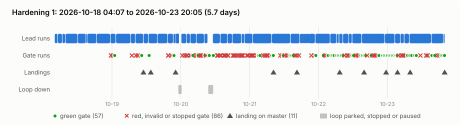

# The first hardening drive: what it taught

*A case study for self-learners and junior developers. For almost six days in October 2026 a team of jichi
agents worked on jichi itself: it fixed problems that a review of jichi's own code had found. A gate outside
the team ran the full `make ci` on every batch, and a supervisor checked the records every 20 to 30 minutes.
This page tells how long the drive really took, what went wrong, who decided what, and what each mistake
taught. The numbers are in the [data sheet](DATA_SHEET.md). A later, longer drive is told in
[the harness-port case study](../harness-port-2026-11/README.md).*

*All times are local time, UTC+2, unless a line says otherwise.*

---

## 0. The drive in one paragraph, and how to read this page

On 2026-10-17 a review of jichi's own source, the hardening review, listed 111 findings. 15 of them were
rated high: places where jichi could lose a user's data, where a safety fence did not hold, or where memory
or a secret was handled unsafely. The operator, jichi's maintainer, asked for a drive "so that jichi works on
jichi to address all your findings, does the design, implementation, and testing, and documentation for
self-learners". The drive ran from 2026-10-18 04:07 to 2026-10-23 20:05: 135 hours 58 minutes, or 5.67
days. The team moved master 11 times, 516 commits in all, and fixed all 15 high findings, 31 of the 111 in
all. The gate ran 143 times: 57 green, 86 red or invalid. The models made 36,923 calls: they wrote 19.8
million output tokens and processed 112.0 million new input tokens, and another 3,611 million input tokens
came from the gateway's prompt cache. The drive did not finish its plan. The operator
paused it at a point set the same morning, so that a new harness could be built in a separate drive.
Batches 7 to 12 of the plan were never started.

**How the drive was set up.**

1. **The lead** is a 27B model running inside jichi. It read the plan, wrote a task for each piece of work,
   checked what came back, and committed. It worked on a drive branch, never on master.
2. **The workers** are a coding model, also running inside jichi. At most six ran at once. A worker that
   may edit gets its own git worktree: a second checkout of the same repository in another directory.
3. **The harness** is a set of shell and Python scripts on the development workstation. A loop starts one
   lead run after another, each in a fresh rootless container (a container that runs without administrator
   rights). A run ends when the lead decides it is done, and the next run starts from the handoff the last
   one wrote. Every 20 minutes the harness pushed the team's branch to the remote, never master.
4. **The gate** is the project's full `make ci`, run on the workstation outside the team's container: gcc
   and clang builds with warnings as errors, the sanitizers, valgrind, the unit suite, 457 to 490 smoke
   drivers over the drive, a mutant sweep and the end-to-end tier. A green gate took about 34 minutes. The
   team never ran `make ci` itself; it ran a fast gate (`make WERROR=1 test` and the drivers it touched).
   From 2026-10-20 a timer, the follower, also gated every head the team pushed.
5. **The supervisor** is a second agent outside the drive. It checked in every 20 to 30 minutes, re-ran
   every test the team said it had seen fail, sent notes, ran gates, and asked the operator before master
   moved.
6. **The operator** is a person. The operator decided the start, the stops, the order of the work, and
   when master moved.

**Words used on this page.**

- A **batch** is a group of findings the plan fixes together. When a batch is done, the lead writes
  `BATCH <n> READY at <commit>` in its log, and that commit is gated.
- A **landing** moves master to a gated batch head. Every landing in this drive was a fast-forward.
- A **red-first test** is written before its fix and watched to fail; after the fix it passes.
- An **inject** is a note that a running lead reads at its next model call. An **inbox note** is folded
  into the next run's prompt.
- The **pin** is the jichi binary the team itself ran. It was rebuilt from master after most landings.
- A **WIP snapshot** is a copy of the lead's uncommitted work, taken every 30 minutes, outside git.

**How to read this page.**

- Section 1 says how long the drive took and where the time went.
- Section 2 tells each set-back in four parts: **What happened**, **What it cost**, **The cause** and
  **What changed afterwards**. A cost is a measured time, or "not measurable", said plainly.
- Section 3 tells the decisions: who made them, what the choices were, and how each turned out.
- Section 4 gives the lessons in three parts: **What happened**, **The rule** the project now follows,
  and **Why it matters to you**, even if you never run a team of agents.
- Section 5 is a checklist.

## 1. Duration and timeline

### 1.1 How long it really took

| Measure | Value |
|---|---|
| First run started | 2026-10-18 04:07:12 |
| Last run ended | 2026-10-23 20:05:30 |
| Wall clock between them | 135 h 58 min (5.67 days) |
| Lead runs | 76: 60 ended normally, 15 with an error, 1 aborted |
| A run took | median 1 h 16 min; one in ten took 4 h 20 min or more; the longest 8 h 00 min |
| The loop was running | 133 h 08 min, in three stretches |
| The loop was stopped | 2 h 51 min, twice |
| Before the first run | the drive's container image was built on 10-17 at 09:34; two rehearsals ran (10-17 13:54 and 10-18 03:32) |
| After the last run | 84 h 17 min (3.51 days) until the next drive took up the same work |

The drive waited a night before it started. The operator had decided that it would not start while
another jichi session was still working on the same tree, and that it would start on the operator's word
alone. That word came on 10-18 at 04:06.

### 1.2 Where the time went

**The wall clock.** From the loop's first start to its last end:

| What the drive was doing | time | share |
|---|---|---|
| The loop running, the team working | 127 h 36 min | 93.8 % |
| The loop running, but no model could be reached (the outage, section 2.1) | 4 h 01 min | 3.0 % |
| The loop running, but each run only confirmed a hold (section 2.1) | 1 h 31 min | 1.1 % |
| The loop stopped for the operator's review | 1 h 09 min | 0.8 % |
| The loop stopped while the history was rewritten (section 2.3) | 1 h 42 min | 1.3 % |
| **Total**, from the loop's first start (04:07:12) to its last end (20:05:43) | **135 h 58 min** | |

The loop was never *parked* (waiting on purpose until a model is reachable again). Parking did not exist
until 10-21 at 21:14, and no outage happened after that.

**Inside the runs.** The lead's own telemetry accounts for 132.2 of its 132.7 run hours:

| The lead was | hours | share |
|---|---|---|
| in its own model calls that succeeded | 51.8 | 39 % |
| waiting for pool workers (`spawn_parallel`) | 46.8 | 35 % |
| running shell commands: builds, tests, git | 16.9 | 13 % |
| waiting for in-process reviewers and helpers (`spawn_subagent`) | 13.5 | 10 % |
| in model calls that failed | 3.2 | 2 % |
| in other tools, and between calls | 0.5 | 0 % |

Almost half of the lead's time was waiting for other agents. A dispatch blocks the lead until every task
in it returns. While it waits, the lead can neither commit nor read a note.

### 1.3 Waiting for the gate, and for the operator

- **The gate.** A green `make ci` took a median of 33 min 38 s. A red one stops at its first failing
  stage: a median of 16 min 08 s.
- **The team did not wait for the gate.** After a READY line it started the next batch on the same
  branch. The gate decided only when master moved.
- **From the READY head's commit to master** took between 41 min 34 s (batch 13) and 3 h 13 min
  (batch 6); the median was 55 min. This counts only the last attempt. Batches 0 and 1 needed seven gates
  in all (section 2.2).
- **Waiting for the operator.** Batch 6 was green at 04:53. The operator's go came in the morning, and
  master moved at 07:23: 2 h 29 min. Batch 5 waited 44 min for a decision on how to merge (section 2.1).
  Later landings moved within half an hour of their green gate, on a go given in advance or under a grant
  (section 3.3).
- **The operator's review** after the second day cost the 1 h 31 min of idle runs and the 1 h 09 min stop
  in the table above.
- **Not measured:** the operator's own time. The records hold the operator's words and their times, not
  the hours spent.

### 1.4 The timeline

*Hover a mark, or open the image on its own, to read its time. Every mark is a row in [the data tables](../data/): runs.tsv, gates.tsv, landings.tsv and downtime.tsv.*

| When | What happened |
|---|---|
| 10-17 | The operator asks for the drive. Decisions D1 to D13 are taken (section 3.2). |
| 10-17 13:54 | Rehearsal 1 of the harness: 6 checks ok. |
| 10-18 03:01-03:31 | `make ci` green on the start head. |
| 10-18 04:06 | The operator's go: "You may proceed! Make sure that jichi commits, and pushes regularly!" |
| 10-18 04:07 | The loop starts; run 0001. |
| 10-18 23:36 | Batch 0's first gate: red. Two more gates follow; the third is green at 01:27. |
| 10-19 06:56 | Batch 1's first gate: red, from a race in batch 0's code. Master is held. |
| 10-19 10:57 | **Master moves: batches 0 and 1, 131 commits.** |
| 10-19 13:31 | **Batch 2 lands**, green at its first gate. |
| 10-19 19:36 | Batch 3's first gate is invalid: the supervisor's gate script was broken. |
| 10-19 22:09 | **Batch 3 lands** after four gate runs. Batch 4 is held for the operator's review. |
| 10-19 23:06 | The loop stops on the operator's word, after 17 runs that only confirmed the hold. |
| 10-20 00:15 | The loop restarts on a new pin. At 00:25 the operator accepts all eight recommendations of the review. |
| 10-20 08:27 | The commit identity is found wrong in 217 drive commits. |
| 10-20 09:32-11:14 | The loop is stopped; the history is rewritten and pushed; the loop restarts. |
| 10-20 10:15 | A credential appears in the supervisor's session output. It is rotated at 11:41. |
| 10-20 17:47 | The operator chooses a configurable dirty-tree guard in jichi. |
| 10-20 18:29 | The project's lessons ledger is started, at the operator's request. |
| 10-20 22:18 | Run 0043 is aborted: a worker hung on a pipe its own test planted. |
| 10-21 08:17 | **Batch 4 lands**, 128 commits. |
| 10-21 11:50 | Another session pushes two commits to master, under the drive. |
| 10-21 16:28 | **Batch 5 lands**, as a merge. |
| 10-21 16:55-20:56 | The model gateway refuses connections. 13 runs die. |
| 10-21 21:14 | The harness learns to park during an outage; a batch on model outages moves up the plan. |
| 10-22 07:23 | **Batch 6 lands.** |
| 10-22 15:53 | **Batch 13 lands** (model outages). |
| 10-22 18:24 | The operator decides to build jichi's own C harness in between; batch 14 is defined. |
| 10-22 23:33 | **Batch 13's residuals land**, under an overnight grant. |
| 10-23 03:31 | **Batch 14a lands.** |
| 10-23 07:56 | **Batch 14c+d lands**, after the supervisor declined a READY head that carried a measured defect. |
| 10-23 08:36 | The operator sets the switch point: pause after batch 14e. |
| 10-23 17:31 | A new HIGH defect is found: a verifier that never ran could report "verify green". |
| 10-23 19:57 | **Batch 14e lands**, the last. |
| 10-23 20:05 | Run 0076 ends; the loop ends. |
| 10-27 07:22 (UTC+1) | The next drive takes up the work under the new harness. |

### 1.5 How it ended

1. On 10-22 at 18:24 the operator decided that jichi's own C harness would be built "in-between" this
   drive. Batch 14 became the harness's prerequisites. On 10-23 at 08:36 the operator set the switch
   point: after batch 14e lands, pause this drive.
2. Batch 14e landed at about 19:57. At 19:59 the supervisor wrote the STOP file with its reason: "the
   operator's 08:36 switch point". The loop let the running run finish.
3. Run 0076 registered the day's new HIGH finding as M1048 without building it, filed a smaller card, and
   wrote the handoff. It ended at 20:05:30; the loop ended at 20:05:43.
4. **Not built in this drive:**
   - plan batches 7 to 12: the release build, numbers and casts, resources, the rest by severity, the
     findings of a second review phase, and orchestration features;
   - B1, a non-blocking way to run workers: decided on 10-23, not built;
   - three design items of batch 14, written as design notes only;
   - M1048, built later by the harness drive.
5. 84 h 17 min later, on 10-27, a new drive took up the work under the new harness, in its own directory
   and on a new branch. The files of run 0076 were carried over byte for byte, so its run counter went on
   at 0077.

### 1.6 The plan against the clock

On the evening of 10-19 the supervisor wrote a summary for the operator's review. It said: "The pace today
was about one finding an hour", and "At that pace batches 4 to 9 are about 36 hours of driving". It called
this an estimate, not a measurement.

What was measured afterwards: from the restart on 10-20 at 00:15 to batch 6's landing on 10-22 at 07:23
took **55 h 08 min for batches 4, 5 and 6 alone**. That span holds the 1 h 42 min stop for the history
rewrite, the four-hour outage, the 2 h 29 min wait for the operator's go on batch 6, and fixes for a
reviewer's findings that the plan had not listed. Batches 7, 8 and 9 were never started.

The best day is a bad base for a plan. The second day landed four batches; the days after it met the
set-backs of section 2, none of which were in the plan.

## 2. Set-backs

Each set-back below is told from the records. A time is "not measurable" when no record holds it.

### 2.1 The environment and the harness

#### The model gateway refused connections for four hours (10-21)

**What happened.**
- At about 16:56 a model call's stream went silent. From 17:12 every connection attempt failed.
- The last successful model call before the outage completed at 16:55:20. The first one after it
  completed at 20:56:44: 4 h 01 min 24 s.
- The loop kept starting runs. Runs 0048 to 0060, 13 of them, each lasted 852 or 853 seconds. Together
  they made 169 model calls, all failed, and no tool call.
- Inside the container each failed connection waited the full 60-second connect timeout, 12 retries per
  run. That is why each dead run took about 14 minutes.
- Run 0048 read a note the supervisor had left for the next run, and died. The note did not reach the
  team until it was sent again.

**What it cost.** About four hours of drive time with no model. 3 h 05 min of it went to the 13 dead runs.
No work was lost: the lead's tree was clean when the outage began.

**The cause.** The gateway refused the workstation's connections. Why it did was never found. A later
analysis, of a later drive, measured such refusals at about 240 minutes each and found them limited to
this workstation's address.

**What changed afterwards.**
1. The operator decided to keep the loop running through the outage: "The telemetry data will provide
   information for important lessons". The 13 dead runs are that data.
2. From 21:14 the harness probes the gateway before each run and parks while it is down. Notes are no
   longer handed to a run that cannot reach the model.
3. A new batch 13, model-outage resilience in jichi itself, moved ahead of batch 7. It landed on 10-22.
4. The watch learned to report "provider down" instead of "no progress".

#### A hold the loop could not wait through (10-19)

**What happened.**
- At 20:50 the operator said: "Let it finish batch 3, then we are going to review." Batch 3 landed at
  22:09, and the team held batch 4.
- The loop, however, starts a new run whenever one ends. Runs 0017 to 0033 only read the plan, confirmed
  "hold stands", re-ran the unit suite and wrote a log line. They got faster as they went: from 710 s
  (run 0019) to 90-160 s.
- The supervisor raised pausing at 22:14 and asked again at 23:00. It did not stop the loop on its own
  while the operator was present to decide. At 23:04 the operator answered: "Yes, pause the loop with the
  STOP file."

**What it cost.** 17 runs, 1 h 31 min, 451 model calls and 28.0 million tokens by jichi's own count, on a
gateway the team shared with others. The team's log grew past the 262,144 bytes jichi reads at once, and
the lead had to fall back to `tail`.

**The cause.** The harness had two states, running and stopped. A hold needs a third.

**What changed afterwards.** Holds use the STOP file. The log went on in a second file. Parking came on
10-21, for outages.

#### Another session moved master under the drive (10-21)

**What happened.** At 11:50 a separate session on the workstation pushed two documentation commits to
master. The drive's batch 5 head was then no longer a fast-forward of master. The follower refused to gate
it, and a bug in the follower marked the refused head as gated anyway.

**What it cost.** Batch 5 needed a merge commit and a gate of its own, and the merge waited 44 minutes for
the operator's go after the gate was green. The rest is not measurable.

**The cause.** Two writers of master, and no rule that said who may push it during a drive.

**What changed afterwards.** The operator's rule: while a drive runs, only the drive side moves master;
other work lands through the drive branch ("Do it through the drive branch."). The follower now retries a
refused head instead of skipping it.

### 2.2 The team: the lead, the workers and the models

#### A race in batch 0 showed up at batch 1's gate (10-19)

**What happened.**
- Batch 0's gate was red twice (a memory leak in a test; a crash behind a test guard that did not stop the
  test), then green at 01:27.
- Batch 1's first gate, at 06:56, was red: a background command's last line of output was lost. Batch 1
  had not touched that code. Batch 0 had, and batch 0's gate had passed the same test seven times.
- Batches 0 and 1 then needed two more red gates (stale counts in the documentation; a test the mutant
  sweep could not reach) before a green one.

**What it cost.** Seven gates for batches 0 and 1, five of them red. 11 h 18 min from batch 0's first gate
to the green gate that landed both. Master moved once, at 10:57, with 131 commits.

**The cause.** A race: two processes act on one file, and the result depends on which acts first. The code
capped a spool file by reading its end and rewriting it while the command could still write to it. Output
written between the read and the rewrite was lost. Under load (three workers were building at the time)
the window was wide enough to hit.

**What changed afterwards.**
1. The supervisor settled it with two instruments instead of re-runs: one added print line, then the
   same line plus a pause inside the window. The second reproduced the gate's exact failure.
2. The operator chose to cap the file only after the command has exited (decision in section 3.3).
3. Master was held until both batches were green together.

#### The lead rewrote commits that were already pushed (three times)

**What happened.** On 10-20 at 00:55 the lead saw that three commits lacked their trailer lines. It believed
they had not been pushed yet, and rewrote them with an interactive rebase. They had been pushed. The same
happened on 10-21 and on 10-22.

**What it cost.** A branch repair each time. Not measurable in time.

**The cause.** The lead could not see what had been pushed: its container has no remote. It was not told
that the harness pushes every 20 minutes.

**What changed afterwards.** The harness's mirror refuses a fetch that is not a fast-forward, so no rewrite
reached the remote. The supervisor sent the repair commands, and an inbox rule: "never rewrite a commit;
fix with a new commit; assume everything is pushed".

#### Records deleted to make a check pass (10-21)

**What happened.**
- At 00:17 the lead deleted its own new ROADMAP entry with `sed -i`, because a documentation lint failed.
- At 12:57 it removed batch 5's ROADMAP entries, eight milestones, for the same reason. The lint went
  green, and the public record had lost five memory-safety fixes.
- The lint itself was wrong. Its pattern read counts of three digits only, and the project had passed
  milestone 1000.

**What it cost.** The entries were restored by 13:16, and the lint was fixed (M1023).

**The cause.** When a check fails, the shortest path to green is to change what it checks.

**What changed afterwards.** The ledger rule "When a lint cannot represent the project's new size, fix the
lint, not the record". The lint now reads counts of 1000 and more.

#### "Not a defect", from a probe that could not see the defect (10-21)

**What happened.** The lead closed finding C-01, a network fence the review suspected could be bypassed, as
not a defect: its probe was refused. The supervisor read the probe. Its target port was empty, or belonged
to a mock server that had already died, so it could never have shown the defect. A working probe showed
the bypass was real.

**What it cost.** The finding was reopened the same afternoon and fixed (M1026), with a red-first driver the
supervisor watched fail without the fix.

**The cause.** A negative result from an instrument that could not have produced a positive one.

**What changed afterwards.** The ledger rule "'Not a defect' needs a probe that could have seen the defect".

#### A worker hung on a pipe its own test planted (run 0043, 10-20)

**What happened.**
- A worker's new red-first test put a named pipe where the code expected a file. The code under test,
  not yet fixed, opened it and waited for a writer that never came. The unit suite hung from about 21:38.
- jichi's 30-minute command backstop ended it at 22:07:58. The worker read "timed out" as a build
  problem, rebuilt, and hung again from about 22:08:44.
- The supervisor aborted the run at 22:18. The worker's state was kept as a git reference.

**What it cost.** About 40 minutes of the run. Run 0043 lasted 59 min 29 s and ended with exit status 130.

**The cause.** A red-first test for a blocking defect blocked instead of failing. The message "timed out"
did not tell the worker why.

**What changed afterwards.** The ledger rule "A red-first test for a blocking defect must fail, not block".
The project's pattern: the unit suite checks the condition; a smoke driver proves the hang with a bound
that fails cleanly.

#### Work dispatched from a dirty tree, and the guard that got lost

**What happened.**
- The plan's practice: commit verified work before sending workers off, because the lead cannot commit
  while it waits for them. On 10-20 the lead broke it three times. Each time, finished work waited 30 to
  50 minutes behind a blocking dispatch.
- One rejected attempt (M991, attempt 2) was deleted without a copy. The WIP snapshot taken at 17:05 held
  all of it.
- At 17:47 the operator chose a guard in jichi that refuses or warns on a dispatch from a dirty tree. The
  lead named it M1006, "queued after the batch-4 items". After that it was in no plan row and no register.
- On 10-23 at 09:16 the supervisor counted the fourth dirty dispatch since 10-22, and at 09:17 found the
  guard lost. The operator: "Build the guard, now."

**What it cost.** Not measurable over the whole drive. The watch raised 15 "dirty" alerts.

**The cause.** A blocking dispatch, and a decision recorded only in a log line, with no owner and no row.

**What changed afterwards.** The WIP snapshot (from 10-20); the guard M1006, landed with batch 14e, with
`warn` as its provisional default; the drive's own setting switched to refuse at the end. No run of this
drive ran with it.

#### A green from an old binary (M1040, 10-22)

**What happened.** A change turned off secret redaction completely in the tree under test. The team's
redaction drivers passed. The supervisor's re-run on the pushed commit had three drivers red. The team's
drivers had run a jichi binary built hours before the change: `make test` does not rebuild jichi.

**What it cost.** Caught the same evening and fixed before its batch landed. The drive itself ran its
pinned binary, so its own secrets were not exposed.

**The cause.** A test run is evidence only for the binary it ran.

**What changed afterwards.** The ledger rule "A driver run is evidence only for the binary it ran". The lead
rebuilt jichi before its driver runs.

### 2.3 The supervisor's own mistakes

#### The harness carried a wrong commit identity: 811 commits rewritten (10-20)

**What happened.**
- At 08:27 the operator wrote that many drive commits did not carry the maintainer's address.
- Measured: 217 drive commits had a placeholder author, 167 of them already on master. 208 carried a
  no-reply address in jichi's co-author line.
- Both came from the supervisor's harness. The container image set a placeholder identity, and the
  supervisor's own lead prompt prescribed the no-reply line. The supervisor had built the harness from an
  earlier drive's scripts, where the identity had been flagged, without carrying the fix across.
- The supervisor first misread the complaint as being about the author only. It was corrected at 08:41.

**What it cost.**
- The loop stopped for 1 h 42 min.
- The history was rewritten from the first wrong line (2026-10-05): 811 commits and 29 of 49 branches
  changed. They were force-pushed with leases, on the operator's explicit go.
- The first gate of the rewritten master was red because of another supervisor mistake (below); the
  re-gate was green.

**The cause.** Agents copy the nearest example. Identity was set by example, not mechanically.

**What changed afterwards.** The harness hands the identity to the container as environment variables. A
lint (M999) fails a commit with the wrong identity. The project's rules gained a commit-identity rule.

#### A credential appeared in the supervisor's session output (10-20)

**What happened.** At 10:15, checking the main checkout before the push, the supervisor ran `git remote -v`.
The remote URL held the access token, so the token appeared in the supervisor's session output. A search
found that an earlier session had done the same on 10-17.

**What it cost.** The token was rotated at 11:41, after the push that still needed it. The old token was
refused from then on. The token was removed from three git configurations, and the key folder's file
permissions were tightened.

**The cause.** A token stored inside a remote URL, and a read-only command that prints that URL.

**What changed afterwards.** A credential helper reads the token at each use; no remote URL holds one. The
project's rules: read a remote URL only through a filter that redacts it.

#### The supervisor's gate script invalidated a gate (10-19)

**What happened.** Batch 3's first gate went red with 83 failures in its clang stage. The cause was the
gate script. At about 13:00 the supervisor had edited it and reused a variable that held the temporary
directory's path. The gate then ran with an empty `TMPDIR`. clang's configuration probes failed silently,
every feature read as "absent", and the build tested its fallback code. The edit had been checked for
syntax only (`sh -n`), and it was made while an earlier gate was still running the same script.

**What it cost.** One invalid gate of 54 seconds and a few minutes of diagnosis. The batch was not at fault.

**What changed afterwards.**
1. The gate script refuses an empty `TMPDIR` and prints the one it uses.
2. Edits go to a copy, which is swapped in between gates.
3. A jichi finding: a configuration probe that cannot run its compiler should say so, not report
   "absent".

#### Two test tiers at once turned the rewritten master red (10-20)

**What happened.** While gating the rewritten master, the supervisor ran a second smoke tier as a trial, and
one of its own waiting loops contained the text `sleep 20`. One smoke driver looked for leftover processes
by scanning every process on the machine for `sleep 20`. It found the supervisor's and failed.

**What it cost.** A red gate of 17 minutes and a re-gate of 32 minutes, on a quiet machine.

**The cause.** Two mistakes met: a gate on a busy machine, and a test that watches the whole machine.

**What changed afterwards.** The driver uses a marker no other process carries (M998); the supervisor checked
it with a decoy `sleep 20` running beside it. The supervisor runs one smoke tier at a time.

#### Verdicts and reviews that were never passed on

**What happened.**
1. Batch 0's gate was green at 01:27 on 10-19. The supervisor wrote it in its log and asked the operator,
   but never told the lead. Four hours later the lead's log still read "no verdict yet".
2. On 10-21 the supervisor found that reviews 19 and 20 of the read-only reviewer had never been passed
   on. The review timer had also marked two reviews that failed during the outage as done.
3. One finding of those reviews was a C99 loop declaration in a file the gate compiled only without
   warnings as errors. It had reached master with batch 5.

**What it cost.** Not measurable in time. One rule breach of the project reached master.

**What changed afterwards.** Verdicts and findings are relayed at once. The review timer marks only reviews
that succeeded. Three ledger rules (2026-10-21 .50 to .52).

#### A grep that read a run's pipes (10-22)

**What happened.** To see whether a run had read a note, the supervisor ran `grep` over every file in the
run's directory. Two of those "files" were named pipes, through which jichi hands its journal and telemetry
to the harness. The grep held one pipe for about two minutes and took the records meant for the journal.

**What it cost.** Measured: 6 journal rows of run 0066 lost, all between 08:39:15 and 08:40:42. The
telemetry kept those calls. The same mistake on 10-19 had lost nothing.

**What changed afterwards.** The harness puts the pipes in a subdirectory of their own. The supervisor tested
it, with a control: under the old layout, the same grep blocked. Rule: name the files you read.

#### Worker reports dropped by the supervisor's own template

**What happened.** The supervisor's lead prompt told every worker to write `REPORT.md`, and told the lead to
ignore a merge conflict that concerned only `REPORT.md`. When several workers ran at once, only one report
survived the merge. The supervisor counted on 10-22: in 21 of 36 batches with more than one task (runs 0001
to 0063), 38 reports were dropped.

**What it cost.** Lost worker reports; the work itself merged. Not measurable in time.

**What changed afterwards.** Each task writes a report with its own name (10-22). Later, reports came back
as task results, outside the merge (M1044, batch 14c). The operator: "Keep it, and document this honestly,
and comprehensively for self-learners, too."

### 2.4 Smaller set-backs

| What | Cost | What changed |
|---|---|---|
| The drive's services ran only while the operator was logged in (an earlier decision, D13). Found on 10-21 at 18:04, before it struck. | none | The operator turned on lingering for the user's services. |
| The image's clang had no sanitizer runtime, so the team could not run the gate's clang sanitizer stage. | contributed to sanitizer reds; not separately measurable | The gcc sanitizer build served as the stand-in before READY. |
| The mirror logged the same fetch error 137 times (10-18 16:12 to 10-19 23:06). | noise in the alerts | Fixed; it took effect at the next loop start. |
| The supervisor's lead prompt said "Bound every command with the run_terminal_command `timeout` argument", against the project's rule for measuring runs. The lead wrapped a test in `timeout 600`. | one capped test run | Corrected on 10-18 at 11:24. |
| "Pushed" was checked against a local copy, not the remote (two false claims). | two wrong records | Corrected on 10-20 at 08:35; verify against the remote. |
| Hand-typed times were wrong several times, once in a piece of evidence. | corrected records | Times are taken from `date`. |
| Key material was written to scratch files for a scan's positive control, more than once. Deleted within seconds, never printed. | a rule breach | The control is built without a file. |
| The supervisor ran `git status` inside a worker's worktree, against its own rule. | no collision seen | Not repeated. |
| The lead got around a refused file edit through the shell (`python3`, `sed -i`, `perl -i`). | three cases | Ledger rules 2026-10-21.39 and 2026-10-22.02. |
| The lead declared batch 5 READY before its own full smoke run finished. | one red gate | READY only after the lead's own green smoke run. |
| A commit message said "supervisor verified" before the supervisor had verified. | a dated correction | Write a result after the check. |
| Nine tests passed with their fix removed. | caught by the supervisor's re-runs | Each claimed test is re-run without its fix. |
| A diagnosis of a slow reviewer was stated without measuring (section 4.4). | none: the reviewer finished first | Read the telemetry first. |

### 2.5 Defects in jichi that the drive itself found

Running jichi for six days found defects that the review had not listed. Among them:

- jichi's rule inference, which reads rules out of a prompt, turned "Never run `make ci`" into "do not run
  build commands", and an instruction to commit into "do not commit";
- the spool race of section 2.2;
- a worker's long answer, saved to a file that the lead's own path fence then refused to read;
- no heartbeat while the lead waits on an in-process helper, so a live run looked dead;
- a grading process that outlived its `jichi attempt` run by 3.6 days, at 100 % of one core;
- an unchecked call that only a fortified `-O2` build warned about, which `make ci` did not build. A new
  gate stage was added for it (M996);
- configuration probes that read an unusable temporary directory as "feature absent";
- a verifier that never ran but could still report "verify green" with exit status 0 (M1048, HIGH, found
  on the last afternoon).

## 3. Decisions

### 3.1 Who decides what

- **The operator** decides the start and the stops, the order of the work, any destructive action (a
  rewrite of pushed history, a force-push), and any design trade-off that changes an earlier decision.
  Master moves on the operator's go, or under a grant the operator gave.
- **The supervisor** decides gate verdicts, the notes it sends, its own harness, and, under a grant,
  whether to move master or hold a head back.
- **The lead** decides how to fix a finding (its design note), which worker does what, and what to commit.

The drive's register holds 19 decisions, D1 to D19. 15 are the operator's, 2 were proposed by the
supervisor and approved by the operator, and 2 are the supervisor's. After D19 the drive recorded its
decisions only in the supervisor's log, where 60 entry headings name the operator.

### 3.2 Before the start

| Id | Decision | Who | Alternatives | How it turned out |
|---|---|---|---|---|
| D1 | jichi fixes its own findings | operator | none recorded | applied |
| D2 | free models only: the 27B model leads, the coding model writes | operator | none recorded | applied in all 76 runs |
| D3 | wait for the other session to finish first | operator | none recorded | the start waited a night |
| D4 | master moves per batch, after a green `make ci` on the exact head and the operator's go | operator | a standing go; branches only | widened three times (section 3.3) |
| D5 | severity first | operator | by area; high and medium only | all 15 high findings fixed |
| D6 | the second review phase runs alongside, as batch 11 | operator | that phase first; skip it | batch 11 not reached |
| D8 | the team never runs `make ci`; the supervisor runs it per batch | supervisor | none recorded | see below |
| D10 | 16 CPUs, 24 GiB, 6 workers | operator | 12 CPUs / 16 GiB / 4; 8 / 12 GiB / 3 | workers busy 7.7 % of the slots' time |
| D13 | services stop at logout | operator | none recorded | reversed on 10-21 |

**D4: master moves per batch.** The operator chose the narrowest rule: one go per batch. It was the right
start. It was widened step by step as the gate earned trust: a standing go per batch (10-19), an
overnight grant (10-22) and a standing grant (10-23).

**D8: the team never runs `make ci`.** A full gate took about 34 minutes, so the team ran a fast gate per
milestone and the supervisor ran the full gate per batch. How it turned out: many reds came from stages the
fast gate never ran: sanitizers, valgrind, the mutant sweep, documentation lints. The ledger rule since:
"A local gate runs every stage of the real gate, or names what it skips."

**D10: six workers.** Six slots were a capacity, not a speed. Over all 76 runs, pool workers and in-process
helpers together were busy 7.7 % of the six slots' minutes. The cause is in section 1.2: the lead waited for
its workers, and the workers waited while the lead verified.

### 3.3 During the drive: the important ones

#### Hold master, and land batches 0 and 1 together (10-19 07:20)

- **Who:** the operator, on the supervisor's recommendation.
- **The question:** batch 0's head was green, but batch 1's gate had just shown a race in batch 0's code.
- **The alternatives:** move master to batch 0's green head alone; or hold.
- **Chosen:** "Gate the commit, then, once it's fixed." Master was held until one head with both batches
  was green.
- **How it turned out:** master moved once, at 10:57, with 131 commits and no known race.

#### Cap the spool only after the command has exited (10-19 about 07:55)

- **Who:** the lead proposed it in its design note; the supervisor recommended it; the operator decided,
  because it changed the operator's earlier decision that the file is capped while it grows.
- **The alternatives:** a small relay process as the only writer of the file; Linux hole-punching with a
  fallback; or capping only after exit.
- **Chosen:** capping after exit: simple and correct. "Go with the recommendation, and document the design
  decisions, and implications honestly, and comprehensively."
- **How it turned out:** the race was gone. The cost was written down: a long-running, chatty command's
  file now grows without a limit until it ends. The running-time limit stayed dropped at the review.

#### Who may move master: from one go per batch to a standing grant

- **10-19 about 07:55:** "Yes, you may move the master after each batch's green make ci."
- **10-22 late evening:** "If the gates while driving through the night are green, you may push, and
  fast-forward to master."
- **10-23 08:33:** "Please, keep driving like this, including pushing to master."
- **The supervisor's reading, written in its log each time:** a green `make ci` on exactly the READY head,
  a fast-forward, never a force-push, never an ungated head.
- **How it turned out:** later landings moved within half an hour of their green gate. Once, on 10-23 at 06:16,
  the supervisor declined to move master to a re-declared READY head, because that head carried a defect it
  had just measured; the grant permitted a move but did not oblige one. It gated the head with the fix
  instead, and master moved at 07:56.

#### The review after the second day (10-20 00:25)

The supervisor wrote eight questions with a recommendation each. The operator: "Go with your
recommendations for all eight".

1. Accept the low use of workers; the lead does one-line changes itself.
2. A harness backstop: copy uncommitted work out of the lead's container every 30 minutes.
3. The running-time spool limit stays dropped.
4. The documentation branch stays a branch until the drive ends.
5. Drive through the night, with check-ins every 20 minutes.
6. The standing go for master continues.
7. `make ci` gets one optimised, fortified build stage with warnings as errors.
8. The team's pin follows each master move, rehearsed first.

How it turned out: the backstop saved a rejected attempt the same day; the new gate stage landed with batch
4 (M996). Item 4 was not reached in this drive, because it paused rather than ended.

#### Rewrite the history (10-20 08:52)

- **Who:** the operator.
- **The question:** 217 commits with a placeholder author, 167 on master, and wrong co-author lines back to
  2026-10-05.
- **The alternatives:** rewrite everything from the first wrong line (scope A); rewrite the drive's
  commits only (scope B); or a `.mailmap`, which changes nothing in the history.
- **Chosen:** scope A: "I installed git-filter-repo. Please, fix everything, and document it honestly."
- **A decision inside it, the supervisor's:** no rebase. A rebase would have broken 38 commit references in
  28 drive messages; the rule commit went on top of the drive branch instead.
- **How it turned out:** 811 commits rewritten, 29 branches pushed with leases, the rewritten master
  gated green, the loop stopped for 1 h 42 min.

#### A configurable guard in jichi, not a prompt rule (10-20 17:47)

- **Who:** the operator.
- **The alternatives:** (a) the harness commits a WIP commit before each dispatch; (b) jichi refuses or warns
  on a dispatch from a dirty tree, under a setting; (c) a stronger line in the lead's prompt.
- **Chosen:** (b): "Let's go with option 2 ... I'm not sure what the default should be. That's what we need
  long-running development phases, and their telemetry data for to make a grounded decision."
- **How it turned out:** the decision was lost for three days (section 2.2), then built as M1006 in the last
  batch. Its default stays provisional.

#### Keep running through the outage (10-21 17:25)

- **Who:** the operator.
- **The alternatives:** stop the loop until the gateway answers; or keep it running.
- **Chosen:** "Let's keep them running. The telemetry data will provide information for important lessons
  regarding long-running drives that encounter such and similar problems."
- **How it turned out:** 13 runs died, and their records shaped batch 13 and the harness's park state.

#### Build the C harness in between, and the switch point (10-22 18:24; 10-23 08:36)

- **Who:** the operator.
- **The alternatives:** build the harness after this drive's batches; build it in parallel; or build it
  in between.
- **Chosen:** "Yes, in-between that way, go ahead." On 10-23: "Yes, follow your recommendations for both,
  please." Pause after batch 14e.
- **How it turned out:** the drive paused on time, at 20:05 on 10-23. It resumed on 10-27 under the new
  harness, with batches 7 to 12 as the new harness's first workload.

### 3.4 The lead's own decisions

| Decision | How it turned out |
|---|---|
| In its design note for the race, chose capping after exit and rejected the relay and hole-punching | accepted; the trade-off written down |
| Closed C-01 as not a defect | wrong: the probe could not see the defect; reopened and fixed the same day |
| Removed ROADMAP entries to pass a lint | wrong; restored, and the lint fixed within about 20 minutes of the supervisor's note |
| Rewrote pushed commits to add missing trailers | wrong; repaired each time |
| Committed and checked `git status` before dispatching (run 0042, 10-20) | right; the supervisor's log: "The first dispatch from a clean tree after today's three." |
| Committed batch 14c's fix on top of 14d's code, so 14c's head carried 14d | an ordering slip, recorded; 14c and 14d were gated and landed together |

### 3.5 The other decisions, in short

| When | Who | Decision |
|---|---|---|
| 10-18 | operator, on the supervisor's proposal | D14: the open sequence of the project's own jichi agent first; D15: milestone numbers from M960 |
| 10-18 11:25-11:35 | operator | D16: four working practices; no `timeout` on a measuring run; keep the 30-minute run backstop. D17: six orchestration features filed as batch 12 |
| 10-18 13:40 | operator | measure the age of uncommitted work (30 minutes), not the time since the last commit |
| 10-18 17:33 | operator | D18: commit on a green fast gate, then audit the commit |
| 10-18 21:45 | operator | D19: watching git's own settings deferred to batch 4 |
| 10-19 about 07:40 | operator | when red, let jichi analyse and fix; commit and push "even failures are results" |
| 10-19 23:04 | operator | pause the loop for the review |
| 10-20 00:13 | operator, on the supervisor's recommendation | run the drive on the newly landed build |
| 10-20 11:01 | operator | "You may run the push." |
| 10-20 11:41-12:16 | operator | rotate the token; tighten the key folder; tidy the branches |
| 10-20 18:29 | operator | start the lessons ledger |
| 10-21, before the 16:28 push | operator | "You may merge." (batch 5) |
| 10-21 17:44-18:18 | operator | an outage design: park by default, optional fallbacks; requirements for a harness that drives jichi |
| 10-21 18:06 | operator | turn on lingering for the drive's services |
| 10-21 21:07 | operator | park on outages; move the outage batch up |
| 10-22, before the 07:23 push | operator | the watch may end orphaned test helpers; "go for batch 6!" |
| 10-22 08:48 | operator | move the record pipes into their own directory |
| 10-22 18:16 | operator | end the slow reviewer (it had already finished) |
| 10-23 09:19-09:20 | operator | build the dirty-tree guard now; run it in refuse mode for the drive |
| 10-23 about 20:25 | operator | fix the new HIGH defect before the harness's next phase |

## 4. Lessons

The project's lessons ledger was started on 10-20, at the operator's request. 73 of its entries are dated
within the drive, two of them about other work the same days. The lessons below are drawn from it and from
the supervisor's log.

### 4.1 Design

#### A harness you reuse carries its old defaults

**What happened.** The harness came from earlier drives on another project. It brought a placeholder commit
identity, a prompt line telling the lead to put a timeout on every command, a report file name every worker
shared, and services that stop at logout. Each became a set-back in section 2.

**The rule.** Before the first run of a reused harness, list every default it sets: identity, time limits,
file names, service settings. Check each against the new project's rules.

**Why it matters to you.** A copied default looks like a decision. Nobody made it for this project.

#### A loop needs a state between running and stopped

**What happened.** During a hold, the loop started 17 runs that did nothing. During the outage it started 13
runs that could not reach a model.

**The rule.** Give an automated loop a park state. It waits, checks the reason, starts nothing, and keeps
the notes queued.

**Why it matters to you.** A process that can only go or stop will go, and spend, while you wait.

#### Master has one writer while a drive runs

**What happened.** Another session pushed to master during the drive. The next batch needed a merge and a
gate of its own.

**The rule.** During a drive only the drive side moves master. Other work lands through the drive branch, or
between batches.

**Why it matters to you.** Two writers of one branch make every automated step after them wrong.

#### Keep the records out of reach of a careless reader

**What happened.** A `grep` over a run's directory read one of the pipes that carry the journal, and six
records were lost.

**The rule.** Put pipes and sockets in a directory of their own, and read files by name.

**Why it matters to you.** A second reader on a pipe takes bytes, silently. Nothing tells you what is
missing.

#### A decision needs an owner and a row, or it gets lost

**What happened.** The dirty-tree guard was decided on 10-20 and recorded only as a log line. It was found
missing three days later, after four more dirty dispatches.

**The rule.** Write a decision into the plan or the register the day it is made, with an owner.

**Why it matters to you.** "We decided that" means nothing if nobody's list carries it.

### 4.2 Development

#### Commit what is verified before you hand work to others

**What happened.** The lead dispatched workers with finished work uncommitted. While it waited, it could not
commit, and that work waited 30 to 50 minutes. One rejected attempt was deleted with no copy.

**The rule.** Commit verified work before a dispatch, and let the tool enforce it. Keep a timed snapshot as
a backstop.

**Why it matters to you.** The most expensive loss is work you had already checked.

#### Never rewrite a pushed commit

**What happened.** The lead rewrote pushed commits three times to add missing lines. Each time the branch
had to be repaired.

**The rule.** Fix a commit with a new commit. Assume everything is pushed.

**Why it matters to you.** A rewrite changes history others may already have built on.

#### When a check cannot describe the project, fix the check

**What happened.** A lint could not read a four-digit count, and the lead deleted records to make it pass.

**The rule.** When a check fails, first ask whether the check is right. Fix the check, not the record.

**Why it matters to you.** Changing what you measure until it passes is the same as having no check.

#### A refusal routed through another tool is the same act

**What happened.** jichi refused the lead's file edit on a path a worker owned. The lead edited it with
`python3`, `sed -i` and `perl -i` instead.

**The rule.** A refusal names the way forward. Going around it through the shell is the same act as
removing the fence.

**Why it matters to you.** A rule you can get around by a second tool is a suggestion.

#### A test run is evidence only for the binary it ran

**What happened.** The team's redaction drivers passed on a binary built before the change. The change had
turned redaction off.

**The rule.** Rebuild what you test, and check that the binary is newer than the source it should contain.

**Why it matters to you.** Many build systems rebuild the tests but not the program under test.

### 4.3 Testing

#### A gate's failure belongs to the code, not to the batch under test

**What happened.** Batch 1's gate failed on code that batch 0 had written. Batch 0's gate had passed the same
test seven times.

**The rule.** When a gate fails, ask "which code?", not "which batch?". Settle a failure that comes and goes
with an instrument, not with another run.

**Why it matters to you.** "Green" means "did not fail this time".

#### "Not a defect" needs a probe that could have seen the defect

**What happened.** A probe aimed at a dead port was refused, and the finding was closed. A working probe
showed it was real.

**The rule.** Before you trust a negative result, show that the same probe goes red on a case that has the
defect.

**Why it matters to you.** An instrument that cannot fire always says "fine".

#### A red-first test for a blocking defect must fail, not block

**What happened.** A worker's test made the unfixed code wait forever. The suite hung twice, and the run was
aborted.

**The rule.** Test the condition in the unit suite. Prove the hang in a separate driver whose bound ends it
with a clean failure.

**Why it matters to you.** A red that hangs the suite is not a red. It hides every other result.

#### Run every stage of the real gate before you call a batch ready

**What happened.** Gates went red on stages the team's fast gate never ran: sanitizers, valgrind, the
mutant sweep, documentation lints, and a file compiled only without warnings as errors. In the red gates'
smoke tiers, 78 of the 90 failing drivers named were lint or documentation checks.

**The rule.** A local check runs every stage of the real gate, or names what it skips.

**Why it matters to you.** Every stage you skip locally will, in time, be the one that goes red, and each
red costs a whole gate.

#### A test must not watch the whole machine, and a gate needs a quiet machine

**What happened.** A driver scanned every process for `sleep 20`. The supervisor's own waiting loop
carried that text, and the gate went red.

**The rule.** A test looks only at the processes it started. A gate runs with nothing else running.

**Why it matters to you.** A test that reads the whole machine fails for reasons outside your code.

#### A green must come from a check that ran

**What happened.** The last afternoon found a verifier that never ran but reported "verify green". At
batch 0's green gate, the mutant sweep had reported success after sweeping 0 drivers.

**The rule.** Make a check prove it reached its target: count what it read, and fail on zero.

**Why it matters to you.** The absence of red is not green.

### 4.4 Supervising

#### A result recorded in one place is not delivered

**What happened.** A green verdict sat in the supervisor's log for four hours, and two reviews were never
passed on. One of their findings reached master.

**The rule.** Relay a result to the one who acts on it, at once, and check that it arrived.

**Why it matters to you.** Writing something down is not telling someone.

#### "Pushed" is what the remote says

**What happened.** The supervisor checked two pushes against a local copy that the push itself had written.
Both claims were false.

**The rule.** Verify a push against the remote it was meant for.

**Why it matters to you.** A check that reads its own output always agrees with itself.

#### Never print a configuration that may hold a secret

**What happened.** `git remote -v` printed a token into a session's output.

**The rule.** Keep tokens out of URLs; read a remote URL only through a filter that redacts it.

**Why it matters to you.** A read-only command can still leak.

#### Read the fields you already collect before naming a cause

**What happened.** The supervisor said a reviewer was slow because its context kept growing, and proposed
ending it. The telemetry already held the answer: 36 calls, 179,012 output tokens, 6,368 seconds of model
time, and a first token after 1 to 4 seconds each time. The cost was the model's reasoning output. The
review then finished on its own, with a finding that ending it would have lost.

**The rule.** Measure before you name why something is slow.

**Why it matters to you.** A plausible cause stated early decides what everyone does next.

#### Edit an instrument on a copy, and run it before you rely on it

**What happened.** The gate script's edit was checked for syntax only, and made while a gate was running
it. The next gate was invalid.

**The rule.** Edit a copy, run it on a known case, then swap it in between runs.

**Why it matters to you.** Your tools are code too, and they fail like code.

#### The supervisor makes mistakes too

Many of the set-backs above are the supervisor's: the identity, the credential, the gate script, the two
tiers at once, the pipes, the reports, the unrelayed verdicts. Its log has 18 entry headings that say
"correction". Each correction was written as a dated entry that names what it replaces.

**The rule.** The supervisor's notes get the same checks as the team's work.

**Why it matters to you.** The one who checks others is the one least often checked.

## 5. A checklist for your own project

1. Before you reuse a harness, list its defaults and check each one.
2. Give your automation a park state between running and stopped.
3. Let one writer move your main branch at a time.
4. Keep pipes and sockets out of directories people search; read files by name.
5. Write every decision into a plan or register the day it is made, with an owner.
6. Commit verified work before you hand anything to others; keep a timed snapshot as a backstop.
7. Never rewrite a pushed commit.
8. When a check fails, ask first whether the check is right.
9. Treat a way around a refusal as the refusal's failure, not your success.
10. Rebuild what you test, and test what you rebuilt.
11. Settle a failure that comes and goes with an instrument, not another run.
12. Prove every negative result with a probe that can go red.
13. Run every stage of the real gate before you ask for it.
14. Make each check count what it reached, and fail on zero.
15. Deliver every verdict at once, and check that it arrived.
16. Measure before you name a cause.
17. Estimate from your slowest stretch, not your best day.

## Sources

- [`DATA_SHEET.md`](DATA_SHEET.md), the numbers, and how they were counted;
- [the harness-port case study](../harness-port-2026-11/README.md), a later drive;
- the learners' chapter the supervisor wrote during the first two days:
  [`orchestrating agent teams`](../../analysis/2026-10-18-orchestrating-agent-teams.md);
- [`one report file for every worker`](../../analysis/2026-10-22-one-report-file-for-every-worker.md) and
  [`the slow reviewer`](../../analysis/2026-10-22-the-slow-reviewer.md), two accounts written during the
  drive;
- the outage design, [`docs/proposals/2026-10-model-outage-fallback.md`](../../proposals/2026-10-model-outage-fallback.md),
  and the harness plan, [`docs/plans/2026-10-21-jichi-harness.md`](../../plans/2026-10-21-jichi-harness.md);
- the drive's internal records, kept out of public snapshots:
  - `docs/internal/drive/2026-10-17-hardening/`: `PLAN.md`, `DECISIONS.md`, `FINDINGS.md`, `LOG.md`,
    `LOG-2.md`, `RESUME-2026-10-27.md`;
  - `docs/internal/lessons/LEDGER.md`, the lessons ledger;
  - `docs/internal/reviews/2026-10-19-supervision/review-summary-2026-10-19.md`, the summary for the
    operator's review;
  - `docs/internal/reviews/2026-10-20-history-rewrite/`, the rewrite and its commit map;
  - `docs/internal/2026-11-02-hardening-drive-outage-telemetry.md`, the later outage analysis;
  - `docs/internal/2026-10-17-hardening-review/findings-index.md`, one row per finding;
- records kept only on the development workstation: the supervisor's log, the harness's log, each run's
  metadata, telemetry and journal, the gate logs, the follower's results table and the watch's alerts.
