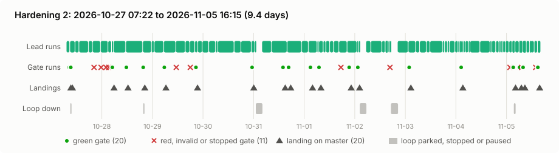

# The second hardening drive: what it taught

*A case study for self-learners and junior developers. From 27 October to 5 November 2026 a team of jichi agents
fixed security and robustness findings in jichi's own source, under a gate that ran the full `make ci` and a
supervisor that checked in every twenty minutes (hourly on the last day). The drive is **paused, not ended**. This
page tells how long it took, what went wrong, who decided what, and what each mistake taught. The numbers are in the
[data sheet](DATA_SHEET.md). Every time on this page is local time (CET, UTC+1).*

---

## 0. The drive in one paragraph, and how to read this page

**What the team was asked to do.** On 17 October 2026 a review of jichi's security and robustness listed 111
findings: 15 high, 39 medium, 46 low and 11 notes. A first drive fixed all the high ones and 14 of the medium ones,
from 17 to 23 October, on older shell and Python scripts. The operator then asked for the work to go on under
`jichi-harness`, jichi's own C harness: "Please, resume the hardening branch under jichi-harness!" Each finding was
to be fixed in the same order: a design note, a test that fails first, the fix, and a page for learners.

**How it was set up.**
- A 27B model led the team. A coding model wrote most of the code, as workers.
- Both models ran on the institution's free model gateway, so no call cost money.
- The team ran in a container on the development workstation. The container held no credential for the Git server.
- So everything that left the container ran on the host: pushing, gating, landing, and installing each new build.
  The supervisor's session did those steps.

**The headline numbers.**
- 224.9 hours (9.4 days) from the first run to the pause.
- 130 runs of the lead. 20 landings on master, carrying 640 commits and milestones M1060 to M1143.
- 55 review findings closed (24 medium, 31 low). One medium finding, B-02, is still open.
- 28 runs of `make ci` on the host: 20 green, 8 red.
- 25,367 model calls. The models wrote 27.8 million output tokens and processed 103.8 million new input tokens;
  another 2,227 million input tokens came from the gateway's prompt cache.
- One public release, 0.13.0.
- Two hard days at the end: the supervisor was away for 16.5 hours, and the gate's own new scripts gave four false
  verdicts in one day.

**It is paused.** The loop stopped on 5 November at 16:16. It resumes after a separate drive has moved the host's
scripts into `jichi-harness` itself, and finding B-02 comes first then (section 1.5).

**How to read this page.** Each section stands on its own:
- section 1 is the time: how long, where it went, the timeline;
- section 2 is the set-backs, each with its cost;
- section 3 is the decisions and who took them;
- section 4 is the lessons;
- section 5 is a checklist for your own project.

**Words used on this page.**

| word | meaning |
|---|---|
| drive | days of work in which a team of jichi agents develops jichi itself |
| the lead | the agent that plans, briefs workers, reviews their work and keeps the drive's log |
| a worker | an agent the lead starts for one task, in its own copy of the tree (a worktree) |
| a run | one session of the lead; when it ends, the loop starts the next one |
| the loop | `jichi-harness drive`, which starts runs one after another until it finds a STOP file |
| STOP file | a file in the drive's directory; the loop ends after the current run when it exists |
| batch | several milestones handed to the gate together |
| READY line | the line `BATCH <name> READY at <commit>` in the lead's log, which asks for the gate |
| the gate | the full `make ci` on exactly that commit: two compilers at `-Werror`, sanitizers, valgrind, the unit suite, the smoke tier and the end-to-end tier |
| landing | moving master to the gated commit, only when the gate is green |
| re-pin | building jichi from the new master and installing it as the binary the drive runs |
| the supervisor | a second agent outside the drive; it read the records, ran the host's steps and wrote notes |
| a note | a short message from the supervisor into the drive's inbox, often also injected into the running lead |
| the operator | the human maintainer, who took the decisions that were theirs |
| fence and cap | a fence limits what an agent can touch, or how long *nothing* may happen; a cap limits how long something may take. Fences stay on; caps stay off for measurements |
| park | stop the loop on purpose during an outage, and start it again when the model answers |
| red-first | a test that is watched failing before its fix is applied |

---

## 1. Duration and timeline

### 1.1 How long it really took

- **First run:** 27 October, 07:22.
- **Pause:** 5 November, 16:16.
- **Span:** 224 hours 53 minutes, or 9.4 days. The work went on around the clock.
- **The loop was running** for 214 hours 23 minutes of that, 95 % of the span.
- **The loop was stopped** for 10 hours 30 minutes, in six gaps.

Nine days bought 84 milestone numbers. That is about 2.7 hours of wall clock per milestone, with a team that never
sleeps. A milestone is one numbered unit of work. Most are one finding's fix, with its design note, its test and its
records. Some are a defect the drive found in `jichi-harness` itself, or a release record.

### 1.2 Where the time went

**The 224.9 hours from the first run to the pause:**

| the loop was | hours |
|---|---|
| running the lead's runs | 214.4 |
| parked for three outages of the model gateway | 9.6 (3.1 + 3.1 + 3.4) |
| stopped while batch 12 went through the gate | 0.8 |
| stopped after the shakedown run, and for one restart | 0.05 |

**Inside the runs.** The 130 runs add up to 214.0 hours. The lead's own records split them like this:

| the lead was | hours | share |
|---|---|---|
| waiting for workers it had dispatched | 77.3 | 36 % |
| waiting for its own model calls | 70.2 | 33 % |
| running shell commands: builds, tests, git | 35.6 | 17 % |
| waiting for in-process reviewers and helpers | 29.7 | 14 % |
| everything else | 1.2 | under 1 % |

So half of the lead's time was spent waiting for other agents. A dispatch blocks the lead until every task in it
returns.

**What the runs produced:**

| runs that... | runs | hours |
|---|---|---|
| committed changes beyond the drive's own records (code, tests, docs) | 72 | 202.7 |
| committed only the drive's own records | 47 | 9.3 |
| committed nothing (every one of them died on a model failure) | 11 | 2.0 |

43 of the 47 record-only runs were on 5 November. Most of them were "pause checks": the lead had written its READY
line and was told to start nothing new, so each run re-read the state, wrote one log line and ended. Seven of them,
runs 0160 to 0166, came and went within 33 minutes, before the supervisor stopped the loop while the gate worked.

**Time that passed while the loop kept running.** These did not stop the loop, but they delayed work:
- **The gate:** 28 runs of `make ci` on the host took 19 hours 9 minutes in all. A green run took about 46 minutes.
- **The supervisor's absence:** 16.5 hours on 4 November (section 2.1). The team worked on, but nothing left the
  container.
- **A build that did not reach the drive:** after master moved on 4 November at 03:18, the drive ran the previous
  build for 22 hours 15 minutes, because installing the new one was a step of the supervisor's session.
- **Waiting for the operator:** not recorded as a total. The operator's decisions are in the supervisor's log, with
  their times, but nobody measured how long a question waited for its answer.

### 1.3 The timeline

*Hover a mark, or open the image on its own, to read its time. Every mark is a row in [the data tables](../data/): runs.tsv, gates.tsv, landings.tsv and downtime.tsv.*

| when | what happened |
|---|---|
| 10-27 07:22 | run 0077 starts: one shakedown run on one small finding, to see `jichi-harness` work a real item |
| 10-27 07:56-08:11 | a two-minute network gap catches a request mid-upload; the call hangs 906.8 s until the dead-stream fence (900 s of silence) ends it; the retry succeeds |
| 10-27 09:05 | the loop starts; the first two landings follow at 09:17 and 10:02 |
| 10-27 11:41 | a READY batch is stopped before its gate: the supervisor measures a regression in it |
| 10-27 21:00 - 10-28 03:59 | four `make ci` reds in a row on the same batch (section 2.3) |
| 10-28 05:46 | that batch lands: 78 commits; master had stood still for 19 h 44 min |
| 10-28 12:36 | the operator: "restart the loop"; the loop had kept running its first build all along (section 2.4) |
| 10-28 19:38 | the loop restarts on the new build |
| 10-29 21:25 | batches 8 and 9 land after two reds |
| 10-30 19:30 | the operator splits batch 10 so that the finished half can land |
| 10-31 00:13 | batch 10 lands |
| 10-31 01:02 - 04:10 | first gateway outage: the loop is parked for 3 h 8 min |
| 10-31 - 11-01 | six small batches (10b-1 to 10b-5 and 10b-6a) land in five landings |
| 11-02 02:23 - 05:31 | second gateway outage: parked 3 h 8 min |
| 11-02 14:41 - 15:13 | the lead model's backend fails in short stretches; eight runs die in a row |
| 11-02 17:09 - 20:31 | third gateway outage: parked 3 h 22 min; the workstation reboots inside it |
| 11-03 02:39 | batch 10b-6c lands |
| 11-03 10:04 | the first release candidate is marked READY, and fails by effect before its gate (section 2.6) |
| 11-04 03:18 | batch 11, the second release candidate, lands |
| 11-04 about 03:20 - 20:01 | the supervisor's session is away (section 2.1) |
| 11-05 01:26 - 01:50 | the waiting commits go out in six steps; push and gate move onto timers |
| 11-05 04:17 | batch 12 lands, the first landing with no supervisor step |
| 11-05 04:19 | a reviewer's WRONG verdict on batch 12 is reproduced; the release waits for a fix batch, 12b |
| 11-05 07:14 - 13:55 | the gate's own scripts give four false verdicts (section 2.2) |
| 11-05 15:44 | batch 12c, the release record, lands at 9ada7cd7 |
| 11-05 15:45 | the STOP file is written: the pause |
| 11-05 16:16 | the loop ends after run 0206 |
| 11-05 20:37 | 0.13.0 is published from 9ada7cd7 |
| 11-05 23:04 | the harness-port drive starts; this one stays paused |
| 11-14 | during the pause, one host script is fixed on the operator's word; nothing else changes |

### 1.4 The 0.13.0 release

The release was cut from the drive's last landing. Getting there took three tries:

1. **11-03 10:04, the first candidate (07822843).** Checked by effect before its gate, it refused two legitimate
   inputs (section 2.6). The operator: "Fix C-08, first."
2. **11-04 03:18, the second candidate (batch 11, 595b074e).** Green and landed. The cut planned for that day did
   not happen: the supervisor's session stopped minutes after the landing (section 2.1).
3. **11-05 04:17, batch 12 (4a1aee78).** Green and landed. The operator had decided to cut from it: "it is better to
   sh[i]p the hardening fixes." But the gate's advisory reviewer rated one fix WRONG, and the supervisor reproduced
   it. Two more batches followed: 12b fixed it, and 12c corrected release text that would have been false in the
   public tree.

The cut moved from 04:17 to 15:44, 11 hours 27 minutes. 0.13.0 was published at 20:37, after the operator's go:
- the public commit is byte for byte the private commit 9ada7cd7, 2,555 files;
- the public repositories' hosted CI ran three times: 48.4, 45.7 and 57.4 minutes, against a limit of 60 minutes.
  The last run left a margin of 2.6 minutes. That margin is carried as an open item (section 1.5).

### 1.5 The pause

**Why.** On 4 November the supervisor's session stopped for 16.5 hours, and every step that left the container
stopped with it (section 2.1). The operator's remark: "the jichi drive seems to be dependent on you, and that was
never the idea." And the next night: "jichi must support, and document various use-cases regarding such drives, as
this." The operator then accepted an order of work (section 3.2, E):
1. batch 12 lands through the gate;
2. 0.13.0 is cut;
3. the hardening drive pauses;
4. a separate drive moves the host's scripts into `jichi-harness`;
5. hardening resumes on the ported harness.

The STOP file says why, in its own words: "Do not start new work; hardening resumes on the ported harness, B-02
first." The push and gate timers stayed on. The loop has not run since 5 November 16:16. At the time of writing
(22 November) the pause has lasted 17 days.

**What resuming waits for.**
1. **The harness-port drive.** It started on 5 November at 23:04 and was still running on 22 November. Its first
   version must cover eight use cases, each shown by a measured run: unattended pushes, a refused backlog, the gate
   on a READY line, the landing policy, the re-pin, delivering verdicts, a model outage, and recovery after a
   reboot.
2. **Finding B-02 first.** B-02 is the last open medium finding of the review. The operator decided on 1 November to
   build both of its halves "later", and on 5 November that it is the first batch of the resume.
3. **Five items carried from the release:**
   - the hosted CI's 60-minute limit;
   - `doctor` reads a slow TLS handshake as "unreachable": its probe has a 3-second limit, and the handshake took
     about 10 seconds that day;
   - the README's version sentence is not tied to the program's version, so no test fails when they differ;
   - the README's record of which public commit holds which private one;
   - the lead's commit trailer still names 0.12.0.
4. **Other open threads:**
   - four open questions on the prompt-injection plan;
   - the gate's last note, on 9ada7cd7, waits in the inbox for the next run (its review of batch 12c: 6 HOLDS, 5
     WEAK, 0 WRONG);
   - 20 commits of the lead's log, written after its last READY line, wait on the team branch.

---

## 2. Set-backs

Each set-back has four parts:
- **What happened**, with the numbers from the record;
- **What it cost**, measured, or "not measurable" said plainly;
- **The cause**;
- **What changed afterwards.**

The supervisor's own failures are told the same way as the team's and the models'.

### 2.1 The supervisor's session stopped for 16.5 hours, and nothing left the container

**What happened.**
- On 4 November at about 03:20 the supervisor's session reached its usage limit. It came back at 20:01.
- Just before, at 03:18, it had landed batch 11 on master. The next step, the re-pin, was not done.
- The team worked on alone. Runs 0146 to 0154 all ended normally and made 46 commits.
- None of them reached the Git server. The last push before the gap ran at 03:17, the next at 20:01: 16 hours 44
  minutes without a push.
- At 20:01 the push was refused: 57.6 MB in 138 file versions, over the Git server's limit of 20 MB per push. By
  01:25 the next night the backlog was 67 commits and 81.7 MB.
- The backlog was large because every milestone's record commit rewrites the README, the roadmap, the changelog and
  the drive's log as whole files, about 5 MB each time.
- The drive kept running the previous build for 22 hours 15 minutes. Thirteen runs, 0147 to 0159, ran it although
  master had moved.

**Why the push depended on the session.** The drive *did* have a push timer from its first day: every 20 minutes,
from 27 October 09:05. Its last push ran on 2 November at 18:03. The workstation rebooted at 18:16 that evening,
and the timer never ran again. The supervisor's reboot checklist did not mention it, and no later entry noticed it
was gone. From then on, pushes ran only when the supervisor's session started them, mostly in its check-ins. The
gate, the landing, the re-pin and the delivery of verdicts had always been steps of the session. And at 02:11 on 5
November the supervisor found that its own check-in job no longer existed either; the records do not say when it was
lost.

**What it cost.**
- 16 h 44 min in which no commit reached the Git server, and two refused pushes.
- 22 h 15 min on an outdated build.
- No gate was delayed: the lead wrote no READY line during the gap.
- The release planned for that day did not happen.

**The cause.** Every step that left the container ran in one agent's session, and the one step that had its own
timer did not survive a reboot.

**What changed.** In the night of 5 November:
1. The backlog was pushed in six fast-forward steps of 7.4 to 16.1 MB each, with the key scan and the size check on
   every step. The limit was not raised.
2. The push moved onto a timer that runs every 20 minutes and survives logout and reboot.
3. A gate watcher started running every 10 minutes. On a READY line it checks the commit records, runs a pre-gate
   sweep, a red-first replay and `make ci`, lands a green head, re-pins, and delivers the verdict to the lead and the
   operator.
4. The operator decided to pause the drive and port these scripts into `jichi-harness` (section 1.5).

### 2.2 The gate's own new scripts gave four false verdicts in one day

**What happened.** The supervisor wrote the new gate scripts between about 01:00 and 03:30 on 5 November. The main
path was rehearsed on a real commit first, and in use it never gave a false verdict. The rare branches were not
rehearsed. On the same day they gave four false verdicts:

| time | verdict | what was true |
|---|---|---|
| 07:14 | RED: "smoke-mutant missing or not clean" | no test driver had changed, so the mutant sweep had nothing to do and said so; the verdict script accepted only "mutant: OK" |
| 11:32 | a READY line withdrawn | a later sentence named this commit and the word WITHDRAWN, but withdrew a *different* commit |
| 13:32 | the final READY line withdrawn | the 11:48 fix looked for "READY at" before the commit; the lead had written "submissions at" |
| 13:55 | RED: "swept no driver, but git counts 1 changed smoke driver" | the 07:50 fix counted every changed file in the test directory; the sweep counts only drivers that run the program, and the one changed file never does |

Two of the four came from fixes of the other two. Every fix had passed its tests: a few real records and cases the
supervisor had invented.

**What it cost.**
- About two hours of gate time: from each false verdict to the gate's next start on that commit, 37, 20 and 57
  minutes. The withdrawal at 11:32 cost nothing in the end, because that batch needed one more commit anyway.
- Twice the RED said "Fix it, then write a new BATCH READY line", so the lead looked for a fault in its own batch.
  - In run 0176 it planned new, unneeded work to give the gate a driver to check.
  - In run 0198, 68 minutes long, it spent most of the run on a lint driver with nothing wrong.
  - Both times a supervisor's note stopped it.
- Nothing wrong landed. Each script failed closed: a doubt became a RED or a withdrawal, never a landing.

**The cause.**
- The rare branches were tested only when they first fired, in production.
- The fixes were tested on invented sentences, not on every real sentence the lead had written.
- A second count used the directory, not the selector of the tool it was checking.
- A verdict caused by the gate's own tools said "Fix it".

**What changed.**
- Each false verdict was withdrawn in a dated note that told the lead to change nothing and to write no new READY
  line.
- Each commit was re-gated as it stood, by one `regate` line in the gate's state file.
- A withdrawal now reaches the operator's digest and the desktop.
- The supervisor wrote the full account the same day, for learners:
  `docs/analysis/2026-11-05-the-gates-own-false-verdicts.md`.
- The port gives a withdrawal its own fixed line and gives the gate's own faults their own verdict class. The
  [harness-port case study](../harness-port-2026-11/README.md) (sections 1.2 and 1.3) tells how that turned out.

The same morning the supervisor also made three smaller mistakes in the same scripts, each fixed before it did harm:
- the watcher's busy check counted the watcher itself, so every READY would have waited for ever;
- the push script read the server's branches before pushing, so the watcher saw a push 20 minutes late;
- the red-first replay counted the smoke tier's runner as a test driver.

### 2.3 Four reds in a row on the first large batch

**What happened.** The first large batch went to `make ci` five times between 27 October 20:17 and 28 October 05:42:

| attempt | what failed |
|---|---|
| 1 | five lints: license headers, the man page, a documentation claim, a portability lint, a documentation count |
| 2 | a lint that checks that the "where we stand" text keeps up with the newest milestone; the fix for attempt 1 bumped a number and exposed it |
| 3 | the C++ build: a `malloc` result assigned without a cast, which C accepts and C++ refuses |
| 4 | a recorded model exchange used as a test had drifted, because a new message entered it |
| 5 | green; the batch landed at 05:46 with 78 commits |

**What it cost.** Four red `make ci` runs, 2 hours 9 minutes of gate time. Master stood still for 19 hours 44
minutes, from 10:02 on 27 October to 05:46 on 28 October.

**The cause.**
- Before writing READY, the lead ran a list of lints it had chosen, and one compiler.
- Each fix exposed the next stage it had not run.
- The supervisor's own pre-gate check did not run the recorded-exchange test either.

**What changed.**
- From 28 October the lead ran the whole smoke tier before READY, not a chosen list.
- The supervisor's pre-gate sweep added the missing driver. From 31 October it grew into a script that runs about
  100 lint and documentation drivers. Later it also ran the sanitizer and `-O2` unit builds and the mutant stage.

### 2.4 A landed fix did not reach the loop for seven hours

**What happened.**
- The loop is one long-running process. It started on 27 October at 09:05 and kept the program it was started
  with.
- Four re-pins replaced the files on disk. The loop's process still showed its program as "(deleted)".
- The re-pins reached only the runs the loop started, not the loop itself.
- So M1064, a fix in the loop's own code, landed on 28 October at 12:25 but took effect only when the loop
  restarted at 19:38. The loop could only stop between runs, and run 0087, the longest of the drive, ran 8 hours 2
  minutes.

**What it cost.** 7 hours 13 minutes in which a landed fix was not in effect, and one restart that needed the
operator's word.

**The cause.** A running process loads its code once. Replacing the file on disk does not change it.

**What changed.**
- The restart went through the STOP file and a small script that waited, with no time limit, for the run to end,
  then started the loop again exactly as before.
- From 5 November the re-pin script reports how many of the loop's own source files changed, and says that the loop
  keeps its old code until it restarts.
- The supervisor also withdrew an earlier claim that the re-pin would fix it.

### 2.5 The model service went away

**What happened.** Two kinds of outage hit the drive.
- **The lead model's backend failed while the gateway answered.**
  - On 27 October one stretch of about 10 minutes killed run 0080 after 4 hours 27 minutes. A worker's
    unfinished result was kept aside.
  - On 2 November, between 14:41 and 15:13, four short stretches killed eight runs in a row, 0122 to 0129. A run's
    12 retries lasted only about two minutes.
- **The gateway accepted no connections at all, each time for about four hours:** in the night of 31 October, early on
  2 November, and again that evening. The drive was parked three times: 3 h 8 min, 3 h 8 min and 3 h 22 min.
- **One silent connection.** On 27 October a two-minute network gap on the workstation caught a request in the middle
  of its upload. The call waited 906.8 seconds until the dead-stream fence (900 seconds of silence) ended it, and its
  retry succeeded.

**What it cost.**
- 9 hours 38 minutes of parked loop.
- 15 runs ended on a model failure; together they had run 10 hours 33 minutes. What they had committed was kept,
  and 11 of them had committed nothing.
- Over the whole drive, 286 of 25,367 model calls failed (1.1 %), and jichi retried 268 times.

**The cause.** Outside the drive. The records do not show why the gateway refused connections.

**What changed.**
1. **31 October: parking.** The operator's standing rule says "park by default". A small watcher wrote the STOP
   file, probed the gateway once a minute, and restarted the loop after two answers. It worked unattended three
   times.
2. **2 November: retries.** The operator raised the retries per call from 12 to 120.
3. **2 November: a better probe.** The first watcher's probe counted any answer from the gateway as healthy, so it
   never saw a backend outage. The new one restarts the loop only when the lead's model answers a live
   tool-calling test.
4. **2 November: paging.** A page watcher alerts and parks after 30 minutes of continuous failure. The threshold
   comes from the measured outages: the short ones lasted at most about 15 minutes, the long ones about 240, and none
   fell in between.

### 2.6 The first release candidate failed by effect, not by the gate

**What happened.**
- On 3 November at 10:04 the lead marked 07822843 as the release candidate.
- Before any `make ci`, the supervisor tested the new code by effect on its neighbours: other inputs that the code
  reads the same way. M1120 was a guard against redirects to private addresses. It refused two legitimate requests:
  - a feed on a private host that redirects to itself;
  - a name with two addresses, whose IPv6 attempt failed before the IPv4 one.
- The supervisor also built and tested every build mode a user might choose. That found two defects that `make ci`
  never built, both already on master:
  - `jichi-harness` failed the release, size-optimised and link-time-optimised builds at `-Werror`;
  - every 32-bit build failed one unit check.

**What it cost.** The candidate moved from 07822843 to 595b074e, which landed on 4 November at 03:18: 17 hours 14
minutes later.

**The cause.**
- The guard counted a stand-in, new connections, for what it meant, redirect hops.
- `make ci` built neither those modes nor 32-bit, so a green gate could not see either defect.

**What changed.**
- The fix, M1124, counts redirect status lines instead.
- By the operator's decision, `make ci` gained two stages: a release build at `-Werror` with the harness, and a
  32-bit build. Each stage was to be shown red first, on the defect it exists to catch.

### 2.7 A landed fix was wrong, and only the advisory reviewer saw it

**What happened.**
- Batch 12 landed on 5 November at 04:17, green.
- An advisory reviewer had read the batch in a fresh context: the 27B model, calibrated earlier that night (section
  3.2, E). It rated one fix, M1125, WRONG. The fix made jichi retry a broken stream, but it also retried an error
  that says the request is too long for the model.
- The supervisor reproduced it within minutes: with 3 retries allowed, 4 requests went out where 1 is right.
- On a priced model, each of those requests costs money.

**What it cost.** The release cut moved by 11 hours 27 minutes, and two more batches. 12b fixed M1125 (as M1142).
12c corrected stale release text that the preparation of the cut found.

**The cause.**
- The fix's condition (an error inside a stream that had started normally) also matched a neighbour with the same
  inputs.
- The test tier's fixture allowed 0 retries, so it could not see a retry at all.

**What changed.**
- The release was not cut from batch 12, although the operator had decided to cut from it. The supervisor held the
  cut, because the batch carried a fix that was now shown wrong by effect.
- The reviewer stayed advisory. A review informs; the gate decides.

### 2.8 The other reds of `make ci`

| batch | stage | the defect | gate time |
|---|---|---|---|
| 8, 29 Oct | the mutant sweep | a test carried a dummy line naming the program, written to satisfy a lint; the sweep then picked it, and it stayed green with a program that does nothing | 42 min |
| 9, 29 Oct | sanitizers | a memory leak in a test's own oracle, invisible to the lead's gcc-only check | 3 min |
| 10b-5, 1 Nov | the `-O2` unit build | a use-after-free in a milestone's own unit test | 1 min |
| 10b-6c, 2 Nov | the mutant sweep | two documentation tests carried an unneeded check of the program; the supervisor's pre-gate sweep skipped this stage | 45 min |

All eight `make ci` reds of the drive were real defects in the batch or in its tests. None was a false red of `make
ci` itself. A batch that needed a second try took between 4 h 42 min and 10 h 6 min from its first red to its green.

### 2.9 Long commands, and a command that never ends

**What happened.**
- Every command the lead or a worker ran had a limit of 30 minutes (the config's `runTimeout`).
- A full smoke tier took longer than that. Two full smoke runs of the lead were killed by the limit before they could
  print a verdict, on 1 and 4 November. Both had been started in the background, and the limit still reached them.
  - On 1 November the lead then waited another 30 minutes for a summary line that could not come.
  - On 2 November a third full smoke, run in the foreground, stopped unfinished; the records do not say why.
- On 30 October a worker wrote an awk program that never set its starting state, so it looped for ever on line 1.
  The 30-minute limit ended it. The model was told only "command timed out", and ran a lightly edited copy with the
  same bug. The limit ended that too, and then the worker changed its approach.

**What it cost.** Two times 30 minutes for the awk program; 30 minutes of each killed smoke, and the wait that
followed on 1 November.

**The cause.**
- The limit's own comment in the config said a full smoke takes "about 7 minutes". By November it took 31 to 33.
- The message of a fired limit said nothing about *why* the command took so long: busy all the time, or waiting.

**What changed.**
- On 4 November the operator raised the limit from 30 minutes to 2 hours.
- The supervisor filed a design card: a fired limit should report the child's CPU time, so that "busy for 1,800
  seconds" is visible at once.

### 2.10 The lead's slips

- **A result written before it was measured.** On 2 November the lead committed "full smoke green 532 drivers / 3224
  checks", and it was pushed. When that was written, the full smoke had not even started. About six minutes after
  the push the lead withdrew it itself, in its own words: "fabricated arithmetic, not a reading".
- **Uncommitted work.** Eight times, a check-in found the lead's or a worker's finished work uncommitted for more than
  30 minutes. Once, the uncommitted files turned the lead's own smoke run red.
- **Dispatches refused.** jichi itself refused 40 of the lead's 203 worker dispatches:
  - 19 because the tree held uncommitted changes before a writing dispatch, which is a fence jichi has;
  - 21 because the arguments were malformed: not valid JSON, or not the list of tasks the tool expects.
- **A READY line before the last fix.** More than once the lead wrote READY and then fixed something in the same
  batch. The supervisor then gated the later commit and asked the lead for a confirming line.
- **What went right on the lead's side:**
  - it acted on every note;
  - when told to change nothing, it changed nothing;
  - it never wrote a READY line it had been told not to write;
  - it withdrew its own false claims.

### 2.11 The supervisor's other mistakes

Each was corrected in a dated entry. They are listed because a supervisor's wrong note costs more than a wrong
commit: the team acts on it.
- **Log lines written before reading the output.** Four times on 31 October and 1 November it chained "check, then
  append to the log" in one command. Once, the log said what was expected while the check had printed nothing. On 3
  November it logged a note as "injected ok" while the call was still waiting.
- **A lint verdict from a grep.** Twice on 28 October it told the record a lint was red. The basis was a count of
  matching lines, which the lint does not read. Run, the lint was green. Both claims were withdrawn.
- **"Missing" when the copy was only late.** It called a commit missing that its copy of the repository had not
  fetched yet. The lead acted on that note, and the note had to be withdrawn.
- **A build from a live tree.** It copied four files from the lead's tree during the 18 seconds in which the lead
  had the unfixed versions checked out for a test. It reported "the fix does not work", while the fix was fine.
- **Instruments that could not see.**
  - A probe through `/proc` was blind for about 20 minutes, because jichi makes itself non-dumpable to protect its
    keys.
  - A container runtime mounted the real random device over the substitute the check relied on.
- **A suggested fix sent unmeasured, and wrong.** On 2 November it told the lead to remove a guard from two drivers.
  Removing it would have turned another lint red.
- **A cap on a measurement.** It ran one check in the foreground under its tool's 600-second limit, which the
  project's first rule forbids. The limit did not fire, and it was still wrong.
- **A wrong status count to the operator.** It reported finding B-02 as fixed; it had only a design note.
- **Its own environment.** A key variable set in its shell turned a test red in its own run of the release check.
  The gate's runs unset those variables, and that gate was green on the same tree.

---

## 3. Decisions

### 3.1 Who decides what

- **The operator** decides scope, priorities, anything that changes the drive's rules or configuration, spending,
  anything public, and when to stop. The supervisor asks; the operator answers in words that the log quotes.
- **The supervisor** decides what it may land under the operator's standing rule: only a green `make ci` on the exact
  head of a READY line. It also decides what it measures, what it tells the lead, and when to stop the loop for a
  reason the operator has already approved (an outage, a gate).
- **The lead** decides how to do the work: the order inside a batch, the design of a fix, when to write READY.

### 3.2 The important decisions in full

**A. Setting the drive up**

1. **How to run the drive (the operator, 27 October).**
   - *The choice:* three ways were offered:
     - A: the harness on the host;
     - B: the harness inside the drive's container, with the host pushing;
     - C: the Landlock fence for the lead's own shell, which was not built yet.
   - *Decided:* "We need all the options. Proceed, as you recommended, please!" B now. A existed already; C stayed a
     later item.
   - *Why:* B kept the boundary the old scripts had: the agents in a container, the Git credential outside.
   - *How it turned out:* by design, the container never held the Git credential. The price was that every outward
     step depended on the host (section 2.1).
2. **A new branch, never a rewrite (the supervisor, 27 October).** The drive started a new branch from master plus
   the two commits of the old branch that had not landed. The alternative, force-pushing or reusing the old branch,
   was rejected: nothing in this project is ever force-pushed. The run counter continued at 0077, so the first
   handoff came from the old drive's last real run.

**B. Gating and landing**

3. **Land only the head of a READY line (the supervisor, 27-28 October).** Twice the lead fixed something after its
   READY line. The first time, landing the line as written would have put a broken roadmap on master. So the
   supervisor gated the later commit, and landed it only after the lead confirmed it with a new line: "I land only
   a READY head."
4. **Split batch 10 (the operator, 30 October).**
   - *The choice:* finish all of batch 10 first, or land the finished half now.
   - *Decided:* "Yes, ask the lead to split batch 10 and READY what's done."
   - *How it turned out:* batch 10 landed at 00:13 the next night, with 57 commits. The rest went out as small
     batches, 10b-1 to 10b-6, in seven landings between 31 October 15:01 and 3 November 02:39.
5. **"Fix C-08, first." (the operator, 3 November).** The first release candidate refused legitimate input
   (section 2.6). Shipping it was the alternative. Ten minutes later the operator approved a scope for the release:
   four findings required, three more if time allowed. Any finding left out became a known issue.
6. **`make ci` gains two stages (the operator, 3 November).** "Yes, make ci must gain the two stages." The
   supervisor had first proposed only a design in the log, with the stages added later. The operator chose the gate
   stages now. The lessons ledger gives the reason: every defect found that way is also a gap in the gate.
7. **No cut from batch 12 (the supervisor, 5 November).** The operator had decided to cut 0.13.0 from batch 12.
   When the reviewer's WRONG reproduced (section 2.7), the supervisor held the cut and restarted the loop for one fix
   batch. The facts that decision rested on had changed. Later that morning, preparing the cut, the supervisor
   found false release text and asked for one more documentation batch, 12c, instead of cutting.

**C. Outages**

8. **Park by default (the operator's rule of 21 October, applied by the supervisor from 31 October).** Letting runs
   churn on retries through a four-hour outage was the alternative. Parking worked unattended three times.
9. **More retries and a probe of the model (the operator, 2 November).** The supervisor put options to the operator.
   The answer was "Thank you! Go with 1+2, please." Option 1 was 120 retries per call instead of 12; option 2 a park
   watcher that probes the lead's model itself.
10. **Wait, rather than move (the operator, 2 November).** During the third outage the supervisor was asked about
    moving the drive to another machine, about 9 GB. It recommended against it: the earlier blocks had each lasted
    about four hours, so this one would likely end before a move was done. The operator: "So, we are going to wait
    until 20:26, first." The watcher resumed the drive at 20:31.

**D. Fences versus caps**

11. **Leave a hung call alone (the supervisor, 27 October).** A call hung on a dead connection. The supervisor did
    not kill the run: "the fence is the mechanism under test". The fence fired at 900 seconds, and the retry
    succeeded.
12. **Let the limit end a runaway command (the supervisor, 30 October).** A worker's awk program could never end.
    The supervisor did not kill it, because "killing the awk by hand would be me acting as a cap". It wrote down in
    advance when it *would* step in: a third attempt of the same program. The worker changed its approach after the
    second.
13. **Raise the command limit (the operator, 4 November).** "Yes, raise the runTimeout." The limit per command went
    from 30 minutes to 2 hours. Zero, meaning no limit, was not possible in that version.

**E. An unattended drive, and the pause**

14. **Timers instead of the session (the operator, 5 November, 01:29).** The operator agreed to the supervisor's
    order: push on a timer, push the backlog in steps, run the gate on a watcher, add a reviewer. The 20 MB push
    limit was not raised; the backlog went out in steps under it.
15. **Calibrate the reviewer first (the supervisor, 5 November).** Before a reviewer may affect a landing, it must
    find flaws that are known in advance.
    - The coding model reviewed a range with two known flaws and found neither. It had read the commit message, not
      the code.
    - The 27B model found both, rating one WRONG and the other WEAK, in 51 minutes.
    - So the 27B reviewer ran, but only as advice.
16. **The order of work, and the pause (the operator, 5 November, 02:16).** "Please, go with your recommendations."
    That accepted nine decisions at once:
    - the order: batch 12, then 0.13.0, the pause, the harness-port drive, then the resume;
    - the public push only on the operator's go;
    - B-02 first when hardening resumes;
    - the landing policy: this drive lands automatically; the product's default waits for a person, marked
      provisional;
    - the reviewer: calibrated first;
    - the port's first scope: eight use cases;
    - the prompt-injection questions answered at the resume;
    - the platform retest after the harness drive;
    - B-02 named by class only in the release's known issues.

    The rejected alternative: build B-02 before the release. That would have taken one to two days, and it would
    have narrowed a fence just before a release.
17. **The release push (the operator, 5 November).** "Yes, to the trial run. One go. If a hosted run goes red or
    times out, you stop and report." A trial branch went first. Master moved only after the trial was green, and the
    tag only after master's run was green.

**F. The lead's own decisions**

18. **READY now, not bundled (1 November).** Asked whether to mark finished work READY or wait for the next finding,
    the lead chose READY now. The supervisor had left the choice to the lead. The batch landed 1.5 hours later.
19. **A documented limit instead of a carve-out (3 November).** For the C-08 fix, the lead kept one case refused (an
    `http` to `https` redirect on the same private host) and documented it. The rejected alternative would have let
    a private host's port 80 reach a service on its port 443. The supervisor agreed.

### 3.3 The other decisions

| date | who | decision | outcome |
|---|---|---|---|
| 10-27 | operator | stopped the first re-pin to ask what it does, then "Go ahead with the re-pin as described" | re-pinned |
| 10-27 | operator | the push moves to `jichi-harness mirror push` | done the same morning |
| 10-27 | operator | the prompt-injection analysis: "Do not write code, yet" | written as a document; not landed; its questions wait for the resume |
| 10-28 | supervisor | close the red gate before starting the next finding | answered in that order |
| 10-28 | operator | carry the stopped harness drive's follow-ups into this drive | carried as 3 patches, landed with batch 7 |
| 11-01 | operator | "Take both halves of B-02; tell the lead to build it, later." | refined on 11-05: B-02 first at the resume |
| 11-01 | supervisor | land 10b-5 on a green gate with one finding open, as with an earlier milestone | moot: the gate went red |
| 11-02 | operator | "add the paging threshold" | a page watcher at 30 minutes of continuous failure, armed the same evening |
| 11-02 | operator | notifications go to the terminal and the desktop, never to the operator's phone | applied |
| 11-03 | operator | a stream cut mid-answer is retried ("end the turn" was rejected) | M1125, corrected by M1142 |
| 11-03 | operator | an end-of-run check: a clean build and the unit suite at `-Werror` | in the drive config |
| 11-05 | supervisor | stop the loop while batch 12 gates | the loop stopped at 03:30 |
| 11-05 | operator | the two documentation-reviewer profiles ship from 0.13.0 | shipped |
| 11-05 | operator | "You may push the public snapshots" | 0.13.0 published at 20:37 |
| 11-05 | supervisor | the pause, per the order of 02:16 | STOP at 15:45 |
| 11-05 | operator | "Please, proceed with the recommend order, and go set up the drive!" | the harness-port drive started at 23:04 |
| 11-14 | operator | fix one host script of this paused drive too | fixed with STOP left in place |

---

## 4. Lessons

Each lesson has three parts:
- **What happened**, with the numbers from the record;
- **The rule** the project now follows;
- **Why it matters to you**, even if you never run a team of agents.

Most of them were written into the project's lessons ledger on the day they were learned.

### Design

#### 4.1 Every step that leaves the machine runs on its own timer, and the timer survives a reboot

**What happened.** The drive had a push timer from day one, but it did not survive a reboot on 2 November, and
nobody noticed. Two days later the supervisor's session stopped for 16.5 hours. Nothing was pushed, gated, landed or
installed in that time (section 2.1).

**The rule.**
- The push, the gate, the landing, the re-pin and the delivery of every verdict each run on a timer of their own.
- Each timer is installed so that it starts again after a reboot.
- After a reboot, check that every timer still fires.

The project's lessons ledger recorded the first two points on 5 November. The reboot point comes from this case
study's reading of the push log, two weeks later; no record of the drive had noticed it.

**Why it matters to you.** A backup job or a deploy that only runs while you are logged in has not been automated.
Test the boring case: switch the machine off and on, and look.

#### 4.2 A long-running process does not pick up a new binary

**What happened.** Four re-pins replaced the loop's program on disk. The loop kept the copy it had started with, so a
landed fix took effect 7 hours late (section 2.4).

**The rule.** Before you claim a new version is in effect, check which process runs it. A process that lives for days
needs a planned restart at a safe point.

**Why it matters to you.** "I deployed it" and "it is running" are different claims. A service, a daemon or a
notebook kernel keeps its old code until it restarts.

#### 4.3 Count the quantity the guard means, not a stand-in for it

**What happened.** A guard against redirects counted new connections as "hops". A redirect to the same host, and a
name whose first address failed, also open connections. So the guard refused two legitimate feeds (section 2.6).

**The rule.** Before shipping a guard, list every other source of the thing it counts, and test each one.

**Why it matters to you.** Counting a stand-in is tempting because it is easy to reach. It is right only until
something else produces the same count.

#### 4.4 Size retries to the outages you measured; park and page beyond them

**What happened.** The supervisor's outage analysis measured every failure behind 15 run deaths. Each one lasted
either at most about 15 minutes or about four hours; nothing fell in between. 12 retries rode out about two minutes,
which covered neither kind.

**The rule.** Measure your outages first. Size in-run retries to the short ones, and park and alert beyond them.
Here that meant 120 retries, and an alert after 30 minutes of continuous failure.

**Why it matters to you.** A retry count copied from somewhere else is a guess. Your own failure log tells you what
to cover.

#### 4.5 A limit that fires should say what it saw

**What happened.** A worker's program looped for ever. The 30-minute limit killed it, and the model was told only
"timed out". So it ran the same program again (section 2.9).

**The rule.** When a fence or a limit fires, report what it measured: here, that the command was busy on the CPU for
the whole 30 minutes, not waiting. This is filed as a design card; jichi did not do it yet when the drive paused.

**Why it matters to you.** An error message is the next decision's input. "Failed" makes people, and models, retry.
"Failed because X" makes them change something.

### Development

#### 4.6 Commit before the next step

**What happened.**
- Eight times a check-in found finished work uncommitted for more than 30 minutes.
- jichi refused 19 dispatches because the tree was dirty.
- Once, uncommitted records turned the lead's own test run red.

**The rule.** Commit what a worker returned before you review it, test it or start the next task. If it is not
ready, commit it on a side branch.

**Why it matters to you.** A commit costs a second. An uncommitted result can be lost to the next checkout, and it
makes every test you run measure a tree nobody can name.

#### 4.7 Write a result only after reading it

**What happened.** The lead pushed a smoke result that had never run, and withdrew it about six minutes after the
push. The supervisor four times wrote a log line in the same command as the check behind it, and once the line was
wrong (sections 2.10 and 2.11).

**The rule.** Run the check in one step and read its output. Write the record in a later step, quoting only what
the output showed.

**Why it matters to you.** A record written ahead of the evidence says what you expected. Nobody can tell that from
a record of what happened.

#### 4.8 Run long commands detached, and know your limits

**What happened.** Two full smoke runs were killed by the 30-minute command limit, although both had been started in
the background (section 2.9).

**The rule.** Find out what limits apply to a command before starting it. Run a long command fully detached, write
its output to a file, and check for its final line, not for silence.

**Why it matters to you.** A killed test run leaves a log that looks like a run. If its last line is not the
summary, it is not a result.

### Testing

#### 4.9 Before a long gate, run every stage the change can trip

**What happened.** Four reds in a row on one batch, each in a stage the lead had not run. Two later reds came from
the mutant stage, which the pre-gate sweep skipped (sections 2.3 and 2.8).

**The rule.** Before asking for the long gate, run each gate stage whose input the change touches: every lint, every
compiler, the sanitizers, the mutant sweep. Most of them take a minute.

**Why it matters to you.** A red found in one minute costs one minute. Found by the full gate, it costs most of an
hour, and then another hour for the next try.

#### 4.10 An absence check is tested by making the forbidden thing happen

**What happened.** In the first run a worker tested a check that says "this event is NOT emitted". Its test switched
the guard off, and the check stayed green, so the test proved nothing. The supervisor's test made the event happen,
and the check went red, as it should.

**The rule.** For a check that something did *not* happen, the test makes it happen and watches the check go red.

**Why it matters to you.** "Nothing went wrong" is the easiest thing for a broken check to report.

#### 4.11 Measure a fix on every case that shares its inputs

**What happened.** A fix taught jichi to tell a dead reused connection from a failed new one. A DNS lookup that times
out gives the same inputs, and the fix turned that 2-second error into a misleading 30-second one. Later a filter
meant for one address range was coded far too wide: it would have refused much of public IPv6. No test had an
address just outside the range. A supervisor's note asked for such addresses before the fix could land, and the lead
narrowed the filter.

**The rule.** Write down what a classifier reads. Find the other cases that produce the same values, and test them,
including values just outside each edge.

**Why it matters to you.** Your test proves the case you were thinking of. The bug is in the case next to it.

#### 4.12 Build every mode a user may build before a release, then make the gate build them

**What happened.** The gate never built 32-bit or the release modes with the harness. Two defects waited there
until the supervisor built each mode by hand before the release (section 2.6).

**The rule.** Before a release, build and test each mode a user can choose. Every defect found that way is also a gap
in the gate: close it with a gate stage, not with a note.

**Why it matters to you.** Your users build what your CI does not. Every mode that nobody builds is a place where a
defect can wait unseen.

#### 4.13 A gate script is tested on every real input first, its rare branches most of all

**What happened.** The gate's new scripts gave four false verdicts in one day, all in branches that had never run
before. Two came from fixes tested on invented sentences (section 2.2).

**The rule.**
- Collect every real instance of what the script reads, and run the script over all of them. Invented cases come
  second.
- Drive each verdict branch once before it can fire for real.
- A line the script does not recognise means "unknown", not "red".
- A verdict caused by the gate's own fault says "wait", not "fix it".

**Why it matters to you.** A test that blames the code for its own fault teaches people to distrust tests.

### Supervising

#### 4.14 Judge only what you can name

**What happened.** The supervisor built from the lead's working tree during an 18-second window. The build was not of
any commit, and it said a working fix did not work (section 2.11).

**The rule.** Check work only from a commit, in a fresh clone. If you must look at uncommitted work, take one
snapshot and compare the live tree with it afterwards.

**Why it matters to you.** A test of a tree that changes while you test it measures something nobody can rebuild.
If you cannot name the commit, you cannot say what you tested.

#### 4.15 "Not found" is not "does not exist"

**What happened.** The supervisor called a commit missing that its copy had not fetched yet. It also called a lint
red from a grep, when the lint itself was green (section 2.11).

**The rule.** A copy that lags can only say "not here yet, as of this time". To know a check's verdict, run the
check.

**Why it matters to you.** "I could not find it" is a statement about your search, not about the world. Say which
search you ran, and when.

#### 4.16 A note to an agent is a draft of the record

**What happened.** The supervisor asked the lead to correct a list without giving the list. The lead wrote a
plausible wrong one, and the batch was withdrawn. Another note described something in words that must not appear in
public text, and the lead copied the words into a public record.

**The rule.** If a note asks for a fact, state the fact. Write it in words the record may carry.

**Why it matters to you.** Whoever reads your message will reuse your words. A vague request gets a plausible guess
back, and plausible guesses end up in the record.

#### 4.17 Calibrate a reviewer before you trust it

**What happened.** On a range with two known flaws, the coding model found neither, and the 27B model found both.
That same 27B reviewer later caught the WRONG fix that the gate had passed (section 2.7).

**The rule.** Give a reviewer work whose flaws you know. Until it finds them, it advises; it never decides.

**Why it matters to you.** A tool, or a person, that has never been seen catching a known defect has not been seen
working.

#### 4.18 The supervisor makes mistakes too

**What happened.** Section 2.11 lists the supervisor's mistakes, and section 2.2 its four false verdicts. Each was
corrected in a dated entry, naming what it superseded, so that anyone who had already acted on the wrong version
could see the change.

**The rule.** The supervisor's notes get the same checks as the team's work. Correct a record with a dated line;
never rewrite it silently.

**Why it matters to you.** Whoever checks other people's work is often the least checked person in the room. Check
your own notes the way you check theirs.

---

## 5. A checklist for your own project

Whether you run a team of agents or work alone:

1. Put every step that leaves your machine on its own timer, and check after a reboot that every timer fires.
2. After a deploy, check which process runs the new code.
3. Commit before you review, probe or start the next task.
4. Before the long gate, run every stage your change can trip.
5. Test an absence check by making the forbidden thing happen.
6. Test a classifier on the cases next to yours, and just outside each edge.
7. Count what a guard means, not a stand-in.
8. Build every mode your users can build before you release.
9. Test a script that reads text on every real instance first, and drive its rare branches before they fire.
10. Write a result only after reading it, and correct records with dated lines.
11. Measure your outages, then size retries to the short ones and park beyond them.
12. Never put a cap on a measurement; let a fence end what must end, and make it say what it saw.
13. Calibrate a reviewer on known flaws before it may stop anything.
14. Expect the schedule in days, not hours: here 84 milestones took 9.4 days of round-the-clock work, and 9.6 hours
    of it were outages nobody planned.

---

## Sources

- [`DATA_SHEET.md`](DATA_SHEET.md), the numbers and how they were produced.
- The drive's plan and log, in the repository:
  - `docs/internal/drive/2026-10-17-hardening/PLAN.md`, the work list;
  - `docs/internal/drive/2026-10-17-hardening/RESUME-2026-10-27.md`, the set-up;
  - `docs/internal/drive/2026-10-17-hardening/LOG-3.md`, the lead's log.
- The review: `docs/analysis/2026-10-17-hardening-00-overview.md` to `-08-*.md` (public), and the findings index
  `docs/internal/2026-10-17-hardening-review/findings-index.md`.
- The host's scripts, configuration and timers: `docs/internal/drive/2026-10-27-hardening-host/` (with a README).
- The decisions of 5 November: `docs/internal/2026-11-05-drive-and-harness-decisions.md`.
- The outages, measured: `docs/internal/2026-11-02-hardening-drive-outage-telemetry.md`.
- The gate's false verdicts, for learners: `docs/analysis/2026-11-05-the-gates-own-false-verdicts.md`.
- The lessons ledger: `docs/internal/lessons/LEDGER.md`, entries 2026-10-27.01 to 2026-11-05.08.
- The next drive: the [harness-port case study](../harness-port-2026-11/README.md).
- Records kept on the drive's host only: the supervisor's log, the loop's log, each run's metadata and telemetry,
  the gate's state file, the push log, and the `make ci` logs.
