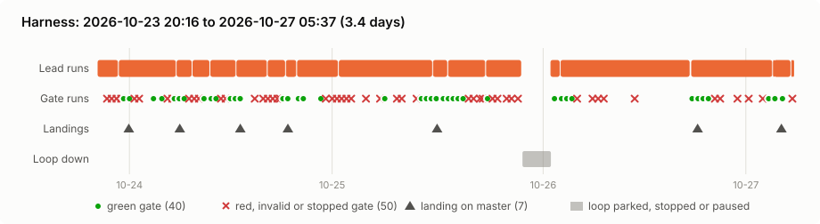

# The harness drive: what it taught

*A case study for self-learners and junior developers. For three and a half days in October 2026 a team of
jichi agents built `jichi-harness`, the program that runs such a team. A gate outside the team ran the full
`make ci` on every head the team pushed, and a supervising agent checked in every 20 minutes. This page tells how
long the work really took, what went wrong, who decided what, and what each mistake taught. The numbers are
in the [data sheet](DATA_SHEET.md).*

---

## 0. The drive in one paragraph, and how to read this page

**The task.** On 2026-10-21 the operator (the person who owns the project and makes its decisions) asked for
a harness with which jichi could run its own development: "we need jichi be able to drive itself with a
suitable harness, or set of harnesses." Until then a set of shell scripts ran each drive, and the steps
outside the team's container needed a supervising agent's session. This drive built phase P2 of the plan:
`jichi-harness`, jichi's third C89 program, with the commands `init`, `doctor`, `mirror fetch`, `mirror push`,
`run` and `drive`. Right after the first batch, it also fixed one defect in jichi itself (batch G18).

**The set-up.**
- **The lead** was a 27B model. It planned each milestone, wrote a design note, dispatched workers, reviewed
  their diffs, kept the team's log, and wrote a line `BATCH <name> READY at <commit>` when a batch was done.
- **The workers** were configured to use a coding model. Each worked in its own git worktree and returned a
  diff. A defect found four weeks later shows that, after each task's first model call, they ran on the
  lead's model (section 2.4.2).
- **The drive ran on the scripts it was porting.** The previous drive's shell scripts ran this drive, with
  only the names changed. The team's job was to rewrite them in C, behaviour by behaviour.
- **The gate.** A CI follower ran the full `make ci` on every head the team pushed. For each READY line, the
  supervisor made sure `make ci` was green on exactly that head, and then moved master to it as a
  fast-forward.
- **The supervisor** was a second agent outside the team. It checked in every 20 minutes, re-ran the team's
  red-first claims, and sent notes into the live run.
- **An independent reviewer**, the 27B model in a fresh context, reviewed each new range of commits.

**The headline numbers.**
- 82.3 hours (3.43 days) from the loop's start to its end, in 20 runs of the lead.
- 7 batches landed on master: 12 milestones (M1048 to M1059) in 179 commits, +39,565 / −118 lines in 169
  files.
- `make ci` ran to a verdict 88 times: 40 green, 48 red.
- The team made 8,883 model calls. The models wrote 12.3 million output tokens and processed 38.4 million new
  input tokens; another 897 million input tokens came from the gateway's prompt cache.
- The supervisor wrote 303 log entries; 221 of them were check-ins.
- The plan's exit test, a rehearsal, was not run in the drive. Later that morning the harness ran a real
  drive for the first time, and two more defects in this drive's code showed up the same day.

**Words used on this page.**

| word | meaning |
|---|---|
| drive | a team of jichi agents working on jichi for days |
| run | one session of the lead, from its start to its handoff; the loop starts the next run when one ends |
| batch | a group of milestones that lands on master together: here H0 to H5, plus G18 |
| `make ci` | the project's full gate: two compilers at `-Werror`, a C++ build, sanitizers, valgrind, the unit suite, the smoke tier of shell drivers, and more; about 35 minutes |
| red, green | a check or a gate that failed, or passed |
| red-first | a test committed before its fix, and shown to fail without it |
| teeth | breaking a guard on purpose to see its check go red ("the check has teeth") |
| land | move master to a batch's head |
| fast-forward | moving master forward along commits that already exist, without a merge commit |
| port | a rewrite of a program in another language that keeps its behaviour |
| side by side | running the old program and its port on the same inputs and comparing the outputs |
| fixture | the input a test plants for the code to run on |
| lint | a check that reads source or documents for a forbidden pattern |
| SAN | a build with the address and undefined-behaviour sanitizers |
| DEFERRED row | an entry in the project's register of known gaps |

**How to read this page.**
- Section 1 tells how long the drive took and where the time went.
- Section 2 lists the set-backs. Each has four parts: **What happened**, **What it cost**, **The cause**, and
  **What changed afterwards**.
- Section 3 lists the decisions: who made them, the alternatives, and how they turned out.
- Section 4 gives the lessons. Each has three parts: **What happened**, **The rule**, and **Why it matters to
  you**.
- Times are local. The clocks moved from +0200 to +0100 at 03:00 on 2026-10-25, during the drive, so every
  time carries its offset. "Z" means UTC.

## 1. Duration and timeline

### 1.1 How long it really took

1. **Before the loop: from 2026-10-21 to the evening of 2026-10-23.** The operator asked for the harness on
   2026-10-21. On 2026-10-22 the operator decided to build it between two batches of another drive, which
   paused for it. On the morning of 2026-10-23 the operator approved the switch point. The supervisor
   committed the plan at 20:10 +0200 that evening.
2. **The loop: 82 h 20 min.** It ran from 2026-10-23 20:16:55 +0200 to 2026-10-27 05:37:25 +0100. It ended
   because the supervisor wrote a STOP file, not because of a deadline.
3. **The planned work: 80 h 56 min.** The last batch, H5, landed on master 80 h 56 min after the loop
   started.
4. **After the loop: weeks.**
   - Six follow-up commits (three of code, three of the team's log) did not land in this drive. On 2026-10-28
     the next drive's lead carried the three code commits over; they are on master.
   - On 2026-10-27 the harness ran a real drive for the first time. Two defects in this drive's code were
     found and fixed that day (section 2.4.4).
   - On 2026-11-13 a board of another architecture found a third defect (section 2.4.3).
   - On 2026-11-20 a defect in jichi itself was found that had changed which model the workers used during
     the whole drive (section 2.4.2).

The code was written in three and a half days. It was not finished until it had run for real, and its records
were still giving up findings four weeks later.

### 1.2 Where the time went

**The loop's 82 h 20 min:**

| span | length | share |
|---|---|---|
| inside the 20 runs of the lead | 78 h 48 min | 95.7 % |
| run 0014 parked before its start: the model gateway refused new connections | 3 h 22 min | 4.1 % |
| between runs 0015 and 0016: two pushes failed while the VPN was down | 4 min 43 s | 0.1 % |
| the other gaps between runs (17 of 14 to 23 s each, and 17 s before the park) and the loop's last 17 s | 5 min 39 s | 0.1 % |

**Inside the runs**, the lead's own model calls and tool calls show where its time went:

| the lead was | hours | share |
|---|---|---|
| waiting for its pool workers (`spawn_parallel`) | 41.4 | 53 % |
| in its own model calls | 18.8 | 24 % |
| waiting for in-process reviewers (`spawn_subagent`) | 9.6 | 12 % |
| running shell commands (builds, tests, git) | 8.9 | 11 % |
| in all other tools | 0.0 | 0 % |

These add up to 78.7 of the 78.8 hours inside the runs. Two thirds of the lead's time was waiting for agents
it had started.

**Outages.**
- On 2026-10-24, from 08:29:55 to 08:49:54 +0200, the VPN went down together with the desktop session. For 20
  minutes there was no model and no git server. The run survived.
- On 2026-10-25 the model gateway refused new connections from about 20:40 +0100. The lead's last successful
  model call was at 19:50:04Z, and the next one at 23:55:08Z: 4 h 05 min without a model. Run 0013 used up its
  retries and ended; run 0014 waited 3 h 22 min before it started.
- On 2026-10-26, from about 14:47 to about 17:56 +0100, the VPN was down again. 17 pushes failed and the CI
  follower refused 12 gates at setup. The model gateway still answered, so the team kept working.

**Waiting for the gate.** From its first READY line to its landing, a batch took between 21 min and 2 h 23 min
(median 1 h 05 min). The team did not stop for it: the lead went on with the next batch while the gate ran.

**Waiting for the operator.** Not measured: a person's time is not in the records. One example of how it
shows: at about 03:37 +0100 on 2026-10-27 the supervisor asked the operator whether to end the drive. It wrote
the STOP file itself at 05:37. The operator's decision on what came next fell between 06:56, when the
supervisor's log still calls it pending, and 07:22, when the next drive's first run started.

### 1.3 Timeline

*Hover a mark, or open the image on its own, to read its time. Every mark is a row in [the data tables](../data/): runs.tsv, gates.tsv, landings.tsv and downtime.tsv.*

| when | what happened |
|---|---|
| 2026-10-21 | The operator asks for a harness that lets jichi drive itself. |
| 2026-10-22 | The operator decides to build it "in-between" two batches of the hardening drive. |
| 2026-10-23, morning | The operator approves the switch point. |
| 2026-10-23 20:10 +0200 | The supervisor commits the plan: batches H0 to H5. |
| 2026-10-23 20:16 +0200 | The loop starts run 0001. |
| 2026-10-23 20:26 +0200 | The operator decides: fix G18 first, and use the `JICHI_HARNESS_` prefix "for now". |
| 2026-10-23 23:19 +0200 | The first READY head is red. The supervisor stops its gate on it after 16 minutes and gates the next commit. |
| 2026-10-23 23:55 +0200 | **H0 lands**: `jichi-harness` builds, and has its learner's page. |
| 2026-10-24 01:57 +0200 | The G18 fix breaks an existing check; the gate is red. |
| 2026-10-24 05:58 +0200 | **G18 lands**: jichi no longer reports "verify green" when its verifier never ran. |
| 2026-10-24 08:29 +0200 | The desktop session ends and takes the VPN with it for 20 minutes. |
| 2026-10-24 13:08 +0200 | **H1 lands**: the configuration and `doctor`. |
| 2026-10-24 16:37 +0200 | The supervisor holds H2's READY: a measured segfault in `init`. |
| 2026-10-24 18:46 +0200 | **H2 lands**: `init`. |
| 2026-10-25 03:00 +0200 | Daylight saving time ends; the clocks show 02:00 +0100. |
| 2026-10-25 09:35 +0100 | The operator cannot tell what labels like "H3" and "P7" mean, and asks for better names and a glossary. |
| 2026-10-25 11:26 +0100 | **H3 lands**: `mirror fetch`, `mirror push` and a credential helper. |
| 2026-10-25, about 20:40 +0100 | The model gateway starts to refuse new connections. |
| 2026-10-25 21:32 +0100 | Run 0013 ends after its 12 retries; run 0014 waits for the gateway. |
| 2026-10-26 00:55 +0100 | The gateway answers again; run 0014 starts. |
| 2026-10-26 02:06 +0100 | Run 0015 starts. At 15 h 24 min it is the longest run of the drive. |
| 2026-10-26 11:58 and 12:00 +0100 | The supervisor's sanitizer pass finds an out-of-bounds write in H4's code and two use-after-free defects already on master. |
| 2026-10-26 12:17 +0100 | The supervisor withdraws its own wrong note (section 2.3.1). |
| 2026-10-26, about 14:47 +0100 | The VPN goes down again, until about 17:56. |
| 2026-10-26 18:18 +0100 | **H4 lands**: `run`, gated by the supervisor's offline variant of the gate. |
| 2026-10-26 19:37 +0100 | The independent review finds a defect that H4 put on master. |
| 2026-10-27 03:22 +0100 | Run 0017 ends by itself: P2 is complete, and the rehearsal cannot run in the container. |
| 2026-10-27 04:13 +0100 | **H5 lands**: `drive`, and the fix for the defect found at 19:37. All of P2 is on master. |
| 2026-10-27 05:37 +0100 | The supervisor writes STOP. The loop ends after run 0020. |
| 2026-10-27 06:12 +0100 | The gate on the six unlanded follow-up commits is red on one lint. |
| 2026-10-27, between 06:56 and 07:22 +0100 | The operator: resume the paused drive, run by `jichi-harness` this time. |
| 2026-10-27 | First real use. Two defects in this drive's code are found and fixed. |
| 2026-10-28 | The next drive's lead carries the three code follow-ups over; they are on master. |
| 2026-11-13 | A board of another architecture finds a missing NULL in an argument list this drive wrote. |
| 2026-11-20 | The defect that put the workers on the lead's model is found. |

### 1.4 How it ended

1. At 03:16 +0100 on 2026-10-27, run 0017 started, found nothing it could build, and ended itself after 6
   minutes. It recorded that P2 was complete and that the rehearsal "cannot start here": the rehearsal needs
   podman, and the container had none.
2. At 04:13, H5 landed. All of phase P2 (H0 to H5) was on master.
3. Run 0018 did two follow-ups the supervisor had asked for (the help text, and tests for three log lines) and
   ended at 05:26. Its five commits, and the log commit before them that recorded H5's READY, came after the
   landed head without a READY line of their own, so these six did not land.
4. Runs 0019 and 0020 found nothing to do. With run 0017, the three idle runs took 16 minutes and 2.27 million
   tokens (by the envelope's count, which includes cached input).
5. At 05:37 the supervisor wrote the STOP file: "the jichi-harness drive's planned work is complete". The loop
   ended after run 0020, at 05:37:25.
6. At 06:12 the gate on the six follow-up commits was red: a portability lint read a pattern inside a test's
   failure message as a non-portable command.
7. The plan's exit criterion for H5 was not met: "the rehearsal ends with the same records as the script's".
   The lead compared lists of behaviours instead.
8. Between 06:56 and 07:22 the operator chose a first real use instead: the paused hardening drive resumed, run by
   `jichi-harness`. On 2026-10-28 that drive's lead carried the three code follow-ups over as patches; they
   are on master.

## 2. Set-backs

Costs are measured where the records allow it. Where they do not, this section says so.

### 2.1 Infrastructure

#### 2.1.1 The model gateway refused new connections for about four hours

- **What happened.** On the evening of 2026-10-25 the gateway began to refuse new connections, at about
  20:40 +0100. Connections opened earlier kept working until 20:50. Run 0013's last successful model call was
  at 19:50:04Z. 26 calls failed between 20:05:19Z and 20:32:42Z, and the run ended at 21:32:43 +0100 when its
  12 retries were used up. The loop parked run 0014 until the gateway answered again at 00:55:02 +0100.
- **What it cost.** The lead had no successful model call for 4 h 05 min. For 3 h 22 min of it the loop
  waited between runs. Nothing was lost: run 0013's tree was clean when it ended.
- **The cause.** Not in the records.
- **What changed afterwards.** Nothing needed to. The loop checked the gateway before each run and waited, and
  it read the inbox only after the wait, so no note was used up by a run that could not start.

#### 2.1.2 The VPN was bound to the desktop session

- **What happened.** On 2026-10-24 at 08:29:55 +0200 the operator's desktop session ended with an X error.
  The VPN went down in the same second. The drive's services kept running, but the model gateway and the git
  server were reachable only through the VPN. It came back at 08:49:54.
- **What it cost.** 20 minutes without a model and without the git server: two pushes failed, and one gate
  was refused at setup and retried. Model streams that were open when the VPN died hung until the dead-stream
  fence closed them after 900 s, about 15 minutes each.
- **The cause.** The VPN profile belonged to the login session. Why the session crashed is not in the records.
- **What changed afterwards.** The supervisor reported the dependency to the operator with two options: a
  system-wide VPN profile, or a VPN service that does not depend on the login. The drive's records do not show
  either being set up.

#### 2.1.3 The VPN dropped again, and the gate could not run

- **What happened.** On 2026-10-26 the VPN was down from about 14:47 to about 17:56 +0100. This time the model
  gateway still answered, so the team kept working. But every push failed (17 failures, from 14:50:10 to
  17:57:21), and the CI follower refused 12 gates at setup, because its first step asks the git server where
  master is.
- **What it cost.** About three hours without a gate. Batch H4 became READY inside that window, at 17:27.
- **The cause.** Not in the records.
- **What changed afterwards.** The supervisor ran `make ci` itself, with the base given by hand (the last
  landed master) instead of asked from the server. When the VPN was back, it checked with the server that
  master had not moved, and landed H4 at 18:18. The offline gate was a one-off script, not a change to the
  gate.

### 2.2 The team: the lead and the workers

#### 2.2.1 READY was declared on a head that was red

- **What happened.** The first batch, H0, was declared `READY at 29e42332`. That head was red: the team's log
  quoted an old citation, and a documentation lint read the quote as a citation pointing nowhere. The fix was
  one commit later.
- **What it cost.** The supervisor's gate on the red head ran 16 min 18 s before the supervisor stopped it.
  From READY to landing, H0 took 1 h 11 min.
- **The cause.** The READY line named a commit before the records commit, and the documentation lints had not
  run on exactly that commit.
- **What changed afterwards.** The lead's rule from then on: READY names the commit the full smoke tier ran
  green on, records included. The supervisor's rule: run the documentation lints by hand on the READY commit
  before starting a 35-minute gate.

#### 2.2.2 READY was written before the result

- **What happened.** In H1 the lead wrote its READY line while its smoke tier was still running. The tier then
  went red on one check (`build_rev`), because a commit made during the tier had changed the build stamp. In
  H2 the lead declared READY with three known review findings unfixed; one was a segfault in `init`. A worker
  had fixed and verified all three, but its result was held back because it also changed a test file, and the
  held result could no longer be applied.
- **What it cost.** The supervisor held H2. From READY to landing H2 took 2 h 23 min, and run 0007 (2 h 09 min)
  redid the three fixes, red-first.
- **The cause.** READY was treated as a plan, not as a measured result.
- **What changed afterwards.** READY is written after the tier's result, on a frozen head: no commits while
  the tier runs.

#### 2.2.3 The G18 fix broke an existing check

- **What happened.** G18 fixed a false "verify green": jichi reported its verifier green and exited 0 when the
  verifier had never run. The fix's own tests passed, but the gate went red. Another driver,
  `capped_turn_says_so`, showed that the fix had dropped the words that say a run stopped at its cap.
- **What it cost.** One red gate (34 minutes of gate time) and a follow-up wave of two workers.
- **The cause.** The checks run for the fix were the ones its commit named. 19 smoke drivers read the changed
  messages; nobody listed them first. The supervisor's own teeth made the same mistake: it ran three drivers,
  not this one, and wrongly wrote that no fixture reached that state.
- **What changed afterwards.** Before changing a message, list every check that reads it.

#### 2.2.4 A new program fell outside the checks built for the old ones

- **What happened.** `jichi-harness` was jichi's third program. Several checks had been written when there
  were two, and none of them failed when a third appeared; they simply did not look at it:
  - the `clean` target did not remove its objects, so the sanitizer stage could reuse objects built without
    sanitizers (found by the lead's own review in H0, and again for its library objects in H4's window);
  - the mutant sweep, which swaps a program for a do-nothing binary to see that the tests notice, never
    swapped `jichi-harness`;
  - the lint that checks documented options did not read its source;
  - the team's quick checks did not include the C++ build, and the new code did not compile as C++;
  - the sanitizer stage ran the new program only as `jichi-harness --version`. It never ran `mirror`, `push`
    or `run`.
- **What it cost.** Six red gates (two for the mutant sweep, two for the options lint, two for C++). The
  sanitizer gap let three memory defects through every green gate: a write one past the end of an array in
  H4's code, and two use-after-free defects that were on master from H3's landing (2026-10-25) until H4's
  (2026-10-26).
- **The cause.** Each check had a universe ("the programs") that had been written down once, as a list of
  two.
- **What changed afterwards.** Each check was extended, red-first. The sanitizer stage now runs every
  harness driver: "harness OK (7 of 7 driver(s))" when H4 landed, 8 of 8 when H5 landed.

#### 2.2.5 Almost half of the red gates failed only on lints

- **What happened.** Of the 48 red gates, 23 failed only on lints: a driver count one behind in a page, a
  translated page that still showed the old number, a milestone cited before its roadmap entry existed, shell
  in a test that is not portable. Each of those lints runs in seconds.
- **What it cost.** 13 h 14 min of the gate's time. The team's time was not lost: it kept working while the
  gate ran.
- **The cause.** The team's quick checks before a push did not include the documentation and count lints.
  Many of these reds came from the record step: a new driver changes a count in several pages, in two
  languages.
- **What changed afterwards.** The supervisor asked for the documentation and lint drivers on the frozen head
  before READY, and ran them itself before each landing gate. The lint reds went on all the same: the last
  red of the drive, on 2026-10-27, was again a lint.

#### 2.2.6 Tasks that had to write were dispatched read-only

- **What happened.** A worker may change files or run commands only if its task says `"write": true`. Five
  times the lead dispatched tasks that needed it without it: once in run 0008 (three measuring probes), once
  in run 0016, and three times in a row in run 0018. The third dispatch in run 0018 also said
  `"merge": false`, which keeps a worker's result apart instead of merging it.
- **What it cost.** In run 0016, 29 minutes until the corrected dispatch. In run 0018, 53 minutes. The
  read-only workers could not change anything.
- **The cause.** The rule was in the lead's prompt, in its checklist before a dispatch. The supervisor's
  correction reached run 0016. Run 0018 started with a fresh context and made the same mistake again.
- **What changed afterwards.** The lead wrote a standing note into the team's log, which every later run
  reads: a task that edits files names `write: true` and a model, and leaves `merge` out.

#### 2.2.7 The lead debugged by changing a worker's uncommitted files

- **What happened.** In run 0010, to find out why `init` refused, the lead ran `git stash` and `git checkout`
  on a worker's uncommitted result. One checkout discarded a new field from two files while a third file
  still used it. The lead then chased the mismatch it had made itself.
- **What it cost.** Not measured. The worker's exact files were recovered from a ref that jichi keeps before
  it discards anything.
- **The cause.** Experimenting in the only copy of the work.
- **What changed afterwards.** The lead's own rule: never stash or check out a worker's uncommitted tree to
  debug; reproduce the problem with a dump of the command line instead. Probes go under `/tmp`, never into the
  workspace; an earlier probe had also created a stray branch there.

#### 2.2.8 Work stayed uncommitted while the lead waited for a review

- **What happened.** Three times the lead merged a worker's result and then waited inside a review sub-agent
  before committing it: about 49 minutes on 2026-10-23, 35 minutes on 2026-10-25, and up to 86 minutes on
  2026-10-26.
- **What it cost.** Nothing was lost. A timer copied the uncommitted files every 30 minutes.
- **The cause.** Review before commit. While the lead waits inside a sub-agent it does not read notes, so the
  supervisor could not reach it.
- **What changed afterwards.** Commit first, as a candidate; then review.

#### 2.2.9 The lead put a timeout around a test run

- **What happened.** In run 0014 the lead wrapped its first full smoke tier in a 25-minute timeout. The tier
  was making progress, and the timeout killed it.
- **What it cost.** One smoke tier. Its length is not recorded.
- **The cause.** A timeout added "so it cannot hang" to a run that measures something.
- **What changed afterwards.** The lead reported it, discarded the result, and quoted only the run without a
  timeout.

#### 2.2.10 A task too large for one reply produced nothing

- **What happened.** The first worker asked to port the handoff script to C wrote nothing in 29 minutes. Two
  of its model calls hit the output ceiling of 32,768 tokens, and the reply was empty. In the whole drive, 10
  worker calls hit that ceiling, 5 of them in run 0015.
- **What it cost.** 29 minutes and one new dispatch.
- **The cause.** One reply had to hold the model's reasoning and the whole new file, and it did not fit.
- **What changed afterwards.** The lead dispatched the port again, in steps of a few hundred lines, building
  after each step. That worker finished. The supervisor decided not to raise the ceiling without a
  measurement and the operator's go (section 3.3).

#### 2.2.11 Records written from memory

- **What happened.** The team's log says at its top that its times are CEST, yet many headings say UTC. For
  example, the heading "22:4x UTC (run 0001 end)" was written by a commit made at 20:46 UTC, which is 22:46
  CEST. The supervisor made the same kind of mistake in its notes: times typed by hand, and two notes with the
  same label.
- **What it cost.** No work was lost. Each wrong time or label cost a correction, and some of the reader's
  trust.
- **The cause.** Times and labels typed by hand.
- **What changed afterwards.** Times come from `date`, in the command that writes them. After the operator
  asked for a glossary, labels carry their owner (`<owner>.<label>`), and each drive keeps a TERMS.md.

### 2.3 The supervisor's own mistakes

#### 2.3.1 A wrong note sent a worker into four hours of fixture sizing

- **What happened.** At 10:04 +0100 on 2026-10-26 the supervisor compared the C port of the handoff script
  with the script. It told the lead that one check failed on the script too, because the script's output,
  5,947 bytes, was "under the cap" and had no cut. It had inferred "no cut" from the size and never searched
  for the cut marker. The lead dispatched a worker with that note in its task, and the worker set out to make
  the test's input larger.
- **What it cost.** That worker ran 4 h 41 min (09:34:45Z to 14:15:33Z) and made 170 model calls, mostly
  measuring fixture sizes. The no-progress alert fired at 14:35 +0100. How much of this the wrong note caused
  is not measured; the supervisor's log puts most of it down to the note.
- **The cause.** The check was red for another reason: its `grep` had no `--` before the pattern
  `- *(cut at 6000 bytes)*`, so `grep` read the pattern as an option and failed. The marker was in the file.
- **What changed afterwards.** The supervisor withdrew the note at 12:17 +0100 with a dated correction. But
  notes reach only the lead, never a worker inside a batch, so the worker went on until its batch returned at
  about 15:15. The fix was the `--`.

#### 2.3.2 Delivered notes were delivered again

- **What happened.** Notes the supervisor injected into a live run stayed in the inbox. The next run's prompt
  is built from the inbox, so run 0003 started with all 14 notes of run 0002 and began work on a card that had
  been parked.
- **What it cost.** Not measured. The supervisor sent a note to reset the run.
- **The cause.** Nothing moved a note out of the inbox once it was delivered.
- **What changed afterwards.** From 05:58 +0200 on 2026-10-24, a note was moved to a "delivered" folder as
  soon as its delivery was confirmed. 85 notes went that way in the drive.

#### 2.3.3 The side by side compared the file, not where the file is used

- **What happened.** The supervisor compared the port's handoff file with the script's, byte for byte, and
  found only differences the design note named. It did not compare the prompt that file is pasted into. In
  the port, the handoff's heading was glued to the end of the line before it, so it was no longer a heading.
  The defect went to master with H4.
- **What it cost.** A defect on master for 9 h 55 min, from H4's landing to H5's, and one fix in H5. No run
  read the broken prompt: the drive itself still ran on the scripts.
- **The cause.** The comparison stopped at the artefact.
- **What changed afterwards.** The independent review found the defect at 19:37 +0100. The supervisor's rule:
  compare a port's output where it is used.

#### 2.3.4 Smaller misses of the supervisor

| what happened | what it cost | the cause | what changed afterwards |
|---|---|---|---|
| Its teeth for the G18 fix ran three drivers, not the one that broke (2.2.3) | one red gate | it ran the drivers the commit named | list every driver that reads the changed strings |
| Twice it named a cause ("host versus container") for a unit count that differed by one | nothing; withdrawn | a guess written as a finding | record the figure and its place; cause "unknown" |
| It listed four places for an edit the operator asked for; there were five | one more commit | it searched three files | a search that must come back empty |
| Its port check of `drive` missed a lost switch that turns the team's push off | nothing; the review found it | it read the design note beside the script | the switch became a setting, with a test |
| Its check of batch H3 before landing did not mention the commit trailers (2.4.1) | six commits without trailers on master | not recorded | none in this drive |
| A remark drew five rounds of log analysis. The operator: "Stop. I didn't ask you to analyze those logs." | the operator's attention | a remark read as a question | answer briefly; offer a check |

### 2.4 Found after the drive

#### 2.4.1 Six commits without their trailers

- **What happened.** jichi's commits carry three trailers: `Co-Authored-By` for jichi, `Jichi-Build` and
  `Jichi-Model`. Six commits of batch H3, all made in run 0010, carry none of them. No record of the drive
  mentions it. The identity count for this case study found it on 2026-11-22.
- **What it cost.** For those six commits the record of what wrote them is missing. All six still name the
  operator as author and committer.
- **The cause.** In runs 0001 and 0002 two commits had the same slip. The lead found the cause (it had passed
  the trailers as paragraphs of the message, not through git's trailer mechanism) and wrote in its log that
  it would check the trailers after every commit. That promise lived in one run's log; the six commits came
  eight runs later. The supervisor's landing notes mention the trailers or the identity for every batch except
  H3. The records do not say why run 0010 dropped them.
- **What changed afterwards.** Nothing in this drive. The commits were not rewritten: the rule is never to
  rewrite an earlier commit. 170 of the 179 landed commits carry the jichi trailer; the other nine are these
  six, the two earlier slips, and the supervisor's own plan commit.

#### 2.4.2 The workers ran on the lead's model

- **What happened.** The workers were configured to use the coding model, and the telemetry and the commit
  trailers say so. On 2026-11-20 a defect in jichi was found: a delegated worker uses its own model for its
  first request only, and the lead's model from its second request on. The defect came in with a commit of
  2026-10-22, the day before this drive, and it is in every build the drive used. This drive's own records
  show it. A worker's first call wrote at a median of 155.0 tokens per second (56 calls). Its later calls
  wrote at 55.1 (2,769 calls), and the lead at 55.5 (1,990 calls).
- **What it cost.** Not measurable as time. Every comparison of the two models drawn from this drive is void:
  the coding model made only each task's first call.
- **The cause.** A fix made the day before re-synced each agent to the lead's model after every request, so
  that it would follow a re-routed lead; it did not tell a worker from the lead. And the telemetry labels a
  call with the model the agent was given, not with the one that answered.
- **What changed afterwards.** On 2026-11-20 the defect went to the running drive as a work item. The rule:
  never read a worker's model from a label; capture the requests it sends.

#### 2.4.3 A missing NULL that x86-64 hid

- **What happened.** When the `drive` command copies a run's notes into the records, it compresses them with
  `gzip`. The argument list it handed to `exec` had no NULL at its end. On x86-64 the next slot happened to
  hold NULL, so every gate passed. On 2026-11-13 an aarch64 board ran the tests: `gzip` got a stray argument
  and failed, and the note vanished from the records without a word.
- **What it cost.** Not measurable. The defect was on master from H5's landing until it was found.
- **The cause.** Undefined behaviour that one architecture hides, and a failure that printed nothing.
- **What changed afterwards.** One line, `argv[3] = NULL;`, and the drop now says why. The rule: run one
  board of another architecture on a candidate head.

#### 2.4.4 The first real use found two more defects in a day

- **What happened.** On 2026-10-27 `jichi-harness` ran a real drive for the first time. Two defects in this
  drive's code showed up:
  - The credential helper (H3) refused every real HTTPS request. It compared the remote's path with a leading
    `/`, but git sends the path without one. Its tests passed because their fixtures wrote the path with the
    slash, which no real git does. Every `mirror push` to the real server would have failed.
  - `run` (H4) moved every note out of the inbox at the end of a run, including notes that arrived after the
    prompt was built. Such a note counted as delivered although no run had read it.
- **What it cost.** Both were fixed the same day.
- **The cause.** Neither path had met the real peer during the drive: the drive itself still ran on the
  scripts, and the tests used fixtures written from memory. The same blind spot had been caught once before,
  by reading: in H3 the supervisor found that `ls-remote` got no credentials over HTTPS, a defect the local
  rehearsal could not see.
- **What changed afterwards.** The credential fix came with a test that uses real git as the credential
  peer.

### 2.5 Other set-backs, in short

| what happened | what it cost | the cause | what changed afterwards |
|---|---|---|---|
| A red-first commit contained its own fix | nothing; checked by restoring the parent's source | an earlier `git add` had staged everything | stage the test alone |
| A red-first driver was red for the wrong reason: `unknown option '--config'`, not "not built yet" | its red proved nothing | the note put `--config` in two places | each red says "not built yet" |
| The smoke runner killed a new driver at its 120-second limit | 2 red gates, 1 h 25 min of gate time | no measured limit; it takes 194 s | a 600-second limit, the measurement beside it |
| A test could never fail: its fixture fed `/dev/null` to the program whatever the code did | not measurable | the fixture's own `< /dev/null` | the redirect removed, and the check shown red |
| With an isolation guard disabled, its driver stayed 13 of 13 green | H3's READY was held until it was fixed | the driver's environment did the guard's job | a test with a poisoned home directory |
| The lead re-sent a placeholder for elided arguments 9 times in run 0015 | not measurable | jichi's refusal said the arguments "cannot be recovered" although a file kept them | a DEFERRED row |
| Workers read `/docs/...` as absolute paths and hit the path fence | 4 refusals in run 0002 | absolute paths in the task text | relative paths in task texts |
| Three idle runs at the end | 16 min and 2.27 M tokens | nothing after P2 was planned | STOP |

## 3. Decisions

### 3.1 Who decides what

- **The operator** decides what is built, in which order, when a drive starts and ends, and anything that
  spends money or changes access.
- **The supervisor** decides within the operator's standing rules: it may hold a head with a measured defect,
  run the gate, land a green head, stop a gate whose red is already measured, and send notes. Its decisions
  are marked as its own, and the operator can overrule any of them.
- **The lead** decides how a milestone is built: the design note, the order of work, which worker gets which
  task.
- **The gate**, `make ci` on exactly the head, decides whether that head can land. Reviews advise.

### 3.2 Before the drive

The drive's `DECISIONS.md` lists 13 decisions of the operator (D1 to D13) and 4 of the supervisor (S1 to
S4). The important ones:

1. **Build the harness on its own (D3, 2026-10-21), "in-between" another drive (D4, 2026-10-22).** The
   alternative was to build it inside the hardening drive that was running. The operator: "Let's build it
   separately." and "Yes, in-between that way, go ahead." The hardening drive paused after its batch 14; this
   drive was to build phases P2 to P5, and the paused drive's remaining batches were to be the harness's first
   workload. **Outcome:** only P2 was planned in detail and built. The paused drive did become the first
   workload, on 2026-10-27.
2. **Landing is standing (D6, 2026-10-23).** "Please, keep driving like this, including pushing to master."
   A READY head lands after a green `make ci` on exactly that head, as a fast-forward, without asking each
   time. The alternative was to ask the operator before each landing. **Outcome:** all seven landings followed
   the rule, and none waited for the operator's go.
3. **Fix G18 first (D12, 2026-10-23, about 20:25).** The supervisor recommended it: a harness that reads
   jichi's "verify green" reads a claim that can be false. The operator: "Yes, fix G18 before P3, as you
   recommended." It became its own batch, right after H0. **Outcome:** landed the next morning, after one
   regression on the way (2.2.3).
4. **Run the drive on the scripts being ported, with only the names changed (S1, the supervisor).** The
   alternative was to improve the scripts first. The reason given: "changing them while the team ports them
   would move the target." **Outcome:** the port had a fixed reference to compare against. But the new
   harness never ran the drive that built it, so it met the real peer only afterwards (2.4.4).
5. **Reuse the previous drive's container image (S2, the supervisor).** A new image was rejected as "an
   untested variable". **Outcome:** the image had no podman, so the rehearsal could not run inside it (1.4).

The other decisions from before the drive:

| # | who, when | decision |
|---|---|---|
| D1 | operator, 2026-10-04 | `jichi-harness` is a C89 program shipped with jichi, configurable for git servers, users and tenants |
| D2 | operator, 2026-10-21 | one model must be enough; the first version supports four execution modes |
| D5 | operator, 2026-10-23 | the switch point: "Yes, follow your recommendations for both, please." |
| D7 | operator, 2026-10-23 | the guard against dispatching from a dirty tree runs in `refuse` mode: "Yes, run it in refuse for the drive" |
| D8 | operator, 2026-10-21 | a clean merge of a moved master needs no go; a conflict goes to the operator |
| D9 | operator, 2026-10-21 | the first notifier is a digest file plus a command hook |
| D10 | operator, 2026-10-21 | Linux on the hardware platforms first, then every operating system jichi can support |
| D11 | operator, 2026-10-17 | free models only: the 27B model for most work, the coding model for delegated code |
| D13 | operator, 2026-10-23 | the settings use the `JICHI_HARNESS_` prefix: "Yes, use the JICHI_HARNESS_ prefix, for now." |
| S3 | supervisor | milestone numbers continue the paused drive's sequence, at M1049 |
| S4 | supervisor | the team branch starts from master plus the plan, not from a documentation branch |

`DECISIONS.md` was written at the start and extended once, in run 0001, with D12 and D13. The decisions taken
during the drive are recorded only in the supervisor's log, the team's log and the supervisor's notes.

### 3.3 During the drive

1. **Hold a READY head on a measured defect (the supervisor, 2026-10-24 16:37 +0200).** The lead had declared
   H2 READY with a known segfault in `init`. The alternatives were to land and fix in the next batch, or to
   hold. The supervisor held it, under the standing rule that it "may hold a head with a known measured
   defect". **Outcome:** run 0007 redid the fixes red-first, and H2 landed at 18:46.
2. **A missing check is a register row, not a hold (the supervisor, 2026-10-25 10:57 +0100).** A review said
   that a fix in H3 had no test that reaches it. The alternatives were to hold H3 until the test existed, or
   to record the gap. The supervisor recorded it (def-350): "a missing check, not a measured defect", and
   `make ci` was green. The same reasoning kept an untested guard from holding H3; its test came first in the
   next run. **Outcome:** H3 landed at 11:26; both gaps were closed in the next two runs.
3. **Hold H4 until the sanitizers run every harness driver (the supervisor, 2026-10-26 11:58 to 12:00
   +0100).** The alternative was to land H4 and fix the gap later. The condition set: the sanitizer stage is
   green on the READY head, and red when each fix is undone. **Outcome:** met at H4's READY head; three memory
   defects were fixed before H4 landed, two of them already on master.
4. **Gate H4 offline (the supervisor, 2026-10-26 17:37 +0100).** The VPN was down and the CI follower could
   not start. The alternatives were to wait for the VPN, or to run `make ci` with the base given by hand. The
   supervisor did the latter and checked the base with the server before pushing. **Outcome:** green; master
   had not moved; H4 landed at 18:18.
5. **Do not interrupt a worker (the supervisor, twice).** On 2026-10-24 at 21:16 +0200 a worker was building
   `mirror fetch` from a wrong source that its task had named. The supervisor's reason: "one worker cycle
   costs less than aborting the batch". The merged result fetched from the right source: the worker had
   rewritten its draft. On 2026-10-26 at 13:16 +0100 the worker of 2.3.1 was sizing fixtures. The only control
   that could stop it was `abort`, which would end run 0015 and drop six queued notes. At 14:37 the
   supervisor asked the operator whether to abort; the batch returned at 15:15 and the question was
   withdrawn. **Outcome:** both waits cost time only. The second showed a gap: there was no way to stop one
   worker. A per-worker stop was built in a later drive, on 2026-11-08.
6. **Do not raise the output ceiling without a measurement and the operator's go (the supervisor, 2026-10-26
   07:37 +0100).** The alternatives were to raise the ceiling, or to give the worker smaller steps.
   **Outcome:** the smaller steps worked; the ceiling was not raised in this drive.
7. **Port the lead-model guard now (the supervisor, 2026-10-25 18:18 +0100).** The design note for `run` put
   off a check the script had: a model name the configuration does not know is warned about and left out,
   never passed on. The alternatives were a register row for later, or the check now. The supervisor asked for
   it now: an unchecked name at the gateway can reach a priced model. **Outcome:** built, with a test shown red
   when the guard is disabled.
8. **Replace the rehearsal with a list of behaviours (the lead, run 0016).** The container had no podman, so
   the rehearsal script could not run. The alternatives were to stop and ask, or to compare behaviour lists.
   The lead compared lists. **Outcome:** H5's "done when" was not met, and the rehearsal never ran in this
   drive.
9. **End the drive (the supervisor, 2026-10-27).** At about 03:37 +0100 the supervisor asked the operator, in
   plain text and without blocking, whether to stop after run 0018. At 05:37 it wrote the STOP file before an
   answer came, because idle runs cost "about 0.5 M tokens each" and the STOP file can be deleted. **Outcome:**
   the loop ended at 05:37:25.
10. **A first real use instead of the rehearsal (the operator, 2026-10-27, between 06:56 and 07:22 +0100).** The options offered:
    run the paused drive with `jichi-harness` on the host; inside the drive's container, with the host
    pushing; or first build a sandbox for the lead's own shell. The operator: "We need all the options.
    Proceed, as you recommended, please!" The container option came first. **Outcome:** two defects found and
    fixed the same day (2.4.4).
11. **Carry the follow-ups through the next drive (the operator, 2026-10-28, about 19:38).** The alternative
    was to land them alone after a green gate. **Outcome:** carried over as three commits dated 2026-10-28;
    they are on master.
12. **Do not rewrite commits that lack their trailers (the lead and the supervisor, 2026-10-23).**
    **Outcome:** the history stays as published; nine landed commits lack the jichi trailer (2.4.1).

The other decisions during the drive:

| when | who | decision | how it turned out |
|---|---|---|---|
| 2026-10-23 20:17 | supervisor | hold the CI follower until the other drive's gate ends: one `make ci` at a time | the follower started at 21:20 |
| 2026-10-24 05:19 | supervisor | stop the follower's gate on a head whose red was already measured by hand, and let it take the fixed head | G18 landed at 05:58 |
| 2026-10-24 05:58 | supervisor | move each delivered note out of the inbox | 85 notes moved (2.3.2) |
| 2026-10-24, shortly before 08:38 | operator | "stop the left-over process. We need the memory freed." | a local model server from an earlier session was stopped |
| 2026-10-24 08:38 | operator | "Yes, go ahead with steps 1-3 and resume supervising." | supervision resumed after the session crash |
| 2026-10-24 13:15 | operator | the harness's page describes the harness by what it does, without reference to another tool | five places changed |
| 2026-10-25 01:17 | supervisor | the missing isolation check (2.5) blocks H3's READY | closed at 02:20 |
| 2026-10-25 06:37 | supervisor | hold H3's READY for the HTTPS credential defect and three smaller items; low ones may be deferred | fixed before READY |
| 2026-10-25 09:38 | operator | "go ahead with all three": a glossary, a naming rule with a template, and a label lint designed now | the lint was designed, not built |
| 2026-10-25 22:23 | operator | "proceed with the harness drive once the gateway is reachable again" | nothing to change: the loop waited |
| 2026-10-26 02:17 | lead | H4 is not ready until the handoff (M1058) is built | READY at 17:27 |
| 2026-10-26 08:02 and 08:11 | operator | "complete the harness drive, then make use of it in the paused drive" | decision 10 above |
| 2026-10-26 22:56 | lead | the lost push switch becomes a setting with a test, not a named change | built in H5 |
| 2026-10-27 01:21 | supervisor | give the new `drive` driver a measured time limit (600 s; it takes 194 s) instead of shortening it | green in the next gate |
| 2026-10-27 03:22 | lead | name the follow-ups M1059-b and M1059-c, without new milestone numbers | the commits carry those names |
| 2026-10-27 05:56 | supervisor | the follow-ups do not land without a READY line | carried in the next drive |

## 4. Lessons

### 4.1 Design

#### 4.1.1 A new program joins every check's universe, by measurement

**What happened.** Five checks written for two programs skipped the third: the `clean` target, the mutant
sweep, the options lint, the C++ build in the quick checks, and the sanitizer stage (2.2.4). The last one let
three memory defects through every green gate.

**The rule.** When you add a program, a module or a language, list every check whose universe is "all of
them". Extend each one, and show it red on the new code before you trust its green.

**Why it matters to you.** A check never says "I did not look". It says "green", whether it looked or not.

#### 4.1.2 Compare a port where its output is used

**What happened.** The handoff file of the port matched the script's, byte for byte. The prompt it was pasted
into did not: a heading had lost its line break (2.3.3).

**The rule.** In a side by side, compare the final result the user or the next program sees, not only the
intermediate file.

**Why it matters to you.** Most defects live at a seam between two parts that each pass their own test.

#### 4.1.3 Meet the real peer once before you trust a fixture

**What happened.** The credential helper's tests wrote the remote's path the way nobody's git does, and passed.
The first real push would have failed (2.4.4). Earlier, `ls-remote` had no credentials over HTTPS, which the
local rehearsal could not see.

**The rule.** Run every interaction with another program once against the real program, with harmless input.
Build fixtures from captured output, not from memory.

**Why it matters to you.** Your memory of another program's behaviour is a guess. A captured exchange is a
fact.

#### 4.1.4 Know what your gate depends on

**What happened.** The gate's first step asked the git server for master. When the VPN went down, no gate ran
for three hours, and an earlier VPN failure had taken the model gateway with it (2.1.2, 2.1.3).

**The rule.** Write down every service your build, gate and team depend on. For each one, know what stops
when it fails, and have a way to run the gate without it, with the missing input given by hand and checked
afterwards.

**Why it matters to you.** Outages are not rare. In three and a half days this drive had three.

### 4.2 Development

#### 4.2.1 READY comes after the result, on a frozen head

**What happened.** One READY named a red head; another was written while the tests still ran; a third came
with a known segfault (2.2.1, 2.2.2).

**The rule.** Run the full checks on the exact commit you will name, commit nothing while they run, and write
"ready" only after the result.

**Why it matters to you.** "Ready" is a measurement. Written before the measurement, it is a wish.

#### 4.2.2 Commit first, then review

**What happened.** Merged work stayed uncommitted for up to 86 minutes while the lead waited for a review,
and during that time nobody could reach the lead (2.2.8).

**The rule.** Commit what a worker returned as a candidate, then review it, then change it.

**Why it matters to you.** A commit costs a second. Losing verified work costs the hours it took.

#### 4.2.3 Never experiment in the only copy

**What happened.** The lead stashed and checked out a worker's uncommitted files to debug, broke them, and
chased its own mistake (2.2.7).

**The rule.** Probe in a copy, under `/tmp`. Reproduce a problem with a dump of the inputs, not by changing
the work.

**Why it matters to you.** A debugging step that changes the evidence can make you solve the wrong problem.

#### 4.2.4 A rule that lives in one run's memory dies with the run

**What happened.** The lead corrected a dispatch mistake in one run and made it again in the next, three times
in a row (2.2.6). It promised to check trailers after every commit, and eight runs later six commits had none
(2.4.1).

**The rule.** Write a rule where every later session reads it: the prompt, a standing note, or better a check
that refuses the mistake.

**Why it matters to you.** "I will remember" does not survive a new day, a new colleague or a new context.

#### 4.2.5 Split a task the model cannot answer in one reply

**What happened.** A port of a whole script in one reply hit the output ceiling twice and wrote nothing.
Dispatched in steps of a few hundred lines, it was done (2.2.10).

**The rule.** Size a task so that one answer fits, with room for the reasoning. Build after each step.

**Why it matters to you.** The same holds for a pull request: small steps you can check beat one big step
you cannot.

#### 4.2.6 Take times from the clock, and give labels an owner

**What happened.** Log headings carried CEST times labelled UTC; the supervisor typed times by hand and
corrected them three times; "P7" meant four different things, and the operator could not follow (2.2.11).

**The rule.** Let the command that writes a record also write its time. Write labels as `<owner>.<label>`,
and keep a glossary.

**Why it matters to you.** The records are how the next reader, maybe you, decides what to trust.

### 4.3 Testing

#### 4.3.1 Before you change a message, list every check that reads it

**What happened.** The G18 fix passed its own tests and broke a check nobody had listed; 19 drivers read the
changed messages (2.2.3).

**The rule.** Search the tests for the strings you change, and run every test that reads them.

**Why it matters to you.** Your change's tests show that it does what you wanted, not that it does nothing
else.

#### 4.3.2 Run the cheap checks before the expensive one

**What happened.** 23 of 48 red gates failed only on lints that run in seconds, at a cost of 13 h 14 min of
gate time (2.2.5).

**The rule.** Before you ask for the full gate, run every check that takes less than a minute, on the exact
commit.

**Why it matters to you.** An hour-long gate that fails on a typo costs an hour. A ten-second lint costs ten
seconds.

#### 4.3.3 A stage checks only what it runs

**What happened.** The sanitizer stage built the new program with sanitizers and ran only `--version`. A stack
write and two use-after-free defects passed every gate (2.2.4).

**The rule.** For each stage, read which commands it really runs. Run every new test under the sanitizers
once by hand.

**Why it matters to you.** "Built with sanitizers" is not "tested with sanitizers".

#### 4.3.4 Perturb the guard, not the label

**What happened.** One test could never fail, because its fixture fed `/dev/null` whatever the code did.
Another stayed 13 of 13 green with its guard disabled, because the driver's environment did the guard's job
(2.5).

**The rule.** Break the guard itself, and watch its test go red. If it stays green, something else holds the
property, and the test is not testing the code.

**Why it matters to you.** A test that cannot fail proves nothing, and looks exactly like one that can.

#### 4.3.5 One architecture can hide undefined behaviour

**What happened.** A missing NULL at the end of an argument list was invisible on x86-64 and dropped notes on
an aarch64 board (2.4.3).

**The rule.** Run at least one machine of another architecture on a candidate. Make a silent failure loud
before hunting its cause.

**Why it matters to you.** C code that "works" may only work on the machine you have.

#### 4.3.6 Limits come from measured durations

**What happened.** The smoke runner killed a new driver at 120 s; it needed 194 s. Two gates went red on a
correct program (2.5). The lead's own 25-minute timeout killed a healthy test run (2.2.9).

**The rule.** Measure first. Set a limit from the measured distribution, and write the measurement beside it.
Never put a timeout around a run that measures something.

**Why it matters to you.** A limit that fires does not tell you the program is slow. It tells you the limit
was wrong, and it hides the answer.

### 4.4 Supervising

#### 4.4.1 To say something is absent, search for it

**What happened.** The supervisor said a file had no cut because it was smaller than the cap. The cut marker
was in it. A worker spent hours on the wrong problem (2.3.1).

**The rule.** Search for the thing itself. A size, a count or a missing message is a proxy.

**Why it matters to you.** "Not there" is the most expensive wrong answer, because nobody checks it.

#### 4.4.2 A note to an agent must arrive once, and reach the one who acts

**What happened.** Delivered notes were delivered again and sent a run back to parked work (2.3.2). A
correction could not reach a worker inside its batch (2.3.1).

**The rule.** Move a note out of the inbox when its delivery is confirmed. Know who reads a note, and when.

**Why it matters to you.** A message that arrives twice, or too late, can do more harm than no message.

#### 4.4.3 A label is not a measurement

**What happened.** Telemetry and trailers said the workers ran the coding model. Their decode speed said the
lead's model answered from each task's second call on (2.4.2).

**The rule.** Check what a record claims against something it cannot fake: speed, captured requests, the
effect.

**Why it matters to you.** Logs record what a program was told, not always what happened.

#### 4.4.4 Check every landing the same way

**What happened.** The supervisor's notes record a check of the commits' identity or trailers at every
landing but one. Six commits without trailers landed in that one (2.4.1).

**The rule.** Use one written checklist for every landing, and do not skip an item because it passed the
last few times.

**Why it matters to you.** The check you skip is the one that would have failed.

#### 4.4.5 Hold on a measured defect; record a missing check

**What happened.** The supervisor held H2 for a segfault, and H4 until the sanitizers ran every driver. It did
not hold H3 for a missing test; it recorded a register row (3.3).

**The rule.** A defect you can measure blocks a landing. A check you do not have yet becomes a recorded gap,
with its number in the commit.

**Why it matters to you.** Holding on every doubt stops all progress; holding on nothing ships the defects.

#### 4.4.6 Answer a remark; investigate when asked

**What happened.** A remark of the operator drew five rounds of unasked analysis, and the operator said
"Stop." (2.3.4).

**The rule.** Answer a remark in a sentence or two, say what you will watch for, and offer a check in one
line.

**Why it matters to you.** Another person's attention is the scarcest resource in a project.

## 5. A checklist for your own project

1. Automate every step that would otherwise need you to be awake, and know what each step depends on.
2. When you add a program or a module, extend every check to it, and show each check red on it once.
3. Run every interaction with another program once against the real thing; build fixtures from captured
   output.
4. Compare a rewrite where its output is used, not only the file it writes.
5. Write "ready" only after the full checks passed on that exact commit, with nothing committed meanwhile.
6. Run the checks that take seconds before the gate that takes an hour.
7. Commit before you review or probe, and never experiment in the only copy.
8. Put every rule where the next session reads it, or better into a check.
9. Break each guard once and watch its test go red.
10. Read which commands each gate stage really runs.
11. Test on a second architecture before you call C code done.
12. Set time limits from measurements; never time-limit a measurement.
13. Search for a thing before you say it is absent; do not trust a label over a measurement.
14. Check every landing with the same written list.
15. Take times from the clock, give labels an owner, and correct records with dated notes.

## Sources

- [`DATA_SHEET.md`](DATA_SHEET.md), the numbers.
- The drive's pages in the tree: `docs/internal/drive/2026-10-23-harness/README.md`, `PLAN.md`,
  `DECISIONS.md`, `TERMS.md` and `LOG.md` (the team's log).
- The lessons ledger, `docs/internal/lessons/LEDGER.md`: entries 2026-10-23.13, 2026-10-25.01, 2026-10-25.02
  and 2026-11-13.05.
- The harness's learner page, `docs/HARNESS.md`.
- git history: master from `0bcece87` (the drive's start) to `561e91b4` (H5), and the drive branch to
  `2dff8aad`; the next drive's commits for the first real use (M1060, M1061, M1063) and the carried follow-ups.
- Records kept on the development workstation, outside the tree: the loop's log, each run's meta file,
  telemetry and error log, the CI follower's results and the gate's logs, the independent reviews, the alerts
  log, the supervisor's log, its notes, and its memory notes.
- The case study of the drive that followed: [the harness-port drive](../harness-port-2026-11/README.md).
