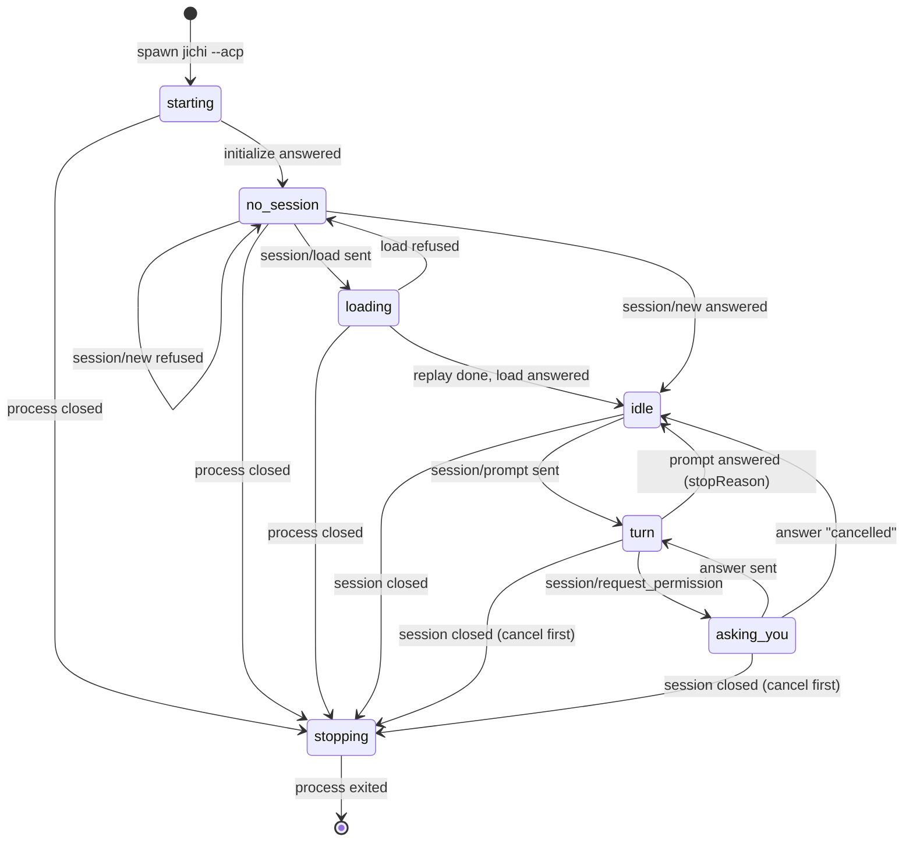

# Building the jichi desktop application: a checklist for a junior developer

*This is the companion to [`2026-09-desktop-gui.md`](2026-09-desktop-gui.md), which says **what**
the application is and why. This page says **in which order** to design and build it, and how
you know each step is done. Nothing here is built yet. Where this page says "the design",
it means that page, and "§" numbers refer to it.*

*Status: **postponed by the operator on 2026-10-01**
([`DECISIONS.md`](../DECISIONS.md#dec-2026-10-01-desktop)). Nothing here is to be built until it is
taken up again.*

*This page is for a **junior developer**: someone who has written programs and used git, but
has not yet driven another program over a protocol, packaged a desktop application, or shipped
on three operating systems. It is also for the **reviewer** who looks at your work at each gate.*

*How to use it:*
- *work from top to bottom, and tick each box in your own copy;*
- *most boxes have a **Done when** line: that is what you show the reviewer, not a feeling of
  being finished;*
- *each phase ends in a **gate**. Stop there, show the reviewer, and start the next phase only
  when they agree;*
- *when a step here and the design disagree, the design wins. Tell the reviewer, so one of the
  two gets fixed.*

*What you need first: a Linux machine you can install software on, git, a C compiler to build
jichi, Python 3 for the first exercise, and a model that costs nothing to call: a free model on
an institutional gateway, or a local server such as LM Studio. From Phase 2 on, jichi's own mock
model server is better still.*

---

## The rules you work by

These are jichi's own working rules, and each was written after it was broken. They apply to the
application just as much.

1. **Measure a behaviour before you rely on it, and write down how.** Record the date, jichi's
   commit, the exact command and what came back. The design's §11 is an example. A behaviour you
   only read about is marked "from the code" or "from the docs", never "measured".
2. **A test must be seen failing before it counts.** Write it, break the thing it checks, watch
   it go red, then put the thing back. A test you never saw fail has never been seen to work.
3. **Run every command you write down, exactly as you wrote it.** That includes `< /dev/null`
   on a jichi command that must not wait for input: a headless run with an open stdin can
   block forever (ANECDOTES #64).
4. **Probe in a place you are willing to lose.** Use a scratch `HOME` and a scratch git
   repository, never a real project. Some jichi commands **write**: `undo` reverted 768 files
   when someone ran it only to see whether it existed (ANECDOTES #66). Find out what a command
   does from `--help`, `--dry-run` or the source, not by running it on your work.
5. **Never spend money by accident.** While developing, use only a model that costs nothing, or
   the mock model. Read `jichi doctor`'s warnings, including "no pricing for the active model":
   it fires exactly where spending would be invisible.
6. **Report what happened, not what you did.** "The dialog appeared and the file was not
   written" is a result. "I sent reject_once" is not.
7. **Small commits, one idea each,** with a message that says why.

---

## Phase 0: learn the ground (no application code yet)

- [ ] **Read the design, §0 to §3.**
      *Done when:* you can explain to the reviewer, without the page, why there is one jichi
      process per session (§3.9), what "Always allow" covers (§3.4), and why a session's mode
      must be shown before it is opened (§3.7).
- [ ] **Read what jichi promises a client:** [`ACP.md`](../ACP.md);
      [`EMBEDDING.md`](../EMBEDDING.md) §3 and §4; and, in
      [`2026-07-web-frontend.md`](2026-07-web-frontend.md), the sections "Owning the process"
      and "Multi-instance governance".
      *Done when:* you can say which of jichi's outputs are Stable, which are Provisional, and
      which are not an interface at all.
- [ ] **Build jichi from source at one fixed commit**
      ([`PREPARE_AND_BUILD.md`](../PREPARE_AND_BUILD.md), [`INSTALL.md`](../INSTALL.md)).
      *Done when:* `jichi --version` prints the commit on its `build:` line (it does for a build
      inside a git checkout, and not for one from an archive), and you have written that commit
      down. Every measurement you make from now on names it.
- [ ] **Use jichi for an hour the terminal way,** following
      [`TUTORIAL_BEGINNER.md`](../TUTORIAL_BEGINNER.md) and [`WORKBENCH.md`](../WORKBENCH.md) §4.
      You are about to rebuild part of this; know what it does first.
      *Done when:* you have approved one change, refused one, read a change with `/diff`, and
      taken one back with `/undo`.
- [ ] **Make a scratch place:** `export HOME="$(mktemp -d)"` in the terminal you probe from, and
      a scratch project made with `git init`. Keep your jichi configuration for that `HOME` in
      a file you can pass with `--config`.
      *Done when:* `jichi --config <file> status --output json < /dev/null` shows your scratch
      project as `cwd`.
- [ ] **Talk to jichi over ACP by hand** with the program below. Run it first with the config's
      `apiBase` pointed at a closed port (for example `http://127.0.0.1:1/v1`), so no model can
      be reached: type `load does-not-exist`, then an empty line. Then
      run it with a model, and ask for a small file to be written. Refuse once, allow once.
      *Done when:* you have a saved transcript showing `initialize`, a load error, a
      permission request, a refusal (the tool card goes to `failed`, with the text "denied") and
      an allowed write, and you
      can point to each message in it.
- [ ] **Reproduce, yourself, the behaviours the design lists as measured:** `serve --acp` exits
      2 (§9, D1); `cwd` in `session/new` is ignored (§3.1); a failed model call ends in
      `end_turn` (§3.8); a wrong `sessionId` in `session/prompt` runs anyway (§3.9); an `auto`
      session loaded into a process started without `--auto` acts unasked, and the same load in
      a `--readonly` process cannot write (§3.7); a cancel sent while a shell command runs is not
      honoured (§3.5, D6).
      *Done when:* your notes have each one with its date, commit and command. If one of them
      no longer happens, jichi has fixed it: tell the reviewer, because the design must change.
- [ ] **Read how jichi tests its own ACP server:** `tests/smoke/acp_load.sh` (offline: it seeds
      a session and points at a dead port 9, with no model), `tests/smoke/acp_cancel.sh`
      (bidirectional over a FIFO, against a stalling mock model), `tests/e2e/acp_terminal.py`
      (model-gated, exercising `terminal/*` delegation), and the reply-script format at the top of
      `tests/tools/mm_core.h`.
      *Done when:* you can write a mock-model script that answers the first request with a
      `write_file` tool call and the second with a line of text.

**Gate 0.** Show the reviewer your notes and your transcript.

### The program: `acp_hello.py`

Save it as `acp_hello.py` and run it in your scratch project. `JICHI` names the jichi binary when
it is not the one on your `PATH`. It needs nothing beyond Python 3.

```sh
# in your scratch project, with the scratch HOME exported
JICHI=/path/to/your/jichi python3 acp_hello.py --config /path/to/your-config.json
```

```python
#!/usr/bin/env python3
"""acp_hello.py -- talk to `jichi --acp` by hand, and see every message.

    python3 acp_hello.py [jichi options, e.g. --config my.json]

Type a prompt and press Enter. `load <id>` opens a saved session instead of a
new one; an empty line quits. jichi's stderr goes to ~/jichi-acp.log: outside
the project, where jichi's checkpoints and file tools cannot see it.
"""
import json, os, queue, subprocess, sys, threading

jichi = os.environ.get("JICHI", "jichi")
log = os.path.join(os.path.expanduser("~"), "jichi-acp.log")
child = subprocess.Popen([jichi] + sys.argv[1:] + ["--acp"],
                         stdin=subprocess.PIPE, stdout=subprocess.PIPE,
                         stderr=open(log, "a"), text=True)
lines = queue.Queue()


def reader():
    # The ONLY code that reads jichi's stdout. Never select() on the pipe and
    # then readline() it: a line already in Python's buffer is invisible to
    # select(), and the program waits for a message it has already received.
    for line in child.stdout:
        try:
            lines.put(json.loads(line))
        except ValueError:            # never let one bad line stop the reader
            print("\n!! not JSON on jichi's stdout:", line.rstrip()[:160])
    lines.put(None)


threading.Thread(target=reader, daemon=True).start()


def send(msg):
    print(">>", json.dumps(msg)[:160])
    child.stdin.write(json.dumps(msg) + "\n")
    child.stdin.flush()


def answer_permission(msg):
    call = msg["params"]["toolCall"]
    print("\n?? jichi asks:", call["title"], "(" + call["kind"] + ")")
    choice = input("   allow once? [y/N] ").strip().lower()
    option = "allow_once" if choice == "y" else "reject_once"
    send({"jsonrpc": "2.0", "id": msg["id"],
          "result": {"outcome": {"outcome": "selected", "optionId": option}}})


def show(update):
    kind = update["sessionUpdate"]
    if kind == "agent_message_chunk":
        print(update["content"].get("text", ""), end="", flush=True)
    elif kind == "user_message_chunk":        # arrives only in a replay
        print("\nyou (replayed):", update["content"].get("text", ""))
    else:
        print("\n<<", kind, update.get("title", ""), update.get("status", ""))
        for part in update.get("content") or []:   # a tool's result text
            text = part.get("text") or (part.get("content") or {}).get("text")
            if text:
                print("  ", text[:200])


next_id = 0


def request(method, params):
    global next_id
    next_id += 1
    send({"jsonrpc": "2.0", "id": next_id, "method": method, "params": params})
    while True:
        msg = lines.get()
        if msg is None:
            sys.exit("jichi exited; read " + log)
        if "method" in msg and "id" in msg:    # a request FROM jichi
            answer_permission(msg)
        elif "method" in msg:                   # a notification
            show(msg["params"]["update"])
        elif msg.get("id") == next_id:          # the answer to OUR request
            return msg


print("<<", request("initialize", {"protocolVersion": 1,
                                   "clientCapabilities": {}}))
sid = None
while True:
    text = input("\nyou> ").strip()
    if not text:
        break
    if text.startswith("load "):
        reply = request("session/load", {"sessionId": text[5:],
                                         "cwd": os.getcwd(), "mcpServers": []})
        if "error" not in reply:
            sid = text[5:]
        print("\n<<", reply)
        continue
    if sid is None:
        sid = request("session/new", {"cwd": os.getcwd(),
                                      "mcpServers": []})["result"]["sessionId"]
    reply = request("session/prompt", {"sessionId": sid,
                                       "prompt": [{"type": "text", "text": text}]})
    print("\n<<", reply)
child.stdin.close()
child.wait()
```

What to look at while you use it:
- the `?? jichi asks:` line comes **after** a `<< tool_call … in_progress` line, not before
  (design §3.3);
- jichi's permission request has `"id": 1` although your own `initialize` also had `"id": 1`:
  the two directions number their requests separately;
- the refused call's card turns `failed`, and the program prints the result's text: live it is
  "denied"; in a replay it is the whole message the model received, which says a third refusal
  in a row ends the turn and tells the model to ask what you want instead of trying another way;
- after the refusal, watch what the model does. Run on 2026-09-30 with `jlu/qwen3-coder-next`,
  exactly as published here, it asked whether it had understood the request; on the next
  prompt it wrote the file once allowed. The whole exchange took about 3 s.

The comment in `reader()` is there because the author of the design made exactly that mistake
in a first version of this program. The permission request had already arrived, and the program
waited four minutes for it (design §11).

---

## Phase 1: decide, and prove the risky parts first

- [ ] **Decide, with the reviewer, and write each decision down with the alternatives you
      rejected.** jichi keeps such a record in [`DECISIONS.md`](../DECISIONS.md); keep one like it
      in the application's repository.
      - the toolkit (the design recommends Tauri 2, §8);
      - whether the application bundles its own jichi or uses an installed one;
      - which platforms version 1 supports (suggested: Linux first);
      - where keys are kept (§6);
      - the application's own licence, and how jichi's `LICENSE` and `NOTICE` travel with it
        (§4.4);
      - the name.
      *Done when:* each decision has a date, a reason, and at least one rejected alternative. A
      choice with no rejected alternative was not a decision.
- [ ] **Spike W, Windows** (skip only if Windows is out of version 1). From a small Windows
      program, start `wsl.exe -d <distro> --cd <linux path> -- /absolute/path/to/jichi --acp`
      (`--` does not start a login shell, so `~/.profile`'s `PATH` does not apply) and run the
      `acp_hello.py` conversation through it: a load, a permission request refused and allowed,
      and a cancel. Pass the key with `WSLENV`.
      *Done when:* the result is written down with the Windows build, the distribution and
      jichi's commit. If a single line arrives changed, split or late, Windows leaves version 1
      (design §10, point 3).
- [ ] **Spike M, macOS** (skip only if macOS is out). Start the chosen toolkit's empty
      application from the Finder, not from a terminal, and have it run
      `jichi describe --output json`.
      *Done when:* you know what `PATH` and which environment variables the application gets,
      and that it finds jichi by an explicit path.
- [ ] **Spike R, rendering.** In the chosen toolkit's web view, render five real pages from
      jichi's `docs/`: one with several Mermaid diagrams
      ([`SELF_IMPROVEMENT.md`](../SELF_IMPROVEMENT.md) has six), one in Japanese
      ([`HAIKU.md`](../HAIKU.md)), one with wide tables ([`PLATFORMS.md`](../PLATFORMS.md)), one with
      long code blocks ([`ACP.md`](../ACP.md)), and the design page itself.
      *Done when:* each page is checked on each platform in version 1, and every difference is
      written down.
- [ ] **Sketch the five windows on paper:** chat, projects and sessions, setup, documentation,
      source. Put the permission dialog on its own sheet. Show the sketches to one person from
      the intended audience, and write down what they misread.
      *Done when:* the sketches carry that person's corrections.

**Gate 1.** The decisions, the spikes' results and the sketches.

---

## Phase 2: the ACP client, with no window

Write the client as a module with **no user-interface code in it**. It starts one jichi, talks
to it, and reports events. Everything in this phase is tested without a window, and without a
network.

- [ ] **Framing.** One reader owns jichi's stdout, splits it on newlines and parses each line.
      Lines can be large: a tool call's `rawInput` can carry a whole file, and a replay carries
      whole tool results. In the other direction, jichi refuses a line longer than 8 MiB
      (`JC_PEER_LINE_MAX`, `include/jc_peercap.h`).
      *Done when:* tests feed one 5 MB line, one line split across many reads, and many lines
      in one read, and each comes out whole.
- [ ] **Classify every message by its shape:** `method` and `id` is a request from jichi,
      `method` alone is a notification, `id` alone is an answer to you (design §3.3).
      *Done when:* a unit test against a scripted peer sends your request number 1 while its
      request number 1 is open, and each is routed correctly. Against real jichi you cannot do
      this: while it waits for an answer it drops every other message (§3.10), so send only the
      answer or `session/cancel` while its request is open.
- [ ] **One request in flight** (§3.10). A second request while one is open is queued or
      refused by *your* code; `session/cancel` is always allowed.
      *Done when:* a test shows a `session/load` sent during an open permission request is held
      back, not lost.
- [ ] **A state machine per process**, drawn below. A message that does not fit the current
      state is an error in *your* client, logged and shown, never ignored.
      *Done when:* the reviewer can match every state and arrow in your code to the drawings
      below, which agree with each other, including the refused-load and "cancelled" edges.
- [ ] **Permission requests** reach the caller as an object carrying the tool call and its three
      options. The client never answers on its own and has no timeout. Answering "cancelled"
      cancels the turn.
      *Done when:* a test leaves a request open for ten minutes and nothing happens.
- [ ] **Cancel and stop** (§3.5; read it whole, because jichi's behaviour here is uneven):
      - cancel with `session/cancel`, and report a cancel that is not honoured within a few
        seconds as exactly that;
      - stop an idle process by closing its stdin;
      - stop a busy one with the full order in §3.5, which ends with **your own cleanup**: before
        stopping jichi, record the process groups its children lead, and kill what is left of
        them afterwards. jichi starts every shell command in a group of its own, so a signal to
        jichi's group does not reach it.
      *Done when:* a mock-model script has jichi run `sleep 300` through `run_terminal_command`;
      your test cancels, then stops jichi; and afterwards no `sleep` is left running. Record the
      tool's arguments in the test's log: the runs in §3.5 that could not be explained did not
      record them.
- [ ] **stderr** goes to a per-session log, and the client can hand the last lines to the
      window.
      *Done when:* a test whose mock answers `status 401` with an error body finds that line in
      the log. (The mock cannot check a key: it answers by request number and body.)
- [ ] **The suspicious empty turn** (§3.8): `end_turn` with no message and no tool call raises
      its own event.
      *Done when:* a test with an unreachable model server gets that event.
- [ ] **The mode check** (§3.7): before `session/load`, the client reads the mode with
      `jichi export <id> --output json`. For `auto` it refuses to load unless the caller passes
      an explicit confirmation.
      *Done when:* a test loading an `auto` session without confirmation is refused.
- [ ] **Integration tests against real jichi and the mock model.** Build jichi's test tools
      (`make smoke-tools` in jichi's tree) and write mock-model scripts for: a text answer; a
      `write_file` call, refused; the same call, allowed; a failing model (`status 500`). Set
      `"maxRetries": 0` in test configs: with the default of 4, one failing turn makes five
      requests, which shifts every `count N` rule after it.
      *Done when:* they run offline in your CI, and each was seen red once, for example by
      expecting the wrong stop reason.
- [ ] **Pin today's defects in tests** (design §9, D1–D5). Each test asserts what jichi does
      **now**, and says in its failure message: "jichi has fixed Dn; change the client and this
      test". So the day jichi changes, you hear about it from your CI, not from a user.
      *Done when:* each has been seen failing once, by flipping its expectation.
- [ ] **The version check.** Store the `jichi describe --output json` you tested against, and
      compare it in CI with the jichi you ship.
      *Done when:* changing one field in the stored copy makes CI fail.

The state machine of one jichi process, as the client sees it:

```text
spawn --> [starting]
             |  initialize answered
             v
        [no session] <------ load refused ------+
          |      |                              |
          |      |  session/load sent           |
          |      v                              |
          |   [loading] ------------------------+
          |      |  replay done, load answered
          |      v
          +--> [idle] <-------------------------+
 session/new     |  session/prompt sent         |
 answered        v                              |
              [turn] ---- prompt answered ------+
               |  ^         (stopReason)        |
    permission |  | answer sent                 |
    request    v  |                             |
            [asking you] --- "cancelled" -------+

any state --> [stopping] --> [exited]
  (close the session; cancel a running turn first)
```

In words: after the process starts, the client waits for the answer to `initialize`. The process
then has no session until `session/new` or `session/load` is answered; a load first passes
through the replay; a refused load (an unknown id, for example) leaves the process without a
session, and so does a refused `session/new`. With a session the process is idle, and a prompt
starts a turn. During a turn jichi may ask a question, and the process then waits for the user;
after the answer the turn goes on, except that answering "cancelled" ends the turn at once. The
turn ends when the prompt is answered with a stop reason, and the process is idle again. From any
state, closing the session stops the process.

Drawn by Mermaid, where your viewer supports it:



**Gate 2.** The reviewer runs your test suite on a machine with no network, and reads the state
machine against the code.

---

## Phase 3: the command runner

- [ ] **One function runs a short jichi command**: `jichi <command> --output json`, in the
      project's directory, with the session's `--config`, the key in the environment, **stdin
      closed** (rule 3), and a timeout.
      *Done when:* a test shows that a command waiting for input fails with your timeout
      rather than hanging your application.
- [ ] **Read stdout as JSON, and the exit code as jichi defines it:** 0, 1, 2, 130, 143
      ([`EMBEDDING.md`](../EMBEDDING.md) §3). Never parse stderr for meaning.
      *Done when:* tests cover each exit code, and 143 is not reported as a crash.
- [ ] **The text-only commands** (`init --list`, `setup --list`, `checkpoints`; design §3.12)
      get a parser tested against output recorded from a real run, and a note naming the
      design's N2.
      *Done when:* a test with a recorded listing passes, and one with a changed line fails
      loudly rather than returning half a list.
- [ ] **Never read jichi's session files.** Add a CI check that fails if your code names
      `.jichi.d/sessions`.
      *Done when:* the check was seen red once.
- [ ] **`undo` only through its dry run.** The function that reverts takes the output of a
      `--dry-run` the user has seen, and refuses otherwise. It refuses during a turn.
      *Done when:* tests show both refusals, run in a scratch project.

**Gate 3.**

---

## Phase 4: the chat window

- [ ] **Streaming text**, rendered as Markdown a few times a second rather than at every piece.
      *Done when:* a reply of 5,000 pieces from the mock model keeps the window responsive. (Use
      the mock's `sse-file` directive: a `text` rule sends the whole reply as one piece.)
- [ ] **Untrusted output stays inert** (design §4.1, §6). Have the mock model answer with a
      `<script>` element, raw HTML, a `javascript:` link, and an image at a remote address.
      *Done when:* nothing runs, nothing is fetched (check with the web view's network
      inspector), and the link opens only after a click that shows its full address.
- [ ] **Tool cards** keyed by `toolCallId`. A card shows "waiting for you" as soon as a
      permission request names it, and never "running" before the answer.
      *Done when:* the reviewer watches one refused and one allowed call, and the cards say
      what happened.
- [ ] **The permission dialog** (design §4.1):
      - it says in plain words what will happen, and shows every argument in full; a shell
        command is shown whole, never shortened;
      - for `edit_file`, find the code in jichi's `src/tools/` that reads `edit_file`'s
        arguments, and build the preview the way that code reads them. Test it with
        `"replace_all": "true"` written as a **string**: jichi reads it as true;
      - it has three buttons worded as in §3.4, **no default button, no timeout**, and Escape
        does not approve;
      - it can be used with the keyboard alone.
      *Done when:* each point has a test or a recorded check, and one person who is not a
      developer has read the dialog aloud and said correctly what "Always allow" would do.
- [ ] **Cancel** is visible for the whole turn.
      *Done when:* a cancel during a long model call and during an open dialog both end the
      turn with `cancelled`.
- [ ] **The title bar** shows the model and the mode; stop reasons are shown in words.
- [ ] **A diagnostics panel** shows the session's stderr log.
- [ ] **Attach a file:** its text goes into the prompt as an embedded `resource` block.
      *Done when:* the model can quote a line from the attached file.
- [ ] **After the turn:** a changes pane (your own `git diff`), and "undo this turn" through the
      dry run (Phase 3).

**Gate 4.** One person from the audience approves a change, refuses one and cancels one, while
you watch and take notes.

---

## Phase 5: projects and sessions

- [ ] **Projects** from `jichi ls --all --output json`, plus directories the user adds.
- [ ] **Sessions per project**, with title, size, last change and **mode** (from `export`; cache
      it by the session's `mtime`, since each call is a process).
- [ ] **Open, New, Close.** Closing stops the process.
- [ ] **Loading an `auto` session asks first**, and says what that means (§3.7).
      *Done when:* the reviewer loads one and reads the question.
- [ ] **One writing session per project** (`chat` or `auto`); `plan` sessions may run beside it.
      Say in the window that a terminal jichi on the same project cannot be seen.
- [ ] **Continue in a terminal:** stop your process, then open a terminal on
      `jichi --session <id>` in the project. A resumed session applies its saved mode, so an
      `auto` session resumes in `auto`. Passing `--plan` to only look also **saves** plan into the
      session, so the next resume without a flag opens in plan too; say so in the window.
      *Done when:* the terminal prints `(resumed: <title>)` -- and, if files the conversation used
      have changed, `(noted for the model: files changed since this conversation last ran)` --
      without replaying the conversation, answers a question about the earlier turn, and after it
      exits the application shows the turns added there. If any file changed, jichi adds a
      `[resume]` user message to the history, which also appears in the replay.
- [ ] **Change model:** stop, start again with `--model <name>`, load the session.

**Gate 5.**

---

## Phase 6: setup and scaffolding

- [ ] **Find jichi:** bundled copy, `PATH`, or WSL. Check its version against the one you
      tested (Phase 2), and when it does not match, say which version is needed.
- [ ] **The model form** runs `jichi setup --non-interactive …` (design §4.2). Refuse a value
      in the "key variable name" field that no shell could export, such as a pasted key, as
      `setup` itself does. `setup` has no preview and ignores `--dry-run`, so to show what it
      writes, run it once in an empty temporary directory and list the files that appear.
      *Done when:* a pasted `sk-…` value is refused, and the refusal does not repeat it.
- [ ] **The key** goes into the keychain, and from there only into the environment of the jichi
      processes you start. Optionally, write `~/.jichi.env` with mode 600 for terminal use.
      *Done when:* a test finds the key in no file your application wrote, and on no command
      line (`ps -ef`).
- [ ] **`doctor`**: show every check. Put warnings where they are seen, the pricing warning first.
      `doctor --live` makes one real model request, so it is a button the user presses.
- [ ] **Model guidance** in the model picker, from [`WORKBENCH.md`](../WORKBENCH.md) §11.1 and
      [`CHOOSING_A_MODEL.md`](../CHOOSING_A_MODEL.md).
- [ ] **git**: checkpoints need it. Check at first run, and explain.
- [ ] **Scaffolding.** First read
      [`../analysis/2026-09-29-scaffolding-packs-review.md`](../analysis/2026-09-29-scaffolding-packs-review.md).
      Then: list the packs, show `jichi init <pack> --dry-run`, write, run `doctor` again.
      *Done when:* the window shows every file before it is written.

**Gate 6.** On a fresh user account, someone from the audience goes from installing the
application to a first approved change, without help. Time it and write down every place where
they stopped.

---

## Phase 7: the documentation and the source

- [ ] **The bundle** comes from `git archive` at the jichi commit you ship (design §4.4). The
      packaging step fails if any path under `docs/internal/` is in it.
      *Done when:* adding such a path to a test archive makes the packaging fail.
- [ ] **`LICENSE` and `NOTICE`** are reachable from the About box.
- [ ] **The renderer**: CommonMark with tables, offline, relative links inside the bundle,
      paths into `src/` opening the source viewer, Mermaid drawn with its source one click
      away, and a font that shows the Japanese terms.
      *Done when:* the five pages of Spike R render on every platform in version 1.
- [ ] **Search** over the docs, with the index built at packaging time.
- [ ] **The source viewer**: tree, C colouring, line numbers, search, and `file:line` links.
- [ ] **The version** of the bundle is shown, and a mismatch with the running jichi is shown too.

**Gate 7.**

---

## Phase 8: platforms and packages

- [ ] **Linux:** `.deb`, `.rpm` or AppImage; not Flatpak (design §5).
- [ ] **macOS:** signed and notarized, with the bundled jichi signed as well.
- [ ] **Windows:** only if Spike W passed; projects inside WSL; paths converted with `wslpath`.
- [ ] **On each platform:** the offline test suite, and **one driven conversation** with a tool
      call whose result the model must use. jichi's own rule is that a platform is not tested
      until a model has been driven on it ([`PLATFORMS.md`](../PLATFORMS.md)).
      *Done when:* each platform has a row with the date, the model, the task and how long it
      took.

**Gate 8.**

---

## Phase 9: security and accessibility

- [ ] **Go through design §6 point by point,** and for each point write down the test or the
      check that shows it holds.
- [ ] **Keyboard only:** a whole turn, including the permission dialog and cancel, without a
      mouse.
- [ ] **Screen readers:** Orca on Linux, VoiceOver on macOS, NVDA on Windows. Each reads the
      permission dialog in an order that makes sense. jichi's own approach is in
      [`ACCESSIBILITY.md`](../ACCESSIBILITY.md).
- [ ] **Languages:** the window's strings can be translated; jichi's `--language` option sets
      the language of its answers.

**Gate 9.**

---

## Phase 10: release, and the question whether to go on

- [ ] **Pin** the jichi version; `describe` compared in CI; a changelog; signed updates that
      name the jichi version they carry.
- [ ] **The audience test** (design §10, point 1): five people from the audience, one guided
      hour with the workbench and one with the application.
      *Done when:* the result is written down. **If three or more prefer the workbench, stop**,
      and say so. That result is worth as much as the application.
- [ ] **Write the release's "what was measured, and what was not"**, like the design's §11.

---

## When you are stuck

- **The protocol:** jichi's whole ACP server is `src/acp/jc_acp.c` (about 1,080 lines) and
  `src/acp/jc_acp_proto.c` (about 620). They are short enough to read. Read them before
  guessing.
- **A behaviour you are unsure of:** measure it with `acp_hello.py` in your scratch place, and
  write down what you saw (rule 1).
- **A disagreement between jichi and its docs:** trust what you measured, write it down, and
  tell the reviewer. While the design was written, the docs and jichi disagreed at least four
  times (§3.1, §3.3, §3.4, §3.5), and a later review found more.
- **A choice between two designs:** write both down with what each costs, and ask. The reviewer
  decides; you make the decision easy.
