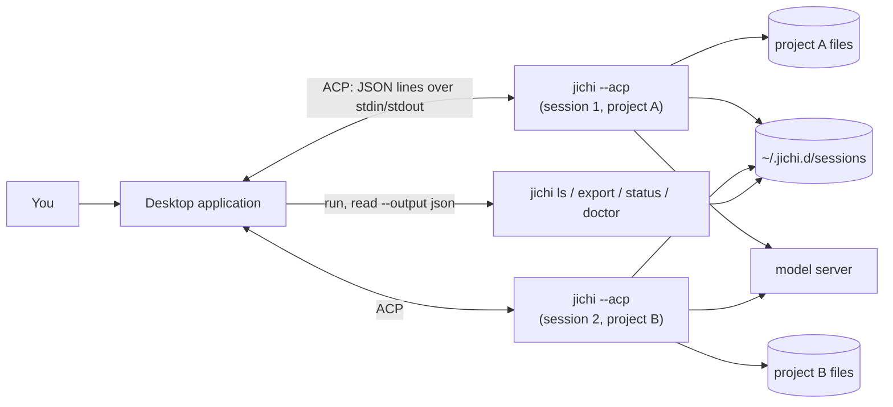
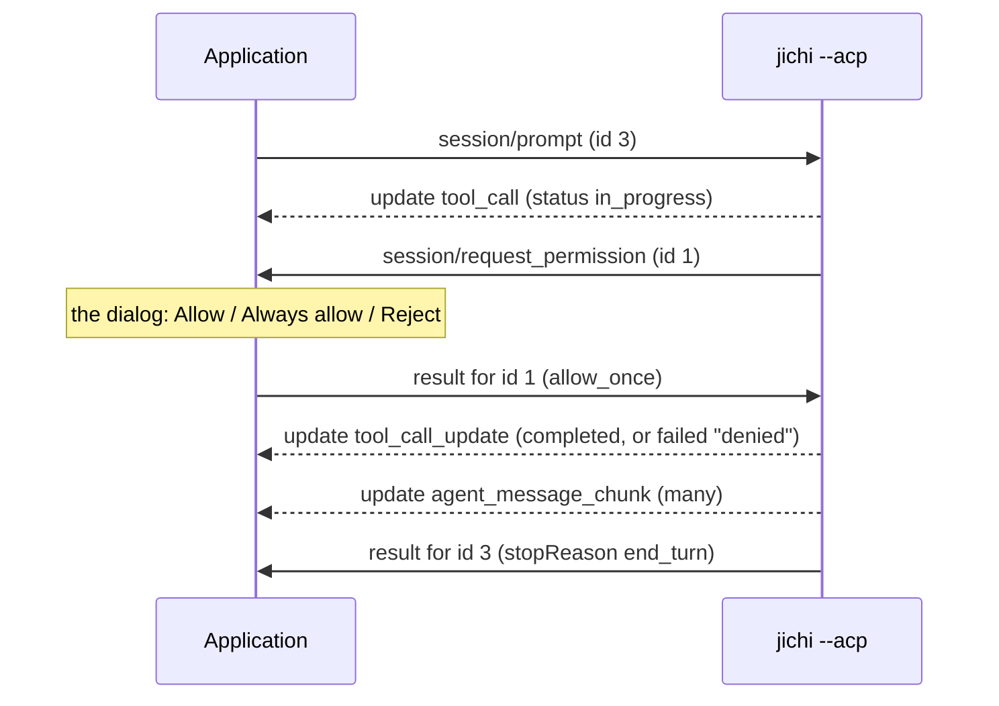

# A desktop application for jichi: design, and how it would be built

*Status: **proposed, design only. Postponed by the operator on 2026-10-01**
([`DECISIONS.md`](../DECISIONS.md#dec-2026-10-01-desktop)). Nothing in `src/` or `tests/` changes on this page, and no
line of the application exists. It would be a separate program with its own repository. It would
start jichi as a child process, the way an editor does. The steps to build it are in the companion
checklist, [`2026-09-desktop-gui-checklist.md`](2026-09-desktop-gui-checklist.md).*

*This page is for three readers:*
- *the **reviewer** who decides whether the application should be built;*
- *the **junior developer** who would build it, with the checklist beside this page;*
- *a **self-learner** who wants to see how a graphical program can drive an agent that was
  written for the terminal.*

*After reading it you can:*
- *say which part of jichi a desktop application talks to for each thing it shows (§2, §3);*
- *name what jichi does today that a graphical client must handle, and must not paper over
  (§3.5–§3.10);*
- *say what the application would do on Linux, macOS and Windows, and what nobody has tried (§5);*
- *decide, for a given user, whether the application or the terminal workbench serves them
  better (§7).*

*What you need first: [`ACP.md`](../ACP.md), the protocol jichi speaks to editors, and
[`EMBEDDING.md`](../EMBEDDING.md) §3–§4, which says what jichi promises to a program that drives
it. [`WORKBENCH.md`](../WORKBENCH.md) is the terminal way of doing everything this page proposes.*

*Where it fits: [`2026-07-web-frontend.md`](2026-07-web-frontend.md) designed a **web** front end
for jichi and gave the rule "justified by fan-out and observation, never by chat". This page
proposes a **desktop** front end that does offer chat. §1 says why the rule's reasons do not all
carry over, and which one still does.*

*How it was checked, on 2026-09-29: jichi was built from `master` at M842 (`c2f407b5`) into a
scratch directory, with 0 errors and 0 warnings. It was driven over ACP by a small Python client,
using a scratch `HOME` and a scratch git repository. Turns that needed a model used
`jlu/qwen3-coder-next`, a free, locally hosted model on the university's gateway. Everything
marked **measured** below was seen on the wire. **From the code** means it was read in
`src/acp/jc_acp.c` or `src/main.c` at that commit and not run. **Judgement** is the author's
opinion. No toolkit was installed, no GUI was built, and nothing was run on macOS or Windows.
By the operator's rule for this machine, no Mermaid diagram was rendered here; each one has a
text diagram and an "In words" paragraph beside it.*

---

## 0. The answer first

1. **The application is a separate program that starts jichi and talks to it over pipes.** No
   new C enters jichi, and nothing links against it: there is no jichi library, only a process
   ([`EMBEDDING.md`](../EMBEDDING.md) §4).
2. **Chat goes over ACP, started as `jichi --acp`.** ACP is the only surface where jichi *asks*
   before it acts. Everything else the application shows comes from short jichi commands with
   `--output json`: `ls`, `export`, `status`, `doctor`, `describe` (§3.12).
3. **Use `jichi --acp`, not `jichi serve --acp`.** The second form exits 2 on every run at M842,
   although `ACP.md` teaches it (§9, D1).
4. **Run one jichi process per open session, and start it in the project's directory.** jichi
   ignores the directory named in `session/new` (measured). It also runs a prompt against
   whatever session the process holds, whatever id the prompt names (measured).
5. **The permission dialog is the safety feature.** Never answer it automatically. "Always
   allow" allows **every** call of that tool, with any arguments, until the jichi process ends.
6. **Show a session's mode before you open it.** A session saved in `auto` mode runs in `auto`
   mode when it is loaded, even in a process started without `--auto`. On 2026-09-29 such a
   session wrote a file with no permission request at all. Started with `--readonly`, the same
   load could not write (both measured, §3.7).
7. **A failed model call looks like a normal empty answer.** The turn ends with `end_turn`, and
   the only sign of the error is a line on stderr (measured twice, §3.8). The application must
   show stderr to the user, and cannot parse it reliably.
8. **Cancel does not stop a shell command that is already running**, unless the command has a
   time limit or a memory budget. jichi reads the cancel during the command too, but on the
   default path it lets the command run to its end. Killing jichi can leave a command with a time
   limit running as an orphan (§3.5). So the application must clean up after jichi itself.
9. **Linux works. macOS is partly verified and has been driven with a model. On Windows, jichi
   runs through WSL2 (verified and driven); Cygwin and MSYS2 are partly verified but not
   recommended.** The application would start jichi through `wsl.exe`, which nobody has tried (§5).
10. **Recommended stack (judgement): Tauri 2, with the user interface and the ACP client written
    in TypeScript.** The ACP client can then be tested without a window, against real jichi and
    jichi's own mock model server (§8).
11. **For someone who lives in the terminal, the workbench is richer today.** Slash commands,
    `/diff`, `/undo` and `/cost` do not travel over ACP. The application pays for itself with
    first-run setup, several projects side by side, and the documentation and source beside the
    chat, for people who do not live in a terminal (§7).

---

## 1. What the application is for, and what it is not

The web proposal ruled out chat for two reasons:
- a web server is a network listener in front of a program that runs shell commands, so it
  adds a remote attack surface;
- for one local session, the terminal interface (TUI) is strictly richer.

A desktop application has **no listener**. It talks to its child over two pipes, and nothing
on the network can reach that conversation. So the first reason does not carry over.

The second reason still holds for anyone at home in a terminal (§7). So this proposal is
justified by its **audience** and by **several projects at once**, not by chat as such. If the
people who will use it are all comfortable in a terminal, the workbench wins, and §10 says to
stop.

**Goals.**

| # | The application lets a user… | Through |
|---|---|---|
| G1 | chat with jichi about a project, and approve or refuse each action it proposes | ACP (§3) |
| G2 | set up a model and a project: configuration, scaffolding packs, a health check | `setup`, `init`, `doctor` (§4.2) |
| G3 | see all projects and their sessions, open one, resume one, start a new one | `ls`, `export`, ACP (§4.3) |
| G4 | read jichi's source code, at the version it is running | a bundled source tree (§4.4) |
| G5 | read jichi's documentation, rendered, with links into the source | a bundled docs tree (§4.5) |

**Non-goals.**
- **It is not an editor.** It shows files, diffs and proposed changes. The user's own editor
  edits, as on the workbench, where "the file system is the integration"
  ([`WORKBENCH.md`](../WORKBENCH.md) §0).
- **It is not remote, and it serves one user.** No login, no server, no shared sessions. The
  web proposal covers that.
- **It does not replace the TUI.** A session opened in the application can be continued in a
  terminal, and the other way round (§4.3).
- **It does not ship a model.** The user points it at a model server, as they would point
  jichi.

---

## 2. The shape

```text
+-------- the desktop application (one program) --------+
| windows: chat | projects and sessions | setup |        |
|          documentation | source                        |
|                                                        |
| ACP client            command runner                   |
| (one per session)     (short jichi commands)           |
+------|---------------------------|---------------------+
       | stdin/stdout,             | arguments;
       | one JSON message          | reads --output json
       | per line                  |
       v                           v
  jichi --acp                jichi ls / export /
  (one process per           status / doctor /
   open session)             init / setup
       |                           |
       +---- reads and writes -----+
       |     files: the project, .jichi/,
       |     ~/.jichi.d/sessions
       v
  model server (HTTPS)
```

In words: the application has two ways to talk to jichi. For a conversation it starts
`jichi --acp` in the project's directory and exchanges one JSON message per line over the
child's stdin and stdout. For everything else it runs a short jichi command, such as
`jichi ls --output json`, and reads the JSON it prints. Both kinds of jichi process read and
write the same files: the project, its `.jichi/` directory, and the saved sessions. Only jichi
talks to the model server.

Drawn by Mermaid, where your viewer supports it:



**One rule governs the design, taken from the web proposal: the application keeps no
conversation of its own.** The saved sessions and the project's files are the only record.
Everything the application shows, it can rebuild by asking jichi again (`export --output json`,
`session/load`). That is what lets the terminal and the application continue each other's
sessions. It also means the application can crash without losing anything the user said.

---

## 3. The contract with jichi, as measured

This section is the part a developer will read most. Each subsection states what jichi does,
how it was established, and what the application must do about it.

### 3.1 Starting jichi

- **Command:** `jichi --config <file> --acp`, or `jichi --acp` to let jichi find its
  configuration (`./local/config.json`, then `~/.jichi`; [`SETUP_WIZARD.md`](../SETUP_WIZARD.md)
  gives the order). `jichi serve` also works. `jichi serve --acp` exits 2 with "error: --acp
  and -p/--print are different run modes; use one" (measured). The word `serve` is taken as a
  prompt (from the code, `src/main.c:15295`).
- **Directory:** the child's working directory **is** the project. `session/new` accepts a
  `cwd` and ignores it. The session was stored under the process's directory (measured).
- **Key:** jichi reads the API key from the environment variable its configuration names
  (`apiKeyEnv`). It does **not** read `~/.jichi.env`: that file is sourced by the start script
  `setup` writes (from the code). A program started from a desktop menu does not inherit
  variables from `~/.bashrc`, so the application must put the key into the child's environment
  itself (§4.2, §6).
- **stderr:** jichi's diagnostics go to stderr. Keep stderr separate from stdout, because a
  single stray line on stdout breaks the JSON framing. Write it to a per-session log, and show
  it (§3.8).
- **Process group:** start the child in its own process group (`setsid`), so that one signal
  reaches jichi and whatever it starts in that group. Shell commands with a time limit or a
  memory budget, and background jobs, are the exception: each leads a group of its own, and the
  application must clean them up itself (§3.5).

### 3.2 The handshake

The application sends `initialize` and gets, measured on 2026-09-29:

```json
{"protocolVersion":1,"agentCapabilities":{"loadSession":true,
 "promptCapabilities":{"image":false,"audio":false,"embeddedContext":true}},"authMethods":[]}
```

`image` becomes `true` only when the active model is configured as vision-capable, and `audio`
only when a transcription model is configured ([`ACP.md`](../ACP.md)).

The client also tells jichi what **it** can do. Two capabilities change jichi's behaviour:
- `fs.readTextFile` / `fs.writeTextFile`: jichi then reads and writes files **through the
  client**, so that an editor's unsaved buffers win;
- `terminal`: jichi then runs shell commands **in the client's terminal**.

**Recommendation for version 1: advertise neither.** The application is not an editor, so it
has no unsaved buffers to protect, and a delegated terminal is a whole sub-protocol. Without
them, jichi reads the disk and runs `/bin/sh` itself, exactly as in the TUI. The web proposal
made the same choice.

### 3.3 One turn, with a permission request

This is the order seen on the wire (measured), with the long fields cut:

```text
application                                   jichi --acp
     |-- session/prompt           (id 3) ---------->|
     |<-- update: tool_call  status in_progress ----|   a tool card appears
     |<-- session/request_permission (id 1) --------|   jichi now waits for you
     |-- result: optionId allow_once (id 1) ------->|
     |<-- update: tool_call_update  completed ------|   or: failed, "denied"
     |<-- update: agent_message_chunk  ... ---------|   the reply, in pieces
     |<-- result (id 3): stopReason end_turn -------|
```

In words: the application sends the prompt. jichi announces a tool call, then asks for
permission and stops until it gets an answer. The application sends the user's choice. jichi
reports the result of the tool, then streams its reply in small pieces, and finally answers the
prompt request with a stop reason.

Drawn by Mermaid, where your viewer supports it:



The actual messages, shortened:

```jsonc
// jichi -> application: the card
{"jsonrpc":"2.0","method":"session/update","params":{"sessionId":"f9b2…","update":
 {"sessionUpdate":"tool_call","toolCallId":"ffa0…","title":"write_file <project>/hello.txt",
  "kind":"edit","status":"in_progress","rawInput":{…}}}}
// jichi -> application: the question (note: jichi's own id, starting at 1)
{"jsonrpc":"2.0","id":1,"method":"session/request_permission","params":{"sessionId":"f9b2…",
 "toolCall":{"toolCallId":"ffa0…","title":"write_file <project>/hello.txt","kind":"edit",
 "status":"pending"},"options":[{"optionId":"allow_once",…},{"optionId":"allow_always",…},
 {"optionId":"reject_once",…}]}}
// application -> jichi: the answer
{"jsonrpc":"2.0","id":1,"result":{"outcome":{"outcome":"selected","optionId":"allow_once"}}}
```

Four details a client gets wrong:

1. **The card arrives before the question, already saying `in_progress`.** The ACP
   specification's own flow creates the call as `pending` ("hasn't started running yet because
   ... we're awaiting approval") and marks it `in_progress` only after permission (checked
   against the spec's source, 2026-09-30). The web proposal's sequence diagram puts the question first. Neither matches what
   jichi sends. **Show a card as "waiting for you" as soon as a permission request names its
   `toolCallId`, and do not show "running" before the answer.**
2. **jichi numbers its own requests from 1.** They collide with the client's ids. Tell the
   messages apart by shape: `method` and `id` is a request from jichi; `method` without `id`
   is a notification; `id` without `method` is the answer to one of *your* requests.
3. **A refusal comes back as a failed tool.** After `reject_once` the card turns `failed` with
   the text "denied", and the model is told. The model may then try something else; in the
   measured run it asked what to do instead.
4. **There is no "reject always".** The three options are the only ones.

### 3.4 What "Always allow" means

**From the code:** `allow_always` adds the tool's **name** to a list, and every later call of
that tool is allowed without a question, **whatever its arguments**. The list belongs to the
process, not to the session: `session/new` and `session/load` do not clear it (`jc_acp.c`,
`struct acp_server`'s `always`). [`ACP.md`](../ACP.md) says "for the rest of the session",
which is true only when a process holds one session. With one process per session (§3.9), the
two are the same.

So "Always allow `run_terminal_command`" means every shell command except the privileged ones
(`sudo`, `doas`, `pkexec`, `su`, `run0`, which jichi still refuses, and which ACP gives it no way
to ask about), for as long as that jichi process runs. **The dialog's wording must say that**, for example: "Allow every
`run_terminal_command` in this session, with any command, until you close it". It must not say
"always allow this".

### 3.5 Cancel and stop

**What jichi does, from the code:**
- `session/cancel` is read in three places: while jichi streams from the model
  (`acp_poll_cancel`, called by libcurl's progress hook), while it waits for an answer to one of
  its own requests (`acp_request_await`), and on the idle tick while a local shell command runs.
  A cancel then ends the prompt with `stopReason: "cancelled"` -- but during a command on the
  default path only after the command has ended (D6). `tests/smoke/acp_cancel.sh` drives the model-stream case against a
  mock model.
- answering a permission request with `{"outcome":{"outcome":"cancelled"}}` also cancels.
- closing jichi's stdin counts as a cancel during a turn, and ends an idle server.
- a shell command is started in a **process group of its own** only on the watched path -- when
  it has a time limit (the call's `timeout`, `--run-timeout` or `runTimeout`) or a memory budget
  -- and as a background job; there jichi kills the whole group when its abort flag is set or the
  limit passes. On the default path the command runs in jichi's own group, and `runTimeout`
  defaults to 0, meaning no limit (`src/config/jc_config.c`).

**What was measured.** The model was asked to run `sleep N` through `run_terminal_command`, in a
process started with `--auto`. The probe recorded the tool's title but not its arguments, so a
time limit the model may have chosen for a run is unknown. (Resolved on review: see below the
table.)

| What the application did | Runs | What happened |
|---|---|---|
| `session/cancel` while the command ran | 1 | no answer to the prompt within 60 s; the command kept running |
| `SIGKILL` to jichi's process group | 3 | jichi died. In 2 runs the command lived on, orphaned (parent 1), in its own group; in the first run it was gone within 2 s, unexplained |
| one `SIGTERM` to jichi while the command ran | 2 | jichi still running 30 s later. Run 1: the command gone after about 30 s. Run 2: it lived, and nothing was answered |
| one `SIGTERM` to an idle `jichi --acp` | 1 | still running after 10 s; a second `SIGTERM` ended it, by the signal, not with exit 143 |

**Resolved on review (2026-09-29, offline, with the arguments chosen deliberately).** The time
limit decides every row. Without one, the command runs in jichi's group: a `SIGKILL` to that
group ends it too (the run where it was "gone within 2 s"), and after one `SIGTERM` it lives until
its natural end (the 30 s command "gone after about 30 s"). With a limit, it leads its own group:
it survives a `SIGKILL` to jichi's group, orphaned, and a cancel ends it at once. The orphans were
adopted by the per-user service manager (`systemd --user`), not by pid 1, so a client must not
look for parent 1.

**What that means for the application:**
- **"Cancel" is a request, not a guarantee.** While a shell command runs, the button cannot
  interrupt it today, and the window must say so: "jichi will stop after the running command
  ends". A cancel that is not honoured within a few seconds is shown as not honoured.
- **Offer a time limit for commands** in the settings (`runTimeout`, or `--run-timeout` when
  starting jichi). It is the user's choice, and off by default in jichi.
- **Clean up after jichi yourself.** Before stopping a jichi process, list the process groups
  its children lead (`ps -o pid=,pgid=,ppid=`: every process whose parent is jichi and whose
  group is its own pid). After jichi has gone, kill any of those groups that remain. Commands on
  the default path share jichi's group, so a signal to that group reaches them too.
- **Stop an idle process by closing its stdin.** That is the clean way. `SIGTERM` does not end
  an idle ACP server on the first signal.
- **Stopping a busy process, in order:** `session/cancel`, and wait a few seconds; close stdin;
  `SIGTERM`, twice if needed; `SIGKILL`; then the cleanup of recorded groups. The web proposal's
  ladder ends in a `SIGKILL` to jichi's **own** process group as "the orphan sweep". That sweep
  reaches the default-path commands, which share jichi's group, but not commands with a time
  limit or memory budget, or background jobs, which lead groups of their own.

### 3.6 Opening a saved session

`session/load` with a saved session's id replays the conversation as `session/update`
notifications, then answers with an empty result, meaning "replay complete". Measured, in a
fresh process with no API key set (so no model could have been called):

```text
user_message_chunk   "Create a file named hello.txt containing the single word hi. …"
tool_call            write_file <project>/hello.txt   status completed
tool_call_update     completed  "Wrote 2 bytes to …"
agent_message_chunk  "Created `hello.txt` containing the single word "hi"."
result {}
```

What a client must know:
- **An unknown id is an error:** `{"code":-32602,"message":"unknown sessionId"}` (measured).
- **Replayed tool ids are not the live ones.** Live, the card was `ffa0…`, an id jichi made up.
  On replay the same call was `chatcmpl-tool-a825…`, the id the model server gave it. Never
  match a live card to a replayed one by id.
- **Replay can contain messages the user did not type.** An `auto`-mode turn had an extra
  `user_message_chunk` starting "Before finishing, review the changes you just made for bugs",
  which jichi added itself (measured). The replay does not mark it, so the application cannot
  label it (§9, N5).
- **A long session floods the pipe.** For a history view, `jichi export <id> --output json`
  gives the whole transcript as one object, without a process holding the session
  ([`2026-07-web-frontend.md`](2026-07-web-frontend.md), appendix §3).

### 3.7 The mode travels with the session

jichi has three modes: `chat` (ask before changing anything), `plan` (change nothing) and
`auto` (run approved tools without asking) ([`TOOL_DECISIONS.md`](../TOOL_DECISIONS.md)). A new
session takes the process's *current* mode: the one it was started with (`--plan`, `--auto`, or
neither), unless a session loaded earlier in the same process changed it (below).

**A loaded session takes the mode it was saved with.** [`ACP.md`](../ACP.md) says so in one
sentence. What that means for a client, measured on 2026-09-29:
1. a process started with `--auto` created a session and wrote `a.txt`;
2. a **second** process, started **without** `--auto`, loaded that session and was asked to
   write `b.txt`;
3. it wrote `b.txt`, with **no** `session/request_permission` at all.
   `jichi export <id> --output json` reported `"mode":"auto"`.

The same happens to a process started with `--plan`, and it spreads. Measured on 2026-09-30
with `qwen/qwen3.5-9b` in LM Studio: a `--plan` process that loaded an `auto` session wrote a
file without asking, its next `session/new` did the same, and that new session was saved as
`auto`. Without the load, a `--plan` process does not offer the model `write_file` at all (the
model said so, and plan mode advertises no mutating tool).

**Fixed at M845:** a loaded or resumed session's mode may now narrow the process's mode, never
widen it, and jichi says when it kept a saved mode out. The measurements above describe jichi
before that fix.

ACP has a way to show and change modes (`modes` in the `session/new` and `session/load`
results, `session/set_mode`, and a `current_mode_update` notification; the specification marks
them unstable). jichi implements none of it: `session/set_mode` answers `-32601 method not
found` (measured).

So the application must:
- **read the mode before it loads a session**, from `jichi export <id> --output json`
  (`ls --output json` does not include it; measured);
- **show it** on the session, in the list and in the chat window's title;
- **ask for explicit confirmation before loading an `auto` session**, saying that jichi will
  then act without asking;
- **not claim it can change a session's mode.** In the TUI, an explicit `--plan` or `--auto`
  "pins" the mode, and a resumed session's saved mode does not override it (`src/main.c`,
  `mode_pinned`). ACP's `session/load` does not check that pin: it calls
  `jc_app_set_mode(s->app, s->sess.mode)` unconditionally (from the code). No flag pins `chat`.
  And the pin is not only for the run: a mode given by flag is saved into the session, so a later
  resume without a flag opens in it (measured in the TUI, 2026-09-30).
- **start a process with `--readonly` when the user only wants to look.** It is the one flag
  that holds across a load: a `--readonly` process loaded the `auto` session, was asked to write
  `c.txt`, and the tool failed with no file written (measured).

### 3.8 A failed turn looks like an empty answer

With the model server unreachable, and again with no API key, `session/prompt` answered
`{"stopReason":"end_turn"}`, with **no** `session/update` before it (measured). The only trace
was on stderr:

```text
warning: no API key found: $JLU_API_KEY (this model's apiKeyEnv) is not set in the environment.
[jichi error] provider returned HTTP 401: {"error":{"message":"Authentication Error, No api key passed in.", …}}
```

jichi's contract says **stderr text is not an interface** ([`EMBEDDING.md`](../EMBEDDING.md)
§4). So the application cannot parse it reliably, and it must not pretend the turn succeeded.
Until jichi reports errors on the protocol (§9, D3):
- treat "`end_turn` with no message and no tool call" as **suspicious**, and say so to the user;
- show the session's stderr log in a diagnostics panel, one click away;
- offer `jichi doctor` from the same place (§4.2).

### 3.9 One process, one session

`session/prompt` with a `sessionId` that does not exist ran anyway, against the session the
process held (measured). `session/load` checks its id; `session/prompt` does not. A
`session/new` in a running process silently replaces the session it held.

So: **one jichi process per open session, and the application routes by process, never by
id.** This is also the grain the web proposal chose, and it recommended against teaching jichi
several sessions per process. When the user closes a session, stop its process.

### 3.10 One request at a time

**From the code:**
- while jichi waits for an answer to *its* request (a permission, or a delegated file or
  terminal call), it reads every incoming line. It keeps only the matching answer and
  `session/cancel`, and drops everything else without replying (`acp_request_await`);
- during a model stream it consumes only a leading `session/cancel` line, and leaves the rest
  for later (`acp_poll_cancel`).

So a `session/load` or a second prompt sent while a permission dialog is open is lost. The
client would wait for an answer that never comes. **Rule: at most one request from the
application in flight per process, apart from `session/cancel`.** Queue the rest, or grey out
the controls that would send them.

### 3.11 What ACP does not carry

| TUI feature | Over ACP? | What the application can do |
|---|---|---|
| slash commands (`/undo`, `/diff`, `/model`, `.jichi/commands`) | no: the text goes to the model as it is (from the code) | the CLI equivalent between turns (§3.12), or the TUI |
| `@file`, `@url:` references | no expansion (from the code) | attach a file's text as an embedded `resource` block; jichi includes it |
| changing model | no | stop the process, start it with `--model <name>`, `session/load` |
| changing mode | no (§3.7) | nothing, today |
| tokens and cost (`/cost`) | no | none reliable; telemetry is provisional and keyed by session id |
| the todo list, plans | no updates are sent | `export --output json` after the turn |
| a picture in the prompt | only with a vision model | send an `image` block when `promptCapabilities.image` is true |

### 3.12 The management surface: short commands with JSON

Each row is a separate short-lived process, run in the project's directory with the same
`--config` as the session. The contract column is jichi's own
([`EMBEDDING.md`](../EMBEDDING.md) §4).

| The application needs | Command | Contract | Checked |
|---|---|---|---|
| projects and sessions | `jichi ls --all --output json` | Stable | measured: `id`, `title`, `workspace`, `nmsgs`, `mtime`; no `mode` |
| one transcript, and its mode | `jichi export <id> --output json` | Stable | measured: includes `"mode"` |
| what is in effect | `jichi status --output json` | Stable | measured: model, provider, `apiBase`, mode, cwd, machine |
| a health check | `jichi doctor --output json` | Stable | measured: `ok`, `warn`, `fail`, `exit`, `checks` |
| the interface and version | `jichi describe --output json` | Stable | measured: 22 subcommands, 19 tools, the stability text |
| which build | `jichi --version` | text | measured: a `build: <commit>` line only for a build inside a git checkout |
| scaffolding packs | `jichi init --list` | text only | measured: `--output json` is silently ignored |
| setup presets | `jichi setup --list` | text only | measured |
| checkpoints | `jichi checkpoints` | text only | measured: `--output json` is silently ignored |
| undo a turn's changes | `jichi undo --dry-run`, then `jichi undo` | **writes** | not run; see below |
| runs alive on the machine | `jichi ps --output json` | not classified (absent from `EMBEDDING.md`'s Stable list) | measured: a live `--acp` process is **not** listed |

Three cautions:
- **`undo` and `rewind` write.** `undo` reverts the project's files to a checkpoint. Always
  run `--dry-run` first, show the result, and run the real command only when the user
  confirms, between turns. `rewind` also rewrites the conversation, so it must never run while
  a jichi process holds that session: the process would overwrite the rewound file at its next
  save. Stop the session's process first. (This project's rules name why: a probe that ran
  `undo` to see whether it existed reverted 768 files; [`ANECDOTES.md`](../ANECDOTES.md) #66.)
- **Never read `~/.jichi.d/sessions/*.json` directly.** The on-disk format is "not an
  interface". `export --output json` is the supported projection.
- **Pin a jichi version, and compare `describe --output json` between versions**, as
  [`EMBEDDING.md`](../EMBEDDING.md) §4 asks. That is how the application learns about a change
  before its users do.

---

## 4. The five features

### 4.1 Chat (G1)

**The window:** the conversation on the left, the project's files and the current session's
changes on the right; a mode badge and the model's name in the title bar.

**Streaming text.** `agent_message_chunk` arrives in small pieces: in one live run with
`jlu/qwen3-coder-next` (2026-09-30), 129 pieces of 1 to 14 characters, 2 on the median
(measured). Append them to a buffer, and re-render the Markdown at most a few times a second.

**Model output is untrusted.** It is shaped by whatever the model read: a web page, a file, a
log. Render it as Markdown with **no raw HTML**, **no remote images** (an image URL can carry
data out as soon as it is displayed), and links that open in the system browser only when
clicked, after showing the full address. Show tool output as plain text in a monospace font.

**Tool cards**, keyed by `toolCallId`: title, kind, arguments, status, result. Show the full
arguments one click away, never cut.

**The permission dialog** is the most important screen in the application:
- say what will happen, in plain words: "jichi wants to write `hello.txt` (2 bytes)",
  "jichi wants to run this command:", followed by the command in full;
- for `edit_file`, show a diff, and build it by reading every argument **exactly as jichi's
  executor will**. This project learned that the hard way: the TUI's own preview read
  `replace_all` strictly while the tool read it leniently. The user approved one replacement,
  and every occurrence was replaced (M530, CLAUDE.md "A preview must read every argument
  exactly as the executor will"). If the application cannot compute the preview with
  certainty, it shows the raw arguments and says so;
- three buttons, worded honestly (§3.4); **no default button, and no timeout**. An unanswered
  question stays open, and "Cancel turn" is always beside it.

**Attaching a file.** A file picker adds the file's text to the prompt as an embedded
`resource` block. jichi accepts these (`embeddedContext: true`) and writes the file's URI and
text into the message (from the code: `jc_acp_prompt_text`).

**After the turn.** Show what changed: run `git diff` in the project yourself, or
`jichi checkpoints` for the list of turns. Offer "undo this turn" through `undo --dry-run` and
confirmation (§3.12).

### 4.2 Setup and scaffolding (G2)

**First run.**
1. **Find jichi.** Look for a copy bundled with the application, then on `PATH`, then (on
   Windows) inside WSL (§5). Run `jichi describe --output json`, and refuse a version the
   application was not tested with, saying which one it needs.
2. **Configure a model.** Ask for the endpoint, the model id, and the **name** of the
   environment variable that will hold the key. Then run `jichi setup --non-interactive
   --preset <role> --provider openai --api-base <URL> --model <id> --key-env <VAR>
   --config-target <local|global>` ([`SETUP_WIZARD.md`](../SETUP_WIZARD.md)). The flag form
   never asks a question and never writes a key. Run in an empty project with the `developer`
   preset, it exited 0 and wrote `local/config.json`, `run.sh`, `AGENTS.md` and a `.jichi/` tree,
   and nothing in `HOME` (measured). `setup` has no preview and silently ignores `--dry-run`, so
   previewing is exactly this: run it once in an empty temporary directory and list the files that
   appear before pointing it at a real project.
3. **Store the key**, in the operating system's keychain (§6). Put it only into the
   environment of the jichi processes the application starts. For users who also work in a
   terminal, offer to write `~/.jichi.env` (mode 600), as the interactive wizard does.
4. **Check.** Run `jichi doctor --output json` and show every check, warnings included.
   `doctor` warns "no pricing for the active model: every cost reads $0.00" when a
   configuration declares no price. That warning matters: it fires on exactly the setups where
   money can be spent without any number showing it. Offer `doctor --live`, which makes **one
   real model request**, only as a button the user presses.
5. **Choose a model for the job.** Carry the workbench's guidance into the model picker: a fast
   coding model wants small, exact tasks and the user watching every request; a slow reasoning
   model is careful, and does not hand work to a faster model by itself
   ([`WORKBENCH.md`](../WORKBENCH.md) §11.1, [`CHOOSING_A_MODEL.md`](../CHOOSING_A_MODEL.md)).

**Scaffolding a project.** `jichi init --list` names 33 packs at M842, for example `c-cli`,
`python-cli`, `docs`, `sysadmin` and `onboarding`, plus 13 domain benches that are copied by
hand from the source tree's `examples/`. `jichi setup --list` names 19 presets across four axes
-- 7 roles, 7 journeys, 3 machine profiles and 2 stances (measured). Both print text only, so the
application parses lines until jichi offers JSON (§9, N2). For each pack:
- run `jichi init <pack> --dry-run` and show exactly which files would be written. The dry run
  marks a new file `+` and an existing one `=`, which is kept unless `--force` is given, and it
  writes nothing (measured with `python-cli`);
- then write them;
- then run `doctor` again.

A pack writes agents, skills, commands and an `AGENTS.md` into the project. The 2026-09-29
review of the packs, [`../analysis/2026-09-29-scaffolding-packs-review.md`](../analysis/2026-09-29-scaffolding-packs-review.md),
found 43 problems in the packs and their documentation. Read it before building this screen,
and make the screen show the files before it writes them.

### 4.3 Projects and sessions (G3)

- **Projects** are the distinct `workspace` values in `jichi ls --all --output json`, plus any
  directory the user adds.
- **Sessions** are listed per project: title, number of messages, last change and **mode**,
  the last taken from `export` (§3.7).
- **Open** means start `jichi --acp` in the project and send `session/load`. **New** means start
  it and send `session/new`.
- **Continue in a terminal:** stop the application's process for that session, then open a
  terminal running `jichi --session <id>` in the project. The TUI and ACP share the session
  store and the ids ([`ACP.md`](../ACP.md)), so the conversation carries over. The terminal
  does not replay it: it prints `(resumed: <title>)`, and restores the saved mode (measured).

**One writer per project.** A plain `--acp` or TUI process takes no lock between processes; only a
run with an autonomy envelope takes an advisory per-workspace lease (`--lease warn|fail|off`,
default `warn`). Two jichi processes writing one project will otherwise fight over the files and
over the checkpoints ([`EMBEDDING.md`](../EMBEDDING.md) §5). The application must:
- keep **one live process per session**;
- allow **one session per project in a mode that can write** (`chat` or `auto`), while more
  `plan` sessions may run beside it;
- say plainly that it **cannot see** a TUI running on the same project: `jichi ps` does not
  list interactive processes (measured for `--acp`).

**Deleting.** `jichi prune` deletes by age and count (`--keep N`, `--older-than`, `--dry-run`),
and it removes more than sessions: it also prunes dreams, the index caches and worktrees.
`--help` at M842 offers no command that deletes one named session, so version 1 has no "delete"
button (§9, N6).

### 4.4 The source code, as reference (G4)

**Which source.** The source of the jichi the application runs, and no other. Ship it built by
`git archive` at that commit, or taken from the public snapshot. Both honour the repository's
`export-ignore` rules, so `docs/internal/`, which holds material meant only for the project's own
machines, is **left out**. At M842 the archive holds 2,234 files: 25 MB as tar, 8 MB
compressed, including about 118,000 lines of C in `src/` and `include/` (measured).

**Which version.** `jichi describe --output json` gives the release version (`0.12.0`).
`jichi --version` adds `build: <commit>` only for a binary built inside a git checkout; the commit
is that of whatever repository **encloses** the build, and the public snapshot keeps its own
history, so its ids need not match `master`'s. A binary built from an archive prints no such line
(measured). Match on `describe`'s version plus a commit you record at packaging time (or a
checksum), and build jichi outside any other repository; when the two disagree, say so on the
screen.

**What to offer:**
- a file tree and a viewer with C syntax colouring and line numbers;
- search across the tree;
- `file:line` links from the documentation (§4.5) straight to the line;
- the files `LICENSE` and `NOTICE`, reachable from the About box. jichi is licensed under
  Apache-2.0, and redistributing it, as source or as a binary, means carrying both files along.

### 4.5 The documentation, rendered (G5)

**What there is:** 849 Markdown files and 12 MB of text outside `docs/internal/`, with 189
Mermaid diagrams in 96 files. The documentation names source files -- `src/...` or `include/...`
`.c`/`.h` paths in backticks -- 993 times (212 distinct paths), and links into `src/` or
`include/` only 24 times (19 distinct): counted on 2026-09-30 over the 575 pages of `docs/`
outside `docs/internal/` and `docs/i18n/`. The counts depend on that pattern and move with every
milestone.

**How to render it:**
- CommonMark with GitHub's tables, rendered offline from the bundled tree. No page may load
  anything from the network;
- relative links resolve inside the bundle; links and backticked paths into `src/` open the
  source viewer (§4.4);
- Mermaid blocks drawn by a bundled `mermaid.js`, with the diagram's source one click away.
  Pages written under the project's diagram rule ([`DOC_REVIEW.md`](../DOC_REVIEW.md) §7) carry
  a text diagram and an "In words" paragraph as well, so a failed drawing loses nothing on those
  pages;
- a font that covers Japanese: the documentation writes terms as kanji with their reading in
  kana;
- a search index built when the application is packaged, not at run time;
- **never `docs/internal/`**. Build the bundle from the same archive as the source, and have the
  packaging step fail if any path under `docs/internal/` is in it.

---

## 5. Platforms

What jichi itself runs on decides everything here. The verdicts are
[`PLATFORMS.md`](../PLATFORMS.md)'s, used strictly.

| Platform | jichi's verdict | How the application starts jichi | Unproven for this design |
|---|---|---|---|
| Linux | **Verified**, many distributions, and **driven** with models | directly | only the application itself |
| macOS (Apple Silicon) | **Partly verified, driven** (M817, 2026-09-26) | directly, from inside the app bundle or an explicit path | ACP from a GUI process; signing a bundled jichi |
| macOS (Intel) | no row in the matrix | — | everything |
| Windows 11 + WSL2 | **Verified and driven** (M475), ACP included, from inside WSL | `wsl.exe -d <distro> --cd <linux path> -- jichi --acp` | `wsl.exe` carrying the ACP pipes from a Windows program |
| Windows, Cygwin or MSYS2 | **Partly verified**, driven | possible; not recommended (below) | a GUI on top |
| Windows, native | not supported ([`PORTING_WINDOWS.md`](../PORTING_WINDOWS.md)) | — | — |

**Linux.** Package as `.deb`, `.rpm` or an AppImage. **Avoid Flatpak** (judgement): its sandbox
would put jichi's shell commands inside the sandbox rather than on the user's system, which is
not what the user approves in the dialog.

**macOS.** A program started from the Finder gets neither the shell's `PATH` nor its
environment variables. So the application must find jichi by an explicit path, and pass the key
itself. Bundling jichi inside the `.app` means signing and notarizing that binary as well. jichi
builds against the SDK's libcurl, so it needs nothing else
([`platform-notes/macos.md`](../platform-notes/macos.md)).

**Windows.** jichi does not run natively, so the Windows application is a Windows program in
front of a Linux jichi:
- keep projects **inside** the Linux file system. jichi's paths in tool titles are Linux
  paths, and Windows sees the same files as `\\wsl.localhost\<distro>\…`; `wslpath` converts
  between the two;
- environment variables reach WSL only when they are named in `WSLENV` (for example
  `WSLENV=JICHI_API_KEY/u`; from Microsoft's documentation, not run here);
- `wsl.exe --cd <dir>` and `--` are both in `wsl.exe`'s own usage text. `--` runs the command
  through the distribution's default shell, which is **not** a login shell when a command is
  given, so a `PATH` set only in `~/.profile` does not apply: start jichi by its absolute path, or
  add `--shell-type login` (checked against Microsoft's WSL source, 2026-09-30, not run);
- **first job, before any screen is built:** prove that `wsl.exe` carries the ACP conversation
  unchanged, line by line, both ways, including a permission round trip and a cancel. If it
  does not, drop Windows from version 1. Do not port jichi to make it work (§10);
- MSYS2 mounts its root without ACLs, so `chmod` does nothing, and the key file, the audit
  log and the daemon socket are world-readable ([`PLATFORMS.md`](../PLATFORMS.md)). Do not
  build a GUI on that.

---

## 6. Security

**The application drives an agent that runs shell commands as the user.** jichi has no sandbox:
its fences bound the agent, not the process ([`EMBEDDING.md`](../EMBEDDING.md) §5,
[`HARDENING.md`](../HARDENING.md)). Everything below follows from that sentence.

- **The permission dialog is the gate.** It is never answered automatically, has no timeout, and
  says what "Always allow" really covers (§3.4). It is not the only gate jichi has: a config's
  `permissions.allow` pre-approves tools, so no dialog ever appears for them, and neither
  `status` nor `doctor` reports it (measured over ACP); an MCP server's `autoApprove` list does the
  same for that server's tools ([`MCP.md`](../MCP.md), not measured here). The application reads
  those lists itself, and shows or refuses them.
- **The mode is always visible,** and loading an `auto` session needs a confirmation (§3.7).
- **"Cancel" is not a stop button for a running command** (§3.5). The window must not suggest
  otherwise, and the application cleans up the commands of any jichi it stops.
- **The shell is not fenced to the project.** The path fence bounds jichi's file tools. A shell
  command runs with the user's full rights ([`TOOL_DECISIONS.md`](../TOOL_DECISIONS.md)). The
  command dialog must show the command in full, never shortened.
- **Keys** live in the keychain: the Secret Service on Linux (for example GNOME Keyring or
  KWallet), the Keychain on macOS, the Credential Manager on Windows. The application passes a
  key to a child in its environment, **never on the command line**, where any user on the
  machine could read it in `/proc/<pid>/cmdline`. `--config-stdin` exists for a configuration
  that must not appear on the command line (M129); it cannot be combined with `--acp`, which needs
  stdin for the protocol (it exits 1), so reserve it for the short management commands and give an
  `--acp` session its `--config <file>`. Keys never go into a configuration file:
  jichi stores only the variable's name.
- **No listener.** The application opens no port. If a later version wants a remote view, that
  is the web proposal's territory, with its token and its rules.
- **Untrusted text is rendered as text** (§4.1): no raw HTML from the model, no remote images,
  and links only when clicked.
- **The web view loads only the application's own files.** Use a strict content security
  policy and the toolkit's narrowest set of permissions (§8).
- **Updates are signed,** and an update of the bundled jichi is shown as one: the version it
  replaces, the new version, and a link to the changelog.
- **Scaffolding writes files other programs will read.** The scaffolding review recorded
  security findings that are still open, and describes them only by class
  ([`../analysis/2026-09-29-scaffolding-packs-review.md`](../analysis/2026-09-29-scaffolding-packs-review.md)).
  Revisit the scaffolding screen when they are fixed.

---

## 7. The application beside the terminal workbench

[`WORKBENCH.md`](../WORKBENCH.md) shows how to get all of this with the tools a Linux desktop
already has: jichi in a terminal, an editor in another window, a browser, a PDF reader, a file
manager, and several desktops. The two are compared here, task by task. "Today" means jichi at
M842; the application column describes the design, since nothing is built.

| Task | Workbench (terminal, editor, browser, …) | Desktop application (as designed) |
|---|---|---|
| start working on a project | `cd ~/project && jichi` | pick the project in a list |
| approve a change | a diff preview and one key: `y` `n` `a` `e` `v` | a dialog with a diff the application computes (§4.1) |
| see what changed | `/diff`, `git diff` in another window | a changes pane (it runs `git diff`) |
| take a change back | `/undo`, `/rewind` | `undo --dry-run`, a confirmation, then `undo`, between turns |
| slash commands, custom commands | all of them | none over ACP (§3.11) |
| tokens and cost | `/cost` | not available today |
| switch model or mode | `/model`, `/mode` | model: restart the session's process; mode: not possible |
| several projects at once | windows, tmux or screen, one desktop each | tabs or a sidebar |
| resume later | `jichi --continue`, `jichi --session <id>` | the session list, with each session's mode |
| work on another machine | ssh plus tmux or screen ([`SCREEN.md`](../SCREEN.md), [`TMUX.md`](../TMUX.md)) | not in version 1 |
| read jichi's docs | a browser, `man jichi`, the files | in the application, at the version it runs |
| read jichi's source | the editor, `grep` | in the application, linked from the docs |
| bring in a PDF or a web page | `pdftotext`, `@notes.pdf`, `@url:…` | attach text as a file; the `@` forms do not expand over ACP |
| first-time setup | `jichi setup`, a guided dialogue in the terminal | a form that runs `setup`'s flag form, then `doctor` |
| a machine with little memory | works on a 96 MB guest ([`LOW_MEMORY.md`](../LOW_MEMORY.md)) | needs a desktop and a web view, hundreds of MB |
| accessibility | the terminal and its screen reader; `/accessible` | the toolkit's accessibility, which must be tested (checklist) |

In words: the workbench can do everything jichi can do, because it runs the real TUI, and it
costs almost nothing to run. It asks the user to be at home with a terminal, several windows and
some commands. The application gives up the interactive features ACP does not carry: slash
commands, cost figures, and switching mode. In return it offers a guided start, a visible list of projects and sessions, and
the documentation and source one click from the conversation.

**What the application should take from the workbench:**
- the file system is the integration; any editor works beside it;
- start in the project's directory, and treat that directory as the boundary;
- read every request before approving it;
- checkpoints need git, so check that git is installed at first run;
- hand jichi text rather than asking it to fetch;
- choose the model by the job.

**Who should use which (judgement):**
- the **self-learner** new to the terminal: the application first, then the workbench once
  the terminal is familiar. The application can open the TUI on the same session, so the
  change of tool costs nothing;
- the **junior developer**: either. The workbench, as soon as slash commands or `/undo` matter;
- the **junior administrator**: the workbench. Administration happens in a terminal, often over
  ssh, often on machines with no desktop.

---

## 8. Choosing a toolkit

**Requirements**, taken from §3–§6:
- R1 Linux, macOS and Windows from one code base;
- R2 a child process with pipes, line framing, a process group and signals;
- R3 Markdown, Mermaid, and source code with syntax colouring;
- R4 buildable by a junior developer, with documentation to learn from;
- R5 a small attack surface: no remote content, few permissions;
- R6 packaging and signing on each platform;
- R7 accessibility for screen readers and keyboard-only use;
- R8 a licence the project can ship with. jichi is Apache-2.0. As published on 2026-09-29,
  PySide6 is "LGPL-3.0-only OR GPL-2.0-only OR GPL-3.0-only" (PyPI) and Tauri "Apache-2.0 OR
  MIT" (its `Cargo.toml`). With Tauri, the process layer (spawning, signals, §3.5's cleanup)
  lives in Rust and needs tests of its own: the TypeScript tests reach only the protocol logic.

The comparison below is **judgement**. None of these toolkits was installed or run for this
page.

| Toolkit | Language | Docs rendering (R3) | Fit |
|---|---|---|---|
| **Tauri 2** | Rust core, TypeScript user interface | the system web view: markdown-it, mermaid.js | **recommended**: small, strict permissions, one UI language |
| Electron | TypeScript | Chromium, bundled | works everywhere; large, and a Node runtime to lock down |
| Qt 6 through PySide6 | Python | Qt renders Markdown; Mermaid needs Qt WebEngine | good for a Linux prototype; packaging Python for three systems is work |
| GTK 4 | C, Python, Rust | a web view for Mermaid | Linux-first; Windows and macOS are second-class |
| Flutter | Dart | Markdown packages; Mermaid needs a web view | a fourth language, for little gain here |
| Godot 4 | GDScript | no Markdown or web view built in | jichi has a `godot` pack, but this is a document-heavy application |

**Why Tauri 2 (judgement):**
- the user interface is HTML and TypeScript, which suits Markdown, Mermaid and syntax colouring
  (R3);
- the Rust side is small: start and stop processes, relay lines, talk to the keychain;
- the ACP client can be written in TypeScript and tested under Node without any window, against
  real jichi and jichi's mock model server (checklist, phase 2);
- Tauri grants the web view only the permissions the application lists (R5);
- one caution: Tauri uses each system's own web view (WebKitGTK on Linux, WebView2 on Windows,
  WKWebView on macOS), so a page can look or behave differently on each. Test all three.

**When to pick another (judgement):**
- a team that already knows Electron should use it, and spend the saved time on the lockdown
  ([Electron's security checklist](https://www.electronjs.org/docs/latest/tutorial/security));
- a Linux-only prototype, written to learn the protocol, is quickest in PySide6 with
  `QProcess`.

---

## 9. What jichi should change

None of these blocks a start: every one has a workaround, given in §3. But each makes every
client simpler and safer. "D" items are defects, measured on 2026-09-29. "N" items are gaps.

| # | What | Evidence | Size |
|---|---|---|---|
| D1 | `jichi serve --acp` always exits 2 | measured; `src/main.c:15295`; taught at ACP.md:10, README.md:1050, DEPLOYMENT.md | small |
| D2 | `session/new` ignores its `cwd` | measured | small: honour it, or refuse a different directory |
| D3 | a failed model call ends as a silent `end_turn` | measured twice | small: answer with a JSON-RPC error, or an agent message |
| D4 | `session/prompt` accepts any `sessionId` | measured | small: refuse an unknown id with `-32602`, as `session/load` does |
| D5 | a loaded session's mode silently replaces the process's; ACP ignores the TUI's pin | measured (§3.7); from the code | medium: honour the pin, cap the mode, report it |
| D6 | `session/cancel` is read but not acted on while a default-path shell command runs | measured (§3.5) | small: act on the abort flag in that wait loop |
| D7 | one `SIGTERM` does not end an ACP server, idle or busy | measured (§3.5) | small: leave the serve loop when the term flag is set |
| N1 | `ls --output json` lacks `mode` | measured | small, and additive, so allowed under the Stable contract |
| N2 | `init --list`, `setup --list`, `checkpoints` ignore `--output json`; `setup` ignores `--dry-run` | measured | small each; refuse the flag where unsupported |
| N3 | slash commands do not travel over ACP | from the code | medium: expand `/name` in prompts, announce commands |
| N4 | no token or cost figures over ACP | from the code | medium |
| N5 | replay does not mark messages jichi added itself | measured | small |
| N6 | `ps` does not list interactive processes; no single-session delete | measured; `--help` | medium; the web proposal's advisory lock candidate |

**Order (judgement):**
- D1 first: it is the first command a newcomer copies from `ACP.md`;
- then D5 and D3, because one silently removes the permission gate, and the other hides a
  failure as a success;
- then D6 and D7, which decide whether a user's "stop" stops anything;
- N1 and N2 are small and let the application stop parsing text.

D5 has a model in jichi already: `jichi control <socket> mode` only ever **narrows** a run's
posture. A loaded session could be held to the same rule.

---

## 10. When this is the wrong idea

Stop, or cut the scope, when any of these holds (judgement; the checklist names the moment to
check some of these):

1. **The users are at home in a terminal.** Put a guided hour with the workbench in front of
   five people from the intended audience, and an hour with the prototype. If three or more
   prefer the workbench, stop.
2. **Nobody will keep three platform builds and their signing alive.** Then ship Linux only, or
   nothing. A half-maintained Windows build that drives an agent with shell access does more
   harm than none.
3. **`wsl.exe` does not carry the conversation unchanged** (§5). Then drop Windows. Do not port
   jichi: [`PORTING_WINDOWS.md`](../PORTING_WINDOWS.md) explains why that is out of scope.
4. **The application starts to edit code.** Then it is becoming an IDE, which is a different
   project. The workbench's rule, "the file system is the integration", keeps it small.
5. **Keeping the bundled docs and source matched to jichi costs more than one packaging step.**
   Then link to the user's installed copy, and say which version it is.

---

## 11. What was measured, and what was not

**Measured on 2026-09-29, jichi at M842 (`c2f407b5`), scratch `HOME`, free model
`jlu/qwen3-coder-next`:**
- the `initialize` reply; `session/new` ignoring `cwd`;
- a write refused (`reject_once`), then a write allowed (`allow_once`), and the order of
  messages in each;
- `session/load` replaying a session in a fresh process with no key set; an unknown id's error;
- `session/set_mode` answering `-32601`; a prompt with a wrong session id running anyway;
- an `auto` session loaded into a process started without `--auto`, writing a file unasked;
- two failed turns ending in `end_turn`, with the error only on stderr;
- `serve --acp` exiting 2;
- the JSON of `ls`, `status`, `export`, `doctor` and `describe` (22 subcommands, 19 tools, the
  stability text);
- `--output json` ignored by `init --list` and `checkpoints`, and `setup --list` printing text only;
- `ps` not listing a live `--acp` process;
- a `--readonly` process refusing a write after loading an `auto` session;
- `setup`'s flag form in an empty project, and `init python-cli --dry-run` writing nothing;
- a cancel, `SIGKILL` and `SIGTERM` against a running shell command, seven runs in all, with the
  disagreements between runs reported as they came out (§3.5);
- `agent_message_chunk` arriving in small pieces (a live run with `jlu/qwen3-coder-next`: 129
  pieces, 1 to 14 characters each, 2 on the median);
- the checklist's `acp_hello.py`, run exactly as published: offline (a refused load), live with
  `jlu/qwen3-coder-next` (a refused write, then an allowed one) and as an offline replay
  (2026-09-30);
- replayed tool ids differing from the live ones, and a jichi-authored `user_message_chunk` the
  replay did not mark (§3.6);
- `--version` printing a `build: <commit>` line only inside a git checkout, and nothing from an
  archive (§4.4);
- the documentation and source counts.

**Measured on review (2026-09-29):** where a cancel is read, and which commands lead their own
process groups (§3.5). **From the code only:** the
TUI's mode pin and ACP's disregard of it; dropped requests while jichi waits for an answer;
"Always allow" keyed by tool name for the life of the process; no slash-command or
`@`-reference expansion over ACP; `~/.jichi.env` not read by jichi.

**Not run:** anything on macOS or Windows; `wsl.exe`; any toolkit; any keychain; any Mermaid
rendering (by rule, on this machine); a cancel during a model stream; the terminal and
file-system delegation. The unexplained runs in §3.5 were not repeated with the tool's arguments
recorded; that is the first thing to do before relying on them.

**One mistake worth passing on.** The first live permission test seemed to hang for four
minutes: a tool card arrived, then nothing. The fault was in the test client, not in jichi. It
waited with `select()` on the pipe's file descriptor, then read with Python's buffered
`readline()`. The permission request had already arrived and sat in Python's buffer, where
`select()` cannot see it. A reader thread that owns the pipe and hands whole lines to a queue
fixed it. Any client that mixes readiness checks with buffered reads can make the same mistake,
and the checklist's phase 2 starts with it.

---

## Words used on this page

- **ACP** (Agent Client Protocol): the protocol an editor uses to drive an agent. JSON-RPC 2.0
  messages, one per line, over the agent's stdin and stdout.
- **JSON-RPC**: requests with an `id` get a result or an error with the same `id`;
  notifications have no `id` and get no reply.
- **session**: one conversation, saved under `~/.jichi.d/sessions`, with an id that is the same
  in the TUI, in headless runs and over ACP.
- **mode**: `chat` asks before changing anything, `plan` changes nothing, `auto` runs approved
  tools without asking.
- **tool card**: the application's box for one tool call, from announcement to result.
- **checkpoint**: jichi's snapshot of the project before a turn changes it; `undo` returns to
  one.
- **web view**: a browser engine inside a desktop application, used here to draw the interface
  and the documentation.
- **process group**: a set of processes that can be signalled together. A shell command jichi
  runs on the default path shares jichi's group, so a signal to that group reaches it; one with a
  time limit or memory budget, and a background job, leads a group of its own, so stopping jichi's
  group does not stop it (§3.5).

## Read further

- [`2026-09-desktop-gui-checklist.md`](2026-09-desktop-gui-checklist.md): the steps, in order.
- [`ACP.md`](../ACP.md), [`EMBEDDING.md`](../EMBEDDING.md): what jichi offers a client, and what
  it promises.
- [`2026-07-web-frontend.md`](2026-07-web-frontend.md): the web design this page builds on,
  including the process ownership and the governance rules.
- [`WORKBENCH.md`](../WORKBENCH.md): the same work, done with a terminal and the tools a Linux
  desktop already has.
- The ACP specification: <https://agentclientprotocol.com/>. Its prompt-turn and session-mode
  pages were read for this page on 2026-09-29.
