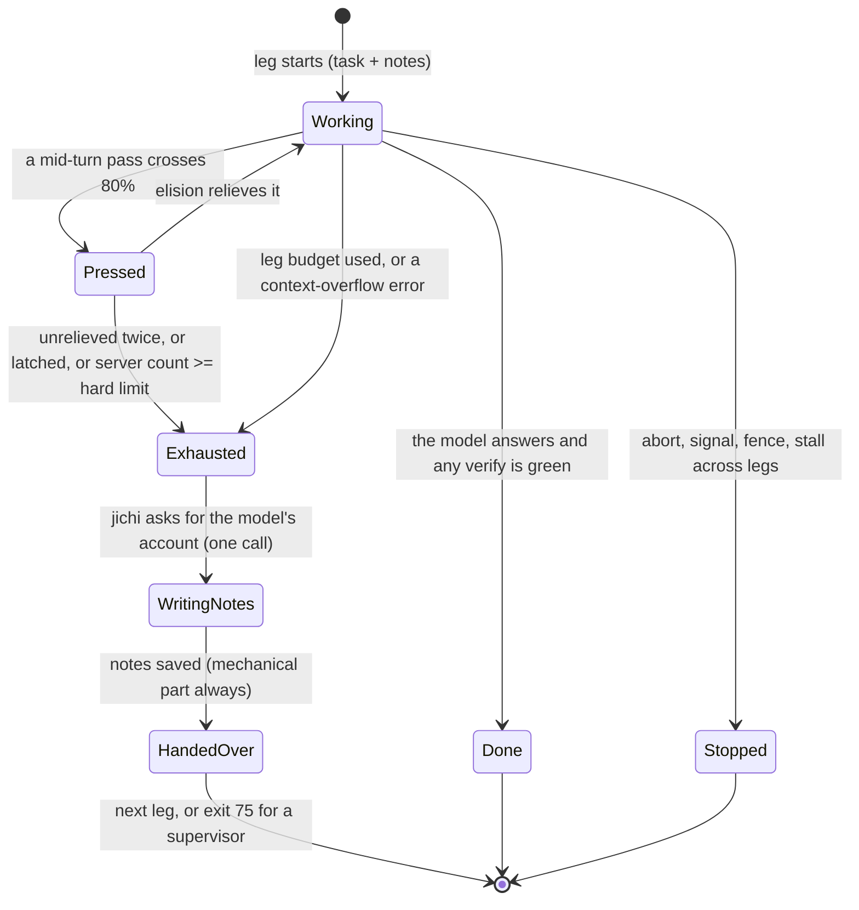

# Proposal: the context relay — handing a long task to a fresh session

*A design proposal, written on threadwork on 2026-10-08 by Claude Opus 5.5 (the
supervisor session), on the operator's request. **Design only: nothing in `src/`
or `tests/` changes on this page.** Code was read at master `17bbb895` (M913);
every `path:line` refers to that commit. It has no milestone numbers: the
workstation (the other machine, which develops jichi) mints them. It builds on the
[run-handoff proposal](2026-09-run-handoff.md) of 2026-09-28 and on the
measurements in [Review 2](../analysis/2026-10-08-review-02-when-the-window-fills.md).*

The operator's request, 2026-10-08:

> We must design a jichi feature that allows long-running autonomous loops for
> agents (and possibly their subagents) that can autocorrect some parts of their
> configuration (number of tool calls), and restart a new session with updated
> notes, if their context-window is under pressure. Because, sometimes autocompact
> doesn't seem to work, and jlu/qwen3.8-27b tends to force itself to work in the
> limits of what's left of the context window.

And, on the budget question: *"Let's design all versions, and document the design
decisions, and implications honestly, and comprehensively. This is a good
learning example for self-learners, and junior developers!"* So this page is
written to be learned from: every decision names the options it rejected and why,
and §6.10 designs all the budget variants side by side.

---

## 0. In short

- **The problem, measured.**
  - In 366 headless drive runs the summarizing autocompact never ran once. The
    summary only runs between turns, and a headless run is one long turn.
  - Elision, the mechanism that does run, holds a long loop in a sawtooth at
    60–80% of the window. Each pass costs a lead about seven fresh starts in
    uncached tokens, and seven loops ended on the gateway's hard limit
    (Review 2).
- **The idea.** When the window is truly exhausted, jichi ends the session at a
  clean point, writes **notes** (the *baton*), and continues the same task in a
  **fresh session** that starts from them. Each session is a **leg**; the chain
  of legs is a **relay**.
- **Evidence that it can work.** In a hand-driven test, `jlu/qwen3.8-27b`
  finished an 80-step task correctly in four legs from its own handoff notes,
  where one session without handover stopped at 39 (Review 2, §5).
- **Why jichi, not the model, picks the moment.** In the same test the model, told
  to wait for a pressure signal, *imagined* the signal in two of three legs.
- **The notes have two parts.** jichi writes a mechanical part at every exit,
  even on a crash or an abort. The model writes a short account of its own when
  it still can, in one dedicated call with a fixed template.
- **Where the loop lives**, in two forms:
  - first, **handover only**: end cleanly, write the notes, and exit with a
    distinct code so an external supervisor starts the next leg (this respects
    the "no built-in loop" decision);
  - then **in-process legs** for runs nobody supervises and for subagents, which
    explicitly overturns that decision for this one case.
- **The tool-call budget is corrected from measurement:** the calls that fit in
  a leg are computed from how fast the prompt grows. Five variants are designed
  (§6.10); the recommendation is **tighten-only by default**, a **bounded
  controller** when the operator sets a ceiling, and **parents allocating to
  children**. A model asking for more stays **interactive only**.
- **Fences stay fences.** No variant can raise a budget past what the operator
  set, change a permission or pick another model.
- **Prerequisites.** A dozen defects the review found along this path must be
  fixed first (§9), most importantly a budget stop that strands tool calls in
  the middle of a round.

---

## 1. Who this is for

- **Developers who will build it**, the workstation first. §6 is the design,
  §8 the interfaces, §10 the tests and §11 the order of work.
- **Self-learners and junior developers.** Read §2–§6 as a worked example of
  designing a feature in a real codebase: a problem measured before it is
  solved, constraints collected from the decisions the project already made,
  options compared honestly, and a test plan written before the code. §6.10 is
  the longest single example of "the same goal, five designs".
- **Operators of long drives.** §6.8 and §8 say what a supervisor will see and
  must do differently.

**What you need first:** the agent loop
([Annai 3](../reading/annai-03-main-to-the-loop.md),
[Fukabori 4](../reading/fukabori-04-the-agent-loop-as-a-state-machine.md)),
compaction ([Review 2](../analysis/2026-10-08-review-02-when-the-window-fills.md)
§2), and the autonomy envelope ([AUTONOMY.md](../AUTONOMY.md)). The words *cap*
and *fence* are used in CLAUDE.md's sense: a **fence** bounds what a run may do
and stays on; a **cap** bounds how long it may take and stays off for a
measurement.

---

## 2. The problem, measured

The full measurement is [Review 2](../analysis/2026-10-08-review-02-when-the-window-fills.md).
The facts this design rests on:

| # | Fact | Source |
|---|---|---|
| P1 | The between-turn summary ran **0 times** in 366 headless runs (7,818 mid-turn passes) | Review 2 §4.1 |
| P2 | 74 of 95 `qwen3.8-27b` leads were pressed; they then sawtooth at 60–80% of the window | Review 2 §4.2 |
| P3 | Workers go on a median of 195–466 tool calls after the first pressure, up to ~4,000 | Review 2 §4.3 |
| P4 | 7 loops ended on the gateway's HTTP 400 at the real window (def-303's mechanism) | Review 2 §4.3 |
| P5 | After an eliding pass a lead re-processes ~107k uncached tokens; a fresh lead's first call ~15k | Review 2 §4.4 |
| P6 | `qwen3-coder-next`'s tool failure rate is 6–8% below 150k prompt tokens and 20.8% above | Review 2 §4.5 |
| P7 | Told to hand over at a `[context]` note, `qwen3.8-27b` wrote correct notes; four legs finished 80/80 | Review 2 §5 |
| P8 | The same model claimed a `[context]` note had arrived when none had, in 2 of 3 legs | Review 2 §5 |
| P9 | A model that stops early on purpose is reported `stop_reason: done`, exit 0 | Review 2 §5 |

And what the code says (from the review's agent-loop slice):

- **No recovery exists.** A context-window HTTP 400 ends the run with
  `stop_reason: error` and exit 1 (`src/chat/jc_agent.c:612-621`, `:2172`). A
  200 whose body is the overflow message becomes the answer, as `done` with exit
  0 (def-82).
- **The `[context]` note asks the model to "write durable results now"**
  (`src/chat/jc_compact.c:303-309`), and nothing acts on that.
- **The code already names the gap.** The comment at the `unrelieved` field
  says: *"Eliding cannot relieve a turn in this state; only smaller tool output
  or a different mechanism can"* (`src/chat/jc_agent.c:4586-4592`). The relay is
  that different mechanism.

---

## 3. Vocabulary

| Term | Meaning on this page |
|---|---|
| **relay** | one task worked on by a chain of sessions, each continuing from the last one's notes |
| **leg** | one session of a relay: a fresh history, one system prompt, its own window |
| **handover** | the end of one leg and the start of the next |
| **baton** (the notes) | the bounded text one leg leaves the next: a mechanical part and a model part |
| **pressure signal** | a measurement that says the window is filling: the mid-turn report, the server's prompt count |
| **exhaustion** | the state in which elision can no longer relieve the window (defined in §6.2) |
| **decision core** | a pure function that turns the signals into continue / hand over / stop |
| **budget controller** | a pure function that sets the next leg's tool-call budget from measured growth |
| **supervisor** | whatever starts runs from outside: a shell loop, systemd, a drive harness, a person |

A possible name in the house style: an **ekiden** (駅伝) is a Japanese long-distance
relay race in which each runner hands a sash, the **tasuki** (襷), to the next.
The image fits: one course, many runners, one sash that must arrive. The working
name on this page stays *relay*; naming is the operator's call (§13).

---

## 4. Requirements and non-goals

**Requirements.**

- **Q1 — Bounded legs.** A leg ends before the window is exhausted, at a moment
  jichi chooses and can explain from numbers.
- **Q2 — Continuity.** The next leg can continue without redoing finished work
  or contradicting decisions already made: the notes carry the state, and the
  repository carries the work.
- **Q3 — Every exit leaves a baton.** The mechanical notes are written on every
  exit path: a normal end, a handover, an abort, a signal, a budget stop, a crash
  as far as possible.
- **Q4 — Fences hold.** Edit scope, path fence, permissions, the privileged gate,
  the shell fence, read-only profiles and the operator's tool-call and token
  fences hold across legs, summed over the whole relay.
- **Q5 — No runaway.** The number of legs is bounded, and a relay that stops
  making progress stops.
- **Q6 — Honest reporting.** A supervisor can tell "done", "handed over",
  "stalled" and "failed" apart from `--output json`, the journal and the exit
  code, never from stderr prose.
- **Q7 — Testable offline.** The decisions are pure functions with unit tests;
  the mechanism is driven end to end with the mock model; the effect is
  measured live with free models, caps off.
- **Q8 — Headless first.** Headless runs and their subagents first; interactive
  sessions get the same mechanism as an offer.

**Non-goals.**

- **Not a scheduler or a task queue.** The relay continues *one* task;
  [AUTONOMOUS_LOOPS.md](../AUTONOMOUS_LOOPS.md) stays the guide for many tasks.
- **Not a new compaction pass.** Elision and the between-turn summary stay as
  they are, and the relay comes after them.
- **Not a memory system.** `memory.md` stays durable, project-wide lessons. A
  baton is working state, one leg deep.
- **No model choice.** A relay never changes the model, and never reaches a
  priced one.

---

## 5. The design at a glance

### 5.1 One leg, as a state machine



**In words.** A leg starts with the task and the previous notes, and works. When
a mid-turn pass crosses the high-water mark the leg is *pressed*; if elision
brings it back down it works on. If elision cannot relieve it twice in a row, or
has nothing left to cut, or the server's own count reaches a hard limit, or the
leg's tool-call budget is used up, or the server refuses a request as too long,
the leg is *exhausted*. jichi then asks the model, once, for its account of the
work, saves the notes (its own mechanical part even if the model's part fails),
and hands over: to the next leg in the same process, or by exiting with a
distinct code for a supervisor. A leg can also end the ordinary ways: done, or
stopped by an abort, a signal, a fence, or a relay that no longer progresses.

### 5.2 A handover, step by step

```mermaid
sequenceDiagram
    participant L as agent loop (leg N)
    participant D as decision core (pure)
    participant M as model
    participant S as notes store (~/.jichi.d/relay)
    participant N as leg N+1
    L->>D: round ended: mid-turn report, server prompt count, calls used
    D-->>L: HAND OVER (reason: unrelieved x2)
    L->>S: mechanical notes (atomic write)
    L->>M: [relay] "this session ends now; write your account in this form"
    M-->>L: the account (or nothing, or a cut reply)
    L->>S: notes = mechanical + labelled account (atomic)
    L->>L: save session N (links to N+1), journal leg_end
    L->>N: fresh history: task + notes as the first user message
    N->>M: first call (~15-25k tokens, cold)
```

**In words.** After each tool round the loop hands its numbers to the pure
decision core. When the core says *hand over*, the loop first writes the
mechanical notes, so a crash after this point still leaves a baton. It then adds
one `[relay]` message asking for the model's account in a fixed form, makes one
model call, and stores the account, labelled as the model's, beside the
mechanical part. It saves the finished session with a link to its successor,
records `leg_end` in the journal, and starts the next leg with a fresh history
whose first user message is the task plus the notes.

### 5.3 What changes in the prompt, schematically

*Illustration, not a measurement: the shapes are drawn to explain the idea. The
measured curves are in Review 2 §4.2–4.3.*

```
prompt
size     today: one long leg (sawtooth, then the wall)
 100% |                                            ######   <- HTTP 400
  80% |- - - - -/\/\/\/\/\/\/\/\/\/\/\/\/\/\/\/\/##- - - -
  60% |       /
  20% |    __/
      +--------------------------------------------------> tool calls

         with a relay: legs that end at exhaustion
 100% |
  80% |- - - - -/\/\#- - - - - - -/\/\#- - - - - - -/\/\#--
  60% |       /     |           /     |           /
  20% |    __/      |________ _/      |________ _/
      +-------------^-----------------^-----------------> tool calls
                    handover (notes)  handover (notes)
```

---

## 6. Decisions

Each decision gives the question, the options, the choice, why, and what it
implies. "Respects R*n*" and "overturns R*n*" refer to the existing decisions
collected by the review (§6.0).

### 6.0 What the project has already decided

The review collected 25 recorded decisions a relay meets; the full table is in
the internal review records. The ones that shape this design most:

| # | Recorded decision | Where | This design |
|---|---|---|---|
| R1 | jichi ships no `--loop`; "each task deserves a fresh, independently-bounded run" | AUTONOMOUS_LOOPS.md §1, §9 | respects it in stage 1; **overturns it** for in-process legs (§6.8) |
| R3 | the run-handoff: notes at every exit, mechanical first, pinned, stamped | proposals/2026-09-run-handoff.md | **extends** it: it becomes the baton |
| R4 | M710: when elision cannot reach its target, do not drop, summarize mid-turn or refuse | analysis/2026-09-22-compaction-decided.md | respects it: a relay is none of the three |
| R5 | `unrelieved` is defined by effect; reclaim is exhausted after a few passes | COMPACTION.md, M326y | **extends** it: exhaustion is the trigger |
| R10 | `--max-tool-calls` is a fence, not a cap | CLAUDE.md | respects it: budgets only narrow, or widen to an operator ceiling |
| R11 | nothing on the control channel may widen a bound; only `pause --extend` stretches the deadline | `include/jc_control.h:24-26` | respects it, except variant V3 (§6.10), interactive only |
| R12 | a child's budget is a slice of its parent's, and a task's own budget only narrows it | `src/tools/jc_tool_parallel.c:2378-2400`, `:871-873` | **extends** it for variant V4 |
| R13 | `max_iters` exits 0 as "resumable"; an unbounded resume loop is a runaway loop | SCRIPTING.md | respects it: counted legs, own stop reason |
| R14 | a session file does not carry the envelope; `--continue` loses the bounds | gap-audit plan, item 6 | respects it: one envelope per relay, not per leg |
| R18 | the subagent iteration taper "shares, not multiplies" the budget | SUBAGENTS.md | respects it: a child's legs share its tapered cap |
| M326z-3 | caps are not adapted at runtime from a statistic | DECISIONS.md | **overturns it for one knob** in variant V1, bounded and journaled |

### 6.1 Who decides the moment: jichi, not the model

**Question.** When should a leg end, and who decides?

**Options.**

1. **The model decides**: tell it in the prompt to hand over when it feels the
   window is full, or when it sees a `[context]` note.
2. **jichi decides** from measurements, and asks the model for its account only
   at the moment it has decided.
3. **A supervisor decides** from outside, through the control channel.

**Choice: 2, with 3 as an extra trigger.** The control channel gets a `relay`
verb (§8.4); it fits the never-widen rule because it only ends work.

**Why not 1.**

- **P8:** the model claimed a signal that never came, in two of three legs. Leg 3
  wrote, *"I keep claiming a `[context]` message arrived, but … no such message
  has ever been sent"*, and then claimed it again and handed over.
- **P2:** left alone, the leads did not stop at pressure; they went on a median of
  18 calls, the workers hundreds.
- A rule in the standing prompt costs tokens on every call, and it invites the
  model to watch for something instead of working.

**Implications.**

- The model never needs a standing rule about handovers.
- jichi must make the decision explainable: every handover records the numbers
  that triggered it (§6.14).
- The `[context]` note keeps its job of telling the model to read narrowly. When
  a relay is on, its "could NOT … write durable results now" text changes to say
  that jichi will hand over, so the model does not start a handover of its own.

### 6.2 What triggers a handover

**Question.** Which measurements mean "end this leg"?

**What is available at the end of every round** (`src/chat/jc_agent.c:4519-4533`):

- the mid-turn report `mrep`: `pressed`, `reached`, `unrelieved`, `latched`,
  `before`, `after`, `limit`;
- the server's count of the last prompt, `app->last_prompt_tokens`, and the
  largest one so far, `app->max_prompt_tokens`;
- `app->ctx_overflow`, set when the server refused a request as too long;
- the leg's tool calls so far.

**Options.**

1. **The first pressed pass.** This is too early. M710 measured that pressed
   passes are served normally: 0 rejections, at a median of 86% of the window
   (R4). A relay that fires on every press relays all the time.
2. **The first short pass** (pressed and missing the 60% target). This is cheaper
   on the prompt cache (P5), but in the demos drive 73 of 74 pressed leads were
   short, so it is barely later than option 1.
3. **Exhaustion**, defined by effect (R5):
   - **E1:** two consecutive pressed passes that end `unrelieved` (still above 80%);
   - **E2:** the M361 latch armed while pressed, meaning nothing elidable is left;
   - **E3:** the server's prompt count at or above a hard limit, 90% of the
     effective window by default;
   - **E4:** a context-overflow refusal: HTTP 400, or an in-stream error once the
     review's R07-F2 is fixed;
   - **E5:** the leg's tool-call budget is used (§6.10).
4. **A forecast**, "fewer than *k* rounds left": the window left divided by the
   growth per call. This is elegant, but the median growth per call differed about
   threefold between roles and models in the drives (about 360 to 1,065 tokens),
   and a forecast is harder to explain than a measured state.

**Choice: 3, as the default.** `relayTrigger` selects it, `"exhausted"`. Option 2
is available as `"short"`, for runs where the prompt cache matters most. A number
`50`–`95` sets E3's percentage directly. Option 4 is not built. The forecast is
used only by the budget controller (§6.10), where an error costs one extra or one
fewer handover rather than a wrong decision now.

**Why.**

- It is the signal the project's own measurements identify (R5), and the code
  comment at `jc_agent.c:4586-4592` names it.
- Every condition is a fact the round has already measured; none is a guess.
- E3 and E4 are safety nets for a window that `contextLength` under-declares or
  over-declares.

**Implications.**

- **E4 makes an overflow recoverable.** Today it ends the run (`jc_agent.c:2172`).
  After a 400 the model cannot answer with the full history, so the account call
  in §6.5 is made on a reduced history: the task, the mechanical notes and the
  last six messages. If even that fails, the leg hands over with the mechanical
  notes alone.
- **The note text depends on the relay.** Under a relay, the `[context]` note's
  "could NOT" branch says *"jichi will end this session and continue in a fresh
  one with notes; keep the todo list and your commits current"*, not "write
  durable results now".

**The decision core, as pseudocode.** A pure function: no I/O, a total truth
table, unit-tested like `jc_toolloop` and the envelope.

```
enum relay_action { CONTINUE, HAND_OVER, STOP_STALLED };

relay_decide(sig, cfg, state) -> (action, reason):
    # sig: this round's mrep, server prompt count, overflow flag, leg calls
    # state: unrelieved streak, legs so far, the progress of the last legs
    if not cfg.relay_on:                          return CONTINUE
    if sig.overflow:                              return HAND_OVER, "overflow"
    if sig.server_prompt >= cfg.hard_pct * sig.limit:
                                                  return HAND_OVER, "hard_limit"
    if sig.pressed and sig.unrelieved:
        state.unrelieved_streak += 1
    else if not sig.pressed:
        state.unrelieved_streak = 0
    if state.unrelieved_streak >= 2:              return HAND_OVER, "unrelieved"
    if sig.pressed and sig.latched:               return HAND_OVER, "exhausted"
    if cfg.trigger == SHORT and sig.pressed and not sig.reached:
                                                  return HAND_OVER, "short"
    if state.leg_calls >= state.leg_budget:       return HAND_OVER, "leg_budget"
    return CONTINUE

# checked once more before the next leg starts (§6.13):
relay_may_continue(state, cfg):
    if state.legs >= cfg.max_legs:                return STOP_STALLED, "max_legs"
    if state.no_progress_legs >= 2:               return STOP_STALLED, "no_progress"
    return CONTINUE
```

### 6.3 How a leg ends: at a round boundary, through the normal exit

**Question.** Where in the loop may a leg end?

**Options.**

1. Wherever the trigger is seen, including between two tool calls of one model
   reply.
2. Only after the whole round, when every tool call of the reply has its result.

**Choice: 2.** The template is the existing loop-stop exit, which ends a
delegate cleanly with the history whole and a reason recorded
(`src/chat/jc_agent.c:4877-4906`, abridged):

```c
    if (noprog_stop) {
        ...
        lo = telem(app, "loop_stop");
        if (lo != NULL) {
            cJSON_AddStringToObject(lo, "kind",
                kinds[(noprog_stop >= 1 && noprog_stop <= 4) ? noprog_stop : 1]);
            cJSON_AddNumberToObject(lo, "repeat", (double)app->last_fail_repeat);
        }
        jc_eventlog_end(app->telemetry, lo);
        app->last_run_capped = 1;
        app->last_run_looped = noprog_stop;
        return JC_OK;
    }
```

**Why not 1.**

- The review found that the per-call budget check already does this (R01-F1): it
  stops in the middle of a round, and the remaining tool calls are never
  answered.
- The saved session then holds a reply whose calls have no results, and
  resuming it sends a request the provider may refuse.
- A handover built the same way would hand on a broken history.

**Implications.**

- The relay check runs after the mid-turn block, next to the no-progress stop
  (`jc_agent.c:4867-4869`).
- The run ends through `jc_agent_run_turn`'s normal tail, so the journal `end`,
  `turn_end` telemetry and the session save all happen (R15).
- A new stop reason is added to `enum jc_run_stop` (`include/jc_outcome.h:44-53`).
  That header's own rule is "add values, never renumber or rename", and its
  renderers switch with no `default:`, so the compiler lists every surface that
  must learn the new value:

```c
enum jc_run_stop {
    JC_STOP_DONE = 0,       /* the model finished and said so                */
    JC_STOP_INTERRUPTED,    /* the operator interrupted it                   */
    JC_STOP_TIMEOUT,        /* a wall-clock deadline fired                   */
    JC_STOP_ERROR,          /* the machinery failed; see the status          */
    JC_STOP_BUDGET,         /* a token / time / tool-call budget was hit     */
    JC_STOP_VERIFY_FAILED,  /* the verifier was still red at the retry limit */
    JC_STOP_SCOPE_TAINTED,  /* verify passed, but outside the edit scope     */
    JC_STOP_MAX_ITERS,      /* the per-turn tool-iteration cap fired         */
    JC_STOP_HANDOVER,       /* PROPOSED: the leg ended to hand over (notes)  */
    JC_STOP_RELAY_STALLED   /* PROPOSED: the relay stopped making progress   */
};
```

  **Why two values and not a field.** `outcome.h` explains why `answer_capped` is
  a field and not a stop reason: a cut reply does not stop the run. A handover
  *does* stop the session, and a stalled relay stops the task. Both answer "why
  did it stop", so both are stop reasons.

### 6.4 What the notes contain

**Question.** What must the next leg be given?

**Options.**

1. The previous history, compacted. This is `--continue` with a summary. It is
   rejected: drives avoid `--continue` because a long history "makes a tired
   run" (R21), and the summary's recall cannot be checked (the 2026-10-05
   audit).
2. Only a model-written summary. Rejected: on an abort, a signal or an overflow
   there is no model call to make, and P8 shows what an unchecked account can
   claim.
3. **A mechanical part jichi writes from its own records, plus a labelled part
   the model writes.** This is the run-handoff proposal's design (R3), extended.

**Choice: 3.** The baton, at most `relayNotesBytes` (8 KB by default):

```
# Relay notes -- leg 3 of relay 7f3c... (written by jichi 2026-10-08 14:02 UTC)
Commit: 1a2b3c4d   Tree: dirty (2 files)   Previous leg ended: unrelieved x2

## 1. The task (verbatim, from leg 1)
<the original prompt>

## 2. Where the work stands (mechanical -- written by jichi, not by the model)
- Calls: 412 in this leg, 1,033 in the relay; fence: 1,033 of 5,000
- Changed since the relay began: src/vm.zig (14 edits), tests/vm_test.zig (3)
- Uncommitted: src/vm.zig, tests/vm_test.zig
- Commits in this leg: 9e8f7a6b "call: retry bare names on self"
- Read most: src/vm.zig (lines 1-400, 812-990), build.zig
- Todo (as last written): [done] repro; [in progress] fix call arm; [ ] census
- Last verify: red, 2 failures (tests/vm_test.zig:88, :140)
- Kept attempts: refs/jichi/discarded/par-3-t2 (from a batch in leg 2)
- Last 5 tool calls: edit_file vm.zig ok; run_tests ok=false; read_file ... ok

## 3. The previous leg's own account (written by the model; verify before relying on it)
Done: ...  In progress: ...  Next step: ...  Decided: ...  Dead ends: ...

## 4. How to use these notes
The repository is the truth; these notes are a map. Re-read a file before you
edit it. If HEAD is not the commit above, the tree has moved.
```

**Why each part:**

- §1 keeps the task from being paraphrased away over four legs.
- §2 cannot be wrong about what happened, because it is jichi's own record: the
  files, the commits, the todo list, the last verify, the kept attempts.
- §3 carries what only the model knows: why it chose an approach, and what not
  to try again.
- §4 is fixed text, the instruction that makes the notes safe to rely on.

**Size and cuts.**

- The mechanical part is never cut; it is bounded by construction (top-N lists).
- The model's part is cut first, at a UTF-8 boundary, with a visible note.
- Paths, never contents: a file the next leg needs, it re-reads. The tickets in
  `~/.jichi.d/tool-output/<pid>/` die with the process, so the notes must never
  cite one (R2, R01-F4).

### 6.5 Who writes the model's part, and when

**Question.** How is the model's account obtained without overflowing the window
it is meant to relieve?

**Options.**

1. Ask in the same history, as one more user message at the tail.
2. Ask a separate summarizer over a rendered transcript, as compaction does.
3. Do not ask; use the last assistant message, as the drive harness's
   `handoff.py` does.

**Choice: 1 by default; 3 as the fallback.**

- **One `[relay]` message at the tail costs little.** The prefix is still cached
  unless an elision has just broken it, so only the new message and the reply are
  processed. The model writes from its whole context, which a separate
  summarizer would not have.
- **The template is fixed, five headings, and the reply is bounded.** Its
  `max_tokens` is fitted to the room actually left in the window (this needs
  def-303) and capped at `relayNotesBytes`.
- **A cut reply is detected and labelled as cut.** The provider's
  `hit_length_cap` sets `truncated`.
- **If the call fails** (E4, a refusal, an empty reply), the last assistant
  message is quoted instead and labelled so.

**Why not 2.**

- The summarizer path silently drops a window that fails (R01-F3), and has a
  hard-coded 60-second cap (R01-F8). Both must be fixed before anything depends
  on it.
- It sees a rendered transcript, not the model's working context, and costs a
  full re-read.

**Implications.**

- A handover costs one extra model call, usually a cached one.
- The relay message is a tagged notice, `[relay]`, registered in NOTICES.md like
  `[context]`.

### 6.6 Where the notes live

**Choice:** `~/.jichi.d/relay/<relay-id>/leg-NN.md`, written with
`jc_write_file_atomic` (0600, write then rename), plus one `relay.json` holding
the relay's state: legs, totals, budgets, and the last notes path.

**Rejected:**

- **In the workspace** (`.jichi/relay.md`). A verify rollback can revert it
  (ANECDOTES #1), the edit-scope sweep sees it, and a model's shell can delete it
  (the drives lost data that way, ANECDOTES #108).
- **memory.md.** It is project-wide and durable, loads only its last 8 KB, would
  push older lessons out, and is written non-atomically (R20, R05-F11).
- **The rules block.** It is capped at 32 KB, charged on every request, and a
  truncation evicts the rules after it.

**Implications.**

- When `HOME` cannot be resolved, jichi falls back to a per-process temporary
  directory (R07 §5). The relay then refuses to run instead of writing notes no
  successor can find.
- The disk fence (`diskFloorMb`) must leave room for the notes; they are written
  first and are small.

### 6.7 How the next leg starts

**Choice.** The next leg gets:

- a **fresh history** whose first user message is the task plus the notes,
  under a `[relay]` provenance tag;
- the **same system prompt** as every other session;
- the **same envelope**: its token, call and deadline fences are counted over
  the whole relay;
- its **todo list copied**;
- its **mode re-applied**, narrowing only (D5, def-285);
- a **drift line** when HEAD moved since the notes were written ("the tree has
  moved: N commits since", from the run-handoff proposal §2.3).

**Rejected:**

- **Notes in the system prompt.** The system prompt heads the cached prefix and
  is built once per turn. Notes belong in the first user message, as `@`-refs and
  auto-context already do (R05 §5).
- **Re-reading the files the notes name, before the first call.** That is the
  model's job, as needed; pre-loading them would refill the window that was
  just emptied.

**Implications.**

- **AUTO mode scans every user message for prohibitions**, and turns them into
  constraints (R05 §5). The relay seed must be exempt from that scan, or a sentence
  in the notes such as "do not touch the parser yet" becomes an enforced rule.
  The original task text was scanned in leg 1 already; its constraints are carried
  in `relay.json` and re-applied, not re-inferred.
- **The model's account is untrusted text.** It is wrapped by the existing
  untrusted-content markers, and passes through the same secret redaction as
  sessions and streams (M802).

### 6.8 Where the loop lives

**Question.** Who starts leg N+1?

**Options.**

| | Topology | Pros | Cons |
|---|---|---|---|
| A | **Handover only.** jichi ends the leg, writes the notes, exits with a distinct code; a supervisor starts the next run with `--handoff-in` | respects R1; OS isolation; fits systemd and the drive harness | needs a supervisor; useless for subagents, which have none |
| B | **In-process legs.** jichi starts the next leg itself in the same process | works with no supervisor; works for subagents; warm repo map, LSP and MCP | overturns R1; one process lives longer; per-process leaks accumulate (the RSS floor steps in sustained-task S1) |
| C | **Re-exec.** jichi `exec`s itself with the notes | a fresh process image; no supervisor | loses warm state; the lease, control socket and journal must be handed across an exec; no nesting guard for `JICHI_BIN` (R03 §5) |

**Choice: A first, then B. C is rejected.**

- **A ships first.** It is the run-handoff proposal plus the stop reason and
  trigger above. The drive harness can replace its own `handoff.py` with it at
  once.
- **B follows, for two cases A cannot serve:** a `-p` run with nobody watching,
  and subagents (§6.11).
- **C would rebuild every warm structure** (index, LSP servers, MCP connections)
  and move the lease and control socket across an exec, for an isolation that A
  already gives.

**What B overturns, stated plainly.** AUTONOMOUS_LOOPS.md: *"jichi ships no
`--loop`, scheduler, or persistent task queue"*, and if one is ever needed, *"the
daemon is the place to grow it, not a new top-level loop"* (R1). In-process legs
are a loop, over one task. The case for overturning:

- the page's three reasons concern **many tasks**: scheduling, persistence and
  isolation between tasks;
- a relay continues **one** task inside one envelope, with the same fences;
- its subagent form cannot be built anywhere else.

The operator decides (§13).

**Bounds on B.**

- At most `relayMaxLegs` legs per process, 5 by default.
- The RSS guard: if the process's resident set at a leg start exceeds four
  times its first leg's, B ends with a handover to the supervisor (A) instead of
  starting another leg in place.
- The per-leg resets of `jc_agent_run_turn` (`jc_agent.c:5011-5045`) are run for
  each leg: the history and both scratch arenas are freed, and no relay state
  goes on the session-lived `app->arena`.

### 6.9 Budgets across legs: one envelope per relay

**Choice.** The envelope (`--budget-tokens`, `--deadline`, `--max-tool-calls`,
`--max-reads`) is the **relay's**, summed over all legs.

- In A, the supervisor passes `--handoff-in`. The notes' `relay.json` carries the
  totals used so far, and jichi arms the envelope with what is **left**, never
  the full amount again.
- The journal keeps **one run id** for the relay. Legs are `leg_start` / `leg_end`
  events, and the run's `end` record is written once, at the relay's end.
  M329's post-outcome guard therefore does not fire between legs: no outcome is
  set until the relay ends.

**Rejected: a fresh envelope per leg.** It turns every handover into a budget
reset: a relay of five legs could spend five times the operator's fence. That is
exactly the hole R14 records for `--continue`.

### 6.10 Correcting the tool-call budget: five designs

This is the decision the operator asked to see in all its versions. **What is
being corrected** is the number of tool calls a leg may make before it hands
over: the **leg budget**. The operator's `--max-tool-calls` (or `maxToolIters`,
or `maxSubagentIters` for a child) stays the **fence** on the whole relay.

**Why correct it at all.** A fixed per-leg number is wrong in both directions,
because the growth per call varies by workload:

- too large, and the leg hits exhaustion first, so the number never mattered;
- too small, and the leg hands over with half its window unused, paying a cold
  start for nothing.

The per-loop medians in the drives ranged from about 360 to 1,065 tokens per
call, by role and model; the per-loop data is kept with the internal drive
records.

**The controller's arithmetic,** shared by the variants that use it:

```
measured over the leg that just ended:
    P0 = the server's prompt count at the leg's first call
    g  = median growth of the server's prompt count per tool call
    W  = the effective window (the same limit compaction uses)
    h  = where the leg should end, as a fraction of W (0.80: the high-water)
    R  = reserve for the handover call (template + account, e.g. 4,000 tokens)

calls that fit in the next leg:
    n_fit = floor( (h * W - P0_next - R) / g )      # P0_next: notes make it larger

next leg budget:
    B = clamp(n_fit, B_min, B_max)                  # the variant sets B_min, B_max
    B = min(B, fence_left)                          # never past the relay's fence
```

**The five variants:**

| | V0: fixed | V1: bounded controller | V2: tighten-only | V3: model asks | V4: parent allocates |
|---|---|---|---|---|---|
| Who sets B | the operator, once | jichi, from measurement | jichi, from measurement | the model asks, someone approves | the parent agent, per child |
| May exceed the configured cap? | no | **yes**, up to `relayLegCallsMax` | **no**, only lower | yes, if approved | no: a slice of the parent's |
| New config | none | min, max (NARROW) | none | policy key (NARROW) | none (task `max_tool_calls`) |
| Who can be wrong | the operator's guess | the measurement (noisy g) | the measurement, safely | the model's self-report | the parent's judgement |
| Gaming risk | none | none | none | **real**: the model wants more | low: zero-sum within the slice |
| Unattended | yes | yes | yes | refused (or V1's bounds) | yes |
| Recorded decision | as today | overturns M326z-3 for one knob | respects everything | overturns R11 | extends R12 (M861, M62#4) |

**V0 — fixed (today).** The operator's cap is the leg's budget.

- **Simple and predictable.** The drive's `maxSubagentIters: 400` is V0.
- **It is wrong in both directions,** as above.
- **It stays the default when the relay is off.**

**V1 — a controller inside operator bounds.** The operator declares
`relayLegCallsMin` and `relayLegCallsMax`; jichi moves B between them from the
arithmetic above; every change is a journal event with the old value, the new
value, the bound and the numbers (P0, g, W).

- **What it gains:** a leg that grows slowly gets more calls, one that grows fast
  gets fewer, and the operator's ceiling holds.
- **What it costs:** a new runtime adaptation of a bound. DECISIONS M326z-3
  rejected exactly that for the output caps: *"tool behaviour would change
  mid-session … for reasons invisible in the config."* V1 answers this in two
  ways:
  - the change is visible, in the journal and in the next leg's notes;
  - the bounds are in the config.

  It is still a principle overturned for one knob, and the operator must say so.
- **Trust class:** both keys are NARROW / NK_BOUND (R07 §5). An untrusted project
  config may lower the maximum, never raise it.

**V2 — tighten-only (recommended default).** The same arithmetic, with
`B_max` = the configured cap and `B_min` = 25.

- **It can only make a leg shorter than the operator's cap**, so it never widens
  anything and needs no new config.
- **It answers the actual failure in the drives.** Workers ran hundreds of calls
  into exhaustion (P3). V2 would have ended them at their measured capacity and
  handed over, instead of letting them grind on to the 400-call fence or the 400
  error.
- **What it cannot do:** give a slow-growing task more than the configured cap.
  V1 can.

**V3 — the model asks, a person approves.** A tool,
`request_budget {extra_calls, reason}`, available only when a relay is on.

- **Interactive:** the request is shown like a permission prompt: *"the agent
  asks for 200 more tool calls in this leg because …"*. An approval raises B for
  this leg, up to the fence.
- **Unattended:** refused by default. Under V1 it may be approved automatically
  within V1's bounds, which makes it a hint and not a widening.
- **Every request is journaled,** approved or not, with its reason.
- **Why it is interesting:** the model knows something jichi does not, namely
  "I need three more calls to finish". A handover three calls before the end is
  pure waste.
- **Why it is dangerous:**
  - a model tends to ask for more;
  - a prompt injection in a tool result can ask in the model's name;
  - R11, the control channel's founding rule that nothing outside can widen a
    run, exists for this reason.
- **Mitigation:** one request per leg, never past the relay's fence, never
  unattended without V1's bounds.

**V4 — the parent allocates (teams).** A lead agent gives each worker a budget
from its own remaining slice. The pieces exist:

- `spawn_parallel` divides the run's remaining calls into slices that sum exactly
  to what is left (`src/tools/jc_tool_parallel.c:2378-2400`);
- a task's own `max_tool_calls` can only narrow its slice
  (`src/tools/jc_tool_parallel.c:871-873`);
- the operator decided on 2026-09-29 that the lead owns its workers' budgets.

The relay adds two things: a worker that hands over reports the measured *g* and
*n_fit* in its result, and the lead may re-spawn it (`from:`) with a budget
chosen from them. It is zero-sum within the lead's slice, so a lead can move
calls between workers and never create more.

**Recommendation.**

- **V2 on whenever the relay is on.** It is safe and needs no configuration.
- **V1 when the operator sets the two bounds.** This overturns M326z-3 for one
  knob, the operator's call.
- **V4 for teams,** by extending spawn_parallel's results.
- **V3 interactive only,** and only after V1 and V2 have run on real drives,
  since it is the variant whose risk is behavioural rather than arithmetic.
- **V0 stays the behaviour with the relay off.**

**What else could be corrected, and what must never be:**

| Setting | Correct at runtime? | Why |
|---|---|---|
| `max_tokens` of a request | **yes**, fitted to the room left (def-303) | a pure safety fix; the window is a fact |
| the leg's tool-call budget | **yes**, by the variants above | the subject of this section |
| parallelism after gateway errors | maybe later | not about context; measure first |
| `toolProfile` (fewer schemas under pressure) | **no** | it changes the cached prefix mid-session (M365) and what the model can do |
| the model, the route, a priced id | **never** | CLAUDE.md: priced models need the operator's grant per run |
| fences: scope, path fence, permissions, shell fence | **never** | a fence that moves itself is not a fence |
| the config file itself | **never** | `config set` wipes a JSONC file and would record a model's change as the user's trusted edit (R07-F1) |

### 6.11 Subagents

**Question.** How does a child relay, and what does its parent see?

**Two kinds of children, two answers.**

- **A `spawn_parallel` child** is a forked process with a worktree. It already
  has a handover in all but name: a child that is stopped, capped or out of
  context answers with a note and keeps its state, and the lead can continue it
  with `from:` (M854, M816; R19). **Choice:** the pool continues the child
  automatically, in a fresh fork from its kept state with the notes as its seed,
  up to `relayMaxLegs`. All legs share the task's slice. The lead sees one result
  with `legs: n` and the last leg's answer.
- **A `spawn_subagent` child** runs in-process and has no worktree or kept state
  (R04 §5). **Choice:** it relays internally (topology B, inside the child), and
  the hand-back to the parent stays the one capped answer (M911).

**Budgets.** A child's legs share its tapered cap. The taper exists so that
nesting "shares, not multiplies" (R18), and legs must not multiply it either.

**Prerequisites from the review** (§9):

- `ctx_overflow` is sticky after a 400, so every later child would look
  overflowed (R04-F5);
- a child's capped answer is spilled under its own pid, where the fenced lead
  cannot read it (R04-F6);
- the `from:` resume note is unbounded and can overflow a resumed worker again
  (R04-F7);
- the watchdog kills a long child without a done line (R04-F18, def-300), so a
  handover needs a grace period.

### 6.12 Interactive sessions

Interactive sessions already have the between-turn summary. They need the relay
for two reasons:

- a single long turn behaves like a headless run;
- each summary is built on the last, so loss compounds (the 2026-10-05 audit).

**Choice:**

- **`/relay`** starts a new leg on request: notes now, fresh session, same
  envelope.
- When the decision core fires during a turn, the TUI does not hand over by
  itself. At the end of the turn it **offers**: *"[relay] the context is
  exhausted (unrelieved twice). Continue in a fresh session from notes? [y/N]"*.
  ACP gets the same as a `session/new` seeded from the notes. That is designed
  later: the ACP contract gaps were postponed with the desktop application
  (DECISIONS, 2026-10-01).

**Why an offer.** In a conversation the operator is the supervisor, so
topology A applies with a person in the supervisor's role.

### 6.13 Termination and runaway protection

A relay stops when:

1. **the task is done**, with any verify green, giving `done`;
2. **the operator's envelope fence is used**, giving `budget`;
3. **`relayMaxLegs` is reached**, giving `relay_stalled` with reason `max_legs`;
4. **two consecutive legs made no progress**, giving `relay_stalled` with reason
   `no_progress`. A leg makes progress when it did at least one of these:
   - committed;
   - changed a tracked file;
   - advanced the todo list;
   - changed the verify result;
5. **the operator aborts or signals**: `interrupted`, with the mechanical notes
   written on the way out;
6. **the notes cannot be written** (the disk fence, an unresolvable HOME): a
   handover is refused, and the leg ends as `budget` with the reason journaled.

**Why rule 4.** SCRIPTING.md warns that *"an unbounded resume loop is a runaway
loop with extra steps"* (R13). A relay without a progress test is exactly that.

### 6.14 What a supervisor sees

**Exit codes**, for runs with the relay on only. Runs without it never see a new
code.

| Exit | When | Today's nearest |
|---|---|---|
| **75** | a leg handed over and expects a successor (topology A) | `max_iters` exits 0 |
| 1 | `relay_stalled`, as for `budget` and `verify_failed` | — |
| 0, 2, 130, 143 | unchanged | — |

**Why 75.** `EX_TEMPFAIL` in BSD's `sysexits.h` means *"temporary failure;
the user is invited to retry"*, which is "start the next leg".

**Rejected alternatives:**

- **Exit 0** would let every existing `rc == 0 → done` branch file a half-done
  task as finished. That is P9, the very failure being fixed.
- **Exit 1** sends the run to retry with backoff and quarantine in
  AUTONOMOUS_LOOPS.md's loop, which treats a planned handover as a failure.

**`--output json`, additive** (EMBEDDING.md: new values and keys may appear):

```json
{"stop_reason": "handover",
 "relay": {"id": "7f3c...", "leg": 3, "reason": "unrelieved",
           "notes": "~/.jichi.d/relay/7f3c.../leg-03.md",
           "next_leg_calls": 640, "calls_used": 1033, "fence": 5000}}
```

**The other surfaces:**

- **jsonl:** a `relay` event at each leg boundary, carrying the same fields
  unabridged, as the jsonl stability rule requires (DECISIONS M326h-4).
- **Journal:** `leg_start`, `leg_end` and `budget_adjust`, each with the
  measured numbers; the run's `end` is written once, at the relay's end.
- **Telemetry:** one `relay` event per boundary, with `phase` set to
  `leg_start`, `leg_end` or `budget`, the trigger's numbers, the notes' sizes
  (mechanical and model) and whether the account was cut. Old readers ignore
  unknown events.
- **Sessions:** store v3 gains `relay_id`, `leg`, `prev_session` and
  `notes_path`, so `jichi sessions` can show a chain and `-c` picks the newest
  leg.

### 6.15 Safety

- **Fences across legs:** edit scope, path fence, permissions, the privileged
  gate, the shell fence, a read-only profile and a delegate's posture are
  re-applied at every leg start. The notes cannot carry a permission.
- **Notes are data.** The model part is wrapped as untrusted and labelled. The
  mechanical part is jichi's.
- **The seed is exempt from the constraint scanner** (§6.7). Constraints are
  carried as data in `relay.json`.
- **Secrets:** the notes pass the same redaction as sessions and streams, and
  the account is redacted before it is written.
- **Config trust** (R07 §5, `jc_config_trust.c`), for the keys of §8.1:
  - `relay`: NARROW / NK_OFF (an untrusted project may turn it off, never on);
  - `relayMaxLegs`, `relayLegCallsMax`: NARROW / NK_BOUND;
  - `relayLegCallsMin`, `relayNotesBytes`: SAFE, with a clamp;
  - a notes directory outside `~/.jichi.d`: GATED, like `logging`.
- **Models:** a relay never changes the model. Every leg uses the run's model,
  and routing applies as it does today, before compaction (R8).

---

## 7. The whole flow, in pseudocode (topology B, headless)

```
run_relay(task, cfg, env):                       # env: ONE envelope for the relay
    relay = load_or_create_relay_state(cfg)      # ~/.jichi.d/relay/<id>/relay.json
    seed  = task
    loop:
        leg = new_leg(relay)                     # new session id, prev = last leg
        hist = [ user(seed) ]
        leg.budget = budget_controller(relay, cfg)          # V0..V4 (6.10)
        (stop, why) = run_turn_with_relay_check(hist, leg, env)
        mech = mechanical_notes(relay, leg, hist, env, git)  # never fails silently
        write_atomic(notes_path(relay, leg), mech)
        if stop == HAND_OVER:
            account = ask_model_for_account(hist, leg)       # one call, fitted max_tokens
            write_atomic(notes_path(relay, leg), mech + label(account))
        save_session(leg, link=notes_path)
        journal(leg_end, why, numbers)
        if stop != HAND_OVER:                    # done / budget / interrupted / error
            return stop
        verdict = relay_may_continue(relay, cfg)
        if verdict == STOP_STALLED:
            return RELAY_STALLED
        if topology == A or rss_grew_too_much():
            return HANDOVER                      # exit 75; the supervisor continues
        seed = task + "\n\n" + read(notes_path(relay, leg)) + drift_line(relay)

run_turn_with_relay_check(hist, leg, env):       # the existing loop, one new check
    for each round:
        ... model call, tools, mid-turn compaction (unchanged) ...
        (act, why) = relay_decide(round_signals(), cfg, leg.state)   # pure
        if act == HAND_OVER: return (HAND_OVER, why)                 # round boundary
    ...
```

---

## 8. Interfaces (proposed)

### 8.1 Config keys (flat, top level, as R07 recommends)

| Key | Type, default | Meaning | Trust |
|---|---|---|---|
| `relay` | bool, `false` | turn the relay on | NARROW, NK_OFF |
| `relayTrigger` | `"exhausted"`, `"short"` or 50–95 | when a leg ends (§6.2) | SAFE, floor 50 |
| `relayMaxLegs` | int, 5 | legs per relay, per process for B | NARROW, NK_BOUND |
| `relayBudget` | `"tighten"` (V2), `"fixed"`, `"bounded"`, `"ask"` | the variant (§6.10) | NARROW: untrusted may pick fixed/tighten only |
| `relayLegCallsMin` / `Max` | int | V1's bounds | SAFE / NARROW, NK_BOUND |
| `relayNotesBytes` | int, 8192 (2,048–32,768) | the baton's size | SAFE |

### 8.2 Flags

| Flag | Meaning |
|---|---|
| `--relay` / `--no-relay` | turn it on or off for this run (overrides the key) |
| `--handoff-out FILE` | also write the notes there at every exit (run-handoff §2.2) |
| `--handoff-in FILE` | start from these notes (topology A's successor) |
| `--relay-legs N` | `relayMaxLegs` for this run |

### 8.3 Stop reasons and exit codes

`handover` and `relay_stalled` as above (§6.3, §6.14). Exit 75 only with the
relay on.

### 8.4 Control channel

- **`relay`:** a new verb, "hand over at the next round boundary". It is served
  like `abort`: deferred during a model call, journaled, and it only ends work.
- **`status`** gains `prompt_tokens`, `window`, `pct`, `unrelieved_streak`, `leg`
  and `leg_budget`, so a supervisor can decide without parsing logs (R05 §5).

### 8.5 Session store v3

`relay_id`, `leg`, `prev_session`, `notes_path`. Older builds load newer files
with a warning, as today. `session_fields_lint.sh` must learn them.

---

## 9. What must be fixed first

The review found defects on exactly the paths a relay would use. Each is a
milestone of its own, red-first, before the relay depends on it.

| From the review | What | Why the relay needs it fixed |
|---|---|---|
| R01-F1 (high) | a budget stop mid-round leaves tool calls unanswered | handovers end at round boundaries, and the saved history must be whole |
| R01-F2 (medium) | a delegate on another model is measured with the parent's window | a child's trigger would fire on the wrong numbers |
| R01-F3 (medium) | a failed summarizer window drops its messages silently | notes must never lose content silently |
| R01-F4 (medium) | claim-ticket paths in history point into a store that dies with the process | notes must not cite them |
| R01-F6 (medium) | the standing `[context]` note adds one message per pressed round | a relay leg must not fill up with notes about notes |
| R03-F1 (high) | the second Ctrl-C kills jichi (`signal()` resets after one delivery) | a handover must survive signals cleanly |
| R04-F5 (medium) | `ctx_overflow` is never cleared | every child after one 400 looks overflowed |
| R04-F6, F7 (medium) | a child's spill is unreadable to the lead; the `from:` note is unbounded | the child relay carries notes through both |
| R05-F6 (medium) | a session is saved only at turn end | a long leg must not lose its history to a SIGKILL |
| R07-F2 (medium) | an in-stream server error becomes the answer | E4 must see an overflow reported that way |
| R07-F4 (medium) | the 30 s stall timeout also bounds the first byte | late, long-prompt calls are the relay's hardest calls |
| def-303 | `max_tokens` is not fitted to the room left | the account call is made in a nearly full window |

---

## 10. Tests, written before the code

Following [TESTING_RUNBOOK.md](../TESTING_RUNBOOK.md): every check is shown red
without its fix, and every measurement runs with caps off and fences on.

**Unit tests (pure).**

1. **`relay_decide`'s whole truth table.** Each of E1–E5 alone; their
   combinations; the streak reset on an unpressed round; `short` only when the
   trigger is `"short"`; the relay off.
2. **`relay_may_continue`.** `max_legs`; the no-progress streak, which a commit,
   a change, a todo advance or a verify change each reset.
3. **The budget controller.** The arithmetic with fixed P0, g, W, h and R; the
   clamps for V1 and V2; never above the fence left; g = 0 (no growth gives the
   maximum); a negative n_fit (the notes alone overfill, which forces B_min and
   is journaled).
4. **The notes renderer.**
   - the mechanical part fits its bound with 10,000 files touched;
   - the model part is cut first, at a UTF-8 boundary, with the note;
   - a ticket path in the model's text is removed;
   - secrets are redacted.

**End to end, with the mock model** (`tests/tools/mockmodel`, which can already
report a growing `usage`, refuse with a 400, and serve several processes; R10 §5):

5. **A rising-usage script reaches E1.**
   - `stop_reason: handover`, exit 75 with the relay on;
   - the notes file exists, is 0600 and holds the mechanical part;
   - leg 2's first captured request (`req.N`) contains the notes and **none** of
     leg 1's history.
   - **Positive control:** the same script with the relay off produces no
     handover.
6. **An overflow 400 mid-run becomes a handover,** with the account made on the
   reduced history. Today the same script ends with exit 1, which is the test's
   red state.
7. **Abort during leg 2:** `interrupted`, and the mechanical notes are written.
8. **No progress for two legs:** `relay_stalled`, exit 1.
9. **The fences:** across three legs, `--max-tool-calls 100` stops the relay at
   100 calls in total, not 300.
10. **A parallel child under pressure:**
    - it hands over inside the pool and the pool continues it;
    - the lead sees one result with `legs: 2`;
    - the slice is shared.
11. **A small mockmodel extension:** `usage grow BASE STEP`, so pressure follows
    the request count without a rule per request (R10 §5). It is a test tool,
    not product code.

**Live measurements** (free models only: `jlu/*` checked against the listing, or
the local LM Studio; caps off):

12. **The 80-item task of Review 2 §5,** relay off against relay on, five runs
    each on `jlu/qwen3.8-27b`. Report correctness, legs, total uncached tokens
    and wall clock. The discard criterion is in §12.
13. **A drive workload, when the operator schedules one.** Overflows must be 0.
    Measure the tool failure rate above 150k, cache misses per task and cards
    finished, against the demos drive as the baseline.

---

## 11. The order of work

The workstation numbers these. Each step is a shippable slice with its tests.

1. **The prerequisites of §9,** each red-first.
2. **Handover only (topology A), off by default:**
   - the stop reasons, exit 75, the decision core with E1–E4;
   - the mechanical notes at every exit and the account call;
   - `--handoff-out` and `--handoff-in`, one envelope across legs, the journal
     events.
   - **The drive harness can replace `handoff.py` here.**
3. **The budget controller, V2,** with E5.
4. **In-process legs (topology B)** for a top-level headless run, with the RSS
   guard and `relayMaxLegs`.
5. **Children:** the parallel pool's automatic continuation, and spawn_subagent's
   internal legs.
6. **V1** (bounded), if the operator decides to overturn M326z-3 for this knob.
   **V4** through spawn_parallel results.
7. **Interactive:** `/relay` and the end-of-turn offer.
8. **V3** (`request_budget`), interactive only, if 3–6 show it is still wanted.

---

## 12. Risks, open questions, discard criteria

**Risks.**

- **The notes lose what mattered,** and the next leg repeats a dead end. The
  mechanical part and the "dead ends" heading reduce this; test 12 measures it.
- **Handovers too often:** a cold start every few hundred calls. The decision
  core counts and reports this; V2's minimum of 25 and E1's streak of 2 bound it.
- **The model writes a handover on its own initiative,** as in P8, despite the
  absence of a rule. The account is requested only by jichi, and a model's
  self-declared handover is just an answer.
- **One process, many legs:** leaks and the RSS floor (sustained-task S1). The
  RSS guard falls back to topology A.

**Open questions.**

- **Should the default trigger be `"short"` for leads?** For a lead, the
  post-elision calls cost seven fresh starts (P5); for workers the cache mostly
  survived. Test 12 with a lead-shaped workload answers it.
- **Should `relay.json` persist across machines,** in the drive's records?
  Probably yes for drives, with redaction; that is a harness decision.
- **What does `jichi runs` show for a relay of five legs:** one row or five?
  One, with a legs column, is proposed.

**Discard this design if:**

- test 12 shows the relay **no better** than one session on correctness, and
  **worse** on tokens or time;
- the drive measurement shows **more** wasted calls (re-reads, repeated dead
  ends) than the tokens saved by smaller prompts;
- the prerequisites of §9 turn out to need a redesign of the loop's exit paths
  that is larger than the relay itself. Then fix the exits first, and revisit.

---

## 13. Decisions for the operator

Each with a recommendation; none is taken on this page.

1. **Overturn AUTONOMOUS_LOOPS's "no built-in loop" for in-process legs (§6.8)?**
   *Recommended: yes, for one task, with the bounds of §6.8, after topology A has
   shipped.*
2. **Exit code 75 for a handover, with the relay on (§6.14)?** *Recommended:
   yes.*
3. **The default trigger (§6.2):** `"exhausted"` or `"short"`. *Recommended:
   `"exhausted"`, revisited after test 12.*
4. **The budget variants (§6.10):** *Recommended: V2 by default; V1 when bounds
   are set (overturning M326z-3 for this one knob); V4 for teams; V3 interactive
   only and last.*
5. **The name.** *Relay*, or a house-style name (*ekiden*, with *tasuki* for the
   notes; §3).
6. **Drive harness:** replace `handoff.py` with step 2 once it ships?

---

## 14. Read further

- [Review 2 — when the context window fills](../analysis/2026-10-08-review-02-when-the-window-fills.md):
  the measurements behind every number above. *Primary for jichi.*
- [proposals/2026-09-run-handoff.md](2026-09-run-handoff.md): the handover between
  runs this design extends. *Primary for jichi.*
- [proposals/2026-09-sustained-task.md](2026-09-sustained-task.md): what a long
  session costs a process (the RSS floor), and how to test compaction honestly.
  *Primary for jichi.*
- [AUTONOMOUS_LOOPS.md](../AUTONOMOUS_LOOPS.md) and [CONTROL.md](../CONTROL.md):
  the external loop and the control channel this design meets. *Primary for
  jichi.*
- [COMPACTION.md](../COMPACTION.md): the mechanisms the relay comes after.
  *Primary for jichi.*
- `sysexits.h(3)`, FreeBSD/BSD manual page: the meaning of exit 75,
  `EX_TEMPFAIL`. *Primary: a standard header's documentation.*
- Nelson F. Liu et al., *Lost in the Middle: How Language Models Use Long
  Contexts*, TACL 2024: why a fresh, short context can be used better than a
  full one. *Secondary: about other models; not measured on the models above.*
