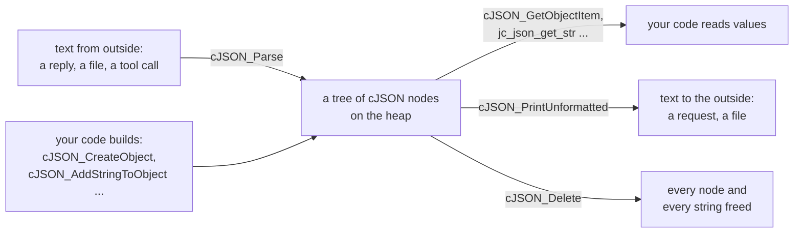

# Ireko 1 -- Everything passes through here

*[入れ子（いれこ）*Ireko* — nested boxes](IREKO.md) · chapter 1 of 7*

## Why this exists

jichi is a program that talks. It talks to a model over HTTP, to MCP servers over pipes or HTTP (`src/mcp/jc_mcp_stdio.c`,
`src/mcp/jc_mcp_http.c`), to language servers over pipes, to an editor over ACP, and to its own
files on disk.
Almost every one of those conversations is written in one format: **JSON**.

JSON is text that carries data. It has six kinds of value:
- an **object**, a set of named members: `{"path": "notes.txt", "limit": 20}`;
- an **array**, a list in order: `["read_file", "edit_file"]`;
- a **string** such as `"notes.txt"`, and a **number** such as `20` or `2.5`;
- the words **`true`** and **`false`**, and the word **`null`**.

An object or an array can hold any value, including another object or array. That
is where this course gets its name. 入れ子（いれこ）*ireko* is a set of nested
boxes, each one fitting inside the next, and a JSON document is exactly that.

Why does an AI agent need JSON so much? Three reasons, and this chapter shows each
one in the code:

1. **A model is a web service.** jichi sends it a request whose body is one JSON
   object: the model's name, the conversation so far, the list of tools. The answer
   comes back as a stream of small JSON objects, one per event.
2. **A tool call is JSON that the model writes.** A model that wants to read a file
   does not run anything. It writes a tool name and a JSON object of arguments,
   `{"path":"notes.txt"}`, shaped by the tool's JSON schema
   ([Annai chapter 4](annai-04-tool-calling.md)).
   jichi parses that object and runs the tool. The model wrote those bytes, so
   jichi cannot trust them: they may be broken, huge, or nested very deep.
3. **jichi's own state is JSON.** Configuration files, saved sessions and the
   telemetry log are JSON too.

So one file of C, `src/json/cJSON.c` (1,247 lines in this tree), sits under nearly
everything jichi does. This chapter shows where it is used, what a parsed document
looks like in memory, and who has to free it. Chapter 2 opens the parser itself.

## The shape



There are two directions and one data structure. Text comes in and is **parsed**
into a tree, and code reads values out of the tree. Or code **builds** a tree and
**prints** it into text that goes out. Either way, the tree lives on the heap until
someone calls `cJSON_Delete`.

## Where jichi uses JSON

Count first. The commands are in "Try it" below. Of the 217 C files under `src/`,
leaving out `src/json/` itself, 100 mention `cJSON`. 54 files parse JSON, and 41
print it.

The calls come in two spellings. The `jc_json_*` names are a thin layer in
`src/json/jc_json.c` (chapter 6 reads the rest of it): `src/json/jc_json.c:jc_json_parse`
returns NULL for a NULL argument and otherwise calls `cJSON_Parse`, and
`src/json/jc_json.c:jc_json_print` calls `cJSON_PrintUnformatted`. Both spellings meet
in the same parser and printer. Here is one call site for each kind of traffic. Open
each one as you read.

**The request.** `src/provider/jc_provider_openai.c:oa_build_request` builds the
request body as a tree. It starts with `cJSON_CreateObject()`, then adds members:
`cJSON_AddStringToObject(root, "model", ...)`, `"messages"`, `"stream"`,
`"max_tokens"`, `"tools"`. At the end it hands the tree to the printer and frees it:

```c src/provider/jc_provider_openai.c:oa_build_request
    {
        jc_status st = jc_prov_print_body(root, body_out);
        cJSON_Delete(root);
        return st;
    }
```

`src/provider/jc_provider.c:jc_prov_print_body` calls `cJSON_PrintUnformatted(root)`
and passes the text on to the HTTP layer. One line later the tree is gone. Only the
text travels.

**The streamed reply.** The request asks for `"stream": true`, so the answer arrives
as Server-Sent Events: lines of the form `data: {...}`, one small JSON object per
event ([Annai chapter 6](annai-06-the-wire.md) tells the wire).
`src/provider/jc_provider_openai.c:oa_on_event` receives one event's data and parses
it on its own:

```c src/provider/jc_provider_openai.c:oa_on_event
    if (strcmp(ev->data, "[DONE]") == 0) {
...
    root = cJSON_Parse(ev->data);
```

The `[DONE]` test comes first because the OpenAI dialect ends its stream with that
word, and it is not JSON. Every other event is parsed into its own small tree, read,
and freed. `src/provider/jc_provider_anthropic.c:an_on_event` parses each event the same way; the Anthropic
dialect has no `[DONE]` word, so it has no such test.

**A tool call's arguments.** This is the strangest case, and the most important one.
The model streams its arguments as **pieces of a string**, and each piece arrives
inside an event that is itself JSON. A unit test feeds two such events:

```c tests/test_provider.c:test_openai
    feed(p, &out, &done, "",
         "{\"choices\":[{\"delta\":{\"tool_calls\":[{\"index\":0,"
         "\"id\":\"call_1\",\"function\":{\"name\":\"read_file\","
         "\"arguments\":\"{\\\"p\"}}]}}]}");
    feed(p, &out, &done, "",
         "{\"choices\":[{\"delta\":{\"tool_calls\":[{\"index\":0,"
         "\"function\":{\"arguments\":\"ath\\\":1}\"}}]}}]}");
    feed(p, &out, &done, "", "[DONE]");
...
        JC_CHECK_STR(tc->arguments_json, "{\"path\":1}");
```

The backslashes are C's escapes and JSON's escapes stacked on top of each other.
Peeled, the first event's `arguments` string is `{"p` and the second one's is
`ath":1}`. Neither piece is JSON. `src/provider/jc_provider_openai.c:oa_handle_tool_calls`
reads the `arguments` string out of each parsed event and appends it to a buffer kept
for the call (`src/provider/jc_provider.c:jc_prov_append_args`). Only when the stream
has ended is the joined text, `{"path":1}`, a whole document. Later,
`src/tools/jc_tool.c:jc_tool_normalize_args` parses it as the tool's arguments; if that
parse fails, it tries a careful repair (chapter 7).

So a tool call's arguments are parsed in two shapes: first as a string inside each
event, then as a document of their own. jichi keeps that shape in its own output.
In a recorded run, the `--output jsonl` stream writes the arguments as a string that
holds JSON, not as an object:

```jsonl docs/reading/traces/tool-round/expected/stdout.jsonl
{"v":1,"type":"tool_call","name":"read_file","args":"{\"path\":\"notes.txt\"}","id":"c1"}
```

**Configuration.** `src/config/jc_config.c:config_parse_file` reads the file,
removes `//` comments and trailing commas with `jc_jsonc_strip` (chapter 7), and
calls `jc_json_parse`. A NULL result is logged as `malformed config JSON`.

**Sessions.** `src/session/jc_session.c:jc_session_serialize` prints a whole
conversation into one document. `src/session/jc_session.c:load_from_text` parses it
back when you resume.

**Telemetry.** Each telemetry record is a tree that is printed as one line and then
freed:

```c src/util/jc_eventlog.c:jc_eventlog_end
        char *line = cJSON_PrintUnformatted(o);
...
            fputs(line, log->f);
            fputc('\n', log->f);
            fflush(log->f);
            free(line);
        }
    }
    cJSON_Delete(o);
```

One JSON document per line is a format called JSONL. Reading the log back,
`src/util/jc_telemetry.c:feed_line` parses one line at a time. A line that does not
parse is skipped, so a torn or hand-edited log does not stop the summary. The skip is silent: `feed_line` keeps no count of what it dropped, so a damaged log reads as a
shorter one, and nothing in the summary says so.

**The other peers.** MCP servers (`src/mcp/jc_mcp_proto.c:jc_mcp_parse_tools`),
language servers (`src/lsp/jc_lsp.c`) and an editor speaking ACP (`src/acp/jc_acp.c`)
all send JSON, and jichi parses it with the same function.

Notice **who wrote** each document. jichi wrote its request bodies and its telemetry. It also writes its session files, but a file on
disk may since have been edited by hand, which is why `CLAUDE.md` lists "a session file on disk"
among the JSON it reads leniently (chapter 6). A model, a server, an editor or a person wrote everything else.
The parser cannot tell the two apart, so it has to be safe for the worst of them.
Chapter 2 reads how it tries.

## The box: `struct cJSON`

Open `src/json/cJSON.h`. A parsed document becomes a tree of nodes, and every node,
whatever kind of value it holds, is one of these:

```c src/json/cJSON.h
typedef struct cJSON {
    struct cJSON *next;
    struct cJSON *prev;
    struct cJSON *child;   /* for Array/Object: first element */
    struct cJSON *tail;    /* for Array/Object: last element (M1085/F-05), or NULL when empty */

    int type;

    char  *valuestring;    /* for String/Raw */
    int    valueint;       /* deprecated mirror of valuedouble */
    double valuedouble;    /* for Number */

    char  *string;         /* the key, if this item is in an Object */
} cJSON;
```

Read it field by field.
- **`type`** says which kind of value the node holds, as one of the constants just
  above the struct in the header: `cJSON_False` 1, `cJSON_True` 2, `cJSON_NULL` 4,
  `cJSON_Number` 8, `cJSON_String` 16, `cJSON_Array` 32, `cJSON_Object` 64, and two
  more, `cJSON_Invalid` 0 and `cJSON_Raw` 128. `true` and `false` are two types, not
  one type with a value. Apart from `cJSON_Invalid` (0), each is a single bit, a power of two. Upstream cJSON chose bits so
that it can add flags to the same field (`cJSON_IsReference` 256, `cJSON_StringIsConst` 512) and
test the type with `(item->type & 0xFF)`; measured with upstream 1.7.17, a string reference has
`type` 272. This file defines neither flag and never combines bits: every type test compares with
`==`, as `src/json/cJSON.c:cJSON_IsString` does.
- **`valuestring`** holds a string's text, in its own heap block.
- **`valuedouble`** holds a number. JSON has one kind of number, and this file keeps
  every number as a `double`. **`valueint`** is the same number cut down to an
  `int`. The header calls it deprecated, and chapter 4 reads how it is clamped.
- **`string`** is the node's **key**, when the node is a member of an object. The
  key lives on the member, not on the object. In `{"path":"notes.txt"}` the node for
  `"notes.txt"` has `string` = `path` and `valuestring` = `notes.txt`. The field
  name is easy to misread: `string` is the key, `valuestring` is the value.
- **`child`** points at the first thing inside an array or an object. **`next`**
  and **`prev`** link a node to its siblings. **`tail`** remembers the last child,
  so that adding one more is quick (M1085; chapter 5).
- **`cJSON_Raw`** marks a node whose `valuestring` is printed as it is. The printer
  handles it, but no function in this file creates one, and no C file under `src/`
  outside `src/json/` names it.

> **C sidebar — a struct that points at its own kind.** `struct cJSON *next;` sits
> inside `struct cJSON` itself. That is allowed because the field is a *pointer*: a
> struct cannot contain itself, only the address of another one like it. The
> `typedef struct cJSON { ... } cJSON;` line gives the struct a second, shorter name,
> so `cJSON *item` and `struct cJSON *item` mean the same type. And a node has room
> for one `child` pointer, yet an array can hold any number of elements. The trick:
> `child` points at the *first* element only, and the elements are chained to each
> other with `next`, like a linked list, with `prev` pointing back. Two pointers per
> node store any tree, however many children a node has.

Here is the document the "Try it" program parses, drawn as nodes. Each `next`
arrow has a matching `prev` arrow going back, left out to keep the picture small.

```
{"name":"read_file","arguments":{"path":"notes.txt","limit":2.5},"tags":["io",true,null]}

object
  |child
  v
string  ==next==>  object  ============next============>  array
key=name           key=arguments                          key=tags
"read_file"          |child                                 |child
                     v                                      v
                   string  ==next==>  number              string ==next==> true ==next==> null
                   key=path           key=limit           "io"
                   "notes.txt"        2.5
```

To visit the children of a node, the header gives you a loop:

```c src/json/cJSON.h
#define cJSON_ArrayForEach(element, array) \
    for ((element) = ((array) != 0 ? (array)->child : 0); \
         (element) != 0; (element) = (element)->next)
```

It is a `for` loop that starts at `child` and follows `next`. It works for objects
too, because an object's members are chained the same way. For a leaf, such as a
number, `child` is NULL and the loop runs zero times.

**How big is one box?** The "Try it" program prints `sizeof(cJSON)`. On the x86-64
machine this chapter was measured on it is 72 bytes, and every value in a parsed
document costs one such block, plus the allocator's own bookkeeping. The comment
above `JC_JSON_MAX_NODES` in `src/json/cJSON.c` says "a malloc'd 64-byte node". That
is the size the A-06 finding (2026-10-17) gives, from before M1085 added the `tail`
pointer; with it, this machine measures 72. A small number in a document, such as `0,`, is two
bytes of text and 72 bytes of tree. Chapter 2 meets the cap that this ratio made
necessary.

## Who owns the tree

> **C sidebar — `malloc`, `free`, and owning.** `malloc(n)` asks the C library for
> `n` bytes of heap memory and returns their address. The memory stays reserved until
> someone passes that same address to `free`. C does not track who that someone is.
> The code has to agree on it, and the agreement is called **ownership**: the owner
> of a block is the one piece of code that must free it, exactly once. Free it
> twice, or use it after it was freed, and the behaviour is undefined. Never free
> it, and it leaks.

The JSON layer has four ownership rules. Each one can be read in the code.

**1. `cJSON_Parse` gives you a tree, and you give it back with `cJSON_Delete`,
once.** Every node comes from `malloc` (`src/json/cJSON.c:cJSON_New_Item`), and so
does every key and every string value. One call frees them all:

```c src/json/cJSON.c:cJSON_Delete
void cJSON_Delete(cJSON *item)
{
    cJSON *next;
    while (item != NULL) {
        next = item->next;
        if (item->child != NULL) {
            cJSON_Delete(item->child);
        }
        if (item->valuestring != NULL) {
            free(item->valuestring);
        }
        if (item->string != NULL) {
            free(item->string);
        }
        free(item);
        item = next;
    }
}
```

It makes two moves. For the boxes *inside* a node, it calls itself on `child`: that
is recursion, one level down. For the boxes *beside* a node, it loops along `next`.
It saves `item->next` in a local variable before `free(item)`, because once the node
is freed, reading `item->next` is reading freed memory. A NULL argument does
nothing, so code may pass the result of a failed parse straight to it.

There is a trap in the loop. `cJSON_Delete` frees the node you give it **and every
sibling after it**. Delete a member that is still linked into its object, and the
members after it go too, while the member before it still points at freed memory.
That is why code that removes one member cuts it loose first.
`src/json/cJSON.c:cJSON_ReplaceItemInObject` sets the old member's `next` and `prev`
to NULL before it deletes it, and so does
`src/setup/jc_setup.c:strip_named_member`.

**2. A string you read out of the tree is borrowed.** The accessors in
`include/jc_json.h` say so:

```c include/jc_json.h
/* Typed object-field accessors. Each returns `dflt` if the key is missing
 * or has the wrong type. Returned strings are owned by the cJSON tree. */
```

Do not free such a string, and do not use it after `cJSON_Delete`. If you need it
for longer, copy it. `src/json/jc_json.c:jc_json_dup_str` copies it into an arena,
a block of memory that lives as long as the arena does.

**3. A printed string is yours.** The printer grows a buffer with `realloc` and
hands it to you (`src/json/cJSON.c:print_with`). The two headers name two ways of
freeing it: `cJSON.h` says "free with cJSON_free", `include/jc_json.h` says "free
with free()". In this file they are the same thing, because
`src/json/cJSON.c:cJSON_free` is one line that calls `free`. Most of the tree uses
plain `free`, as `jc_eventlog_end` above does.

**4. Adding a node to a parent hands the node over.** `cJSON.h` says it in one line:
"Items are owned by their parent after being added." After
`cJSON_AddItemToObject(o, "tool_input", ti)`, deleting `o` deletes `ti` as well.
If the add fails, it returns 0 and the node is still yours (the call in
`src/chat/jc_hooks.c:build_stdin` ignores that 0, so if copying the key ever runs out of memory,
`ti` leaks); the
`cJSON_Add...ToObject` helpers, such as `cJSON_AddStringToObject`, delete their new
node themselves in that case. `src/util/jc_eventlog.c:jc_eventlog_end` applies the
same idea to a whole function: it takes the tree it is given and always deletes it,
even when there is no log file to write to.

The "Try it" section below shows rules 1 and 3 with a leak checker.

## Not upstream cJSON (M171)

There is a well-known C library called cJSON. This file is not it. Read the top of
`src/json/cJSON.c`:

```c src/json/cJSON.c
 * PROVENANCE -- read this before assuming otherwise. This file is NOT upstream
 * cJSON and contains no third-party code. It is an original, from-scratch C89
 * implementation of the subset of the cJSON *API* that jichi uses. It lived under
 * `third_party/cjson/` until M171, which was doubly misleading: it implied we had
 * vendored someone else's MIT-licensed library (we had not), and an auditor
 * looking for cJSON's copyright notice would find none and reasonably conclude the
 * notice had been stripped. jichi vendors no third-party source at all.
 *
 * Only the API is shared, deliberately: the function names and the double-based
 * number model match upstream. The real library (github.com/DaveGamble/cJSON) is
 * no longer a drop-in replacement, though: the struct has a `tail` member that
...
```

(The elided lines give the other reasons and point to this chapter. Until release 0.15.0
the comment said the opposite: that the struct layout matched upstream as well, "so the
real library ... can replace this file and cJSON.h as a pair without touching anything else
in the tree". The tree this chapter describes, `8c51afe5`, still has that version, and "A
promise nobody checks" below tests it.)

An **API** is what a caller sees: the function names, their arguments, and the
struct the caller reads. The **implementation** is the code behind them. jichi
wrote its own implementation of a subset of a well-known API. The tree's rule for
dependencies is "libcurl and nothing else" (`CLAUDE.md`), so there is no
third-party JSON library to link. Sharing the API means that a reader who knows
cJSON reads jichi's calls without a dictionary, and that the real library could, in
principle, take this file's place. "What went wrong here" below checks how true
that last part still is.

**It also compiles as C++.** M188 compiled the whole tree with a C++ compiler, and
its write-up, [`docs/CPP_BUILD.md`](../CPP_BUILD.md), reports that "the in-tree
cJSON compiled clean". You can see why in the file. Every allocation is cast:
`(cJSON *)malloc(sizeof(cJSON))` in `src/json/cJSON.c:cJSON_New_Item`. C converts the
`void *` that `malloc` returns without a cast; C++ refuses to. And `cJSON.h` wraps
its declarations in `#ifdef __cplusplus extern "C" {`, which tells a C++ compiler
that these are C functions. The "Try it" section compiles the file as C++98.

## Try it

You need a C compiler. Nothing here builds jichi, and every file you write goes into
a throwaway directory.

**1. Count the call sites.**

```sh
# in the jichi checkout
find src -name '*.c' ! -path 'src/json/*' | wc -l
find src -name '*.c' ! -path 'src/json/*' -exec grep -l 'cJSON' {} + | wc -l
find src -name '*.c' ! -path 'src/json/*' -exec grep -lE 'cJSON_Parse\(|jc_json_parse\(' {} + | wc -l
find src -name '*.c' ! -path 'src/json/*' -exec grep -lE 'cJSON_Print(Unformatted)?\(|jc_json_print\(' {} + | wc -l
```

```
217
100
54
41
```

These are the counts at `8c51afe5` (2026-11-18), the tree this chapter describes. The tree grows:
at 0.15.0 the same four commands print 222, 101, 55 and 41. If your numbers are a little
higher still, that is the reason, and nothing is wrong.

The four numbers are: C files outside `src/json/`, files that mention `cJSON`, files
that parse, files that print. Your numbers will differ on another tree; the
proportion is the point.

**2. Parse a document, walk it, print it, free it.** This program parses the
document drawn above, prints one line per node, prints the tree back as text, and
frees it. With the argument `leak` it skips `cJSON_Delete` on purpose, for step 3.

```sh
# in the jichi checkout
T=$(mktemp -d)        # a throwaway directory; keep this shell open for the steps below
cat > "$T/walk.c" <<'END_OF_C'
/* walk.c -- parse a document, walk its tree, print it, free it. */
#include <stdio.h>
#include <string.h>
#include "cJSON.h"

static const char *type_name(const cJSON *item)
{
    switch (item->type) {
    case cJSON_False:  return "false";
    case cJSON_True:   return "true";
    case cJSON_NULL:   return "null";
    case cJSON_Number: return "number";
    case cJSON_String: return "string";
    case cJSON_Array:  return "array";
    case cJSON_Object: return "object";
    default:           return "?";
    }
}

/* One line for this node, then one call for each child, one level deeper. */
static void walk(const cJSON *item, int depth)
{
    const cJSON *child;

    printf("%*s%s", depth * 2, "", type_name(item));
    if (item->string != NULL) {
        printf("  key=\"%s\"", item->string);
    }
    if (cJSON_IsString(item)) {
        printf("  valuestring=\"%s\"", item->valuestring);
    }
    if (cJSON_IsNumber(item)) {
        printf("  valuedouble=%g valueint=%d", item->valuedouble, item->valueint);
    }
    printf("\n");
    cJSON_ArrayForEach(child, item) {
        walk(child, depth + 1);
    }
}

int main(int argc, char **argv)
{
    const char *text =
        "{\"name\": \"read_file\","
        " \"arguments\": {\"path\": \"notes.txt\", \"limit\": 2.5},"
        " \"tags\": [\"io\", true, null]}";
    cJSON *root;
    char *out;

    printf("sizeof(cJSON) = %lu bytes\n", (unsigned long)sizeof(cJSON));
    root = cJSON_Parse(text);
    if (root == NULL) {
        printf("refused\n");
        return 1;
    }
    walk(root, 0);

    out = cJSON_PrintUnformatted(root);
    if (out != NULL) {
        printf("%s\n", out);
        cJSON_free(out);
    }

    if (argc > 1 && strcmp(argv[1], "leak") == 0) {
        return 0;   /* on purpose: the tree is never freed */
    }
    cJSON_Delete(root);
    return 0;
}
END_OF_C
cc -std=c89 -pedantic -Wall -Wextra -Isrc/json -o "$T/walk" "$T/walk.c" src/json/cJSON.c -lm
"$T/walk"
```

The compiler prints nothing: no warnings, under the same flags jichi is held to.
The program prints:

```
sizeof(cJSON) = 72 bytes
object
  string  key="name"  valuestring="read_file"
  object  key="arguments"
    string  key="path"  valuestring="notes.txt"
    number  key="limit"  valuedouble=2.5 valueint=2
  array  key="tags"
    string  valuestring="io"
    true
    null
{"name":"read_file","arguments":{"path":"notes.txt","limit":2.5},"tags":["io",true,null]}
```

Compare the walk with the drawing: the indentation is the `child` arrows, and the
lines at one indentation are the `next` chain. `valueint=2` is 2.5 cut down to an
`int`. The array's elements have no key, because only object members do. The spaces
of the source text are gone from the print: the tree keeps values, not layout
(`cJSON_Print`, the other printer, indents; chapter 5 reads both). `walk` calls itself
once per level, the same way the parser does (chapter 2).

**3. Count the boxes with a leak checker.** If you have `valgrind`, run the program
twice, once with the leak:

```sh
# in the jichi checkout, the same shell (needs valgrind)
valgrind --leak-check=full "$T/walk" leak 2>&1 >/dev/null | grep -E 'lost:|All heap'
valgrind --leak-check=full "$T/walk" 2>&1 >/dev/null | grep -E 'lost:|All heap'
```

```
==1490129==    definitely lost: 72 bytes in 1 blocks
==1490129==    indirectly lost: 662 bytes in 16 blocks
==1490129==      possibly lost: 0 bytes in 0 blocks
==1490139== All heap blocks were freed -- no leaks are possible
```

The number between the `==` marks is a process id; yours will differ. Read the
leak: 1 block of 72 bytes is "definitely lost", the root node, which nothing points
to any more. 16 blocks are "indirectly lost": reachable only through the root. The
document has 9 values, so 9 nodes, and 8 heap strings: 5 keys and 3 string values.
1 + 16 = 17 = 9 + 8. Each string block is a little longer than its text (chapter 3
reads why). The second run, with `cJSON_Delete`, frees all of them. The printed
string is freed with `cJSON_free` in both runs, so it never shows up.

**4. Compile the same file as C++.** If you have `g++`:

```sh
# in the jichi checkout (needs g++)
g++ -std=c++98 -pedantic -Wall -Wextra -fsyntax-only -x c++ src/json/cJSON.c; echo "rc=$?"
```

```
rc=0
```

`-fsyntax-only` checks the file without producing an object file, and `-x c++`
says to read a `.c` file as C++. No diagnostics, exit status 0.

**5. Find the code that only jichi's version can serve.**

```sh
# in the jichi checkout, the same shell
find src -name '*.c' ! -path 'src/json/*' -exec grep -lE 'cJSON_jc_|object->tail' {} +
rm -r "$T"            # done: remove the throwaway directory
```

```
src/setup/jc_setup.c
src/provider/jc_provider_anthropic.c
src/provider/jc_provider_openai.c
```

The next section explains why these three files matter. Your list may come out in
another order: `find` does not sort.

## What went wrong here, and what it teaches

### A directory that told the wrong story (M171)

Until M171, these two files lived in `third_party/cjson/`. Their own header already
said they were not upstream cJSON. The directory name said the opposite, and
`docs/ROADMAP.md` records why that mattered: the directory name is what an auditor
reads first. The record calls the claim "misleading in both directions". It
suggested jichi had copied someone else's MIT-licensed library, and anyone who then
looked for cJSON's copyright notice would find none and could fairly conclude it had
been removed.

The wrong belief had a cost in the build, too. That translation unit was exempt from
`-pedantic`, and the exemption existed **only** because it was thought to be foreign
code. Compiled under the full `-std=c89 -pedantic -Wall -Wextra -Werror`, it was
clean, so M171 deleted the special build rule, and every translation unit was built
under one set of flags.

The lesson: a name is a claim. A directory called `third_party` says "someone else
wrote this", and readers believe names before they read headers.

### A promise nobody checks (read for this chapter)

At `8c51afe5`, the tree this chapter describes, the provenance comment still promised
that upstream cJSON "can replace this file and cJSON.h as a pair without touching
anything else in the tree". (Release 0.15.0 corrected the comment, and the README's
copy of the promise.) Step 5 of "Try it" found three files that say otherwise:
- `src/provider/jc_provider_openai.c:oa_on_event` and
  `src/provider/jc_provider_anthropic.c:an_on_event` call
  `cJSON_jc_parse_refused_by_cap()` (M1094, chapter 2). `cJSON.h` itself calls that
  function a "jichi extension ... not part of the cJSON API".
- `src/setup/jc_setup.c:strip_named_member` writes `object->tail`, the field M1085
  added to the struct.

Behaviour has moved as well, on purpose. Since M1078, `cJSON_Parse` refuses
anything after the root value, and the code says why: "Upstream cJSON accepts the
trailing data; jichi refuses it on purpose." Since M1113, looking a key up returns
the last of two duplicate members (chapter 2). Upstream does neither, and measured against upstream itself (cJSON 1.7.17, as a Linux
distribution packages it) the differences go further. Upstream's `cJSON_GetObjectItem` returns the
**first** of two duplicates and ignores case (`"Path"` is found by `"path"`). Its struct has no
`tail` (64 bytes there; jichi's is 72), so the provenance comment's "struct layout ... match
upstream" no longer holds. And it keeps the last element's address in the first element's `prev`,
where this file keeps NULL and `strip_named_member` relies on that NULL. Swapping upstream in
would therefore do more than break the build in three files: it would reopen the hook bypass that
M1113 closed (chapter 2), and quietly change how every key is matched.

Each of these changes was right on its own terms. None of them updated the promise,
because nothing checks the promise: no test builds jichi against the real library.
This chapter found the gap by reading, and the three files above are the
measurement. The search covers `src/` only. The tests use the extensions too: `find tests -name '*.c' -exec
grep -lE 'cJSON_jc_|cJSON_pb_' {} +` lists four files (`tests/test_json.c`,
`tests/test_cjson_append_linear.c`, `tests/test_provider.c`, `tests/test_cjson_print_parity.c`).
`cJSON_pb_run_bytes` and `cJSON_pb_run_reset` are two more jichi-only functions, declared in
`cJSON.c` itself rather than in the header. It was not shown by building against upstream, which this chapter did
not do.

The lesson: a promise about the future ("could be replaced") is a claim like any
other, and a claim that no check holds will drift. Either check it, or write it as
history ("was API-compatible when written").

## Check yourself

1. In the document from "Try it", which pointers lead from the root to the number
   `2.5`?
2. `jc_json_get_str(o, "path", NULL)` returns a `const char *`. Who frees that
   string, and when does it stop being valid?
3. `m` points at the second member of an object with three members. You call
   `cJSON_Delete(m)` without unlinking it first. What is freed, and what is left
   pointing at freed memory?
4. Why does `src/json/cJSON.c:cJSON_New_Item` cast the result of `malloc`, when C
   does not need the cast?
5. A tool call's arguments arrive in several events. Why can jichi not parse the
   arguments event by event?

<details><summary>Answers</summary>

1. `root->child` is the `name` member; its `next` is the `arguments` object; that
   object's `child` is `path`; its `next` is `limit`, the number 2.5.
2. The tree owns it. It is freed by the `cJSON_Delete` of the whole tree, and it is
   invalid from then on. To keep it longer, copy it, for instance with
   `jc_json_dup_str` into an arena.
3. `m`, everything inside it, and the third member: `cJSON_Delete` follows `next`.
   The first member's `next` still points at `m`, and the object's `tail` still
   points at the third member. Both are now pointers to freed memory.
4. The house style casts every allocation, which keeps the file valid C++ as well as
   C. C++ refuses to convert `void *` to `cJSON *` without a cast. M188's C++ build
   compiled this file clean.
5. Each event carries a piece of a string, such as `{"p`, which is not a JSON
   document. Only the joined text is one, so the arguments are parsed once the call
   is complete.

</details>

*Next: [chapter 2 — Boxes inside boxes: the recursive-descent parser](ireko-02-boxes-inside-boxes.md), where the text becomes the tree.*
