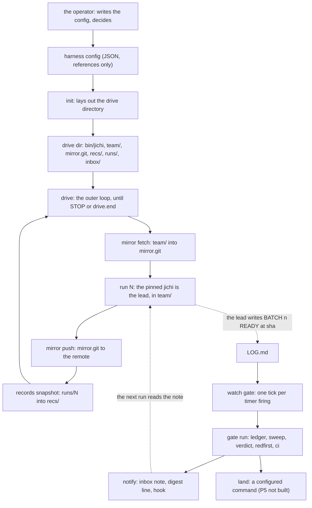

# Tazuna 1 -- What a harness is for

*[手綱（たづな）*Tazuna* — the harness](TAZUNA.md) · chapter 1 of 10*

## Why this exists

Annai followed one sentence through jichi while you watched: you typed, the model called a tool,
a file changed, and you were there to read every line. A **drive** takes you out of that picture.
A lead agent and the workers it starts work through a plan for hours or days, batch after batch,
on a machine whose owner is asleep. Their commits have to leave the agent's clone, reach a branch
on the remote, pass a gate, and in the end land on master. Something has to start each run, carry
what one run learned into the next, copy the team's commits out, push them, notice that a batch is
ready, gate it, and tell the people concerned.

That "something" first existed as roughly 2,650 lines of shell, Python, configuration and prompts,
plus a set of timers, with a supervising agent session woken every few minutes to fill the gaps.
The plan that replaces it, `docs/plans/2026-10-21-jichi-harness.md`, starts from the operator's
words of 2026-10-21: "we need jichi be able to drive itself with a suitable harness, or set of
harnesses", and "If a user has only access to one model, then the harness has to support that
use-case, too, even if the performance may be bad."

The plan's section 1 names four parties in a drive:

| Party | What it does |
|---|---|
| the team | a lead and its workers: plans a batch, has workers write code and tests, reviews, merges, keeps the log |
| the harness | starts runs, carries data between them, mirrors the team's branches, pushes, gates, watches |
| the supervisor | reads the state, verifies the team's claims, relays notes, gates batches, moves master on the operator's go |
| the operator | a person: decides the plan, every master move, priced models, deletions |

"Drive itself" means the third row goes away. Its mechanical duties move into code, into
`jichi-harness`; its judgment is meant to become an agent run in a supervisor role (the plan's
section 9 and its phase P6; no command for it exists at this commit). The operator stays, and
keeps every decision.

There is one more requirement, and it shapes everything after it. The harness runs **on a host
the agents must not control**. The team's lead runs a model's shell commands, and the model reads
untrusted text. On the same disk sit the git token that can push, the model key that costs money,
and the operator's own files. A harness that hands the agent a token, or runs a hook the agent
planted, has turned one bad model output into a stolen credential.

Decision D4 (2026-10-04, in `docs/plans/2026-10-03-learners-models-and-drives.md`) made the harness
jichi's third C89 program, beside `jichi` and `jichi-convert`. `docs/HARNESS.md` gives the reason:
it reuses what jichi already has and tests -- the spawn primitive, the environment scrub, the
redactor, the memory protection -- "and quoting a credential in `sh` is where such scripts go
wrong."

## The shape



Read it as two loops. The upper one is the **drive loop**, one long-lived process: fetch the team's
commits, run the lead once, push, copy the run's records, repeat. The lower one is driven by the
**host's timers**: a watcher that reads the drive's log for a READY line, a gate that tests exactly
that commit, a notifier that tells the lead and the operator what the gate said. The two halves
meet in files -- the log, the inbox, the remote -- never in shared memory. That is what lets a
scheduled C command (`push`, `notify`, `watch`) run beside the shell script it replaces, on the
same inputs, before the switch-over (`docs/HARNESS.md`, the `notify` and `watch` sections).

## The words every later chapter uses

| Word | What it means here | Where it lives |
|---|---|---|
| **operator** | the person; "The operator keeps every decision" | the plan's section 11 |
| **drive** | one unattended stretch of work toward a plan: a directory (`dir`), a branch prefix (`drive.branchPrefix`), an end (`drive.end`) | the config's `drive` object; the `drive` command |
| **rehearsal** | a drive's layout with a local stand-in for the remote and random canaries for the key and token | `init`'s second mode (chapter 2) |
| **run** | one start of the lead, numbered; its records go to `<dir>/runs/N/`, outside the agent's workspace | `src/harness/jc_harness_run.c:jc_harness_run` |
| **lead** | the agent a run starts: the jichi the tenant's `bin` names (the drive's pinned `bin/jichi` when the config says so), in the tenant's `workdir` (the team's clone), on `drive.leadModel` when the tenant's jichi config names that model | the `run` command |
| **workers**, **team** | the lead's helpers, started with jichi's `spawn_parallel`; the lead and its workers together are the team, and `team/` is their clone | `src/harness/jc_harness_handoff.c:jc_harness_build_handoff` counts their batches |
| **tenant** | one entry in the config's `tenants` array: a name, a `workdir`, a `home` | `--tenant` on `run` and `drive` |
| **mirror** | `mirror.git`, a bare repository only the harness writes: it fetches from the team's clone and pushes to the remote | `mirror fetch`, `mirror push` |
| **records** | what a run leaves (journal, telemetry, stream, stderr, prompt, meta), copied to the orphan branch `<prefix>/records` in `recs/` | `runs/N/`, `recs/` |
| **inbox**, **handoff** | notes waiting for the next run, and the prompt section the next run gets from the previous run's records | `inbox/`, `runs/N/handoff.md` |
| **READY line** | `BATCH <n> READY at <commit>` in the drive's log, by default `<dir>/LOG.md`; the watcher reads the last one | `src/harness/jc_hp_watchgate.c:jc_hp_watchgate_run` |
| **gate** | the test of exactly one READY commit, in five stages, run in this order: ledger, sweep, verdict, redfirst, ci | `src/harness/jc_hp_gate.c:jc_hp_gate_full_run` |
| **landing** | moving master to a green READY commit, as a fast-forward | the gate's last step; P5 |
| **Mode A to D** | where the boundary between harness and agent is drawn: same user, separate user, a service, a container | `docs/HARNESS.md`, "The modes" |

Two of these deserve a second sentence now, because they are easy to misread.

A **drive's end is a bound on the drive, not a cap on a run.** `docs/HARNESS.md` quotes the plan:
"the loop sets no deadline and no budget" on a run. A run keeps jichi's fences on (the tool-call
limit, the verify timeout) and its caps off, because a cap that fires does not just hide an answer,
it manufactures a different one (`CLAUDE.md`, "Caps versus fences"). The loop checks the end before
it starts each run, and when the end arrives mid-run it stops the live run the way Ctrl-C would, so
the run still writes its journal.

**Landing** needs no per-batch go because the operator decided so. The plan's decisions table
records the 2026-10-23 decision that a READY head moves master on a green `make ci` of exactly that
head, as a fast-forward, without a per-batch go. At this commit the gate's last step does that by
running a command the configuration names (`host.landRun`); a `HOLD` file in the gate's home holds
it for the operator, and with no land command configured the gate refuses to guess and says so.
The harness's own landing commands -- `pending`, `approve`, `land`, `integrate` -- are phase P5 and
not built.

## The limit, read first

`docs/HARNESS.md` opens with the sentence a learner most needs and least wants:

```text docs/HARNESS.md
In **Mode A** (the normal user account) the harness and the agent run as the same user. The harness
therefore keeps the git token from the model's commands — not from a determined attacker with that
account. The 2026-10-03 plan says it plainly: "The only boundary that holds is a process the model
cannot drive." For untrusted input, the modes that do hold are **a separate user (Mode B)** or
**a container (Mode D)**: "The harness can support that; it cannot enforce it."
```

Everything built so far is Mode A. The threat model in the same page lists what is protected and
from whom:

- **the git token and the model key**, from the model's commands -- a stolen token pushes anywhere
  it can, a stolen key spends money;
- **the operator's own files** (`~/.ssh`, other projects), from the model's commands;
- **the repository's history and other branches**, from a run gone wrong;
- **the host's integrity**, from a planted file that later runs as the operator: a `.git/hooks/*`
  or a `core.fsmonitor` setting runs when *anyone* runs git in that repository;
- **other tenants**, from each other.

Mode A can honestly hold some of these and not others. It keeps the token out of the agent's
environment (the push gets it through a credential helper that reads the file when git asks); the
team's push never carries `--force` and touches only branches under the drive's prefix; and it
reads the team's commits by fetching them into a repository only it writes, with every git child's
hooks and fsmonitor switched off. It cannot stop a command from reading any file the operator can
read -- the token file included -- because in Mode A the agent *is* the operator, as far as the
kernel knows. `docs/HARDENING.md` says the same of jichi itself: "A command runs as you".
[Chapter 3](tazuna-03-the-mirror-and-the-credential-helper.md) shows the mirror and the credential
helper in code, and [chapter 4](tazuna-04-run-and-the-handoff.md) how a run receives its key; this
chapter's job is to make sure you never mistake those protections for a boundary.

The four modes, one line each (`docs/HARNESS.md`, "The modes"; the plan's section 7 has the full
text):

- **Mode A, the normal user account** -- built first; its limit is the one quoted above.
- **Mode B, a separate OS user** -- the cheapest boundary that holds against the model's commands.
- **Mode C, a daemon or service** -- unit files as the record.
- **Mode D, containers** -- rootless podman first; the boundary for untrusted input.

## The commands, at a glance

| Command | Its job | At this commit |
|---|---|---|
| `init` | lay out a drive's or a rehearsal's directory | built (M1053) |
| `doctor` | check the configuration offline: never opens a secret, never calls a model | built (M1052) |
| `mirror fetch` / `head` / `push` | read the team's clone into the mirror; push the mirror to the remote after a key scan and a size check | built (M1055, M1056) |
| `credential-helper` | the helper git spawns during a push; it answers only for the configured remote | built (M1056) |
| `run` | one lead run: the key into the child's environment, the prompt with the handoff, the records outside the workspace | built (M1057, M1058) |
| `drive` | the outer loop until STOP or `drive.end`; pauses after three quick failures | built (M1059) |
| `push records` / `tick` / `backlog` / `units` / `run-drive` | the host's scheduled push and its timer files | built (M1147) |
| `notify` | deliver a gate verdict: inbox note, live-run inject, digest line, operator hook | built (M1152) |
| `watch gate` / `units` | one tick of the gate watcher; its timer files | built (M1153) |
| `gate run` / `units` | the gate on one READY commit, or one of its five stages with `--stage` | built (M1154 to M1159) |
| `status`, `review`, `verify`, `probe` | the other watchers | not built (P3) |
| `pending`, `approve`, `land`, `integrate` | the operator's landing interface | not built (P5) |

## How the binary is laid out

Everything starts in `src/harness/jc_harness_main.c:main`. There is no option library: one `for`
loop walks `argv`. Before a command word it accepts the global options (`--help`, `--version`,
`--config <file>`); the first bare word that names a command switches the loop into that command's
own flags and positionals, and anything it does not recognise is a usage error. After the loop, a
**dispatch tail** has one block per command. Here is `init`'s, whole:

```c src/harness/jc_harness_main.c:main
    if (strcmp(not_built_cmd, "init") == 0) {
        if (init_mode == NULL) {
            return not_built("init");
        }
        if (init_dir == NULL) {
            fprintf(stderr, "jichi-harness: init: needs a DIR after the mode "
                            "(drive|rehearsal)\n");
            usage(argv[0]);
            return 2;
        }
        {
            struct jc_arena *a = jc_arena_new(0);
            int rc;
            if (a == NULL) {
                fprintf(stderr, "jichi-harness: init: out of memory\n");
                return 1;
            }
            rc = jc_harness_init_run(config_path, init_mode, init_dir,
                                     init_from, init_jichi_bin, a);
            jc_arena_free(a);
            return rc;
        }
    }
```

The other blocks keep the same beats: refuse what is missing (exit 2), make **one arena** for the
whole command, call **one entry function**, and return its status. The arena is the session
arena of Annai chapter 7 shrunk to one command: everything the command allocates -- the parsed
config, every path it joins, every captured git output -- dies together at `jc_arena_free`.

The exit status is a contract. The comment above `not_built` (below) ties its 2 to the same class
`jichi-convert` uses for usage errors and `jichi` for its refusals:

- **0** -- the command did its job (or, for a watcher tick, found nothing to do);
- **1** -- it ran and something failed: a git step, a red verdict, a problem `doctor` found;
- **2** -- a usage refusal: nothing was done, and the message says what was missing.

One command hands on another program's status instead. `run` returns the exit status of the jichi
it started, or 128 plus the signal number when a signal killed it, so a 1 or a 2 from `run` may be
jichi's own.

The oddest piece of the file is the refusal that still says a built command is not built:

```c src/harness/jc_harness_main.c:not_built
static int not_built(const char *cmd)
{
    fprintf(stderr, "jichi-harness: %s: not built yet (see docs/HARNESS.md)\n", cmd);
    return 2;
}
```

At M1049 every command printed this. The milestones that built `init`, `mirror`, `run` and `drive`
kept the refusal for the command's **bare** form (`init` with no mode, `run` with neither `--tenant`
nor `--run`), because the
smoke driver `tests/smoke/harness_third_program.sh` asserts that refusal and the milestones were not
allowed to change it. The section on what went wrong comes back to that, and
[chapter 9](tazuna-09-main-config-and-doctor.md) reads the whole of `main` and `doctor`.

### Which file owns which command

| Command | File | Entry |
|---|---|---|
| argument parsing, dispatch | `src/harness/jc_harness_main.c` | `src/harness/jc_harness_main.c:main` |
| the configuration (a library, used by every command) | `src/harness/jc_harness_config.c` | `src/harness/jc_harness_config.c:jc_harness_config_load` |
| `doctor` | `src/harness/jc_harness_doctor.c` | `src/harness/jc_harness_doctor.c:jc_harness_doctor_run` |
| `init` | `src/harness/jc_harness_init.c` | `src/harness/jc_harness_init.c:jc_harness_init_run` |
| `mirror fetch`, `mirror head` | `src/harness/jc_harness_mirror.c` | `src/harness/jc_harness_mirror.c:jc_harness_mirror_fetch_run`, `src/harness/jc_harness_mirror.c:jc_harness_mirror_head_run` |
| `mirror push` | `src/harness/jc_harness_push.c` | `src/harness/jc_harness_push.c:jc_harness_mirror_push_run` |
| `credential-helper` | `src/harness/jc_harness_cred.c` | `src/harness/jc_harness_cred.c:jc_harness_cred_helper_run` |
| `run` | `src/harness/jc_harness_run.c` | `src/harness/jc_harness_run.c:jc_harness_run` |
| the handoff `run` builds | `src/harness/jc_harness_handoff.c` | `src/harness/jc_harness_handoff.c:jc_harness_build_handoff` |
| `drive` | `src/harness/jc_harness_drive.c` | `src/harness/jc_harness_drive.c:jc_harness_drive` |
| `push records` | `src/harness/jc_hp_records.c` | `src/harness/jc_hp_records.c:jc_harness_push_records_run` |
| `push tick` | `src/harness/jc_hp_tick.c` | `src/harness/jc_hp_tick.c:jc_harness_push_tick_run` |
| `push backlog` | `src/harness/jc_hp_backlog.c` | `src/harness/jc_hp_backlog.c:jc_harness_push_backlog_run` |
| `push units` | `src/harness/jc_hp_units.c` | `src/harness/jc_hp_units.c:jc_harness_push_units_run` |
| `push run-drive` | `src/harness/jc_hp_rundrive.c` | `src/harness/jc_hp_rundrive.c:jc_harness_push_rundrive_run` |
| `notify` | `src/harness/jc_harness_notify.c` | `src/harness/jc_harness_notify.c:jc_harness_notify` |
| `watch gate` | `src/harness/jc_hp_watchgate.c` | `src/harness/jc_hp_watchgate.c:jc_hp_watchgate_run` |
| `watch units` | `src/harness/jc_hp_watchunits.c` | `src/harness/jc_hp_watchunits.c:jc_hp_watchunits_run` |
| `gate run` (the whole gate) | `src/harness/jc_hp_gate.c` | `src/harness/jc_hp_gate.c:jc_hp_gate_full_run` |
| `gate run --stage ledger` | `src/harness/jc_hp_gateledger.c` | `src/harness/jc_hp_gateledger.c:jc_hp_gateledger_run` |
| `gate run --stage verdict` | `src/harness/jc_hp_gateverdict.c` | `src/harness/jc_hp_gateverdict.c:jc_hp_gv_run` |
| `gate run --stage sweep` | `src/harness/jc_hp_gatesweep.c` | `src/harness/jc_hp_gatesweep.c:jc_hp_gatesweep_run` |
| `gate run --stage ci` | `src/harness/jc_hp_gateci.c` | `src/harness/jc_hp_gateci.c:jc_hp_gateci_run` |
| `gate run --stage redfirst` | `src/harness/jc_hp_gateref.c` | `src/harness/jc_hp_gateref.c:jc_hp_gateref_run` |
| `gate units` | `src/harness/jc_hp_gateunits.c` | `src/harness/jc_hp_gateunits.c:jc_hp_gateunits_run` |

The naming tells the history. The `jc_harness_*` files are the P2 core, one per command. The
`jc_hp_*` files arrived later, one per subcommand or gate stage, so that a batch could add a body
without touching the others. Two entry points are declared in an unexpected header,
`include/jc_harness_config.h`; its own comment says why: the batch that added them had no
dedicated header in its file set.

The harness links jichi's shared objects (the Makefile's `jichi-harness` link line lists them), so
`jc_proc_capture`, the secret-environment scrub and the arenas are the same code jichi runs. It does
**not** run the agent in its own process: `run` spawns jichi as a child (the tenant's `bin`, or
without one the `jichi` beside the harness), and
`drive` spawns `run` as a child of its own binary, in its own process group, so a run that dies
takes nothing of the loop with it.

> **C sidebar -- a dispatch without an option library.** `getopt_long` is a GNU extension, not
> POSIX, and jichi keeps to C89 plus POSIX; a `strcmp` chain is portable and plain to read.
> The flags are stored as `const char *` pointers straight into `argv` -- no copies, because `argv`
> outlives every command. And notice the variable every block tests: `not_built_cmd`. At M1049 it
> held the name of a command that was, without exception, not built; it now holds whichever command
> was named. A name is a claim, and this one outlived its truth -- read the code, not the name.

## Try it

This exercise writes nothing: every command below either prints or refuses. It runs in an empty
temporary directory anyway, and the last line proves that directory is still empty.

```sh
# in the jichi checkout, after `make jichi jichi-harness`
J=$(pwd)
cd "$(mktemp -d)"
"$J/jichi-harness" --help < /dev/null
"$J/jichi-harness" < /dev/null > /dev/null; echo "exit $?"
"$J/jichi-harness" bogus < /dev/null > /dev/null; echo "exit $?"
"$J/jichi-harness" init < /dev/null; echo "exit $?"
"$J/jichi-harness" push < /dev/null > /dev/null; echo "exit $?"
"$J/jichi-harness" --config nowhere.json doctor < /dev/null; echo "exit $?"
"$J/jichi-harness" doctor --config nowhere.json < /dev/null > /dev/null; echo "exit $?"
ls -A | wc -l
```

What it printed here (the help is trimmed; your `Usage:` line shows your own path):

```
Usage: .../jichi-harness [--config <file>] <command> [options]

jichi-harness drives a jichi run: it lays out the drive, fetches the
team's repositories, starts runs and carries their records, so jichi
(or any agent) can drive itself. Each command below is wired into the
build; the ones not built yet refuse with exit status 2, never a
silent success.

Commands (see docs/HARNESS.md):
  init        Lay out a drive or rehearsal directory (BUILT, M1053):
...
jichi-harness: no command given
exit 2
jichi-harness: unknown command 'bogus'
exit 2
jichi-harness: init: not built yet (see docs/HARNESS.md)
exit 2
jichi-harness: push: needs a subcommand (records | tick | backlog | units | run-drive)
exit 2
x the config loads
    harness config: could not read "nowhere.json" (not found)
0 ok, 0 warnings, 1 problem
exit 1
jichi-harness: unknown option '--config'
exit 2
0
```

Match each line to the dispatch. The missing command, the unknown command and the bare `push` are
usage refusals (2). The bare `init` takes the `not_built` path you read above. `doctor` with a
missing file is not a usage error: the loader's refusal *is* the report, so it is a problem (1).
And the last `doctor` shows a real inconsistency: `init`, `mirror`, `run`, `drive`, `push`,
`notify`, `watch` and `gate` all accept `--config` after the command word, but `doctor` accepts it
only before (`docs/HARNESS.md`: "`--config` is global (before the command)"), so the same flag in
the other place is an unknown option.

Then open `src/harness/jc_harness_main.c`, find the block for `push` in the dispatch tail, and
follow it to `src/harness/jc_hp_tick.c:jc_harness_push_tick_run`. You have just used the map.

## What went wrong here, and what it teaches

**A decision nobody owned.** D4 was decided on 2026-10-04 and nothing was built for weeks. The
plan's section 2 traces why: the plan was last edited that day, the session that held it stopped
the same day, ownership of jichi's code moved to other work, and `docs/DEFERRED.md` had no row for
it. Its conclusion, marked as an inference: "D4 stalled through a handoff gap, not a decision." The
lesson the plan draws is mechanical -- every decision not built at once gets its `DEFERRED.md` row
in the same commit -- and you will see `def-` numbers throughout `docs/HARNESS.md` because of it.

**Five defects in one day of the shell harness.** The plan's section 3 lists what was found on
2026-10-21 alone: followers that marked progress whatever their exit code (after two reviews died
in an outage, 37 commits counted as reviewed and none had been); a gate that assumed master was an
ancestor of the drive branch; three scripts fixed on the host and not in the repository's copy; a
drive that died at logout because its timers were user units without lingering; transient units
that vanished with no record of the command that started them. Each is a reason the harness became
a program in the tree, changed only by milestones with red-first tests, rather than scripts edited
where they run.

**A test that froze a message past its truth.** You saw it in Try it: `init` is built, and a bare
`init` still says "not built yet". The comment above the `init` block in `main` explains that the
sibling driver asserts that refusal and the milestone was not allowed to change it. Each milestone
was right to respect a contract it did not own; the sum is a message that now misleads a reader.
When a test pins *text*, it pins a claim, and a claim can go stale while the test stays green.

**The help text drifts too.** `--help` says that the gate's "HOLD, land and repin arms are not built
yet and refuse by name". At this commit `src/harness/jc_hp_gate.c:jc_hp_gate_full_run` runs all
three: a `HOLD` file holds a green, `host.landRun` lands it, `host.repinRun` re-pins. Prose about
code rots fastest; that is why these guides anchor to function names and are linted, and why you
should trust a function over a usage string when they disagree.

## Check yourself

1. In Mode A, from whom does the harness keep the git token, and from whom can it not?
2. A drive is configured to end at midnight, and a run starts at 23:50. What happens at midnight,
   and why is that not a cap on the run?
3. `jichi-harness gate run --stage sweep ...` misbehaves. Which file and function do you open first?
4. Name the three exit statuses and what each one promises about what was done.
5. Why does the harness read the team's commits by fetching them into `mirror.git`, instead of
   pushing straight from the team's clone?

<details>
<summary>Answers</summary>

1. From the model's commands: the token never enters the agent's environment, argv or a log, and
   git gets it from a credential helper. Not from a determined attacker with the same account: in
   Mode A the agent runs as the operator, so it can read the token file. Mode B or D is the boundary
   that holds.
2. The loop checks the end before it starts a run, so it would not have started a run past the end;
   once the end arrives mid-run it sends the run's process group a SIGINT, the way Ctrl-C stops it,
   so the run writes its journal, and it starts no further run. The end bounds the drive; the run
   itself carries no deadline or token budget.
3. `src/harness/jc_hp_gatesweep.c`, at `jc_hp_gatesweep_run`; the dispatch block for `gate` in
   `src/harness/jc_harness_main.c:main` shows which flags reach it.
4. 0: done (or nothing to do); 1: it ran and something failed; 2: a usage refusal, nothing done.
   `run` is the exception: it returns the status of the jichi it started.
5. The team's clone is writable by the agent, and a git command run there could run a hook or
   fsmonitor the agent planted. The mirror is written only by the harness, checked before every use
   (its five integrity checks are chapter 3's subject), and every git child runs with hooks and
   fsmonitor switched off.

</details>

*Next: [chapter 2 — `init`: laying out a drive](tazuna-02-init-laying-out-a-drive.md).*
