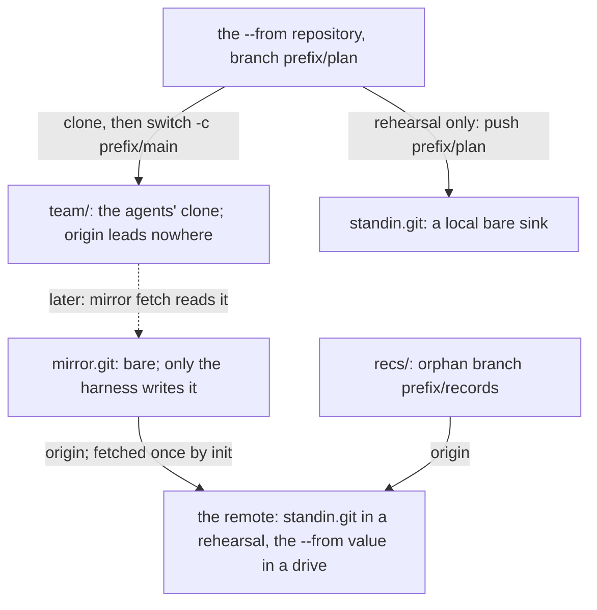

# Tazuna 2 -- `init`: laying out a drive

*[手綱（たづな）*Tazuna* — the harness](TAZUNA.md) · chapter 2 of 10*

## Why this exists

Before a drive's first run there has to be a place for it, and the place has jobs of its own:

- **directories that exist before the agent's fence is armed** -- jichi's shell fence grants write
  access to a list of directories, and one that does not exist yet grants nothing;
- **one fixed jichi build** for the whole drive, so rebuilding the checkout does not change the agent
  (a run uses it when the tenant's `bin` names it; without a `bin`, `run` takes the `jichi` beside
  the harness);
- **the secrets, by reference** -- reachable when a run starts, never copied into the directory;
- **three git repositories with separate owners**: the team's clone, which the agents write; the
  mirror, which only the harness writes; the records clone, where runs' records are committed;
- **a rehearsal** -- the same layout with a local stand-in for the remote and fakes for the secrets.

And running the setup twice must be safe. `jichi-harness init` does all of this. It is the C89 port
of the shell drive's setup script (M1053, batch H2), the first harness command that runs git and the
only one that lays out a directory. It reads the configuration first, so this chapter does too.

## The shape



Beside these, `init` makes the plain directories (`runs/`, `inbox/`, `backups/`, `bin/`, `verify/`,
`home/.cache/`, `home/.jichi.d/tool-output/`), pins `bin/jichi`, writes the secrets' stand-ins, and
stores byte-exact copies of two repository configs for later integrity checks.

## Step 0: the configuration

`src/harness/jc_harness_config.c:jc_harness_config_load` turns one JSON file into a
`struct jc_harness_config` (`include/jc_harness_config.h`), and every command but `credential-helper`
calls it (that one reads only its environment). Its
header comment draws the line: it **is** the format, the refusals and the three `JICHI_HARNESS_*`
settings; it **is not** `doctor`, `init`, git, or the reading of any secret. It stores references --
a path, a variable name, a command -- and never opens what they point at.

| Key | Read as | Default |
|---|---|---|
| `dir` | the drive directory; **required**; `JICHI_HARNESS_DIR` wins over it | none |
| `modelKeyFile` | the path of the model key's file; `JICHI_HARNESS_MODEL_KEY_FILE` wins | absent |
| `gitTokenFile` | the path of the push token's file; `JICHI_HARNESS_GIT_TOKEN_FILE` wins | absent |
| `jichiConfig` | the path of jichi's own config (not parsed here) | absent |
| `pushKept` | lenient boolean: also push the kept attempts | false |
| `servers[]` | `name`, `kind` (`gitlab`, `github`, `gitea`, `bitbucket`, `ssh`, `local`), `url`, optional `credential` of `type` `tokenFile` (`path`), `env` (`name`), `helper` (`command`) or `sshKey` (`path`) | none |
| `tenants[]` | `name` (required), `home`, `workdir`, `jichiConfig`, `mirror`, `server`, `pushTarget` (must name a server), `branchPrefix` (required when `pushTarget` names a server whose kind is not `local`) | none |
| `drive` | `branchPrefix`, `end`, `leadModel` (strings); `limits.shellFence`, `.pathFence`, `.diskFence` and `teamPush` (lenient booleans) | limits false, `teamPush` true |
| `host` | 28 optional strings for the host-side commands; `host.dir` falls back to the resolved `dir` | each absent |

Four rules govern the reading:

- **A problem is a value, never a crash.** Not JSON, an array where an object belongs, a missing
  `dir`, an unknown kind: each sets a status and a message naming the problem, read back with
  `jc_harness_config_error` -- `CLAUDE.md`'s "tool errors are values", for a file a person writes.
- **An empty or non-string field counts as absent** (`src/harness/jc_harness_config.c:opt_str`).
  Whether absent is an error is the caller's call: no `dir` is a refusal, no `leadModel` is fine.
- **A secret is refused before it is stored.** A `credential` with a `token`, `key` or `password`
  field is refused in `src/harness/jc_harness_config.c:parse_credential` before the value reaches the
  arena, and a `url` with a `user:secret@` authority in
  `src/harness/jc_harness_config.c:parse_server`. Both messages name the rule, never the value. The
  header comment's reason: the configuration "must stay committable and shareable".
- **An environment setting wins over its config twin**, and the struct records which one won
  (`src/harness/jc_harness_config.c:resolve_ref`): a config may be shared, a key file's path is per
  machine. `doctor` uses the record to say "(env override)".

### Booleans are read leniently, and why

```c src/harness/jc_harness_config.c:parse_drive
        out->limits_shell_fence =
            jc_json_get_bool_lenient(limits, "shellFence", 0);
...
    out->drive_team_push = jc_json_get_bool_lenient(j, "teamPush", 1);
```

The reader is jichi's own, and short:

```c src/json/jc_json.c:jc_json_get_bool_lenient
int jc_json_get_bool_lenient(const cJSON *o, const char *key, int dflt)
{
    cJSON *item = cJSON_GetObjectItem(o, key);
    if (cJSON_IsBool(item)) {
        return cJSON_IsTrue(item) ? 1 : 0;
    }
    if (cJSON_IsNumber(item)) {
        return item->valuedouble != 0.0 ? 1 : 0;
    }
    if (cJSON_IsString(item) && item->valuestring != NULL) {
        /* ... */
        int b = 0;
        if (jc_bool_from_word(item->valuestring, &b)) {
            return b;
        }
    }
    return dflt;
}
```

A JSON boolean, a number (non-zero is true), or one of `true`/`false`, `yes`/`no`, `on`/`off`,
`1`/`0` in any case; anything else -- prose, an object -- falls to the default. `CLAUDE.md`
("Conventions & invariants") tells why: people write `1` for true, the strict reader called that the
wrong type and returned the default, and fifteen shipped configs saying `"pathFence": 1` ran with the
fence **off** (M519); a model's `{"readonly": 1}` got a writable child (M530). The elided comment
adds M534: `on`/`off` were missing while jichi's own `config set` wrote them. The rule is "who wrote
this JSON": a file a person writes is read leniently. `tests/test_harness_config.c` holds both
halves -- `"true"`, `1` and `"YES"` read as on, `"a fence we like"` falls to off.

Three limits. Leniency is about **values**, not **keys**: jichi's
`src/json/cJSON.c:cJSON_GetObjectItem` is case-sensitive and the loader never warns about a key it
does not know, so `"teampush": false` is simply absent and the push stays on (Try it shows the same
with `BranchPrefix`). The three `drive.limits` flags are read and unit-tested, but nothing in `src/`
reads them back yet. And the struct is not the whole schema: `drive.gitName`/`gitEmail`, a tenant's
`promptFile` and `bin`, and `drive.tick` are re-parsed by the commands that need them
(`src/harness/jc_harness_init.c:read_identity`, `src/harness/jc_harness_run.c:read_run_extras`,
`src/harness/jc_harness_drive.c:read_drive_extras`) -- one schema spread over four files. Notice
there that `read_identity`'s header says it returns 0 when a name was set, the code returns 1, and
its only caller tests `< 0`: harmless, and a reminder to read the code, not the comment.

## Walking `jc_harness_init_run`

`src/harness/jc_harness_init.c:jc_harness_init_run` is one long function doing the layout in the
shell script's order. Keep the file's header comment open: its numbered behaviours are the contract.

**1. Refuse before writing.** The mode must be `drive` or `rehearsal`; `DIR` must be given; `--from`
is required (the usage line's `[--from <repo>]` brackets are misleading); the jichi to pin must
exist -- `--jichi-bin`, or the `jichi` beside the running harness, found through `/proc/self/exe`;
the config must load; a drive needs a model-key reference; `drive.branchPrefix` must be set and short
enough that `<prefix>/records` fits its 160-byte buffer. Each failure exits 2 with nothing created.
In practice `--config` is always needed: a rehearsal may omit it, and is then refused for having no
branch prefix.

**2. `DIR` becomes absolute** -- `mkdir -p`, then `realpath`. `realpath` is an XSI extension, outside
the base POSIX level the Makefile selects, so the file defines `_XOPEN_SOURCE 600` before its first
`#include` (a feature-test macro must be seen before any system header). Note what is **not** used:
the config's `dir`. The layout goes where the command line says, while `run` and `drive` later use
the config's `dir`; keep them the same.

**3. The plain directories.** The function's comment calls them "the shell fence's grants". jichi's
Landlock code shows why they must exist first:

```c src/util/jc_landlock.c:add_beneath
    fd = open(path, O_PATH | O_CLOEXEC);
    if (fd < 0) {
        return 0;   /* missing/unreadable -> skip (cannot widen) */
    }
```

A grant for a path that cannot be opened is skipped -- safe for a fence, and fatal for the agent's
writes there. A drive's tenant `home` names this `home/` (`tests/smoke/harness_drive.sh` wires it
so), `run` makes it the child's `HOME`, and jichi keeps its tool-output store under
`$HOME/.jichi.d/tool-output`.

**4. The pinned jichi.** `bin/jichi` is a byte copy, mode 755, reported by the `build:` line of its
`--version --verbose` -- the commit it was built from (M495: two builds about 50 milestones apart
once printed the same version). A pin that exists **and** is executable is left alone; one that is
not executable is pinned again (the script tested `-x`, not `-e`; the code calls this S2).

**5. The secrets.** In a drive, `key.env` gets one line, mode 600:

```c src/harness/jc_harness_init.c:jc_harness_init_run
            if (jc_snprintf(keyfile_line, sizeof keyfile_line,
                            "JICHI_API_KEY=$(tr -d ' \\t\\n\\r' < %s)\n",
                            keyfile) >= (int)sizeof keyfile_line) {
```

It names the key file and never holds the key. A rehearsal gets two canaries instead, `canary.env`
(`JICHI_API_KEY=CANARY-` and 24 random hex digits) and `canary.token` (`tokcanary-` and 24 more),
drawn with the script's exact `od -An -N12 -tx1 /dev/urandom`. A canary is a fake secret whose
appearance anywhere is proof of a leak, and each rehearsal draws its own. At this commit the
canaries keep the default file mode (they are not secrets), and nothing in `src/harness/` reads
`key.env` or the canaries again: `run` reads the configured key file itself
([chapter 4](tazuna-04-run-and-the-handoff.md)).

**6. The stand-in, rehearsal only.** `standin.git`, bare, receives the source's `<prefix>/plan` by a
push by path. It has no origin: it is a sink that plays the remote.

**7. `team/`.** A `git clone --no-local --branch <prefix>/plan` of the source, switched to a new
`<prefix>/main`, its origin set to `/nonexistent-the-harness-pushes`, git's `*.sample` hooks removed.
The dead-end origin is deliberate: the team never fetches or pushes; the harness pushes from the mirror.

**8. `mirror.git`.** Bare, origin the remote, fetch refspec `+refs/heads/*:refs/remotes/origin/*`,
and one initial fetch with `-c credential.helper=` so the operator's credential cache is never asked.
A failed fetch is **reported, not fatal**. Then the mirror's `config` is copied byte for byte to
`mirror.git-config.harness-copy`, and the comment says why now:

```c src/harness/jc_harness_init.c:jc_harness_init_run
             * the harness wrote. Written HERE, at creation, not re-read
             * later -- a later re-read would bless a plant. A mirror whose
```

`mirror fetch` refuses a mirror whose config differs from that copy (M1055,
[chapter 3](tazuna-03-the-mirror-and-the-credential-helper.md)).

**9. `recs/`.** A normal repository on an orphan branch `<prefix>/records`, a `README.md` built from
the prefix, committed with `drive.gitName`/`drive.gitEmail` passed as `GIT_AUTHOR_*` and
`GIT_COMMITTER_*` in the child's environment, which beat every git config level (with neither set,
git's own resolution applies). Then its origin, and `recs.git-config.harness-copy`, the reference
for the records push's URL guard.

**10. The host push home**, only with a `host` block naming `pushHome`: two more bare repositories,
`push.git` and `recs-push.git`, for the scheduled push
([chapter 6](tazuna-06-push-the-scheduled-host-push.md)). Otherwise nothing outside `DIR` is touched.

### Every git child

```c src/harness/jc_harness_init.c:git_run_env
    argv[k++] = (char *)"git";
    argv[k++] = (char *)"-c"; argv[k++] = (char *)"core.fsmonitor=";
    argv[k++] = (char *)"-c"; argv[k++] = (char *)"log.showSignature=false";
    argv[k++] = (char *)"-c"; argv[k++] = (char *)"commit.gpgsign=false";
    argv[k++] = (char *)"-c"; argv[k++] = (char *)"core.hooksPath=/dev/null";
...
    return jc_proc_capture(argv, env, NULL, out, GIT_OUT_CAP, 30, NULL);
```

The four `-c` flags are jichi's "M2" neutralisation, explained at
`src/tools/jc_tool_git.c:git_capture`: an empty `core.fsmonitor` beats a planted one, no signature
check can start a planted gpg program, no commit is signed by one, and no hook runs.
`src/util/jc_proc.c:jc_proc_capture` scrubs the registered secret variables from the child.

> **C sidebar -- why the casts.** In C89 a string literal has type `char[N]`, so `argv[k++] = "git";`
> compiles as C. The casts exist because `make ci` also builds the harness as C++ (M1049), where a
> literal is `const char[N]`. And `argv` is a fixed `char *argv[32]` behind a refusal of more than 16
> extra arguments: the bound is checked, not hoped for.

Two more facts from the code. The `30` is a kill deadline: a git child still running after 30
seconds is killed with `SIGKILL`, process group and all. A `--no-local` clone of jichi's own
repository from a local path took about 3 seconds here; a clone over a network was not measured. And
unlike `mirror fetch`, `init` does not point `GIT_CONFIG_GLOBAL` at an empty file, so apart from the
four flags the operator's own git configuration applies -- `init` runs once, by the operator, before
any agent has touched the directory.

### "Left as it is", and what is not done

Idempotence is one pattern, repeated for every part: if it exists (`jc_is_dir`, `jc_file_exists`),
say "left as it is"; else build it. So `init` never **repairs**: the test for `team/` is only whether
`team/.git` is a directory. What a second run makes of a clone the 30-second deadline killed halfway
was not measured here; read the test and decide. The never-delete rule has two edges:
`remove_hook_samples` deletes git's templates (only in a clone just made), and a non-executable
`bin/jichi` is overwritten. And the header lists what the port dropped on purpose: no copy of the
scripts into `DIR/harness/` (the C program **is** the harness), no rehearsal container names (Mode A
has none; def-336), no pre-push hooks or credential helper -- the key scan and size check are C code
in `src/harness/jc_harness_push.c:jc_harness_mirror_push_run`, so the repositories are laid out
**unarmed**.

### The rehearsal

Not a separate code path: apart from the drive-only refusal, the function's real branch on
`is_drive` is one block -- a drive gets `key.env` and `--from` as its remote, a rehearsal the canaries and a fresh
`standin.git`. The rest is shared, so a rehearsal exercises the drive's layout with "no real remote"
and canaries "never the real key or token" (`docs/HARNESS.md`); `tests/smoke/harness_init.sh` runs
it end to end with real git.

## Try it

Everything happens in a fresh temporary directory, with a source repository made on the spot.
Nothing touches your checkout, a server or a credential.

**1. A source repository with a plan branch, and a config.**

```sh
# in the jichi checkout, after `make jichi jichi-harness`
J=$(pwd)
cd "$(mktemp -d)"
git init -q src
git -C src -c user.name=Learner -c user.email=learner@example.com commit -q --allow-empty -m "the plan's first commit"
git -C src branch drive/tazuna/plan
cat > harness.json <<EOF
{"dir": "$(pwd)/drive",
 "drive": {"branchPrefix": "drive/tazuna",
           "gitName": "Tazuna Learner", "gitEmail": "learner@example.com"}}
EOF
```

**2. The rehearsal.**

```sh
# in the same temporary directory, still
"$J/jichi-harness" init --config harness.json rehearsal drive --from src --jichi-bin "$J/jichi" < /dev/null; echo "exit $?"
```

```
init (rehearsal): bin/jichi: (no build stamp)
init (rehearsal): canary.env: a random model-key canary (never a fixed string)
init (rehearsal): canary.token: a random token canary (never a fixed string)
init (rehearsal): standin.git: the source's plan branch, local (no real remote)
init (rehearsal): team/ on drive/tazuna/main at a68c26e
 (no sample hooks; origin leads nowhere)
init (rehearsal): mirror.git fetched 1 remote refs
init (rehearsal): mirror.git: the config bytes are stored at mirror.git-config.harness-copy (for `mirror fetch`'s integrity check)
init (rehearsal): recs.git: the config bytes are stored at recs.git-config.harness-copy (the records push's URL guard reference)
init (rehearsal): recs/ on drive/tazuna/records (orphan), origin /tmp/tmp.MV5HxdtqYe/drive/standin.git
init (rehearsal): done: /tmp/tmp.MV5HxdtqYe/drive
exit 0
```

One line per part, in the walk's order; your hashes and paths will differ. `(no build stamp)` is
honest: this binary was built from a tree without git history, and jichi prints no `build:` line
rather than an invented one. The break after `a68c26e` is a defect (see the last section).

**3. What it made.**

```sh
# in the same temporary directory, still
find drive -maxdepth 1 | sort
find drive/home | sort
ls -l drive/bin/jichi drive/canary.env drive/canary.token | awk '{print $1, $NF}'
cat drive/canary.env drive/canary.token
git -C drive/team remote get-url origin
ls drive/team/.git/hooks | wc -l
cmp drive/mirror.git/config drive/mirror.git-config.harness-copy && echo "the stored copy matches"
git -C drive/recs log --format='%an <%ae>: %s'
```

```
drive
drive/backups
drive/bin
drive/canary.env
drive/canary.token
drive/home
drive/inbox
drive/mirror.git
drive/mirror.git-config.harness-copy
drive/recs
drive/recs.git-config.harness-copy
drive/runs
drive/standin.git
drive/team
drive/verify
drive/home
drive/home/.cache
drive/home/.jichi.d
drive/home/.jichi.d/tool-output
-rwxr-xr-x drive/bin/jichi
-rw-rw-r-- drive/canary.env
-rw-rw-r-- drive/canary.token
JICHI_API_KEY=CANARY-99eea85e1d21bd63568d1523
tokcanary-578e4836f4719115624ae765
/nonexistent-the-harness-pushes
0
the stored copy matches
Tazuna Learner <learner@example.com>: records: the branch
```

Every part of the walk, and no `harness/`. The canaries get whatever mode your umask gives a new
file (`-rw-rw-r--` here). The team's clone has no hook files at all (`0`). The records commit
carries the config's identity, not yours.

**4. Again, then three refusals.**

```sh
# in the same temporary directory, still
"$J/jichi-harness" init --config harness.json rehearsal drive --from src --jichi-bin "$J/jichi" < /dev/null; echo "exit $?"
cat drive/canary.token
```

```
init (rehearsal): bin/jichi exists: left as it is
init (rehearsal): canary.env exists: left as it is
init (rehearsal): canary.token exists: left as it is
init (rehearsal): team/ exists: left as it is
init (rehearsal): mirror.git exists: left as it is
init (rehearsal): recs/ exists: left as it is
init (rehearsal): done: /tmp/tmp.MV5HxdtqYe/drive
exit 0
tokcanary-578e4836f4719115624ae765
```

The same canary as before. An existing `standin.git` is skipped silently, unlike the other six parts.

```sh
# in the same temporary directory, still
"$J/jichi-harness" init --config harness.json rehearsal other --jichi-bin "$J/jichi" < /dev/null; echo "exit $?"
printf '{"dir": "unused", "drive": {"BranchPrefix": "drive/tazuna"}}\n' > typo.json
"$J/jichi-harness" init --config typo.json rehearsal other --from src --jichi-bin "$J/jichi" < /dev/null; echo "exit $?"
printf '{"dir": "unused", "servers": [{"name": "g", "kind": "gitlab", "url": "https://example.com/x.git", "credential": {"type": "tokenFile", "token": "s3cret"}}]}\n' > secret.json
"$J/jichi-harness" init --config secret.json rehearsal other --from src --jichi-bin "$J/jichi" < /dev/null; echo "exit $?"
ls -d other
```

```
jichi-harness: init: --from <repo> is required: the source of the team clone, and the rehearsal's local stand-in's content
exit 2
jichi-harness: init: the branch prefix is not set (the config's drive.branchPrefix): the team, the mirror and the records branches hang off it
exit 2
jichi-harness: init: the harness config could not be loaded: server "g": credential holds a secret verbatim in field "token"; the configuration never holds a secret; name a reference (tokenFile/env/helper/sshKey), not the value
exit 2
ls: cannot access 'other': No such file or directory
```

The misspelled `BranchPrefix` loads without complaint -- it is simply absent -- and `init` names the
key it lacks. The secret is refused by field name; `s3cret` is nowhere in the output. All three
refusals came before the first write.

**5. The drive form, with a key file that holds no key.**

```sh
# in the same temporary directory, still
printf 'not-a-real-key\n' > fake.key
cat > drive.json <<EOF
{"dir": "$(pwd)/d2", "modelKeyFile": "$(pwd)/fake.key",
 "drive": {"branchPrefix": "drive/tazuna",
           "gitName": "Tazuna Learner", "gitEmail": "learner@example.com"}}
EOF
"$J/jichi-harness" init --config drive.json drive d2 --from src --jichi-bin "$J/jichi" < /dev/null; echo "exit $?"
cat d2/key.env
ls -l d2/key.env | awk '{print $1, $NF}'
git -C d2/mirror.git remote get-url origin
```

```
init (drive): bin/jichi: (no build stamp)
init (drive): key.env: the model key file is read when sourced (no copy)
init (drive): team/ on drive/tazuna/main at a68c26e
 (no sample hooks; origin leads nowhere)
init (drive): mirror.git: the fetch from origin FAILED
init (drive): mirror.git: the config bytes are stored at mirror.git-config.harness-copy (for `mirror fetch`'s integrity check)
init (drive): recs.git: the config bytes are stored at recs.git-config.harness-copy (the records push's URL guard reference)
init (drive): recs/ on drive/tazuna/records (orphan), origin src
init (drive): done: /tmp/tmp.MV5HxdtqYe/d2
exit 0
JICHI_API_KEY=$(tr -d ' \t\n\r' < /tmp/tmp.MV5HxdtqYe/fake.key)
-rw------- d2/key.env
src
```

`key.env` names the key file, mode 600, and `not-a-real-key` is not in it. No canaries, no stand-in.
And the relative `--from src` became the mirror's origin as written: from inside `d2/mirror.git`,
`src` names nothing, so the initial fetch failed -- reported, with `init` still exiting 0. In drive
mode `--from` is meant to be the remote itself, and a URL resolves from anywhere; with a local path,
give an absolute one.

## What went wrong here, and what it teaches

The function's comments record what review and testing found:

- **A read past the end (S1).** `src/harness/jc_harness_init.c:build_stamp` advanced with
  `strchr(p, '\n') + 1`, undefined when no newline remains; `tests/smoke/harness_init.sh` records
  that the unfixed walk segfaults. The fix tests for `build: ` first and stops at the last line.
- **A prefix too long for its names (S3)** is now, in the comment's words, "a usage-class refusal
  (exit 2), not a silent truncation to the wrong branch names". A bounded `jc_snprintf` prevents an
  overflow, not a wrong answer: its return value is the check.
- **A hard-coded date (M1147).** The records `README.md` named the drive of 2026-10-23 whatever drive
  you laid out; it is now built from the prefix.
- **A deviation, removed.** An early port gave `standin.git` an origin back to the source, which the
  reference never did.

Four more turned up in this chapter's own runs -- observations, not recorded incidents:

- the `team/ on ... at <hash>` line breaks because `rev-parse --short`'s newline is kept;
  `src/harness/jc_harness_mirror.c` has a `first_line` helper for this, and no driver reads the line;
- `init` never reads the config's `dir`, though `docs/HARNESS.md`'s settings table lists `init` as a
  reader of `JICHI_HARNESS_DIR`;
- a relative `--from` in drive mode becomes the origin verbatim and the fetch fails, yet exit is 0;
- the records `README.md` still says "written by the harness (loop.sh)", a script the port replaced.

What they share: a report line is part of the record, and a test that checks the layout without
reading the report lines will not see one go wrong. Exit 0 says the function finished, not that every
part it reported is usable.

## Check yourself

1. Why must `init` create `home/.jichi.d/tool-output` before any run, instead of letting jichi make
   it when needed?
2. Someone writes `"pathFence": "on"` in `drive.limits`. What does the loader store, and what would
   a strict reader have stored?
3. What does `key.env` contain in a drive, and what does it never contain?
4. Why is `mirror.git-config.harness-copy` written at creation and never refreshed?
5. Between two runs of `init` you delete `drive/canary.token`. What does the second run do?

<details>
<summary>Answers</summary>

1. The shell fence grants a directory by opening it; a path that does not exist is skipped and grants
   nothing (`add_beneath`), so the fenced shell could never write there.
2. On: `"on"` is one of the lenient words. A strict reader returns the default for any non-boolean,
   so it would have stored off. Before M534 the lenient reader stored off too, because `on` and
   `off` were not yet among its words.
3. One line, `JICHI_API_KEY=$(tr -d ' \t\n\r' < <key file>)`, mode 600: a reference that reads the
   key file when sourced. Never the key.
4. It is what `mirror fetch` compares the live config against; a copy refreshed later would capture
   whatever had been planted in the meantime.
5. It draws and writes a new token canary (`canary.token: a random token canary`) and leaves every
   other part as it is; `canary.env` keeps its old value.

</details>

*Next: [chapter 3 — the mirror and the credential helper](tazuna-03-the-mirror-and-the-credential-helper.md).*
