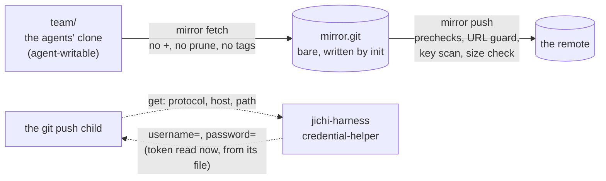

# Tazuna 3 -- The mirror and the credential helper

*[手綱（たづな）*Tazuna* — the harness](TAZUNA.md) · chapter 3 of 10*

## Why this exists

A drive's team works for hours in its own clone, `team/`. Its work has to reach
the remote, where it survives the machine and where the gate can read it. The
operator wants three things from that journey:

- **the agents never hold the push token.** A stolen token pushes anywhere the
  token can (`docs/HARNESS.md`, the threat model);
- **the history is never rewritten.** No `--force`, no push to `master`;
- **nothing the agents planted runs as the harness.**

The third is the subtle one. In Mode A the harness and the agents run as the
same user, so everything in `team/.git` is agent-writable: its `config`, its
`hooks/`, a `core.fsmonitor` command. Git runs those for *whoever runs git
there*. Were the harness to `git push` inside `team/`, a planted hook would run
with the harness's rights, beside the token.

So the harness never pushes from the team's clone. `init` (chapter 2) points the
clone's `origin` at `/nonexistent-the-harness-pushes` and keeps a repository of
its own, `mirror.git`. The plan's table of lessons
(`docs/plans/2026-10-21-jichi-harness.md`, section 14) pairs "Never run git in a
repository the agent can write" with its mechanism, "the mirror pattern, in
every mode". In Mode A the rule holds for the *push*. The harness still starts
git children that *read* the team's clone (the fetch below, and `run`'s
`rev-parse` in chapter 4), and each carries the neutralisation described here.
The `rev-parse` carries four of its five `-c` flags: it leaves out
`core.alternateRefsCommand=`.

`mirror fetch` copies the team's branches into the mirror
(`src/harness/jc_harness_mirror.c`). `mirror push` sends them on to the remote
(`src/harness/jc_harness_push.c`, whose other commands are chapter 6's), and
git gets the token from `credential-helper` (`src/harness/jc_harness_cred.c`).

## The shape



Both solid arrows start with the same five checks. The dotted exchange happens
*inside* the push: git asks, the helper answers, and the token travels only on
that pipe.

## The mirror: a repository only the harness writes

`init` creates `mirror.git` as a bare repository whose `origin` is the remote
(in a rehearsal, a local bare stand-in), and stores a byte copy of its `config`
beside it as `mirror.git-config.harness-copy`.

### The five checks, before any git runs

`src/harness/jc_harness_mirror.c:precheck` runs five checks, and none of them
runs git. Each reads a file or lists a directory, because git itself is the
danger: a check that ran `git config` would already be running git inside a
repository that may have been tampered with.

| Check (as the refusal names it) | Function | What it refuses |
|---|---|---|
| 1, bare | `check_bare` | a `HEAD` file that is missing or not a `ref: ` line. The team's clone fails here: its `HEAD` is under `.git/` |
| 2, ownership | `check_ownership` | a mirror directory owned by another uid |
| 3, config bytes | `check_config_bytes` | a `config` differing by one byte from the stored copy, or no stored copy |
| 5, alternates | `check_no_alternates` | an `objects/info/alternates` file: git would run the mirror's `core.alternateRefsCommand` over the stores it names |
| 4, hooks | `check_hooks` | any regular file in `hooks/` whose name does not end in `.sample` (the ending of git's own templates, which git never runs) |

A failed check exits 2, names the check, and nothing is fetched. The rows are
in the fetch's order; the numbers are the ones the messages print.

**The honest limit.** This is a check-then-use guard. A process running as the
same user could plant something between the check and the git call, and
`check_config_bytes`'s refusal text says so: "a check-then-use guard against the
agent's own commands, not a fence against a same-uid racer". The complete fence
is a separate user (Mode B, `docs/HARNESS.md`, "The modes").

### The neutralised git child

Every git process the fetch starts goes through
`src/harness/jc_harness_mirror.c:git_m2`:

```c src/harness/jc_harness_mirror.c:git_m2
    argv[k++] = (char *)"git";
    argv[k++] = (char *)"-c"; argv[k++] = (char *)"core.fsmonitor=";
    argv[k++] = (char *)"-c"; argv[k++] = (char *)"log.showSignature=false";
    argv[k++] = (char *)"-c"; argv[k++] = (char *)"commit.gpgsign=false";
    argv[k++] = (char *)"-c"; argv[k++] = (char *)"core.hooksPath=/dev/null";
    argv[k++] = (char *)"-c"; argv[k++] = (char *)"core.alternateRefsCommand=";
```

A `-c` on the command line overrides the repository's configuration, and each
of these switches off one way a configuration can make git run a program: the
file-watcher command, the two signature settings that can start `gpg`, every
hook, and (behind check 5) the alternates command. The environment adds the
other half: `GIT_CONFIG_GLOBAL` and `GIT_CONFIG_SYSTEM` point at two empty files
the harness owns (`make_empty_env_files`). A plant in the agent's
`~/.gitconfig` is then invisible to the git child, and to the `upload-pack`
child git starts to read the team's clone. The comment in `git_m2` names one
such setting, `uploadpack.packObjectsHook`.

### What the fetch copies, and what it refuses to copy

`src/harness/jc_harness_mirror.c:fetch_team_branches` fetches two refspecs from
the team's clone, `<prefix>/main` and `<prefix>/work/*`, with **no `+`**, no
`--prune` and `--no-tags`. Without the `+`, git refuses to move a mirror branch
backwards or sideways, so a branch the team rewrote keeps its old tip. Without
`--prune`, a branch the team deleted stays. The mirror only grows forward.

A refused ref is *expected*: the missing `+` exists to cause it. The
function's comment records a measurement on git 2.53 under `-q`: a refused ref
exits 1 and prints nothing, and a broken source exits 1 too, with output. So
the port tells them apart by whether git printed anything:

```c src/harness/jc_harness_mirror.c:fetch_team_branches
    /* rc != 0, measured shape (2.53, -q): */
    cut_copy(cut, sizeof cut, out.data);
    if (rc == 1 && (out.data == NULL || out.data[0] == '\0')) {
```

A silent 1 is the refused ref: a report line, exit 0, because the other
refspec still applied. Any other result is a transport failure: exit 1 with
git's first 200 bytes. Measured here on git 2.43.0 (2.53 was not checked), a
refused ref was a silent 1, as the comment says. A broken source was not a 1:
a missing path, and a directory that is not a repository, each exited 128 with
`fatal: ... does not appear to be a git repository`. The harness reported
`failed (rc=128)` and exited 1, so its verdict was still right. The trade-off
is in the comment: the rule was measured on git 2.53 under `-q`. A future git
that prints on a refused ref would turn every refusal into a "transport
failure": loud, but wrong.

Then `fetch_kept_all` copies the **kept attempts**, jichi's discarded
checkpoints under `<dir>/home/.jichi.d/checkpoints/`, into `refs/kept/<k>/*`,
but only from a store whose `worktree =` line is byte-exactly the team's
workdir. Any other store is skipped. The comment names the incident behind
that: on 2026-10-18 a lead's scratch-probe store had a worktree that existed
only inside its own container. `mirror head` prints the mirror's
`<prefix>/main` as a short hash (`jc_harness_mirror_head_run`). It runs its
`rev-parse` through `git_m2`, but without the five checks.

## The push: a sequence of refusals

`src/harness/jc_harness_push.c:jc_harness_mirror_push_run` reads best as a list
of reasons *not* to push. Each one ends the command before anything reaches the
remote:

1. **The five checks again**, git-free, in the order 1, 2, 5, 4, 3. They are a
   *copy* of the fetch's functions. The block comment above them explains
   ("rather than refactor the fetch file, the minimum ... is duplicated here")
   and names the cost: "If M1055's precheck changes, this copy must follow."
2. **The URL guard.** The effective push URL, which the first git child reads
   with `git remote get-url --push origin`, must equal the stored copy's
   `url =` line byte for byte (`stored_origin_url`), or exit 2 naming both. A global `insteadOf`
   plant needs no guard: the empty `GIT_CONFIG_GLOBAL` hides it from the guard
   and the push alike.
3. **The two secrets, read now** (`load_secret`), from the files the
   configuration names. A missing file, or one shorter than 12 bytes after
   trimming whitespace, refuses (exit 1). A scan with nothing to look for must
   never pass: that is *fail-closed*.
4. **The key scan** (`key_scan`) reads every file version the push would *add*
   to `<prefix>/main`, `<prefix>/work/*` and, when `pushKept` is on, the kept
   branches of step 6, and searches it for either secret. (Until M1179 it did
   not read the kept refs: see the end of "What went wrong here".) More tips
   than the scan carries (24) is a refusal. "Would add" means reachable from those
   tips, minus what the remote has **now**: `build_exclusion` asks
   `git ls-remote <stored URL>`, because a push by URL never updates the
   mirror's tracking refs, which are therefore stale by construction. A hit
   exits 1 naming the *path*, never the content. Finding no tip to push is a
   refusal too.
5. **The size check** (`size_check`), over the same tips: no file version over
   8 MiB, no push over 20 MiB.
6. **The push**: `git push -q <stored URL>` with the two refspecs, by the URL
   the harness stored, never by the name `origin`, and never with `--force`.
   The kept attempts travel only when the configuration's `pushKept` is true,
   as `<prefix>/kept/*` branches (`build_refspecs`). `pushKept` is off unless
   the configuration sets it. A non-fast-forward
   rejection is exit 1: a push that did not land has failed.

Every git child of the push is bounded at 120 seconds (`PUSH_TIMEOUT`), the
fetch's at 60, which its comment calls "generous but bounded". These are caps on
git, and a real push slower than that would be reported as a failure. How close
a real push comes to the bound is not measured here.

## The credential helper: how the token reaches git

Git does not read passwords itself. It starts a **credential helper** with the
action `get`, writes the identity it wants (`protocol=`, `host=`, `path=`) on
the helper's stdin, and reads `username=` and `password=` back. The harness *is*
that helper: `jichi-harness credential-helper` is a top-level command git
starts, not a script lying in the mirror.

`src/harness/jc_harness_push.c:credential_args` gives the push child three `-c`
flags:

- `credential.helper=`, empty, which **resets** the list of helpers git would
  consult in turn, so a helper planted in any configuration is not asked;
- `credential.helper=<the harness's absolute path> credential-helper`, the
  **set**. The path is the running binary's own (`self_exe` reads
  `/proc/self/exe`), never whatever `PATH` would find;
- `credential.useHttpPath=true`, so the identity includes the repository path.

`credential_env` adds three environment entries: `JICHI_HARNESS_GIT_TOKEN_FILE`
(the token file's *path*, never the token), `JICHI_HARNESS_CRED_RULE` (the user
name: `oauth2` for a URL with a scheme, `none` for a local path, for which git
asks no helper at all) and `JICHI_HARNESS_CRED_URL` (the stored remote URL). The
key scan's `ls-remote` child gets the same flags and environment, because on an
HTTPS remote listing the tips needs the credential too.

`src/harness/jc_harness_cred.c:cred_get` splits the configured URL into the
protocol, host and path git would send for it (`classify_url`), reads git's
request (`parse_identity`), and compares:

```c src/harness/jc_harness_cred.c:cred_get
    if (proto_in == NULL || strcmp(proto_in, exp_proto) != 0) {
        return refuse_mismatch(url);
    }
...
    if (strcmp(host_in, exp_host) != 0) {
        return refuse_mismatch(url);
    }
...
    if (strcmp(path_in, exp_path) != 0) {
        return refuse_path_mismatch(url, path_in);
    }
```

Only after all three match is the token file opened (`load_token`: trimmed, at
least 12 bytes), and the helper prints exactly two lines. For `store` and
`erase`, `cred_noop` reads the input, discards it and prints nothing, so git
can never get the helper to save the token anywhere.

**Why check the identity when the URL guard already did?** The guard is
check-then-use too: a same-user process could re-point `origin` between the
guard and the push (def-346 in `docs/DEFERRED.md`). The helper has no such
window. Whatever URL the push ends up dialling, it answers only for the remote
it was configured with, and the source calls it "the race-free layer". So the
token rests in its file, sits in the helper's memory for one `get`, crosses one
pipe to git, and goes to the server. It is never on an argv, in a log, in the
mirror, or in the agents' environment.

**A gap, stated.** `include/jc_harness_config.h` says the configuration keeps a
user-name rule per server kind (`github` -> `x-access-token`, ...) "so H3's
helper can apply it". The push does not consult it: it derives the rule from
the URL's shape (the `is_file ? "none" : "oauth2"` test in
`jc_harness_mirror_push_run`), and
`src/harness/jc_harness_config.c:jc_harness_user_name_rule_of` is called only by
its unit test. What a non-GitLab server makes of `oauth2` is not measured here.

## Try it

Everything runs in a throwaway directory against a local stand-in remote: no
network, no model, and canary secrets. First a rehearsal, laid out by `init` as
chapter 2 described. The `unset` matters, because those settings, if exported,
win over the configuration file (chapter 9):

```sh
# in the jichi checkout, after `make jichi jichi-harness`
H=$PWD/jichi-harness J=$PWD/jichi
unset JICHI_HARNESS_DIR JICHI_HARNESS_MODEL_KEY_FILE JICHI_HARNESS_GIT_TOKEN_FILE
cd "$(mktemp -d)"
git init -q src
git -C src -c user.name=Practice -c user.email=practice@example.com commit -q --allow-empty -m "the plan"
git -C src branch practice/plan
printf 'CANARY-model-key-0123456789\n' > key
printf 'CANARY-git-token-0123456789\n' > token
chmod 600 key token
cat > harness.json <<EOF
{"dir":"$PWD/drive","modelKeyFile":"$PWD/key","gitTokenFile":"$PWD/token",
 "drive":{"branchPrefix":"practice","gitName":"Practice","gitEmail":"practice@example.com"}}
EOF
"$H" init --config harness.json rehearsal drive --from src --jichi-bin "$J" < /dev/null
```

`init` reports each part it lays out and ends with
`init (rehearsal): done: .../drive`. Now play the team, then the harness:

```sh
# in the same scratch directory and shell
echo hello > drive/team/notes.txt
git -C drive/team add notes.txt
git -C drive/team -c user.name=Practice -c user.email=practice@example.com commit -q -m "the team's first commit"
"$H" mirror fetch --config harness.json drive/mirror.git < /dev/null
"$H" mirror push --config harness.json drive/mirror.git < /dev/null
git -C drive/standin.git log --oneline practice/main
```

```
mirror fetch: done
mirror push: the key scan: 1 file version(s) in 1 commit(s) checked, 0 with a secret
mirror push: the size check: 1 file version(s), 0.0 MB in all, the biggest file version 0.0 MB -- within the limits of 8 MB per file version and 20 MB per push
mirror push: pushed practice/main and the practice/work refset to .../drive/standin.git
d4f0fab the team's first commit
6292428 the plan
```

One commit was scanned, not two: the stand-in already had "the plan", so
`ls-remote` excluded it. (Your hashes will differ.) Now act as an agent running
as the same user: plant a hook in the mirror, then commit a secret and delete
it again:

```sh
# in the same scratch directory and shell
printf '#!/bin/sh\ntouch planted\n' > drive/mirror.git/hooks/post-merge
"$H" mirror fetch --config harness.json drive/mirror.git < /dev/null; echo "rc=$?"
rm drive/mirror.git/hooks/post-merge
cp token drive/team/oops.txt
git -C drive/team add oops.txt
git -C drive/team -c user.name=Practice -c user.email=practice@example.com commit -q -m "a secret, committed"
git -C drive/team rm -q oops.txt
git -C drive/team -c user.name=Practice -c user.email=practice@example.com commit -q -m "and deleted again"
"$H" mirror fetch --config harness.json drive/mirror.git < /dev/null
"$H" mirror push --config harness.json drive/mirror.git < /dev/null; echo "rc=$?"
git -C drive/standin.git log --oneline practice/main
```

```
jichi-harness: mirror: check 4 (hooks): the mirror's hooks/ holds a regular file drive/mirror.git/post-merge that the harness did not put there -- init lays the mirror out without arming it (def-337), so a hook there is a plant
rc=2
mirror fetch: done
mirror push: the key scan: 1 file version(s) in 2 commit(s) checked, 1 with a secret (refused)
jichi-harness: mirror: the key scan: the pushed file version oops.txt contains a secret (the model key or the git token); the push is refused
rc=1
d4f0fab the team's first commit
6292428 the plan
```

Read the path in the first message: `drive/mirror.git/post-merge`, though the
file was in `hooks/`. `check_hooks` formats the mirror and the file name, not
the hooks directory, and the push file's copy of the check builds the path the
same way. The verdict is right; the message names the wrong path.

The tip no longer has `oops.txt`, but the push would carry the middle commit,
so the scan reaches it, and the remote did not move. This mirror cannot push
again until the operator steps in: the secret is in its history, and the fetch
(no `+`) will not let the team rewrite it away. The driver
`tests/smoke/harness_mirror_push.sh` lays out a fresh rehearsal for each family
of cells for the same reason.

The local stand-in never asked the helper anything, since git consults no
helper for a local path. So drive it by hand, first playing git, then letting
real git play itself (`git credential fill` asks the helpers and contacts no
server):

```sh
# in the same scratch directory and shell
export JICHI_HARNESS_GIT_TOKEN_FILE=$PWD/token
export JICHI_HARNESS_CRED_RULE=oauth2
export JICHI_HARNESS_CRED_URL=https://git.example.org/drive/remote.git
printf 'protocol=https\nhost=git.example.org\npath=drive/remote.git\n\n' | "$H" credential-helper get; echo "rc=$?"
printf 'protocol=https\nhost=git.example.org\npath=other/project.git\n\n' | "$H" credential-helper get; echo "rc=$?"
printf 'url=https://git.example.org/drive/remote.git\n\n' | GIT_TERMINAL_PROMPT=0 git -c credential.helper= -c "credential.helper=$H credential-helper" -c credential.useHttpPath=true credential fill; echo "rc=$?"
unset JICHI_HARNESS_GIT_TOKEN_FILE JICHI_HARNESS_CRED_RULE JICHI_HARNESS_CRED_URL
```

```
username=oauth2
password=CANARY-git-token-0123456789
rc=0
jichi-harness: credential-helper: get refused: the requested path does not match the configured remote's path; the credential will not be served for https://git.example.org/drive/remote.git (the requested path is not that remote's; requested path: other/project.git)
rc=1
protocol=https
host=git.example.org
path=drive/remote.git
username=oauth2
password=CANARY-git-token-0123456789
rc=0
```

Note the `path=` git sent: `drive/remote.git`, *without* a leading slash. The
next section tells what that slash once cost. The final `unset` is not tidiness:
an exported `JICHI_HARNESS_GIT_TOKEN_FILE` would override the configuration of
the next harness command you run.

## What went wrong here, and what it teaches

**def-367, part 1: the flag that pointed into a dead frame.** The record is the
def-367 row in `docs/DEFERRED.md` and the M1147 entry in `docs/ROADMAP.md`.
M1056's `mirror push` built the credential flags like this (as it stood before
the fix):

```c
credential_args(char *argv_out[], int cap, const char *harness)
{
    char setflag[PATH_CAP + 32];
    ...
    argv_out[1] = setflag;
```

`setflag` is an automatic array in `credential_args`'s own stack frame, which
ends at the `return`. In C89 the value of a pointer to an automatic object
becomes indeterminate when the object's block ends, and using it is undefined
behaviour. The record says why it mattered: both callers ran `jc_snprintf` three
times and `credential_env` *after* building the flags and *before* the git child
read them, each free to reuse those stack bytes. The flag naming the helper
could be overwritten between being built and being executed. It shipped in the
published 0.13.0, and the driver cell that captured the push child's argv was,
in the record's words, "green by luck, not by construction".

The fix allocates the string in the command's arena, which outlives every git
child:

```c src/harness/jc_harness_push.c:credential_args
    setflag = (char *)jc_arena_calloc(a, PATH_CAP + 32);
    if (setflag == NULL) {
        return -1;
    }
    if (jc_snprintf(setflag, PATH_CAP + 32,
                    "credential.helper=%s credential-helper", harness)
        >= (int)(PATH_CAP + 32)) {
        return -1;
    }
    argv_out[0] = (char *)"credential.helper=";
    argv_out[1] = setflag;
    argv_out[2] = (char *)"credential.useHttpPath=true";
```

This is jichi's arena rule (`CLAUDE.md`, "Conventions & invariants") outside
the agent: the shortest lifetime that outlives the data, where the data is a
string another process reads at `exec`. The record adds that the M1147
restructure had grown a *second*, also broken copy (an exported
`jc_hp_cred_flags` with its own 512-byte buffer); it is now one thin wrapper
over the fixed function.

No compiler stopped it. Measured here, gcc 13.3 at
`-std=c89 -pedantic -Wall -Wextra` compiles the pre-fix function without a
word, while a short toy that stores a local array's address through an
out-parameter does draw `-Wdangling-pointer`. Why the warning stays quiet for the real function is not
measured here, and the lesson does not depend on it: a lifetime is decided when
the code is written. A warning only sometimes notices that it was not.

**def-367, part 2: the scan that refused an empty file.** The same row records
the key scan refusing the push on
`brc != 0 || blob.data == NULL || blob.len == 0`. But git has an empty blob, a
0-byte file such as the drive's
`runs/<N>/.started` marker (the comment in `jc_hp_blob_read` names it). Reading
it succeeds and returns no bytes, so a good read was taken for a failure and
the push was refused "fail-closed". The identical condition had already been
fixed in the records push's scan; the copy in `mirror push` had not. Both loops
now call one function, where only git's exit code decides:

```c src/harness/jc_harness_push.c:jc_hp_blob_read
    brc = git_m2(out, mirror, e_global, e_system, cargv, 3, NULL,
                 PUSH_BLOB_CAP);
    if (raw_rc != NULL) {
        *raw_rc = brc;
    }
    return (brc != 0) ? 1 : 0;
```

Two lessons. **Fail-closed refuses what is unknown, not what is empty**: zero
is a valid length, and a 0-byte object cannot hold a secret. And **two copies
of a check drift apart**: one was fixed and the other was not. The hooks
message in "Try it" is the same lesson from the other side, a defect copied
into both files, because the precheck is still duplicated on purpose.

**M1061: the helper that refused its own remote** (`CHANGELOG.md`).
`cred_get` first compared the path *with* its leading `/`, but real git sends
it without (measured on git 2.43.0 and 2.53.0), so against a real HTTPS remote
`mirror push` could never authenticate. The driver's hand-written cells sent
the slash too: they tested the code's assumption, not git. The fix strips the
slash, and a new cell uses real git as the credential peer, as "Try it" does:
make the fixture behave like the real peer.

**Found while reviewing this chapter (2026-11-13), fixed in M1179: the kept
attempts travelled unscanned.** `pushKept` is off unless the configuration sets
it to true. When it is on, `build_refspecs` adds a third refspec, `refs/kept/*`
to `<prefix>/kept/*`. But the key scan and the size check took their tips from
`resolve_tips`, which listed only `<prefix>/main` and `<prefix>/work/*`. So a
kept attempt reached the remote without either check. Measured here: a
rehearsal with `pushKept` on, whose only secret (the token canary) sat in a
kept attempt and nowhere on the team's branches. The key scan reported
`0 with a secret`, the push exited 0, and the stand-in then held the kept
branch with the canary in it. M1179 makes `resolve_tips` list the kept refs
whenever `pushKept` is on, and turns more tips than the scan carries (24),
which used to be dropped in silence, into a refusal. Cells 34 and 35 of
`tests/smoke/harness_mirror_push.sh` hold both; each failed on the unfixed
binary. The lesson: **a scan must cover what the push sends.** The push's
refspecs and the scan's tips came from two separate lists, and only one of them
named the kept refs.

## Check yourself

1. Why does the harness push from `mirror.git` and never from `team/`, though
   both sit on the same disk and belong to the same user?
2. What do the five checks stop, and what do they not stop?
3. The URL guard already compared the push URL with the stored one. What does
   the helper's identity check add?
4. In the pre-fix `credential_args`, which object's lifetime had ended, and why
   did the driver not notice?

<details>
<summary>Answers</summary>

1. Git runs a repository's hooks and `core.fsmonitor` for whoever runs git
   there. `team/` is agent-writable, so pushing from it would run their plants
   as the harness, beside the token. The mirror is the harness's own bare
   repository, checked before every fetch and push (`mirror head` reads it
   without the checks) and only driven by neutralised git.
2. They stop the agent's ordinary commands from planting a hook, an alternates
   file or a changed config. They do not stop a same-user process that changes
   the mirror between the check and the git call; that needs Mode B.
3. A same-user process can re-point `origin` between the guard and the push.
   The helper answers only for the protocol, host and path it was configured
   with, and has no check-then-use window.
4. The automatic array `setflag` in `credential_args`'s frame, which ended at
   its `return`. Whether the bytes were overwritten depended on the caller's
   later stack use; in the driver they happened to survive.

</details>

*Next: [chapter 4 -- `run` and the handoff](tazuna-04-run-and-the-handoff.md):
one lead run, what it is told, and what it leaves for the next.*
