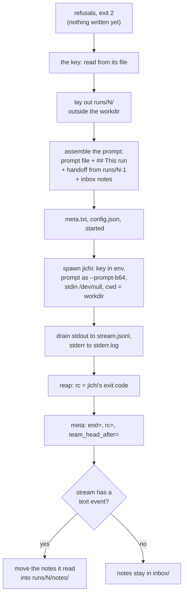

# Tazuna 4 -- `run` and the handoff

*[手綱（たづな）*Tazuna* — the harness](TAZUNA.md) · chapter 4 of 10*

## Why this exists

A drive is a long series of **lead runs**, each one jichi process with a fresh
context. When a run ends the model remembers nothing, so whatever the next run
should know must be handed to it as text. The operator wants each run to:

- start from the drive's standing instructions, knowing **which run it is**
  and **where its records are**;
- hear **what the previous run did**, from that run's records, not from
  anyone's memory of it;
- receive the **manager's notes** that arrived since, and keep offering them
  until a model has actually answered;
- get the model key without the key landing on a command line, in a log or in
  a record;
- run with **no time or token cap**, so it measures what the team can do, not
  where a cap fell (`CLAUDE.md`, "Caps versus fences");
- leave its records **outside the workspace**, in a state the next run can read.

`jichi-harness run --config <file> --tenant <name> --run <N>` does one such
run. It is the C89 port of the drive's `run-lead.sh` without its container half,
since Mode A has none (`docs/HARNESS.md`, "`run`: one lead run in Mode A"). Two
files carry it: `src/harness/jc_harness_run.c` and
`src/harness/jc_harness_handoff.c`. Chapter 5's `drive` calls `run` once per
turn of its loop.

## The shape



Everything above the spawn can refuse; everything below it records.

## Before anything is written: the refusals and the key

`src/harness/jc_harness_run.c:jc_harness_run` begins with two `unsetenv` calls,
for `JICHI_API_KEY` and `JLU_API_KEY`, on the harness's *own* environment. The
key must come from the file the configuration names and nowhere else; a key the
operator's shell happened to export would otherwise reach the child, and the
run would quietly use a key the configuration never named.

Then the refusals, each exit 2, each naming what is missing, none creating
anything: a missing `--config`, `--tenant` or `--run`; a configuration the
loader rejects; an unknown tenant, or one without `workdir` or `home`; no drive
`dir`; no model-key file; no readable `promptFile`; no jichi binary; a key file
that is missing or empty (`read_key_file` takes the first non-blank line and
names the *file* in its refusals, never the key); an unreadable jichi
configuration.

Two reads follow. `read_jichi_version` runs `<bin> --version --verbose` and
keeps the `build:` stamp for the prompt and the meta (a binary that answers
nothing is refused, exit 1). And the **lead-model guard**: if `drive.leadModel`
names a model the tenant's jichi configuration does not define
(`lead_model_named` reads its `models` array), the run warns and *omits*
`--model`, so jichi routes by its own configuration: "WARN + OMIT, NOT a
refusal", in the comment's words. `docs/HARNESS.md` calls it a cost fence: a raw
model id reaching the gateway is the priced-model class of `docs/ANECDOTES.md`
entry 68.

## The records, outside the workspace

The run lays out `<dir>/runs/<N>/`: `prompt.md`, `meta.txt`, `config.json` (a
byte copy of the jichi configuration), `handoff.md`, `handoff.err`,
`journal.jsonl` and `telemetry.jsonl` (jichi writes these, via `--journal` and
`--log`), `stream.jsonl` and `stderr.log` (the harness appends jichi's stdout and
stderr), `notes/`, `ctl/` and an empty `.started` marker.

None of it is under the tenant's workdir, where the agent works. The reason is
older than the harness: `docs/ANECDOTES.md` entry 1 is a log file kept inside
the workspace and reverted by the autonomy envelope's rollback, which looked
like truncated stderr. A record inside the thing it records can be rewritten by
it. In Mode A this guards against accident, not against a hostile agent: the
agent runs as the same user and can write `runs/` too, and there is no
read-only mount (`docs/HARNESS.md`). So the prompt states the records path
outright, `realpath`'d.

## What the lead receives: the prompt

The prompt is assembled in one `jc_sb` (a growable string buffer), in order:

1. **the tenant's `promptFile`**, verbatim: the standing instructions;
2. **`## This run`**: the run number, the start time, the drive's end if one
   is set, the pinned build stamp and the absolute records path;
3. **the handoff** (next section), when there is one;
4. **`## Notes from the manager`**: every `*.md` in `<dir>/inbox/`, sorted by
   name byte for byte, each under `### <name>`, the name without its `.md`.

The notes are *read* now, not moved, and `note_names` records exactly which
names went into the prompt (at most 512; any more wait for the next run). The
text is written to `prompt.md` and base64-encoded for `--prompt-b64`. Then
`meta.txt` is written *before* the spawn: `run=`, `start=`, the version and
stamp, the configuration with its sha256, `records_dir=`, `team_head=` (the
workdir's `HEAD`, read by a neutralised `git rev-parse` in `team_head`),
`lead_model=`, `handoff=`, and a `limits:` line that says in so many words "no
deadline, no token budget".

## The handoff: what the previous run left you

`src/harness/jc_harness_handoff.c:jc_harness_build_handoff`, the port of the
drive's `handoff.py`, is called only if `runs/<N-1>/` exists. A first run has
none, and a run named `0` or with non-digits in its name has no previous run by
definition. It reads three things and nothing else, no git and no network:
the previous `meta.txt` (`rc`, `start`, `end`, `team_head_after`); its
`stream.jsonl`, line by line (`hh_handle_line`: the last `done` text, the last
`todowrite`, the path tools' calls, each `spawn_parallel`, each `tool_result` by
id); and its `notes/`. The section it writes, under the heading
`## What the previous run left you`, opens with:

```c src/harness/jc_harness_handoff.c:hh_build_section_unbounded
    ok &= jc_sb_append_fmt(&sb,
        "*Written by the harness from run %s's own records, mechanically. "
        "Only its last message is the model's, quoted. Verify before relying "
        "on it: the tree may have moved since.*\n", run_name) == JC_OK;
```

That is the section's honesty clause. The harness writes the section from
records. The clause names one line as the model's: the previous run's last
message, in quotes. It is not the only text a model wrote, though: the todo
items and the batch task texts are the model's words too, copied from its tool
calls and cut short. The clause does not say so. The file's opening comment
states the trade-off: a mechanical
section "cannot invent a fact, but it can be stale". No model summarises the
run, because a model's summary is one more place for an invented fact to enter,
and the next run could not tell it from a recorded one.

The bullets and their caps (most caps are constants at the top of the file):

- **How it ended** (`hh_ended`): the `rc`, the minutes, a reason from a fixed
  map (0 "it ended itself", 130 "it was interrupted: the deadline, or an
  abort", 124 "a time bound fired", 1 "it ended with an error", else "see its
  records"), and the commit;
- **Its last message**: the last `done` text only, cut at 600 characters
  (counted as code points, so a cut never splits a UTF-8 sequence);
- **Its todo list, as it last wrote it**: at most 15 items of 140 characters;
- **The files it read or changed**: the 25 most-used paths, ties by path so the
  order is deterministic;
- **Its batches**: each `spawn_parallel`, paired with its result *by id*, at
  most 8 tasks shown;
- **The manager's notes it was given**: the first four at 500 characters, then
  "and N more". A `.gz` note shows `(unreadable)`: the harness links no zlib,
  because jichi's only dependency is libcurl (def-358).

The whole section is cut at **6000 bytes** (`hh_cut`), back to the last
newline, with the marker `- *(cut at 6000 bytes)*`, because "a section that
eats the model's context to report on the previous run is worse than no
section". And it **fails open**: a missing `stream.jsonl` drops the section and
files the reason in `runs/<N>/handoff.err`, an unreadable `meta.txt` only turns
its fields into `?`, and the run starts either way. The handoff works in its own
arena, freed before it returns. `handoff.md` and `handoff.err` are always
written, even empty.

## The size limit: the prompt is one argument

This is how the prompt reaches jichi, at the end of the argv:

```c src/harness/jc_harness_run.c:jc_harness_run
        argv[k++] = (char *)"--max-tool-calls";
        argv[k++] = (char *)RUN_MAX_TOOL_CALLS;
        argv[k++] = (char *)"--verify-timeout";
        argv[k++] = (char *)RUN_VERIFY_TIMEOUT;
        argv[k++] = (char *)"--prompt-b64";
        argv[k++] = (char *)b64;
        argv[k] = NULL;
```

The whole prompt, base64-encoded, is **one** argv element. Three reasonable
choices led here: base64, because `--prompt-b64` carries a multi-line prompt
through any quoting intact (`docs/ENCODING.md`, M129); not `-p "<text>"`,
because jichi refuses a `-p` argument that looks like a flag
(`docs/ANECDOTES.md` entry 50) and a prompt may start with `--`; and not stdin,
because the run deliberately gives jichi `/dev/null`, since a headless run can
block forever on a stdin nobody closes (`docs/ANECDOTES.md` entry 64).

**But Linux limits a single exec argument**, terminating NUL included. The
kernel's `MAX_ARG_STRLEN` is 32 pages: 131,072 bytes with the usual 4 KiB page
(the page size measured here). Base64 turns 3 bytes into 4, so the largest
prompt that fits is **98,301 bytes**. The harness has no check of its own. Past
the limit, the forked child's `execvp` fails with `E2BIG`, and
`src/util/jc_spawn.c:child_run` falls through to `_exit(127)`. jichi never runs,
so `stream.jsonl` and `stderr.log` stay empty, and the harness reaps a 127 and
writes `rc=127` without a word about why. Measured here, the boundary is exact:
98,301 bytes reach jichi and 98,302 die with 127 ("Try it" reproduces it).

The prompt's other limits are the harness's own, chosen for the model's
context: the 6000-byte handoff and the 512-note inbox. The kernel limit turns up
again in chapter 7: `tests/smoke/harness_notify.sh` explains why its largest
test text is 131,071 bytes.

## How a run ends

After the spawn the harness sits in a `select` loop over two non-blocking
pipes, appending jichi's output to its two files, and retires a pipe only at a
real end of file, never on `EAGAIN`. `jc_proc_waitpid` then reaps jichi. The
run's code **is** jichi's: its exit status, or 128 plus the signal number.

At the drive's end, the `drive` loop sends SIGINT to the run's process group
(chapter 5). The run's one handler forwards it to jichi's group and does
nothing else:

```c src/harness/jc_harness_run.c:run_on_sigint
    (void)sig;
    if (g_run_jichi_pgid > 0) {
        kill(-g_run_jichi_pgid, SIGINT);   /* the run's whole group, jichi with it */
    }
    g_run_sigint_seen = 1;
```

jichi treats it as Ctrl-C, writes its journal and exits 130. The run keeps
waiting (the drain loop carries on after an interrupted `select`, and
`jc_proc_waitpid` retries an interrupted wait), reaches its normal ending, and
writes `rc=130`. A handler that re-raised the signal would kill the run before
that line was written. The pgid stays 0 until the spawn succeeds, so an early
signal can never become `kill(-0)` (the run's own group) or `kill(-1)` (every
process the user may signal); it is remembered in `g_run_sigint_seen` and
forwarded just after the spawn.

An honest note for the C89 reader: ISO C promises a handler only the right to
*assign* to a `volatile sig_atomic_t`. This one also calls `kill`, which POSIX
lists as async-signal-safe, and reads the plain `pid_t` global
`g_run_jichi_pgid`, which neither standard promises. The comment above the
globals cites `CLAUDE.md`'s rule and counts the `kill` as its one addition. It
says the handler reads `g_run_jichi_pgid`, but not that this read is outside
both promises.

After the reap, `meta.txt` gains `end=`, `rc=` and `team_head_after=` (the
workdir's `HEAD` again). Last, the notes: the run moves the ones it read into
`runs/<N>/notes/` **only if** `stream.jsonl` holds a `"type":"text"` event
(`stream_has_text`), that is, only if a model call delivered content. A run that
died before its first answer leaves them in `inbox/` for the next run. And it
moves exactly the names in `note_names`, never "whatever is in the inbox now"
(`move_inbox_notes`). Not built at this commit, and named so: collecting records
after the run (def-355), a per-tenant key name (def-356), and a gateway-up check
(def-357).

## Try it

No model is called: the jichi configuration points at port 9 of your own
machine, where almost no system listens, so every run fails at its first model
call. That is all these experiments need. The key is a canary.

```sh
# in the jichi checkout, after `make jichi jichi-harness`
H=$PWD/jichi-harness J=$PWD/jichi
unset JICHI_HARNESS_DIR JICHI_HARNESS_MODEL_KEY_FILE JICHI_HARNESS_GIT_TOKEN_FILE
cd "$(mktemp -d)"
mkdir -p drive/inbox drive/home work
git init -q work
git -C work -c user.name=Practice -c user.email=practice@example.com commit -q --allow-empty -m base
printf 'CANARY-not-a-real-key-0123\n' > key
chmod 600 key
printf 'You are the lead of a practice drive.\n' > prompt.md
cat > jichi.json <<'EOF'
{"models":[{"name":"m","provider":"openai","model":"none",
  "apiBase":"http://127.0.0.1:9/v1","apiKeyEnv":"JICHI_API_KEY","roles":["chat"]}],
 "snapshots":false,"repoMap":false,"references":false,"toolProfile":"none","maxRetries":0}
EOF
cat > harness.json <<EOF
{"dir":"$PWD/drive","modelKeyFile":"$PWD/key","drive":{"branchPrefix":"practice"},
 "tenants":[{"name":"lead","home":"$PWD/drive/home","workdir":"$PWD/work",
   "jichiConfig":"$PWD/jichi.json","promptFile":"$PWD/prompt.md","bin":"$J"}]}
EOF
printf 'Please read the plan first.\n' > drive/inbox/0001-note.md
"$H" --config harness.json run --tenant lead --run 0001 < /dev/null; echo "rc=$?"
ls drive/inbox
ls drive/runs/0001 | tr '\n' ' '; echo
cat drive/runs/0001/meta.txt drive/runs/0001/stderr.log
```

```
rc=1
0001-note.md
config.json ctl handoff.err handoff.md journal.jsonl meta.txt notes prompt.md stderr.log stream.jsonl telemetry.jsonl
run=0001
start=2026-11-13T11:08:06Z
jichi=jichi 0.13.0 build (no build stamp)
config=.../jichi.json sha256=da699f765453f69c9941fd467a5af9ab2c523eb9ed641fbc37d20108cd2945ce
records_dir=.../drive/runs
team_head=c154b6c
lead_model=(the config's routing)
handoff=none
limits: max-tool-calls=50000 verify-timeout=30m; no deadline, no token budget
end=2026-11-13T11:08:06Z
rc=1
team_head_after=c154b6c
[control] listening on .../drive/runs/0001/ctl/lead.sock
[jichi error] http stream: Couldn't connect to server (before connecting)
error: http error
```

The run's code is jichi's, 1, and the note is still in `inbox/`: no model call
delivered text. ("(no build stamp)" because this jichi was built from an
unpacked tree, not a git checkout.) Run the next one:

```sh
# in the same scratch directory and shell
"$H" --config harness.json run --tenant lead --run 0002 < /dev/null; echo "rc=$?"
sed -n '/^## This run/,$p' drive/runs/0002/prompt.md
```

```
rc=1
## This run

Run 0002, started 2026-11-13T11:08:06Z.
The pinned build (for the Jichi-Build trailer): (no build stamp).
The records for this run (journal, stream, the meta, the previous runs' records) are in .../drive/runs/.

## What the previous run left you

*Written by the harness from run 0001's own records, mechanically. Only its last message is the model's, quoted. Verify before relying on it: the tree may have moved since.*

- **How it ended:** rc 1 after 0 min: it ended with an error. It ended at commit `c154b6c`.

## Notes from the manager

### 0001-note

Please read the plan first.
```

One bullet, because run 0001's stream held nothing else, and the note delivered
a second time, as promised. Now find the size limit to the byte. Runs named `x`,
`y` and `z` have no previous run, hence no handoff, and equal-length names, so
the overhead the run adds is the same for all three:

```sh
# in the same scratch directory and shell
awk -v n=1000 'BEGIN { while (n-- > 0) printf "x" }' > prompt.md
"$H" --config harness.json run --tenant lead --run x < /dev/null; echo "rc=$?"
OV=$(( $(wc -c < drive/runs/x/prompt.md) - 1000 )); echo "the run adds $OV bytes"
awk -v n=$((98301 - OV)) 'BEGIN { while (n-- > 0) printf "x" }' > prompt.md
"$H" --config harness.json run --tenant lead --run y < /dev/null; echo "rc=$?"
awk -v n=$((98302 - OV)) 'BEGIN { while (n-- > 0) printf "x" }' > prompt.md
"$H" --config harness.json run --tenant lead --run z < /dev/null; echo "rc=$?"
wc -c drive/runs/y/prompt.md drive/runs/z/prompt.md drive/runs/y/stderr.log drive/runs/z/stderr.log
```

```
rc=1
the run adds 318 bytes
rc=1
rc=127
 98301 drive/runs/y/prompt.md
 98302 drive/runs/z/prompt.md
   171 drive/runs/y/stderr.log
     0 drive/runs/z/stderr.log
196774 total
```

One byte apart: the first prompt reached jichi, which wrote 171 bytes of
errors; the second never ran. (Your overhead and that error count vary with
your temporary path's length; the boundary does not.) Last, what the next numbered run hears after an
over-limit run:

```sh
# in the same scratch directory and shell
"$H" --config harness.json run --tenant lead --run 0003 < /dev/null; echo "rc=$?"
printf 'You are the lead of a practice drive.\n' > prompt.md
"$H" --config harness.json run --tenant lead --run 0004 < /dev/null; echo "rc=$?"
cat drive/runs/0004/handoff.md
ls drive/inbox
```

```
rc=127
rc=1

## What the previous run left you

*Written by the harness from run 0003's own records, mechanically. Only its last message is the model's, quoted. Verify before relying on it: the tree may have moved since.*

- **How it ended:** rc 127 after 0 min: see its records. It ended at commit `c154b6c`.
0001-note.md
```

Run 0004 hears only that run 0003 ended with 127. Run 0003's handoff, about run
0002, reached no model: it is only in `runs/0003/handoff.md`. The driver
`tests/smoke/harness_run.sh` holds the records, the notes and the handoff
against the project's mock model server, including the happy path these
experiments cannot show: a text reply, after which the notes move. No driver
holds the exec size limit or the 127 it causes (def-368 is not fixed).

## What went wrong here, and what it teaches

**def-368: the prompt that could not be executed.** The record is M1150 in
`docs/ROADMAP.md` and the def-368 row in `docs/DEFERRED.md`. Runs 0004 to 0015
of the harness-port drive each died with rc 127, stream and stderr empty, and
every retry died the same way, until the supervisor measured the kernel
boundary. The record has four parts, and "Try it" showed each on a small scale:

- **(a)** the prompt travels as one argv element, past `MAX_ARG_STRLEN`;
- **(b)** the failure is a bare 127 and `E2BIG` is in no log, so a failure that
  happens before jichi even starts needed a measurement to diagnose;
- **(c)** a run that dies at exec keeps its notes. The rule (keep them unless a
  model call delivered text) is right for a model that answered 500, since the
  next run may succeed. A deterministic failure, though, made every retry's
  prompt identical, size included, and the loop could not recover. A retry of a
  deterministic failure is not a retry;
- **(d)** each dead run's handoff is a stub, so the last *real* handoff is
  buried, as runs 0003 and 0004 showed.

The row records a recurrence on 2026-11-12. Run 0040's prompt was 102,170 bytes
and it died at exec; run 0041's prompt then carried a 299-byte stub about it in
place of the 5,889-byte handoff about run 0039, and run 0041 started only
*because* the stub made its prompt small enough (96,580 bytes). The fix the row
names is to deliver the prompt on the child's stdin, or in a file, and to stop a
run that died at exec from replacing the handoff. It is recorded as an agenda
item for after the drive's pause, not started; at this commit `jc_harness_run`
still passes `--prompt-b64`, as quoted above.

Two lessons. **Every delivery channel has a size** (an argv element, a pipe
buffer, an environment block), and choosing one is choosing its limit, looked
up or not. And **a failure must leave its cause where the next reader looks**:
a run that dies at once without a word costs more than one that dies slowly but
says why.

**M1063: the note moved but never read.** The comment at the top of
`src/harness/jc_harness_run.c` and the M1063 entry in `docs/ROADMAP.md` record
that the move once listed the inbox *again* at exit and took every note
present. A note that arrived while run 0077 was running was filed under that
run, whose prompt never held it, and the next handoff listed it as given. Now the list read at assembly
*is* the list moved: "moved == read".

**M1057's off-by-one, found by UBSan.** `team_head` once declared `argv[14]` for
fourteen arguments, but the terminating `NULL` is the fifteenth store. The
sanitizer stage had only ever run `jichi-harness --version`, so it missed this;
UBSan reported it (index 14 out of bounds) as soon as the stage ran every
harness driver (`CHANGELOG.md`, M1058). The comment on `argv[15]` keeps the
arithmetic in view.

## Check yourself

1. Why does the run unset `JICHI_API_KEY` in its *own* environment before it
   reads the key file?
2. Which part of the handoff did a model write, and how does the section say so?
3. A drive's prompt file is 97,000 bytes and runs start dying with 127. What
   else is in the prompt, and what do a dying run's records show?
4. Why are notes moved only after jichi exits, only when the stream holds a
   `text` event, and only by the names read at assembly?
5. What does `run_on_sigint` do, and why does it not end the run itself?

<details>
<summary>Answers</summary>

1. So the file is the key's only source. An ambient key in the operator's shell
   would otherwise reach the child, and the run would use a key the
   configuration never named.
2. The header names "Its last message", the previous run's final `done` text,
   quoted. It says the section is written "mechanically", that "Only its last
   message is the model's, quoted", and asks for verification before relying.
   The todo items and the batch task texts are the model's words too, copied
   from its tool calls; the header does not say so.
3. The `## This run` block, a handoff of about 6000 bytes and every inbox note,
   which can push past 98,301. `meta.txt` says `rc=127`; `stream.jsonl` and
   `stderr.log` are empty because jichi never executed; the notes are still in
   `inbox/`; the next handoff says only "rc 127 ... see its records".
4. A note is delivered only once a model answered (a `text` event); a run that
   failed earlier leaves it for the next. Moving by the assembly-time names
   means a note that arrived mid-run is neither read nor moved (M1063).
5. It forwards SIGINT to jichi's process group and sets a flag. jichi exits 130
   after writing its journal, and the run, still waiting, then writes `end=`,
   `rc=130` and `team_head_after=` on its normal path. Dying in the handler
   would lose those lines.

</details>

*Next: [chapter 5 -- `drive`: the outer loop](tazuna-05-drive-the-outer-loop.md):
the loop that calls `run`, fetches and pushes around it, and knows when to stop.*
