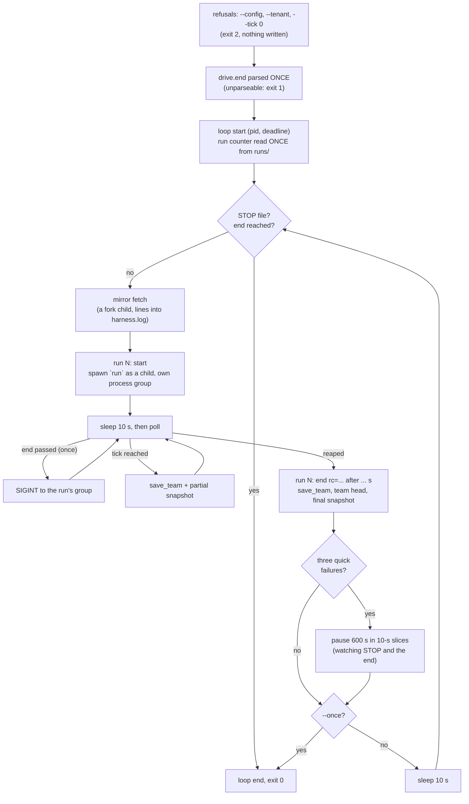

# Tazuna 5 -- `drive`: the outer loop

*[手綱（たづな）*Tazuna* — the harness](TAZUNA.md) · chapter 5 of 10*

## Why this exists

A drive is not one run. It is many runs of the team's lead, one after another,
over days, while the operator sleeps. Each run ends sooner or later: the model
says it is done, its context fills, the gateway goes away, or a bug kills it.
Every time, someone has to start the next run, carry the finished run's records
out of the workspace, push the team's branch, stop when the drive's end arrives
or the operator says stop, and, when runs keep dying, stop burning through them.

Before the port a shell script did this (`loop.sh`). `jichi-harness drive`
(M1059, batch H5) is its C89 port: the command that lets the harness drive an
agent with no session watching. `docs/HARNESS.md` calls it "a bound on the
*drive*, not a cap on the *runs*": the loop has an end time, and it never puts a
deadline or a token budget on a single run.

The command is one function, `src/harness/jc_harness_drive.c:jc_harness_drive`,
with eighteen static helpers beside it. This chapter reads them in the order
they run, then the records push (`src/harness/jc_hp_records.c`) and the dry
podman line (`src/harness/jc_hp_rundrive.c`).

## The shape



Three things to notice before any C. The loop decides to stop only at the top,
before a run starts. The run is a separate *process*, so a run that crashes
cannot take the loop with it. And records leave the workspace in two kinds of
snapshot: a `partial` one at every tick while the run is alive, and a `final`
one after it ends.

## Before the loop: refuse first, parse the end once

These refusals all come before the first line of `harness.log`. No `--config`,
no `--tenant`, a tenant the config does not name or one with no `workdir`, a
`--tick 0`: each is exit 2 with a named reason. A zero tick is refused, not read
as "push on every poll"; the message calls it "a cap-on-housekeeping".

The end of the drive is handled differently:

```c src/harness/jc_harness_drive.c:jc_harness_drive
        if (extract_drive_end(raw, end_buf, sizeof end_buf) == NULL ||
            !parse_deadline(end_buf, &end)) {
            refuse("the end time does not parse");
            return 1;
        }
```

`src/harness/jc_harness_drive.c:extract_drive_end` pulls `drive.end` out of the
*raw* config text, before the JSON loader validates anything. That is the
reference's order: the script parsed its end time before it ran a single
precheck, and a broken end was its own exit 1. The port keeps the order and the
exit class. `src/harness/jc_harness_drive.c:parse_deadline` accepts exactly
two forms, `YYYY-MM-DD HH:MM:SS +ZZZZ` and a bare `YYYY-MM-DD HH:MM:SS` (read as
UTC), since M1179. `docs/HARNESS.md` says why it guesses nothing else: a
deadline that parses to the wrong instant "is the class of cap that manufactures
a plausible different answer".

> **C sidebar -- no `timegm`.** Turning UTC fields into seconds since 1970 is
> `timegm` on glibc, but the build defines `_POSIX_C_SOURCE=200112L` globally,
> and glibc does not declare `timegm` under it. So
> `src/harness/jc_harness_drive.c:utc_from_tm` hand-rolls the day count, and its
> comment says how it was checked (1970-01-01 is day 0, 2000-01-01 day 10957).
> Until M1179 `parse_deadline` trusted `sscanf` only through its return value,
> the number of fields converted: seven with an offset, six without.

That count was the whole check, and it let more through than the two forms.
This was found while reviewing this chapter on 2026-11-13 and measured. An end of `2099-01-01 00:00:00 +01:00` converts seven
fields, but `+01:00` is read as the number 1, so the offset becomes one minute
instead of one hour: the loop logged the deadline as
`2099-01-01 00:59:00 +0100`, 59 minutes late. An end of
`2099-01-01 00:00:00 Europe/Berlin` converts six fields; the zone name is
ignored and the time is read as UTC. Both were accepted: the loop logged
`loop start` with its deadline, and nothing said the end was wrong. M1179
replaced the two `sscanf` calls with a small parser that reads the two forms
digit by digit, allows only blanks after them, and checks the day against the
month (`2099-02-31` had rolled over into March). Cell 15 of
`tests/smoke/harness_drive.sh` refuses five bad forms and checks the instants of
three good ones; on the unfixed binary every bad form was accepted. The lesson:
`sscanf`'s return value counts what it converted, not that nothing else was
there.

Then the run counter. `src/harness/jc_harness_drive.c:read_run_counter` reads
`runs/` once, counts a name only when every byte is a digit, and parses it in
base 10: in the reference's shell arithmetic a leading zero meant octal, and
`0008` was an error. The first run is the largest existing number plus one.

## The top of every iteration: STOP and the end

```c src/harness/jc_harness_drive.c:jc_harness_drive
        /* behaviour 4: the STOP file, at the TOP (before the increment). */
        if (jc_snprintf(stop_path, sizeof stop_path, "%s/STOP", cfg.dir)
            < (int)sizeof stop_path) {
            if (jc_file_exists(stop_path)) {
                log_line(log_path, "STOP file present: loop ends");
                log_line(log_path, "loop end");
                return 0;
            }
        }
        /* the deadline check, at the TOP (before the increment). */
        if (time(NULL) >= end) {
            log_line(log_path, "deadline reached: loop ends");
            log_line(log_path, "loop end");
            return 0;
        }
```

This is the operator's whole stop interface: `touch <dir>/STOP`. The loop does
not look for it while a run is alive, so STOP means "finish this run, then
stop" (the smoke driver's cell D4). Both checks sit before the run number is
incremented, so no run starts after STOP or the end, and a stop spends no run
number. Both exits are exit 0: a drive that ended is a success, whatever its
runs returned. Each
log line is one append through `log_line`, stamped by `stamp_of` in the
`date '+%F %T %z'` shape.

## The run is a child, in its own process group

The run is not called; it is spawned. The loop finds its own binary with
`readlink("/proc/self/exe")` and starts
`jichi-harness run --config <f> --tenant <t> --run N` through `jc_spawn`:

```c src/harness/jc_harness_drive.c:jc_harness_drive
            req.argv = argv;
            req.fd_stdin = JC_SPAWN_DEVNULL;
            req.fd_stdout = logfd;
            req.fd_stderr = logfd;
            req.new_pgroup = 1;   /* the run leads its own group; kill(-pid) */
```

Stdin is `/dev/null`, so nothing in the run can block on a terminal (the
ANECDOTES #64 class). Stdout and stderr go to `harness.log`, beside the loop's
own lines. And the run leads a new process group: `kill(-pid, sig)` with a
negative pid reaches every process in that group. The jichi that the run starts
leads a group of its own, one level down, so a signal reaches it only when the
run passes it on.

A child process buys isolation: the counter, the quick-failure count and the
end time survive anything the run does. The price is the Linux-only
`/proc/self/exe` lookup; `docs/DEFERRED.md` def-383 records that it stays for
now (the decision on it, D-F8-4, is left open), and that the harness does not
yet apply jichi's memory protection to the keys it reads. The loop puts no
secret on a command line, in `harness.log`, in a snapshot or in a child's
environment: the model key reaches jichi through the `run` command's own
environment delivery, the git token reaches git through the push's credential
helper. The loop's process does hold both secrets for a while, though: its
pushes run inside it, and they read both secret files to scan for them. Cell D2
checks
that a canary key is in no argv, no `harness.log` line and no file under
`recs/`, and *is* in the request the mock model received.

## While the run runs: the 10-second poll

```c src/harness/jc_harness_drive.c:jc_harness_drive
            if (!signalled && time(NULL) >= end) {
                signalled = 1;
                ...
                kill(-run_pid, SIGINT);
            }
            /* Is the run child still alive? */
            drc = waitpid(run_pid, &status, WNOHANG);
            if (drc == run_pid) {
                wait_done = 1;
                break;
            }
```

When the end passes mid-run, the loop sends **SIGINT, once**, to the run's
group. SIGINT is what Ctrl-C sends, and jichi answers it by writing its journal
and exiting 130. The run forwards the signal to jichi's group
(`src/harness/jc_harness_run.c:run_on_sigint`) and stays alive long enough to
write `rc=130`, `end=` and `team_head_after=` into its meta file. A SIGKILL would
have lost all three. The reference sent `podman kill --signal INT` to its
container; Mode A has no container, so the target became a process group.

`waitpid(..., WNOHANG)` asks "has it exited?" without blocking. While the answer
is no and `tick` seconds (default 1200, `drive.tick` or `--tick <s>`) have
accumulated, the loop runs `save_team` and a `partial` snapshot, so a long
run's records reach `recs/` before it ends. When the child is reaped,
its wait status becomes the logged rc: the exit status, 128 plus the signal
number for a signal, and 1 when neither decodes. The comment says "never
masked".

## After the run: save, look, snapshot

The end of a run is always `run N: end rc=<rc> after <t> s`, then `save_team`,
then `run N: team head <sha>`, then the `final` snapshot.

`src/harness/jc_harness_drive.c:save_team` is the mirror fetch and the
`mirror push`, called as functions rather than as commands. The push runs in the
loop's own process; the fetch runs in a forked copy of it whose stdout is a pipe
(`fetch_logged_to_harness_log`), so its lines reach `harness.log` stamped. The
M1064 entry in `docs/ROADMAP.md` tells how an earlier attempt redirected the
loop's *own* stdout instead and broke the snapshot after it. With
`drive.teamPush: false`, the operator's "loop, fetch, snapshot, no push" switch
(`docs/HARNESS.md`), the fetch runs and the push is skipped, logged as
`team push off: save_team fetched only`. The team head is the **mirror's**
`<prefix>/main`, not the run's `team_head_after=`, which reads the workdir; the
two differ when the lead left another branch checked out.

## The snapshot: records out of the workspace

`src/harness/jc_harness_drive.c:snapshot` copies `runs/N/` to `recs/runs/N/` and
commits it:

- a top-level regular file over 1 000 000 bytes is gzipped and its plain twin
  removed; a smaller one is copied with its mode and times and a stale `.gz`
  twin removed, so a file that shrank between `partial` and `final` ends in one
  form, never both;
- the subdirectories `notes`, `lmstudio`, `sessions` and `attempts` are always
  gzipped and get no plain twin;
- `supervision-log.md` and `harness.log` travel with every snapshot;
- the commit is `records: run N (partial)` or `(final)`, with the identity from
  `drive.gitName` / `drive.gitEmail`; without them git's own error is logged,
  and the loop invents no identity.

Where the port is stricter than the script: every file it copies is checked
with `lstat`, which does not follow a link, and a symlink under `runs/N/` is
skipped by name, with a log line. (The two top-level files are first checked
with `stat`; a link there is still not copied, because the copy checks again
with `lstat`, but it is dropped without a line.) In Mode A the agent is the same
user as the harness and could plant `runs/N/keylink` pointing at the key file;
the script's `cp -p` and `gzip -c` would have followed it into the commit. Every
git child the snapshot runs in `recs/` goes through `git_recs`, with hooks,
fsmonitor and signing off and empty global and system configs, so a planted
`recs/.git/hooks/pre-commit` never runs as the harness (cells D6d and D6e). The
records push's own git children carry the same `-c` switches and empty
configs.

Last, the records push, gated twice: `drive.teamPush` true and the token file
readable. The gate is `access(token_file, R_OK)`, which never reads the token.
Met, the in-process records push runs, and a failure is logged and the loop goes
on. Not met, the loop logs `the records push is not built (def-360; ...)`: the
commit stays in `recs/`, and the host's timer
([chapter 6](tazuna-06-push-the-scheduled-host-push.md)) pushes it.

## The records push

`src/harness/jc_hp_records.c:jc_harness_push_records_run` pushes the orphan
branch `<prefix>/records`. The loop calls it in process; the host's tick calls
the same function as `push records`. It is a cousin of the team push
([chapter 3](tazuna-03-the-mirror-and-the-credential-helper.md)) with two
deliberate differences:

- **A key scan, no size check.** `records_key_scan` takes the objects the push
  would add (`jc_hp_records_scan`: reachable from the records tip and from none
  of the remote's current tips, read with `git ls-remote`), reads each blob
  with `jc_hp_blob_read`, and searches it for the model key and the git token.
  A hit refuses with exit 1 and names the *path*, never the content; a scan
  that cannot run refuses too. Records are large by design, so no size limit.
- **The stored URL.** The destination comes from the config copy `init` wrote
  beside the clone (`<recs>.git-config.harness-copy`), never from the clone's
  live `origin`, and the push never uses `--force`.

Both secrets are loaded first (each file must hold at least 12 bytes after
whitespace is removed), because a scan with nothing to look for is not a pass.
The opening remote fetch is rc-neutral, since on a new remote the branch does
not exist yet. Exit 0 is landed. Exit 1 is a key-scan refusal, a failed push, a
secret that cannot be loaded, or a records repository with no records branch.
Exit 2 is a usage, precheck or URL refusal.

Two records defects are kept in the comments and the ROADMAP. **The empty
file:** every run writes `runs/N/.started`, 0 bytes, and `git cat-file` of an
empty blob succeeds and prints nothing. A read that took "nothing captured" for
"could not read" refused every in-loop records push; the comment keeps the
fingerprint, `could not be read (cat-file rc=0: )`, where rc 0 said the read had
worked. `src/harness/jc_harness_push.c:jc_hp_blob_read` is now the one reader
for both key scans, "so the two copies cannot drift apart again" (M1147). **A
number in the log (M1155):** "N file version(s) checked" counted trees as well
as blobs; running the port beside the reference script, on the same pushes,
showed it.

## A run that dies

The loop never ends because a run failed. Instead:

```c src/harness/jc_harness_drive.c:jc_harness_drive
        if (child_rc != 0 && (t1 - t0) < QUICK_LIMIT_S) {
            quick = quick + 1;
        } else {
            quick = 0;
        }
```

A run that exits non-zero within 120 seconds is a *quick failure*; a pre-run
refusal, such as a missing key file, is the fastest kind. Three in a row log
`three quick failures in a row: waiting 10 minutes`. The script slept
`sleep 600` in one piece; the port sleeps in 10-second slices and checks the end and
STOP after each, so an end that arrives during the pause ends the drive. A
refused run that created no `runs/N` still costs its number, and its snapshot
commits nothing. The next run's handoff is `run`'s business
([chapter 4](tazuna-04-run-and-the-handoff.md)).

What the pause cannot do is tell a failure that will pass from one that will
not. `docs/DEFERRED.md` def-368 records runs 0004 to 0015 of one drive all dying
with rc 127 after about ten seconds: the prompt had outgrown the kernel's limit
for one exec argument, and every retry died the same way. The fixes it records
all lie outside the loop, and none is built at this tree: the prompt on stdin
instead of in an argument, the errno in the run's log, and a run that dies at
exec handing its inbox notes on instead of keeping them for an identical retry,
and leaving the previous run's handoff in place instead of overwriting it. A
retry loop is only as good as the evidence each failure leaves.

## How the host starts it: `push run-drive`

The reference drive ran in a podman container, started from the host.
`src/harness/jc_hp_rundrive.c:jc_harness_push_rundrive_run` prints that
`podman run` line, shell-quoted, and execs nothing: its header says it must never start
podman from inside a drive's container, and the operator's rule is never to run
what may write to learn what it does. `build_rundrive_line` keeps the
reference's limits (`--cpus 16`, `--memory 24g`, `--pids-limit 16384`), drops
every capability, and mounts the model key file read-only. It never mounts the
git token file: the container never holds the token. The line is for reading,
not pasting, and `docs/DEFERRED.md` def-382 says why; the Try it shows it.

## Try it

Everything here is offline: no real model, no network, no real key. The first
block shows the refusals, the two ways the loop ends at the top, and the dry
podman line.

```sh
# in the jichi checkout, after `make jichi-harness`; the block makes its own directory
H=$PWD/jichi-harness
cd "$(mktemp -d)"
printf '{"dir":"%s","drive":{"end":"next tuesday"},"tenants":[{"name":"lead","workdir":"%s"}]}\n' "$PWD" "$PWD" > h.json
"$H" --config h.json drive < /dev/null; echo "exit $?"
"$H" --config h.json drive --tenant lead --tick 0 < /dev/null; echo "exit $?"
"$H" --config h.json drive --tenant lead < /dev/null; echo "exit $?"
ls
printf '{"dir":"%s","drive":{"end":"2020-01-01 00:00:00"},"tenants":[{"name":"lead","workdir":"%s"}]}\n' "$PWD" "$PWD" > h.json
"$H" --config h.json drive --tenant lead < /dev/null; echo "exit $?"
printf '{"dir":"%s","drive":{"end":"2099-01-01 00:00:00 +0100"},"tenants":[{"name":"lead","workdir":"%s"}]}\n' "$PWD" "$PWD" > h.json
touch STOP
"$H" --config h.json drive --tenant lead < /dev/null; echo "exit $?"
cat harness.log
printf '{"dir":"/srv/drive","modelKeyFile":"/srv/keys/model.key","host":{"pushHome":"/srv/push","image":"localhost/drive:1"}}\n' > host.json
"$H" --config host.json push run-drive < /dev/null; echo "exit $?"
```

What it printed here (the stamps are this machine's clock and zone):

```
jichi-harness: drive: no --tenant named (drive needs one to run)
exit 2
jichi-harness: drive: --tick 0 is not a valid tick (a 0 tick is a cap-on-housekeeping, not the reference's value)
exit 2
jichi-harness: drive: the end time does not parse
exit 1
h.json
exit 0
exit 0
2026-11-13 11:56:31 +0100 loop start (pid 1311503), deadline 2020-01-01 01:00:00 +0100
2026-11-13 11:56:31 +0100 deadline reached: loop ends
2026-11-13 11:56:31 +0100 loop end
2026-11-13 11:56:31 +0100 loop start (pid 1311505), deadline 2099-01-01 00:00:00 +0100
2026-11-13 11:56:31 +0100 STOP file present: loop ends
2026-11-13 11:56:31 +0100 loop end
podman run '--rm' '--init' '--name' 'jhp-drive' '--userns=keep-id' '--security-opt=no-new-privileges' '--cap-drop=all' '--network=pasta:-T,1234' '--cpus' '16' '--memory' '24g' '--pids-limit' '16384' '-v' '/srv/drive:/srv/drive:rw' '-v' '/srv/drive/conf:/srv/drive/conf:ro' '-v' '/srv/drive/bin:/srv/drive/bin:ro' '-v' '/srv/drive/mirror.git-config.harness-copy:/srv/drive/mirror.git-config.harness-copy:ro' '-v' '/srv/keys/model.key:/srv/keys/model.key:ro' '-e' 'HOME=/srv/drive/home' '/srv/drive/home' '-e' 'TMPDIR=/tmp' '/tmp' '-e' 'TZ=Europe/Berlin' 'Europe/Berlin' '-e' 'PATH=/srv/drive/bin:/usr/local/bin:/usr/bin:/bin' '-w' '/srv/drive' 'localhost/drive:1' '/srv/drive/bin/jichi-harness' '--config' '/srv/drive/conf/harness.json' 'drive' '--tenant' 'lead' '< /dev/null'
exit 0
```

The refusals left nothing but `h.json`: no log, no `runs/`. The bare end
`2020-01-01 00:00:00` is UTC, logged in local time. Both stops come before any
fetch or run, so no git repository was needed. In the podman line, the bare
`'/srv/drive/home'` after `'HOME=/srv/drive/home'` is def-382: by the usage line
`podman run --help` prints, `podman run [options] IMAGE [COMMAND [ARG...]]`,
the first word that is not an option is the image. Cell 4 of
`tests/smoke/harness_push_rundrive.sh` asserts those bare words one by one; a
fixture that greps words cannot see a grammar.

The loop with real runs needs a real `jichi`, a mock model and git
repositories. The smoke drivers build exactly that, from `init`'s own rehearsal
layout and a local bare stand-in for the remote:

```sh
# in the jichi checkout
make jichi jichi-harness smoke-tools
for d in drive push_records; do
  printf '%-13s ' "$d"
  sh tests/smoke/harness_$d.sh < /dev/null | awk '/^1\.\./{p=$0} /^ok/{o++} /^not ok/{n++} END{print p, o+0, "ok,", n+0, "not ok"}'
done
```

```
make: 'jichi-harness' is up to date.
make: Nothing to be done for 'smoke-tools'.
drive         1..14 14 ok, 0 not ok
push_records  1..7 7 ok, 0 not ok
```

It took about four minutes here, most of them spent waiting for 10-second polls
on purpose. Read the
header of `tests/smoke/harness_drive.sh` beside this chapter: each of its
fourteen cells is one behaviour above, and each says what makes it red.

The last experiment goes with the worked defect below: take the M1165-b fix out
of a throwaway copy and see what can, and cannot, notice. It needs `valgrind`
and runs the drive driver twice, so give it some minutes.

```sh
# in the jichi checkout: a throwaway copy with the M1165-b fix taken out
T=$(mktemp -d) && git archive HEAD | tar -x -C "$T" && cd "$T"
sed '/^    argv\[3\] = NULL;$/d' src/harness/jc_harness_drive.c > d.tmp && mv d.tmp src/harness/jc_harness_drive.c
grep -c 'argv\[3\]' src/harness/jc_harness_drive.c
make jichi jichi-harness smoke-tools > build.log 2>&1; echo "build exit $?"
sh tests/smoke/harness_drive.sh < /dev/null | grep -c '^ok'
printf '#!/bin/sh\nexec valgrind -q --log-file=%s/vg.%%p %s/jichi-harness "$@"\n' "$T" "$T" > vgh && chmod 755 vgh
JC_SMOKE_HBIN=$T/vgh sh tests/smoke/harness_drive.sh < /dev/null | grep -c '^ok'
cat vg.* | grep -c 'Syscall param execve(argv) points to uninitialised byte'
cat vg.* | grep -m 1 'created by'
```

```
0
build exit 0
14
14
4
==1606219==  in frame #5, created by gzip_file_p (???:)
```

Read the six lines in order. The fix is gone (no `argv[3]` left in the file),
the tree builds, and all fourteen cells pass, cell 7 and cell D6f included: on
this x86-64 machine the missing NULL changes nothing anyone can see. Under
valgrind the cells still pass, and valgrind reports
`Syscall param execve(argv) points to uninitialised byte(s)` four times, all
four in a stack frame created by `gzip_file_p`. (Its other reports in `vg.*`
come from `init`, another chapter's code.) The whole block took about eight
minutes here.

## What went wrong here, and what it teaches

**M1165 and M1165-b: the gzip child's argv** (`docs/ROADMAP.md`, both entries).

On an aarch64 board in the 2026-11-12 platform retest, the drive snapshot's
`recs/.../notes/` came back empty, and nothing in `harness.log` said why. The
subdirectory pass gzips every file and keeps no plain twin, so a file whose gzip
failed was simply not there. M1165 fixed the silence first: `gzip_file_p` now
reports the child's rc through an out-parameter, and both failure arms log one
line naming the file.

```c src/harness/jc_harness_drive.c:snapshot
            int gfail = -1;
            if (gzip_file_p(sp, gz, (mode_t)(st.st_mode & 07777), &gfail)) {
                (void)unlink(dp);   /* the XOR: remove the plain twin */
            } else {
                ...
                                "snapshot %s (%s): gzip failed for %s (rc=%d)",
```

Cell D6f holds that line with a stand-in `gzip` that exits 1. On the board, the
driver's cell 7 now said `gzip failed for notes/n.txt (rc=1)`: a number where
there had been nothing. M1165-b found why. `gzip_file_p` built its argv in a
four-slot array and filled three:

```c src/harness/jc_harness_drive.c:gzip_file_p
    argv[0] = (char *)"gzip";
    argv[1] = (char *)"-c";
    argv[2] = src_arg;
    argv[3] = NULL;
    req.argv = argv;
```

The fourth line is the fix. Before it, `argv[3]` was never assigned, though the
spawn contract is plain:

```c include/jc_spawn.h
    char *const *argv;      /* program + args, NULL-terminated, PATH-searched.
```

An automatic array in C is not initialised, and `execvp` walks the array until
it finds a NULL, so it read whatever the stack held in that slot. The ROADMAP
calls it undefined behaviour since M1059, the milestone that wrote the snapshot.
`docs/analysis/2026-11-13-a-va-list-passed-by-value.md` (lesson 1) says why it
hid: "x86-64's stack happened to hold a NULL there." Every gate ran on x86-64.
On the board the slot held something else, and gzip failed. The fix was one
line; the ROADMAP records the other fixed-size argv arrays in `src/` as a
separate lint card.

The last Try-it block measures both halves of that on x86-64. Without the fix
the drive driver still passes all fourteen cells, and valgrind, run under the
same driver, names the uninitialised `argv` read in `gzip_file_p`'s frame. The
defect that took a board to find, an instrument finds on the kind of machine
every gate already runs on.

What it teaches:

1. **Silence is the first defect.** M1165 did not fix the bug; it made the bug
   say its name. A function that can drop a record must leave a witness, and
   the witness should carry the number, not only the fact.
2. **"It works here" is a fact about here.** Undefined behaviour may look
   correct, and the machines that agree will not tell you. The analysis page
   lists this case beside two others.
3. **Red-first has a blind spot.** On x86-64 the unfixed tree passes every
   cell, so "watch it fail without the fix" cannot show this tooth there. An
   instrument that tracks uninitialised memory can, and so can a machine whose
   stack differs.

## Check yourself

1. You touch `STOP` while run 0012 is in its second hour. When does the drive
   end, and which log lines tell you?
2. The end passes while a run waits for the model. What does the loop send, to
   which processes, and why that signal and not SIGKILL?
3. Why does the records push scan for secrets but never check sizes, and why
   does it push to the stored URL rather than to `origin`?
4. A file in `runs/N/notes/` fails to gzip. Why is the log line the only
   witness that it existed?
5. Why did every x86-64 gate stay green while `argv[3]` was unassigned, and what
   could have shown the defect without an aarch64 board?

<details>
<summary>Answers</summary>

1. After run 0012 ends. STOP is checked only at the top of an iteration (and in
   the pause slices): the run finishes, its end line, team head and final
   snapshot follow, then `STOP file present: loop ends` and `loop end`, exit 0.
   No `run 0013: start` appears.
2. One SIGINT to the run's process group (`kill(-run_pid, SIGINT)`); the run
   forwards it to jichi's group. jichi handles SIGINT by writing its journal and
   exiting 130, and the run then records `rc=130`, `end=` and
   `team_head_after=`. SIGKILL cannot be handled, so all of that would be lost.
3. Records are large by design, so a size limit would refuse the thing the push
   exists for, while a secret in them is still a leak. The stored URL is the
   copy `init` wrote; the live `origin` can be re-pointed by any process running
   as the same user.
4. The subdirectories are always gzipped and have no plain twin, and
   `gzip_file_p` unlinks its half-written `.gz` when the child fails. Nothing of
   the file reaches `recs/`; only the line
   `snapshot N (KIND): gzip failed for notes/... (rc=...)` says it was there.
5. Reading an unassigned automatic variable is undefined behaviour, and on
   x86-64 that stack slot happened to hold a NULL, so `execvp` saw a terminated
   array. An instrument that tracks uninitialised memory sees the read on any
   machine: valgrind did, in this chapter's Try it.

</details>

*Next: [chapter 6 -- `push`: the scheduled host push](tazuna-06-push-the-scheduled-host-push.md),
the host's half of getting the work onto the remote.*
