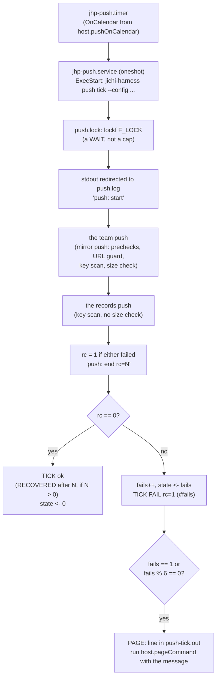

# Tazuna 6 -- `push`: the scheduled host push

*[手綱（たづな）*Tazuna* — the harness](TAZUNA.md) · chapter 6 of 10*

## Why this exists

The team's work and the run records are only safe once they are on the remote.
Chapter 5's loop can push them itself, but a drive that runs in a container
should not hold the git token at all: a token inside the container is a token
the model's commands can read. So the push moves out, to the host, and runs on a
timer. The unit file the harness generates says it in one line: "the container
never holds the git token".

What the operator needs from that timer:

- a push every twenty minutes or so, that never runs twice at once;
- a page when pushing starts to fail, but not one every twenty minutes for a
  whole night;
- a line that says when it recovered;
- the records branch pushed too, checked for secrets but never refused for
  size, because records are large by design;
- a way out when the team's backlog is too big to push in one go;
- and unit files that come from the configuration, so two drives on one host
  never push in the same minute.

`jichi-harness push` (M1147, batch H7) is the C89 port of the host's push
scripts, one subcommand per job: `records`, `tick`, `backlog`, `units` and
`run-drive`. [Chapter 5](tazuna-05-drive-the-outer-loop.md) read `records` and
`run-drive`; this chapter reads the other three, and the shared pieces they
stand on.

## The shape



Four files hold the tick's whole state, all under `host.pushHome`:
`push.lock` (the lock), `push.log` (what the pushes said), `push-tick.out` (one
verdict line per tick, plus the pages) and `push-tick.state` (one number: the
failures in a row). Nothing else survives between ticks, which is what makes a
oneshot service enough.

## One verb, five files

The dispatch in `src/harness/jc_harness_main.c:main` has three refusals, all
exit 2, and all before any config is loaded: an unknown subcommand, a bare
`push` (both name the five), and a `push <sub>` without `--config`. Each
subcommand then loads the config itself, and the host commands refuse a config
with no `host` block by name. The host block is what says where the push home
is, and the code will not guess one.

Each subcommand lives in its own file (`src/harness/jc_hp_tick.c`,
`src/harness/jc_hp_records.c`, `src/harness/jc_hp_backlog.c`,
`src/harness/jc_hp_units.c`, `src/harness/jc_hp_rundrive.c`). The reason is how
the harness was built: by a team of agents working in parallel and merged file by
file. M1147's ROADMAP entry tells how a per-file, first-writer-kept merge dropped
three of the five bodies when they shared one file. The shared machinery stayed
in `src/harness/jc_harness_push.c`, the home of `mirror push`, and was exported
for the five: `jc_hp_git_run` (one git child with the five neutralising `-c`
flags and empty global and system configs), `jc_hp_cred_flags` and
`jc_hp_cred_env` (the credential-helper wiring), `jc_hp_load_secret`,
`jc_hp_bytes_contains`, `jc_hp_blob_read`, the shared blob-list parser
`jc_hp_parse_blobs`, and the two range rules `jc_hp_records_scan` and
`jc_hp_tip_delta_scan`.

The price of "one file per owner, no cross-file private symbols" is visible in
the code. `push_refuse_host` exists twice. The `readlink("/proc/self/exe")`
lookup appears in four of the push files under three names. The
`date '+%F %T %z'` stamp is built in six places in `src/harness/`; three of them
are the drive's `stamp_of`, the tick's `tick_ts` and the backlog's
`backlog_stamp`. This chapter's Try it shows two of those three disagreeing.

One more reading habit: the comment above the five prototypes in
`include/jc_harness_push.h` still says the `records`, `tick` and `backlog`
bodies are stubs that print `not wired yet`. They are not; the Try it runs two of
them. A comment is a claim about the code, and the code is the thing to run.

## What a tick does

`src/harness/jc_hp_tick.c:jc_harness_push_tick_run`, in order.

**Preconditions, before the lock.** The config must load and name a
`host.pushHome`, and that directory must hold two directories named `push.git`
and `recs-push.git`. `init` makes them as bare repositories for a host; the tick
checks only that the two directories exist. Each failure is exit 2 with
the missing thing named. They come before the lock, so a misconfigured tick
refuses at once instead of first waiting for the lock.

**The lock.**

```c src/harness/jc_hp_tick.c:jc_harness_push_tick_run
    lock_fd = -1;
    if (getenv("PUSH_LOCKED") == NULL) {
        lock_fd = open(lock_path, O_RDWR | O_CREAT | JC_O_BINARY,
                       S_IRUSR | S_IWUSR | S_IRGRP | S_IROTH);
        ...
        if (lockf(lock_fd, F_LOCK, 0) != 0) {
```

`lockf(fd, F_LOCK, 0)` blocks until the lock is free. A tick that starts while
another still pushes *waits*; it does not fail and it does not run beside it.
That is the difference between a lock and a cap, and the project keeps it on
purpose. The kernel releases the lock when the process closes the file or
exits, so a tick that crashes leaves no stale lock behind. The
`PUSH_LOCKED` variable is the reference's re-entrancy guard: a caller that
already holds the lock sets it, and the tick skips the lock.

> **C sidebar -- feature-test macros.** `lockf` and its `F_LOCK` constant are
> XSI, not plain POSIX.1-2001, and the build defines `_POSIX_C_SOURCE=200112L`
> globally, under which glibc hides them. So `jc_hp_tick.c` defines
> `_XOPEN_SOURCE 600` at its top, before the first `#include`. A feature-test
> macro defined after the first system header changes nothing, so its position
> matters as much as its value. M1163's ROADMAP entry records a guard that was
> first placed after the includes, where it was dead.

**The pushes.** For the two calls the tick points its own stdout at
`push.log` (`dup` the old fd 1, `dup2` the log onto it, restore afterwards),
because both pushes print their report lines to stdout. Before them the tick
does a quiet fetch of the drive's branches from the mirror (the `b2` fetch,
whose failure is a third outcome that also folds into the rc), and then it
calls the team push (`jc_harness_mirror_push_run`, the `mirror push` command,
in process) and the records push (`jc_harness_push_records_run`). Each outcome
becomes a `push.log` line.

```c src/harness/jc_hp_tick.c:jc_harness_push_tick_run
    /* rc = the OR of the three (team, records, the b2 fetch), normalised:
     * any non-zero -> 1, all zero -> 0. */
    rc = (team_rc != 0 || recs_rc != 0 || b2_failed != 0) ? 1 : 0;
```

A push that returns 2 (its own usage refusal, say a mirror precheck) is folded
into 1 as well. The header explains why: the systemd oneshot must see a
*failure*, and the page must fire. A usage code from a timer that nobody reads
would be a silent misconfiguration.

**The count and the page.** After `push: end rc=N`, the tick reads
`push-tick.state` (`tick_read_state`: a missing, empty or non-numeric file
reads as 0) and writes the verdict:

```c src/harness/jc_hp_tick.c:jc_harness_push_tick_run
        fails++;
        tick_write_state(state_path, fails);
        ...
        if (fails == 1 || fails % 6 == 0) {
```

On success the line is `TICK ok | <last push.log line>`, plus
`RECOVERED after <N> failed tick(s)` when the count was above zero, and the
state goes back to 0. On failure the count goes up and
`TICK FAIL rc=1 (#N) | <last line>` is written. On the first failure and every
sixth after it, the tick also writes
`PAGE: jichi drive: the host push failed (N tick(s) in a row); see <pushHome>/push.log`
and runs `host.pageCommand` with that message as its last argument. At a
twenty-minute schedule, "every sixth" is about once every two hours: the
operator hears about the first failure at once, and is reminded, not flooded.

`tick_run_page` splits the configured command on spaces and tabs (no shell, no
quoting), appends the message as one more argument, and runs it with a 30-second
limit. If the spawn itself fails or the command runs out of time, the tick says
so on stderr. Since M1179 a non-zero exit of the command is reported there
too, 127 by name; the tick's rc never changes because of it. A config without `pageCommand` still gets the
`PAGE:` line and runs nothing. The reference called a desktop notifier by name;
the port makes the command a config field, so mail or chat is a one-line script
on the operator's side.

That left a hole, found while reviewing this chapter on 2026-11-13 and
measured. By default the harness starts a child
with `fork` and then `exec`. When the command cannot be executed, a wrong path
say, the `exec` fails inside the child, and the child exits 127. To
`tick_run_page` that is an exit status like any other, so it says nothing. A
failing tick whose `pageCommand` named a file that does not exist wrote its
`PAGE:` line, exited 1, and printed no word about the page command: the operator
was never paged and nothing said so. Only with the other spawn backend
(`JICHI_SPAWN_BACKEND=spawn`) did the same tick print
`pageCommand could not be run (rc=-1)`. M1179 reports any non-zero exit of the
page command, and names 127, because it is the one a broken configuration
produces; a command can also exit 127 by itself, so the message names the code
and does not claim the cause. Cell 10 of `tests/smoke/harness_push_tick.sh`
holds it on the fork backend and failed on the unfixed binary. The root, a fork
backend that cannot tell its caller that the `exec` failed, is left for after
0.14.0.

**The rc.** The tick exits with the push's 0 or 1, unchanged. The service has
no restart policy; the next tick is the retry, and the journal and
`push-tick.out` are the record.

## The two pushes a tick makes

The team push is `mirror push`, read in
[chapter 3](tazuna-03-the-mirror-and-the-credential-helper.md): five integrity
prechecks, the URL guard, a key scan and a size check, then a push by the
stored URL through the credential helper. The records push is `push records`,
read in [chapter 5](tazuna-05-drive-the-outer-loop.md): a key scan and no size
check, because a run's records are large by design. The tick adds no check of
its own to either. It calls both entry points in process and reads their exit
codes.

What the M1147 batch did add in `src/harness/jc_harness_push.c` is a set of
exports, so that the subcommand files reuse the team push's pieces instead of
copying them. Two are worth a closer look:

- `src/harness/jc_harness_push.c:jc_hp_git_run` runs one git child with the five
  `-c` flags that switch off fsmonitor, signature display, signing, hooks and
  alternate-ref commands, plus `GIT_CONFIG_GLOBAL` and `GIT_CONFIG_SYSTEM`
  pointed at `/dev/null`. Its guard bounds the *total* argv it is about to
  write, not only each input: at the per-input limits the sum would have been 70
  entries for a 64-slot array (M1151, defect c).
- `src/harness/jc_harness_push.c:jc_hp_cred_flags` wraps `credential_args`,
  which builds the three `-c credential.*` flags. The middle one, naming the
  helper by the harness's absolute path, used to be built in a buffer on
  `credential_args`'s own stack and returned by pointer, a pointer into a frame
  that no longer existed when git read it. M1147's ROADMAP entry calls it
  undefined behaviour shipped in 0.13.0. The fix allocates it in the caller's
  arena, which outlives every git child that reads it.

## The backlog refusal

The team push refuses a push that adds more than 20 MiB, or any single file
version over 8 MiB. After a long stretch without a successful push, the team's
backlog can be over that limit even though every commit in it is fine. The
limit stays. The backlog is pushed in pieces, oldest first, and each piece is
checked on its own: `push backlog` takes the commits to stop at, `TIP...`,
oldest first, and pushes up to each in turn.

`src/harness/jc_hp_backlog.c:jc_harness_push_backlog_run` works from the host's
own `push.git`. Before the steps it refreshes `push.git`'s tracking ref from the
remote. The reference relied on its sibling script to have done that; the port
runs on its own, so it fetches first, or a remote that moved elsewhere could look
like a fast-forward. Then, for each TIP:

1. the TIP must resolve and be on `push.git`'s `<prefix>/main`
   (`merge-base --is-ancestor`);
2. it must be a fast-forward of the remote's `<prefix>/main`;
3. both checks run over that step's delta only (`backlog_checks`, the range from
   `jc_hp_tip_delta_scan`);
4. the push, by the mirror's stored URL, never `--force`;
5. a re-fetch, so the next step's fast-forward check sees what just landed.

```c src/harness/jc_hp_backlog.c:backlog_checks
        if (size > (BACKLOG_FILE_MB * 1048576UL)) {
            return 1;   /* the per-file-version limit (8 MiB) */
        }
        total += size;
        if (total > (BACKLOG_TOTAL_MB * 1048576UL)) {
            return 1;   /* the per-step limit (20 MiB) -- the split */
        }
```

The first refused step stops the command: a `backlog: ... stop` line in
`push.log`, exit 1, and no `backlog: done`. The steps before it have landed. The
code calls this the split, and the backlog's smoke driver says "the split, not
the raise": the operator answers an over-limit step by choosing an earlier TIP.
`push backlog` has no way to raise its limits. (The team push's own size
refusal does name "a raised limit for one push by hand" as a way out.) Every
check that cannot run (an object it cannot classify, size or read) refuses as
well.

Two honest limits, both visible in the code. The step's refusal line is the same
whatever refused it, `the push of <t> failed (rc=1): stop`, for a size, a secret
or an unreadable blob alike. The operator learns *which* step, not *why*. And it
takes no lock (the reference took none), so nothing in the code keeps a
scheduled tick from pushing while a backlog runs.

## The units are generated

`src/harness/jc_hp_units.c:jc_harness_push_units_run` prints two systemd user
units, or writes them with `-o <dir>`. It never installs them and never calls
`systemctl`; the supervisor installs them on the host.

- `jhp-push.service` is a oneshot with `Nice=10`, and its `ExecStart` names the
  harness binary's own path (`readlink /proc/self/exe`) with
  `push tick --config <the config>`. It names a command, not a script path, so there is
  nothing beside the unit to drift. The config path is copied exactly as you
  typed it, so give `push units` an absolute one: a service does not start in
  the directory you were in.
- `jhp-push.timer` takes `OnCalendar=` from `host.pushOnCalendar`, with
  `AccuracySec=30s` and `Persistent=true` (a tick missed while the machine was
  off runs at the next boot).

A host block without `pushOnCalendar` is refused, exit 2, and there is no
fallback schedule. The reason is in the refusal itself: two drives on one host
must never push in the same minute, and any built-in default would put them
there. Both files open with a comment saying they are generated, not written by
hand, and that the fix for a wrong unit is to regenerate it.

## Try it

Offline, in a scratch directory: no remote, no real key. The pushes here fail
on purpose (there is no mirror and no records clone), so you can watch the count
and the page.

```sh
# in the jichi checkout, after `make jichi-harness`; the block makes its own directory
H=$PWD/jichi-harness
cd "$(mktemp -d)"
C=$PWD/h.json
mkdir -p ph/push.git ph/recs-push.git
printf 'canary-model-key-0123456789\n' > model.key
printf 'canary-git-token-0123456789\n' > git.token
printf '[remote "origin"]\n\turl = %s/nowhere.git\n' "$PWD" > mirror.git-config.harness-copy
printf '#!/bin/sh\necho "$1" >> paged.txt\n' > page.sh && chmod 755 page.sh
cat > "$C" <<EOF
{"dir":"$PWD","modelKeyFile":"$PWD/model.key","gitTokenFile":"$PWD/git.token",
 "drive":{"branchPrefix":"demo"},
 "host":{"pushHome":"$PWD/ph","pageCommand":"$PWD/page.sh","pushOnCalendar":"*:07/20"}}
EOF
for i in 1 2 3; do "$H" --config "$C" push tick < /dev/null 2>/dev/null; echo "tick $i: exit $?"; done
cat ph/push-tick.out ph/push-tick.state paged.txt
"$H" --config "$C" push tick < /dev/null; echo "exit $?"
"$H" --config "$C" push units < /dev/null
"$H" --config "$C" push backlog HEAD < /dev/null; echo "exit $?"
tail -n 2 ph/push.log
```

What it printed here (the directories are shortened to `...`, and one long
comment line is cut):

```
tick 1: exit 1
tick 2: exit 1
tick 3: exit 1
2026-11-13 12:00:41 +0100 TICK FAIL rc=1 (#1) | 2026-11-13 12:00:41 +0100 push: end rc=1
2026-11-13 12:00:41 +0100 PAGE: jichi drive: the host push failed (1 tick(s) in a row); see .../ph/push.log
2026-11-13 12:00:41 +0100 TICK FAIL rc=1 (#2) | 2026-11-13 12:00:41 +0100 push: end rc=1
2026-11-13 12:00:41 +0100 TICK FAIL rc=1 (#3) | 2026-11-13 12:00:41 +0100 push: end rc=1
3
jichi drive: the host push failed (1 tick(s) in a row); see .../ph/push.log
jichi-harness: mirror: the mirror directory does not exist or is not a directory: .../mirror.git
jichi-harness: push tick: the team push returned a usage code (2): the tick is misconfigured -- mapped to the tick's rc 1 (the service must see the failure and the page fires)
jichi-harness: push records: the records directory does not exist or is not a directory: .../recs
jichi-harness: push tick: the records push returned a usage code (2): the tick is misconfigured -- mapped to the tick's rc 1 (the service must see the failure and the page fires)
exit 1
# jhp-push.service -- GENERATED by `jichi-harness push units` (M1147, batch H7, 2026-11-06); NOT hand-written: do not edit by hand -- regenerate it.
# The harness port drive's host push (the user-level oneshot). Runs `<harness> push tick --config <config>`: the team mirror push (`mirror push`) + the records push, from the host (the container never holds the git token; option B). ...
[Unit]
Description=jichi harness port drive: host push (push tick)
After=network-online.target

[Service]
Type=oneshot
Nice=10
ExecStart=.../jichi-harness push tick --config .../h.json

# jhp-push.timer -- GENERATED by `jichi-harness push units` (M1147, batch H7, 2026-11-06); NOT hand-written: do not edit by hand -- regenerate it.
# The schedule comes from the config (host.pushOnCalendar) so two drives' pushes never share a minute on the same host. Persistent: a tick missed while the machine was off runs at the next boot.
[Unit]
Description=jichi harness port drive: host push (scheduled)

[Timer]
OnCalendar=*:07/20
AccuracySec=30s
Persistent=true

[Install]
WantedBy=timers.target
exit 1
2026-11-13 12:00:41 +0100 push: end rc=1
2026-11-13 12:00:41 +0000 backlog: the fetch of the remote's team refs failed (rc=128): stop
```

Three things to read in it. One page for three failures, at #1; the stub
received the message as its argument. The fourth tick, run with its stderr
visible, shows the two pushes refusing with exit 2 and the tick folding each
into its own exit 1. The backlog stopped at its very first step, the refresh
fetch, because the stored URL points at a repository that does not exist. And
the last two `push.log` lines were written in the same second on one machine,
yet their zones disagree: the tick's line carries this machine's offset
(`+0100` here), the backlog's says `+0000`. Check-yourself question 5 asks why.

The real thing, against local bare repositories and canary secrets, is in the
smoke drivers. Each header lists its cells and what makes each one red:

```sh
# in the jichi checkout
make jichi jichi-harness smoke-tools
for d in tick backlog units; do
  printf '%-8s ' "$d"
  sh tests/smoke/harness_push_$d.sh < /dev/null | awk '/^1\.\./{p=$0} /^ok/{o++} /^not ok/{n++} END{print p, o+0, "ok,", n+0, "not ok"}'
done
```

```
make: 'jichi-harness' is up to date.
make: Nothing to be done for 'smoke-tools'.
tick     1..9 9 ok, 0 not ok
backlog  1..10 10 ok, 0 not ok
units    1..6 6 ok, 0 not ok
```

Cell 9 of the tick driver is a `# SKIP` on a normal build, which still prints
`ok`: it checks for a leak and runs only in a sanitizer build (the M1150 story
below).

## What went wrong here, and what it teaches

**The lock's constant.** The reference script took its lock with `flock -o`. The
brief for the port asked for `lockf(fd, F_TLOCK, 0)` and described it as the
blocking wait. It was measured before it was trusted (2026-11-06), and the
result is kept in the header of `src/harness/jc_hp_tick.c`: against a second
process holding the lock, `F_TLOCK` returned `EAGAIN` at once, and `F_LOCK`
waited the holder's full three seconds. glibc's headers describe `F_TLOCK` as
"Test and lock a region for exclusive use", a non-blocking try. With `F_TLOCK`
the tick would have turned "wait for the other push" into "fail at once", a cap
where the design wanted a lock. The brief named the wanted behaviour correctly
and the constant wrongly, and only a measurement could tell them apart.

The same header records a second measurement from that day: on Linux an `flock`
lock and a `lockf` lock do not see each other. A port tick and a still-running
reference script would both have taken "the" lock and pushed together. So the
switch-over runs the port against its own push home, and the header says plainly
that the port serialises with itself only.

**Eight TIPs, and a silent ninth (M1151, defect b).** The first `push backlog`
kept its TIPs in `tips[8]`. A ninth TIP was dropped without a word, eight steps
were pushed, and the command still printed `backlog: done` and exited 0. The
independent review of the batch called it WRONG, and the reference's unbounded
`for t in "$@"` was the standard. The fix is a growing `jc_vec` of every
positional (the comment in `jc_harness_push_backlog_run` names "the M1151 defect
b"), and the backlog driver's cells 9 and 10 now push nine and ten TIPs and count
the `backlog: push` lines. A fixed array is fine; a fixed array that drops
silently is the defect.

**384 bytes in three objects (M1150).** The host gate came back RED on the H7
batch. Its leak check (`scripts/leakcheck.sh`) runs every harness smoke driver
against a sanitizer build, and it found
`Direct leak of 384 byte(s) in 3 object(s)` in every tick that should have
exited 0: the sanitizer's report
changes the exit code, so the driver's rc checks went red too. The leak was in
`build_exclusion` in `src/harness/jc_harness_push.c`. A per-tip existence check
captured git's output into a buffer, freed it only on the success branch, and
re-initialised the buffer at the end of the loop, which dropped the pointer on
the failure branch. The failure branch was the expected case: a tip the mirror
does not have. The fix is one statement, freeing on every path. The code was
older than H7 (it came with `mirror push`); H7 only made it reachable from a
driver the gate runs. And the new cell 9 is written so that it cannot pass by
saying nothing: on a build without the sanitizer it is marked `# SKIP`, never a
plain pass, because no leak report from a binary that cannot produce one would
mean nothing was checked.

What the three share: in each, the code did something plausible (a lock that
does not wait, eight pushes, a buffer reused), and an independent instrument or
peer showed it wrong: a second process holding the lock, the reference script's
unbounded loop, the sanitizer's leak report. When there is a reference, run
beside it; when there is an instrument, run under it.

## Check yourself

1. A tick is still pushing a large records commit when the timer starts the next
   one. What does the second tick do, and what would it have done with
   `F_TLOCK`?
2. The push fails thirteen ticks in a row, then succeeds. On which ticks did the
   page fire, and what does the fourteenth tick write?
3. The team push refuses with exit 2 because the mirror's stored config copy
   differs from the live one. What does the tick exit with, and why not 2?
4. A host block has no `pushOnCalendar`. What does `push units` do, and why
   does it not fall back to a sensible default such as every twenty minutes?
5. In the Try it, why does the backlog's `push.log` line say `+0000` while the
   tick's lines carry this machine's offset? Read
   `src/harness/jc_hp_backlog.c:backlog_stamp`.

<details>
<summary>Answers</summary>

1. It blocks in `lockf(lock_fd, F_LOCK, 0)` until the first tick exits, then
   pushes; its `push: start` comes after the first tick's `push: end` (the tick
   driver's cell 1). With `F_TLOCK` the call would have returned `EAGAIN` at once
   and the tick would have refused: a cap instead of a lock.
2. Ticks 1, 6 and 12 (`fails == 1 || fails % 6 == 0`). The fourteenth writes
   `TICK ok | ...`, then `RECOVERED after 13 failed tick(s)`, and resets the
   state file to 0.
3. Exit 1. The tick folds any non-zero subcommand rc into 1, and says so on
   stderr, because the oneshot service has to see a failure and the page has to
   fire. A 2 would read as a usage error of the tick itself.
4. It refuses with exit 2 and names `host.pushOnCalendar`; it writes no unit.
   The schedule is what keeps two drives on one host from pushing in the same
   minute, and only the operator knows the other drive's schedule. A built-in
   default would give every drive the same one, which is exactly the
   collision.
5. `backlog_stamp` computes the offset as `difftime(t, mktime(&tmv))`, where
   `tmv` came from `localtime_r(&t, ...)`. `mktime` reads its argument as local
   time, so it returns `t` itself and the difference is always 0: the stamp
   prints the local wall clock with `+0000`. The tick's `tick_ts` and the drive's
   `stamp_of` instead read the local wall clock *as UTC* (`tick_utc_from_tm`)
   and subtract `t`, which gives the real offset. On a machine whose zone is UTC
   the three agree, which is the one place the backlog stamp is right. (Reading
   on, a non-zero offset would still print wrong: `off_min` holds minutes, but
   the digits are cut from it as if it held seconds, `mag / 3600`.)

```c src/harness/jc_hp_backlog.c:backlog_stamp
        time_t utc = mktime(&tmv);   /* mktime: the local wall clock's epoch */
        double dd = difftime(t, utc);
        off_min = (int)(dd / 60.0);  /* local is UTC + off_min */
```

</details>

*Next: [chapter 7 -- `notify` and `watch`](tazuna-07-notify-and-watch.md), the
verdict's messenger and the gate's clock.*
