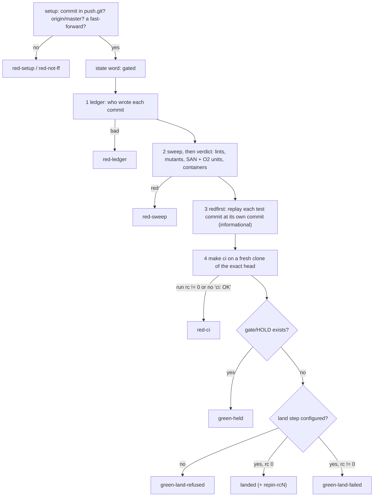

# Tazuna 8 -- `gate run`: from a READY line to `master`

*[手綱（たづな）*Tazuna* — the harness](TAZUNA.md) · chapter 8 of 10*

## Why this exists

jichi has one rule about `master` that admits no exception: **nothing moves it
unless `make ci` was green on the exact head** (`CLAUDE.md`, "Merging"). At
a desk, a person checks that by hand. In a drive, a team of agents produces
batches through the night, and the rule needs a program that applies it every
time, the same way, whoever is awake.

`gate run <SHA8> [BATCH]` is that program. Chapter 7's watcher starts it on a
READY commit. It runs five checks in a fixed order and writes one **verdict
word** into the state file. (A run that passes the setup writes `gated` before
it, and a repin step adds a `repin-rc<N>` line after `landed`.) Only one of
those words, `landed`, says
that the step which moves `master` ran and succeeded.
`make ci` alone takes about 48 minutes (the header of `jc_hp_gate.c`), and
the gate runs it with no time limit at all.

This chapter reads seven files: the orchestrator `src/harness/jc_hp_gate.c`,
the five stage bodies it runs (ledger, sweep, verdict, redfirst, ci), and
`src/harness/jc_hp_gateunits.c`, which prints the unit template that starts a
gate. Like chapter 7's commands, they are ports of host scripts, and
`docs/HARNESS.md` dates them M1154 to M1159.

## The shape



Any stage can also end the run as **INVALID** (`invalid-<stage>`). That word
means the gate's *own* tool faulted, so the batch was not judged at all. The
exit codes keep the outcomes apart: RED exits 1; INVALID exits 0, with the note
"Change nothing, wait"; `landed` and `green-held` exit 0; `green-land-refused`
and `green-land-failed` exit 1.

## How the orchestrator runs a stage

Open `src/harness/jc_hp_gate.c:jc_hp_gate_full_run`. It does not call the
stage bodies as functions. It runs each one as a **separate process**, the
harness invoking itself:

```
<self> gate run --config <cfg> --stage <name> <args...> > <G>/<name>.txt 2>&1
```

`<self>` comes from `/proc/self/exe` (`src/harness/jc_hp_gate.c:gf_self_path`),
and `<G>` is `<gateHome>/<sha8>/`, the run's record home. The self-exec buys
two things: every stage can be run by hand with `--stage`, exactly as the gate
runs it, and every stage leaves a **record file** that is its whole interface.
The orchestrator reads the child's rc and its files (the record, and for ci the
run's log), and no in-memory state.

The command line goes through `sh -c` for the redirect, which brings the old
danger of a shell re-parsing values. The fix was M1159's B-fix C1, and its
comment describes the incident: a `--container-run` value containing a `;`
ended the child's command, and the rest of the value **ran on the host**.
Since then `src/harness/jc_hp_gate.c:gf_cmd_word` single-quotes every word and
turns each `'` inside a word into `'\''`:

```c src/harness/jc_hp_gate.c:gf_cmd_word
    gn = jc_snprintf(cmd + base, cap - base, " '");
...
    for (i = 0; w[i] != '\0'; i++) {
        if (w[i] == '\'') {
            gn = jc_snprintf(cmd + base, cap - base, "'\\''");
```

Two more rules shape every stage:

- **No timeout.** `src/harness/jc_hp_gate.c:gf_stage_child` calls
  `jc_proc_capture` with no deadline (D14: "the ci's 48 minutes are the
  point"). That is `CLAUDE.md`'s caps-versus-fences rule: a cap firing during
  `make ci` would produce a verdict about the cap, not about the commit.
- **The D6 order: state word, then say, then note.** Every verdict helper, such
  as `src/harness/jc_hp_gate.c:gf_red`, appends the state word first, then
  writes the say line to `run.log` and stdout, then calls chapter 7's
  `jc_harness_notify` in-process. The state word goes first because the next
  watcher tick reads that file and nothing else. If the note fails, the
  failure is named, and the verdict stands.

## The setup: the commit, master, and a fast-forward

Before any stage starts, the orchestrator runs three git reads of its own
through `src/harness/jc_hp_gate.c:gf_git`. Each read sets 16 secret variables
to empty (15 API keys and `ZD_TOKEN_FILE`), so no key reaches it (the comments
call this D8). The
three questions are: does `<SHA8>^{commit}` resolve in `push.git`; does
`refs/remotes/origin/master` resolve; and is master an ancestor of the commit.
A "no" to any of them is a RED (`red-setup` or `red-not-ff`) before anything
expensive has run. A "yes" to all three writes the first state word, `gated`.

## 1. The ledger: who wrote each commit

`src/harness/jc_hp_gateledger.c:jc_hp_gateledger_run` walks
`git rev-list master..head` and checks each commit against the drive's
identity rule. The rule is `CLAUDE.md`'s "Committing" line, made mechanical by
`src/harness/jc_hp_gateledger.c:jc_hp_gateledger_reasons`:

- the author and the committer are the ledger address;
- every `Co-Authored-By` value carries `<address>`;
- a `Jichi-Build` and a `Jichi-Model` trailer are present;
- the `Jichi-Model` id is not a priced provider's
  (`src/harness/jc_hp_gateledger.c:jc_hp_gateledger_is_priced`).

Each bad commit prints one line, `<sha8> <reasons>`. The stage ends with
`ledger: N commit(s), B bad` and this exit:

```c src/harness/jc_hp_gateledger.c:jc_hp_gateledger_run
    return (n_commits > 0 && bad == 0) ? 0 : 1;
```

The rule demands `n_commits > 0`. An empty range is red, not vacuously green.
"Zero bad out of zero" is the empty-set agreement this project's lints keep
refusing. Two narrow exceptions exist, and each prints `accepted:` and is not
counted as bad. One is an accept list of full 40-hex ids whose only reasons are
missing trailers. The other (DD6) is a supervisor's commit that carries one
specific trailer and changes only files in the drives' internal documents
directory, which public snapshots do not ship.

## 2. The sweep, then the verdict

The **sweep** (`src/harness/jc_hp_gatesweep.c:jc_hp_gatesweep_run`) runs the
checks that `make ci` does not. It works in a fresh clone of `push.git`,
checked out detached at the SHA8. Inside that clone it builds, then runs
every `*lint*.sh`, `docs_*.sh` and `reading_trace.sh` under `tests/smoke/`
(`src/harness/jc_hp_gatesweep.c:gsw_driver_name` picks them). It then
runs `make smoke-mutant` against `MUTANT_BASE` (origin/master), the unit suite
under ASan/UBSan and under gcc `-O2` (each in a clone of its own), and the two
container drivers. Each command is a shim (`--build-run`, `--mutant-run`, ...)
whose default is the reference's real `make` line. The record's last line is
`records: <dir>`, and a sweep that exits 0 *without* that line counts as
INVALID: it died late.

The **verdict** (`src/harness/jc_hp_gateverdict.c:jc_hp_gv_run`) reads that
record and judges it. It is green only if every required line is *present*:

```c src/harness/jc_hp_gateverdict.c:jc_hp_gv_classify
    (void)jc_snprintf(pat_sweep, sizeof pat_sweep,
                      "^sweep: ran [1-9][0-9]* drivers on %s; red: none$",
                      s);
```

The count is `[1-9][0-9]*`. A sweep that ran **zero** drivers matches no
pattern, so it is red. The two container lines need a count of at least 1 too.
The build line, the mutant line and the `N checks, 0 failures` of both unit
suites must be present, but their counts are not checked: a unit suite that
reports `0 checks, 0 failures` passes. A missing line is red as surely as a
failing one. For the sweep and the containers, this is `CLAUDE.md`'s "count
what the gate reached" written as a regex. The verdict also does not trust a
mutant stage that swept nothing. When smoke-mutant reports "no changed drivers
to sweep", the verdict asks git to count the batch's changed smoke drivers
again, and it stays green only if that recount agrees
(`src/harness/jc_hp_gateverdict.c:jc_hp_gv_verdict`).

The `-O2` suite shows why the sweep compiles things nothing else compiles.
`docs/HARNESS.md` tells it under M1160: at e12d9876 that stage died on a
`stringop-truncation` error that no container stage had ever compiled, and it
reached the host gate as `unit o2 rc=2 NO SUMMARY`. The gate caught it. Since
then `tests/smoke/o2_unit_stage.sh` catches that class in the container first.

## 3. Red-first, replayed

`CLAUDE.md` asks every new test to be "shown to fail without its fix". The
**redfirst** stage (`src/harness/jc_hp_gateref.c:jc_hp_gateref_run`) checks
that claim after the fact. It selects the *test commits* in the batch with
`src/harness/jc_hp_gateref.c:jc_gateref_select`: commits that change only
files under `tests/` (or internal notes), among them a smoke driver or a unit
test file (`test_*.c`). It checks each of them out **at its own commit**,
builds, and runs its tests there. A test that was committed before its fix should fail at its own
commit (`RED`). One that passes there (`GREEN`) was never observed failing.

This stage is informational: it can make the run INVALID, but never RED. Its
results go into the GREEN note as a question to the lead: "never observed
failing at its own commit ... say which in LOG-3". A test can pass there for
an honest reason, for example a pin of behaviour that was already fixed. The
gate asks for the reason and does not decide it.

## 4. `make ci` on the exact head

`src/harness/jc_hp_gateci.c:jc_hp_gateci_run` has one job: `make ci`, on
exactly the commit that was declared READY. "Exactly" is checked, not assumed.
The stage clones `push.git` with `--no-local`, checks the SHA8 out detached,
and compares the clone's `HEAD` with `push.git`'s own resolution of the SHA8:

```c src/harness/jc_hp_gateci.c:jc_hp_gateci_run
            if (gci_git_read(home, "rev-parse HEAD", head,
                             (int)sizeof head) != 0) {
                head[0] = '\0';
            }
...
            if (strcmp(head, want) != 0) {
                if (jc_snprintf(line, sizeof line,
                                "  ci: checkout mismatch: INVALID\n") < 0) {
```

Then it runs the `--ci-run` command (default `make ci`) once. The command runs
with the API keys emptied, a short `TMPDIR`, and stdout and stderr in
`<ci-log-dir>/ci-<sha8>.log`. `src/harness/jc_hp_gateci.c:gci_run_child`
spawns it and reaps it with no deadline. When the run is over, the stage
writes `  ci: rc=<r> <last 'ci: OK' line>` into its record. On a failure it
adds a `  ci: RED make ci rc=<r>. ...` line, plus an excerpt file: every
`not ok` line with one line before and twenty after.

Look at what the stage's *own* exit code means. It is **0 whenever the run
finished, red or green**. It is 1 only when something around the run broke
(the clone, the checkout check, the merge-base, a record file), which makes it
an INVALID. The
stage reports facts. Turning facts into a verdict is the orchestrator's job,
and the next section is about the day those two got mixed up.

## The verdict, and M1160-d

After the ci stage, the orchestrator decides. This is the code at this tree:

```c src/harness/jc_hp_gate.c:jc_hp_gate_full_run
            run_rc = chrc;
            p3 = recbuf;
            while (p3 != NULL) {
                if (memcmp(p3, "  ci: RED make ci rc=", 21) == 0) {
...
        if (run_rc != 0 || r.okl[0] == '\0') {
```

`chrc` is the **stage's** exit code. `run_rc` is the **run's** exit code,
parsed back out of the record. The red condition needs both halves: the run
exited non-zero, *or* its log has no `ci: OK` line. Either one alone is red.
Only a green run passes on to the land step. A green run means `make ci` exited
0, printed `ci: OK`, and ran on a clone verified to be the READY commit, which
the setup verified to be a fast-forward of master.

The land step itself is a command from the configuration (`--land-run` or
`host.landRun`), run as `sh -c '<cmd> <sha8>'`. The port **trusts its exit
code**: rc 0 writes `landed`. The fast-forward push of `master` happens inside
that command, and that is also where a master that moved after the setup check
has to be refused. Without a land command the run ends `green-land-refused`
and leaves `master` alone; in the code's words, "the port will not guess a
landing". A `<gateHome>/HOLD` file stops a GREEN before the land step
(`green-held`, exit 0): a hand-brake the operator can pull without editing
anything else.

The watcher starts all of this through a transient unit. `gate units`
(`src/harness/jc_hp_gateunits.c:jc_hp_gateunits_run`) prints the generated twin
of that unit, a `jhp-gate@.service` template with `Nice=19` whose `ExecStart=`
is `host.gateRun` verbatim. The SHA8 reaches the template only through `%i` in
its `Description=`, so an instance runs the command without the SHA8 or the
batch (`docs/DEFERRED.md` def-381, open at this tree). Like every
generated unit in this harness it refuses, exit 2, when its input is absent,
here `host.gateRun`. It does not fall back to a default gate command.

## Try it

A complete gate run, every stage real, every expensive command a stand-in: the
config replaces each `make` with `true` or an `echo` of the line the verdict
expects. Fixed dates make the commit ids match below. Your timestamps and
`/tmp` names will differ.

**1. A repository with a base and one well-formed commit.**

```sh
# in the jichi checkout, after `make jichi-harness`
sh                                  # a throwaway shell: `exit` drops the exports
J=$PWD/jichi-harness
cd "$(mktemp -d)"
export GIT_CONFIG_GLOBAL=/dev/null GIT_CONFIG_SYSTEM=/dev/null
export GIT_AUTHOR_DATE=2026-11-13T00:00:00Z GIT_COMMITTER_DATE=2026-11-13T00:00:00Z
A=ops@example.com
git init -q -b main w && mkdir -p w/tests/smoke
printf '#!/bin/sh\n"$BIN" --version\n' > w/tests/smoke/demo_lint.sh
echo one > w/f && git -C w add -A
git -C w -c user.name=Ops -c user.email=$A commit -q -m base
echo two > w/f && git -C w add -A
git -C w -c user.name=Ops -c user.email=$A commit -q -m change \
    --trailer "Co-Authored-By: jichi <$A>" --trailer "Jichi-Build: 0000abcd" \
    --trailer "Jichi-Model: jlu/demo"
git clone -q --bare w push.git
git -C push.git update-ref refs/remotes/origin/master "$(git -C w rev-parse HEAD~1)"
S=$(git -C w rev-parse --short=8 HEAD); echo "$S"
```

```
b45daaed
```

**2. The stand-ins, and a full gate run.** `ci.sh` plays `make ci`, and the
land step only echoes.

```sh
# in the throwaway directory from step 1, the same shell
printf '#!/bin/sh\necho "smoke: OK (1 drivers, 0 failed)"\necho "ci: OK"\nexit 0\n' > ci.sh
chmod +x ci.sh
cat > cfg.json <<EOF
{"dir":"$PWD/dir","host":{"pushRepo":"$PWD/push.git","gateHome":"$PWD/gate",
 "ledgerAddress":"$A","bin":"true","buildRun":"true",
 "mutantRun":"echo 'mutant: OK (1 drivers swept, 0 excluded)'",
 "unitRunSan":"echo '9 checks, 0 failures'","unitRunO2":"echo '9 checks, 0 failures'",
 "containerRun":"echo '  container fetch_ssrf_reuse rc=0 4 ok, 0 not ok'; echo '  container resolve_timeout_connect rc=0 5 ok, 0 not ok'",
 "ciRun":"$PWD/ci.sh","landRun":"echo land: would fast-forward master to"}}
EOF
$J gate run --config cfg.json "$S" 1 < /dev/null; echo "rc=$?"
cat gate/state
```

```
2026-11-13 14:45:53 +0100 gate: BATCH 1 at b45daaeda208a0c7711c40e1f3da6348f905a3d5; master b5ca9df85fc1ddd7bf98fdb2029b91f0a0719831
2026-11-13 14:45:54 +0100 ledger: 1 commit(s), 0 bad
2026-11-13 14:45:54 +0100 sweep: start
2026-11-13 14:45:54 +0100 sweep: green
2026-11-13 14:45:54 +0100 redfirst: 0 red-first commit(s), 0 red, 0 green, 0 skip
2026-11-13 14:45:54 +0100 ci: start
2026-11-13 14:45:54 +0100 ci: rc=0 ci: OK
2026-11-13 14:45:54 +0100 VERDICT green, LANDED: master is b45daaed
2026-11-13 14:45:54 +0100 gate b45daaed: note 20261113-1445-gate-b45daaed.md; no live run
rc=0
b45daaed gated 2026-11-13 14:45:53 +0100
b45daaed landed 2026-11-13 14:45:54 +0100
```

Read `LANDED` carefully. The echo exited 0, so the port wrote `landed`, and
`master` in `push.git` did not move. The word records the land command's rc,
not a fact about `master`.

**3. What the lead receives, and the records.**

```sh
# in the throwaway directory from step 1, the same shell
cat dir/inbox/*-gate-"$S".md
ls gate/"$S" | tr '\n' ' '; echo
```

```
# Host gate: b45daaed

Host gate (automatic, 2026-11-13 14:45:54 +0100): GREEN and LANDED: BATCH 1 READY at b45daaed is master now (1 commits; sweep: ran 1 drivers on b45daaed; red: none; smoke: OK (1 drivers, 0 failed); ci: OK; records: /tmp/tmp.Bu4of3L6HC/gate/b45daaed/rf/records). bin/ NOT re-pinned (host.repinRun absent: H11 is not built; the reference's repin.sh stands for the switch-over); your NEXT run uses it. Branch the next batch from the team branch as before.

Records on the host: /tmp/tmp.Bu4of3L6HC/gate/b45daaed/ (the supervisor reads them; you need not).
ci ci.txt ledger.txt redfirst.txt rf run.log sw sweep.txt sweep.verdict verdict.txt 
```

There is one record per stage, plus `run.log` with every say line. When a
verdict surprises you, start reading there.

**4. M1160-d: a run that prints `ci: OK` and still fails.**

```sh
# in the throwaway directory from step 1, the same shell
printf '#!/bin/sh\necho "smoke: OK (1 drivers, 0 failed)"\necho "ci: OK"\nexit 3\n' > ci.sh
$J gate run --config cfg.json "$S" 1 < /dev/null; echo "rc=$?"
tail -n 2 gate/state
```

```
2026-11-13 14:45:54 +0100 gate: BATCH 1 at b45daaeda208a0c7711c40e1f3da6348f905a3d5; master b5ca9df85fc1ddd7bf98fdb2029b91f0a0719831
...
2026-11-13 14:45:55 +0100 ci: rc=3 ci: OK
2026-11-13 14:45:55 +0100 VERDICT red (ci): make ci rc=3.  Log on the host: /tmp/tmp.Bu4of3L6HC/gate/ci/ci-b45daaed.log.
2026-11-13 14:45:55 +0100 gate b45daaed: note 20261113-1445-gate-b45daaed.md; no live run
rc=1
b45daaed gated 2026-11-13 14:45:54 +0100
b45daaed red-ci 2026-11-13 14:45:55 +0100
```

The same SHA8 was gated twice. The state file gains lines and loses none, and
the watcher reads the last word, `red-ci`.

**5. A ledger stage by hand, on a commit with no trailers.** (The `valgrind`
line is optional. On this tree it prints nothing. Before M1178 it printed two
lines, and the next section explains them.)

```sh
# in the throwaway directory from step 1, the same shell
git -C w -c user.name=Ops -c user.email=$A commit -q --allow-empty -m "no trailers"
$J gate run --config cfg.json --stage ledger w HEAD~2 HEAD < /dev/null; echo "rc=$?"
valgrind -q $J gate run --config cfg.json --stage ledger w HEAD~2 HEAD < /dev/null 2>&1 | grep 'uninitialised'
exit
```

```
ca320324 no-Co-Authored-By no-Jichi-Build no-Jichi-Model
ledger: 2 commit(s), 1 bad
rc=1
```

## What went wrong here, and what it teaches

### M1160-d: the stage's exit code is not the run's

Before M1160-d, the ci step's decision read only half of the facts. The
comments M1160-d left in `jc_hp_gate_full_run` name the change: the decision
now reads "the RUN rc (run_rc), not the STAGE rc (chrc)", beside the `ci: OK`
test you saw above. Cells 94 and 95 of `tests/smoke/harness_gate_run.sh`
record what the unfixed tree did.

The old condition was red only when the log had no `ci: OK` line. The say line
and the note printed `chrc`, the *stage's* code, which is 0 for every run that
finished. Two things followed from that. A failing `make ci` was reported as
`ci: rc=0`. And a run that printed `ci: OK` but exited non-zero (step 4 of Try
it) was GREEN, so it would have reached the land step. The reference script
had always tested `cr -ne 0 || -z okl`. The port had dropped half of the
condition, because a stage that *completes* returns 0, and the code read that 0
as if it were the run's result. Cells 94 and 95 of
`tests/smoke/harness_gate_run.sh` (G15r and G15v) now pin both halves. G15v is
step 4: `ci: OK` printed, exit 3, expected RED, never LAND.

The general lesson: once a value has passed through a layer, name which layer
it belongs to. `chrc` and `run_rc` are both "the ci rc", and only one of them
is about the commit. The other is about the harness.

The comments around the stage launcher record three more bugs of the same
kind, each one a mismatch between two layers. M1159's B-fix C1 is the unquoted
`;` described above. In C2, a flags array one slot too small let the NULL
terminator land on `values[0]`. On a plain build that silently **dropped
`--work`** from the sweep child, and UBSan reported it as an index 8 out of
bounds. In C4, `gf_last_line` computed a line's length after it had moved the
start pointer, so every say line was a bare timestamp. Each of these was
silent: the run still printed a plausible verdict.

### Two more, measured while writing this chapter, and fixed in M1178

Both were found while this chapter was being written, by reading the code and
running it on 2026-11-13. Both are fixed in M1178, each with a test seen red on
the unfixed binary.

- **The ledger read an accept list it never initialised.**
  `jc_hp_gateledger_run` declares `struct jc_vec accept;`. Before M1178 only
  `gl_read_accept` initialised it, and that ran only when an accept list was
  configured. With no list, a bad commit made `jc_hp_gateledger_accept_listed`
  read `accept.len`, and the cleanup `jc_vec_free(&accept)` passed the
  uninitialised `accept.data` to `free()`. Both are undefined behaviour, and
  valgrind reported both: step 5's valgrind line printed two
  `Conditional jump or move depends on uninitialised value(s)` lines. The
  verdict was right only because the stack slot happened to be harmless. ASan
  does not detect uninitialised reads (that is MSan's job), so a SAN build is no
  check for this class. The fix is a loader that initialises first and reads
  second, and the run calls it whether or not there is a list:

```c src/harness/jc_hp_gateledger.c:jc_hp_gateledger_load_accept
{
    jc_vec_init(accept, sizeof (const char *));
    if (path == NULL || path[0] == '\0') {
        return 0;
    }
    return gl_read_accept(path, a, accept);
}
```

  Its unit test fills a vector with `0xA5` bytes before calling it with no
  path, so a loader that skipped the initialisation fails a check on every
  machine, not only under valgrind.
- **The setup pasted the SHA8 into a shell unquoted.** Before M1178 `gf_git`
  built `cd '<repo>' && git rev-parse --verify -q <SHA8>^{commit}` and handed it
  to `sh -c`, and the `gate run` dispatch never checked that the SHA8 was hex. A
  SHA8 containing `;` ran a command of its own here. The stage bodies refused a
  non-hex SHA8, and chapter 7's watcher only ever passes 7 to 40 hex, so the
  designed path was safe; a hand-typed `gate run` was not. C1 had quoted the
  stage command line, and this was the one shell line it did not reach. Now the
  orchestrator refuses a `<SHA8>` that is not 7 to 40 lowercase hex, with exit
  2, before it reads the config or writes anything, and `gf_git` quotes every
  word, the push repo path included, with C1's own helper:

```c src/harness/jc_hp_gate.c:gf_git
        if (gf_cmd_word(joined, sizeof joined, r->push_repo) != 0) {
            return -1;
        }
...
        for (j = 0; j < n_args; j++) {
            if (gf_cmd_word(joined, sizeof joined, args[j]) != 0) {
                return -1;
            }
        }
```

  Cells 96 and 97 of `tests/smoke/harness_gate_run.sh` pin both halves. On the
  unfixed binary, cell 96's injected command ran, and cell 97 (a push repo path
  containing a `'`) read every commit as "not in the host's push.git".

The full account is in
[`docs/analysis/2026-11-13-five-harness-port-defects.md`](../analysis/2026-11-13-five-harness-port-defects.md).

The theme is chapter 7's: a check that never receives the dangerous input
cannot see the bug. G15v exists because someone wrote down "`ci: OK` *and* a
non-zero exit". Ask it of every input: what does the real peer send that my
fixture never does?

## Check yourself

1. A batch's range `master..head` is empty. What does the ledger stage return,
   and why is that the right answer?
2. The sweep record lacks the `  unit o2 ...` line entirely. Is the verdict
   green, red or invalid?
3. Why does a stage that hits INVALID exit the orchestrator with 0, while a
   RED exits 1?
4. After step 2 of Try it, the state file says `landed`, and `master` has not
   moved. Is that a bug in the gate? Where must the fast-forward be enforced?

<details><summary>Answers</summary>

1. It returns 1, and the gate's verdict is red (ledger). The exit is
   `n_commits > 0 && bad == 0`. Zero commits judged is not "all good". It means
   nothing was judged, and a gate that says green over an empty set has read
   nothing.
2. Red. The verdict requires each line to be *present* (`^  unit o2 rc=0 [0-9]+
   checks, 0 failures$`), so a missing line gives the reason "missing or not
   clean: the -O2 unit suite".
3. INVALID means the gate's own tool faulted, so the batch was not judged. The
   note says "Change nothing, wait", and the run exits 0 because nothing is
   wrong with the batch. RED judges the batch and exits 1.
4. Not a bug in the gate. The gate's contract ends with the land command's
   rc, and the stand-in only echoed. The real fast-forward, including the
   refusal when `master` moved after the setup check, belongs inside the land
   command.

</details>

*Next: [chapter 9 — `main`, the settings, and `doctor`](tazuna-09-main-config-and-doctor.md).*
