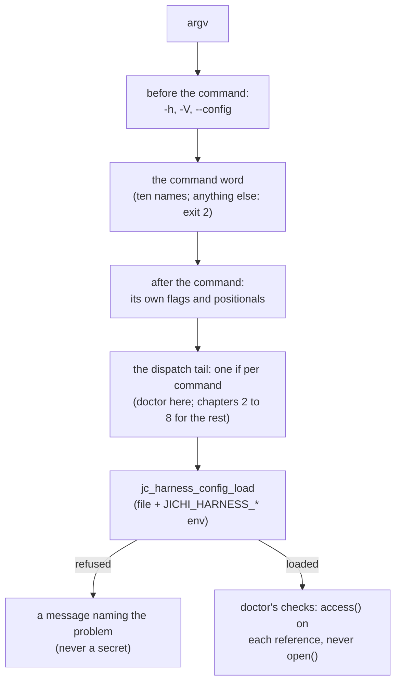

# Tazuna 9 -- `main`, the settings, and `doctor`

*[手綱（たづな）*Tazuna* — the harness](TAZUNA.md) · chapter 9 of 10*

## Why this exists

Chapters 2 to 8 each read one command. This chapter reads what every command
passes through first: **`main`**, which turns a command line into one call; **the
configuration loader**, which turns one JSON file and three environment variables
into a struct; and **`doctor`**, which reports on that struct before a drive starts.

The operator's use case is a drive that runs for hours with nobody watching. If
the harness points at a key file that is not there, the first sign must not be a
dead run at night. It must be a report you read *before* you start, naming what is
missing by the setting that holds it, and never printing a secret. Two rules shape
all three files:

1. **A refusal is never a silent success.** Every way the program can decline has
   its own exit code and a line that says why.
2. **A secret is referenced, never stored.** The configuration says *where* the
   model key and the git token are. It never holds them, and nothing in this
   chapter opens them.

## The shape



Read it as one call of `jichi-harness --config cfg.json doctor`. Every command
runs the same top half.

## `main`: one pass over argv, one `if` per command

Open `src/harness/jc_harness_main.c` and go to `main`. The file is about 1,800
lines, but `main` has only two parts: a loop over `argv`, and a run of `if`
statements after it.

### It started by refusing everything

The first version (M1049, batch H0a) could only print its version, print its help,
and refuse. Every command the plan named was wired in, and every one answered with
this:

```c src/harness/jc_harness_main.c:not_built
static int not_built(const char *cmd)
{
    fprintf(stderr, "jichi-harness: %s: not built yet (see docs/HARNESS.md)\n", cmd);
    return 2;
}
```

Why build a program that does nothing? Because "does nothing and exits 0" is the
failure the harness exists to stop: an unattended drive that believes a step ran
when it did not. `tests/smoke/harness_third_program.sh` still holds the contract:
its checks 4 to 7 run `init`, `mirror`, `run` and `drive` *bare* and expect exit 2
and `not built yet`, so a bare `init` still prints the H0 refusal today. One fossil
remains: the variable holding the command's name is still called
`not_built_cmd`. Read it as "the command".

### The loop: three zones

The loop walks `argv` once, and each word lands in one of three zones:

1. **Before the command**, only `-h`/`--help`, `-V`/`--version` and
   `--config <file>` are understood, the same place `jichi` takes its `--config`.
2. **The command word** must be one of ten names: `init`, `doctor`, `mirror`,
   `credential-helper`, `run`, `drive`, `push`, `notify`, `watch`, `gate`.
   Anything else is `unknown command`, exit 2.
3. **After the command**, a block per command, of the form
   `if (strcmp(not_built_cmd, "run") == 0) { ... }`, takes that command's flags; a
   flag no block took is `unknown option`, exit 2. Bare words become the command's
   positionals: `init`'s mode and directory, `notify`'s SHA8 and text.

Two consequences surprise people. `--help` is global only, so
`jichi-harness doctor --help` is an unknown option. And every command that takes a
configuration also accepts `--config` after the command word, except `doctor`, for
which "global, before the command" (the help's words) is the only place. (Git
starts `credential-helper`, which takes no configuration and reads what it needs
from the environment the push gives it.)

### Three exit classes

| Exit | What it means | Examples |
|---|---|---|
| 0 | the command did what it was asked | `--help`; `doctor` with warnings only |
| 1 | the command ran and found a problem | `doctor` with a failed check; out of memory (the full `gate run` exits 2 there, the one exception) |
| 2 | the invocation was refused | no command; an unknown option; a flag without its value; a bare `init` |

Once `run` has started its jichi child, it passes on the child's own exit code
(chapter 4). And `doctor` breaks the table in one deliberate place: with no
`--config` it exits **1, not 2**. The comment above its dispatch says why: "A
broken or missing --config is a PROBLEM (the doctor's report, exit 1), never the
exit-2 not-built class." For `doctor` the report *is* the product, so a missing configuration is
something to report, not a reason to refuse to report.

### The dispatch tail

After the loop, `main` is a run of `if` blocks, one per command, all shaped like
this one:

```c src/harness/jc_harness_main.c:main
    if (strcmp(not_built_cmd, "doctor") == 0) {
        struct jc_arena *a = jc_arena_new(0);
        int rc;
        if (a == NULL) {
            fprintf(stderr, "jichi-harness: doctor: out of memory\n");
            return 1;
        }
        rc = jc_harness_doctor_run(config_path, output_json, a);
        jc_arena_free(a);
        return rc;
    }
```

Each command gets its own arena (`0` asks for the default block size), and `main`,
not the command, frees it; `include/jc_harness_doctor.h` says "The CALLER owns the
arena". Here out of memory is exit 1, checked before use. The parsed values are passed
as they are, without a copy. If arenas are new to you,
[Fukabori 3](fukabori-03-the-three-arena-lifetime-model.md) is the long version.

> **C sidebar: why `main` opens with fifty-eight declarations.** C89 requires a
> block's declarations to come before its first statement, so `main` declares all
> its state at the top, grouped by command. Most are `const char *` that will point
> *into* `argv`; nothing is copied, because those strings live until `main`
> returns. Two are growing vectors (`push_extra`, `gate_pos`). `jc_vec_free` on one
> that never allocated is a no-op, so only the exits that can follow a positional
> must free first; the comment over `push_extra` names them.

## The settings: `src/harness/jc_harness_config.c`

A harness configuration is one JSON object, and only `dir` is required. Read
`src/harness/jc_harness_config.c:jc_harness_config_load` top to bottom: it reads
and parses the file, insists on an object, requires `dir`, resolves the
references (`modelKeyFile` and `gitTokenFile` locate the secrets; `jichiConfig`
the jichi config), then reads `pushKept`, the `servers` and `tenants` tables, the
`drive` block and the optional `host` block.

### Three settings, and which source wins

Three references can also come from the environment (`docs/HARNESS.md` lists them
under "The settings"): `JICHI_HARNESS_DIR` for `dir`, `JICHI_HARNESS_MODEL_KEY_FILE`
for `modelKeyFile` and `JICHI_HARNESS_GIT_TOKEN_FILE` for `gitTokenFile`. Each name
says what its value holds, and the two secret ones say they name a *file*, not the
secret (the last section tells why that matters). Which source wins is one small
function:

```c src/harness/jc_harness_config.c:resolve_ref
resolve_ref(const char *env_value, const char *config_value,
            jc_harness_source *src_out, struct jc_arena *a)
{
    if (env_value != NULL) {
        *src_out = JC_HARNESS_SRC_ENV;
        return jc_arena_strdup(a, env_value);
    }
    *src_out = JC_HARNESS_SRC_CONFIG;
    return (config_value != NULL) ? jc_arena_strdup(a, config_value) : NULL;
}
```

The environment wins, and the struct records which source won, so `doctor` can say
"(env override)". The file is meant to be shareable; a path on one machine is that
machine's business. Two edge cases follow from the code. "Set" means `getenv` did
not return `NULL`, so a variable exported *empty* still wins, with an empty
string. And `dir` is required of the *file* before `resolve_ref` runs, so
`JICHI_HARNESS_DIR` can override the file's `dir` but cannot stand in for a file
that has none.

The three names are constants in `include/jc_harness_config.h`, "so M1052's lint
can prove they appear in docs/HARNESS.md's settings table". That lint is check 9 of
`tests/smoke/harness_doctor.sh`: it reads the names *out of the header* and fails
if the page lacks one. `pushKept` and `drive.teamPush` are deliberately
config-only, and the comments say so.

### A credential is a reference

A server's credential has a **type** and a **reference**: `tokenFile` and
`sshKey` name a `path`, `env` names a variable, `helper` names a `command`. The
loader checks the shape and stores the string. It never opens what the reference
points at; that happens at the moment of use (chapter 3 for the token, chapter 4
for the key). The telling part of
`src/harness/jc_harness_config.c:parse_credential` is what it refuses:

```c src/harness/jc_harness_config.c:parse_credential
    static const char *value_fields[3] = { "token", "key", "password" };
...
    for (i = 0; i < 3; i++) {
        const char *v = opt_str(j, value_fields[i]);
        if (v != NULL) {
            char msg[320];
            jc_snprintf(msg, sizeof msg,
                        "credential holds a secret verbatim in field "
                        "\"%s\"; the configuration never holds a secret; "
                        "name a reference (tokenFile/env/helper/sshKey), "
                        "not the value",
                        value_fields[i]);
            refuse(out, a, JC_ERR_INVALID, msg);
            return JC_ERR_INVALID;
        }
    }
```

A `token`, `key` or `password` string is refused *before* the value is copied
into the configuration. Look at what the message contains: the field's **name**
(`value_fields[i]`), never `v`. A refusal that quoted the secret back would print
it into whatever log captures stderr. `parse_server` applies the same rule to URLs:
an `@` in a `://` URL's authority (between `://` and the next `/`) is user
information, which here means credentials, and the URL is refused with a message
that echoes no part of it.

### What the loader refuses, and what it leaves alone

Every malformed input becomes a `jc_status` and a message, never a crash: not JSON,
not an object, no `dir`, a server without a `name`, `kind` or `url`, a kind outside
the six (`gitlab`, `github`, `gitea`, `bitbucket`, `ssh`, `local`), a tenant pushing
to an unknown server, a non-local push target without a `branchPrefix` ("the
harness pushes a branch under a fixed prefix, never with --force"). The loader
stops at the **first** problem. Its booleans are read with
`jc_json_get_bool_lenient`, the project's rule for JSON a person writes, since a
strict read once turned a fence silently off when someone wrote `1` (M519).

The `host` block is the opposite case: over two dozen optional strings
(`pushHome`, `gateHome`, `gateRun`, ...), and comment after comment says "The
loader does NOT refuse them: the command decides." Nine commands share one loader
(`credential-helper` reads its environment instead), and only the command knows
what it needs. The cost, stated plainly: the loader
asks for each key it knows and never looks at the rest, so a misspelled key
(`gateHom`) is silently absent, the command uses its default, and `doctor` does
not notice.

## The secret rule

`docs/HARNESS.md` states it in one paragraph:

```markdown docs/HARNESS.md
A model key and a git token are the only secrets the program handles. Neither ever reaches a command
line, a URL, a log, a record, the agent's environment or a file the harness writes; each is read
from the file the configuration names, at the moment it is used. `init` (H2) writes only the
...
```

This chapter's files hold the first half: the configuration holds only
references, and nothing here opens them. The commands hold the second half: `run`
reads the key at the start of a run (`src/harness/jc_harness_run.c:read_key_file`)
and hands it to jichi through the spawn's environment, never argv; the credential
helper reads the token when git asks; `init`'s `key.env` only names the key file.

The rule is tested with **canaries**: random strings put where a secret would be,
then searched for where they must not appear. `tests/smoke/harness_doctor.sh` puts
one in the key and token files and fails if it reaches `doctor`'s output;
`tests/test_harness_config.c` puts one in each value field and in a URL's user
part and fails if a refusal message contains it. What the rule does not cover is
the limit `docs/HARNESS.md` puts first: in Mode A the harness and the agent are the
same user, so the rule keeps secrets from the model's *commands*, not from an
attacker with that account.

## `doctor`: seven checks, and no secret opened

`src/harness/jc_harness_doctor.c:jc_harness_doctor_run` runs seven checks in a
fixed order and prints them in jichi's own doctor shape (`src/util/jc_doctor.c`):
one line per check (`ok`, `!` for a warning, `x` for a problem), a summary line
`N ok, N warnings, N problems`, and the same JSON behind `--output json`.

| # | Label | ok | `!` warning | `x` problem |
|---|---|---|---|---|
| 1 | the config loads | (no line) | — | no `--config` (then the label is `no configuration`), or the loader's refusal; **nothing else runs** |
| 2 | the drive dir is set | the directory exists | set, not created yet | not set |
| 3 | the model key file is set | the named file exists | set, file absent | not set |
| 4 | the git token file is set | the named file exists | set, file absent | not set |
| 5 | the jichi config is set | the named file exists | set, file absent | not set |
| 6 | the servers | each has a credential reference | some server has none | — |
| 7 | the tenants and the drive identity | always (a summary) | — | — |

Exit 1 if any check is a problem, else 0; a warning never fails `doctor`. Here is
check 3, all three branches:

```c src/harness/jc_harness_doctor.c:jc_harness_doctor_run
    if (cfg.has_model_key_file && cfg.model_key_file != NULL) {
        jc_snprintf(det, sizeof det, "%s (JICHI_HARNESS_MODEL_KEY_FILE)%s",
                    cfg.model_key_file,
                    cfg.model_key_file_source == JC_HARNESS_SRC_ENV
                        ? " (env override)" : "");
        if (hdoc_exists(cfg.model_key_file)) {
            hdoc_add(r, &n, HDOC_OK, "the model key file is set", det);
        } else {
            jc_snprintf(det, sizeof det,
                        "%s (JICHI_HARNESS_MODEL_KEY_FILE) does not exist yet "
                        "(the run will create it, or the reference is wrong)",
                        cfg.model_key_file);
            hdoc_add(r, &n, HDOC_WARN, "the model key file is set", det);
        }
    } else {
        hdoc_add(r, &n, HDOC_FAIL, "the model key file is set",
                 "the model key file (JICHI_HARNESS_MODEL_KEY_FILE) is not "
                 "set, so the key scan has nothing to look for");
    }
```

`hdoc_exists` is one line, `access(path, F_OK) == 0`: it asks the kernel whether
the name exists without opening the file, so `doctor` cannot print what it never
read. It prints the *path*, since "A path is not a secret; the key's value is" (the
header). An absent *reference* is a problem and an absent *file* only a warning,
because "an absent reference is what 'stopped before its request'" (the file
comment; the incident is in the last section), while a named file may still be put
in place before the drive starts.

`doctor` makes no live probe (a `--live` half would need the key; deferred as
def-335 in `docs/DEFERRED.md`), never parses the jichi config (`jichi doctor` does),
and never checks that a file is the *right* one: the "Try it" points the model key
reference at the token file, and `doctor` says `ok`.

## Try it

Build the harness and read its help (trimmed here):

```sh
# in the jichi checkout
make jichi-harness
./jichi-harness --help < /dev/null
```

```text
Usage: ./jichi-harness [--config <file>] <command> [options]
...
  --config <file>  The harness configuration (global, before the command)
...
```

Now the three exit classes, then a config whose references point at files that do
not exist yet. `H` keeps the binary's path; every path in the configs is relative to
the throwaway directory.

```sh
# in the jichi checkout, then a throwaway directory
H=$PWD/jichi-harness
cd "$(mktemp -d)"
"$H" < /dev/null > /dev/null; echo "exit $?"
"$H" doctor < /dev/null; echo "exit $?"
"$H" doctor --config cfg.json < /dev/null > /dev/null; echo "exit $?"
cat > cfg.json <<'EOF'
{"dir": "drive",
 "modelKeyFile": "model.key",
 "gitTokenFile": "git.token",
 "jichiConfig": "jichi.json",
 "servers": [{"name": "stand-in", "kind": "local", "url": "remote.git"}],
 "drive": {"branchPrefix": "drive/demo"}}
EOF
"$H" --config cfg.json doctor < /dev/null; echo "exit $?"
```

```text
jichi-harness: no command given
exit 2
x no configuration
    pass --config <file> to point at the harness config
0 ok, 0 warnings, 1 problem
exit 1
jichi-harness: unknown option '--config'
exit 2
! the drive dir is set
    drive -- set, but not yet created (init will make it)
! the model key file is set
    model.key (JICHI_HARNESS_MODEL_KEY_FILE) does not exist yet (the run will create it, or the reference is wrong)
...
! the servers
    1 server(s) configured (kinds: local); every credential is by reference (the type, never the value); 1 server(s) have no credential reference (a push will fail until one is named)
ok the tenants and the drive identity
    0 tenant(s); drive branch prefix drive/demo; end (none); lead model (none)
1 ok, 5 warnings, 0 problems
exit 0
```

Five warnings, exit 0. Now create the files with a canary inside each secret,
check that no canary comes out, and override the key reference from the
environment, once with a file that exists and once with one that does not:

```sh
# in the same throwaway directory
mkdir drive
printf 'CANARY-not-a-real-key\n' > model.key
printf 'CANARY-not-a-real-token\n' > git.token
printf '{}\n' > jichi.json
"$H" --config cfg.json doctor < /dev/null; echo "exit $?"
"$H" --config cfg.json doctor < /dev/null | grep -c CANARY
JICHI_HARNESS_MODEL_KEY_FILE=git.token "$H" --config cfg.json doctor < /dev/null | grep -A1 'model key'
JICHI_HARNESS_MODEL_KEY_FILE=other.key "$H" --config cfg.json doctor < /dev/null | grep -A1 'model key'
```

```text
ok the drive dir is set
...
5 ok, 1 warning, 0 problems
exit 0
0
ok the model key file is set
    git.token (JICHI_HARNESS_MODEL_KEY_FILE) (env override)
! the model key file is set
    other.key (JICHI_HARNESS_MODEL_KEY_FILE) does not exist yet (the run will create it, or the reference is wrong)
```

The first override is `ok` although the "model key" is the token file: `doctor`
checks existence only. The second, a warning, does **not** say "(env override)".
Check 3's code shows why: the warning branch rebuilds `det` and leaves the suffix
out. Finally, the secret rule, with a token where a reference belongs and then a
password in a URL:

```sh
# in the same throwaway directory
cat > leaky.json <<'EOF'
{"dir": "drive",
 "servers": [{"name": "origin", "kind": "gitlab",
              "url": "https://git.example.org/team/repo.git",
              "credential": {"type": "tokenFile", "token": "NOT-A-REAL-TOKEN"}}]}
EOF
"$H" --config leaky.json doctor < /dev/null; echo "exit $?"
sed 's|https://|https://me:NOT-A-REAL-PASSWORD@|' leaky.json > leaky2.json
"$H" --config leaky2.json doctor < /dev/null; echo "exit $?"
```

```text
x the config loads
    server "origin": credential holds a secret verbatim in field "token"; the configuration never holds a secret; name a reference (tokenFile/env/helper/sshKey), not the value
0 ok, 0 warnings, 1 problem
exit 1
x the config loads
    server "origin": url embeds credentials in its authority (user:secret@...); credentials are by reference only; strip the user:secret
0 ok, 0 warnings, 1 problem
exit 1
```

Neither message contains `NOT-A-REAL`. `leaky2.json` still has its `token` field,
but the URL refusal is the one you see: `parse_server` checks the URL before the
credential, and the loader stops at the first problem.

## What went wrong here, and what it teaches

**From the record: settings whose names hid what they held.** Section 10.4 of
`docs/plans/2026-10-21-jichi-harness.md` tells it. The scripts before this program
had 47 settings prefixed `ZD_`, a prefix spelled out nowhere (almost certainly
"zigodot drive", the drive they were first written for). Three concerned secrets,
and no name said so. `ZD_ENV_FILE` named a `key.env` that holds no key, only a
line that reads the key file, and the supervising session, going by the name,
described it as holding the key until it read the script. Twice the session lacked
the variable: a push was refused (2026-10-21), and a doctor run stopped before its
request (2026-10-22). This chapter showed the response: one prefix naming the
product, names that say what the value holds, refusals that name the missing
setting, a table linted from the header. **A setting's name is an interface, and a
reader acts on what it seems to say.**

**From the record: a fixed array where the script had none.** The review of the
`push` port (M1151, defect b) found that `push backlog` kept its tips in `tips[8]`
and *silently dropped a ninth* while printing `backlog: done` and exiting 0, and
that `main`'s `push_extra[8]` refused a tenth positional. The script loops over
`"$@"`, which has no limit. Both are now grow-on-demand vectors. **In C every array
has a size; where the original had none, that size is a new behaviour, to be
chosen and stated, not left in from a first draft.**

**Found while writing this chapter (2026-11-13): prose in a program drifts too.**
Each was read in this tree or measured in "Try it"; no register names them at this
commit.

- The help text says the `gate run` orchestrator's "HOLD, land and repin arms are
  not built yet and refuse by name", yet
  `src/harness/jc_hp_gate.c:jc_hp_gate_full_run` carries all three (search it for
  `HOLD`). The last line of `main`, under the comment "The other two are not built
  yet.", can no longer be reached. Only some help marks are held by a check
  (`harness_third_program.sh` pins the `run` and `drive` lines, M1080).
- `doctor`'s warning for a missing key file says "the run will create it", but
  `run` reads the key file before any write and refuses (exit 2) when it is missing.
  The same warning drops "(env override)", exactly when the source matters.
- An exported but empty `JICHI_HARNESS_MODEL_KEY_FILE` counts as set and blanks the
  file's reference; `doctor` then warns about a file with no name.

**A report is a second implementation of what it reports on, and it drifts like
documentation.** Read a message against the code that prints it, and prefer a check
that fails over a sentence that can go stale.

## Check yourself

1. Why does `jichi-harness doctor` with no `--config` exit 1, while a bare
   `jichi-harness init` exits 2?
2. A credential is `{"type": "tokenFile", "path": "/k", "token": "abc"}`. What does
   the loader do, and which part of the object can appear in its message?
3. `src/harness/jc_harness_doctor.c:hdoc_add` begins `int i = (*n)++;` and then
   clamps `i` to `HDOC_MAX - 1` (16 - 1). What would a seventeenth call do, and why
   is it harmless today?
4. Why is a missing *reference* a problem but a missing *file* only a warning, and
   what will `run` do if you start it while that warning shows?

<details>
<summary>Answers</summary>

1. For `doctor` the report is the product: a missing configuration gets a
   `x no configuration` line, the summary and exit 1. A bare `init` is an
   incomplete invocation and gets the not-built refusal, exit 2, which
   `harness_third_program.sh` checks 4 to 7 hold.
2. It refuses the whole config with "credential holds a secret verbatim in field
   "token"", prefixed by the server's name. The message names the field `token`,
   never the value `abc`, and the refusal comes before the value is copied into
   the configuration.
3. `i` sticks at 15 but `n` keeps counting. At 17, `hdoc_count` and both renderers
   loop to `n` and read `r[16]`, one past the array: undefined behaviour. Today a
   run makes at most six calls, one per check that runs. The clamp protects the
   write, not the count.
4. A reference that is not set means nothing will ever be read: the recorded "doctor
   run stopped before its request". A named file may still be put in place before
   the drive starts. But `run` reads the key file before any write and refuses
   (exit 2) if it is missing, so the warning's "the run will create it" is wrong.
   Treat the warning as a stop until the file exists.

</details>

*Next: [chapter 10 — porting scripts into C](tazuna-10-porting-scripts-into-c.md):
the method that built every command you have read.*
