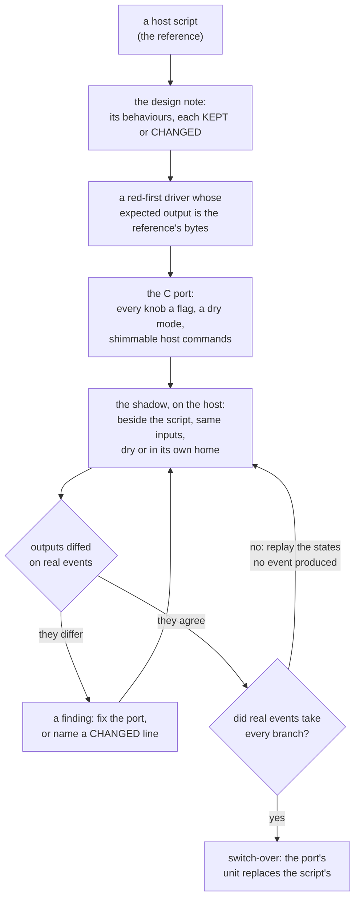

# Tazuna 10 -- Porting scripts into C

*[手綱（たづな）*Tazuna* — the harness](TAZUNA.md) · chapter 10 of 10*

## Why this exists

Every command you read in chapters 2 to 9 existed before it was C. The drives ran
on host shell scripts: one laid out a drive, one ran the lead, one looped, one
pushed on a timer, one watched the log for a READY line, one gated the batch. The
plan for the harness (`docs/plans/2026-10-21-jichi-harness.md`, section 16) says
of them: "The scripts grew over four drives."

Those scripts were *working*, and a drive depended on them around the clock. So
the operator's problem was not "write a harness". It was "replace the thing that
keeps the drive alive, without a day on which the drive is not pushed, not gated,
or gated wrongly". The same plan gives the method in one line: "Port behaviour first,
measured side by side, then improve."

Why port at all, if the scripts worked? `docs/HARNESS.md` gives the reason in its
"What it is" section. In C89 the harness can reuse what jichi already has and
already tests. Today it uses the spawn primitive and its environment scrub. The
page also names the redactor and the memory protection, but at this commit no
harness file calls either; def-383 in `docs/DEFERRED.md` records the memory
protection as owed. The harness also passes the same gate and lints. The page goes on: "a shell
script would rebuild those by hand, and quoting a credential in `sh` is where such
scripts go wrong."

This closing chapter is about the method: how a script becomes a C command, and
how you find out whether the two really do the same thing. Its main lesson came
late. It is dated 2026-11-13, the day this course was written.

## The shape



Everything above the last diamond is the method as the plan and `docs/HARNESS.md`
describe it. The last diamond, "did real events take every branch?", was added by
what happened on 2026-11-13. Most of this chapter is about why it is needed.

## One script, one batch

The port went batch by batch, and each batch took one script (or one small family
of scripts) and made it a command. Every row below is named in `docs/HARNESS.md`
or in the command's own source.

| Batch | The script it ports | The command | Chapter |
|---|---|---|---|
| H1 (M1051, M1052) | the drive's settings file, its live doctor | the config loader, `doctor` | 9 |
| H2 (M1053) | `setup-dir.sh` | `init` | 2 |
| H3b, H3c (M1055, M1056) | `mirror.sh` and its pre-push checks | `mirror fetch`, `mirror head`, `mirror push`, `credential-helper` | 3 |
| H4 (M1057, M1058) | `run-lead.sh`, `handoff.py` | `run` and its handoff | 4 |
| H5 (M1059) | `loop.sh` | `drive` | 5 |
| H7 (M1147) | `push.sh`, `push-tick.sh`, `push-backlog.sh`, `run-drive.sh`, the systemd units | `push` | 6 |
| H8 (M1152) | `gate-note.sh` | `notify` | 7 |
| H9a (M1153) | `gate-watch.sh` | `watch gate`, `watch units` | 7 |
| H9b (M1154 to M1159) | `gate-run.sh` and its stage scripts | `gate run` | 8 |

The scripts themselves are not part of the public tree. What the tree keeps is how
each port *read* its script. Open `src/harness/jc_hp_watchgate.c` and read its
first comment: it names the script it ports and lists, range by range, which of
the script's lines became which part of the tick.
`tests/smoke/harness_gate_watch.sh` names the same script in its header as the
"Ported reference (read line by line; ...)".

Each port also has a design note that lists the script's behaviours by number.
The code and `docs/HARNESS.md` cite those numbers, and they mark every behaviour
the port does differently as **CHANGED** (and, where it matters, one it keeps on
purpose as **KEPT**). `notify`'s operator hook is "(CHANGED)": the script called a
desktop notifier, the port runs a command the configuration names. Several
sections of `docs/HARNESS.md` carry a paragraph that begins "Port differences from
the reference, each named". The rule behind those lists is that a difference you
did not write down is a difference nobody will look for. Some CHANGED lines follow
from where the port runs: `run` drops the script's container half because "Mode A has no podman". One
goes the other way. `drive`'s records snapshot skips symlinks, FIFOs and devices
by name, where the script's `cp -p` and `gzip -c` followed symlinks, and
`docs/HARNESS.md` calls that "the one place the port is TIGHTER than the
reference".

## Four seams that make a port comparable

A port can only be checked against its script if both can run on the same inputs
without getting in each other's way. Four things in the code exist for that.

### 1. Every knob of the script is a flag

The script was tuned by environment variables. The port turns each one into a flag,
and the comment in `main` keeps the mapping:

```c src/harness/jc_harness_main.c:main
    /* watch's own args (M1153, H9a): the subcommand (gate|units; a bare
     * `watch` is a usage refusal naming the two) and the tick's flags.
     * --config is accepted before OR after the subcommand, like the others.
     * gate: --log <f> / --state <f> / --out <f> (the reference's GATE_LOG3 /
     * GATE_STATE / GATE_OUT knobs, named by flag) and --dry (GATE_DRY).
     * The shimmable host commands (--unit-state / --unit-list / --unit-run /
     * --pgrep) fall back to the reference's argv when absent (the
     * pageCommand idiom); the config's host block may name them too.
     * units: -o <dir> (the push units idiom; absent = print to stdout). */
```

`--state` and `--out` matter most for a shadow. The port can read the same LOG as
the script while writing its verdicts and its say lines into files of its own, so
two watchers never write into one state file.

### 2. A dry mode

A shadow must not *act*. If the port's gate watcher really started a gate unit
beside the script's, the host would run two gates on one commit. So the tick has a
`--dry` arm, and it sits exactly where the action would be:

```c src/harness/jc_hp_watchgate.c:jc_hp_watchgate_run
    if (dry) {
        n_wg = jc_snprintf(say, sizeof say,
                           "DRY: would start jhp-gate-%s (gate-run.sh %s) for "
                           "BATCH %s (%s:%d)",
                           s8, s8, ready.batch, log_base, ready.line_no);
        if (n_wg < 0 || n_wg >= (int)sizeof say) {
            return 1;
        }
        wgate_say(out, say);
        return 0;
    }
```

The dry tick says what it *would* do and stops. In a shadow, that line is the
port's half of the comparison: the script starts a gate, and the port's dry line
must name the same commit.

`push run-drive` goes one step further: in this tree it never runs anything. It
prints the container command it would build, as one shell-quoted line, and exits.
`src/harness/jc_hp_rundrive.c:jc_harness_push_rundrive_run` gives the operator's
rule as the reason: "never run what may write to learn what it does".

### 3. Shimmable host commands

The port was written and tested inside a drive container that has no systemd. The
tick needs three host commands (is a unit active, which units run, start a unit)
and `pgrep`. Each one is *shimmable*: you can replace it with a stand-in. A flag
names a replacement first, the config's `host` block second (`unitState`,
`unitList`, `unitRun`; `pgrep` has no config key, only its flag), and the
script's own command line is the default:

```c src/harness/jc_hp_watchgate.c:jc_hp_watchgate_run
        static const char DEF_PG[] = "pgrep -f tests/smoke/";
...
        ul = (unit_list != NULL && unit_list[0] != '\0')
                ? unit_list : (cfg.host_unit_list != NULL
                                   ? cfg.host_unit_list : DEF_UL);
```

`DEF_PG` and `DEF_UL` are the script's own command lines (`DEF_UL` is its
`systemctl --user list-units`, widened to both drives' unit prefixes). In the container, the driver's config points
`unitList` at a small script that prints whatever unit names the cell needs. On
the host, the config can leave it unnamed, and then the real `systemctl` runs.
`gate run`'s stages have the same seam for their heavy commands (`--build-run`,
`--ci-run`, `--redfirst-run` and others), so the driver can stand in for a full
`make ci`.

Keep this seam in mind. It is what makes the port testable without a host, and it
is also where the port's tests can stop resembling the host. Both halves of that
come back below.

### 4. A home of its own

Some outputs cannot be made dry, because the output *is* the work: a push is a
push. The `push` port therefore ran its switch-over against **its own
`pushHome`**, beside the script's. `docs/HARNESS.md` gives a second reason for
that. The port locks with POSIX `lockf` and the script with `flock(2)`, and "the
two lock kinds are invisible to each other on Linux". Sharing a home would have
meant two pushers that cannot see each other's lock.

## How script and port are compared

There are two places a comparison happens, and they catch different things.

**In the tree: drivers whose expected output is the script's.** Every port has a
red-first smoke driver (`tests/smoke/harness_notify.sh`,
`tests/smoke/harness_gate_watch.sh`, `tests/smoke/harness_gate_run.sh` and the
rest). Most of their headers carry a section called "THE RED THIS IS HELD BY",
which says why the driver fails on the tree before the port. Their expected strings
are the reference's bytes: the gate watcher's say lines are checked "byte-exact",
and `docs/HARNESS.md` calls `notify`'s note "byte-identical to the reference".
Where the script had a history of mistakes, the driver names them as cells.
`docs/HARNESS.md` says the gate watcher's driver holds "the four false verdicts of
the plan's section 3". Three of its cells are named by the time each happened:
07:55, 11:32 and 13:32. Its header lists 13:47, the settled rule, beside them. These drivers
run only the port. No driver runs a script, so what is compared is the port's
output against bytes that were copied from the script.

**On the host: the shadow.** Before a unit switches over, the port runs beside the
script on real events, both outputs are kept, and the decisions are diffed.
`docs/HARNESS.md` says it for `watch` ("a day of ticks diffed on the same LOG") and
for `notify` ("same inputs, both outputs kept, the decisions diffed"). def-370 in
`docs/DEFERRED.md` gives the rule while the push switch-over was in flight: "the
script is authoritative until a day of ticks agrees".

The shadow works, and the record shows it working. In M1155 the push port ran
beside `push.sh`, and 24 ticks were compared. The two agreed on every *team* push.
They differed on every *records* push, and always by exactly the number of
interior trees in the pushed range. The script said 5 file versions were checked
where the port said 8, and 4 where it said 7. The port had counted every blob and
tree id the range named, and printed that count as "file version(s)
checked". It only *read* the blobs, so the number in its durable log was false. The
fix counts the blobs actually read, and cell 7 of
`tests/smoke/harness_push_records.sh` holds it red-first. No push had done
anything wrong; only a sentence in a log was untrue, and the diff found it.

## Agreement covers only the branches real events took

On 2026-11-13 the gate watcher's port had been running as a dry shadow beside its
script for days, and the two had agreed. Then a replay fed both of them a state
that no real tick had produced: a READY line marked for a re-gate while a gate
unit was already running. The script waited ("a gate runs"). The port said it
would start a second gate.

[Chapter 7](tazuna-07-notify-and-watch.md) tells the defect itself, and its fix
in M1178. In short: `systemctl`'s unit list indents its lines, and the port took
the unit name from the line's very first byte. (Measured where this chapter was written, with systemd
255: each unit line of `systemctl --user list-units` begins with two spaces, and a
unit in the `failed` state gets a `●` in that column instead.)

```c src/harness/jc_hp_watchgate.c:jc_hp_watchgate_run
                char unit[WGATE_PATH_CAP];
                size_t tl = 0;
...
                while (*p == ' ' || *p == '\t') {
                    p++;
                }
...
                while (*p != '\0' && *p != ' ' && *p != '\t' &&
                       *p != '\n' && tl < sizeof unit - 1) {
                    unit[tl++] = *p;
                    p++;
                }
```

Before M1178 only the last loop was there. On an indented line it stopped at
once and copied nothing, so the "unit" was an empty string and nothing was ever
busy. The script took the first *field* with `awk '{print $1}'`, and awk's
default field splitting skips leading blanks. Since M1178 the first loop skips
the blanks (the elided lines also skip a `●`), and then the last loop reads the
unit.

Why could days of agreement not see this? Read the tick's order in
`jc_hp_watchgate_run`. The state-word arms come before the busy filter. A commit
whose gate the watcher started itself has the state word `started`. While its unit
is active, the tick returns *without saying anything*, before the busy filter ever
runs. So the busy filter decides something only when a READY with no verdict yet
waits while some *other* gate or ci unit runs, or when a commit is re-gated. Since
the two agreed, no real tick in those days can have reached the filter with a gate
running: one that did would have given two different outputs, and the diff would
have shown it. The port and the script agreed on every branch the events took, and
that agreement said nothing about the branch they did not take.

Why was the driver green? Cell 15 of `tests/smoke/harness_gate_watch.sh` tests the
busy filter thoroughly: the watcher's own unit must not count, a `ci` unit must,
and so must the other drive's prefix. But until M1178 its stand-in for
`systemctl` printed the unit names *flush left*. The stand-in behaved like the
description of the output, not like the output. It prints the real shape now. `docs/TESTING_RUNBOOK.md` (section 3c) has the rule for this,
learned from a different crash: "A mock answers the questions you thought to ask;
the peer decides which code runs."

What follows from it, as practice:

1. **List the branches, not the events.** The script's `if`s are a finite list.
   For each one, ask whether a real event in the shadow period took it. The ones
   nobody can name are the ones to replay.
2. **Replay the states real events did not make.** A dry port is cheap to run on a
   made-up state: a LOG with a READY line, a state word, a unit list, a config. The
   "Try it" below does exactly that.
3. **Measure the peer before you imitate it.** Run the real command once and look
   at its bytes (GNU `cat -A` or `od -c` shows leading spaces) before writing the
   stand-in that will imitate it.

## Try it

Chapter 7's "Try it" (its step 3) already replays the busy filter: the same tick
fed a flush-left and an indented unit list. Before M1178 the two got different
decisions; now they get the same one. If you skipped it, do it now; it is this
chapter's lesson in two commands. Here you replay
the other kind of branch the lesson names: an *input* no test used. The input is
the shape of the `host` block, and the expected decision is the same each time.

Build a two-commit repository, a bare `push.git` with the remote-tracking refs the
tick reads, a LOG with one READY line, and one stand-in for `systemctl`'s unit
list that reports a gate already running, in the real command's shape (two
leading blanks, then the unit and its columns):

```sh
# in the jichi checkout, then a throwaway directory
make jichi-harness
H=$PWD/jichi-harness
cd "$(mktemp -d)"
export GIT_CONFIG_GLOBAL=/dev/null GIT_CONFIG_SYSTEM=/dev/null
export GIT_AUTHOR_NAME=demo GIT_AUTHOR_EMAIL=demo@example.com
export GIT_COMMITTER_NAME=demo GIT_COMMITTER_EMAIL=demo@example.com
export GIT_AUTHOR_DATE=2026-11-13T12:00:00Z GIT_COMMITTER_DATE=2026-11-13T12:00:00Z
git init -q -b main work
git -C work commit -q --allow-empty -m "master's tip"
git -C work commit -q --allow-empty -m "the batch"
git clone -q --bare work push.git
git -C push.git update-ref refs/remotes/origin/master main~1
git -C push.git update-ref refs/remotes/origin/drive/demo/main main
c=$(git -C push.git rev-parse main)
printf 'BATCH 1 READY at %s\n' "$c" > LOG.md
printf '#!/bin/sh\necho "  jhp-gate-%.8s.service loaded active running gate"\n' "$c" > busy.sh
chmod +x busy.sh
```

The `export` lines fix the commits' author, committer and dates, so your commit ids
are the ones printed below, and they keep your own git configuration out of the
fixture. They last until you close this shell, so use a terminal you can throw
away.

Now tick three times, dry, with three shapes of `host` block that all name the
same `push.git`. The first names it directly. The second names only `pushHome`;
the comment in `include/jc_harness_config.h` gives the default,
`absent = <host.pushHome>/push.git`. The third adds a `gateHome`:

```sh
# in the same throwaway directory
for host in '"pushRepo": "push.git"' '"pushHome": "."' '"pushHome": ".", "gateHome": "drive/gate"'; do
  printf '{"dir": "drive", "drive": {"branchPrefix": "drive/demo"}, "host": {%s, "gateRun": "/bin/true"}}\n' "$host" > cfg.json
  "$H" --config cfg.json watch gate --log LOG.md --dry --unit-list ./busy.sh --pgrep true < /dev/null
done
```

```text
BATCH 1 READY at e919b45e: waiting, a gate runs (jhp-gate-e919b45e.service )
BATCH 1 READY at e919b45e (LOG.md:1): not on the remote's team branch yet; waiting for the push timer
BATCH 1 READY at e919b45e: waiting, a gate runs (jhp-gate-e919b45e.service )
```

The repository, the commit and the running gate are the same in all three ticks.
The first and the third wait for the gate, as the script would. The space before
`)` is the script's too: it joins the unit names with `tr '\n' ' '`, and since
M1178 the port prints the same bytes. The second never
gets that far: it waits for a push that has already happened. Only the shape of
the configuration differs, and the last section explains why.

Every flag in the tick is one of the four seams. `--log` is a script knob turned
into a flag, and `--dry` is the dry arm. `--unit-list` replaces `systemctl`, and
`--pgrep true` replaces the team-smoke check with a command that finds nothing, so
your machine's own processes cannot change the result.

## What went wrong here, and what it teaches

**From the record: the arm a dry shadow never runs (def-381).** A dry tick returns
before the start, so the start's own command line never runs in a shadow. Neither
does it run in the driver, whose `unitRun` is a stand-in that records whatever
arguments it receives; two of the driver's cells even require the port's shape. A
design review then found that shape wrong for `systemd-run`. The port adds the unit
name, the description and the command as plain arguments, where the script passed
the name as an option and the description as a property, both before the command.
The command, which should be several words, also goes in as one argument. Measured
against the real `systemd-run`, the port's shape fails with "Failed to find
executable" and creates no unit. def-381 in `docs/DEFERRED.md` records this
and says it plainly: "a stand-in cannot show this defect". The operator's rule is
that the gate watcher does not switch over while def-381 is open. **The lesson: a
shadow compares only what both sides do. The action you made dry so that it could
not do harm is the one place the comparison is blind, so check it once against the
real program, with a harmless command.**

**Found while writing this chapter (2026-11-13): a default no config used.** The
second tick in "Try it" never gets past "waiting for the push timer" because the
two defaults it relies on are written into the same buffer:

```c src/harness/jc_hp_watchgate.c:jc_hp_watchgate_run
    } else if (cfg.host_push_home != NULL &&
               cfg.host_push_home[0] != '\0' &&
               (size_t)jc_snprintf(repo, sizeof repo, "%s/push.git",
                                   cfg.host_push_home) < sizeof repo) {
        push_repo = repo;
...
    } else if ((size_t)jc_snprintf(repo, sizeof repo, "%s/gate", cfg.dir)
                   < sizeof repo) {
        gate_home = repo;
```

When the config names neither `pushRepo` nor `gateHome`, both documented defaults
apply. The second `jc_snprintf` then overwrites the first, and `push_repo` points
at the text `<dir>/gate`. Every tick looks for the READY commit in a directory that
is not a repository, and it reports "not on the remote's team branch yet; waiting
for the push timer", which is a polite and permanent wait. Measured here, the same
fixture works as soon as either `pushRepo` or `gateHome` is named. The watcher's
driver never meets the case, because every config it writes names `gateHome`. At
this commit no register row names this defect.

**The lesson, for the whole method.** Each of these stories has the same shape as
the 2026-11-13 replay. The port agreed with everything that was compared: a
driver's expected bytes, a day of real ticks. It was wrong only where nothing
compared it: an indented line no stand-in printed, a start no shadow made, a
default no config used. **Agreement is evidence about the branches it covered.**
Before you call a port done, write down the branches, and for each one, name the
input that took it.

## Where to go next

This is the last Tazuna chapter. From here:

- **The reference.** `docs/HARNESS.md` is what this course was a reading companion
  for. It changes when a command changes, so read it again when the harness gains a
  command. Its "Read further" section leads to the plan
  (`docs/plans/2026-10-21-jichi-harness.md`): the threat model, the modes, and the
  phases still to come (the other watchers, landing, Modes B to D).
- **The other courses.** [Annai](ANNAI.md) follows one request through jichi
  itself. [Fukabori](FUKABORI.md) argues one design decision per chapter; its
  chapter 10, [the test architecture as a
  system](fukabori-10-the-test-architecture-as-a-system.md), is the theory behind
  this chapter's practice. [Tsuiseki](TSUISEKI.md) traces recorded runs byte for
  byte. [Kiroku](KIROKU.md) teaches you to read the project's records: the
  roadmap, the deferral register, the anecdotes, where most of this course's
  stories are kept.
- **The exercises.** Do each chapter's "Try it" again on a newer tree, and diff
  your output against the page. Where they differ, either the code changed or the
  page is wrong, and either way you have found something. Then two graded
  assignments sharpen this chapter's lesson.
  [Grade the grader](../assignments/09-grade-the-grader.md) asks you to think in
  input classes, not cases. [The hollow gate](../assignments/14-the-hollow-gate.md)
  asks what a green was ever evidence of. [CURRICULUM.md](../CURRICULUM.md) maps
  the rest.
- **The runbook.** `docs/TESTING_RUNBOOK.md` is the numbered list of steps for
  adding a test, each with the incident that produced it. Sections 3c ("make the fixture behave like
  the real peer") and 4 ("enumerate the universe a second way") are this chapter's
  lesson in the project's own words.

## Check yourself

1. Why does the gate watcher's port turn the script's environment knobs into flags
   like `--state` and `--out`, rather than reading the same variables?
2. A shadow tick and the script agreed on every tick for a week. Name one kind of
   defect that agreement cannot rule out, and say how you would look for it.
3. Why did the busy filter's defect not show up in normal operation, even with a
   gate running? (Hint: what does the tick do with a commit whose state word is
   `started`?)
4. Cell 15 of `tests/smoke/harness_gate_watch.sh` was green. What would have made
   it red on the defective port, and what would you have had to do first?
5. In M1155 the port and the script pushed exactly the same data. What did the
   comparison find, and why was it worth fixing?

<details>
<summary>Answers</summary>

1. So that a shadow can read the same LOG while writing its own state and say lines
   into separate files. Two watchers writing one state file would change each
   other's decisions. Flags also put every input the command reads on its command
   line, where a test or a replay can set it.
2. A defect in a branch no real event took. Here that was a READY waiting while a
   gate runs. A dry arm that never acts is another, and so is a default that no
   config uses. List the script's branches, name the event that took each one, and
   replay the rest on made-up states with the dry port.
3. The state-word arms run before the busy filter. A commit whose gate the watcher
   started has the word `started`, and while its unit is active the tick returns
   without a word. The filter only decides anything when a READY with no verdict
   waits while some other gate or ci unit runs, or on a re-gate. Since the shadow
   and the script agreed, no real tick in that period met the case.
4. A stand-in that prints the unit list the way `systemctl` really does, with two
   leading spaces. First you would have to run the real command once and look at
   its bytes (`cat -A` or `od -c`), because a stand-in can only imitate what its
   author has actually seen.
5. The port printed the number of object ids in the range (blobs and trees) as the
   number of "file version(s) checked", which was more than it read. A count in a
   durable log is evidence someone will rely on later, so a false one is a defect
   even when the push itself is right. The fix counts the blobs read, so the log
   now says what the script says.

</details>
